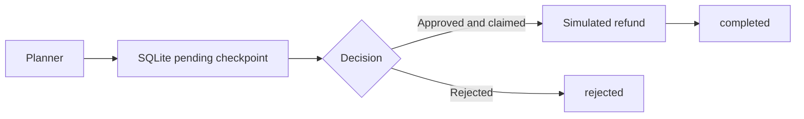

## Why make agent state explicit?

A loop can implement a reliable agent when it records the current node, arguments, recovery position, and stopping rules. A state graph makes those controls inspectable. See [agent loops and state machines](/en/articles/agent-loop-state-machine/) for the foundations.

The downloadable [Python example](/examples/agents/state_graph.py) requires Python 3.11+ and SQLite 3.35+, with no third-party dependencies. Refunds are simulated in an in-memory list; no payment service is contacted.

## Approval checkpoints and recovery positions

A checkpoint stores the next node, business state, consumed steps, and status. Saving only a dictionary and restarting from the Planner can overwrite approved parameters and rerun earlier work.

This example persists checkpoints in SQLite. Approval resumes the suspended node, rejection terminates the run, and a conditional database update permits only one consumer of an approval. An approval applies to one boundary; later sensitive nodes still interrupt. Node identifiers and implementations must remain compatible when rebuilding a workflow.



## Complete runnable example

Run `python3 state_graph.py`. The demo closes storage and rebuilds the graph against the same database to demonstrate recovery after a worker restart.


```python
"""Small SQLite-backed approval workflow; no external side effects in the demo."""
import asyncio
import copy
import inspect
import json
import sqlite3
import tempfile
import uuid
from dataclasses import dataclass
from pathlib import Path


class AgentState(dict):
    def apply_delta(self, delta):
        for key, value in delta.items():
            if key == "messages":
                self[key] = self.get(key, []) + copy.deepcopy(value)
            else:
                self[key] = copy.deepcopy(value)


@dataclass
class AgentEvent:
    event_type: str
    node_name: str
    payload: dict
    run_id: str


class SqliteCheckpointer:
    def __init__(self, path):
        self.db = sqlite3.connect(path, isolation_level=None)
        self.db.execute("""CREATE TABLE IF NOT EXISTS runs (
            run_id TEXT PRIMARY KEY, node TEXT, state TEXT,
            steps INTEGER, status TEXT NOT NULL)""")

    def create(self, run_id, node, state):
        self.db.execute("INSERT INTO runs VALUES (?, ?, ?, 0, 'running')",
                        (run_id, node, json.dumps(state)))

    def save(self, run_id, node, state, steps, status):
        self.db.execute("""UPDATE runs SET node=?, state=?, steps=?, status=?
                           WHERE run_id=?""",
                        (node, json.dumps(state), steps, status, run_id))

    def claim_approval(self, run_id, decision):
        if decision not in {"approved", "rejected"}:
            raise ValueError("decision must be approved or rejected")
        status = "running" if decision == "approved" else "rejected"
        row = self.db.execute("""UPDATE runs SET status=?
            WHERE run_id=? AND status='pending'
            RETURNING node, state, steps""", (status, run_id)).fetchone()
        if row is None:
            raise ValueError("approval missing, already consumed, or not pending")
        return row[0], AgentState(json.loads(row[1])), row[2]

    def close(self):
        self.db.close()


class StateGraph:
    def __init__(self, checkpointer, max_steps=20):
        self.checkpointer = checkpointer
        self.max_steps = max_steps
        self.nodes = {}
        self.edges = {}
        self.conditional_edges = {}
        self.interrupt_nodes = set()
        self.entry_point = None

    def add_node(self, name, function):
        self.nodes[name] = function

    def set_entry_point(self, name):
        self.entry_point = name

    def add_edge(self, source, target):
        self.edges[source] = target

    def add_conditional_edge(self, source, router):
        self.conditional_edges[source] = router

    def add_interrupt_before(self, node):
        self.interrupt_nodes.add(node)

    async def stream(self, state, run_id=None):
        run_id = run_id or str(uuid.uuid4())
        state = AgentState(copy.deepcopy(state))
        self.checkpointer.create(run_id, self.entry_point, state)
        async for event in self._drive(state, run_id, self.entry_point, 0):
            yield event

    async def resume(self, run_id, decision):
        node, state, steps = self.checkpointer.claim_approval(run_id, decision)
        if decision == "rejected":
            yield AgentEvent("rejected", node, {}, run_id)
            return
        # Skip only this approved boundary, never all future approvals.
        async for event in self._drive(state, run_id, node, steps, node):
            yield event

    async def _drive(self, state, run_id, node, steps, approved_node=None):
        try:
            while node and node != "END":
                if steps >= self.max_steps:
                    raise RuntimeError("step budget exhausted")
                if node in self.interrupt_nodes and node != approved_node:
                    self.checkpointer.save(run_id, node, state, steps, "pending")
                    yield AgentEvent("interrupted", node, {"state": copy.deepcopy(state)}, run_id)
                    return
                approved_node = None
                yield AgentEvent("node_start", node, {}, run_id)
                delta = self.nodes[node](AgentState(copy.deepcopy(state)))
                if inspect.isawaitable(delta):
                    delta = await delta
                if delta:
                    state.apply_delta(delta)
                previous_node = node
                router = self.conditional_edges.get(node)
                node = router(state) if router else self.edges.get(node, "END")
                steps += 1
                self.checkpointer.save(run_id, node, state, steps, "running")
                yield AgentEvent("state_update", previous_node, {"delta": delta}, run_id)
            self.checkpointer.save(run_id, "END", state, steps, "completed")
            yield AgentEvent("completed", "END", {"final_state": copy.deepcopy(state)}, run_id)
        except (Exception, asyncio.CancelledError):
            self.checkpointer.save(run_id, node, state, steps, "failed")
            raise


def build_workflow(checkpointer, refund_log):
    graph = StateGraph(checkpointer)
    graph.add_node("planner", lambda state: {"action": "refund", "amount": 1000})
    graph.add_node("human_approval", lambda state: {"approval_recorded": True})

    def refund(state):
        # Simulation only. A real payment API needs a stable business idempotency key.
        refund_log.append(state["amount"])
        return {"status": "success", "messages": [{"role": "tool", "content": "Simulated refund"}]}

    graph.add_node("refund", refund)
    graph.set_entry_point("planner")
    graph.add_conditional_edge("planner", lambda state: "human_approval" if state["amount"] > 500 else "refund")
    graph.add_edge("human_approval", "refund")
    graph.add_edge("refund", "END")
    graph.add_interrupt_before("human_approval")
    return graph


async def main():
    with tempfile.TemporaryDirectory() as directory:
        path = str(Path(directory) / "checkpoints.sqlite3")
        refunds = []
        store = SqliteCheckpointer(path)
        workflow = build_workflow(store, refunds)
        events = [event async for event in workflow.stream(AgentState(messages=[]))]
        run_id = events[-1].run_id
        store.close()
        # Reopen storage and rebuild the graph to simulate a worker restart.
        store = SqliteCheckpointer(path)
        workflow = build_workflow(store, refunds)
        async for event in workflow.resume(run_id, "approved"):
            print(event.event_type, event.node_name)
        store.close()
        print("Simulated refunds:", refunds)


if __name__ == "__main__":
    asyncio.run(main())
```

## Guarantees and production extensions

The example persists approval state and prevents duplicate approval consumption. It does not make external payments execute exactly once. A crash after a payment succeeds but before a checkpoint is saved still requires a stable business idempotency key or transactional outbox. See [agent orchestration and evaluations](/en/articles/agent-orchestration-evals/).

The synchronous SQLite transactions suit a local example. Production systems also need authenticated approvers, parameter-bound decisions, snapshot migrations, audit records, leases, and cancellation propagation. LangGraph also supports durable checkpoints and self-hosted observability; a custom runtime is not inherently safer.

## Frequently Asked Questions (FAQ)

### Q1: Does rejecting approval execute the tool?
No. `resume(run_id, "rejected")` consumes the pending record and emits a rejected event. Invalid decisions raise an error rather than implicitly approving.

### Q2: Can duplicate approval callbacks repeat the refund?
The pending record can be claimed once. Duplicate callbacks are rejected. A real payment API still needs idempotency across retries.

### Q3: Does a checkpoint undo external side effects?
No. Control-flow persistence and external transactions are separate concerns. See [advanced tool execution](/en/articles/advanced-agent-tool-use-and-function-calling/) for execution and recovery boundaries.

References: [LangGraph persistence](https://docs.langchain.com/oss/python/langgraph/persistence), [Temporal activity idempotency](https://docs.temporal.io/activity-definition).
