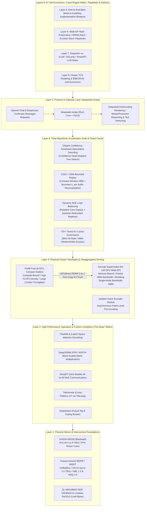
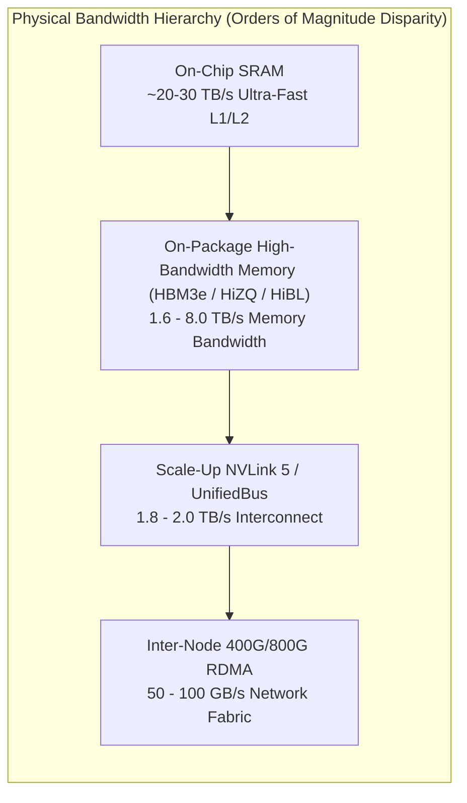
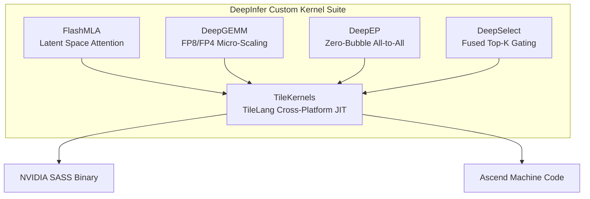
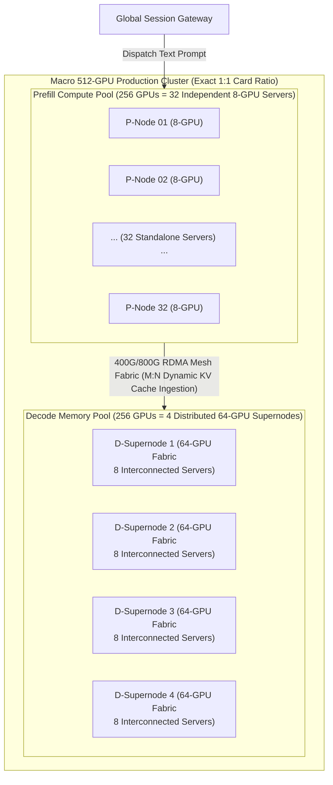
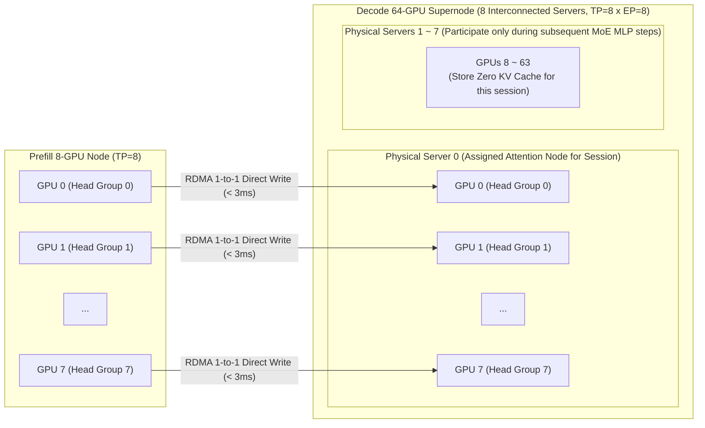
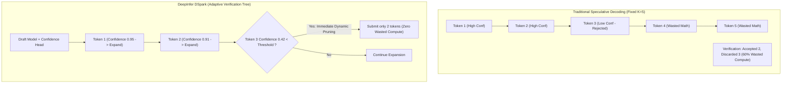
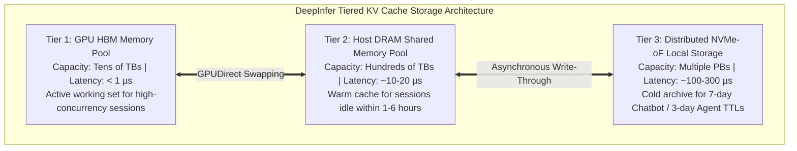
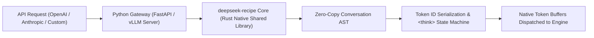
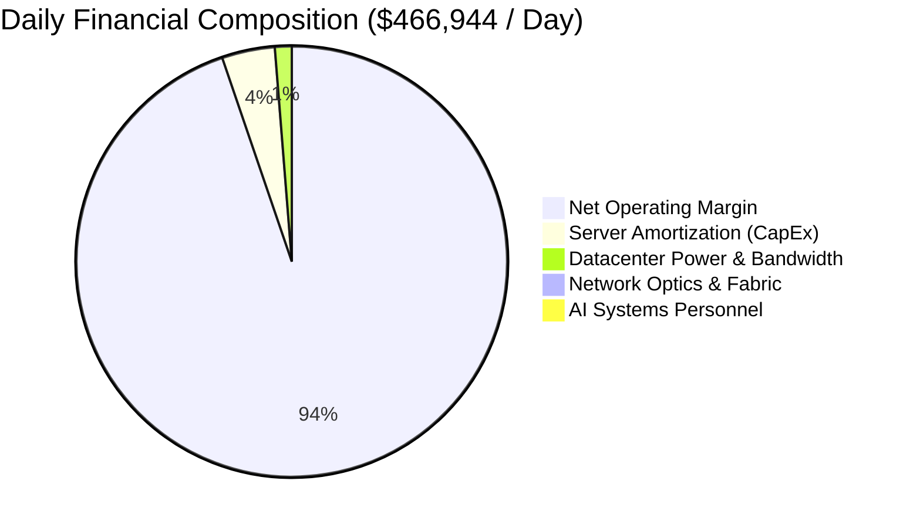
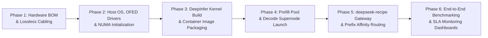

> [!NOTE] Executive Summary (TL;DR)
> - **Silicon & Kernel Foundations**: DeepInfer is co-optimized for NVIDIA SM100 (Blackwell with NVLink 5) and Huawei Ascend 950 series NPUs (Ascend 950PR & 950DT with UnifiedBus / HCCS up to 2.0 TB/s), leveraging custom kernels—FlashMLA (latent attention decoding), DeepGEMM (FP8/FP4 block-scaled GEMM), DeepEP (zero-bubble All-to-All communication), and TileKernels (TileLang domain-specific JIT compilation)—to eliminate hardware abstraction overhead.
> - **Cluster Topology & PD Disaggregation**: Breaking past single-node time-sharing limitations, the system decouples 8-GPU compact Prefill nodes (compute-bound, high FLOPs density) from 64–128 GPU Wide-EP Decode supernodes (memory-bound, high aggregate HBM bandwidth). By Little's Law throughput balance, the macro P/D card ratio scales dynamically with effective input-to-output length ratios—converging to 1:1 under high-concurrency 77K prompts at a 96% cache hit rate, or 1:2 in starter validation clusters—supplemented by an isolated asynchronous Vision Encoder pipeline.
> - **Triad Algorithmic Acceleration Suite**: Built for **DeepSeek-V4.1-Flash (552B total-parameter asymmetric MoE, 40-layer Causal Encoder-Decoder activating 8B in Prefill and 16B in Decode)**, DeepInfer introduces **DSpark Confidence-Scheduled Speculative Decoding** (Confidence Head predicting adaptive verification trees, unlocking 4%–7% net throughput), **CSA2 + SWA Bounded Replay** (maintaining constant sliding-window KV memory in HBM, omitting local SWA KV from persistent storage, and bounding worst-case cache-miss recomputation to a fixed suffix window $n_{\text{win}}$), and **dynamic MoE load balancing** (resident core experts + on-demand redundant replicas to eliminate cross-node stragglers).
> - **Protocol Revolution & Unit Economics**: Checkpoints officially discard traditional Jinja templates in favor of the Rust-native `deepseek-recipe` engine for protocol translation across OpenAI/Anthropic schemas, `<think>` isolation, and tool-call parsing. The production report reveals single-cluster daily throughput of **155 Trillion Tokens**, average prompt lengths of 77K, a **96% KV Cache hit rate**, and **$38/GPU/hour (~254 RMB/GPU/h)** in off-peak revenue.
> - **Deep-Dive Cross References**: Inter-node RDMA transport is detailed in [P/D Disaggregation & Distributed KV Cache](/en/articles/pd-disaggregation-distributed-kv-cache/); speculative decoding theory is explored in [EAGLE Speculative Decoding](/en/articles/speculative-decoding-eagle-guide/); underlying attention mechanics are derived in [MLA Matrix Absorption](/en/articles/mha-gqa-mla-matrix-absorption-inference-engine/) and [MoE Expert Parallelism](/en/articles/moe-expert-parallelism-inference-engine/); high-performance networking is covered in [InfiniBand Production Tuning](/en/articles/infiniband-production-deployment-opensm-ofed-nccl-tuning/).

---

## Introduction: Revealing the Economics of Production Inference

In modern AI research, open source often stops at releasing weights and publishing papers. The underlying engineering that enables frontier labs to sustainably serve hundreds of millions of requests under viable unit economics has remained a guarded trade secret.

In October 2026, DeepSeek published its landmark technical report, *Production Deployment Practices of DeepSeek V4.1 Flash at Scale*, accompanied by the open-source release of its core production stack: the high-performance inference framework **[DeepInfer](https://github.com/deepseek-ai/DeepInfer)** and the protocol adaptation layer **[deepseek-recipe](https://github.com/deepseek-ai/deepseek-recipe)**.

The disclosures revealed staggering production numbers:
* **Single-Cluster Daily Throughput**: Operating at **155 Trillion Tokens/day**;
* **Monetization & Efficiency**: Generating **$38 per GPU per hour** in revenue even at off-peak rates;
* **Extreme Long-Context Resilience**: Processing average prompts of **77K Tokens** while sustaining a **96% KV Cache hit rate**, maintaining Time to First Token (TTFT) at **~400ms**, and clocking generation speeds between **230 and 300 tokens/s**.

These achievements stem from a ground-up reconstruction of the entire inference stack—spanning semiconductor microarchitectures, collective communication fabrics, specialized operator compilers, disaggregated prefill-decode clustering, and unified protocol parsing. This guide provides an exhaustive engineering dissection across all layers.

---

## Architectural Blueprint: The Nine-Layer DeepSeek Vertical Stack

Before exploring micro-level mechanics, review the macro-level **nine-layer vertical stack** spanning DeepInfer and `deepseek-recipe` (aligned 1-to-1 with Layers 1 through 9 below):



---

## Layer 1: Physical Silicon and Interconnect Foundations

Inference efficiency is bound by semiconductor physics. DeepInfer's design philosophy rejects generic hardware abstractions in favor of direct alignment with accelerator microarchitectures.

### 1. Dual-Track Silicon: NVIDIA Blackwell SM100 vs. Huawei Ascend 950 (950PR / 950DT)

DeepSeek's production deployments embrace both NVIDIA and Huawei compute platforms, where the Ascend 950 family splits natively into **Ascend 950PR** (for Prefill) and **Ascend 950DT** (for Decode and Training):

| Hardware Dimension | NVIDIA Blackwell (SM100) | Huawei Ascend 950 Series (950PR / 950DT) |
| :--- | :--- | :--- |
| **Process & Packaging** | TSMC 4NP Dual-Die CoWoS-L | Multi-Chiplet Advanced System-in-Package (SiP) |
| **Die-to-Die Interconnect** | 10 TB/s NV-HBI Fabric | Ultra-Wide On-Package Chiplet Bus |
| **Scale-Up Interconnect** | NVLink 5 (1.8 TB/s Bidirectional per GPU) | UnifiedBus (UB) / HCCS (up to 2.0 TB/s Interconnect) |
| **Memory Subsystem** | 192GB–288GB HBM3e (8.0 TB/s Bandwidth) | **950PR**: 128GB HiBL 1.0 (~1.6 TB/s, Prefill-optimized)<br/>**950DT**: 144GB HiZQ 2.0 (~4.0 TB/s, Decode/Training-optimized) |
| **Compute Engines** | 5th-Gen Tensor Cores (Native FP4 / FP8) | DaVinci Architecture (Cube Matrix + Vector Units) |
| **Driver & Toolchain** | CUDA 13.x / PTX / TileLang JIT | CANN 8.x / Ascend C / TileLang JIT |



### 2. Physical Interconnect Gaps and Distributed Parallelism Laws

The bandwidth disparity between on-package HBM (8.0 TB/s) and inter-node networks (50–100 GB/s) represents an 80x–100x performance drop. This physical reality establishes two core distributed rules:
1. **Tensor Parallelism (TP) Must Remain Intra-Node**: TP requires two high-frequency `All-Reduce` collective operations per transformer layer for every single token. Extending TP across physical nodes stalls Tensor Cores in network wait states over 95% of the time.
2. **Expert Parallelism (EP) Requires Non-Blocking Fabrics**: While MoE `All-to-All` collective communication exchanges lower per-token data volume than TP, it is hypersensitive to network tail latency and buffer jitter. Inter-node topologies mandate 8x 400G/800G InfiniBand (NDR) or rail-optimized lossless RoCEv2 fabrics (see [InfiniBand Production Tuning](/en/articles/infiniband-production-deployment-opensm-ofed-nccl-tuning/)).

---

## Layer 2: High-Performance Operators and Custom Compilers (The Deep* Matrix)

Generic inference runtimes decompose complex models into generic CUDA kernels, causing excessive global memory round-trips. DeepInfer addresses this through a dedicated matrix of custom kernels:



### 1. FlashMLA: Dedicated Latent Space Attention Kernel

As analyzed in [MLA Matrix Absorption](/en/articles/mha-gqa-mla-matrix-absorption-inference-engine/), Multi-Head Latent Attention compresses keys and values into a low-rank latent representation $c_t^{KV}$, reducing per-token KV Cache footprint to less than one-sixth of traditional MHA.

FlashAttention-2/3 assumes standard multi-head formats and cannot absorb low-rank projection matrices in-flight. **FlashMLA** provides:
- **On-Chip Matrix Absorption**: Executes the multiplication of query projections with KV decompression weights $W_U^{KV}$ directly inside GPU shared memory (SRAM), eliminating the need to materialize uncompressed key-value matrices in HBM.
- **TMA Hardware Alignment**: Aligns tile sizes with NVIDIA Blackwell's Tensor Memory Accelerator (TMA) for asynchronous, register-bypassing data movement.

### 2. DeepGEMM: Fine-Grained Block-Scaled Matrix Multiplication

Large sparse MoE checkpoints (such as 552B DeepSeek-V4.1-Flash and trillion-parameter flagships) require low-precision quantization. However, coarse per-tensor quantization destroys numerical precision in reasoning tasks.
- **Block-Level Scaling**: DeepGEMM applies fine-grained 1x128 or 128x128 block quantization, maintaining independent FP8 E8M0 scale factors per block.
- **Micro-Architecture Specialization**:
  On Blackwell, DeepGEMM compiles directly to native **MXFP4 (Microscaling FP4)** and FP8 Tensor Core assembly.
  On Ascend 950, it maps to DaVinci 3D Cube mixed-precision execution pipelines without precision conversion penalties.

### 3. DeepEP: Zero-Bubble Communication-Computation Overlap

In distributed MoE execution, tokens must be dispatched to experts on disparate nodes via `all_to_all_v` collectives.
- **Micro-Batch Pipelining**: DeepEP chunks incoming batches into micro-batches. While micro-batch $n$ executes expert forward passes on GPU Tensor Cores, micro-batch $n+1$ asynchronously exchanges tokens across the RDMA fabric, achieving near-perfect communication hiding.
- **Hierarchical Transport**: DeepEP routes intra-node token transfers across NVLink while routing inter-node traffic directly over GPUDirect RDMA.

### 4. TileKernels and TileLang: Bridging NVIDIA and Domestic Silicon

To avoid maintaining separate CUDA and Ascend C codebases, DeepInfer integrates **TileLang**:
- Engineers define compute and memory movement patterns using Pythonic Tile-level abstractions.
- The TileLang compiler handles register allocation, shared memory bank conflict resolution, and instruction scheduling, emitting native SASS binaries for NVIDIA SM100 and optimized machine code for Huawei Ascend 950.

---

## Layer 3: Physical Cluster Topologies & Disaggregated Serving (Disambiguating Macro 1:1 vs. Micro 8 and 64)

Co-locating compute-bound prefill operations with memory-bound decode operations on the same GPU creates severe resource interference. DeepSeek's production deployments address this via physical Prefill-Decode (PD) Disaggregation.

However, the juxtaposition of **"Prefill and Decode maintain an exact 1:1 GPU card count ratio"** alongside **"Prefill runs on 8-GPU nodes while Decode runs on 64–128 GPU supernodes"** frequently puzzles systems engineers: *How can 8 and 64 equate to a 1:1 ratio? How does an 8-GPU node stream its KV Cache to a 64-GPU supernode without incurring catastrophic network broadcast storms?*

This section resolves the paradox across four technical dimensions: macro-cluster capacity, micro-serving topologies, queueing theory proofs, and tensor resharding mechanics.

---

### 1. Conceptual Disambiguation: Macro Cluster Allocation vs. Micro-Pod Granularity

The confusion stems from conflating **macro-cluster capacity allocation** with **micro-serving execution boundaries**:

| Architectural Dimension | Prefill Pool (Prompt Ingestion) | Decode Pool (Token Generation) | Architectural Relationship |
| :--- | :--- | :--- | :--- |
| **Micro-Serving Unit (Pod)** | **Single 8-GPU Server (P-Node)** | **64–128 GPU Distributed Supernode (D-Supernode)** | **Micro granularity disparity**: 8-card standalone node vs 8–16 physical nodes grouped into a supernode |
| **Parallel Sharding** | **Intra-node Tensor Parallelism (TP=8)** | **Intra-node TP=8 + Inter-node Wide-EP=8/16** | NVLink saturates attention locally; RDMA routes MoE expert tokens across nodes |
| **Execution Bottleneck** | Compute-Bound (High FLOPs Density) | Memory-Bound (HBM Bandwidth Constrained) | 8 GPUs saturate Tensor Cores; Decode requires 64 GPUs to aggregate HBM bandwidth |
| **Macro Cluster Scale (512-GPU Example)** | **256 GPUs (32 Independent 8-GPU Nodes)** | **256 GPUs (4 Independent 64-GPU Supernodes)** | **Macro total card ratio is exactly 1 : 1** ($32 \times 8 = 4 \times 64 = 256$) |



**Key Takeaway**: The architecture does not pair one 8-GPU node with one 64-GPU node. Instead, **32 independent 8-GPU Prefill nodes serve prompts in parallel, streaming completed KV Caches across an M:N RDMA fabric into 4 distributed 64-GPU Decode supernodes**. The aggregate GPU count ($32 \times 8 = 256$ vs. $4 \times 64 = 256$) yields a symmetrical 1:1 capacity ratio.

---

### 2. Little's Law & Throughput Equilibrium: How `N_P : N_D` Scales with `L_eff : L_out`

A deeper systems question emerges: *Prefill requires tens of milliseconds, whereas autoregressive Decode takes multiple seconds. Why do some clusters deploy a 1:8 ratio, Layer 9's 96-GPU validation unit use 1:2 (32P:64D), and DeepSeek's full-scale production report converge to 1:1?*

The answer follows directly from **Little's Law steady-state throughput balance ($\lambda = \mu_{P\_pool} = \mu_{D\_pool}$)** across per-GPU request service rates, effective uncached prompt length $L_{\text{eff}}$, and Decode continuous batching concurrency $B_D$.

#### (1) General Steady-State Throughput Equation
Consider a cluster with $N_P$ Prefill GPUs ($N_P / 8$ standalone 8-GPU P-Nodes) and $N_D$ Decode GPUs ($N_D / 64$ distributed 64-GPU D-Supernodes) serving arrival rate $\lambda$ (req/s):
* **Per-Node & Per-GPU Prefill Service Rate**: With instantaneous concurrency $B_P$ and forward latency $T_P(L_{\text{eff}})$ over uncached length $L_{\text{eff}} = L_{\text{in}} \cdot (1 - H)$:
  $$\mu_{P\_node} = \frac{B_P}{T_P}, \quad r_P = \frac{\mu_{P\_node}}{8} = \frac{B_P}{8 \cdot T_P} \text{ req/(s}\cdot\text{GPU)}$$
* **Per-Supernode & Per-GPU Decode Service Rate**: A 64-GPU supernode shards **DeepSeek-V4.1-Flash (552B total-parameter asymmetric MoE, 40-layer Causal Encoder-Decoder activating 8B in Prefill and 16B in Decode)** across all 64 GPUs, aggregating **$\approx 214\text{ TB/s}$** of HBM bandwidth on 64× H800/H100 or **$512\text{ TB/s}$** on 64× Blackwell B200. With continuous batching concurrency $B_D$, output length $L_{\text{out}}$, and per-stream decode velocity $V_D$, decode duration is $T_D = L_{\text{out}} / V_D$:
  $$\mu_{D\_node} = \frac{B_D}{T_D}, \quad r_D = \frac{\mu_{D\_node}}{64} = \frac{B_D}{64 \cdot T_D} \text{ req/(s}\cdot\text{GPU)}$$
* **Queue-Free Cluster Equilibrium ($\lambda = \mu_{P\_pool} = \mu_{D\_pool}$)**:
  $$N_P \cdot r_P = N_D \cdot r_D \iff \frac{N_P}{8} \cdot \frac{B_P}{T_P} = \frac{N_D}{64} \cdot \frac{B_D}{T_D} \implies \frac{N_P}{N_D} = \frac{r_D}{r_P} = \frac{B_D \cdot T_P(L_{\text{eff}})}{8 \cdot B_P \cdot T_D(L_{\text{out}})}$$

#### (2) Exact Solutions Across Three Production Regimes

Evaluating the exact equation across real workload regimes eliminates any need for ad-hoc scaling multipliers:

1. **Regime A: Short Effective Input + Moderate Decode Concurrency ($L_{\text{eff}} \approx 3\text{k}\text{--}4\text{k}$ in, $800\text{--}1\text{k}$ out, $B_D = 64$)**
   * Single 8-GPU P-Node ($B_P = 1, T_P = 0.05\text{ s}$): $\mu_{P\_node} = 20\text{ req/s}$ ($r_P = 2.5\text{ req/s/GPU}$); 32 nodes (256 GPUs) yield $\mu_{P\_pool} = 640\text{ req/s}$.
   * Single 64-GPU D-Supernode at conservative concurrency $B_D = 64$, $V_D = 250\text{ tokens/s}$, $L_{\text{out}} = 800$ ($T_D = 3.2\text{ s}$): $\mu_{D\_node} = \frac{64}{3.2} = 20\text{ req/s}$ ($r_D = 0.3125\text{ req/s/GPU}$); 4 supernodes (256 GPUs) process $\mu_{D\_pool} = 80\text{ req/s}$.
   * Exact equilibrium ratio: $\frac{N_P}{N_D} = \frac{0.3125}{2.5} = \mathbf{1 : 8}$ (only 4 P-Nodes = 32 Prefill GPUs are required to saturate 256 Decode GPUs).
2. **Regime B: Enterprise Long-Context Starter Cluster (Matching Layer 9's 96-GPU Footprint: 32P : 64D = 1 : 2)**
   * Under moderate initial cache hit rates where effective uncached prefill averages $L_{\text{eff}} \approx 10\text{k}\text{--}16\text{k}$ tokens ($T_P \approx 0.16\text{ s}, B_P = 1 \implies \mu_{P\_node} = 6.25\text{ req/s}, r_P \approx 0.78\text{ req/s/GPU}$), paired with 1 64-GPU Decode supernode running $B_D = 80, T_D = 3.2\text{ s}$ ($\mu_{D\_node} = 25\text{ req/s}, r_D \approx 0.39\text{ req/s/GPU}$):
   * 4 P-Nodes (32 GPUs, $\mu_{P\_pool} = 25\text{ req/s}$) balance 1 D-Supernode (64 GPUs, $\mu_{D\_pool} = 25\text{ req/s}$), yielding $\frac{N_P}{N_D} = \frac{0.3906}{0.7813} = \mathbf{1 : 2}$! (Similarly, compute-heavy long-context workloads with $32\text{k}\text{--}64\text{k}$ uncached inputs and $512\text{--}1\text{k}$ outputs naturally approach **1:1 to 1:2**).
3. **Regime C: DeepSeek Saturated Agent Workload (77K Input, 96% Hit Rate + CSA2 High Concurrency $B_D = 512$, Converging to 1 : 1)**
   * With $L_{\text{in}} = 77,000$ tokens and $H = 96\%$, effective uncached prefill is $L_{\text{eff}} = 3,080$ tokens ($T_P \approx 0.05\text{ s}, B_P = 1 \implies \mu_{P\_node} = 20\text{ req/s}$, $r_P = 2.5\text{ req/s/GPU}$), giving $\mu_{P\_pool} = 640\text{ req/s}$ across 32 P-Nodes (256 GPUs).
   * On Decode, because **CSA2 compresses global HBM KV Cache down to 890 Bytes/token**, a 64-GPU supernode packs **$B_D = 512$ concurrent active sequences** (just 8 streams/GPU). At $T_D = 3.2\text{ s}$, per-supernode throughput reaches $\mu_{D\_node} = \frac{512}{3.2} = 160\text{ req/s}$ ($r_D = 2.5\text{ req/s/GPU}$), so 4 supernodes (256 GPUs) deliver $\mu_{D\_pool} = 4 \times 160 = 640\text{ req/s}$!
   * Substituting directly into the balance law:
     $$\frac{N_P}{8} \times \frac{1}{0.05} = \frac{N_D}{64} \times \frac{512}{3.2} \iff 2.5 N_P = 2.5 N_D \iff N_P : N_D = \mathbf{1 : 1}$$

> [!IMPORTANT] Physical Reality: P/D Ratios Are Governed by $L_{\text{eff}} : L_{\text{out}}$ and KV Compression
> - **At 0% Cache Hit Rate**: $L_{\text{eff}} = 77,000$ tokens balloons Prefill latency from 50ms to ~1,200ms (24× slower, dropping $r_P$ to $0.104\text{ req/s/GPU}$). Sustaining high-concurrency Decode would trigger immediate prefill queue collapse unless Prefill GPUs outnumber Decode GPUs by an order of magnitude.
> - **At 96% Cache Hit Rate + CSA2 Compression**: Cutting prefill compute by 24× while packing 512 concurrent decode streams per 64-GPU supernode aligns $r_P = r_D = 2.5\text{ req/s/GPU}$, producing the symmetrical 1:1 macro card ratio; for enterprise clusters with lower hit rates or smaller batch budgets, calibrating via $\frac{N_P}{N_D} = \frac{B_D T_P}{8 B_P T_D}$ (typically **1:2 to 1:4**) is essential.

---

### 3. Micro-Level Tensor Resharding: Direct 1-to-1 Injection from 8 GPUs to 64 GPUs

Engineers often ask: *If an 8-GPU node shards tensors via TP=8, and a 64-GPU supernode spans 8 physical servers (TP8 × EP8), does transferring KV Caches require an 8-to-64 network broadcast storm (All-to-All Resharding)?*

The answer is **no. Inter-node RDMA transfers execute as clean 1-to-1 point-to-point pushes between matching GPU ranks.**



#### Why No 64-Way Broadcast Is Needed (MLA First Principles):
1. **KV Cache Is Consumed Exclusively by Attention**:
   In Transformer architectures, KV Caches are accessed only during Multi-Head Attention computation and are decoupled from subsequent MoE FFN layers.
2. **Supernode Hierarchical Decomposition**:
   Within a 64-GPU supernode, inter-server communication handles Expert Parallelism (EP=8), while **each physical server executes intra-node Tensor Parallelism (TP=8) locally**.
3. **Session Affinity Binding**:
   Upon completing prefill, the global router pins the session's attention evaluation to a **single physical server (e.g., Server 0)** within the 64-GPU supernode.
4. **One-Sided Direct DMA Injection**:
   GPU $i \in [0, 7]$ on the Prefill node initiates a GPUDirect RDMA Write targeting GPU $i$ on the destination server.
   **Network transfers operate strictly as point-to-point 1-to-1 pipelines, transferring megabytes of compressed MLA latent vectors in under 3ms with zero broadcast overhead.** Subsequent MoE token dispatch occurs across the local network during the MLP phase and involves no KV Cache movement.

---

### 4. Isolated Vision Encoder Pipeline

For multimodal workloads, DeepInfer extracts image processing into a standalone tier:
- Incoming images are pre-processed by dedicated Vision Encoder nodes into patch-level embeddings.
- Visual tokens merge with text tokens at the gateway before ingestion by the Prefill pool.
- This prevents lightweight convolutional or ViT kernels from disrupting LLM execution graphs.

---

## Layer 4: Triad Algorithmic Acceleration Suite

Beyond hardware and kernel co-design, DeepInfer integrates three algorithmic breakthroughs: **DSpark Speculative Decoding**, **SWA Bounded Replay**, and **Dynamic MoE Balancing**.

### 1. DSpark Confidence-Scheduled Speculative Decoding

Standard speculative decoding pairs a lightweight draft model with a primary target model, verifying $K$ drafted tokens in a single target forward pass (see [EAGLE Speculative Decoding](/en/articles/speculative-decoding-eagle-guide/)).

However, conventional schemes suffer from the **Fixed-Stride Penalty**:
With a fixed stride ($K=5$), if the first drafted token is rejected, all four remaining tokens are discarded. During deep reasoning phases or complex syntax emission, rigid strides introduce significant waste.



#### DSpark Confidence Head Formulation
DSpark attaches a lightweight regression head to the draft model's final layer, predicting target acceptance probability:

$$\hat{P}_{\text{accept}}(x_{t+i}) = \sigma \left( W_c \cdot h_{t+i} + b_c \right)$$

where $h_{t+i}$ denotes the draft model's hidden representation at step $t+i$.

The scheduler dynamically bounds verification tree depth:

$$\text{Depth}(T) = \max \left\{ m \in [1, K_{\max}] \;\middle|\; \prod_{j=1}^{m} \hat{P}_{\text{accept}}(x_{t+j}) \ge \tau_{\text{threshold}} \right\}$$

- **Structured Syntax (JSON, Code Boilerplate, Prose)**: When cumulative confidence remains high, DSpark expands validation trees up to 8–12 tokens.
- **Complex Logic & Symbolic Math**: As confidence dips, the verification tree shrinks to 1–2 tokens, preventing rollback overhead.
- **Production Impact**: DSpark provides an additional **4% to 7% net throughput gain** over baseline generation.

---

### 2. CSA2 + SWA Bounded Replay (Constant Window Memory & Bounded Suffix Recomputation)

**DeepSeek-V4.1-Flash** is built on a **552B total-parameter asymmetric MoE backbone using a 40-layer Causal Encoder-Decoder (CED) split (20-layer Causal Encoder + 20-layer Decoder, activating 8B parameters in Prefill and 16B parameters in Decode)**, pairing **CSA2 (Compressed Sparse Attention 2)** with **Sliding Window Attention (SWA)**:
- **CSA2 Cross-Layer Sharing & FP4 KV**: Compresses persistent global KV Cache in HBM down to **890 Bytes/token** (~1/4 the footprint of V4-Flash).
- **The SWA External Persistence Dilemma**: During active decoding, SWA layers maintain a constant ring buffer of $n_{\text{win}}$ tokens in GPU HBM ($O(n_{\text{win}})$ memory). However, in 72-hour tiered prefix storage (Host DRAM / NVMe SSD), persisting local SWA KV tensors at every historical token offset to support arbitrary prefix-cache hits would bloat external storage and PCIe/RDMA bandwidth by multiples of the global CSA2 cache; conversely, naively dropping SWA states forces traditional engines to recompute the entire 77K prompt on an unaligned cache hit.

**SWA Bounded Replay Mechanics**:
1. **CSA2-Only External Persistence**: Tier 2/3 external caches **persist only compact global CSA2 KV representations** and omit local SWA window states altogether (rather than storing periodic full "Boundary Anchors" every $W$ tokens), shrinking persistent external KV storage to **~1/8** of the prior generation.
2. **Bounded Suffix Replay ($n_{\text{win}}$)**: Because any SWA layer's state at an arbitrary prefix boundary depends strictly on the most recent $n_{\text{win}}$ tokens, upon a prefix-cache hit or session resume, DeepInfer leverages the cached global CSA2 KV states and replays **only a strictly bounded trailing suffix window of at most $n_{\text{win}}$ tokens** to reconstruct exact SWA states on the fly.
3. **Efficiency**: Maintains constant $O(n_{\text{win}})$ sliding-window HBM usage while bounding worst-case cache-miss/resume recomputation to $O(n_{\text{win}})$ instead of $O(L_{\text{prompt}})$.

---

### 3. Dynamic MoE Expert Load Balancing

In multi-node expert parallelism, unmitigated routing skew creates severe **Straggler Bottlenecks**: if all tokens in a batch route to a small subset of popular experts, those GPU ranks saturate while others idle, blocking the entire cluster at the subsequent All-to-All barrier.

DeepInfer employs a three-part balancing strategy:
1. **Resident Core Experts**: Offline traffic analysis identifies top-frequency experts, which are replicated across **every physical node**. Requests hitting these experts execute locally, generating zero cross-node network traffic.
2. **Dynamic Redundant Replicas**: Telemetry monitors token arrival rates per expert in real time. When an uncommon expert experiences sudden traffic spikes, the cluster broadcasts weights via RDMA to instantiate temporary replicas on underutilized nodes within milliseconds.
3. **Capacity Factor Truncation & Reranking**: Enforces strict token processing caps per expert with residual bypass connections, bounding inter-GPU rank computation variance to within 5%.

---

### 4. Tiered 72h+ KV Cache Management: Sustaining a 96% Hit Rate

The production report's most striking metric is an online **96% KV Cache hit rate** across 77K-token average inputs. This efficiency relies on a structured three-tier storage hierarchy:



- **Policy-Based TTL Enforcement**:
  - **Conversational Traffic (Chatbot)**: Configured with a **7-day TTL**, ensuring multi-turn user follow-ups hit cache near-instantaneously.
  - **Agent Workflows**: Configured with a **3-day TTL**, preserving long tool execution traces and environment observations.
- **Radix Tree Prefix Indexing**:
  Incoming token streams are matched against a global prefix radix tree. Requests route directly to the Decode node hosting the matched KV Cache blocks, executing **prefix-aware placement**.

---

## Layer 5: Protocol and Gateway Layer (`deepseek-recipe` Deep Dive)

Production deployments require reliable API serialization. Alongside DeepInfer, DeepSeek open-sourced **[deepseek-recipe](https://github.com/deepseek-ai/deepseek-recipe)**.

### 1. Why Jinja Templates Were Deprecated

Traditional Hugging Face repositories rely on `chat_template.jinja` rendered via Python. In massive production clusters, Jinja presents three primary bottlenecks:
1. **CPU Parsing Overhead**: Interpreting complex Jinja templates across hundreds of thousands of concurrent requests saturates gateway CPU cores.
2. **State Machine Fragility**: Reasoning models produce interleaved reasoning tags (`<think>...</think>`), structured function calling parameters, and multimodal references. String-based Jinja rendering frequently mishandles token boundaries and escaping.
3. **Protocol Divergence**: Bridging external OpenAI (Chat Completions / Responses) or Anthropic (Messages) schemas into Jinja templates requires fragile boilerplate.

Consequently, **DeepSeek-V4.1-Flash removed Jinja templates**, delegating all prompt preparation to `deepseek-recipe`.

### 2. Rust Native Core with Python Bindings

`deepseek-recipe` is authored in **Rust** with PyO3 bindings:



### 3. Implementation Example: Protocol Bridging and Reasoning Extraction

Installable via `pip install deepseek-recipe`, the Python bindings expose `ChatCompletionRequest` / `ResponsesRequest`, `ConversionOptions`, `DeepseekV41Encoding` (`render_conversation()`), and the stateful `StreamProcessor`. Below is a verified production integration matching the official `deepseek_recipe` API:

```python
"""
production_gateway_recipe.py
Production gateway integration using official deepseek-recipe APIs for protocol
conversion, V4.1 prompt rendering, and streaming <think> / tool-call demuxing.
"""

from typing import Dict, Any, Iterable, List
from deepseek_recipe import (
    ChatCompletionRequest,
    ConversionOptions,
    DeepseekV41Encoding,
    InferenceChunk,
    InferenceFinishReason,
    PromptUsage,
    StreamProcessor,
)

# Reusable stateless V4.1 prompt encoder
V41_ENCODING = DeepseekV41Encoding()


def render_openai_request(payload: Dict[str, Any]) -> Dict[str, Any]:
    """
    Converts standard OpenAI Chat Completions payloads (including tools, reasoning_effort,
    and historical reasoning_content) into unified Conversations and V4.1 native prompts.
    """
    # 1. Ingest and validate API request (use ResponsesRequest for OpenAI Responses API)
    request = ChatCompletionRequest(payload)

    # 2. Normalize into internal Conversation AST + parsing options
    converted = request.convert(ConversionOptions())

    # 3. Render exact DeepSeek-V4.1 prompt string (or token IDs when paired with PromptTokenizer)
    rendered = V41_ENCODING.render_conversation(converted.conversation)

    return {
        "converted": converted,
        "prompt": rendered.prompt,
    }


def stream_engine_chunks_to_sse(
    converted: Any,
    request_id: str,
    model_name: str,
    prompt_tokens: int,
    cache_hit_tokens: int,
    text_deltas: Iterable[str],
) -> List[str]:
    """
    Demuxes raw backend output chunks via StreamProcessor, isolating <think>...</think>
    traces and structured tool calls into OpenAI-compatible JSON chunks.
    """
    chunk_gen = ChatCompletionRequest.chunk_generator(
        converted, request_id, model_name
    )
    processor = StreamProcessor(chunk_gen, converted.parsing_options)
    sse_events: List[str] = []

    # 1. Emit initial ready chunk with prompt & cache-hit token accounting
    ready_events = processor.push(
        InferenceChunk.ready(
            prompt_usage=PromptUsage(
                prompt_tokens=prompt_tokens,
                prompt_cache_hit_tokens=cache_hit_tokens,
            )
        )
    )
    sse_events.extend(ev.to_json() for ev in ready_events)

    # 2. Incrementally push backend text or token chunks (InferenceChunk.tokens / text)
    for delta in text_deltas:
        for ev in processor.push(InferenceChunk.text(delta, token_count=1)):
            sse_events.append(ev.to_json())

    # 3. Finalize finish reason and flush trailing parser state
    for ev in processor.push(InferenceChunk.finish(InferenceFinishReason.Stop)):
        sse_events.append(ev.to_json())
    processor.finish()

    return sse_events
```

- **Robust Syntax Isolation**: The Rust parser guarantees strict syntactic tokenization, ensuring synthetic prompt injections (e.g., forged `<|fim_begin|>` or `<think>` tags) are safely escaped.

---

## Layer 6: Cluster Financials and Production Unit Economics

How does DeepSeek maintain profitability while offering competitive API pricing, achieving **$38/GPU/hour** in revenue? A formal financial model clarifies the dynamics.

### 1. Revenue and Throughput Modeling

Consider a baseline production deployment of 512 accelerators (256 Prefill GPUs + 256 Decode GPUs):
* **Revenue Rate per GPU**: $\$38 \text{ / (GPU} \cdot \text{Hour)}$
* **Aggregate Daily Revenue**:
  $$\text{Daily Cluster Gross} = 512 \text{ GPUs} \times 24 \text{ Hours} \times \$38 \approx \$466,944 \text{ / Day}$$
* **Annualized Gross Revenue**:
  $$\text{Annualized Gross} = \$466,944 \times 365 \approx \$170.4 \text{ Million / Year}$$

### 2. Comprehensive Total Cost of Ownership (TCO) Breakdown

Operating 512 enterprise-grade GPUs (e.g., 64 8-GPU Blackwell / H100 nodes) incurs the following monthly cost model:

| Cost Category | Monthly Allocation (USD) | Modeling Methodology |
| :--- | :--- | :--- |
| **Server Hardware Amortization (CapEx)** | **$550,000 / month** | 64 nodes amortized over 36 months straight-line + enterprise support |
| **Network Fabric & Optics Amortization** | **$65,000 / month** | 800G NDR InfiniBand leaf-spine switches and active optical cabling |
| **Datacenter Power & Cooling (OpEx)** | **$130,000 / month** | High-density liquid-cooled suites, 12kW–15kW per rack, PUE = 1.25 |
| **High-Bandwidth Transit & BGP Ports** | **$45,000 / month** | Dedicated redundant transit ports supporting high egress volume |
| **AI Infrastructure Engineering Allocation**| **$90,000 / month** | Dedicated cluster operations and systems engineering personnel |
| **Total Monthly Operating Cost** | **~$880,000 / month** | **Yields an average daily run-rate of $29,333 / day** |

### 3. Financial Margin Analysis: The Role of Cache Hit Rates

Comparing gross revenues against operating costs:
- **Daily Gross Revenue**: **$466,944 / day**
- **Daily Operating Run-Rate**: **$29,333 / day**
- **Daily Operating Margin**: **$437,611 / day (93.7% Gross Margin)**



#### The True Driver: 96% KV Cache Hit Rate
While large language model serving is often treated as compute-bound selling of FLOPs, DeepSeek's operational model primarily **monetizes memory bandwidth and cache reuse**:
- Without tiered 72-hour KV caching, a 77K prompt requires full quadratic forward passes across Tensor Cores, incurring massive compute cost.
- With **96% of input tokens hitting cache**, the prefill compute burden drops by 96%. The cluster reads stored states and passes execution directly to high-throughput Wide-EP Decode supernodes.
- **Takeaway**: **MLA's ultra-compact latent state combined with a 96% KV hit rate decouples serving revenue from raw compute expenses**.

---

## Layer 7: Cross-Framework Architectural Matrix

How does DeepInfer contrast with other prominent inference engines in production?

| Architectural Dimension | DeepSeek DeepInfer | vLLM (v1 Engine) | SGLang (FlashInfer) | TensorRT-LLM |
| :--- | :--- | :--- | :--- | :--- |
| **Primary Design Target** | **High-Scale Profitable Production** | Developer accessibility and universal serving | Complex multi-turn Agent & long contexts | Peak single-node NVIDIA performance |
| **P/D Disaggregation** | **Native Physical Disaggregation (1:1 Ratio)** | Experimental community support | Mature distributed PD implementations | Supported via complex manual manifests |
| **MoE Parallelism** | **Native Wide-EP (64–128 GPU Supernodes)**| Intra-node focus, multi-node via Ray | Cross-node EP integrated with DeepEP | Static TP/EP groupings |
| **Speculative Decoding** | **DSpark (Confidence Adaptive Tree Search)** | Standard Speculative / EAGLE | Native EAGLE-2 Tree Decoding | Fixed-stride speculative decoding |
| **Long-Context Cache** | **SWA Bounded Replay + 72h Tiering** | PagedAttention blocks | RadixAttention prefix trees | Basic KV paging |
| **Silicon Ecosystem** | **SM100 (Blackwell) + Huawei Ascend 950** | Broad community coverage (NVIDIA-first)| Primarily NVIDIA, expanding ROCm | **NVIDIA Platforms Only** |
| **API Protocol Layer** | **Custom deepseek-recipe (Rust Native)** | Python Jinja template evaluation | Python abstraction layers | C++ native runtime / Triton |

---

## Layer 8: Production Troubleshooting and Failure Mode Playbooks

Based on multi-node supernode testing with DeepInfer, four critical failure modes and their mitigations are highlighted below:

### 1. Wide-EP Inter-Switch Congestion and Hash Polarization
- **Symptom**: Scaling Decode supernodes to 128 GPUs across multiple leaf switches triggers a 70% collapse in All-to-All throughput, with escalating packet drop counters (`rx_prio0_drop`).
- **Root Cause**: Dense All-to-All collective exchanges cause Equal-Cost Multi-Path (ECMP) routing to suffer from **Hash Polarization**, directing multiple elephant flows onto identical spine uplinks and causing localized buffer exhaustion.
- **Remediation**:
  Enable **Adaptive Routing (AR)** on InfiniBand fabrics to dynamically steer packets around congested links. For RoCEv2 environments, enforce strict DSCP traffic class mappings and hardware-level PFC deadlock detection (`PFC_DEADLOCK_DETECTION_EN=1`). To see how 72-GPU rack-scale NVLink copper backplanes eliminate inter-node PCIe/NIC bottlenecks for Wide-EP dispatch alongside NCCL NVLS/SHARP collectives, consult [Rack-Scale SuperPoD & Collective Communication: GB200 NVL72, NVLink 5 & NCCL Internals](/en/articles/rack-scale-superpod-nvl72-nccl-collectives/).

### 2. DSpark Confidence Score Drift on Extended Reasoning Traces
- **Symptom**: During complex, multi-step code synthesis, speculative acceleration collapses from 1.6x down to 0.9x (slower than unspeculated baselines).
- **Root Cause**: On deep reasoning chains, hidden representations deviate semantically from the draft model's training distribution. The Confidence Head overestimates acceptance probabilities, issuing low-quality draft sequences that trigger costly rollbacks.
- **Remediation**:
  Configure conservative dynamic rollback safety gates in the internal Decode scheduler configuration (capping `max_draft_tokens: 4` with an automatic rollback circuit breaker):
  ```yaml
  # Internal Decode Control-Plane DSpark Safety Gate (Reference Control-Plane Spec)
  dspark:
    enabled: true
    confidence_threshold: 0.85
    max_draft_tokens: 4
    abort_on_rollback_rate: 0.30
  ```
  If rollbacks exceed 30% over three consecutive execution steps, the scheduler temporarily falls back to pure autoregressive generation.

### 3. Asynchronous RDMA KV Ingestion Race Conditions
- **Symptom**: Prefill nodes pushing KV Cache blocks via RDMA into Decode GPU memory occasionally result in corrupted generation or `CUDA illegal memory access` crashes.
- **Root Cause**: RDMA Write operations transfer data directly into GPU memory without host CPU intervention. If the target node's attention kernel attempts to read a block before transmission completes, it reads partial state.
- **Remediation**:
  Implement a **Two-Phase Memory Gate Protocol**: upon completing data transfer, the sending NIC writes an 8-byte completion flag to a designated synchronization mailbox. The target GPU kernel polls this memory flag via a lightweight spinlock before unblocking attention computation.

### 4. Cache Eviction Storms under Tiered Storage Saturation
- **Symptom**: Periodic latency spikes where TTFT jumps from 400ms to 5 seconds across active sessions.
- **Root Cause**: When Tier 1 (GPU HBM) and Tier 2 (Host DRAM) reach 95% capacity thresholds simultaneously, synchronous eviction triggers thousands of session offloads to local NVMe-oF arrays, exhausting random write IOPS and stalling the PCIe bus.
- **Remediation**:
  Transition to **Low-Watermark Gradual Eviction**: lower the eviction threshold to 80% and run a background daemon utilizing token-bucket rate limiting to stage cold blocks to NVMe disks smoothly without I/O bursts.

---

## Layer 9: End-to-End Production Implementation Blueprint: From Bare Metal to Cluster Acceptance

Architecture and algorithmic theory must translate into actionable commands and precise physical datacenter cabling. This section provides an end-to-end implementation manual guiding infrastructure teams from hardware procurement and lossless fabric configuration to cluster orchestration, prefix-affinity gateway deployment, and SLA acceptance verification.



---

### Phase 1: Hardware Procurement, Rack Planning & Lossless Cabling

To host **DeepSeek-V4.1-Flash (552B total-parameter asymmetric MoE, 40-layer Causal Encoder-Decoder activating 8B in Prefill and 16B in Decode)** across a standard production validation footprint, the recommended baseline cluster comprises **96 GPUs (12 8-GPU physical servers)**, partitioned into 4 Prefill nodes (32 GPUs) and 1 64-GPU Decode supernode (matching Layer 3's **1:2 starter validation ratio**):

#### 1. Hardware Bill of Materials (BOM)
* **Compute Nodes (12x HGX H100/B200 or Huawei Ascend 950 8-way Servers)**:
  * CPU: Dual-socket AMD EPYC 9654 (192 physical cores) or Intel Xeon Platinum 8480+;
  * Memory: 2TB DDR5-4800 ECC Registered RAM (ensuring sufficient host shared memory);
  * Local Storage: 4x 7.68TB NVMe PCIe 5.0 SSDs (configured in RAID 0 for Tier 3 KV swapping);
  * GPUs: 8x NVIDIA H100 SXM5 80GB (fully meshed intra-node via NVLink at 900 GB/s);
  * NICs: 8x NVIDIA ConnectX-7 400Gbps OSFP single-port HCAs (dedicated to inter-GPU RDMA traffic) + 2x 100Gbps NICs (management/public traffic).
* **Network Fabric (Leaf-Spine Lossless Topology)**:
  * Leaf Switches: 2x NVIDIA Quantum-2 QM9700 64-port 400G NDR InfiniBand switches (or 400G/800G RoCEv2 equivalents);
  * Spine Switches: 2x QM9700 spine switches, establishing a **non-blocking 1:1 dual-uplink fabric**.

#### 2. Network Cabling & Switch Configuration
Ensure strict **PCIe local affinity between GPUs and NICs**, eliminating cross-socket traffic:
* GPU 0 connects to the PCIe switch hosting NIC 0; GPU 1 connects to NIC 1, and so forth.
* **Lossless Fabric Switch Configuration (RoCEv2 Parameters)**:
  ```bash
  # Enable Priority Flow Control (PFC) on priority 3 and ECN marking on access ports
  interface Ethernet1/1-1/64
    flowcontrol priority 3 pfc
    congestion-control ecn minimum-threshold 150000 maximum-threshold 1500000 mark-probability 10
  ```

---

### Phase 2: Host Operating System, Driver & NUMA Optimization

Apply uniform kernel and fabric tuning across all 12 physical nodes.

#### 1. Kernel Network, Virtual Memory, and Transparent Hugepage (THP) Tuning
Write socket buffer and memory-map parameters to `/etc/sysctl.d/99-ai-infra.conf`:
```ini
# Expand socket read/write buffers and network backlog
net.core.rmem_max = 134217728
net.core.wmem_max = 134217728
net.core.rmem_default = 67108864
net.core.wmem_default = 67108864
net.core.optmem_max = 67108864
net.core.netdev_max_backlog = 250000
# Enable TCP control-plane ECN (Note: RoCEv2 UDP-4791 ECN/DCQCN is configured via NIC QoS & switch profiles)
net.ipv4.tcp_ecn = 1
# Expand virtual memory map limits for large checkpoint mmaps and tiered cache pools
vm.max_map_count = 2621440
```
Apply `sysctl` settings and configure Transparent Hugepages via Linux `sysfs` (THP is managed via `/sys/kernel/mm/transparent_hugepage/`, not `sysctl`):
```bash
sudo sysctl --system
# Use madvise THP and disable synchronous compaction stalls on pinned GPU memory
echo madvise | sudo tee /sys/kernel/mm/transparent_hugepage/enabled
echo never | sudo tee /sys/kernel/mm/transparent_hugepage/defrag
```

#### 2. Hardware Topology & GPUDirect RDMA Verification
Execute self-checks to ensure all 8 adapters operate at full bandwidth:
```bash
# 1. Verify InfiniBand/RoCEv2 adapter state and link speeds (400 Gbps Active)
ibstat | grep -E "(CA '|State:|Physical state:|Rate:)"

# 2. Verify Hopper/Blackwell 8-GPU NVSwitch topology (All GPU-GPU links must report NV18; never SYS)
nvidia-smi topo -m

# 3. Restrict GPUDirect RDMA strictly to shared PCIe switch paths (PIX) to prevent cross-socket traversal
export NCCL_NET_GDR_LEVEL=PIX
export NCCL_TOPO_DUMP_FILE=/etc/ai-infra/nccl_topo.xml
export NCCL_SET_STACK_SIZE=1
```

---

### Phase 3: DeepInfer Kernel Compilation & Container Image Packaging

> [!IMPORTANT] Open-Source Scope Verification: Public Engine API vs. Internal Distributed Control Plane
> The public **[deepseek-ai/DeepInfer](https://github.com/deepseek-ai/DeepInfer)** repository open-sourced the core offline inference engine (`deepinfer.entrypoints.llm.LLM` and `deepinfer.sampling_params.SamplingParams`) alongside custom hardware kernels, while **distributed HTTP serving (`server`), P/D disaggregation routing, and RDMA KV transfer daemons remain internal to DeepSeek's proprietary infrastructure**. Private cluster deployments wrap the public `LLM` engine and `deepseek-recipe` inside internal RPC workers and an affinity-aware API gateway.

Encapsulate custom kernels (FlashMLA, DeepGEMM, DeepEP, TileLang) and `deepseek-recipe` in a clean multi-stage Docker base image:

```dockerfile
# syntax=docker/dockerfile:1.4
FROM nvidia/cuda:13.0.0-devel-ubuntu24.04 AS builder

WORKDIR /build

# Install compilation toolchains and Rust
RUN apt-get update && apt-get install -y --no-install-recommends \
    git cmake ninja-build python3-dev python3-pip curl pkg-config libssl-dev && \
    curl --proto '=https' --tlsv1.2 -sSf https://sh.rustup.rs | sh -s -- -y
ENV PATH="/root/.cargo/bin:${PATH}"

# 1. Build public DeepInfer core engine and custom kernels
RUN git clone --recursive https://github.com/deepseek-ai/DeepInfer.git /build/DeepInfer && \
    cd /build/DeepInfer && \
    pip install --no-cache-dir -r requirements.txt && \
    python3 setup.py bdist_wheel

# 2. Build deepseek-recipe protocol parser (Rust + PyO3)
RUN git clone https://github.com/deepseek-ai/deepseek-recipe.git /build/deepseek-recipe && \
    cd /build/deepseek-recipe && \
    cargo build --release && \
    python3 -m pip install maturin && maturin build --release

# Production runtime base image
FROM nvidia/cuda:13.0.0-runtime-ubuntu24.04
WORKDIR /app

RUN apt-get update && apt-get install -y --no-install-recommends \
    python3 python3-pip numactl infiniband-diags ibverbs-utils libibverbs1 && \
    rm -rf /var/lib/apt/lists/*

COPY --from=builder /build/DeepInfer/dist/*.whl /tmp/
COPY --from=builder /build/deepseek-recipe/target/wheels/*.whl /tmp/
RUN pip install --no-cache-dir /tmp/*.whl fastapi uvicorn httpx && rm -rf /tmp/*.whl

ENV PYTORCH_CUDA_ALLOC_CONF="expandable_segments:True,max_split_size_mb:128"
ENV NCCL_NET_GDR_LEVEL=PIX
CMD ["python3"]
```

---

### Phase 4: Public DeepInfer Engine Invocation & Reference Control-Plane Spec

#### 1. Verified Public `DeepInfer` Engine Usage (`run_deepinfer_engine.py`)
Inside worker processes, invoke the open-source `deepinfer.entrypoints.llm.LLM` and `SamplingParams` interfaces paired with `deepseek-recipe`:

```python
from deepinfer.entrypoints.llm import LLM
from deepinfer.sampling_params import SamplingParams
from deepseek_recipe import (
    ChatCompletionRequest,
    ConversionOptions,
    DeepseekV41Encoding,
)

# 1. Render exact DeepSeek-V4.1-Flash prompt via deepseek-recipe
req = ChatCompletionRequest({
    "model": "deepseek-ai/DeepSeek-V4.1-Flash-1017",
    "messages": [{"role": "user", "content": "Derive Little's Law P/D equilibrium for disaggregated serving."}],
})
converted = req.convert(ConversionOptions())
rendered = DeepseekV41Encoding().render_conversation(converted.conversation)

# 2. Initialize the public DeepInfer LLM engine (supports seq_seed & structured output so_args)
llm = LLM(model="deepseek-ai/DeepSeek-V4.1-Flash-1017")
sampling_params = SamplingParams(
    temperature=0.0,
    max_tokens=1024,
)

outputs = llm.generate([rendered.prompt], sampling_params)
print(outputs[0].outputs[0].text)
```

#### 2. Reference Control-Plane Architecture Spec (Internal Disaggregated Serving)
When wrapping the `LLM` engine into an internal disaggregated P/D control plane across 4 Prefill nodes (`192.168.10.101 ~ 104`) and 1 64-GPU Decode supernode (`192.168.10.111 ~ 118`), the **Reference Control-Plane Spec** (illustrating internal worker parameters rather than a public CLI) is structured as follows:

```yaml
# reference_pd_cluster_spec.yaml — Reference Control-Plane Spec (96-GPU Starter Unit: 32P + 64D)
model_path: /models/DeepSeek-V4.1-Flash-1017

prefill_pool:
  replicas: 4                        # 4 standalone 8-GPU servers (32 GPUs total)
  listen_port: 8001
  parallelism:
    tensor_parallel_size: 8          # Intra-node NV18 full-mesh TP=8
    pipeline_parallel_size: 1
  scheduler:
    max_model_len: 131072
    max_num_seqs: 4
    gpu_memory_utilization: 0.90
  kv_connector:
    transport: gpudirect_rdma_write  # 1-to-1 rank-matched GPU RDMA push
    hca_devices: [mlx5_0, mlx5_1, mlx5_2, mlx5_3, mlx5_4, mlx5_5, mlx5_6, mlx5_7]

decode_supernode:
  nodes: 8                           # 8 interconnected 8-GPU servers (64 GPUs total)
  listen_port: 8002
  parallelism:
    tensor_parallel_size: 8          # Intra-node Attention TP=8
    expert_parallel_size: 8          # Inter-node MoE Wide-EP=8
  scheduler:
    max_model_len: 131072
    max_num_seqs: 128
    gpu_memory_utilization: 0.92
  dspark:
    enabled: true
    confidence_threshold: 0.85
    max_draft_tokens: 4              # Aligned with Layer 8 reasoning safety gate
    abort_on_rollback_rate: 0.30
  kv_governance:
    csa2_swa_bounded_replay: true
    ttl_hours: 72
    tier3_nvme_path: /mnt/nvme_tier3_kv/
```

#### 3. Kubernetes / KubeRay Manifest Configuration
In Kubernetes environments, mount `/dev/shm` backed by memory alongside RDMA device limits:
```yaml
apiVersion: ray.io/v1
kind: RayCluster
metadata:
  name: deepseek-decode-supernode-64gpu
spec:
  headGroupSpec:
    rayStartParams:
      dashboard-host: '0.0.0.0'
    template:
      spec:
        containers:
        - name: ray-head
          image: internal-registry.corp/deepinfer-worker:v4.1
          resources:
            limits:
              nvidia.com/gpu: "8"
              rdma/hca: "8"
              memory: 256Gi
          volumeMounts:
          - mountPath: /dev/shm
            name: dshm
        volumes:
        - name: dshm
          emptyDir:
            medium: Memory
            sizeLimit: 128Gi
```

---

### Phase 5: Production Gateway, Protocol Bridging & Prefix Affinity Routing

To achieve the **96% KV Cache hit rate**, the gateway enforces prefix-aware consistent hashing while using the official `deepseek-recipe` APIs to bridge external OpenAI requests to internal P/D RPC workers:

```python
"""
production_affinity_gateway.py
Production gateway: prefix-aware consistent hashing, official deepseek-recipe protocol
translation, and StreamProcessor reasoning/tool-call demuxing.
"""

import hashlib
import uuid
from typing import List, Dict, Any
from fastapi import FastAPI, Request
from fastapi.responses import StreamingResponse
import httpx
from deepseek_recipe import (
    ChatCompletionRequest,
    ConversionOptions,
    DeepseekV41Encoding,
    InferenceChunk,
    InferenceFinishReason,
    PromptUsage,
    StreamProcessor,
)

app = FastAPI(title="DeepSeek Production Gateway")
V41_ENCODING = DeepseekV41Encoding()

# Internal RPC endpoints for 4 Prefill workers and 1 64-GPU Decode supernode
PREFILL_WORKERS = [f"http://192.168.10.{i}:8001" for i in range(101, 105)]
DECODE_SUPERNODE = "http://192.168.10.111:8002"


def compute_prefix_hash(messages: List[Dict[str, Any]]) -> str:
    """Computes a SHA-256 prefix hash over System Prompt and initial turns for affinity routing."""
    prefix_str = ""
    for msg in messages:
        if msg.get("role") in ("system", "user") and isinstance(msg.get("content"), str):
            prefix_str += msg["content"]
            if len(prefix_str) > 2048:
                break
    return hashlib.sha256(prefix_str.encode("utf-8")).hexdigest()


@app.post("/v1/chat/completions")
async def chat_completions(request: Request):
    payload = await request.json()
    messages = payload.get("messages", [])
    model_name = payload.get("model", "DeepSeek-V4.1-Flash")
    request_id = f"chatcmpl-{uuid.uuid4().hex[:12]}"

    # 1. Consistent hash routing to maximize prefix cache hits on internal Prefill workers
    p_hash = compute_prefix_hash(messages)
    selected_p_node = PREFILL_WORKERS[int(p_hash[:8], 16) % len(PREFILL_WORKERS)]

    # 2. Convert protocol & render native V4.1 prompt via deepseek-recipe Rust core
    ds_req = ChatCompletionRequest(payload)
    converted = ds_req.convert(ConversionOptions())
    rendered = V41_ENCODING.render_conversation(converted.conversation)

    # 3. Trigger internal Prefill worker (pushes compressed KV to Decode supernode via RDMA)
    async with httpx.AsyncClient(timeout=60.0) as client:
        p_resp = await client.post(
            f"{selected_p_node}/internal/prefill",
            json={
                "prompt": rendered.prompt,
                "target_decode_node": DECODE_SUPERNODE,
                "session_hash": p_hash,
            },
        )
        prefill_meta = p_resp.json()

    # 4. Stream output from Decode supernode and demux <think> / tool calls via StreamProcessor
    async def sse_generator():
        chunk_gen = ChatCompletionRequest.chunk_generator(
            converted, request_id, model_name
        )
        processor = StreamProcessor(chunk_gen, converted.parsing_options)

        for ev in processor.push(
            InferenceChunk.ready(
                prompt_usage=PromptUsage(
                    prompt_tokens=prefill_meta["prompt_tokens"],
                    prompt_cache_hit_tokens=prefill_meta["cache_hit_tokens"],
                )
            )
        ):
            yield f"data: {ev.to_json()}\n\n"

        async with httpx.AsyncClient(timeout=300.0) as client:
            async with client.stream(
                "POST",
                f"{DECODE_SUPERNODE}/internal/stream_decode",
                json={"kv_session_id": prefill_meta["kv_session_id"]},
            ) as stream:
                async for line in stream.aiter_lines():
                    if not line:
                        continue
                    for ev in processor.push(InferenceChunk.text(line, token_count=1)):
                        yield f"data: {ev.to_json()}\n\n"

        for ev in processor.push(InferenceChunk.finish(InferenceFinishReason.Stop)):
            yield f"data: {ev.to_json()}\n\n"
        processor.finish()
        yield "data: [DONE]\n\n"

    return StreamingResponse(sse_generator(), media_type="text/event-stream")
```

---

### Phase 6: Cluster Acceptance Benchmarks & Observability

Before serving live user traffic, clusters must pass rigorous validation under simulated concurrency.

#### 1. OpenAI-Compatible Gateway Benchmark Execution
Because the Phase 5 gateway exposes a standard `/v1/chat/completions` endpoint, drive high-concurrency ShareGPT acceptance traffic against `:8000` using standard OpenAI-compatible benchmark harnesses such as `vllm bench serve`:
```bash
vllm bench serve \
    --backend openai-chat \
    --base-url http://127.0.0.1:8000 \
    --endpoint /v1/chat/completions \
    --model DeepSeek-V4.1-Flash \
    --dataset-name sharegpt \
    --dataset-path ./ShareGPT_V3_unfiltered_cleaned_split.json \
    --num-prompts 2000 \
    --max-concurrency 256 \
    --request-rate 50
```

#### 2. Acceptance Verification Checklist
Sign-off requires satisfying all operational thresholds:
* [x] **KV Cache Hit Rate**: Must stabilize at **$\ge 90\%$** after 30 minutes of continuous load;
* [x] **Time to First Token (TTFT P95)**: Bounded at **$\le 450 \text{ ms}$** under cache-hit conditions;
* [x] **Decode Throughput (TPOT)**: Average output velocity maintains **$\ge 230 \text{ tokens/s}$**;
* [x] **Zero Fabric Drops**: Interface counters (`ethtool -S <interface> | grep rx_prio3_drop`) remain strictly **0**.

---

## Frequently Asked Questions (FAQ)

### Q1: Why did DeepSeek build DeepInfer from scratch instead of contributing patches to vLLM or SGLang?
General-purpose frameworks like vLLM and SGLang are designed to support hundreds of model architectures and diverse consumer and enterprise deployment scenarios. This broad compatibility necessitates generalized abstraction layers and complex multi-device runtime wrappers.
DeepInfer was engineered with a focused objective: maximizing serving efficiency specifically for **DeepSeek architectures (such as DeepSeek-V4.1-Flash's 40-layer Causal Encoder-Decoder, CSA2+SWA, and 552B asymmetric MoE alongside trillion-parameter flagships), Wide-EP topologies, and target Blackwell/Ascend silicon**. Removing extraneous abstractions yielded a lightweight codebase with zero memory overhead and direct kernel access, forming the operational foundation of its $38/GPU/h unit economics.

### Q2: Why is deepseek-recipe implemented in Rust, and how can teams integrate it into existing API gateways?
Jinja templates are interpreted dynamically as raw text. When handling multi-turn tool calling, complex system prompts, and strict `<think>` token isolation, Jinja incurs high CPU overhead and risks token escaping errors. Rust provides zero-cost abstractions, deterministic memory safety without a garbage collector, and high-throughput AST manipulation.
For integration, the library is distributed via PyPI (`pip install deepseek-recipe`). Python gateways (e.g., built on FastAPI, Litestar, or LiteLLM) can replace prompt formatting and stream parsing modules by routing requests through `ChatCompletionRequest`, `DeepseekV41Encoding.render_conversation()`, and `StreamProcessor`, achieving parity with official tokenization and reasoning separation without altering underlying network architectures.

### Q3: How do Huawei Ascend 950 and NVIDIA Blackwell compare when running DeepInfer?
- **Compute & Memory Subsystem**: NVIDIA Blackwell excels in raw dense FP4/FP8 GEMM throughput due to its 5th-Gen Tensor Cores and TMA subsystem. Huawei's Ascend 950 series directly mirrors P/D disaggregation in silicon—offering **Ascend 950PR** (128GB HiBL 1.0, ~1.6 TB/s) for Prefill and **Ascend 950DT** (144GB HiZQ 2.0, ~4.0 TB/s) for Decode/Training—backed by DaVinci 3D Cube + Vector cores and UnifiedBus / HCCS scale-up interconnects up to 2.0 TB/s.
- **Software Alignment**: DeepInfer uses **TileLang** to abstract hardware differences. TileLang compiles to optimized SASS for NVIDIA platforms and corresponding native assembly for Ascend platforms, optimizing for Ascend's L0/L1 on-chip memory buffers. In memory-bound Decode phases on **552B asymmetric MoE (8B Prefill / 16B Decode active)** utilizing Wide-EP sharding and HiZQ 2.0 bandwidth, Ascend 950DT supernodes demonstrate token generation throughput that closely tracks tier-one accelerators.

### Q4: Can enterprise private deployments replicate the 96% KV Cache hit rate?
**Yes, provided traffic patterns and gateway routing are architected appropriately.**
The 96% hit rate reported in production stems from two major workload characteristics:
1. **Agent Workflows**: Multi-turn agents repeatedly submit stable system prompts, tool specifications, and environmental state histories, forming large, reusable shared prefixes.
2. **Enterprise Knowledge Bases (RAG)**: Multi-turn Q&A against static organizational documentation reuses identical reference contexts across queries.
To achieve comparable metrics, teams must implement: (1) **Radix Tree prefix caching** with extended TTL windows (3–7 days), and (2) **Session-affinity routing** at the gateway layer, ensuring requests bearing identical prefix fingerprints route consistently to the same Decode worker nodes to avoid cache fragmentation.
