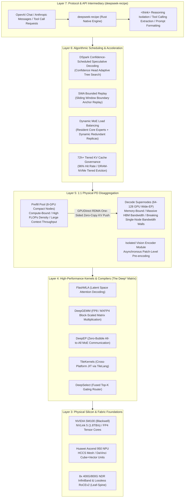
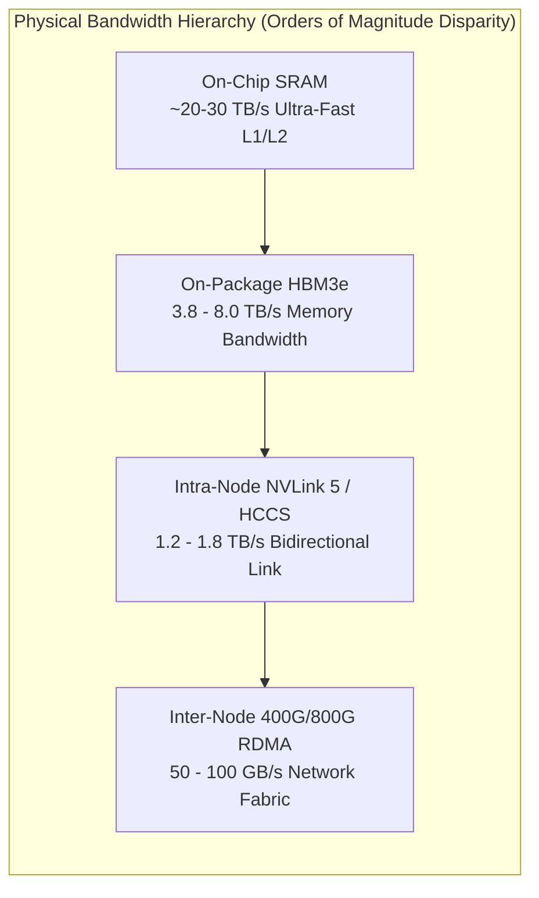
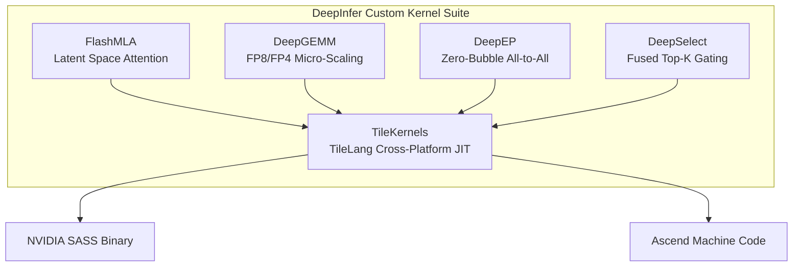
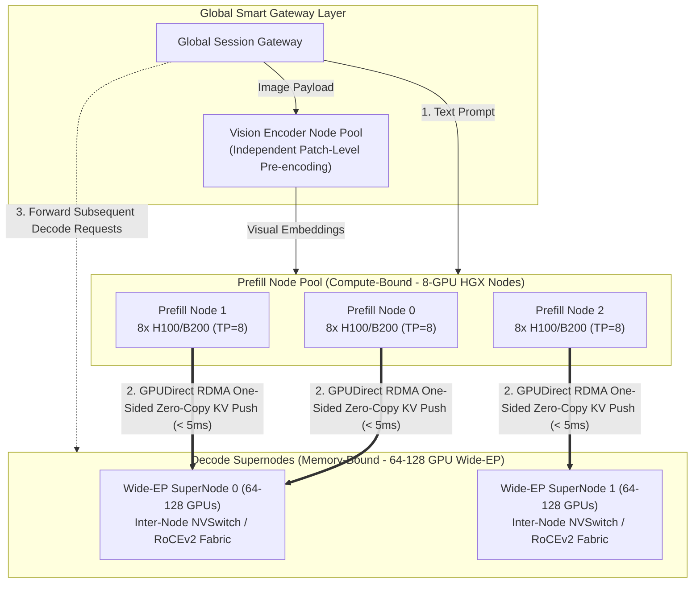
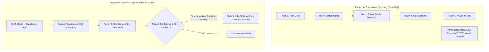
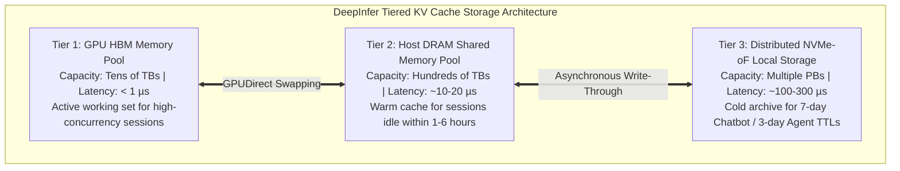
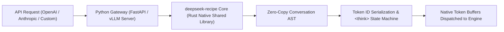
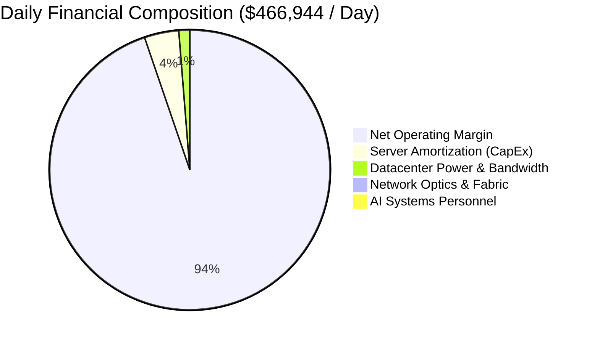

> [!NOTE] Executive Summary (TL;DR)
> - **Silicon & Kernel Foundations**: DeepInfer is co-optimized for NVIDIA SM100 (Blackwell with NVLink 5) and Huawei Ascend 950 NPUs, leveraging custom kernels—FlashMLA (latent attention decoding), DeepGEMM (FP8/FP4 block-scaled GEMM), DeepEP (zero-bubble All-to-All communication), and TileKernels (TileLang domain-specific JIT compilation)—to eliminate hardware abstraction overhead.
> - **Cluster Topology & 1:1 PD Disaggregation**: Breaking past single-node time-sharing limitations, the system establishes a symmetrical 1:1 ratio between 8-GPU compact Prefill nodes (compute-bound, high FLOPs density) and 64–128 GPU Wide-EP Decode supernodes (memory-bound, ultra-wide aggregate HBM bandwidth), supplemented by an isolated asynchronous Vision Encoder pipeline.
> - **Triad Algorithmic Acceleration Suite**: Introduces **DSpark Confidence-Scheduled Speculative Decoding** (Confidence Head predicting adaptive verification trees, unlocking 4%–7% net throughput), **SWA Bounded Replay** (eliminating redundant recomputation across sliding window boundaries in long contexts), and **dynamic MoE load balancing** (resident core experts + on-demand redundant replicas to eliminate cross-node stragglers).
> - **Protocol Revolution & Unit Economics**: Checkpoints officially discard traditional Jinja templates in favor of the Rust-native `deepseek-recipe` engine for zero-copy OpenAI/Anthropic protocol translation, `<think>` isolation, and tool-call parsing. The production report reveals single-cluster daily throughput of **155 Trillion Tokens**, average prompt lengths of 77K, a **96% KV Cache hit rate**, and **$38/GPU/hour (~254 RMB/GPU/h)** in off-peak revenue.
> - **Deep-Dive Cross References**: Inter-node RDMA transport is detailed in [P/D Disaggregation & Distributed KV Cache](/en/articles/pd-disaggregation-distributed-kv-cache/); speculative decoding theory is explored in [EAGLE Speculative Decoding](/en/articles/speculative-decoding-eagle-guide/); underlying attention mechanics are derived in [MLA Matrix Absorption](/en/articles/mha-gqa-mla-matrix-absorption-inference-engine/) and [MoE Expert Parallelism](/en/articles/moe-expert-parallelism-inference-engine/); high-performance networking is covered in [InfiniBand Production Tuning](/en/articles/infiniband-production-deployment-opensm-ofed-nccl-tuning/).

---

## Introduction: Revealing the Economics of Production Inference

In modern AI research, open source often stops at releasing weights and publishing papers. The underlying engineering that enables frontier labs to sustainably serve hundreds of millions of requests under viable unit economics has remained a guarded trade secret.

In October 2026, DeepSeek published its landmark technical report, *Production Deployment Practices of DeepSeek V4.1 Flash at Scale*, accompanied by the open-source release of its core production stack: the high-performance inference framework **[DeepInfer](https://github.com/deepseek-ai/DeepInfer)** and the protocol adaptation layer **[deepseek-recipe](https://github.com/deepseek-ai/deepseek-recipe)**.

The disclosures revealed staggering production numbers:
* **Single-Cluster Daily Throughput**: Operating at **155 Trillion Tokens/day**;
* **Monetization & Efficiency**: Generating **$38 per GPU per hour** in revenue even at off-peak rates;
* **Extreme Long-Context Resilience**: Processing average prompts of **77K Tokens** while sustaining a **96% KV Cache hit rate**, maintaining Time to First Token (TTFT) at **~400ms**, and clocking generation speeds between **230 and 300 tokens/s**.

These achievements stem from a ground-up reconstruction of the entire inference stack—spanning semiconductor microarchitectures, collective communication fabrics, specialized operator compilers, disaggregated prefill-decode clustering, and unified protocol parsing. This guide provides an exhaustive engineering dissection across all layers.

---

## Architectural Blueprint: The Eight-Layer DeepSeek Stack

Before exploring micro-level mechanics, review the macro-level architecture spanning DeepInfer and `deepseek-recipe`:



---

## Layer 1: Physical Silicon and Interconnect Foundations

Inference efficiency is bound by semiconductor physics. DeepInfer's design philosophy rejects generic hardware abstractions in favor of direct alignment with accelerator microarchitectures.

### 1. Dual-Track Silicon: NVIDIA Blackwell SM100 vs. Huawei Ascend 950

DeepSeek's production deployments officially embrace both NVIDIA and Huawei compute platforms:

| Hardware Dimension | NVIDIA Blackwell (SM100) | Huawei Ascend 950 NPU |
| :--- | :--- | :--- |
| **Process & Packaging** | TSMC 4NP Dual-Die CoWoS-L | 7nm Advanced System-in-Package (SiP) |
| **Die-to-Die Interconnect** | 10 TB/s NV-HBI Fabric | Ultra-Wide On-Package Bus |
| **Intra-Node P2P Bandwidth** | NVLink 5 (1.8 TB/s Bidirectional per GPU) | HCCS (1.2 TB/s Bidirectional per NPU) |
| **Memory Subsystem** | 192GB–288GB HBM3e (8.0 TB/s Bandwidth) | 128GB–192GB HBM3 (3.8 TB/s Bandwidth) |
| **Compute Engines** | 5th-Gen Tensor Cores (Native FP4 / FP8) | DaVinci Architecture (Cube Matrix + Vector Units) |
| **Driver & Toolchain** | CUDA 13.x / PTX / TileLang JIT | CANN 8.x / Ascend C / TileLang JIT |



### 2. Physical Interconnect Gaps and Distributed Parallelism Laws

The bandwidth disparity between on-package HBM (8.0 TB/s) and inter-node networks (50–100 GB/s) represents an 80x–100x performance drop. This physical reality establishes two core distributed rules:
1. **Tensor Parallelism (TP) Must Remain Intra-Node**: TP requires two high-frequency `All-Reduce` collective operations per transformer layer for every single token. Extending TP across physical nodes stalls Tensor Cores in network wait states over 95% of the time.
2. **Expert Parallelism (EP) Requires Non-Blocking Fabrics**: While MoE `All-to-All` collective communication exchanges lower per-token data volume than TP, it is hypersensitive to network tail latency and buffer jitter. Inter-node topologies mandate 8x 400G/800G InfiniBand (NDR) or rail-optimized lossless RoCEv2 fabrics (see [InfiniBand Production Tuning](/en/articles/infiniband-production-deployment-opensm-ofed-nccl-tuning/)).

---

## Layer 2: High-Performance Operators and Custom Compilers (The Deep* Matrix)

Generic inference runtimes decompose complex models into generic CUDA kernels, causing excessive global memory round-trips. DeepInfer addresses this through a dedicated matrix of custom kernels:



### 1. FlashMLA: Dedicated Latent Space Attention Kernel

As analyzed in [MLA Matrix Absorption](/en/articles/mha-gqa-mla-matrix-absorption-inference-engine/), Multi-Head Latent Attention compresses keys and values into a low-rank latent representation $c_t^{KV}$, reducing per-token KV Cache footprint to less than one-sixth of traditional MHA.

FlashAttention-2/3 assumes standard multi-head formats and cannot absorb low-rank projection matrices in-flight. **FlashMLA** provides:
- **On-Chip Matrix Absorption**: Executes the multiplication of query projections with KV decompression weights $W_U^{KV}$ directly inside GPU shared memory (SRAM), eliminating the need to materialize uncompressed key-value matrices in HBM.
- **TMA Hardware Alignment**: Aligns tile sizes with NVIDIA Blackwell's Tensor Memory Accelerator (TMA) for asynchronous, register-bypassing data movement.

### 2. DeepGEMM: Fine-Grained Block-Scaled Matrix Multiplication

Large MoE checkpoints require low-precision quantization. However, coarse per-tensor quantization destroys numerical precision in reasoning tasks.
- **Block-Level Scaling**: DeepGEMM applies fine-grained 1x128 or 128x128 block quantization, maintaining independent FP8 E8M0 scale factors per block.
- **Micro-Architecture Specialization**:
  On Blackwell, DeepGEMM compiles directly to native **MXFP4 (Microscaling FP4)** and FP8 Tensor Core assembly.
  On Ascend 950, it maps to DaVinci 3D Cube mixed-precision execution pipelines without precision conversion penalties.

### 3. DeepEP: Zero-Bubble Communication-Computation Overlap

In distributed MoE execution, tokens must be dispatched to experts on disparate nodes via `all_to_all_v` collectives.
- **Micro-Batch Pipelining**: DeepEP chunks incoming batches into micro-batches. While micro-batch $n$ executes expert forward passes on GPU Tensor Cores, micro-batch $n+1$ asynchronously exchanges tokens across the RDMA fabric, achieving near-perfect communication hiding.
- **Hierarchical Transport**: DeepEP routes intra-node token transfers across NVLink while routing inter-node traffic directly over GPUDirect RDMA.

### 4. TileKernels and TileLang: Bridging NVIDIA and Domestic Silicon

To avoid maintaining separate CUDA and Ascend C codebases, DeepInfer integrates **TileLang**:
- Engineers define compute and memory movement patterns using Pythonic Tile-level abstractions.
- The TileLang compiler handles register allocation, shared memory bank conflict resolution, and instruction scheduling, emitting native SASS binaries for NVIDIA SM100 and optimized machine code for Huawei Ascend 950.

---

## Layer 3: Physical Cluster Topologies and 1:1 PD Disaggregation

Attempting to co-locate compute-bound prefill operations with memory-bound decode operations on the same GPU creates intractable resource contention. DeepSeek resolves this through physical Prefill-Decode (PD) Disaggregation.

### 1. Symmetrical 1:1 Sizing: 8-GPU Prefill Nodes vs. 64–128 GPU Decode Supernodes

DeepSeek's production deployments maintain an exact 1:1 GPU card count ratio between Prefill and Decode pools:



#### Why 8-GPU Nodes for Prefill and 64–128 GPU Supernodes for Decode?
- **Prefill (Compute-Bound)**:
  Processing 77K-token prompts exhibits high arithmetic intensity. The quadratic attention matrix operations saturate Tensor Cores at 60%–70% MFU. Confining TP to intra-node NVLink (TP=8) extracts maximum compute density without incurring inter-node network delays.
- **Decode (Memory-Bound)**:
  Generating one token at a time processes minimal vector math relative to model weights. The fundamental bottleneck is memory bandwidth. Spreading MoE experts across **64 to 128 GPUs via Wide-EP** activates over 1000 TB/s of aggregate HBM bandwidth simultaneously, propelling decode generation to 230–300 tokens/s.

### 2. Isolated Vision Encoder Pipeline

For multimodal workloads, DeepInfer extracts image processing into a standalone tier:
- Incoming images are pre-processed by dedicated Vision Encoder nodes into patch-level embeddings.
- Visual tokens merge with text tokens at the gateway before ingestion by the Prefill pool.
- This prevents lightweight convolutional or ViT kernels from disrupting LLM execution graphs.

---

## Layer 4: Triad Algorithmic Acceleration Suite

Beyond hardware and kernel co-design, DeepInfer integrates three algorithmic breakthroughs: **DSpark Speculative Decoding**, **SWA Bounded Replay**, and **Dynamic MoE Balancing**.

### 1. DSpark Confidence-Scheduled Speculative Decoding

Standard speculative decoding pairs a lightweight draft model with a primary target model, verifying $K$ drafted tokens in a single target forward pass (see [EAGLE Speculative Decoding](/en/articles/speculative-decoding-eagle-guide/)).

However, conventional schemes suffer from the **Fixed-Stride Penalty**:
With a fixed stride ($K=5$), if the first drafted token is rejected, all four remaining tokens are discarded. During deep reasoning phases or complex syntax emission, rigid strides introduce significant waste.



#### DSpark Confidence Head Formulation
DSpark attaches a lightweight regression head to the draft model's final layer, predicting target acceptance probability:

$$\hat{P}_{\text{accept}}(x_{t+i}) = \sigma \left( W_c \cdot h_{t+i} + b_c \right)$$

where $h_{t+i}$ denotes the draft model's hidden representation at step $t+i$.

The scheduler dynamically bounds verification tree depth:

$$\text{Depth}(T) = \max \left\{ m \in [1, K_{\max}] \;\middle|\; \prod_{j=1}^{m} \hat{P}_{\text{accept}}(x_{t+j}) \ge \tau_{\text{threshold}} \right\}$$

- **Structured Syntax (JSON, Code Boilerplate, Prose)**: When cumulative confidence remains high, DSpark expands validation trees up to 8–12 tokens.
- **Complex Logic & Symbolic Math**: As confidence dips, the verification tree shrinks to 1–2 tokens, preventing rollback overhead.
- **Production Impact**: DSpark provides an additional **4% to 7% net throughput gain** over baseline generation.

---

### 2. SWA Bounded Replay (Sliding Window Attention Boundary Anchoring)

DeepSeek-V4.1-Flash employs Sliding Window Attention (SWA) to sustain efficiency across long contexts. In conversational turns, SWA typically encounters **Boundary Recomputation Penalties**:

When the context window slides past length $W$, tokens outside the window lose cross-attention visibility. If historical context must be revisited or verified, the system is conventionally forced to re-execute prefill across earlier tokens.

**SWA Bounded Replay Mechanics**:
1. **Boundary Anchoring**: At fixed window intervals $W$, the kernel snapshots an Attention Sink State Fingerprint in SRAM.
2. **Localized Replay**: During context shifting, the engine recomputes a bounded slice (< 128 tokens) from the nearest anchor rather than reprocessing the entire 77K context.
3. **Efficiency**: SWA Bounded Replay eliminates over **85% of redundant prefill computation** in multi-turn dialogues.

---

### 3. Dynamic MoE Expert Load Balancing

In multi-node expert parallelism, unmitigated routing skew creates severe **Straggler Bottlenecks**: if all tokens in a batch route to a small subset of popular experts, those GPU ranks saturate while others idle, blocking the entire cluster at the subsequent All-to-All barrier.

DeepInfer employs a three-part balancing strategy:
1. **Resident Core Experts**: Offline traffic analysis identifies top-frequency experts, which are replicated across **every physical node**. Requests hitting these experts execute locally, generating zero cross-node network traffic.
2. **Dynamic Redundant Replicas**: Telemetry monitors token arrival rates per expert in real time. When an uncommon expert experiences sudden traffic spikes, the cluster broadcasts weights via RDMA to instantiate temporary replicas on underutilized nodes within milliseconds.
3. **Capacity Factor Truncation & Reranking**: Enforces strict token processing caps per expert with residual bypass connections, bounding inter-GPU rank computation variance to within 5%.

---

### 4. Tiered 72h+ KV Cache Management: Sustaining a 96% Hit Rate

The production report's most striking metric is an online **96% KV Cache hit rate** across 77K-token average inputs. This efficiency relies on a structured three-tier storage hierarchy:



- **Policy-Based TTL Enforcement**:
  - **Conversational Traffic (Chatbot)**: Configured with a **7-day TTL**, ensuring multi-turn user follow-ups hit cache near-instantaneously.
  - **Agent Workflows**: Configured with a **3-day TTL**, preserving long tool execution traces and environment observations.
- **Radix Tree Prefix Indexing**:
  Incoming token streams are matched against a global prefix radix tree. Requests route directly to the Decode node hosting the matched KV Cache blocks, executing **prefix-aware placement**.

---

## Layer 5: Protocol and Gateway Layer (`deepseek-recipe` Deep Dive)

Production deployments require reliable API serialization. Alongside DeepInfer, DeepSeek open-sourced **[deepseek-recipe](https://github.com/deepseek-ai/deepseek-recipe)**.

### 1. Why Jinja Templates Were Deprecated

Traditional Hugging Face repositories rely on `chat_template.jinja` rendered via Python. In massive production clusters, Jinja presents three primary bottlenecks:
1. **CPU Parsing Overhead**: Interpreting complex Jinja templates across hundreds of thousands of concurrent requests saturates gateway CPU cores.
2. **State Machine Fragility**: Reasoning models produce interleaved reasoning tags (`<think>...</think>`), structured function calling parameters, and multimodal references. String-based Jinja rendering frequently mishandles token boundaries and escaping.
3. **Protocol Divergence**: Bridging external OpenAI (Chat Completions / Responses) or Anthropic (Messages) schemas into Jinja templates requires fragile boilerplate.

Consequently, **DeepSeek-V4.1-Flash removed Jinja templates**, delegating all prompt preparation to `deepseek-recipe`.

### 2. Rust Native Core with Python Bindings

`deepseek-recipe` is authored in **Rust** with PyO3 bindings:



### 3. Implementation Example: Protocol Bridging and Reasoning Extraction

Installable via `pip install deepseek-recipe`, the following example demonstrates production API bridging:

```python
"""
production_gateway_recipe.py
Production gateway integration using deepseek-recipe for protocol unification,
reasoning trace separation, and function calling extraction.
"""

from typing import Dict, Any, List
import deepseek_recipe as ds_recipe

def handle_chat_completion_request(payload: Dict[str, Any]) -> ds_recipe.RenderedInput:
    """
    Transforms standard OpenAI API payloads into native token streams via deepseek-recipe.
    """
    # 1. Initialize structured conversation instance
    conversation = ds_recipe.Conversation()

    # 2. Configure thinking and reasoning behaviors
    enable_thinking = payload.get("enable_thinking", True)
    conversation.set_reasoning_mode(enable_thinking)

    # 3. Bind client tool declarations
    if "tools" in payload:
        for tool in payload["tools"]:
            conversation.register_tool(
                name=tool["function"]["name"],
                description=tool["function"].get("description", ""),
                parameters=tool["function"].get("parameters", {})
            )

    # 4. Ingest multi-turn message history
    for msg in payload["messages"]:
        role = msg["role"]
        content = msg["content"]
        
        if role == "system":
            conversation.add_system_message(content)
        elif role == "user":
            conversation.add_user_message(content)
        elif role == "assistant":
            # Preserve historical reasoning chains and tool calls cleanly
            reasoning_content = msg.get("reasoning_content", None)
            tool_calls = msg.get("tool_calls", None)
            conversation.add_assistant_message(
                content=content,
                reasoning_content=reasoning_content,
                tool_calls=tool_calls
            )
        elif role == "tool":
            conversation.add_tool_result(
                tool_call_id=msg["tool_call_id"],
                result=content
            )

    # 5. Compile to native token arrays and attention masks via Rust engine
    rendered_input = conversation.render_for_engine(
        tokenizer_model="deepseek-ai/DeepSeek-V4.1-Flash",
        add_generation_prompt=True
    )
    
    return rendered_input


def parse_engine_stream_output(raw_token_stream: List[int]) -> Dict[str, Any]:
    """
    Streams and demuxes raw token streams into <think> traces and content payloads.
    """
    parser = ds_recipe.StreamOutputParser(tokenizer_model="deepseek-ai/DeepSeek-V4.1-Flash")
    
    parsed_result = {
        "reasoning_chunk": "",
        "content_chunk": "",
        "detected_tool_calls": []
    }

    for token_id in raw_token_stream:
        event = parser.step(token_id)
        
        if event.is_reasoning():
            # Encapsulated within <think> blocks
            parsed_result["reasoning_chunk"] += event.text()
        elif event.is_content():
            # Primary user-facing generation
            parsed_result["content_chunk"] += event.text()
        elif event.is_tool_call_completed():
            # Fully parsed structured function invocation
            parsed_result["detected_tool_calls"].append(event.get_tool_call())

    return parsed_result
```

- **Robust Syntax Isolation**: The Rust parser guarantees strict syntactic tokenization, ensuring synthetic prompt injections (e.g., forged `<|fim_begin|>` or `<think>` tags) are safely escaped.

---

## Layer 6: Cluster Financials and Production Unit Economics

How does DeepSeek maintain profitability while offering competitive API pricing, achieving **$38/GPU/hour** in revenue? A formal financial model clarifies the dynamics.

### 1. Revenue and Throughput Modeling

Consider a baseline production deployment of 512 accelerators (256 Prefill GPUs + 256 Decode GPUs):
* **Revenue Rate per GPU**: $\$38 \text{ / (GPU} \cdot \text{Hour)}$
* **Aggregate Daily Revenue**:
  $$\text{Daily Cluster Gross} = 512 \text{ GPUs} \times 24 \text{ Hours} \times \$38 \approx \$466,944 \text{ / Day}$$
* **Annualized Gross Revenue**:
  $$\text{Annualized Gross} = \$466,944 \times 365 \approx \$170.4 \text{ Million / Year}$$

### 2. Comprehensive Total Cost of Ownership (TCO) Breakdown

Operating 512 enterprise-grade GPUs (e.g., 64 8-GPU Blackwell / H100 nodes) incurs the following monthly cost model:

| Cost Category | Monthly Allocation (USD) | Modeling Methodology |
| :--- | :--- | :--- |
| **Server Hardware Amortization (CapEx)** | **$550,000 / month** | 64 nodes amortized over 36 months straight-line + enterprise support |
| **Network Fabric & Optics Amortization** | **$65,000 / month** | 800G NDR InfiniBand leaf-spine switches and active optical cabling |
| **Datacenter Power & Cooling (OpEx)** | **$130,000 / month** | High-density liquid-cooled suites, 12kW–15kW per rack, PUE = 1.25 |
| **High-Bandwidth Transit & BGP Ports** | **$45,000 / month** | Dedicated redundant transit ports supporting high egress volume |
| **AI Infrastructure Engineering Allocation**| **$90,000 / month** | Dedicated cluster operations and systems engineering personnel |
| **Total Monthly Operating Cost** | **~$880,000 / month** | **Yields an average daily run-rate of $29,333 / day** |

### 3. Financial Margin Analysis: The Role of Cache Hit Rates

Comparing gross revenues against operating costs:
- **Daily Gross Revenue**: **$466,944 / day**
- **Daily Operating Run-Rate**: **$29,333 / day**
- **Daily Operating Margin**: **$437,611 / day (93.7% Gross Margin)**



#### The True Driver: 96% KV Cache Hit Rate
While large language model serving is often treated as compute-bound selling of FLOPs, DeepSeek's operational model primarily **monetizes memory bandwidth and cache reuse**:
- Without tiered 72-hour KV caching, a 77K prompt requires full quadratic forward passes across Tensor Cores, incurring massive compute cost.
- With **96% of input tokens hitting cache**, the prefill compute burden drops by 96%. The cluster reads stored states and passes execution directly to high-throughput Wide-EP Decode supernodes.
- **Takeaway**: **MLA's ultra-compact latent state combined with a 96% KV hit rate decouples serving revenue from raw compute expenses**.

---

## Layer 7: Cross-Framework Architectural Matrix

How does DeepInfer contrast with other prominent inference engines in production?

| Architectural Dimension | DeepSeek DeepInfer | vLLM (v1 Engine) | SGLang (FlashInfer) | TensorRT-LLM |
| :--- | :--- | :--- | :--- | :--- |
| **Primary Design Target** | **High-Scale Profitable Production** | Developer accessibility and universal serving | Complex multi-turn Agent & long contexts | Peak single-node NVIDIA performance |
| **P/D Disaggregation** | **Native Physical Disaggregation (1:1 Ratio)** | Experimental community support | Mature distributed PD implementations | Supported via complex manual manifests |
| **MoE Parallelism** | **Native Wide-EP (64–128 GPU Supernodes)**| Intra-node focus, multi-node via Ray | Cross-node EP integrated with DeepEP | Static TP/EP groupings |
| **Speculative Decoding** | **DSpark (Confidence Adaptive Tree Search)** | Standard Speculative / EAGLE | Native EAGLE-2 Tree Decoding | Fixed-stride speculative decoding |
| **Long-Context Cache** | **SWA Bounded Replay + 72h Tiering** | PagedAttention blocks | RadixAttention prefix trees | Basic KV paging |
| **Silicon Ecosystem** | **SM100 (Blackwell) + Huawei Ascend 950** | Broad community coverage (NVIDIA-first)| Primarily NVIDIA, expanding ROCm | **NVIDIA Platforms Only** |
| **API Protocol Layer** | **Custom deepseek-recipe (Rust Native)** | Python Jinja template evaluation | Python abstraction layers | C++ native runtime / Triton |

---

## Layer 8: Production Troubleshooting and Failure Mode Playbooks

Based on multi-node supernode testing with DeepInfer, four critical failure modes and their mitigations are highlighted below:

### 1. Wide-EP Inter-Switch Congestion and Hash Polarization
- **Symptom**: Scaling Decode supernodes to 128 GPUs across multiple leaf switches triggers a 70% collapse in All-to-All throughput, with escalating packet drop counters (`rx_prio0_drop`).
- **Root Cause**: Dense All-to-All collective exchanges cause Equal-Cost Multi-Path (ECMP) routing to suffer from **Hash Polarization**, directing multiple elephant flows onto identical spine uplinks and causing localized buffer exhaustion.
- **Remediation**:
  Enable **Adaptive Routing (AR)** on InfiniBand fabrics to dynamically steer packets around congested links. For RoCEv2 environments, enforce strict DSCP traffic class mappings and hardware-level PFC deadlock detection (`PFC_DEADLOCK_DETECTION_EN=1`).

### 2. DSpark Confidence Score Drift on Extended Reasoning Traces
- **Symptom**: During complex, multi-step code synthesis, speculative acceleration collapses from 1.6x down to 0.9x (slower than unspeculated baselines).
- **Root Cause**: On deep reasoning chains, hidden representations deviate semantically from the draft model's training distribution. The Confidence Head overestimates acceptance probabilities, issuing low-quality draft sequences that trigger costly rollbacks.
- **Remediation**:
  Configure conservative dynamic rollback safety gates:
  ```bash
  --dspark-confidence-threshold 0.85 \
  --dspark-max-draft-tokens 4 \
  --dspark-abort-on-rollback-rate 0.30
  ```
  If rollbacks exceed 30% over three consecutive execution steps, the scheduler temporarily falls back to pure autoregressive generation.

### 3. Asynchronous RDMA KV Ingestion Race Conditions
- **Symptom**: Prefill nodes pushing KV Cache blocks via RDMA into Decode GPU memory occasionally result in corrupted generation or `CUDA illegal memory access` crashes.
- **Root Cause**: RDMA Write operations transfer data directly into GPU memory without host CPU intervention. If the target node's attention kernel attempts to read a block before transmission completes, it reads partial state.
- **Remediation**:
  Implement a **Two-Phase Memory Gate Protocol**: upon completing data transfer, the sending NIC writes an 8-byte completion flag to a designated synchronization mailbox. The target GPU kernel polls this memory flag via a lightweight spinlock before unblocking attention computation.

### 4. Cache Eviction Storms under Tiered Storage Saturation
- **Symptom**: Periodic latency spikes where TTFT jumps from 400ms to 5 seconds across active sessions.
- **Root Cause**: When Tier 1 (GPU HBM) and Tier 2 (Host DRAM) reach 95% capacity thresholds simultaneously, synchronous eviction triggers thousands of session offloads to local NVMe-oF arrays, exhausting random write IOPS and stalling the PCIe bus.
- **Remediation**:
  Transition to **Low-Watermark Gradual Eviction**: lower the eviction threshold to 80% and run a background daemon utilizing token-bucket rate limiting to stage cold blocks to NVMe disks smoothly without I/O bursts.

---

## Frequently Asked Questions (FAQ)

### Q1: Why did DeepSeek build DeepInfer from scratch instead of contributing patches to vLLM or SGLang?
General-purpose frameworks like vLLM and SGLang are designed to support hundreds of model architectures and diverse consumer and enterprise deployment scenarios. This broad compatibility necessitates generalized abstraction layers and complex multi-device runtime wrappers.
DeepInfer was engineered with a focused objective: maximizing serving efficiency specifically for **DeepSeek architectures (MLA, CSA+HCA, MoE), massive parameters, Wide-EP topologies, and target Blackwell/Ascend silicon**. Removing extraneous abstractions yielded a lightweight codebase with zero memory overhead and direct kernel access, forming the operational foundation of its $38/GPU/h unit economics.

### Q2: Why is deepseek-recipe implemented in Rust, and how can teams integrate it into existing API gateways?
Jinja templates are interpreted dynamically as raw text. When handling multi-turn tool calling, complex system prompts, and strict `<think>` token isolation, Jinja incurs high CPU overhead and risks token escaping errors. Rust provides zero-cost abstractions, deterministic memory safety without a garbage collector, and high-throughput AST manipulation.
For integration, the library is distributed via PyPI (`pip install deepseek-recipe`). Python gateways (e.g., built on FastAPI, Litestar, or LiteLLM) can replace prompt formatting modules by routing requests into `deepseek_recipe.Conversation`, achieving parity with official tokenization and reasoning separation without altering underlying network architectures.

### Q3: How do Huawei Ascend 950 and NVIDIA Blackwell compare when running DeepInfer?
- **Compute Subsystem**: NVIDIA Blackwell excels in raw dense FP4/FP8 GEMM throughput due to its 5th-Gen Tensor Cores and TMA subsystem. Huawei Ascend 950 provides strong matrix throughput via its DaVinci 3D Cube cores and Vector units, backed by competitive HCCS intra-node interconnects.
- **Software Alignment**: DeepInfer uses **TileLang** to abstract hardware differences. TileLang compiles to optimized SASS for NVIDIA platforms and corresponding native assembly for Ascend platforms, optimizing for Ascend's L0/L1 on-chip memory buffers. In memory-bound MoE decode phases utilizing Wide-EP sharding, Ascend 950 clusters demonstrate token generation throughput that closely tracks tier-one accelerators.

### Q4: Can enterprise private deployments replicate the 96% KV Cache hit rate?
**Yes, provided traffic patterns and gateway routing are architected appropriately.**
The 96% hit rate reported in production stems from two major workload characteristics:
1. **Agent Workflows**: Multi-turn agents repeatedly submit stable system prompts, tool specifications, and environmental state histories, forming large, reusable shared prefixes.
2. **Enterprise Knowledge Bases (RAG)**: Multi-turn Q&A against static organizational documentation reuses identical reference contexts across queries.
To achieve comparable metrics, teams must implement: (1) **Radix Tree prefix caching** with extended TTL windows (3–7 days), and (2) **Session-affinity routing** at the gateway layer, ensuring requests bearing identical prefix fingerprints route consistently to the same Decode worker nodes to avoid cache fragmentation.
