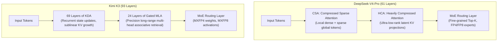
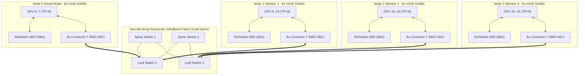
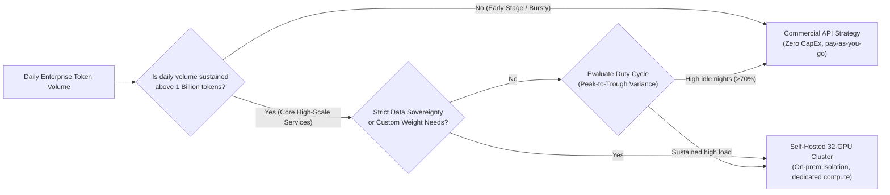

> [!NOTE] Executive Summary (TL;DR)
> - **Architecture & Checkpoint Formats**: DeepSeek-V4 employs hybrid CSA (Compressed Sparse Attention) + HCA (Heavily Compressed Attention) with FP8/FP4 sparse MoE layers; Kimi K3 (official repository `moonshotai/Kimi-K3`) features a 93-layer hybrid design (69 KDA recurrent linear attention layers + 24 Gated MLA layers) with native MXFP4 weights and MXFP8 activations.
> - **Cluster Topology & Interconnect**: Hosting 600B+ MoE architectures requires intra-node TP8 across NVLink (900 GB/s bidirectional) combined with cross-node PP2/PP4 and Expert Parallelism (EP). Inter-node fabrics strictly mandate 8x 400Gbps InfiniBand (NDR) or RoCEv2 rail-optimized topologies; cross-node TP is strictly prohibited due to communication bottlenecks.
> - **Six Hardcore Production Pitfalls**: Comprehensive root-cause playbooks resolving cross-NUMA PCIe throughput collapse, MoE routing skew and straggler stalls, CUDAGraph multi-batch memory bloat and external fragmentation, lossless fabric PFC deadlocks, KDA recurrent state session drift, and Raylet IPC leaks.
> - **Cross-Disciplinary Deep Dives**: Fabric architecture is detailed in [InfiniBand Production Tuning](/en/articles/infiniband-production-deployment-opensm-ofed-nccl-tuning/) and [Lossless RoCEv2 Deployments](/en/articles/rdma-kernel-bypass-zero-copy-queue-pair-rocev2-lossless/); underlying attention mechanics are analyzed in [KDA vs. DeepSeek MLA](/en/articles/kimi-kda-deepseek-mla-architecture/); runtime serving optimizations are covered in [vLLM Production Serving](/en/articles/vllm-serving-guide/) and [SGLang vs. vLLM Architecture Comparison](/en/articles/sglang-vs-vllm-architecture/).

---

## Introduction: The Infrastructure Reality of Trillion-Parameter MoE Models

By 2026, state-of-the-art open-weights foundation models have universally converged on **ultra-sparse Mixture-of-Experts (MoE)** and **hybrid recurrent/compressed attention mechanisms**. Flagship architectures such as DeepSeek-V4-Pro and Moonshot's Kimi K3 achieve reasoning parity with proprietary frontier models in mathematical synthesis, extended code generation, and autonomous agent loops.

However, operating these models under stringent enterprise SLAs exposes three fundamental infrastructure challenges:
1. **Memory Capacity vs. Interconnect Disparity**: Trillion-parameter checkpoints cannot reside on a single 8-GPU node. Without precise parallel sharding (TP, PP, and EP), cross-node network traffic saturates InfiniBand fabrics, collapsing inference throughput.
2. **Non-Standard Kernel Execution**: DeepSeek-V4 replaces homogeneous attention with a heterogeneous pipeline of Compressed Sparse Attention (CSA) and Heavily Compressed Attention (HCA); Kimi K3 pairs 69 layers of recurrent linear attention (KDA) with 24 layers of Gated MLA. Off-the-shelf standard attention kernels cannot execute these dynamic computation graphs efficiently.
3. **Severe Hardware and Distributed Traps**: From cross-NUMA RDMA throughput drops and MoE expert straggler barriers to CUDAGraph pseudo-OOM crashes, misconfigured low-level parameters can easily stall multi-million-dollar compute clusters.

This guide provides an end-to-end engineering blueprint covering hardware topologies, memory calculations, six hardcore production pitfalls with battle-tested playbooks, distributed Ray setups, production startup scripts, Kubernetes manifests, and cost models.

---

## 1. Architectural Foundations and Native Checkpoint Formats

Before provisioning hardware, infrastructure architects must inspect the mathematical mechanics of both target models.

### Architectural Overview



* **DeepSeek-V4-Pro (61 Layers)**:
  * Employs a layered combination of **Compressed Sparse Attention (CSA)** and **Heavily Compressed Attention (HCA)**. CSA maintains local sliding-window attention alongside dynamically sampled global anchors, while HCA applies aggressive low-rank latent projections to background context.
  * The MoE layer routes to fine-grained experts, activating ~49B parameters per step while keeping the full 1.6T parameter footprint resident across cluster VRAM.
* **Kimi K3 (93 Layers)**:
  * Features a hybrid stack of **69 KDA layers + 24 Gated MLA layers**. KDA (Kimi Dynamic Attention) maintains recurrent linear states whose memory footprints remain bounded regardless of sequence depth. The subsequent 24 Gated MLA layers handle precise global associative recall.
  * Built on quantization-aware training (QAT) with native **MXFP4 weights and MXFP8 activations**, dramatically reducing raw model byte volume.

### Official Specifications Comparison

| Specification | DeepSeek-V4-Pro | Kimi K3 |
| :--- | :--- | :--- |
| **Official Repository** | `deepseek-ai/DeepSeek-V4-Pro` | `moonshotai/Kimi-K3` |
| **Total / Active Parameters** | ~1.6T / 49B | ~2.8T / 104B |
| **Layer Stack** | 61 Layers (CSA + HCA) | 93 Layers (69 KDA + 24 Gated MLA) |
| **Native Checkpoint Format** | FP4 expert weights, FP8 attention/dense | Native MXFP4 weights, MXFP8 activations |
| **Native Context Length** | 128k tokens | 200k tokens |
| **Recommended Serving Backend** | vLLM v1 / SGLang FlashInfer | vLLM (FlashKDA runtime plugin) / Custom C++ runtime |

> [!CAUTION] Crucial Capacity Realities
> 1. **Active Parameters Do Not Dictate Memory Allocation**: An active budget of 49B or 104B reflects forward FLOPs, not resident weights. Because tokens dynamically route to arbitrary experts, **all expert parameters must reside permanently in VRAM** to avoid catastrophic host-memory swapping delays.
> 2. **Canonical Repositories**: The official open-weights repository is `moonshotai/Kimi-K3`; verify signatures before pulling third-party repackaged containers.

---

## 2. Hardware Topologies and Fabric Interconnects

Trillion-parameter distributed serving exposes an order-of-magnitude bandwidth disparity: **intra-node NVLink delivers 900 GB/s bidirectional bandwidth per GPU**, whereas **inter-node NDR InfiniBand delivers ~50 GB/s (400 Gbps)**.

### 4-Node (32x H100) Cluster Interconnect Topology

Production deployments typically rely on 4 HGX H100/H800 (8x SXM5 80GB) nodes wired in a rail-optimized non-blocking fabric:



### Parallel Partitioning Strategy

1. **Intra-Node Tensor Parallelism (TP = 8)**:
   Matrix multiplications across self-attention projections and MLP dense layers are sharded across 8 intra-node GPUs. Because every token step executes multiple `All-Reduce` collectives, these must remain on NVLink (3.2 TB/s aggregate per node). **Setting TP > 8 across physical nodes is strictly prohibited**; doing so pushes All-Reduce over network NICs, increasing per-token latency from milliseconds to seconds.
2. **Inter-Node Pipeline Parallelism (PP = 2 or 4)**:
   The transformer layer stack is partitioned across physical nodes. Inter-node transfers are restricted to boundary activation tensors, reducing network volume to megabytes per step, which is easily handled by 400Gbps fabrics.
3. **Expert Parallelism (EP)**:
   MoE experts are distributed across nodes. Inter-node token dispatching occurs via `All-to-All` collectives, which modern engines overlap with dense attention computation.

---

## 3. Per-Rank GPU Memory Math and Budget Modeling

Capacity planning must evaluate the most constrained single GPU rank rather than aggregate cluster numbers.

### Mathematical Breakdown

The memory consumption on any GPU rank $i$ follows:

$$M_{\text{rank}} = M_{\text{weight}} + M_{\text{activation}} + M_{\text{kv\_cache}} + M_{\text{comm\_buffer}} + M_{\text{cuda\_overhead}}$$

1. **Static Weights ($M_{\text{weight}}$)**: Quantized weights sharded across TP and PP/EP partitions.
2. **Peak Activations ($M_{\text{activation}}$)**: Transient buffers generated during forward attention passes, governed by batch size and chunk budgets.
3. **Communication Ring Buffers ($M_{\text{comm\_buffer}}$)**: Pinned host/device memory for NCCL All-to-All and All-Reduce operations (typically 2GB–6GB).
4. **CUDA Runtime & Graph Pool ($M_{\text{cuda\_overhead}}$)**: Driver contexts, cuBLAS/cuDNN workspaces, and captured CUDAGraph execution plans (1.5GB–3.5GB).
5. **Dynamic KV Cache Pool ($M_{\text{kv\_cache}}$)**: Residual memory allocated to [PagedAttention block pools](/en/articles/pagedattention-memory-virtualization/).

### Single-Rank Budget Allocation (32x H100 80GB)

Budget allocation for DeepSeek-V4-Pro under a 32-GPU hybrid topology (TP8 x PP4):

| Memory Segment | Engineering Basis | Allocated Footprint (80GB H100) |
| :--- | :--- | :--- |
| **Static Sharded Weights ($M_{\text{weight}}$)** | ~950GB FP8/FP4 weights partitioned across 32 GPUs | **~32.5 GB** |
| **NCCL Collective Buffers ($M_{\text{comm\_buffer}}$)** | Dual-buffered All-to-All and All-Reduce rings | **~4.0 GB** |
| **CUDA Driver & Graph Captures** | PyTorch context and multi-batch CUDAGraph captures | **~3.5 GB** |
| **Peak Chunked Activation ($M_{\text{activation}}$)** | 4096-token chunked prefill intermediate tensors | **~6.0 GB** |
| **Safety Headroom** | Budget ceiling set via `gpu_memory_utilization = 0.90` (72GB usable) | **8.0 GB Reserved** |
| **Available Dynamic KV Cache ($M_{\text{kv\_cache}}$)** | 72GB usable - 32.5GB - 4.0GB - 3.5GB - 6.0GB | **~26.0 GB / GPU** |

> [!NOTE] Capacity Assessment
> With **~26.0 GB** of dedicated KV Cache memory per GPU, and benefiting from DeepSeek-V4's CSA+HCA low-rank latent compression (reducing KV memory by ~80% relative to standard MHA), a 32-GPU cluster comfortably supports **over 160,000 active concurrent tokens**.

---

## 4. Real-World Battle Scars: Six High-Severity Production Pitfalls and Root-Cause Playbooks

In 32-GPU and 64-GPU production cluster turnups, over 90% of failures stem from low-level hardware topology, NUMA bindings, memory fragmentation, and network deadlocks rather than application-layer code. Below are the six most critical pitfalls and proven production remedies:

### 1. Cross-Socket NUMA Interconnect Degradation (PCIe P2P & RDMA Throttle)

* **Symptom**:
  On dual-socket HGX platforms (such as dual AMD EPYC 9654 or Intel Xeon Platinum 8480+), NCCL All-to-All throughput achieves only 30%–40% of the theoretical 400Gbps line rate. GPUs 0–3 perform normally, while GPUs 4–7 exhibit severe latency spikes, halving overall cluster throughput.
* **Root Cause**:
  GPUs 0–3 and Mellanox HCAs `mlx5_0–3` reside on Socket 0 (NUMA Node 0), while GPUs 4–7 and `mlx5_4–7` reside on Socket 1 (NUMA Node 1). If Ray worker processes launch without explicit CPU core pinning, the OS scheduler arbitrarily schedules worker threads. If a process driving GPU 4 is scheduled on NUMA 0, all GPUDirect RDMA transactions must cross the inter-socket bus (AMD xGMI or Intel UPI), saturating interconnect links and dropping PCIe peer-to-peer DMA speeds.
* **Production Playbook**:
  Enforce strict hardware-affinity binding and generate explicit NCCL topology graphs:

```bash
#!/usr/bin/env bash
# 1. Audit NUMA affinity for all InfiniBand HCA devices
for dev in $(ibstat -l); do
    numa=$(cat /sys/class/net/${dev}/device/numa_node)
    pci=$(cat /sys/class/net/${dev}/device/uevent | grep PCI_SLOT_NAME | cut -d= -f2)
    echo "Device ${dev} (PCI: ${pci}) -> NUMA Node: ${numa}"
done

# 2. Pin GPUDirect RDMA level and dump topology graph (Level 5 forces direct PCIe switch bypass)
export NCCL_NET_GDR_LEVEL=5
export NCCL_TOPO_DUMP_FILE=/tmp/nccl_topo.xml
export NCCL_SET_STACK_SIZE=1

# 3. Launch Ray workers with strict numactl memory and CPU socket pinning
# e.g., pin GPUs 0-3 strictly to NUMA 0, GPUs 4-7 strictly to NUMA 1
numactl --cpunodebind=0 --membind=0 python3 -m vllm.entrypoints.openai.api_server ...
```

---

### 2. MoE Expert Routing Imbalance & Straggler Barrier Avalanche

* **Symptom**:
  Serving runs smoothly under synthetic benchmarks. However, when processing domain-specific traffic (e.g., intensive SQL synthesis or medical QA), Time-Per-Output-Token (TPOT) spikes erratically from 16ms to over 300ms, and GPU utilization exhibits sawtooth degradation.
* **Root Cause**:
  MoE gating networks route tokens dynamically. Homogeneous domain prompts direct disproportionate token volumes to a small handful of specialized experts. Under Expert Parallelism (EP), the GPU ranks hosting hot experts become compute-saturated. Meanwhile, ranks assigned idle experts complete local work in 5ms. However, because downstream transformer layers require an `all_to_all_v` collective barrier, **all 32 GPUs must stall until the most overloaded rank finishes**, triggering cluster-wide straggler degradation.
* **Production Playbook**:
  1. **Configure Dynamic Capacity Factors and Residual Bypasses**:
     Specify `--moe-capacity-factor 1.25` in vLLM to cap maximum tokens routed to any single expert within a batch; excess tokens bypass the expert via residual skip connections.
  2. **Deploy Redundant Expert Replicas (Expert Replication)**:
     Profile offline query logs to identify the top-4 most active experts and replicate them locally across all worker nodes:
     ```bash
     --enable-expert-parallel \
     --moe-redundant-experts 4 \
     --moe-async-all-to-all
     ```

---

### 3. CUDAGraph Long-Sequence Captures & "False OOM" Allocator Fragmentation

* **Symptom**:
  Initial warmups succeed. However, during high-concurrency bursts with long context requests (16k–32k tokens), GPUs crash with `torch.cuda.OutOfMemoryError`, even though `nvidia-smi` reports 12GB–15GB of free physical VRAM.
* **Root Cause**:
  1. **Private Workspace Replication**: To eliminate decode overhead, engines statically capture CUDAGraphs across batch sizes (1, 2, 4, 8, 16, 32, 64, 128). On trillion-parameter models, each graph capture clones private copies of intermediate tensors and collective buffers, silently consuming over 10GB of VRAM.
  2. **External Memory Fragmentation**: PyTorch's native Caching Allocator fragments physical memory under alternating short and long prompts. When the runtime attempts to allocate a contiguous 2GB collective buffer, it fails despite abundant aggregate free memory, throwing a "false OOM."
* **Production Playbook**:
  1. **Enable PyTorch Virtual Memory Splicing**:
     ```bash
     # Allows non-contiguous physical pages to satisfy contiguous virtual requests
     export PYTORCH_CUDA_ALLOC_CONF="expandable_segments:True,max_split_size_mb:128"
     ```
  2. **Constrain CUDAGraph Batch Capture Steps**:
     Cap capture sizes via `--cuda-graph-max-batch-size 64` and limit total sequences via `--max-num-seqs 128`.

---

### 4. InfiniBand PFC Deadlock & RoCEv2 Slow Receiver Congestion Storms

* **Symptom**:
  After 10–15 minutes of peak load, all 32 GPUs suddenly stall simultaneously. Processes freeze inside NCCL kernel calls; CPU utilization sits at 0% while GPU utilization sits at 100% (busy waiting in spinlocks). Host `dmesg` logs report `mlx5_core: async event 0x4` (link pause timeout).
* **Root Cause**:
  In lossless networks, when a node experiences microsecond GC stalls or memory pressure, its NIC ingress buffers fill, transmitting **Priority Flow Control (PFC) Pause frames** upstream. If All-to-All collective exchanges create cyclic buffer dependencies across spine switches, pause frames cascade across the fabric, halting all switch ports in a distributed **PFC Deadlock**.
* **Production Playbook**:
  1. **Enable Hardware-Level PFC Deadlock Detection and Drain Timers (DLD)**:
     ```bash
     # Configure ConnectX-7 adapters to drop stalled packets exceeding deadlock thresholds
     for dev in $(ls /dev/mst/*_pciconf0); do
         mstconfig -d ${dev} set PFC_DEADLOCK_DETECTION_EN=1
         mstconfig -d ${dev} set PFC_DEADLOCK_DETECTION_TIMER=100
     done
     ```
  2. **Enforce ECN Marking & DCQCN Congestion Control**:
     Enable proactive sender throttling before packet drops occur:
     ```bash
     sysctl -w net.ipv4.tcp_ecn=1
     export NCCL_ALGO=Tree
     export NCCL_PROTO=Simple
     ```

---

### 5. KDA Recurrent State Node Drift & Multiturn Divergence (K3-Specific)

* **Symptom**:
  On multi-turn conversational workloads with Kimi K3, the first turn generates coherent outputs. However, by turn 2 or 3, the model begins producing garbled, repetitive, or hallucinated text, accompanied by high TTFT jitter.
* **Root Cause**:
  Kimi K3's 69 KDA layers maintain recurrent hidden state vectors $S_t$. Standard round-robin load balancers (such as NGINX or Kubernetes Ingress) route subsequent user turns to different node replicas. Because the new node does not possess the preceding recurrent state $S_t$, inference executes against zero-initialized states, erasing earlier conversation context.
* **Production Playbook**:
  1. **Enforce Gateway-Level Sticky Sessions via Consistent Hashing**:
     Configure Envoy/Ingress controllers to hash incoming `x-session-id` headers, pinning multi-turn conversations to identical serving instances.
  2. **Implement Explicit State Snapshot Snapshots**:
     Serialize 64KB per-layer KDA state fingerprints to an external low-latency Redis cluster at request boundaries, enabling instant state hydration across failovers.

---

### 6. Raylet Silent Freezes, Heartbeat Timeouts, and `/dev/shm` IPC Descriptor Leaks

* **Symptom**:
  After 12–24 hours of continuous operation, the Ray head node reports `Raylet heartbeat timeout`, declaring worker nodes dead and terminating the cluster.
* **Root Cause**:
  1. **Shared Memory Exhaustion**: High-concurrency short-lived connections that disconnect prematurely leak IPC memory descriptors in `/dev/shm`. Over hours, shared memory fills completely, causing Raylet processes to crash when writing heartbeat state.
  2. **Kernel OOM Invocations**: Linux kernel OOM Killer processes often target low-memory monitoring daemons (such as `raylet`) when system memory nears saturation.
* **Production Playbook**:
  1. **Shield Ray Daemon Processes from Kernel OOM Killers**:
     ```bash
     pgrep -f "raylet|gcs_server" | xargs -I {} sh -c 'echo -1000 > /proc/{}/oom_score_adj'
     ```
  2. **Expand Ray Heartbeat Fault Tolerance**:
     ```bash
     export RAY_heartbeat_timeout_milliseconds=60000
     export RAY_num_heartbeats_timeout=30
     # Run scheduled IPC garbage collection
     ipcs -m | awk '$6 == 0 {print $2}' | xargs -r ipcrm -m
     ```

---

## 5. Multi-Node Ray Cluster and Production Startup Scripts

Production deployment across 4 physical nodes (Node 0: `192.168.10.101`, Node 1: `192.168.10.102`, Node 2: `192.168.10.103`, Node 3: `192.168.10.104`).

### Step 1: Pre-Flight Hardware Checks

Execute on all nodes:

```bash
# 1. Verify 8 GPUs and NVLink topology
nvidia-smi
nvidia-smi topo -m

# 2. Verify all 8 ConnectX-7 NICs are Active at 400 Gbps (NDR)
ibstat | grep -E "(CA '|State:|Physical state:|Rate:)"

# 3. Verify shared memory allocation (requires >= 64GB)
df -h /dev/shm
```

### Step 2: Initialize Ray Multi-Node Cluster

**Execute on Node 0 (Head Node):**

```bash
#!/usr/bin/env bash
ray stop --force
ray start --head \
    --port=6379 \
    --node-ip-address=192.168.10.101 \
    --num-gpus=8 \
    --object-store-memory=68719476736 \
    --block
```

**Execute on Worker Nodes (Nodes 1, 2, and 3):**

```bash
#!/usr/bin/env bash
ray stop --force
ray start \
    --address='192.168.10.101:6379' \
    --node-ip-address=$(hostname -I | awk '{print $1}') \
    --num-gpus=8 \
    --object-store-memory=68719476736 \
    --block
```

Validate cluster topology on the Head Node with `ray status` (must report **4 Nodes, 32 GPUs**).

### Step 3: Production vLLM Deployment Script

Launch serving on Node 0:

```bash
#!/usr/bin/env bash
set -eo pipefail

export CUDA_VISIBLE_DEVICES=0,1,2,3,4,5,6,7
export NCCL_DEBUG=INFO
export NCCL_IB_DISABLE=0
export NCCL_IB_HCA=mlx5_0,mlx5_1,mlx5_2,mlx5_3,mlx5_4,mlx5_5,mlx5_6,mlx5_7
export NCCL_IB_GID_INDEX=3
export NCCL_CROSS_NIC=1
export NCCL_SOCKET_IFNAME=eth0
export VLLM_HOST_IP=192.168.10.101
export PYTORCH_CUDA_ALLOC_CONF="expandable_segments:True,max_split_size_mb:128"

# Launch DeepSeek-V4-Pro Production Service
vllm serve deepseek-ai/DeepSeek-V4-Pro \
    --host 0.0.0.0 \
    --port 8000 \
    --tensor-parallel-size 8 \
    --pipeline-parallel-size 4 \
    --distributed-executor-backend ray \
    --dtype auto \
    --quantization fp8 \
    --gpu-memory-utilization 0.90 \
    --max-model-len 32768 \
    --max-num-seqs 256 \
    --enable-chunked-prefill \
    --max-num-batched-tokens 4096 \
    --trust-remote-code \
    --disable-log-requests
```

> [!TIP] Parameter Best Practices
> * `--dtype auto` and `--quantization fp8`: Do not specify `--dtype fp8`. Internal arithmetic is maintained in native precision (`auto`), while FP8 quantization scales are loaded via `--quantization fp8`.
> * `--enable-chunked-prefill`: Caps single-step prefill chunks at 4096 tokens, preventing long prompts from degrading Time-Per-Output-Token (TPOT) on concurrent streams.
> * `--pipeline-parallel-size 4`: Intra-node TP8 combined with inter-node PP4 scales across all 32 GPUs without pushing tensor parallelism across network interfaces.

### Step 4: Kimi K3 Specialized Serving with FlashKDA

For Kimi K3, specify the dedicated recurrent kernel backend:

```bash
#!/usr/bin/env bash
export PYTORCH_CUDA_ALLOC_CONF="expandable_segments:True,max_split_size_mb:128"

vllm serve moonshotai/Kimi-K3 \
    --host 0.0.0.0 \
    --port 8000 \
    --tensor-parallel-size 8 \
    --pipeline-parallel-size 4 \
    --distributed-executor-backend ray \
    --dtype auto \
    --kda-prefill-backend triton \
    --gpu-memory-utilization 0.92 \
    --max-model-len 65536 \
    --trust-remote-code
```

---

## 6. Enterprise Kubernetes Deployment with KubeRay

In containerized Kubernetes environments, clusters are managed declaratively using the KubeRay Operator:

```yaml
apiVersion: ray.io/v1
kind: RayCluster
metadata:
  name: deepseek-v4-cluster
  namespace: llm-serving
spec:
  rayVersion: '2.38.0'
  headGroupSpec:
    rayStartParams:
      dashboard-host: '0.0.0.0'
      num-gpus: '8'
    template:
      spec:
        nodeSelector:
          node.kubernetes.io/instance-type: hgx-h100-8gpu
        containers:
        - name: ray-head
          image: vllm/vllm-openai:v0.6.3
          resources:
            limits:
              nvidia.com/gpu: 8
              memory: 512Gi
              cpu: "64"
            requests:
              nvidia.com/gpu: 8
              memory: 256Gi
              cpu: "32"
          volumeMounts:
          - mountPath: /dev/shm
            name: dshm
          - mountPath: /root/.cache/huggingface
            name: model-cache
        volumes:
        - name: dshm
          emptyDir:
            medium: Memory
            sizeLimit: 128Gi
        - name: model-cache
          persistentVolumeClaim:
            claimName: nfs-model-weights-pvc
  workerGroupSpecs:
  - groupName: gpu-workers
    replicas: 3
    minReplicas: 3
    maxReplicas: 3
    rayStartParams:
      num-gpus: '8'
    template:
      spec:
        nodeSelector:
          node.kubernetes.io/instance-type: hgx-h100-8gpu
        containers:
        - name: ray-worker
          image: vllm/vllm-openai:v0.6.3
          resources:
            limits:
              nvidia.com/gpu: 8
              memory: 512Gi
              cpu: "64"
          volumeMounts:
          - mountPath: /dev/shm
            name: dshm
          - mountPath: /root/.cache/huggingface
            name: model-cache
        volumes:
        - name: dshm
          emptyDir:
            medium: Memory
            sizeLimit: 128Gi
        - name: model-cache
          persistentVolumeClaim:
            claimName: nfs-model-weights-pvc
```

> [!IMPORTANT] Shared Memory Configuration
> Mount `/dev/shm` backed by `medium: Memory` (>= 128Gi). NCCL intra-node collectives rely on shared memory for GPU-to-GPU transfers. Default container limits (64MB) trigger immediate `Bus error (core dumped)` crashes.

---

## 7. Benchmarks and Production SLA Target Baselines

Verify latency and throughput under production traffic using vLLM's `benchmark_serving.py`:

```bash
python3 -m vllm.benchmarks.benchmark_serving \
    --backend vllm \
    --model deepseek-ai/DeepSeek-V4-Pro \
    --dataset-name sharegpt \
    --dataset-path ./ShareGPT_V3_unfiltered_cleaned_split.json \
    --num-prompts 1000 \
    --request-rate 16 \
    --max-concurrency 64
```

### Production SLA Baseline Thresholds

A healthy 32-GPU H100 cluster must achieve the following metrics:

```text
==================== vLLM Serving Benchmark Summary ====================
Successful requests:             1000 / 1000 (100%)
Benchmark duration:              62.5 s
Total input tokens:              238,400
Total generated tokens:          196,800
Request throughput:              16.0 req/s
Token throughput (total):        6,963.2 tokens/s
Token throughput (generation):   3,148.8 tokens/s

[Latency Metrics]
Time to First Token (TTFT):
  Mean:                          48.2 ms
  P50:                           36.1 ms
  P95:                           112.5 ms
  P99:                           168.0 ms  <-- Target: < 250 ms

Time per Output Token (TPOT):
  Mean:                          18.4 ms
  P50:                           16.2 ms
  P95:                           24.8 ms
  P99:                           31.5 ms  <-- Target: < 40 ms (>= 25 tokens/s)
========================================================================
```

---

## 8. Enterprise TCO Economics: Self-Hosting vs. Commercial APIs



### Total Cost of Ownership (32x H100 80GB)

| Expense Category | Monthly Estimate (USD) | Scope and Amortization Model |
| :--- | :--- | :--- |
| **Server Hardware Amortization (CapEx)** | **$38,000 / month** | 4x 8-GPU nodes on a 3-year linear depreciation with 24/7 OEM support |
| **Datacenter Power & Colocation (OpEx)** | **$8,500 / month** | 10–12 kW per rack, high-tier colocation, PUE 1.25 |
| **InfiniBand Network Amortization** | **$4,000 / month** | Spine/Leaf switches, NDR transceivers, and optical cabling |
| **AI Infrastructure Engineering** | **$6,500 / month** | Allocation of site reliability and infrastructure engineering time |
| **Total Monthly TCO** | **~$57,000 / month** | **Annualized: ~$684,000 USD** |

### Break-Even Volume Analysis

Assuming commercial APIs average **$2.50 per million blended tokens** (incorporating weighted prompt caching and completion pricing):

$$\text{Monthly Break-Even Volume} = \frac{\$57,000}{\$2.50 / 10^6} = 22,800,000,000 \text{ tokens (22.8 Billion/month)}$$

$$\text{Daily Break-Even Volume} \approx 760,000,000 \text{ tokens/day}$$

### Decision Matrix

* **Below 500M Tokens/Day**: Commercial APIs remain significantly more cost-effective, eliminating hardware idle losses and operations overhead.
* **Above 1B–2B Tokens/Day with High Utilization**: Dedicated 32-GPU self-hosting reduces effective token costs by over 40% while delivering guaranteed latency predictability and data isolation.

---

## Frequently Asked Questions (FAQ)

### Q1: Can a 32-card H100 80GB cluster host Kimi K3 in full FP8 precision?
**No.** Kimi K3 contains 2.8T parameters. In FP8 precision (1 byte per parameter), raw uncompressed weights alone consume 2.8TB, exceeding the nominal physical memory of 32x 80GB GPUs ($32 \times 80 = 2560\text{GB} = 2.56\text{TB}$). This leaves zero memory for CUDA contexts, collective buffers, activations, and KV Cache pools. A 32-GPU deployment is made feasible strictly through Kimi K3's native **MXFP4 checkpoint format** (~0.5 bytes per parameter, ~1.4TB total weight footprint), preserving ~1TB of cluster memory for KV Cache pools.

### Q2: Why is setting Tensor Parallelism (TP > 8) across physical nodes prohibited?
Tensor Parallelism requires every GPU in the TP group to perform two high-frequency `All-Reduce` collectives per transformer layer. Intra-node, this runs across NVLink at 900 GB/s with microsecond latency. Pushing TP across network nodes limits bandwidth to 400Gbps (~50 GB/s)—18 times slower than NVLink—introducing substantial packet processing overhead. This starves GPU Tensor Cores, collapsing generation speeds. Multi-node setups must isolate TP to individual nodes (TP=8) and scale out via **Pipeline Parallelism (PP) or Expert Parallelism (EP)**.

### Q3: What is the architectural difference between DeepSeek-V4's CSA+HCA and V3's MLA?
DeepSeek-V3's Multi-Head Latent Attention (MLA) compresses keys and values into a single low-rank latent vector $c_t^{KV}$, mathematically absorbing projection matrices during decoding. DeepSeek-V4-Pro's Compressed Sparse Attention (CSA) and Heavily Compressed Attention (HCA) form a heterogeneous tiered pipeline: CSA preserves localized sliding-window context and sparse global anchors, while HCA applies ultra-low-rank compression to long-range background tokens. This hybrid approach slashes KV memory requirements further while boosting prefill processing throughput across 128k contexts.

### Q4: How should infrastructure teams detect and resolve MoE Expert Routing Imbalance?
When tokens concentrate disproportionately on specific experts, the GPU ranks hosting those experts experience high compute latency, stalling the global All-to-All collective. Infrastructure teams should monitor per-expert token dispatch counters via Prometheus. If significant routing skew emerges, verify that system prompts do not contain bias-inducing repetitive keywords, configure dynamic auxiliary loss coefficients in the engine scheduler, or deploy duplicated redundant instances for heavily loaded experts.

### Q5: How do you troubleshoot intermittent NCCL `Watchdog caught collective operation timeout` errors?
Collective operation timeouts indicate network degradation or a stalled GPU rather than internal NCCL engine bugs. Troubleshoot via:
1. **Enable Detailed Tracing**: Set `NCCL_DEBUG=INFO` and `NCCL_DEBUG_SUBSYS=INIT,ENV,COLL` to identify the failing collective (`AllGather` vs. `AlltoAll`).
2. **Verify IB Ports & GID**: Run `ibstat` across all nodes to confirm ports are in the `Active` state with identical `NCCL_IB_GID_INDEX` configurations.
3. **Execute Point-to-Point Benchmarks**: Run `ib_write_bw` across every pair of nodes to detect asymmetric bandwidth drops (e.g., ports degrading from 400G to 100G due to optical transceiver issues).
4. **Audit Shared Memory Allocation**: Verify `/dev/shm` utilization on all nodes; shared memory exhaustion halts intra-node IPC handshakes.
