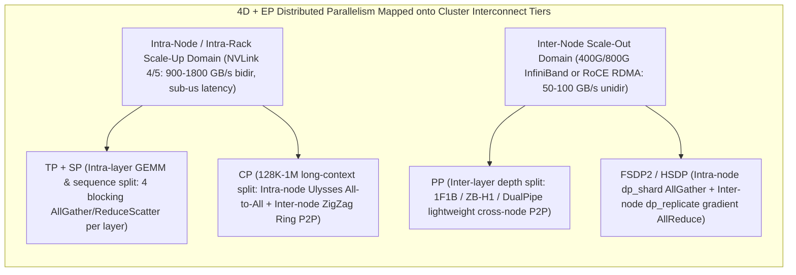
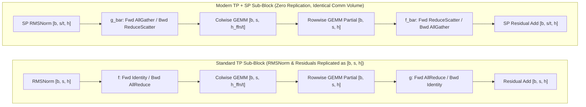
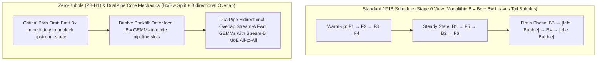
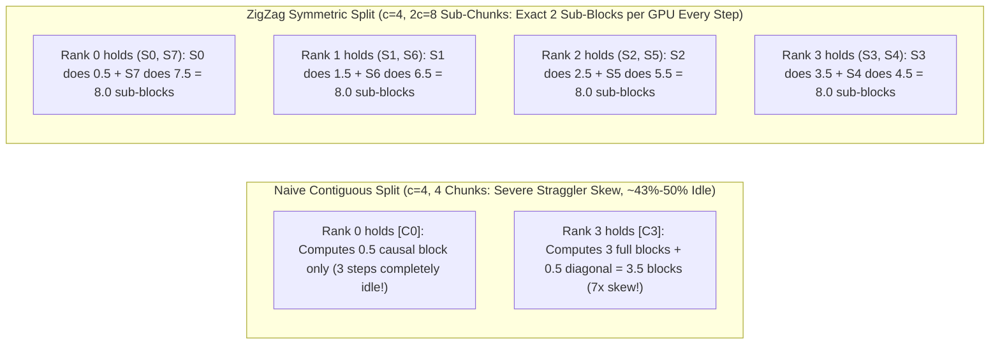

> [!NOTE] Executive Summary (TL;DR)
> - **First-Principles Mixed-Precision & Activation Math**: Under standard BF16 compute + FP32 AdamW master states, a model with $\Psi$ trainable parameters consumes **$16\Psi\text{ Bytes}$** of static HBM ($18\Psi\text{ Bytes}$ with FP32 gradient accumulation)—meaning a 70B dense model requires $1,120\text{ GB}$ (`~1,043 GiB`) before allocating a single activation tensor; while **GQA + FlashAttention** eliminates the quadratic $O(a s^2)$ attention matrix, linear $O(s b h)$ activations still shatter single-GPU HBM ceilings at $128\text{K}\text{--}1\text{M}$ sequence lengths.
> - **Orthogonal State Sharding & Intra-Layer Partitioning**: Moving from DDP and ZeRO-1/2 ($2\Psi$ parameter elements communicated per step) to ZeRO-3 / **PyTorch `FSDP2`** ($3\Psi$ elements), `fully_shard` replaces `FSDP1` flat-parameter packing with per-parameter `DTensor` sharding on `DeviceMesh`, `torch.compile`-friendly zero-copy views, and deterministic `recordStream`-free memory management; pairing intra-node **Tensor Parallelism (`TP`)** with **Sequence Parallelism (`SP`)** replaces `AllReduce` with `AllGather` + `ReduceScatter` at identical communication volume while slashing non-TP activation memory by $1/t$.
> - **Zero-Bubble Pipelines & Load-Balanced Million-Token Contexts**: Pipeline Parallelism evolves from **`1F1B`** (bubble fraction $\frac{p-1}{m}$, capping peak stored activations at $p$ microbatches) to **Zero-Bubble PP** (splitting backward into critical-path $B_x$ and bubble-filling $B_w$) and DeepSeek-V3's bidirectional **`DualPipe`** (overlapping cross-node MoE `All-to-All` inside forward/backward compute); for long-context training, **ZigZag Ring Attention** pairs symmetric sub-chunks $(i, 2c-1-i)$ to eliminate the $\sim 50\%$ causal-mask idle stall of naive Ring Attention while breaking DeepSpeed-Ulysses's $n_{kv}$ head-count ceiling.

## Introduction: Why Frontier LLM Training Is a 4D Optimization Game Across HBM Walls and Bandwidth Cliffs

Once you graduate from single-node 7B LoRA runs in our [End-to-End LLM Fine-Tuning Guide](/en/articles/fine-tuning-guide/) to full-parameter 70B post-training, million-token context extension, or multi-node policy updates in [Test-Time Compute and GRPO in Practice](/en/articles/test-time-compute-grpo/) and [Distributed RL Post-Training with verl](/en/articles/distributed-rl-post-training-verl-colocation/), the physical limits of an 80GiB H100/H800 GPU bring naive scripts to an immediate halt.

Modern distributed training frameworks project a massive computational graph onto physical cluster interconnects across four orthogonal parallelism axes (**4D Parallelism**, extended to 5D by Expert Parallelism `EP` for sparse MoE models):
1. **Data Parallelism (`DP` / `ZeRO` / `FSDP2` / `HSDP`)**: Partitions batches across replicas while sharding optimizer states, gradients, and weights via `ReduceScatter` and `AllGather`;
2. **Tensor & Sequence Parallelism (`TP + SP`)**: Splits intra-layer matrix multiplications along row/column axes and shards residual/normalization activations along tokens, relying on high-bandwidth intra-node Scale-Up links;
3. **Pipeline Parallelism (`PP`)**: Slices model depth across stages, exchanging compact boundary activations across nodes via lightweight point-to-point (`P2P`) transfers;
4. **Context Parallelism (`CP`)**: Shards every intermediate activation along ultra-long sequences ($128\text{K}\text{--}1\text{M}$), communicating exclusively inside the Self-Attention operator via `All-to-All` or P2P KV rings.



Every sound cluster sizing decision begins not with YAML trial-and-error, but with a byte-exact ledger of HBM capacity and collective communication volume.

---

## 1. Mixed-Precision Memory & Activation Ledger from First Principles

Per-GPU peak HBM consumption during training is the sum of **static model states** (parameters, gradients, and optimizer states) and **dynamic residual memory** (saved forward activations, transient collective buffers, and allocator fragmentation).

### 1.1 Deriving the Exact 16Ψ (and 18Ψ) Byte Static Memory Formula

Let $\Psi$ denote the number of trainable parameters. Frontier LLM training universally pairs **BF16 forward/backward compute** with **FP32 AdamW master states**. Why not update BF16 parameters directly in BF16? Because BF16 allocates 1 sign bit, 8 exponent bits, and only **7 explicit mantissa bits**, yielding a machine epsilon near $1.0$ of $\varepsilon_{\text{bf16}} = 2^{-7} \approx 7.81 \times 10^{-3}$. At production learning rates $\eta \in [10^{-5}, 3 \times 10^{-4}]$, normalized AdamW step updates $\Delta w = \eta \cdot \hat{m}_t / (\sqrt{\hat{v}_t} + \epsilon)$ sit around $10^{-4} \ll \varepsilon_{\text{bf16}}$. Applying $w - \Delta w$ directly in BF16 triggers catastrophic **mantissa swamping** ($\text{fl}_{\text{bf16}}(w - \Delta w) \equiv w$), freezing convergence altogether.

Consequently, standard mixed-precision training maintains four static state tensors in HBM:
1. **BF16 Compute Weights ($W_{\text{bf16}}$)**: Consumed by Tensor Core GEMMs during forward and backward passes at $2\text{ Bytes/param}$, totaling **$2\Psi\text{ Bytes}$**;
2. **BF16 Gradients ($G_{\text{bf16}}$)**: Produced during backpropagation at $2\text{ Bytes/param}$, totaling **$2\Psi\text{ Bytes}$** (note: when accumulating or reducing gradients in FP32 across microbatches or large DP groups via `reduce_dtype=fp32` to prevent low-bit underflow, this buffer doubles to **$4\Psi\text{ Bytes}$**);
3. **FP32 Master Weights ($W_{\text{fp32}}$)**: High-precision primary copy absorbing small optimizer updates at $4\text{ Bytes/param}$, totaling **$4\Psi\text{ Bytes}$**;
4. **FP32 AdamW First & Second Moments ($m_t, v_t$)**: Exponential moving averages of gradients ($4\text{ Bytes}$) and squared gradients ($4\text{ Bytes}$), totaling **$8\Psi\text{ Bytes}$**.

Summing all four components yields the canonical **static mixed-precision memory equation**:

$$M_{\text{static}} = \underbrace{2\Psi}_{\text{BF16 Weights}} + \underbrace{2\Psi}_{\text{BF16 Grads}} + \underbrace{4\Psi}_{\text{FP32 Master}} + \underbrace{(4\Psi + 4\Psi)}_{\text{FP32 AdamW } m_t, v_t} = \mathbf{16\Psi\text{ Bytes}} \quad (\mathbf{18\Psi\text{ Bytes}}\text{ with FP32 grad accum})$$

Let us verify this on a **70B dense model** ($\Psi = 70 \times 10^9$):
- Decimal footprint: $M_{\text{static}} = 70 \times 10^9 \times 16\text{ Bytes} = \mathbf{1,120\text{ GB}}$ ($1,260\text{ GB}$ at $18\Psi$);
- Binary HBM capacity ($1\text{ GiB} = 2^{30}\text{ Bytes}$): $1,120 \times 10^9 / 2^{30} \approx \mathbf{1,043.08\text{ GiB}}$ (**`~1,043 GiB`**).

In stark physical terms: **before feeding a single token or allocating a single activation tensor**, the static training states of a 70B model already exceed an entire 8× H100-80GB server's aggregate HBM ($640\text{ GiB}$) by **$403\text{ GiB}$**!

### 1.2 Per-Layer Activation Memory: Classic Megatron MHA vs. Modern GQA + FlashAttention

Once static states are sharded, forward activations saved for backward gradient computation become the dominant HBM bottleneck. Let $s$ be sequence length, $b$ micro-batch size, $h$ hidden dimension, $a$ query attention heads, $g = n_{kv}$ GQA key-value heads, and $h_{\text{ffn}}$ the SwiGLU intermediate width.

**1. Classic Megatron-LM Multi-Head Attention (MHA) Formula**:
In a pre-FlashAttention Transformer block (LayerNorm + GeLU MLP of width $4h$ + BF16 activations + 1-byte dropout masks), Korthikanti et al. (MLSys '23) derived the exact byte count saved per layer:
- **Attention sub-block**: Input LayerNorm ($2sbh$), shared QKV input ($2sbh$), $Q$ and $K$ saved for $Q K^T$ ($4sbh$), $V$ saved for score-value matmul ($2sbh$), output projection input ($2sbh$), and residual dropout mask ($1sbh$) sum to $13sbh\text{ Bytes}$; meanwhile, explicitly materializing the $[b, a, s, s]$ attention matrix stores Softmax probabilities ($2bas^2$), attention dropout mask ($1bas^2$), and dropped-out probabilities ($2bas^2$), adding **$5bas^2\text{ Bytes}$**;
- **MLP sub-block**: Input LayerNorm ($2sbh$), Linear-1 input ($2sbh$), GeLU input ($8sbh$), Linear-2 input ($8sbh$), and dropout mask ($1sbh$) sum to $21sbh\text{ Bytes}$.

Combining both sub-blocks yields the classic Megatron-LM activation equation:

$$M_{\text{act, classic}}^{\text{layer}} = 34 s b h + 5 b a s^2 = s b h \left(34 + \frac{5 a s}{h}\right)\text{ Bytes}$$

Notice how violently the quadratic $\frac{5 a s}{h}$ term explodes: for $h = 8192, a = 64, b = 1$ at $s = 32,768$, the $5 b a s^2$ term alone demands $5 \times 1 \times 64 \times 32768^2 \approx \mathbf{343.6\text{ GB}}$ *per layer*—over $27\text{ TB}$ across 80 layers!

**2. Modern Stack (GQA + SwiGLU + RMSNorm + FlashAttention-2/3) & Selective Checkpointing**:
Modern foundation models (Llama-3, Qwen2.5, DeepSeek) fundamentally reshape this curve:
- **FlashAttention eliminates $O(a s^2)$ HBM materialization**: By tiling $Q, K, V$ in on-chip SRAM with online softmax rescaling, FlashAttention never writes the $s \times s$ score matrix to HBM. It saves only the final output $O$ ($2sbh\text{ Bytes}$) and a tiny FP32 log-sum-exp vector $L_{\text{lse}}$ ($4bas\text{ Bytes}$), collapsing per-layer activation complexity to **strictly linear $O(s b h)$**;
- **GQA shrinks $K, V$ projections**: Key and value activations shrink to $4 s b h \cdot \frac{g}{a}\text{ Bytes}$ (for Llama-3-70B with $g/a = 8/64 = 1/8$, saved $K, V$ tensors drop from $4sbh$ to $0.5sbh$);
- **SwiGLU MLP dominates remaining memory**: Without dropout, modern uncheckpointed activation memory per layer is $M_{\text{act, modern}}^{\text{layer}} \approx s b \left(10h + 4h\frac{g}{a} + 6h_{\text{ffn}}\right)\text{ Bytes}$. For Llama-3-70B ($h_{\text{ffn}} = 3.5h$), this equals **$31.5 s b h\text{ Bytes}$**, of which SwiGLU (`gate_proj`, `up_proj`, and $\text{SiLU} \odot$) accounts for $23 s b h$ ($>73\%$)!
- **Selective Activation Checkpointing (SAC)**: While Full Block Checkpointing reduces steady-state storage to just the **$2 s b h\text{ Bytes}$** layer-boundary input at the cost of **$+33\%$ extra training FLOPs** (re-running every GEMM in backward), PyTorch's **Op-Level Selective Activation Checkpointing (`SAC`)** caches compute-intensive GEMM outputs while discarding and recomputing FLOP-free, memory-heavy `RMSNorm`, `RoPE`, and `SwiGLU` elementwise intermediates (or checkpoints every $k$-th layer), cutting activation HBM by $50\%\text{--}70\%$ for under $10\%\text{--}15\%$ FLOP overhead.

| Activation Ledger Metric | Classic MHA (No FlashAttn) | Modern GQA + FlashAttn (No Checkpointing) | Modern Stack + Full Block Checkpointing |
| :--- | :--- | :--- | :--- |
| **Per-Layer Complexity** | $s b h \left(34 + \frac{5 a s}{h}\right)\text{ Bytes}$ | $s b \left(10h + 4h\frac{g}{a} + 6h_{\text{ffn}}\right) = O(s b h)$ | $2 s b h\text{ Bytes/layer}$ + 1 active layer peak |
| **Llama-3-70B ($b=1, s=32\text{K}$, 80 Layers)** | $\sim 28,200\text{ GB}$ ($O(s^2)$ blowup) | $\sim 676\text{ GB}$ (purely linear, SwiGLU-heavy) | $\sim 43\text{ GB}$ boundary inputs + $8.5\text{ GB}$ active |
| **Backward Recompute FLOP Overhead** | $0\%$ | $0\%$ (local SRAM tile recompute only) | $+33\%$ (re-executes all QKV/O/MLP GEMMs) |

---

## 2. Data Parallelism Evolution: DDP, ZeRO-1/2/3, and PyTorch FSDP2 (`DTensor` + HSDP)

To fit $16\Psi$ static states across $N_d$ data-parallel GPUs, Microsoft DeepSpeed **ZeRO (Zero Redundancy Optimizer)** and PyTorch **FSDP** systematically eliminate the redundant state replication of DistributedDataParallel (`DDP`).

### 2.1 Exact Static Memory & Collective Communication Volume Across DDP and ZeRO-1/2/3

Let $N_d$ be the DP degree and $\Psi$ the parameter count, with BF16 ($2\text{ Bytes/elem}$) forward/backward collectives (taking the ring/tree scaling factor $\frac{N_d - 1}{N_d} \approx 1$ for large $N_d$). Below we report communication in **both parameter elements ($\Psi$, Rajbhandari SC'20 convention) and BF16 bus bytes**:

| Strategy | Sharded States | Per-GPU Static Footprint (Bytes, $16\Psi$ Base) | Per-Step Collectives Breakdown | Comm Volume per Step (Elements / BF16 Bytes) | 70B @ $N_d=64$ Static HBM |
| :--- | :--- | :--- | :--- | :--- | :--- |
| **DDP** | None (replicated) | $2\Psi + 2\Psi + 12\Psi = \mathbf{16\Psi}$ | Backward grad `AllReduce` ($2\Psi$ elems) | **$2\Psi$ elems** ($4\Psi\text{ Bytes}$) | $1,043.1\text{ GiB}$ (OOM) |
| **ZeRO-1 ($P_{\text{os}}$)** | Optimizer ($12\Psi$) | $2\Psi + 2\Psi + \frac{12\Psi}{N_d}$ | Grad `ReduceScatter` ($\Psi$) + Updated param `AllGather` ($\Psi$) | **$2\Psi$ elems** ($4\Psi\text{ Bytes}$) | $277.1\text{ GiB}$ (OOM) |
| **ZeRO-2 ($P_{\text{os}+g}$)** | Optimizer + Grads ($14\Psi$) | $2\Psi + \frac{2\Psi + 12\Psi}{N_d} = 2\Psi + \frac{14\Psi}{N_d}$ | Streaming grad `ReduceScatter` ($\Psi$) + Step-end `AllGather` ($\Psi$) | **$2\Psi$ elems** ($4\Psi\text{ Bytes}$) | $152.1\text{ GiB}$ (>80GiB) |
| **ZeRO-3 / FSDP ($P_{\text{os}+g+p}$)** | All states ($16\Psi$) | $\frac{2\Psi + 2\Psi + 12\Psi}{N_d} = \mathbf{\frac{16\Psi}{N_d}}$ | Fwd `AllGather` ($\Psi$) + Bwd `AllGather` ($\Psi$) + Grad `ReduceScatter` ($\Psi$) | **$3\Psi$ elems** ($6\Psi\text{ Bytes}$) | **$16.30\text{ GiB}$** (Fits cleanly) |

Two foundational architectural insights jump straight out of this table:
1. **ZeRO-1 and ZeRO-2 Are Communication-Free Lunches**: Because a ring `AllReduce` is physically implemented as **1 `ReduceScatter` ($\Psi$ elements) + 1 `AllGather` ($\Psi$ elements)**, ZeRO-1 and ZeRO-2 transfer **the exact same $2\Psi$ elements ($4\Psi\text{ Bytes}$) as DDP** while slashing static memory from $16\Psi$ toward $2\Psi$! Whenever a single GPU can comfortably hold $2\Psi$ BF16 weights (e.g., 7B–14B models on 80GiB GPUs), ZeRO-2 / `FSDP2(reshard_after_forward=False)` strictly dominates ZeRO-3.
2. **ZeRO-3 / FSDP Trades $+50\%$ Communication ($3\Psi$ vs. $2\Psi$) for Unbounded Capacity Scaling**: Sharding the $2\Psi$ weights requires materializing each layer via `AllGather` before forward ($\Psi$) and freeing it right after, materializing it again via `AllGather` before backward ($\Psi$), and streaming `ReduceScatter` on gradients ($\Psi$), totaling **$3\Psi$ elements ($6\Psi\text{ Bytes}$)**. With double-buffered async prefetching, layer $l+1$'s `AllGather` overlaps cleanly behind layer $l$'s Tensor Core GEMMs.

### 2.2 Why PyTorch `FSDP2` (`fully_shard`) Superseded `FSDP1`

While PyTorch's original `FullyShardedDataParallel` (`FSDP1`) popularized sharded training, its internal **`FlatParameter`** abstraction created severe production pain points. Stabilized across PyTorch 2.4–2.6+, **`FSDP2` (`torch.distributed.fsdp.fully_shard`)** re-architected sharding from the ground up:

1. **Per-Parameter `DTensor` on `DeviceMesh` vs. `FlatParameter` Concatenation**:
   - `FSDP1` flattened and concatenated every parameter inside a wrapped module into a single monolithic 1D `FlatParameter` buffer. That destroyed clean parameter boundaries—complicating frozen-backbone + LoRA fine-tuning, mixed parameter dtypes (FP32 norms alongside BF16 linears), optimizer param-group weight-decay exclusions, and distributed checkpoint (`DCP`) resharding, while causing frequent `torch.compile` graph breaks.
   - **`FSDP2` represents each `nn.Parameter` individually as a `DTensor` sharded along dim-0 (`Shard(0)`) on a `DeviceMesh`**. Module hierarchies, state-dict keys, heterogeneous dtypes, and `DCP` work natively out of the box with zero un-flattening glue.
2. **Zero-Copy View Semantics & End-to-End `torch.compile` Tracing**:
   - `FSDP2` exposes functional collective primitives (`all_gather_copy_in`, `reduce_scatter_tensor`) directly to TorchInductor, enabling whole-graph compilation to fuse parameter copy-ins and reorder collectives around compute kernels.
3. **Deterministic Stream-Free Memory Management (`recordStream` Elimination)**:
   - `FSDP1` relied on CUDA's `Tensor.record_stream()` to stop the compute stream from overwriting buffers still in flight on the NCCL stream. Whenever CPU kernel launches ran ahead of GPU execution, `record_stream` artificially extended buffer lifetimes inside `CUDACachingAllocator`, causing multi-gigabyte fragmentation spikes, phantom OOMs at $75\%$ logical usage, and costly `cudaDeviceSynchronize` cache flushes.
   - **`FSDP2` completely eliminates `record_stream()`**: it coordinates explicit double-buffered `AllGather` / `ReduceScatter` queues using deterministic `torch.cuda.Event` fences between communication and compute streams. Unsharded buffers are released the instant a layer finishes, delivering **$\sim 7\%$ higher MFU** and a rock-steady HBM watermark across thousands of steps.
4. **2D Hybrid Sharded Data Parallelism (`HSDP`)**:
   - Passing a 2D `DeviceMesh` labeled `("dp_replicate", "dp_shard")` to `fully_shard` confines chatty `AllGather` / `ReduceScatter` collectives inside high-bandwidth intra-node NVLink (`dp_shard=8`), while running a single coalesced gradient `AllReduce` across inter-node RDMA scale-out links (`dp_replicate`) at optimizer step boundaries.

---

## 3. Tensor Parallelism (`TP`) + Sequence Parallelism (`SP`): Intra-Layer Partitioning & Bandwidth Equivalence

At 70B–405B scale or $32\text{K+}$ sequence lengths, pure FSDP2 hits two walls: transient unsharded layer activations still burst on single GPUs, and scaling pure DP across hundreds of GPUs starves per-GPU micro-batch arithmetic intensity. Megatron-LM's **Tensor Parallelism (`TP`)** and **Sequence Parallelism (`SP`)** solve both inside a high-speed Scale-Up domain.

### 3.1 Megatron-LM Column-Parallel + Row-Parallel Pairing

Splitting arbitrary linear layers in isolation would trigger a collective after every GEMM. Instead, Megatron-LM pairs **Column-Parallel** first projections with **Row-Parallel** second projections across $t$ TP ranks:

1. **SwiGLU MLP Block**:
   - Partition `gate_proj` and `up_proj` weights $W_{\text{gate}}, W_{\text{up}} \in \mathbb{R}^{h \times h_{\text{ffn}}}$ **column-wise** into $W_{\text{gate}}^{(i)}, W_{\text{up}}^{(i)} \in \mathbb{R}^{h \times (h_{\text{ffn}}/t)}$. Because $\text{SiLU}(\cdot)$ and elementwise $\odot$ act independently per channel, each GPU computes its local intermediate slice **with zero communication**:
     $$Z^{(i)} = \text{SiLU}\!\left(X W_{\text{gate}}^{(i)}\right) \odot \left(X W_{\text{up}}^{(i)}\right) \in \mathbb{R}^{b \times s \times (h_{\text{ffn}}/t)}$$
   - Partition `down_proj` $W_{\text{down}} \in \mathbb{R}^{h_{\text{ffn}} \times h}$ **row-wise** into $W_{\text{down}}^{(i)} \in \mathbb{R}^{(h_{\text{ffn}}/t) \times h}$. By block-matrix multiplication:
     $$Y = \begin{bmatrix} Z^{(1)} & \cdots & Z^{(t)} \end{bmatrix} \begin{bmatrix} W_{\text{down}}^{(1)} \\ \vdots \\ W_{\text{down}}^{(t)} \end{bmatrix} = \sum_{i=1}^{t} Z^{(i)} W_{\text{down}}^{(i)}$$
     Each rank computes partial result $Y_{\text{partial}}^{(i)} = Z^{(i)} W_{\text{down}}^{(i)} \in \mathbb{R}^{b \times s \times h}$, followed by **1 `AllReduce`** in forward (and **1 conjugate `AllReduce`** on input gradients before `gate_up` in backward).
2. **GQA Self-Attention Block**:
   - Partition $a$ query heads and $g = n_{kv}$ KV heads across $t$ ranks ($a/t$ query and $g/t$ KV heads per rank, requiring $t \le n_{kv}$). QKV projections run Column-Parallel, local FlashAttention and RoPE run completely communication-free, and output projection $W_o$ runs Row-Parallel with **1 `AllReduce`**.

Thus, standard `TP` executes **2 `AllReduce` collectives in forward** and **2 `AllReduce` collectives in backward** per Transformer layer.

### 3.2 Sequence Parallelism (`SP`): Slashing Non-TP Activations by 1/t at Zero Extra Bandwidth

Standard `TP` leaves an expensive blind spot: outside the TP blocks—across **RMSNorm / LayerNorm, Dropout, and the residual stream**—every `[b, s, h]` activation tensor is **identically replicated** across all $t$ TP ranks! Because those point-wise ops are independent along the token axis $s$, **Sequence Parallelism (`SP`)** shards them into `[b, s/t, h]`:



Let us prove the exact communication equivalence for one sub-block (e.g., MLP) operating on a BF16 activation tensor $[b, s, h]$ of size $M_{\text{act}} = 2 b s h\text{ Bytes}$ ($b s h$ elements):
- **Standard `TP` forward**: Executes **1 `AllReduce`** at the `down_proj` output. Since ring/NVSwitch `AllReduce` decomposes into 1 `ReduceScatter` ($\frac{t-1}{t} \cdot 2 b s h \approx 2 b s h\text{ Bytes}$) + 1 `AllGather` ($\frac{t-1}{t} \cdot 2 b s h \approx 2 b s h\text{ Bytes}$), it transfers **$2 b s h$ elements** ($4 \frac{t-1}{t} b s h\text{ Bytes}$ total, or $2 b s h\text{ Bytes}$ per collective phase).
- **`TP + SP` forward**:
  1. Executes **1 `AllGather`** along sequence dim before `gate_up` ($[b, s/t, h] \to [b, s, h]$), transferring $\frac{t-1}{t} (2 b s h) \approx \mathbf{2 b s h\text{ Bytes}}$ ($b s h$ elements);
  2. Executes **1 `ReduceScatter`** along sequence dim after `down_proj` (summing partial GEMMs *and* scattering back to $[b, s/t, h]$), transferring $\frac{t-1}{t} (2 b s h) \approx \mathbf{2 b s h\text{ Bytes}}$ ($b s h$ elements).
  - In backward, the autograd duals mirror this identically: **1 `AllGather`** ($2 b s h\text{ Bytes}$) after `down_proj` and **1 `ReduceScatter`** ($2 b s h\text{ Bytes}$) before `gate_up`.

Because **`1 AllReduce` $\equiv$ `1 AllGather` + `1 ReduceScatter`**, `TP + SP` incurs **zero extra communication bytes** over pure `TP` while slashing non-TP RMSNorm, Dropout, and residual activation memory by **$1/t$**—bringing every single activation tensor in the Transformer onto true $1/t$ scaling!

> [!IMPORTANT] Why TP Must Remain Inside a Single NVLink Scale-Up Domain
> Unlike FSDP's layer-prefetchable `AllGather`, `TP + SP` collectives sit **directly on the critical serial execution path** ($8$ blocking collectives per layer across forward + backward, or $640$ serial barriers per microbatch on an 80-layer 70B model). Stepping across an 8-GPU chassis boundary onto $50\text{--}100\text{ GB/s}$ RDMA NICs—a $9\times\text{--}18\times$ unidirectional bandwidth drop from $900\text{ GB/s}$ NVLink 5—stalls Tensor Cores for $>50\%$ of step time. Consequently, keep **$t \le 8$** on standard 8-GPU HGX nodes, and only scale up to **$t \le 72$** inside unified rack-scale fabrics like **NVIDIA GB200/GB300 NVL72** ($130\text{ TB/s}$ bidirectional NVLink 5), as analyzed in [Rack-Scale SuperPODs & Collectives Deep Dive](/en/articles/rack-scale-superpod-nvl72-nccl-collectives/).

---

## 4. Pipeline Parallelism (`PP`): From `GPipe` & `1F1B` to Interleaved `1F1B`, Zero-Bubble & `DualPipe`

When scaling across dozens of nodes where intra-node `TP=8` cannot hold the model alone and scale-out links cannot absorb ZeRO-3's $3\Psi$ traffic, **Pipeline Parallelism (`PP`)** partitions $L$ layers sequentially across $p$ stages, sending only compact `[b, s/t, h]` boundary tensors via P2P. Its central adversary is the **pipeline bubble**.

### 4.1 Pipeline Bubble Derivation & Why `1F1B` Caps In-Flight Memory at p Microbatches

Suppose a pipeline has $p$ stages and splits each optimizer step into $m$ microbatches ($m \ge p$), with per-stage forward and backward latencies $t_f$ and $t_b$:
- **Ideal compute duration**: $T_{\text{ideal}} = m (t_f + t_b)$;
- **Warm-up & drain bubble duration**: Stage $p-1$ waits $(p - 1)$ forward steps before starting microbatch 1 and leaves $(p - 1)$ backward steps at step drain, giving $T_{\text{bubble}} = (p - 1)(t_f + t_b)$;
- **Pipeline Bubble Fraction (relative to ideal compute)**:

$$\text{Bubble Ratio} = \frac{T_{\text{bubble}}}{T_{\text{ideal}}} = \frac{(p - 1)(t_f + t_b)}{m(t_f + t_b)} = \mathbf{\frac{p - 1}{m}} \quad \left(\text{or } \frac{p - 1}{m + p - 1} \text{ of total step wall-clock}\right)$$

Driving the bubble below $10\%$ requires $m \ge 8p$, exposing the pivotal memory divide between **`GPipe`** and **`1F1B`**:
- **`GPipe` ($O(m)$ Memory Blowup)**: Executes all $m$ forwards ($F_1 \dots F_m$) before $B_1$, forcing every stage to cache activations for **all $m$ microbatches simultaneously**—making large $m$ impossible without OOM.
- **`1F1B` (Peak Memory Capped at $p$)**: Achieves the **exact same bubble ratio $\frac{p - 1}{m}$**, but stage $i \in \{0, \dots, p-1\}$ runs only $(p - i)$ warm-up forwards before alternating 1 backward $B_k$ (immediately freeing microbatch $k$'s activations!) with 1 forward $F_{k+p-i}$. Worst-case Stage 0 holds at most **$p$ in-flight microbatches regardless of how large $m$ grows**!

### 4.2 Interleaved `1F1B`, Zero-Bubble (`Bx` / `Bw` Split) & DeepSeek-V3 `DualPipe`

Modern training stacks crush the remaining $\frac{p-1}{m}$ bubble via three progressively sharper schedules:

1. **Interleaved `1F1B` ($v$ Virtual Stages)**:
   Assigning each GPU $v$ non-contiguous layer chunks (e.g., for $p=4, v=2$, GPU 0 holds layers $\{0,1\}$ and $\{8,9\}$) shrinks each chunk's execution time by $1/v$, reducing the bubble fraction to:
   $$\text{Bubble Ratio}_{\text{Interleaved}} = \mathbf{\frac{p - 1}{v \cdot m}}$$
   at the cost of **$v\times$ higher cross-stage P2P activation traffic**.

2. **Zero-Bubble Pipeline Parallelism (`ZB-H1` / `ZB-V`, Qi et al. ICLR '24)**:
   Backpropagation through $Y = X W^T$ is not monolithic—it comprises two independent GEMMs:
   - **$B_x$ (Input Activation Gradient, $\frac{\partial \mathcal{L}}{\partial X} = \frac{\partial \mathcal{L}}{\partial Y} W$)**: **Strictly on the inter-stage critical path**, because Stage $i-1$ is blocked until it receives $\frac{\partial \mathcal{L}}{\partial X}$;
   - **$B_w$ (Weight Gradient, $\frac{\partial \mathcal{L}}{\partial W} = (\frac{\partial \mathcal{L}}{\partial Y})^T X$)**: **Zero inter-stage dependency**! Once Stage $i$ holds $\frac{\partial \mathcal{L}}{\partial Y}$ and saved $X$, $B_w$ only accumulates into local parameter gradients needed at `optimizer.step()`.
   **`ZB-H1`** executes $B_x$ eagerly to unblock upstream stages and delays $B_w$ to slot directly into warm-up/drain bubble gaps—slashing `1F1B`'s bubble by $\sim 2/3$ at identical $p$-microbatch memory, while V-folded **`ZB-V`** approaches **near-zero compute bubbles**.

3. **DeepSeek-V3 `DualPipe` (Bidirectional Pipeline + Compute-Comm Overlap)**:
   When training 671B-parameter MoE models (`PP=16, EP=64`), cross-node Expert Parallelism (see [MoE Expert Parallelism Inference Engine Design](/en/articles/moe-expert-parallelism-inference-engine/)) injects two heavy RDMA `All-to-All` collectives (`Dispatch` and `Combine`) into every MoE block. **`DualPipe`** launches two independent microbatch streams **simultaneously from both ends** of the pipeline (Stage $0 \to p-1$ and Stage $p-1 \to 0$, with mirrored model chunks on symmetric stages). On every GPU, forward compute ($F$) of Stream A is paired and overlapped with backward ($B_x / B_w$) of Stream B: while Stream A drives Tensor Cores across most SMs, Stream B concurrently executes cross-node InfiniBand MoE `All-to-All` using just 20 dedicated communication SMs—**hiding nearly $100\%$ of EP and PP communication** while halving pipeline bubbles to $(\frac{p}{2} - 1)$ scale!



---

## 5. Context Parallelism (`CP`) for 128K–1M Long-Context Training

At **$s = 128\text{K}\text{--}1\text{M}$ tokens**, even `TP=8 + SP` with Full Activation Checkpointing breaks down: at $s = 1,048,576$ (1M), storing 80 checkpointed `[b, s/8, h]` boundary tensors alone consumes $171.8\text{ GB/GPU}$, and `TP + SP`'s `AllGather` still reconstructs the full 1M-token sequence before every linear projection.

**Context Parallelism (`CP`, degree $c$)** shards **all** activations permanently as $s / c$ without ever gathering the full sequence onto one GPU. Because `RMSNorm`, `RoPE`, `Linear`, and `SwiGLU` act token-wise independently, **Self-Attention is the only operator requiring cross-GPU communication**, spawning two paradigms: **DeepSpeed-Ulysses** and **Ring Attention**.

### 5.1 DeepSpeed-Ulysses vs. Ring Attention: Head Ceilings and P2P Overlap

1. **DeepSpeed-Ulysses (`All-to-All` Sequence-to-Head Transpose)**:
   - Before Attention, $Q, K, V$ are sequence-sharded as $[b, s/c, a, d_{\text{head}}]$. An **`All-to-All`** across $c$ ranks transposes partitioning to attention heads: $[b, s, a/c, d_{\text{head}}]$. Each rank runs standard local FlashAttention over the full sequence for $a/c$ heads, followed by an inverse **`All-to-All`** back to $[b, s/c, a, d_{\text{head}}]$.
   - **Hard Limitation**: Strictly bounded by KV head count **$c \le n_{kv}$**! On Llama-3-70B or Qwen2.5-72B ($n_{kv} = 8$), once intra-node `TP=8` shards those 8 KV heads, Ulysses cannot scale `CP` further without duplicating KV heads across ranks.

2. **Ring Attention (Overlapped P2P KV Ring + Blockwise Online Softmax)**:
   - Each rank keeps $Q_i \in \mathbb{R}^{b \times (s/c) \times a \times d_{\text{head}}}$ stationary and circulates $(K_j, V_j)$ around a $c$-GPU ring via async `isend` / `irecv` over $c$ steps, merging partial outputs via FlashAttention's exact log-sum-exp rescaling $\exp(m_{\text{old}} - m_{\text{new}})$.
   - **Overlap Arithmetic Intensity**: Per ring step, compute is $4 b (s/c)^2 h\text{ FLOPs}$ while GQA KV P2P volume is $4 b (s/c) h \frac{g}{a}\text{ Bytes}$, giving a ratio of $\frac{s}{c} \cdot \frac{a}{g}$. For Llama-3-70B ($a/g = 8$) at $s/c \ge 4,096$, $\text{FLOPs/Byte} = 32,768 \gg 19,780$ (H100 BF16 vs. 400G IB balance point)—**hiding cross-node RDMA transfers 100% behind compute with zero head-count limit**!

### 5.2 The Causal Mask Load-Imbalance Trap & Striped / ZigZag Ring Attention

If we naively slice a causal sequence contiguously into $C_0, C_1, \dots, C_{c-1}$ across $c$ Ring Attention ranks, MFU collapses by nearly half!

**Why Naive Contiguous Slicing Wastes ~50% Compute**:
Under autoregressive causal masking ($q_{\text{pos}} \ge k_{\text{pos}}$):
- **Rank $0$** (tokens $[0, s/c)$) computes only its own lower-triangular diagonal ($\frac{1}{2}$ block) on step 0; on steps $1 \dots c-1$, incoming $K_1 \dots K_{c-1}$ lie strictly in the future ($k_{\text{pos}} > q_{\text{pos}}$) and are **100% masked out ($0$ FLOPs)**!
- **Rank $c-1$** (final tokens $[\frac{c-1}{c}s, s)$) computes $(c - 1)$ dense past blocks plus its $\frac{1}{2}$ causal triangle = **$c - \frac{1}{2}$ blocks**—doing **$(2c - 1)\times$ more work than Rank $0$**!
Synchronizing at the step barrier forces all ranks to wait for Rank $c-1$, leaving **$\frac{c-1}{2c-1} \to 50\%$ of cluster Tensor Cores completely idle**!

**How ZigZag / Striped Ring Attention Restores 100% Balance**:
Adopted in Megatron-Core and frontier 128K–1M trainers, **ZigZag Ring Attention** splits the sequence into **$2c$ equal sub-chunks** $\{S_0, S_1, \dots, S_{2c-1}\}$ of length $\frac{s}{2c}$ and assigns the **symmetric front-back pair $(S_i, S_{2c - 1 - i})$ to Rank $i \in \{0, \dots, c-1\}$**:



Let us verify the exact FLOP invariance on Rank $i$:
1. **Identical Total Work**: $S_i$ attends to $i + \frac{1}{2}$ sub-blocks, while $S_{2c-1-i}$ attends to $(2c - 1 - i) + \frac{1}{2}$ sub-blocks. Summing them cancels $i$ identically:
   $$\text{Work}(\text{Rank } i) = \left(i + \frac{1}{2}\right) + \left(2c - 1 - i + \frac{1}{2}\right) \equiv \mathbf{2c\text{ sub-blocks}}$$
2. **Identical Work on Every Single Ring Step**: When Rank $i$ processes KV pair $(S_j, S_{2c-1-j})$ from Rank $j$:
   - For $j = i$: $\frac{1}{2} + 1 + \frac{1}{2} = \mathbf{2}$ sub-blocks;
   - For $j < i$ ($j < i < 2c-1-i < 2c-1-j$): both $S_i$ and $S_{2c-1-i}$ attend densely to $S_j$ ($1 + 1$) and skip $S_{2c-1-j}$ ($0$) = **$\mathbf{2}$ sub-blocks**;
   - For $j > i$ ($i < j < 2c-1-j < 2c-1-i$): $S_i$ skips both ($0$), while $S_{2c-1-i}$ attends densely to both $S_j$ and $S_{2c-1-j}$ ($1 + 1$) = **$\mathbf{2}$ sub-blocks**!

Every GPU executes **exactly 2 dense sub-blocks on every tick of the ring**, achieving $100\%$ load balance! In 1M-token production stacks, **2D Unified Sequence Parallelism (`USP`)** pairs intra-node `Ulysses=8` over NVLink with inter-node `ZigZag Ring=8` over RDMA for effortless 64-way `CP`.

---

## 6. Production Implementation & Cluster Sizing Blueprint

Let us put all pieces together in clean, syntactically valid **PyTorch 2.5+ (`DeviceMesh` + `TP/SP` + `FSDP2`)** code following the TorchTitan production pattern.

### 6.1 PyTorch 2.5+ 3D DeviceMesh (`dp_replicate`, `dp_shard`, `tp`) + SP + FSDP2

This script composes intra-node `ColwiseParallel` / `RowwiseParallel` / `SequenceParallel` with 2D HSDP `fully_shard` without altering a single line of mathematical `forward()` code (launch via `torchrun --nnodes=8 --nproc_per_node=8 train_3d.py`):

```python
import os
import torch
import torch.nn as nn
import torch.nn.functional as F
import torch.distributed as dist
from torch.distributed.device_mesh import init_device_mesh
from torch.distributed.tensor import Replicate, Shard
from torch.distributed.tensor.parallel import (
    ColwiseParallel,
    PrepareModuleInput,
    RowwiseParallel,
    SequenceParallel,
    parallelize_module,
)
from torch.distributed.fsdp import MixedPrecisionPolicy, fully_shard


class RMSNorm(nn.Module):
    def __init__(self, dim: int, eps: float = 1e-6):
        super().__init__()
        self.eps = eps
        self.weight = nn.Parameter(torch.ones(dim))

    def forward(self, x: torch.Tensor) -> torch.Tensor:
        norm_x = x.float() * torch.rsqrt(x.float().pow(2).mean(-1, keepdim=True) + self.eps)
        return norm_x.type_as(x) * self.weight


class FeedForward(nn.Module):
    def __init__(self, dim: int, hidden_dim: int):
        super().__init__()
        self.w1 = nn.Linear(dim, hidden_dim, bias=False)  # gate_proj
        self.w3 = nn.Linear(dim, hidden_dim, bias=False)  # up_proj
        self.w2 = nn.Linear(hidden_dim, dim, bias=False)  # down_proj

    def forward(self, x: torch.Tensor) -> torch.Tensor:
        return self.w2(F.silu(self.w1(x)) * self.w3(x))


class GQAAttention(nn.Module):
    def __init__(self, dim: int, n_heads: int, n_kv_heads: int):
        super().__init__()
        self.n_heads = n_heads
        self.n_kv_heads = n_kv_heads
        self.head_dim = dim // n_heads
        self.wq = nn.Linear(dim, n_heads * self.head_dim, bias=False)
        self.wk = nn.Linear(dim, n_kv_heads * self.head_dim, bias=False)
        self.wv = nn.Linear(dim, n_kv_heads * self.head_dim, bias=False)
        self.wo = nn.Linear(n_heads * self.head_dim, dim, bias=False)

    def forward(self, x: torch.Tensor) -> torch.Tensor:
        bsz, seqlen, _ = x.shape
        # Local head counts adjust automatically after column-wise TP sharding
        q = self.wq(x).view(bsz, seqlen, -1, self.head_dim).transpose(1, 2)
        k = self.wk(x).view(bsz, seqlen, -1, self.head_dim).transpose(1, 2)
        v = self.wv(x).view(bsz, seqlen, -1, self.head_dim).transpose(1, 2)
        out = F.scaled_dot_product_attention(q, k, v, is_causal=True, enable_gqa=True)
        return self.wo(out.transpose(1, 2).contiguous().view(bsz, seqlen, -1))


class TransformerBlock(nn.Module):
    def __init__(self, dim: int, hidden_dim: int, n_heads: int, n_kv_heads: int):
        super().__init__()
        self.attention_norm = RMSNorm(dim)
        self.attention = GQAAttention(dim, n_heads, n_kv_heads)
        self.ffn_norm = RMSNorm(dim)
        self.feed_forward = FeedForward(dim, hidden_dim)

    def forward(self, x: torch.Tensor) -> torch.Tensor:
        # Under TP + SP, residual x stays sequence-sharded as [batch, seq_len // tp_size, dim]
        x = x + self.attention(self.attention_norm(x))
        x = x + self.feed_forward(self.ffn_norm(x))
        return x


class MiniLLM(nn.Module):
    def __init__(self, vocab_size: int = 128256, dim: int = 4096, n_layers: int = 8):
        super().__init__()
        self.tok_embeddings = nn.Embedding(vocab_size, dim)
        self.layers = nn.ModuleList([
            TransformerBlock(dim=dim, hidden_dim=14336, n_heads=32, n_kv_heads=8)
            for _ in range(n_layers)
        ])
        self.norm = RMSNorm(dim)
        self.output = nn.Linear(dim, vocab_size, bias=False)

    def forward(self, tokens: torch.Tensor) -> torch.Tensor:
        h = self.tok_embeddings(tokens)
        for layer in self.layers:
            h = layer(h)
        return self.output(self.norm(h))


def apply_3d_parallel(
    model: MiniLLM,
    dp_replicate: int,
    dp_shard: int,
    tp_size: int,
) -> tuple[MiniLLM, dist.device_mesh.DeviceMesh]:
    # 1. Initialize 3D hardware-aligned DeviceMesh: (inter-node replicate, intra-node shard, intra-node TP)
    mesh_3d = init_device_mesh(
        "cuda",
        (dp_replicate, dp_shard, tp_size),
        mesh_dim_names=("dp_replicate", "dp_shard", "tp"),
    )
    tp_mesh = mesh_3d["tp"]
    dp_mesh = mesh_3d["dp_replicate", "dp_shard"] if dp_replicate > 1 else mesh_3d["dp_shard"]

    # 2. Apply TP + SP first: embeddings emit Shard(1) directly into the SP residual stream
    parallelize_module(
        model,
        tp_mesh,
        {
            "tok_embeddings": RowwiseParallel(
                input_layouts=Replicate(),
                output_layouts=Shard(1),
            ),
            "norm": SequenceParallel(),
            "output": ColwiseParallel(
                input_layouts=Shard(1),
                output_layouts=Replicate(),
            ),
        },
    )

    for layer in model.layers:
        parallelize_module(
            layer,
            tp_mesh,
            {
                "attention_norm": SequenceParallel(),
                "attention": PrepareModuleInput(
                    input_layouts=(Shard(1),),
                    desired_input_layouts=(Replicate(),),
                ),
                "attention.wq": ColwiseParallel(),
                "attention.wk": ColwiseParallel(),
                "attention.wv": ColwiseParallel(),
                "attention.wo": RowwiseParallel(output_layouts=Shard(1)),
                "ffn_norm": SequenceParallel(),
                "feed_forward": PrepareModuleInput(
                    input_layouts=(Shard(1),),
                    desired_input_layouts=(Replicate(),),
                ),
                "feed_forward.w1": ColwiseParallel(),
                "feed_forward.w3": ColwiseParallel(),
                "feed_forward.w2": RowwiseParallel(output_layouts=Shard(1)),
            },
        )

    # 3. Apply FSDP2 (fully_shard) bottom-up, composing 2D/3D DTensors across (dp_shard, tp)
    mp_policy = MixedPrecisionPolicy(
        param_dtype=torch.bfloat16,
        reduce_dtype=torch.float32,  # FP32 gradient reduction prevents underflow at high DP degree
    )
    for layer in model.layers:
        fully_shard(layer, mesh=dp_mesh, mp_policy=mp_policy, reshard_after_forward=True)
    fully_shard(model, mesh=dp_mesh, mp_policy=mp_policy, reshard_after_forward=True)
    return model, mesh_3d


if __name__ == "__main__":
    local_rank = int(os.environ["LOCAL_RANK"])
    torch.cuda.set_device(local_rank)
    dist.init_process_group(backend="nccl")

    world_size = dist.get_world_size()
    # Example: 64 GPUs (8x8) -> dp_replicate=2, dp_shard=8, tp=4; 8 GPUs -> 1x2x4
    tp_degree = 4
    dp_shard_degree = min(8, world_size // tp_degree)
    dp_rep_degree = world_size // (dp_shard_degree * tp_degree)

    with torch.device("meta"):
        llm = MiniLLM()
    llm, mesh = apply_3d_parallel(llm, dp_rep_degree, dp_shard_degree, tp_degree)
    llm.to_empty(device="cuda")  # Materialize only local 1/(dp_shard * tp) DTensor shards on HBM
    dist.destroy_process_group()
```

Note the **`with torch.device("meta")` + `to_empty(device="cuda")`** idiom: instantiating 8 copies of a $140\text{ GB+}$ 70B model in CPU RAM per node immediately triggers host OOM. Constructing the model on `meta`, applying `TP` + `FSDP2` `DTensor` sharding metadata first, and materializing only local $1/(N_d \cdot t)$ shards directly on CUDA before streaming weights via `torch.distributed.checkpoint` is mandatory at 70B+ scale.

### 6.2 Cluster Topology Decision Table (7B to 671B MoE Across 8–512 GPUs)

Never enable extra parallelism axes unnecessarily—every added dimension introduces new collective barriers. Use this production sizing matrix across 80GiB/141GiB H100/H800 or GB200 clusters:

| Workload & Model Scale | Cluster Size | Recommended Parallelism Recipe | Architectural Rationale |
| :--- | :--- | :--- | :--- |
| **7B–8B Dense** (4K–32K SFT / GRPO) | **8 GPUs** (1× HGX) | `FSDP2 (dp_shard=8), TP=1, PP=1, CP=1` | Static state is just $112\text{ GB}$ ($14\text{ GB/GPU}$); `TP=1` avoids all 4 blocking intra-layer collectives, sustaining $52\%\text{--}56\%$ MFU. |
| **7B–8B Dense** (128K–512K Long-Context) | **32 GPUs** (4× HGX) | `FSDP2 (dp_shard=8) × CP=4/8 (ZigZag Ring)` | Weights are small, 512K activations are huge; `ZigZag Ring CP` shards sequence memory while hiding KV P2P inside FlashAttention. |
| **70B–72B Dense** (8K–32K SFT / RL) | **64 GPUs** (8× HGX) | `HSDP (dp_rep=2, dp_shard=8) × TP=4 (+SP)` | Static $1,120\text{ GB}$; intra-node `TP=4 + SP` slashes layer & logit spikes while HSDP confines `AllGather` inside NVLink. |
| **70B–72B Dense** (128K–256K Long-Context) | **128–256 GPUs** (16–32× HGX) | `TP=8 (+SP) × CP=4–8 (ZigZag) × PP=2 × ZeRO-1` | Intra-node `TP=8` saturates 8 GQA KV heads; cross-node `ZigZag Ring CP` scales sequence orthogonally without head replication. |
| **671B MoE (37B Active)** (DeepSeek-V3 Scale) | **256–512 GPUs** (H800 or NVL72) | `TP=1 × PP=8–16 (DualPipe) × EP=64 × ZeRO-1` | $10.7\text{ TB}$ static state; `DualPipe` hides cross-node `EP=64` MoE `All-to-All` behind forward/backward GEMMs (fits inside 1 rack on NVL72). |

---

## Frequently Asked Questions (FAQ)

### Q1: Since a 70B model's static state takes only 16.3 GiB/GPU under 64-GPU `FSDP2` (`TP=1`), why does it suddenly OOM at 32K sequence length unless we enable `TP=4/8 + SP`?
Because single-GPU HBM ceilings are broken by **unsharded transient spikes**, not persistent shards! Under `TP=1`, increasing $N_d$ cannot shrink two massive per-GPU buffers: first, the active layer's uncheckpointed SwiGLU intermediate tensors reconstructed during backward; second—and most lethal—the **output vocabulary cross-entropy logit spike**. On Qwen2.5-72B (vocabulary $V = 152,064$), materializing an unsharded `[1, 32768, 152064]` FP32 logit tensor plus its gradient instantaneously demands $32768 \times 152064 \times 4 \times 2 \approx \mathbf{37.1\text{ GiB}}$! Enabling `TP=4/8 + SP` alongside Vocab-Parallel Cross-Entropy (or Liger-Kernel's chunked `FusedLinearCrossEntropy`) slashes this transient spike by $75\%\text{--}95\%$.

### Q2: When combining Activation Checkpointing with `FSDP2` or `ZeRO-3`, does recomputing the forward pass during backward trigger an extra `AllGather` (`4Ψ` instead of `3Ψ`)?
**Only if your checkpoint wrapper spans across multiple `fully_shard` units!** If you wrap a multi-layer sequential stage inside one `checkpoint` call while applying `fully_shard` per inner `TransformerBlock`, backward recomputation must `AllGather` and free each block's weights once during recompute and *again* during gradient propagation—inflating communication from $3\Psi$ to **$4\Psi$**. Always **apply activation checkpointing inside (or 1-to-1 per) each `TransformerBlock` before calling `fully_shard(layer)`**: `FSDP2` then executes just **1 backward `AllGather`** per block, retaining the unsharded BF16 parameters across local forward recomputation and immediate backward gradient computation to preserve **$3\Psi$** volume.

### Q3: Why set `reduce_dtype=torch.float32` in `FSDP2` `MixedPrecisionPolicy` when it doubles `ReduceScatter` traffic compared to BF16?
At data-parallel scales of $N_d \ge 64$, **FP32 gradient reduction is critical for numerical stability**. When per-rank gradients are pre-divided by $N_d$ or accumulated across microbatches, deep residual and embedding gradients routinely dip to $10^{-5}\text{--}10^{-4}$. Summing 64–256 BF16 tensors (7 mantissa bits) introduces severe non-associative rounding drift and underflow to zero. While `reduce_dtype=torch.float32` raises `ReduceScatter` volume from $2\Psi$ to $4\Psi\text{ Bytes}$ (increasing total step volume from $6\Psi$ to $8\Psi\text{ Bytes}$, $+33\%$), suppressing cross-rank syncs on intermediate gradient-accumulation microsteps keeps wall-clock overhead below $3\%\text{--}5\%$ while matching single-node FP32 reference convergence.

### Q4: On GQA models with only 8 KV heads (like Llama-3-70B, `n_kv_heads=8`), how can we combine intra-node `TP=8` with `CP=8` for 512K training without hitting Ulysses's head ceiling?
This is precisely where **ZigZag Ring Attention** shines over standalone DeepSpeed-Ulysses. Once intra-node `TP=8` shards all 8 KV heads across 8 NVLink GPUs ($1$ local KV head per rank), Ulysses has zero head divisibility left unless you wastefully replicate KV heads across nodes. **ZigZag Ring Attention is completely orthogonal to head sharding**: configure intra-node GPUs as `TP=8 (+SP)` (8 Q heads and 1 KV head per GPU), and group GPUs sharing the same `local_rank` across 8 nodes into a cross-node **`CP=8` ZigZag Ring**. Each ring circulates only that rank's **single local KV head** ($1/8$ the P2P bandwidth!), scaling cleanly to $512\text{K}\text{--}1\text{M}$ tokens with zero KV replication.
