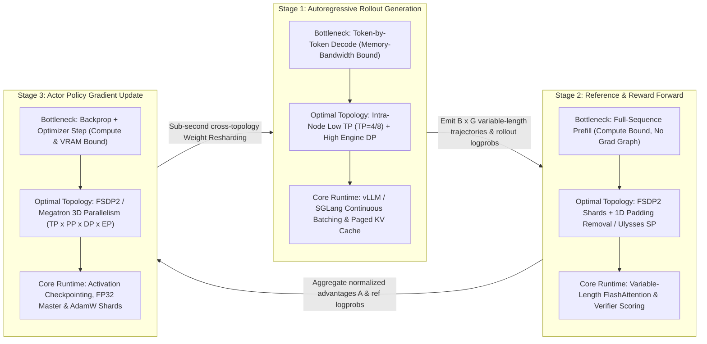
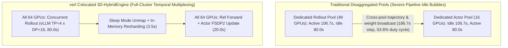
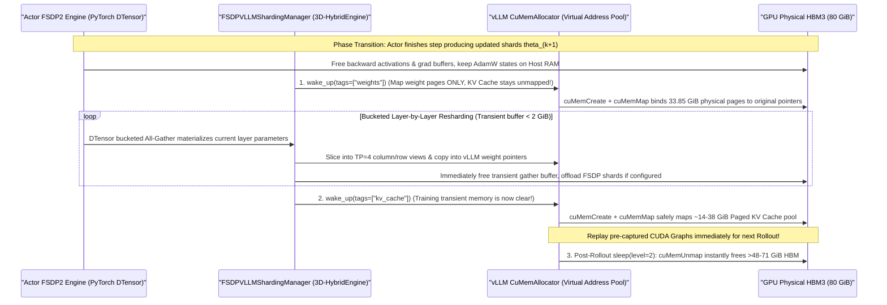
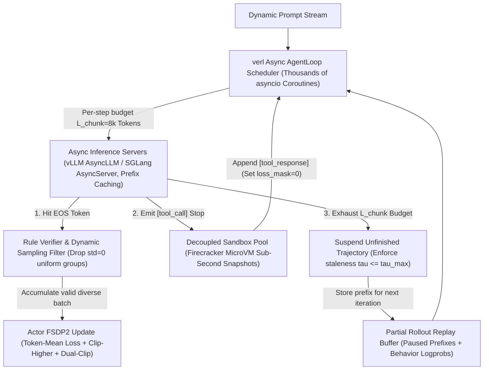

> [!NOTE] Executive Summary (TL;DR)
> - **Heterogeneous Compute Mismatch Is the Real RL Bottleneck**: Each RL post-training step alternates between memory-bandwidth-bound autoregressive generation (Rollout), compute-bound Reference/Reward forward passes, and compute-plus-VRAM-bound Actor backpropagation; across multi-node clusters, rollout generation consumes $70\%\text{--}85\%$ of wall-clock step time.
> - **Colocation Crushes Static Disaggregated Pools**: For Qwen2.5-72B on $64 \times \text{H100-80GB}$, synchronous disaggregated pools suffer from an unavoidable $\sim 44\%$ idle bubble even under calculus-optimal GPU partitioning; `verl`'s colocated architecture time-multiplexes all GPUs across both phases, accelerating end-to-end step throughput by $\sim 1.8\times$.
> - **Virtual Memory Unmapping & Zero-Redundancy Resharding**: By combining vLLM `Sleep Mode` (staging CUDA `cuMemUnmap` / `cuMemMap` across `"weights"` and `"kv_cache"` tags) with `verl`'s `3D-HybridEngine` (bucketed `DTensor` `All-Gather` and micro data-parallel group `dp_g` resharding), 100GB+ weights transition in $1.5\text{--}3.5\text{ s}$ with zero disk I/O and zero overlap OOM spikes.
> - **Partial Rollouts & DAPO Eliminate Long-Tail Stragglers**: Against $32\text{k}\text{--}64\text{k}$ reasoning chains and multi-turn sandbox tool calls, combining chunked Partial Rollout replay buffers, staleness-bounded Dual-Clip importance sampling (`clip_ratio_c=3.0`), DAPO dynamic sampling, and decoupled async coroutine pools sustains $>90\%$ effective cluster utilization.

## Introduction: Why Distributed Heterogeneous Scheduling—Not Policy Math—Bottlenecks RL Post-Training

Running supervised fine-tuning (SFT) or a single-node 7B prototype from [Test-Time Compute and GRPO in Practice: From PPO to Critic-Free Reinforcement Learning](/en/articles/test-time-compute-grpo/) takes fewer than two hundred lines of PyTorch. Throughout SFT, every GPU executes a completely homogeneous `Forward -> Backward -> Optimizer Step` loop dominated by dense GEMMs; tensor parallelism (TP) and Fully Sharded Data Parallelism (FSDP2) remain static from initialization to convergence, routinely sustaining $45\%\text{--}55\%$ Model FLOPs Utilization (MFU).

Yet when engineering teams scale post-training reinforcement learning to **72B dense models** or **235B–671B Mixture-of-Experts (MoE) models** across **64 to 512 H100/H800 GPUs**—targeting long Chain-of-Thought (Long-CoT) reasoning or multi-turn sandbox tool interaction—the first wall they hit is rarely algorithmic divergence. Instead, **effective cluster GPU utilization plummets below $15\%$, accompanied by relentless phase-transition CUDA OOMs and NCCL watchdog timeouts**.

The root cause is structural: **a single RL post-training iteration is a heterogeneous dataflow graph chaining three execution stages with diametrically opposed hardware bottlenecks and mutually incompatible optimal parallelism topologies**.



As illustrated above, the exact same Actor network demands contradictory execution layouts within seconds of each other:
1. **Autoregressive Rollout Stage (Memory-Bandwidth Bound)**: Decoding each token streams over a hundred gigabytes of model weights and dynamically growing KV Cache pages from HBM into SRAM at minimal arithmetic intensity. High throughput requires tight intra-node Tensor Parallelism (e.g., `TP=4` or `TP=8` inside an NVLink domain) paired with PagedAttention continuous batching, as detailed in our [Production vLLM Serving Guide](/en/articles/vllm-serving-guide/). Calling native PyTorch FSDP `model.generate()` directly—triggering cross-node `All-Gather` collectives on every decoded token—degrades generation throughput by $15\times\text{--}30\times$.
2. **Reference Log-Probability Forward Stage (Compute Bound)**: Requires neither backward activation graphs nor optimizer states, executing a single high-arithmetic-intensity Prefill pass over packed variable-length trajectories to extract $\log \pi_{\text{ref}}(o \mid q)$ and exact baseline policy log-probabilities.
3. **Actor Policy Update Stage (Compute + Optimizer-VRAM Bound)**: Must hold BF16 parameters, BF16/FP32 gradients, FP32 master weights, FP32 AdamW first and second moments ($m, v$), checkpointed activations, and vocabulary-wide logits—mandating **PyTorch FSDP2 (`DTensor`)** or **Megatron-Core (`TP × PP × DP × EP`)** sharding across dozens or hundreds of GPUs.

Bridging high-throughput inference engines and fully sharded distributed trainers on the same physical silicon—without overflowing HBM or stalling on disk checkpoints—is the defining architectural contribution of modern RL frameworks led by **`verl` (Volcano Engine Reinforcement Learning, the open-source production implementation of the EuroSys '25 *HybridFlow* paper)** and **OpenRLHF**.

---

## 1. First-Principles VRAM & Compute Ledger: Disaggregated Pools vs. Colocated Multiplexing

Before choosing a cluster topology, we must establish a byte-exact HBM ledger and a closed-form wall-clock model for a production 72B reasoning workload.

### 1.1 Byte-Exact VRAM Breakdown for Qwen2.5-72B & Frontier MoE Models

Consider **Qwen2.5-72B** (total parameters $\Psi = 72.7 \times 10^9$, hidden layers $L = 80$, hidden size $D = 8192$, query heads $H_q = 64$, GQA key-value heads $H_{kv} = 8$, head dimension $d_{\text{head}} = 128$) running GRPO across **8 nodes of 8× H100-80GB SXM5 GPUs ($N = 64$ GPUs total, reporting both decimal $\text{GB} = 10^9\text{ B}$ and binary $\text{GiB} = 2^{30}\text{ B}$ against an $80\text{ GiB}$ HBM3 ceiling)**:

1. **Actor Static Training States (Mixed-Precision BF16 + FP32 AdamW = $16\text{ Bytes}/\text{param}$)**:
   - **BF16 Parameters**: $2\text{ Bytes} \times 72.7 \times 10^9 = 145.4\text{ GB}$ ($135.41\text{ GiB}$);
   - **BF16 Gradients**: $2\text{ Bytes} \times 72.7 \times 10^9 = 145.4\text{ GB}$ ($135.41\text{ GiB}$; note that enabling FP32 gradient reduce-scatter via `reduce_dtype=fp32` doubles this buffer to $4\text{ Bytes}/\text{param}$, raising total Actor static state to $18\text{ Bytes}/\text{param}$);
   - **FP32 Master Weights**: $4\text{ Bytes} \times 72.7 \times 10^9 = 290.8\text{ GB}$ ($270.83\text{ GiB}$);
   - **FP32 AdamW First ($m$) & Second ($v$) Moments**: $(4 + 4)\text{ Bytes} \times 72.7 \times 10^9 = 581.6\text{ GB}$ ($541.66\text{ GiB}$).
   - **Total Actor Static Footprint**:
     $$M_{\text{actor}} = 16 \times 72.7 \times 10^9\text{ Bytes} = 1,163.2\text{ GB} \approx 1,083.31\text{ GiB}$$
     Sharded uniformly across $64$ GPUs via FSDP2, persistent per-GPU residency is $1,083.31 / 64 \approx \mathbf{16.93\text{ GiB/GPU}}$.

2. **Reference Model Static Footprint (Frozen BF16 = $2\text{ Bytes}/\text{param}$)**:
   - GRPO eliminates the Critic value network entirely (instantly saving $1,083.31\text{ GiB}$!), while an explicit KL anchor (`use_kl_loss=True`) requires $145.4\text{ GB}$ ($135.41\text{ GiB}$) for frozen $\pi_{\text{ref}}$, consuming just $\mathbf{2.12\text{ GiB/GPU}}$ across $64$ FSDP shards (or $0\text{ GiB}$ idle when CPU-offloaded).

3. **Rollout Engine Weights & Long-CoT KV Cache Footprint**:
   - Spawning $16$ independent vLLM replicas at $\text{TP} = 4$ requires each replica to hold a full BF16 weight copy: $135.41\text{ GiB} / 4 = \mathbf{33.85\text{ GiB/GPU}}$.
   - Using the exact Grouped-Query Attention (GQA) formula, **per-token BF16 KV Cache consumption** for Qwen2.5-72B is:
     $$\text{KV}_{\text{token}} = 2 \times L \times H_{kv} \times d_{\text{head}} \times 2\text{ Bytes} = 2 \times 80 \times 8 \times 128 \times 2 = 327,680\text{ Bytes} = 320\text{ KiB/token}$$
     For a single extended reasoning trajectory of length $S = 32,768$ ($32\text{k}$) tokens, **one sequence's KV Cache equals**:
     $$32,768 \times 320\text{ KiB} = 10,485,760\text{ KiB} = \mathbf{10.00\text{ GiB/seq}}$$
     Across a $\text{TP}=4$ group, each concurrent $32\text{k}$ trajectory consumes $10.00 / 4 = 2.50\text{ GiB/GPU}$.

> [!TIP] Interactive VRAM & Distributed Sharding Calculator
> When sizing multi-node FSDP2 + TP colocation budgets for 72B dense models or frontier MoE architectures like DeepSeek-V3 (671B total / 37B active parameters, requiring $10,736\text{ GB} \approx 10.0\text{ TiB}$ for Actor mixed-precision states alone), use our interactive [AI Infrastructure VRAM & Cluster Sizing Toolkit](/en/tools/) to validate per-GPU peak HBM watermarks across custom GQA ratios, group sizes $G$, and sequence lengths.

This ledger exposes an immediate physical collision: if vLLM retains its weights ($33.85\text{ GiB}$) and pre-allocated KV Cache pool ($25\text{ GiB}$) during training, inference residency alone consumes $58.85\text{ GiB}$. Once Actor backpropagation begins—adding persistent FSDP shards ($19.05\text{ GiB}$), transient `All-Gather` buffers, long-context activations, and `[micro_batch, seq_len, vocab_size]` logits (with Qwen2.5's $152,064$ vocabulary, an unchunked FP32 logit tensor for a single $32\text{k}$ sequence demands $32,768 \times 152,064 \times 4\text{ Bytes} \approx 18.56\text{ GiB}$)—any $80\text{ GiB}$ GPU suffers an immediate Out-Of-Memory crash:

| Per-GPU HBM Component (Qwen2.5-72B @ 64 GPUs) | Naive Co-Residency (No Sleep) | `verl` Staged Sleep + Offload (Rollout Phase) | `verl` Staged Sleep + Offload (Actor Update Phase) |
| :--- | :--- | :--- | :--- |
| **Actor FSDP2 Params + Grad Shards** | $4.23\text{ GiB}$ | $2.12\text{ GiB}$ (lazy grad alloc) | $4.23\text{ GiB}$ |
| **Actor FP32 Master + AdamW ($m,v$)** | $12.70\text{ GiB}$ | $0\text{ GiB}$ (offloaded to Host DDR5) | $0\text{ GiB}$ (streamed / CPU-offloaded update) |
| **Reference FSDP2 Frozen Shard** | $2.12\text{ GiB}$ | $0\text{ GiB}$ (`param_offload=True`) | $0\text{ GiB}$ (streamed in Stage 2 & freed) |
| **vLLM `TP=4` Inference Weights** | $33.85\text{ GiB}$ | $33.85\text{ GiB}$ (mapped & active) | **$0\text{ GiB}$** (`sleep(level=2)` unmapped) |
| **vLLM Paged KV Cache Pool** | $25.00\text{ GiB}$ | $14.15\text{ GiB}$ (capped at `0.60` util) | **$0\text{ GiB}$** (`cuMemUnmap` physical release) |
| **Activations + Reshard/Collectives + CUDA Context** | $28.50\text{ GiB}$ | $4.20\text{ GiB}$ | $34.50\text{ GiB}$ (checkpointed acts + chunked logits) |
| **Peak Per-GPU HBM ($80.00\text{ GiB}$ Ceiling)** | **$106.40\text{ GiB}$ (Guaranteed OOM)** | **$54.32\text{ GiB}$ ($>25\text{ GiB}$ Headroom)** | **$38.73\text{ GiB}$ (Scales cleanly to $64\text{k}$ CoT)** |

### 1.2 Proving the Disaggregated Pipeline Bubble vs. Colocated Temporal Multiplexing

To sidestep single-GPU memory contention, first-generation RLHF systems (and OpenRLHF's non-colocated disaggregated mode) partition the Ray cluster into dedicated **Rollout GPU Pools** and **Actor Training GPU Pools**.

Let us derive the exact structural bubble of synchronous on-policy RL under disaggregation. Suppose across $N = 64$ GPUs, one GRPO iteration requires:
- Aggregate Rollout generation compute $W_{\text{roll}} = 5,120\text{ GPU}\cdot\text{s}$ ($80\%$ of total step work);
- Aggregate Ref forward + Actor backward compute $W_{\text{train}} = 1,280\text{ GPU}\cdot\text{s}$ ($20\%$ of total step work).

In a **Synchronous Disaggregated Architecture**, we assign $\alpha N$ GPUs to Rollout and $(1 - \alpha)N$ GPUs to Training ($0 < \alpha < 1$). Because strict on-policy GRPO cannot compute policy gradients for $\pi_{\theta_k}$ until the rollout batch finishes generating, the two pools execute serially across a synchronization barrier:

$$T_{\text{disagg}}(\alpha) = \frac{W_{\text{roll}}}{\alpha N} + \frac{W_{\text{train}}}{(1 - \alpha) N}$$

Differentiating with respect to $\alpha$ and setting $\frac{\mathrm{d}T_{\text{disagg}}}{\mathrm{d}\alpha} = 0$ yields the global minimum:

$$-\frac{W_{\text{roll}}}{\alpha^2 N} + \frac{W_{\text{train}}}{(1 - \alpha)^2 N} = 0 \implies \frac{\alpha^*}{1 - \alpha^*} = \sqrt{\frac{W_{\text{roll}}}{W_{\text{train}}}} = \sqrt{\frac{5120}{1280}} = 2 \implies \alpha^* = \frac{2}{3}$$

Even at the continuous calculus optimum $\alpha^* = 2/3$ (ignoring node/TP power-of-two divisibility constraints), minimum step latency is bounded below by:

$$T_{\text{disagg}}(\alpha^*) = \frac{\left(\sqrt{W_{\text{roll}}} + \sqrt{W_{\text{train}}}\right)^2}{N} = \frac{\left(\sqrt{5120} + \sqrt{1280}\right)^2}{64} = \frac{11,520}{64} = \mathbf{180.0\text{ s}}$$

Rounding to valid 8-GPU node boundaries ($48$ Rollout GPUs + $16$ Training GPUs) yields $5120/48 + 1280/16 = \mathbf{186.7\text{ s}}$; a naive $32 / 32$ split takes $160 + 40 = \mathbf{200.0\text{ s}}$, locking cluster active duty cycle at exactly **$50.0\%$**!

Now compare **`verl`'s Colocated Architecture**: all $N = 64$ GPUs execute Rollout concurrently ($5120 / 64 = 80.0\text{ s}$), execute an in-memory sleep/reshard transition in $T_{\text{switch}} \approx 3.5\text{ s}$, and then all $64$ GPUs execute Ref forward + Actor updates concurrently ($1280 / 64 = 20.0\text{ s}$):

$$T_{\text{coloc}} = \frac{W_{\text{roll}}}{N} + T_{\text{switch}} + \frac{W_{\text{train}}}{N} = 80.0 + 3.5 + 20.0 = \mathbf{103.5\text{ s}}$$

Colocation delivers an immediate **$1.80\times\text{--}1.93\times$ wall-clock speedup**, lifting active cluster duty cycle to $6400 / (64 \times 103.5) \approx \mathbf{96.6\%}$. Better still, during Reasoning RL, emergent self-reflection routinely causes average response lengths to surge $5\times\text{--}10\times$ mid-run (e.g., from $1.5\text{k}$ tokens at step 0 to $16\text{k}$ tokens at step 1,500), continuously invalidating any static disaggregated partition $\alpha$, whereas colocated time-multiplexing adapts elastically at zero reconfiguration cost.



| Architectural Dimension | Synchronous Disaggregated | Async Pipelined Disaggregated (OpenRLHF Async / AReaL) | Colocated Multiplexing (`verl` `3D-HybridEngine`) |
| :--- | :--- | :--- | :--- |
| **Physical GPU Ownership** | Isolated Ray placement groups per role | Isolated Actor & Learner pools overlapped across steps | Identical physical GPUs time-shared across all phases |
| **Policy Staleness ($\tau$)** | Strictly On-Policy ($\tau = 0$) | Inherent $\tau \ge 1$ step off-policy lag | Strictly On-Policy ($\tau = 0$) by default; optional async |
| **Adaptability to Growing CoT** | Poor (longer CoTs starve training GPUs) | Moderate (requires dynamic pool re-allocation) | Optimal (100% of cluster shifts organically between phases) |
| **VRAM Engineering Complexity** | Low (dedicated $80\text{ GiB}$ per engine) | Low (dedicated HBM + periodic NCCL weight push) | High (requires virtual memory unmapping & staged wake-up) |
| **Ideal Production Regime** | Heterogeneous hardware (e.g., H20 Rollout + H800 Train) | Ultra-slow external environments tolerant of off-policy lag | Standard 64–512 homogeneous GPU GRPO / DAPO post-training |

---

## 2. Sub-Second Mode Switching Under the Hood: vLLM / SGLang Sleep Mode & 3D-HybridEngine Resharding

How do modern RL frameworks achieve $96\%+$ colocated duty cycles without either crashing from the $106.4\text{ GiB}$ memory collision in Table 1 or burning minutes tearing down and cold-starting inference servers every step? Two low-level systems breakthroughs make this possible: **CUDA virtual-memory-backed Sleep Mode** and **zero-redundancy `3D-HybridEngine` weight resharding**.

### 2.1 Dissecting vLLM `Sleep Mode` (`level=1/2`) & SGLang `torch_memory_saver`

Destroying a vLLM or SGLang process after every rollout step and re-initializing it on the next step incurs crippling overhead: reloading custom JIT/Triton kernels, rebuilding NCCL TP communicators, and **re-capturing dozens of batch-size CUDA Graphs** ($20\text{--}50\text{ s}$ per step on a 72B multi-GPU engine).

However, CUDA Graphs enforce an unforgiving hardware invariant: **every weight tensor and KV Cache buffer baked into a captured graph must retain its exact virtual memory address (`CUdeviceptr`) across replays**, or replay immediately faults with `CUDA_ERROR_INVALID_VALUE`.

To release physical HBM pages back to the GPU driver while freezing virtual address pointers in place, vLLM (`enable_sleep_mode=True`) leverages `CuMemAllocator` built atop the CUDA Driver Virtual Memory Management API (`cuMemAddressReserve`, `cuMemCreate`, `cuMemMap`, `cuMemUnmap`, `cuMemRelease`). In parallel, SGLang (`--enable-memory-saver`, architectural trade-offs detailed in [SGLang vs. vLLM Architecture Deep Dive](/en/articles/sglang-vs-vllm-architecture/)) intercepts allocations via `torch_memory_saver` to expose `release_memory_occupation()` and `resume_memory_occupation()`.

Inside vLLM, every memory allocation is tagged as `"weights"` or `"kv_cache"`, supporting two distinct hibernation levels:
- **`llm.sleep(level=1)` (Host-Backed Hibernation)**: Asynchronously DMAs `"weights"` from GPU HBM into pinned Host CPU RAM, discards `"kv_cache"` contents, and invokes `cuMemUnmap` + `cuMemRelease` to return $>92\%$ of physical HBM pages to the driver while preserving reserved virtual address ranges and captured CUDA Graphs. Ideal when waking the engine later with **unchanged** weights (e.g., multi-model serving or frozen reference scoring).
- **`llm.sleep(level=2)` (Zero-Backup Unmap — The RL Post-Training Gold Standard)**: Because the Actor is about to compute freshly updated policy weights $\theta_{k+1}$, backing up stale rollout weights $\theta_k$ over PCIe to CPU RAM is pure waste! `level=2` **discards both `"weights"` and `"kv_cache"`** without touching Host RAM (retaining only tiny static buffers like RoPE cos/sin caches), unmapping physical HBM in milliseconds.

Crucially, preventing transition-spike OOMs on 72B+ models requires **Staged Tag-Based Wake-Up**:



Notice why staging `tags=["weights"]` before `tags=["kv_cache"]` is non-negotiable: calling an un-staged `llm.wake_up()` while FSDP still holds active shards and `All-Gather` buffers would map both $33.85\text{ GiB}$ of weights and up to $38\text{ GiB}$ of KV Cache simultaneously alongside $\sim 21\text{ GiB}$ of training buffers ($92.85\text{ GiB} > 80\text{ GiB}$), triggering an instant OOM during weight synchronization. Staging shaves nearly $40\text{ GiB}$ off the transition watermark.

### 2.2 `verl` 3D-HybridEngine: Micro Data-Parallel Groups (`dp_g`) & Zero-Redundancy Resharding

With physical HBM cleanly time-multiplexed, `verl`'s `3D-HybridEngine` solves the second challenge: resharding parameters from training parallelism $(p, t, d)$ (pipeline $p$, tensor $t$, data/ZeRO $d$, where $N = p \times t \times d$) into generation parallelism $(p_g, t_g, d_g)$ (typically $p_g = 1$, rollout TP $t_g$, and engine replicas $d_g = N / t_g$).

Naive full-model gathering (e.g., `FSDP.summon_full_params()` across the entire 72.7B model) would materialize $145.4\text{ GB}$ on every GPU simultaneously, crashing immediately. Instead, `FSDPVLLMShardingManager` and Megatron resharding bridges apply two key optimizations:

1. **Orthogonal Micro Data-Parallel Groups (`dp_g`)**:
   When training uses Megatron 3D parallelism $(p, t, d)$ and inference uses $(1, t_g, d_g)$ (where $t_g$ is a multiple of $t$, giving micro-group span $g = p \cdot \frac{t_g}{t}$ and $d = g \cdot d_g$), `3D-HybridEngine` partitions the global DP axis into disjoint **micro data-parallel sub-communicators (`dp_g`)**. Instead of broadcasting weights across all $N = 64$ GPUs, concurrent `All-Gather` collectives execute strictly within minimal local subgroups of size $p \times \frac{t_g}{t}$, eliminating spine-switch congestion. On rack-scale NVLink domains (collective topology analyzed in [Rack-Scale SuperPOD NVL72 Architecture and NCCL Collectives Deep Dive](/en/articles/rack-scale-superpod-nvl72-nccl-collectives/)), `dp_g` resharding stays $100\%$ inside $900\text{ GB/s}$ NVSwitch fabric.
2. **Bucketed Streaming `DTensor` Redistribution**:
   Under FSDP2 (`actor.strategy=fsdp2`), each parameter is a PyTorch `DTensor`. Entering Rollout, `FSDPVLLMShardingManager` iterates module-by-module, invoking `full_tensor()` on one transformer layer bucket at a time ($< 1.8\text{ GB}$ transient buffer), slicing fused `qkv_proj` and `gate_up_proj` views directly into vLLM's mapped weight tensors via `dtensor_weight_loader`, and immediately freeing the transient gather buffer.

Validating against wire speed: across an 8-node, 64× H100 cluster with rail-optimized $8 \times 400\text{ Gbps}$ InfiniBand ($\sim 50\text{ GB/s}$ unidirectional per NIC; RDMA fabric tuning covered in [Production InfiniBand Deployment: OpenSM, OFED, and NCCL Tuning](/en/articles/infiniband-production-deployment-opensm-ofed-nccl-tuning/)), streaming a full Ring `All-Gather` of $145.4\text{ GB}$ takes just $\frac{63}{64} \times \frac{145.4\text{ GB}}{50\text{ GB/s}} \approx \mathbf{2.86\text{ s}}$ (and under **$0.5\text{--}1.2\text{ s}$** with intra-node HSDP/NVLink subgroups)—nearly two orders of magnitude faster than shared-filesystem checkpointing ($40\text{--}90\text{ s}$).

---

## 3. Conquering the Long-Tail Straggler Effect: Partial Rollouts, Async AgentLoops & DAPO

Even after eliminating static pool bubbles and weight-sync overhead, scaling DeepSeek-R1-style Long-CoT training or multi-turn Agentic RL surfaces a vicious second bottleneck: **every rollout step runs at 100% GPU compute for the first 30 seconds, followed by 150 seconds where 90% of cluster GPUs flatline near 0% SM utilization**.

### 3.1 Anatomy of Group-Sampling Stragglers & Sandbox I/O Stalls

In GRPO, each batch of $B$ prompts spawns $G$ parallel completions ($B = 128\text{--}512$, $G = 8\text{--}16$, yielding $2,048\text{--}8,192$ trajectories per step). Under a synchronous batch barrier, rollout duration is dictated by the **single slowest trajectory across the entire cluster**:

$$T_{\text{rollout\_step}} = \max_{b \in [1, B],\, i \in [1, G]} \left( T_{\text{prefill}}(q_b) + \sum_{t=1}^{|o_{b,i}|} T_{\text{decode}}(t) + \sum_{m=1}^{M_{b,i}} T_{\text{sandbox}}(m) \right)$$

This extreme-value bottleneck manifests violently in two production workloads:
1. **Heavy-Tailed Reasoning Lengths**: While $95\%$ of math/coding completions terminate cleanly within $2\text{k}\text{--}6\text{k}$ tokens, $5\%$ hit Olympiad edge cases or self-verification loops stretching to $32,768\text{--}65,536$ tokens. Worse, per-token attention memory traffic scales linearly with sequence length, so the final straggling $64\text{k}$ trajectories decode at batch size $1$ with $<2\%$ compute efficiency while holding $60+$ peer GPUs hostage.
2. **Multi-Turn Agentic Tool Stalls**: In agentic RL environments (architecture patterns explored in our [Environment Scaling Guide for AI Agents](/en/articles/environment-scaling-agent-guide/)), emitting `<tool_call>` pauses generation while external sandboxes compile C++/Rust crates, run `pytest` suites, or query search indices. Blocking GPU workers synchronously on external I/O starves tensor cores across the board.

### 3.2 Four Co-Designed Systems & Algorithmic Solutions

State-of-the-art RL stacks (Moonshot Kimi k1.5, ByteDance Seed's DAPO, and `verl`'s async server engine) dismantle straggler bubbles through four co-designed mechanisms:



#### 1. Partial / Chunked Rollouts Across Iterations
Pioneered at scale in Kimi k1.5, **Partial Rollout** enforces a strict **per-step output token budget $L_{\text{chunk}}$** (e.g., $8,192$ tokens against a $65,536$ total cap):
- Any trajectory reaching $8,192$ tokens without emitting EOS is cleanly suspended; its token prefix and **per-token behavior policy log-probabilities $\log \mu(o_t \mid q, o_{<t})$** are written into a **Replay Buffer**.
- Completed trajectories immediately proceed to Actor gradient updates without waiting for tail outliers! On the next RL step, suspended prefixes resume generation from the Replay Buffer—leveraging Prefix Caching to restore KV states rapidly.

Because a multi-chunk trajectory combines segments generated under slightly older policies $\pi_{\theta_{k-\tau}}, \dots, \pi_{\theta_k}$, stability requires two mathematical guardrails:
- **Hard Staleness Bound ($\tau_{\max}$)**: Track each trajectory's originating policy step $k_{\text{start}}$ and evict or re-verify trajectories exceeding $k - k_{\text{start}} > \tau_{\max}$ (typically $2\text{--}4$ steps).
- **Dual-Clip PPO (`verl` `clip_ratio_c = 3.0`)**: When $\hat{A}_{i,t} < 0$ and off-policy lag inflates $r_{i,t}(\theta) = \frac{\pi_\theta(o_{i,t} \mid q, o_{i,<t})}{\mu(o_{i,t} \mid q, o_{i,<t})} \gg 1$, standard PPO leaves negative-advantage terms unbounded below, causing destructive gradient spikes; Dual-Clip enforces a lower ceiling $c \cdot \hat{A}_{i,t}$ ($c = 3.0$).

#### 2. Coroutine-Driven Async `AgentLoop` & Observation Loss Masking
With `actor_rollout_ref.rollout.mode=async`, `verl` wraps vLLM (`AsyncLLM`) or SGLang (`AsyncSGLangServer`) behind thousands of lightweight `asyncio` trajectory coroutines:
- Emitting `</tool_call>` immediately evicts the request from the GPU batch slot—freeing compute for active requests—while the coroutine dispatches an async RPC to an isolated execution pool (see [Agent Sandbox Isolation in Production: Firecracker MicroVM Sub-Second Snapshots](/en/articles/agent-sandbox-firecracker-microvm-snapshot-isolation/)).
- Once `<tool_response>...</tool_response>` returns, the coroutine appends the observation and re-enters continuous batching with automatic prefix-cache reuse.
- **Non-Negotiable Invariant — Observation Masking ($m_{i,t} \in \{0, 1\}$)**: Tokens inside `<tool_response>` come from the external environment rather than $\pi_\theta$. Setting `response_mask` $m_{i,t} = 0$ on all environment observation tokens ensures gradients and KL penalties apply strictly to model-generated tokens.

#### 3. DAPO's Four Co-Designed Objective Refinements
Built directly on `verl`, ByteDance Seed's **DAPO (Decoupled Clip and Dynamic Sampling Policy Optimization)** resolves three subtle failure modes of vanilla GRPO on long chains of thought. Incorporating multi-turn masking $m_{i,t}$, asymmetric decoupled clipping, and token-level normalization yields the unified surrogate objective:

$$\mathcal{J}_{\text{DAPO}}(\theta) = \mathbb{E}_{(q,a)\sim\mathcal{D},\,\{o_i\}_{i=1}^G\sim\mu(\cdot\mid q)} \left[ \frac{1}{\sum_{i=1}^G \sum_{t=1}^{|o_i|} m_{i,t}} \sum_{i=1}^G \sum_{t=1}^{|o_i|} m_{i,t} \cdot \mathcal{L}_{\text{dual-clip}}\big(r_{i,t}(\theta), \hat{A}_{i,t}\big) \right]$$

where the per-token asymmetric dual-clipped surrogate $\mathcal{L}_{\text{dual-clip}}$ ($c = 3.0$, $\varepsilon_{\text{low}} = 0.20$, $\varepsilon_{\text{high}} = 0.28$) is:

$$\mathcal{L}_{\text{simple}}(r, \hat{A}) = \min\Big(r \cdot \hat{A},\; \operatorname{clip}(r,\, 1 - \varepsilon_{\text{low}},\, 1 + \varepsilon_{\text{high}}) \cdot \hat{A}\Big)$$

$$\mathcal{L}_{\text{dual-clip}}(r, \hat{A}) = \begin{cases} \max\big(\mathcal{L}_{\text{simple}}(r, \hat{A}),\; c \cdot \hat{A}\big), & \text{if } \hat{A} < 0 \\ \mathcal{L}_{\text{simple}}(r, \hat{A}), & \text{if } \hat{A} \ge 0 \end{cases}$$

When anchoring to $\pi_{\text{ref}}$ (`use_kl_loss=True`, recommended for general agentic tool-use alignment to preserve instruction following), `verl` applies Schulman's strictly non-negative, low-variance $k_3$ estimator (`kl_loss_type="low_var_kl"`):

$$D_{\text{KL}}^{(k_3)}\big(\pi_\theta \,\|\, \pi_{\text{ref}}\big) = \frac{\pi_{\text{ref}}(o_{i,t} \mid q, o_{i,<t})}{\pi_\theta(o_{i,t} \mid q, o_{i,<t})} - \log \frac{\pi_{\text{ref}}(o_{i,t} \mid q, o_{i,<t})}{\pi_\theta(o_{i,t} \mid q, o_{i,<t})} - 1 \ge 0$$

Three high-leverage engineering takeaways emerge directly from these equations:
1. **Clip-Higher ($\varepsilon_{\text{high}} = 0.28 > \varepsilon_{\text{low}} = 0.20$)**: Under symmetric $\varepsilon = 0.20$, a rare exploratory reflection token with $\pi_{\theta_{\text{old}}} = 0.01$ is capped at $0.012$ per update, starving exploration and inducing premature **entropy collapse**. Decoupling $\varepsilon_{\text{high}} = 0.28$ accelerates reinforcement of low-probability reasoning branches while keeping $\varepsilon_{\text{low}} = 0.20$ conservative on probability suppression.
2. **Token-Level Policy Gradient Loss (`loss_agg_mode="token-mean"`)**: Sample-level averaging ($\frac{1}{\lvert o_i \rvert}$) dilutes per-token gradients inside $20\text{k}$-token proofs by $20\times$ relative to $1\text{k}$-token answers—simultaneously under-rewarding deep reasoning steps and under-penalizing long gibberish loops. Normalizing by $\sum_{i,t} m_{i,t}$ weights every generated reasoning token equally across the batch.
3. **Dynamic Sampling & Overlong Reward Shaping**: Whenever all $G=16$ completions for a prompt are uniformly correct or uniformly wrong, $\operatorname{std}(\{R_j\}) = 0 \implies \hat{A}_{i,t} = 0$—feeding zero-gradient dead weight into FSDP2 backward passes! Dynamic Sampling filters out $\operatorname{std} = 0$ groups on the fly until `train_batch_size` diverse groups accumulate, while a linear soft-penalty buffer over the final $4,096$ tokens before `max_response_length` eliminates hard-truncation reward noise and verbosity hacking.

---

## 4. Production Implementation: 64-GPU Ray + `verl` Colocated GRPO Config & Custom Agent Loop

Below is a battle-tested, cross-verified production setup for **Qwen2.5-72B Long-CoT & Multi-Turn Sandbox RL** across **8 nodes × 8× H100-80GB GPUs (64 GPUs)** using `verl`.

### 4.1 64-GPU Multi-Node Colocated Launch Script (`FSDP2` + `vLLM Async` + `Clip-Higher`)

With the Ray cluster online across 8 RDMA-connected nodes, launch `verl.trainer.main_ppo` with the following Hydra overrides:

```bash
#!/usr/bin/env bash
set -euo pipefail

# Critical NCCL & CUDA Virtual Memory allocator safeguards
export NCCL_DEBUG=WARN
export NCCL_IB_GID_INDEX=3
export TORCH_NCCL_AVOID_RECORD_STREAMS=1
export PYTORCH_CUDA_ALLOC_CONF="expandable_segments:False"
export VLLM_ATTENTION_BACKEND=FLASH_ATTN

MODEL_PATH="/mnt/shared/models/Qwen2.5-72B-Instruct"
DATA_DIR="/mnt/shared/datasets/reasoning_code_rl"
REWARD_SCRIPT="/mnt/shared/verl_jobs/verifiable_reward.py"
TOOL_CONFIG="/mnt/shared/verl_jobs/sandbox_tools.yaml"

python3 -m verl.trainer.main_ppo \
    algorithm.adv_estimator=grpo \
    algorithm.use_kl_in_reward=False \
    data.train_files="${DATA_DIR}/train.parquet" \
    data.val_files="${DATA_DIR}/val.parquet" \
    data.train_batch_size=256 \
    data.max_prompt_length=2048 \
    data.max_response_length=32768 \
    data.filter_overlong_prompts=True \
    actor_rollout_ref.model.path="${MODEL_PATH}" \
    actor_rollout_ref.model.use_remove_padding=True \
    actor_rollout_ref.model.enable_gradient_checkpointing=True \
    actor_rollout_ref.actor.strategy=fsdp2 \
    actor_rollout_ref.actor.optim.lr=1e-6 \
    actor_rollout_ref.actor.ppo_mini_batch_size=64 \
    actor_rollout_ref.actor.ppo_micro_batch_size_per_gpu=1 \
    actor_rollout_ref.actor.use_dynamic_bsz=True \
    actor_rollout_ref.actor.ppo_max_token_len_per_gpu=36864 \
    actor_rollout_ref.actor.use_kl_loss=True \
    actor_rollout_ref.actor.kl_loss_coef=0.001 \
    actor_rollout_ref.actor.kl_loss_type=low_var_kl \
    actor_rollout_ref.actor.clip_ratio_low=0.2 \
    actor_rollout_ref.actor.clip_ratio_high=0.28 \
    actor_rollout_ref.actor.clip_ratio_c=3.0 \
    actor_rollout_ref.actor.loss_agg_mode=token-mean \
    actor_rollout_ref.actor.entropy_coeff=0.0 \
    actor_rollout_ref.actor.fsdp_config.param_offload=False \
    actor_rollout_ref.actor.fsdp_config.optimizer_offload=True \
    actor_rollout_ref.rollout.name=vllm \
    actor_rollout_ref.rollout.mode=async \
    actor_rollout_ref.rollout.multi_turn=True \
    actor_rollout_ref.rollout.tool_kwargs.tools_config_file="${TOOL_CONFIG}" \
    actor_rollout_ref.rollout.n=16 \
    actor_rollout_ref.rollout.tensor_model_parallel_size=4 \
    actor_rollout_ref.rollout.gpu_memory_utilization=0.60 \
    actor_rollout_ref.rollout.free_cache_engine=True \
    actor_rollout_ref.rollout.log_prob_micro_batch_size_per_gpu=2 \
    actor_rollout_ref.ref.fsdp_config.param_offload=True \
    actor_rollout_ref.ref.log_prob_micro_batch_size_per_gpu=2 \
    custom_reward_function.path="${REWARD_SCRIPT}" \
    custom_reward_function.name=compute_score \
    trainer.critic_warmup=0 \
    trainer.logger='["console","wandb"]' \
    trainer.project_name="qwen72b-grpo-colocated" \
    trainer.experiment_name="64xh100-fsdp2-vllm-async" \
    trainer.n_gpus_per_node=8 \
    trainer.nnodes=8 \
    trainer.save_freq=25 \
    trainer.test_freq=10 \
    trainer.total_epochs=15
```

Pay close attention to three production-critical details in this launch specification:
1. **Why `PYTORCH_CUDA_ALLOC_CONF="expandable_segments:False"` Is Mandatory**: Both PyTorch's `expandable_segments:True` allocator and vLLM's `Sleep Mode` `CuMemAllocator` manipulate low-level CUDA Virtual Memory APIs (`cuMemAddressReserve` / `cuMemMap`). Enabling both inside the same colocated worker process triggers driver virtual-segment fragmentation and un-reclaimable reserved blocks during `wake_up()`. Disabling PyTorch expandable segments while delegating KV unmapping to `free_cache_engine=True` eliminates virtual-memory allocator clashes.
2. **Dynamic Token Micro-Batching (`use_dynamic_bsz=True` + `ppo_max_token_len_per_gpu=36864`)**: Combined with `use_remove_padding=True` (1D packed unpadded sequences), `verl` packs multiple short $2\text{k}$-token trajectories into one micro-batch while isolating a $32\text{k}$-token outlier into its own micro-batch—preventing random micro-batch length spikes from OOMing individual ranks.
3. **Disciplined `gpu_memory_utilization=0.60` Sizing**: Offloading the $812.49\text{ GiB}$ of FP32 master weights and AdamW states (`optimizer_offload=True`) plus frozen Reference shards (`ref.fsdp_config.param_offload=True`) to abundant 2TB Host DDR5 RAM leaves only $2.12\text{ GiB/GPU}$ of Actor BF16 shards resident on HBM. Capping vLLM at $0.60$ ($\sim 48\text{ GiB/GPU}$: $33.85\text{ GiB}$ `TP=4` weights + $14.15\text{ GiB/GPU}$ KV Cache = $56.6\text{ GiB}$ KV pool per replica) preserves $>25\text{ GiB/GPU}$ of clean headroom for NCCL buffers and streaming weight resharding.

### 4.2 Custom Verifiable Reward (with Overlong Shaping) & Stateful Async Sandbox Tool

Below is `verifiable_reward.py` alongside a stateful multi-turn sandbox tool inheriting `verl.tools.base_tool.BaseTool`:

```python
# /mnt/shared/verl_jobs/verifiable_reward.py
import re
from typing import Any, Optional

THINK_ANS_PATTERN = re.compile(
    r"^<think>\s*.+?\s*</think>\s*<answer>\s*(.+?)\s*</answer>\s*$",
    re.DOTALL,
)


def compute_score(
    data_source: str,
    solution_str: str,
    ground_truth: str,
    extra_info: Optional[dict[str, Any]] = None,
) -> float:
    """Custom verl verifiable reward: exact match + format check + DAPO overlong penalty."""
    match = THINK_ANS_PATTERN.match(solution_str.strip())
    if not match:
        base_reward = -1.0
    else:
        extracted_answer = match.group(1).strip()
        is_correct = (extracted_answer == ground_truth.strip())
        base_reward = 1.0 if is_correct else -0.5

    # DAPO Overlong Reward Shaping: linear penalty across the final 4096-token buffer before 32768
    if extra_info and "response_token_len" in extra_info:
        resp_len = int(extra_info["response_token_len"])
        max_len = 32768
        buffer_len = 4096
        soft_limit = max_len - buffer_len
        if resp_len > soft_limit:
            overlong_penalty = min(1.0, (resp_len - soft_limit) / buffer_len)
            base_reward -= overlong_penalty

    return float(base_reward)
```

For multi-turn code verification, subclass `BaseTool` so each trajectory binds a dedicated `instance_id` backed by an async HTTP sandbox gateway without blocking GPU event loops:

```python
# /mnt/shared/verl_jobs/code_sandbox_tool.py
import uuid
import httpx
from typing import Any, Optional
from verl.tools.base_tool import BaseTool, OpenAIFunctionToolSchema
from verl.tools.schemas import ToolResponse


class AsyncSandboxTool(BaseTool):
    """Stateful multi-turn verl tool backed by a remote Firecracker microVM pool."""

    def __init__(self, config: dict, tool_schema: OpenAIFunctionToolSchema):
        super().__init__(config, tool_schema)
        self._endpoint = config.get("sandbox_gateway_url", "http://sandbox-pool.rl.svc:8080")
        self._sessions: dict[str, dict[str, Any]] = {}
        self._client = httpx.AsyncClient(timeout=httpx.Timeout(15.0, connect=3.0))

    def get_openai_tool_schema(self) -> OpenAIFunctionToolSchema:
        return self.tool_schema

    async def create(
        self, instance_id: Optional[str] = None, **kwargs: Any
    ) -> tuple[str, ToolResponse]:
        session_id = instance_id or uuid.uuid4().hex
        resp = await self._client.post(
            f"{self._endpoint}/v1/sandboxes/restore",
            json={"session_id": session_id, "snapshot": "py312-scipy-env"},
        )
        resp.raise_for_status()
        self._sessions[session_id] = {"passed_tests": False, "turns": 0}
        return session_id, ToolResponse()

    async def execute(
        self, instance_id: str, parameters: dict[str, Any], **kwargs: Any
    ) -> tuple[ToolResponse, float, dict[str, Any]]:
        code_snippet = parameters.get("code", "")
        resp = await self._client.post(
            f"{self._endpoint}/v1/sandboxes/{instance_id}/exec",
            json={"code": code_snippet, "timeout_sec": 10},
        )
        payload = resp.json()
        stdout_trunc = (payload.get("stdout", "") + payload.get("stderr", ""))[:4096]
        exit_code = payload.get("exit_code", -1)

        self._sessions[instance_id]["turns"] += 1
        self._sessions[instance_id]["passed_tests"] = (exit_code == 0)
        step_reward = 0.05 if exit_code == 0 else 0.0
        return (
            ToolResponse(text=f"[exit_code={exit_code}]\n{stdout_trunc}"),
            step_reward,
            {"exit_code": exit_code},
        )

    async def calc_reward(self, instance_id: str, **kwargs: Any) -> float:
        state = self._sessions.get(instance_id, {})
        return 0.2 if state.get("passed_tests", False) else 0.0

    async def release(self, instance_id: str, **kwargs: Any) -> None:
        self._sessions.pop(instance_id, None)
        await self._client.delete(f"{self._endpoint}/v1/sandboxes/{instance_id}")
```

Finally, bind `AsyncSandboxTool` inside `sandbox_tools.yaml` so `verl`'s `ToolAgentLoop` routes OpenAI-formatted tool calls automatically:

```yaml
# /mnt/shared/verl_jobs/sandbox_tools.yaml
tools:
  - class_name: "code_sandbox_tool.AsyncSandboxTool"
    config:
      sandbox_gateway_url: "http://sandbox-pool.rl.svc:8080"
    tool_schema:
      type: "function"
      function:
        name: "run_python_sandbox"
        description: "Execute Python verification script inside an isolated Firecracker microVM."
        parameters:
          type: "object"
          properties:
            code:
              type: "string"
              description: "Self-contained Python 3.12 source code to execute."
          required:
            - code
```

### 4.3 Production Operational Troubleshooting Checklist

When operating multi-node `verl` colocated training jobs on Kubernetes + KubeRay clusters, keep these three high-frequency failure modes at your fingertips:

1. **Symptom 1: Step 1 Finishes Cleanly, but Step 2 Crashes Inside `wake_up()` or `resume_memory_occupation()` with `CUresult error: 2 (out of memory)`**
   - **Root Cause**: After Actor step 1 finishes backpropagation, PyTorch's `CUDACachingAllocator` logically frees gradient and activation tensors but retains tens of gigabytes inside its reserved cache pool rather than returning physical pages to the NVIDIA driver—starving vLLM/SGLang's direct `cuMemCreate` driver calls.
   - **Fix**: Export `TORCH_NCCL_AVOID_RECORD_STREAMS=1` (preventing cross-stream tensor lifetime extension), verify `torch.cuda.empty_cache()` executes on `FSDPVLLMShardingManager` exit, and dial `rollout.gpu_memory_utilization` down from `0.80` to `0.55–0.65`.
2. **Symptom 2: `ProcessGroupNCCL Watchdog Timeout` Aborts the Job Hours into Long-CoT Training**
   - **Root Cause**: One worker rank gets stuck in an un-timed external tool call or runaway decode loop while finished ranks enter the next collective barrier (`All-Gather` resharding or `Reduce-Scatter`), exceeding PyTorch's default `600s` NCCL watchdog timer.
   - **Fix**: Never paper over hangs by blindly inflating `NCCL_TIMEOUT` to hours! Enforce hard `10s–15s` client timeouts on every sandbox RPC, enable chunked Partial Rollout budgets, and audit RDMA links for PFC pause storms or degraded optical transceivers per [Production InfiniBand Deployment: OpenSM, OFED, and NCCL Tuning](/en/articles/infiniband-production-deployment-opensm-ofed-nccl-tuning/).
3. **Symptom 3: Multi-Node KubeRay Jobs Hang Indefinitely Waiting for Ray Placement Groups**
   - **Root Cause**: `RayPPOTrainer` requests `STRICT_PACK` placement groups across all $8 \times 8 = 64$ GPUs before initializing distributed process groups; under Kubernetes' default pod-by-pod scheduler, two competing 64-GPU jobs can each claim 32 GPUs and deadlock forever.
   - **Fix**: Attach Volcano `PodGroup` or Kueue `All-or-Nothing` admission policies to KubeRay `RayCluster` manifests, enforcing atomic Gang Scheduling as detailed in [Hacking the Kubernetes Scheduler: Custom Plugins via Scheduling Framework, Volcano DRF Math, and Descheduler Dynamic Rebalancing](/en/articles/k8s-scheduling-framework-custom-plugin-gang-scheduling/).

---

## Frequently Asked Questions (FAQ)

### Q1: When should we choose `actor.strategy=fsdp2` versus `actor.strategy=megatron` in `verl`?
For dense models between 7B and 72B parameters (such as Qwen2.5-72B or Llama-3.3-70B), **`fsdp2` is strongly recommended as the default**: built natively on PyTorch `DTensor`, it supports Hugging Face model definitions out of the box with zero architecture rewrites, and delivers near-optimal throughput across 32–64 GPUs when paired with `optimizer_offload=True` and `use_remove_padding=True`. However, once you scale to **200B+ dense models** or **large-scale MoE architectures like DeepSeek-V3 or Qwen3-235B-A22B**, pure data-parallel `All-Gather` across sparsely activated experts creates severe cross-node communication amplification. At that scale, switch to `megatron` (Megatron-Core) to unlock native **Expert Parallelism (EP) + Pipeline Parallelism (PP) + Context Parallelism (CP)**, letting `3D-HybridEngine` reshard directly from `TP × PP × EP × DP` into inference `TP × EP`.

### Q2: Why do vLLM / SGLang `rollout_log_probs` occasionally diverge slightly from FSDP's recomputed `old_log_probs`, and how should we handle it?
This subtle discrepancy stems from **kernel-level numerical non-determinism between inference engines and training frameworks**: Rollout engines execute fused PagedAttention kernels, custom RoPE ops, or FP8 weight quantization under dynamically changing continuous-batching reduction orders, whereas Actor training runs 1D unpadded FlashAttention and standard BF16 GEMMs. Across $16\text{k}\text{--}64\text{k}$ autoregressive steps, minor BF16 rounding differences accumulate so $\frac{\pi_\theta}{\pi_{\text{vllm}}} \neq 1.0$. Consequently, in strict on-policy mode, **standard production practice runs a single grad-free forward pass (`compute_log_prob`) on the FSDP Actor in Stage 2 to establish exact $\log \pi_{\theta_{\text{old}}}$ baselines**, guaranteeing $r_{i,t}(\theta) = 1.0000$ on the first PPO mini-batch update. If you skip that forward pass to save compute and reuse `rollout_log_probs` directly, always enable Truncated Importance Sampling and Dual-Clip (`clip_ratio_c=3.0`) while monitoring `ppo_kl` for numerical drift.

### Q3: Does offloading 800+ GiB of AdamW optimizer states via `actor.fsdp_config.optimizer_offload=True` turn PCIe bandwidth into a major bottleneck?
In short-context SFT, yes—because SFT forward/backward steps finish in $1\text{--}2\text{ s}$, making PCIe transfers a major fraction of step time. In **Long-CoT RL post-training, however, PCIe overhead is virtually negligible**! Let us verify the exact math: across 64× H100 GPUs (PCIe Gen5 $\times 16$, $\sim 50\text{ GB/s}$ sustained unidirectional per GPU), Qwen2.5-72B's FP32 master weights plus AdamW moments come to just $(270.83 + 541.66) / 64 \approx 12.70\text{ GiB/GPU}$. Round-tripping $25.4\text{ GiB}$ per optimizer step takes roughly **$0.5\text{ s}$**—less than **$1.5\%$** of an $80\text{--}150\text{ s}$ GRPO iteration! In exchange, freeing $12.70\text{ GiB/GPU}$ of HBM doubles the available Rollout KV Cache pool, boosting overall end-to-end training throughput by $>25\%$.

### Q4: For multi-turn Agentic RL, when does SGLang outperform vLLM as `verl`'s rollout backend?
On single-turn math or competitive coding benchmarks, vLLM and SGLang deliver comparable generation throughput. However, in **deep multi-turn agentic trajectories (10–30 interleaved tool calls, bash sessions, or web-browsing turns per episode)** and **tree-structured branching rollouts**, SGLang's radix-tree-backed **RadixAttention** provides a decisive edge: each time an `AgentLoop` coroutine appends a `<tool_response>` onto a $20\text{k}$-token multi-turn history and re-submits the sequence, RadixAttention matches arbitrary token-granularity prefixes across turns and pairs with cache-aware routing to slash redundant Prefill FLOPs by $60\%\text{--}85\%$.
