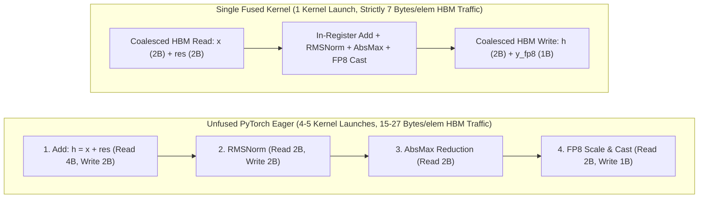
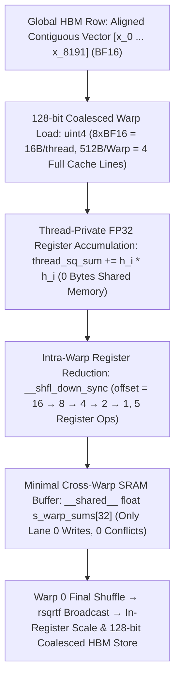

> [!NOTE] Executive Summary (TL;DR)
> - **Crushing the Elementwise HBM Wall**: Executing Residual Add, RMSNorm, and dynamic FP8 quantization as separate PyTorch eager ops generates **15–27 Bytes/elem** of HBM round-trip traffic; fusing them into a single register-resident kernel slashes traffic to **7 Bytes/elem** (**2.1x–3.9x** compression) while eliminating repeated kernel launch overheads.
> - **Microarchitectural Execution Mastery**: Saturate memory channels via **128-bit vectorized loads (`uint4` moving 512 Bytes/Warp per instruction)**, eliminate 32-way SRAM stalls through **Shared Memory padding and XOR swizzling**, and replace shared-memory barrier trees with **zero-SRAM `__shfl_down_sync` warp register shuffles**.
> - **End-to-End Production Stack**: Progress from a low-level vectorized CUDA C++ fused RMSNorm kernel to the exact **OpenAI Triton fused Residual + RMSNorm + Dynamic Per-Token FP8 (`e4m3fn`) kernel** powering [vLLM](/en/articles/vllm-serving-guide/) and SGLang, complete with `torch.library.custom_op` CUDA Graph capture and Nsight Compute (`ncu`) diagnosis.

## Introduction: The Hidden Latency Black Hole Between GEMMs

Discussions of LLM inference optimization routinely gravitate toward dense matrix multiplications (GEMMs) and attention kernels such as [FlashAttention and FlashInfer](/en/articles/flashattention-flashinfer-kernel-evolution/). With `cuBLASLt` and `CUTLASS` exploiting Hopper WGMMA and Blackwell `tcgen05.mma` instructions, modern serving engines already push linear projection Tensor Core utilization close to silicon limits.

Yet capturing a microsecond-accurate Nsight Systems trace of Llama-3.1-70B or [DeepSeek-V3 MoE](/en/articles/moe-expert-parallelism-inference-engine/) on an NVIDIA H100 or B200 exposes an uncomfortable truth: **during autoregressive Decode and small-to-medium batch Prefill, end-to-end Time-Per-Output-Token (TPOT) is heavily taxed by the "glue" operators sandwiched between GEMMs — Residual Add, RMSNorm, RoPE, SwiGLU, and dynamic FP8 quantization.**

Collectively, these elementwise and reduction operators account for well under 1% of total model FLOPs. Left unfused in eager execution, however, their near-zero arithmetic intensity pins them directly against the [Roofline HBM bandwidth ceiling](/en/articles/inference-roofline-prefill-decode/), while launching a dozen tiny kernels per Transformer layer fragments GPU scheduling.

As Chapter 6 of our **Production LLM Inference Systems** series, this guide dives straight to bare metal: we map the GPU execution and memory hierarchy on Hopper and Blackwell, dissect 128-bit memory coalescing and 32-bank SRAM conflicts, build a vectorized **CUDA C++ fused Add + RMSNorm kernel** from scratch, implement a production **OpenAI Triton fused Residual + RMSNorm + dynamic per-token FP8 quantization kernel**, and establish a rigorous **Nsight Compute (`ncu`)** and CUDA Graph hardening workflow.

---

## 1. GPU Execution and Memory Hierarchy — Why Naive PyTorch Ops Hit the HBM Wall

Writing kernels that approach the speed-of-light hardware envelope starts with an exact mental model of SIMT execution units and on-chip memory bandwidths.

### 1.1 The SIMT Execution Hierarchy and Hopper / Blackwell Memory Pyramid

Physically, an NVIDIA GPU maps work onto four nested execution levels:
1. **Thread**: The finest arithmetic unit, backed by private 32-bit physical registers (capped at **255 32-bit registers per thread** on both Hopper and Blackwell).
2. **Warp**: The atomic unit of hardware instruction scheduling — strictly **32 consecutive threads** (`lane_id` in `0..31`) executing in **SIMT (Single Instruction, Multiple Threads)** lockstep. Each SM houses 4 independent Warp Schedulers.
3. **CTA (Cooperative Thread Array / Thread Block)**: Up to 1024 threads (32 Warps) co-resident on a single Streaming Multiprocessor (SM), sharing programmer-managed Shared Memory and synchronizing via hardware barriers (`__syncthreads()`, PTX `bar.sync`).
4. **SM and Grid**: All CTAs spawned by a kernel launch form a Grid, distributed by the GigaThread Engine across all active SMs on the die (**132 SMs** on H100 SXM5; **148 SMs** on Blackwell B200).

Data movement latency across the corresponding storage tiers spans more than two orders of magnitude. Below are the exact architectural specifications for **NVIDIA Hopper H100 SXM5** and **Blackwell B200**:

| Memory Tier | Scope & Lifetime | Hopper H100 SXM5 Spec | Blackwell B200 Spec | Typical Latency | Architectural Role in Kernel Engineering |
| :--- | :--- | :--- | :--- | :--- | :--- |
| **Register File (RF)** | Thread-private | `256 KB / SM` (65,536 × 32-bit, max 255/thread) | `256 KB / SM` (65,536 × 32-bit, max 255/thread) | ~1 Cycle | Fastest storage on silicon; over-allocation causes Local Memory spilling or occupancy collapse |
| **Shared Memory / L1 Cache** | CTA-shared (Unified SRAM) | `256 KB / SM` physical (up to `228 KB / SM` Shared) | `256 KB / SM` physical (up to `228 KB / SM` Shared + dedicated `256 KB` TMEM) | ~20–30 Cycles | 32 parallel 4B-wide SRAM banks; workspace for cross-warp reductions and GEMM tiles |
| **L2 Cache** | GPU Grid-wide | `50 MB` | `126 MB` | ~200 Cycles | Hardware-managed cache; keeps small hot vectors like RMSNorm weights resident on-chip |
| **Global Memory (HBM3 / HBM3e)** | Device-persistent | `80 GB HBM3` @ **`3.35 TB/s`** | `192 GB HBM3e` @ **`8.0 TB/s`** | ~400–500+ Cycles | Massive capacity, high latency; round-tripping intermediate tensors here kills throughput |

> [!TIP]
> **Blackwell Architectural Nuance**: On B200 (`sm_100a`), alongside up to `228 KB / SM` of configurable Shared Memory, NVIDIA introduced a dedicated **`256 KB / SM` Tensor Memory (`TMEM`)** exclusively for 5th-generation Tensor Core (`tcgen05.mma`) accumulators — decoupling MMA accumulator footprint from general-purpose thread registers during fused epilogues.

### 1.2 Exact Byte-Traffic Math of Operator Fusion

Let us audit every byte crossing the HBM bus on the exact pre-GEMM hot path executed before every W8A8 FP8 Attention and FFN linear projection in Llama-3.1-70B or Qwen2.5-72B, where hidden dimension $D = 8192$ and incoming activations / residuals use `BF16` (`2 Bytes/elem`):

```python
# Canonical Pre-GEMM Hot Path: Residual Add -> RMSNorm -> Dynamic Per-Token FP8 (E4M3FN) Quant
h = x + residual                                          # Updated BF16 residual stream
rms = torch.rsqrt(h.float().pow(2).mean(-1, keepdim=True) + eps)
y = (h.float() * rms).to(torch.bfloat16) * weight         # Normalized BF16 activation
amax = y.abs().amax(dim=-1, keepdim=True).clamp(min=1e-12)
scale = amax.float() / 448.0                              # E4M3FN max finite value = 448.0
y_fp8 = (y.float() / scale).to(torch.float8_e4m3fn)       # Consumed by FP8 Tensor Core GEMM
```

Without a custom fused kernel — even if PyTorch 2.4+ native `F.rms_norm` collapses normalization into a single ATen kernel — eager execution still dispatches **4 to 5 separate kernels**, materializing $[M, 8192]$ intermediate tensors back and forth to HBM at every boundary:



Counting exact HBM read and write bytes per tensor coordinate $(m, d)$ (note that RMSNorm `weight` has shape $[8192]$ = `16 KB` total, remaining hot in the `50 MB` / `126 MB` L2 Cache across tokens for ~`0B` amortized HBM traffic, and per-row FP32 `scale` adds only $4 / 8192 \approx 0.0005\text{ Bytes/elem}$):

| Execution Strategy | Per-Kernel HBM Read / Write Breakdown | Kernel Launches | Total HBM Traffic (Bytes/elem) | Traffic Ratio vs. Fused |
| :--- | :--- | :--- | :--- | :--- |
| **Naive PyTorch Eager (materializing `.float()`)** | `add`(6B) + `h.float()` cast & variance(10B) + norm & weight(6B) + `amax`(2B) + `fp8` cast(3B) | 6–7 | **~27 Bytes/elem** | **3.86x** |
| **Decomposed BF16 Ops (unfused RMSNorm)** | `add`(R:2+2, W:2 = 6B) + variance(R:2B) + norm mul(R:2, W:2 = 4B) + `amax`(R:2B) + `fp8` cast(R:2, W:1 = 3B) | 5 | **17 Bytes/elem** | **2.43x** |
| **ATen `F.rms_norm` Semi-Fused Path** | `add`(6B) + `F.rms_norm`(R:2, W:2 = 4B) + `amax`(R:2B) + `fp8` cast(R:2, W:1 = 3B) | 4 | **15 Bytes/elem** (~13–15B w/ partial fusion) | **2.14x** |
| **Single Fused Kernel (`Fused Add+RMSNorm+FP8`)** | Read `x`(2B) + Read `residual`(2B) $\rightarrow$ **100% Register-Resident Math** $\rightarrow$ Write `h`(2B) + Write `y_fp8`(1B) | **1** | **`7 Bytes/elem`** | **1.00x (Information-Theoretic Floor)** |

**`7 Bytes/elem` is the strict information-theoretic minimum** for this operator graph: two 2-byte inputs must be read, the updated 2-byte residual stream must be persisted, and the 1-byte quantized FP8 activation must be emitted. Across an 80-layer Transformer (2 pre-norm sites per layer = **160 invocations per forward step**), single-pass fusion yields a **2.14x–3.86x HBM traffic reduction** while eliminating $160 \times (4 - 1) = 480$ kernel launches per token (~$1.5\text{–}2.4\;\text{ms}$ of pure CPU/driver dispatch overhead saved in eager mode).

---

## 2. Memory Coalescing, Vectorized 128-bit Loads, and Shared Memory Bank Conflicts

Merging operators into one kernel function only pays off if memory transactions saturate physical bus width. Two microarchitectural rules govern whether a kernel achieves 90% or 20% of peak bandwidth: **128-bit coalesced global memory vectorization** and **conflict-free 32-bank Shared Memory access**.

### 2.1 32-Byte Sector Coalescing and 128-bit (`uint4`) Vectorized Loads

On Volta, Ampere, Hopper, and Blackwell GPUs, the SM Load/Store Unit (LSU) services global memory accesses in **32-byte sectors** grouped into **128-byte L1 cache lines** (4 contiguous sectors per cache line).

When a 32-thread Warp executes a global load, the hardware Memory Coalescer merges per-thread addresses into minimal sector transactions:
* **Why Scalar 16-bit Loads (`ld.global.b16`) Underperform**: If each thread loads a single `nv_bfloat16` (`2 Bytes`), an entire 32-thread Warp moves only $32 \times 2 = 64\text{ Bytes}$ (half a cache line) per instruction. Across a hidden row of $D = 8192$ (`16,384 Bytes`) processed by a 256-thread CTA, every thread must issue **32 scalar load instructions**, flooding Warp Scheduler issue slots and filling LSU scoreboard queues (`stall_mio_throttle` / `stall_long_scoreboard`).
* **Full-Width 128-bit Vectorized Loads (`float4` / `uint4` -> `ld.global.v4.u32`)**: The widest per-thread load instruction supported by NVIDIA GPUs is **128 bits (16 Bytes)**. Reinterpreting 16-byte-aligned BF16 pointers as `uint4*` unlocks three compounding wins:
  - **Per-Thread Width**: Each thread pulls **`8 × BF16` elements (`16 Bytes`)** into four 32-bit registers in a single instruction;
  - **Per-Warp Coalescing**: Across 32 consecutive lanes, a single warp instruction fetches $32 \times 16 = \mathbf{512\text{ Bytes}}$ (**`256 × BF16` elements**), cleanly saturating **four contiguous 128-byte cache lines (16 sectors)** at **100% bus utilization**;
  - **8x Instruction Compression**: For $D = 8192$ at 256 threads/CTA, each thread issues just **4** `ld.global.v4.u32` instructions to ingest the entire row.

### 2.2 Shared Memory 32-Bank Architecture, Padding, and XOR Swizzling

Once data lands on-chip, cross-warp reductions and matrix tiles pass through Shared Memory. Unlike cache-line-addressed HBM, **Shared Memory is physically organized into 32 independent SRAM banks**, each **4 Bytes (32-bit)** wide per clock cycle.

Every byte address `byte_addr` maps deterministically to a bank via:

$$\text{bank\_id} = \left\lfloor \frac{\text{byte\_addr}}{4} \right\rfloor \bmod 32$$

Consider a 2D shared-memory tile `__shared__ float s_tile[32][32]`:
1. **Conflict-Free Row Access (`s_tile[row][lane_id]`)**: Lanes `0..31` access consecutive 4-byte floats along a row. Lane `k` hits bank `(row * 32 + k) % 32 = k`. All 32 banks serve distinct addresses simultaneously in **1 SRAM wavefront** (note: if multiple lanes read the **exact same 4-byte address** such as `s_tile[0][0]`, hardware **broadcast/multicast** also resolves it in 1 cycle with zero conflict).
2. **Catastrophic 32-Way Bank Conflict (`s_tile[lane_id][col]`, Stride = 32 Floats)**: Reading down a column steps by `32` floats (`128 Bytes`) per lane:

$$\text{bank\_id} = (\text{lane\_id} \times 32 + \text{col}) \bmod 32 = \text{col} \bmod 32$$

**All 32 threads collide on 32 distinct addresses inside the exact same SRAM bank!** Hardware serializes the single warp instruction into **32 sequential wavefronts**, slashing effective Shared Memory bandwidth by **$32\times$**.

Kernel engineers eliminate bank conflicts using two canonical techniques depending on alignment constraints:

* **Technique 1: Static `+1` Column Padding (`__shared__ float s_tile[32][33]`)**
  Appending one dummy `float` per row shifts the stride from `32` to `33` words. Column access `s_tile[lane_id][col]` now maps to:

  $$\text{bank\_id} = (\text{lane\_id} \times 33 + \text{col}) \bmod 32 = (\text{lane\_id} + \text{col}) \bmod 32$$

  As `lane_id` ranges over `0..31`, `bank_id` forms a bijection onto all 32 banks — zero conflicts!
  - **The Catch**: Adding a 4-byte element breaks **16-byte (128-bit) row alignment** on odd rows (row 1 starts at byte `33 * 4 = 132`, which is not divisible by 16), making vectorized `ld.shared.v4.b32`, Tensor Core `ldmatrix`, and Hopper TMA illegal!

* **Technique 2: Zero-Overhead, Alignment-Preserving XOR Swizzling**
  To preserve strict 16-byte alignment with zero wasted SRAM, `CUTLASS` / `CuTe` and `Triton` permute column coordinates using bitwise XOR (`^`):
  - **4-Byte Word Granularity**: Map logical `(row, col)` to physical column `phys_col = col ^ row` (bijective across both rows and columns of a `32×32` tile).
  - **128-bit (`16B`) Vector Chunk Granularity (`col_chunk ^ (row % 8)`)**: A 128-byte BF16 tile row (`64 × BF16`) contains **8 chunks of 16 Bytes (`uint4`, spanning 4 banks each)** so `8 chunks × 4 banks = 32 banks`. Remapping logical chunk `c` (`0..7`) via:

  $$c_{\text{phys}} = c \oplus (\text{row} \bmod 8)$$

  ensures that when 8 rows (`row = 0..7`) are accessed at fixed logical column `c` (such as during `ldmatrix`), $c \oplus (\text{row} \bmod 8)$ visits all 8 distinct 16-byte chunks across banks `0..31` in **1 conflict-free cycle while keeping every chunk strictly 16-byte aligned**.

The diagram below traces the complete conflict-free pipeline from 128-bit coalesced HBM loads through register-only warp shuffles:



---

## 3. Low-Level CUDA C++ Kernel — Vectorized Warp Shuffle and Block RMSNorm

Armed with coalescing and bank mechanics, let us write a clean, production-grade **CUDA C++** `fused_add_rmsnorm_bf16_kernel`.

Textbook reduction tutorials often allocate `__shared__ float sdata[256]` and execute 8 sequential `__syncthreads()` barriers in a halving tree. On modern NVIDIA GPUs, **threads within the same 32-thread Warp exchange registers directly across the hardware shuffle crossbar via `__shfl_down_sync`**, reducing 32 values to lane 0 in 5 instructions with **zero Shared Memory** and **zero CTA barriers**.

### 3.1 Complete Vectorized CUDA C++ Implementation

The implementation below integrates **64-bit overflow-safe pointer arithmetic**, **`uint4` + `__nv_bfloat162` 128-bit vector loads**, **compile-time unrolled register caching (eliminating a second HBM read in Pass 2)**, **`__shfl_down_sync` warp reductions**, and **read-only cache (`__ldg`) weight broadcasting**:

```cpp
#include <cuda_runtime.h>
#include <cuda_bf16.h>
#include <cstdint>
#include <cassert>

constexpr int WARP_SIZE = 32;

// Register-only intra-warp sum reduction: 5 SHFL.DOWN ops converge 32 lanes into lane 0
__device__ __forceinline__ float warp_reduce_sum(float val) {
    #pragma unroll
    for (int offset = WARP_SIZE / 2; offset > 0; offset >>= 1) {
        val += __shfl_down_sync(0xffffffffu, val, offset);
    }
    return val;
}

// 1 CTA processes 1 token row (supports hidden_dim <= BLOCK_SIZE * MAX_VECS * 8)
// Default BLOCK_SIZE = 256, MAX_VECS = 8 covers up to hidden_dim = 16384 (e.g., Llama-3.1-405B)
template <int BLOCK_SIZE = 256, int MAX_VECS = 8>
__global__ void __launch_bounds__(BLOCK_SIZE)
fused_add_rmsnorm_bf16_kernel(
    __nv_bfloat16* __restrict__ out,          // [M, D] Normalized output y
    __nv_bfloat16* __restrict__ residual_out, // [M, D] Updated residual h (safe to alias residual)
    const __nv_bfloat16* __restrict__ x,      // [M, D] Branch hidden activation
    const __nv_bfloat16* __restrict__ residual,// [M, D] Incoming residual stream
    const __nv_bfloat16* __restrict__ weight, // [D]    RMSNorm gamma weight
    const int hidden_dim,                     // Hidden size D (multiple of 8 for 16B alignment)
    const float eps)                          // Numerical epsilon (typically 1e-6f)
{
    static_assert(BLOCK_SIZE % WARP_SIZE == 0 && BLOCK_SIZE <= 1024,
                  "BLOCK_SIZE must be a multiple of 32 and <= 1024");
    constexpr int NUM_WARPS = BLOCK_SIZE / WARP_SIZE;

    const int num_vecs = hidden_dim >> 3; // Each uint4 packs 8 BF16 elements (16 Bytes)
    // Critical: cast blockIdx.x to size_t to prevent int32 overflow when M * D >= 2^31!
    const size_t row_vec_offset = static_cast<size_t>(blockIdx.x) * num_vecs;

    const uint4* __restrict__ x_vec = reinterpret_cast<const uint4*>(x) + row_vec_offset;
    const uint4* __restrict__ r_vec = reinterpret_cast<const uint4*>(residual) + row_vec_offset;
    const uint4* __restrict__ w_vec = reinterpret_cast<const uint4*>(weight);
    uint4* __restrict__ res_out_vec = reinterpret_cast<uint4*>(residual_out) + row_vec_offset;
    uint4* __restrict__ out_vec     = reinterpret_cast<uint4*>(out) + row_vec_offset;

    // Statically indexed register array: #pragma unroll keeps h_regs 100% in hardware registers!
    uint4 h_regs[MAX_VECS];
    float thread_sq_sum = 0.0f;

    // ==================== Pass 1: 128-bit Load + FP32 Residual Add + Sum of Squares ====================
    #pragma unroll
    for (int step = 0; step < MAX_VECS; ++step) {
        const int vec_idx = step * BLOCK_SIZE + threadIdx.x;
        if (vec_idx < num_vecs) {
            uint4 vx = x_vec[vec_idx];
            uint4 vr = r_vec[vec_idx];
            uint4 vh;

            const __nv_bfloat162* x_bf2 = reinterpret_cast<const __nv_bfloat162*>(&vx);
            const __nv_bfloat162* r_bf2 = reinterpret_cast<const __nv_bfloat162*>(&vr);
            __nv_bfloat162* h_bf2       = reinterpret_cast<__nv_bfloat162*>(&vh);

            #pragma unroll
            for (int k = 0; k < 4; ++k) {
                float2 xf = __bfloat1622float2(x_bf2[k]);
                float2 rf = __bfloat1622float2(r_bf2[k]);
                float2 hf = make_float2(xf.x + rf.x, xf.y + rf.y);
                // Round residual stream to BF16 and accumulate rounded value for bit-exact parity
                h_bf2[k]  = __float22bfloat162_rn(hf);
                float2 hf_rounded = __bfloat1622float2(h_bf2[k]);
                thread_sq_sum += hf_rounded.x * hf_rounded.x + hf_rounded.y * hf_rounded.y;
            }

            res_out_vec[vec_idx] = vh; // 128-bit coalesced HBM write of updated residual
            h_regs[step] = vh;         // Retain in registers so Pass 2 never re-reads HBM!
        }
    }

    // ==================== Cross-Warp Block Reduction (Only 33 Floats = 132 Bytes SRAM) ====================
    __shared__ float s_warp_sums[WARP_SIZE];
    __shared__ float s_rrms;

    const int lane_id = threadIdx.x & (WARP_SIZE - 1);
    const int warp_id = threadIdx.x >> 5;

    float warp_sum = warp_reduce_sum(thread_sq_sum);
    if (lane_id == 0) {
        s_warp_sums[warp_id] = warp_sum;
    }
    __syncthreads(); // Barrier 1: wait for all warps to publish partial sums

    if (warp_id == 0) {
        float block_sum = (lane_id < NUM_WARPS) ? s_warp_sums[lane_id] : 0.0f;
        block_sum = warp_reduce_sum(block_sum);
        if (lane_id == 0) {
            s_rrms = rsqrtf(block_sum / static_cast<float>(hidden_dim) + eps);
        }
    }
    __syncthreads(); // Barrier 2: broadcast inverse RMS scalar s_rrms to entire CTA

    const float rrms = s_rrms;

    // ==================== Pass 2: In-Register Normalize + __ldg Weight + 128-bit Store ====================
    #pragma unroll
    for (int step = 0; step < MAX_VECS; ++step) {
        const int vec_idx = step * BLOCK_SIZE + threadIdx.x;
        if (vec_idx < num_vecs) {
            uint4 vw = __ldg(&w_vec[vec_idx]); // Broadcast gamma weight via Read-Only / L2 cache
            uint4 vh = h_regs[step];
            uint4 vy;

            const __nv_bfloat162* h_bf2 = reinterpret_cast<const __nv_bfloat162*>(&vh);
            const __nv_bfloat162* w_bf2 = reinterpret_cast<const __nv_bfloat162*>(&vw);
            __nv_bfloat162* y_bf2       = reinterpret_cast<__nv_bfloat162*>(&vy);

            #pragma unroll
            for (int k = 0; k < 4; ++k) {
                float2 hf = __bfloat1622float2(h_bf2[k]);
                float2 wf = __bfloat1622float2(w_bf2[k]);
                float2 yf = make_float2(hf.x * rrms * wf.x, hf.y * rrms * wf.y);
                y_bf2[k]  = __float22bfloat162_rn(yf);
            }

            out_vec[vec_idx] = vy; // 128-bit coalesced HBM write of normalized activation
        }
    }
}

// Host launcher wrapper
void launch_fused_add_rmsnorm_bf16(
    __nv_bfloat16* out,
    __nv_bfloat16* residual_out,
    const __nv_bfloat16* x,
    const __nv_bfloat16* residual,
    const __nv_bfloat16* weight,
    int num_tokens,
    int hidden_dim,
    float eps,
    cudaStream_t stream)
{
    assert(hidden_dim % 8 == 0 && hidden_dim <= 256 * 8 * 8);
    assert(reinterpret_cast<uintptr_t>(x) % 16 == 0);
    assert(reinterpret_cast<uintptr_t>(residual) % 16 == 0);
    assert(reinterpret_cast<uintptr_t>(out) % 16 == 0);

    dim3 grid(num_tokens);
    dim3 block(256);
    fused_add_rmsnorm_bf16_kernel<256, 8><<<grid, block, 0, stream>>>(
        out, residual_out, x, residual, weight, hidden_dim, eps);
}
```

### 3.2 Microarchitectural Design Highlights

Four subtle engineering choices separate this production kernel from naive implementations:
1. **Compile-Time Array Indexing Prevents Stack Spills**: Indexing `h_regs[i]` with a runtime loop bound forces `ptxas` to spill the array into HBM-backed `Local Memory` because hardware register names cannot be dynamically indexed. Bounding the loop by `MAX_VECS = 8` with `#pragma unroll` resolves `h_regs[0..7]` to 32 static 32-bit registers (`0 bytes stack frame`).
2. **Two Barriers Total Across the Entire CTA**: `__shfl_down_sync(0xffffffffu, val, offset)` (`offset = 16, 8, 4, 2, 1`) collapses each 32-thread Warp in registers, requiring just `132 Bytes` of Shared Memory and two `__syncthreads()` calls to compute and broadcast `rsqrtf`.
3. **64-bit Row Offset Guard (`size_t`)**: During long-context Prefill (for instance $M = 262,144,\; D = 8192$), linear element index $M \times D = 2^{31}$ overflows signed 32-bit `INT32_MAX` (`2,147,483,647`), triggering `cudaErrorIllegalAddress`. Promoting `blockIdx.x` to `size_t` eliminates this failure mode.
4. **BF16 Storage, FP32 Accumulation**: Because `__nv_bfloat16` carries only 7 mantissa bits (~$7.8 \times 10^{-3}$ relative precision), summing 8,192 squares directly in BF16 suffers severe mantissa swamping. Promoting arithmetic to `float2` preserves full FP32 variance accuracy.

---

## 4. Production OpenAI Triton Kernel — Fused Residual, RMSNorm, and Dynamic Per-Token FP8 Quantization

While raw CUDA C++ offers instruction-level control, extending C++ templates every time an epilogue changes — such as fusing dynamic per-token FP8 quantization, outlier clamping, or gated routing — multiplies boilerplate around `uint4` unpacking, non-multiple-of-8 tail masks, and warp shuffles.

That productivity-performance sweet spot is why **OpenAI Triton** powers the majority of fused bandwidth-bound kernels in [vLLM](/en/articles/vllm-serving-guide/), SGLang, and Liger-Kernel.

### 4.1 Paradigm Shift: CUDA Thread-Level vs. Triton Block-Programmed (CTA-Level)

CUDA follows a **Thread-Level SPMD model**: you write scalar/vector code from the perspective of a single `threadIdx.x`, manually coordinating coalescing, shared-memory layout, and warp shuffles.

Triton elevates programming to a **Block-Programmed (CTA-Level) Tensor model**:
* Each program instance (`tl.program_id(0)`) represents an entire **CTA** operating directly on blocked 1D/2D vectors created with `cols = tl.arange(0, BLOCK_N)`;
* Lowering through `Python AST -> Triton-IR -> TTGIR (Triton GPU IR) -> LLVM IR -> PTX -> CUBIN`, the Triton compiler **automatically partitions vectors across warps and threads, emits predicated 128-bit `ld.global.v4` instructions, allocates and swizzles Shared Memory, and lowers `tl.sum` / `tl.max` into butterfly `__shfl_xor_sync` and cross-warp reductions**.

### 4.2 Production Triton Implementation (`Fused Add + RMSNorm + Dynamic FP8`)

In W8A8 FP8 serving on Hopper H100 and Blackwell B200 (detailed in our [LLM Quantization Precision Guide](/en/articles/quantization-precision-guide/)), the gold-standard activation scheme before FP8 Tensor Core matmul is **Dynamic Per-Token `float8_e4m3fn` Quantization**: for each token row, compute exact post-RMSNorm peak magnitude $\text{amax} = \max_j \lvert y_j \rvert$, derive row scale $\text{scale} = \text{amax} / 448.0$, and quantize $y / \text{scale}$ into 1-byte `e4m3fn` elements consumed directly by `torch._scaled_mm` (or `cutlass_scaled_mm`).

Below is the complete, syntactically valid `@triton.jit` + `@triton.autotune` production kernel performing **Residual Add + BF16 Stream Writeback + RMSNorm + Dynamic Per-Token AbsMax + Saturation-Safe FP8 Cast in a single HBM pass**:

```python
import torch
import triton
import triton.language as tl

# E4M3FN (1 sign, 4 exponent, 3 mantissa bits, finite-only / no Inf) max value = 448.0
FP8_E4M3_MAX: float = torch.finfo(torch.float8_e4m3fn).max  # 448.0


@triton.autotune(
    configs=[
        triton.Config({}, num_warps=4, num_stages=1),
        triton.Config({}, num_warps=8, num_stages=1),
        triton.Config({}, num_warps=16, num_stages=1),
    ],
    key=["N"],
)
@triton.jit
def fused_add_rmsnorm_fp8_kernel(
    x_ptr,          # [M, N] BF16 input activation pointer
    res_ptr,        # [M, N] BF16 incoming residual pointer
    w_ptr,          # [N]    BF16 RMSNorm gamma weight pointer
    h_out_ptr,      # [M, N] BF16 updated residual output pointer (may alias res_ptr)
    y_fp8_ptr,      # [M, N] float8_e4m3fn quantized output pointer
    scale_ptr,      # [M]    FP32 per-token dequantization scale pointer
    stride_xm,      # Row stride of x
    stride_rm,      # Row stride of residual
    stride_hm,      # Row stride of h_out
    stride_ym,      # Row stride of y_fp8
    N,              # Exact hidden dimension D (e.g., 4096, 7168, 8192)
    eps,            # Numerical stability epsilon (e.g., 1e-6)
    FP8_MAX: tl.constexpr,
    BLOCK_N: tl.constexpr,
):
    # 1. Map CTA to token row; promote to int64 to prevent >2B element pointer overflow
    row_idx = tl.program_id(axis=0).to(tl.int64)
    cols = tl.arange(0, BLOCK_N)
    mask = cols < N

    # 2. Single coalesced HBM read pass (compiler emits predicated 128-bit vector loads)
    x = tl.load(x_ptr + row_idx * stride_xm + cols, mask=mask, other=0.0).to(tl.float32)
    res = tl.load(res_ptr + row_idx * stride_rm + cols, mask=mask, other=0.0).to(tl.float32)
    w = tl.load(w_ptr + cols, mask=mask, other=0.0).to(tl.float32)

    # 3. Update BF16 residual stream in HBM and round-trip to FP32 for exact stream parity
    h_bf16 = (x + res).to(tl.bfloat16)
    tl.store(h_out_ptr + row_idx * stride_hm + cols, h_bf16, mask=mask)
    h = h_bf16.to(tl.float32)

    # 4. In-register RMSNorm: masked lanes hold 0.0 so they add 0 to sum; divide by N, not BLOCK_N!
    mean_sq = tl.sum(h * h, axis=0) / N
    rrms = tl.math.rsqrt(mean_sq + eps)
    y = tl.where(mask, h * rrms * w, 0.0)

    # 5. Dynamic Per-Token AbsMax & FP8 (E4M3FN) quantization in the exact same register pass!
    amax = tl.max(tl.abs(y), axis=0)
    amax = tl.maximum(amax, 1e-12)  # Guard all-zero token rows against 0/0 NaN
    scale = amax / FP8_MAX

    # Explicit finite clamp prevents 1-ULP FP32 division overshoot (>448.0) from turning into NaN!
    y_scaled = tl.clamp(y / scale, -FP8_MAX, FP8_MAX)
    y_fp8 = y_scaled.to(tl.float8e4m3fn)

    # 6. Coalesced 1-byte/elem FP8 activation store + 4-byte per-token scale store
    tl.store(y_fp8_ptr + row_idx * stride_ym + cols, y_fp8, mask=mask)
    tl.store(scale_ptr + row_idx, scale)


def fused_add_rmsnorm_dynamic_fp8(
    x: torch.Tensor,
    residual: torch.Tensor,
    weight: torch.Tensor,
    eps: float = 1e-6,
) -> tuple[torch.Tensor, torch.Tensor, torch.Tensor]:
    """Returns (h_out_bf16, y_fp8_e4m3fn, per_token_scale_fp32) ready for torch._scaled_mm."""
    assert x.shape == residual.shape and x.dtype == torch.bfloat16
    N = x.shape[-1]
    M = x.numel() // N
    BLOCK_N = triton.next_power_of_2(N)
    if BLOCK_N > 16384:
        raise ValueError(f"Single-pass register kernel requires N <= 16384, got {N}")

    x_2d = x.contiguous().view(M, N)
    res_2d = residual.contiguous().view(M, N)
    h_out = torch.empty_like(x_2d)
    y_fp8 = torch.empty((M, N), device=x.device, dtype=torch.float8_e4m3fn)
    scale = torch.empty((M,), device=x.device, dtype=torch.float32)

    fused_add_rmsnorm_fp8_kernel[(M,)](
        x_2d, res_2d, weight,
        h_out, y_fp8, scale,
        x_2d.stride(0), res_2d.stride(0), h_out.stride(0), y_fp8.stride(0),
        N, eps,
        FP8_MAX=FP8_E4M3_MAX,
        BLOCK_N=BLOCK_N,
    )
    return h_out.view_as(x), y_fp8.view(*x.shape), scale
```

Notice three production-critical details embedded in this kernel:
* **Effortless Non-Power-of-Two Hidden Sizes**: Models like [DeepSeek-V3 MoE](/en/articles/moe-expert-parallelism-inference-engine/) use $N = 7168$. Rounding `BLOCK_N = triton.next_power_of_2(7168) = 8192` satisfies Triton's power-of-two reduction requirement while `mask = cols < N` and `tl.where(mask, ..., 0.0)` ensure padded lanes `[7168, 8192)` never corrupt either `tl.sum` or `tl.max` — zero scalar cleanup loops required.
* **`e4m3fn` Finite Saturation Guard (`tl.clamp`)**: Unlike IEEE floats, `float8_e4m3fn` extends its max normal value from `240.0` to `448.0` by sacrificing `Inf` encodings (`S.1111.111` represents `NaN` only). Without `tl.clamp(y / scale, -448.0, 448.0)`, a 1-ULP FP32 division rounding overshoot such as `448.00003` could emit `NaN` on non-saturating conversion paths.
* **Zero-Copy Handoff to W8A8 Tensor Cores**: The emitted `y_fp8` (`[M, N]`) and `scale.view(-1, 1)` feed straight into `torch._scaled_mm(y_fp8, w_fp8_col_major, scale_a=scale.view(-1, 1), scale_b=w_scale.view(1, -1), out_dtype=torch.bfloat16)`, applying row and column scales inside the Tensor Core GEMM epilogue.

### 4.3 From Full-Row Register Reductions to Tiled Streaming: The Online Softmax Connection

Why can `fused_add_rmsnorm_fp8_kernel` execute two sequential reductions (`tl.sum` for RMS, then `tl.max` for `amax`) in one HBM pass? Because hidden size $N \le 16384$ fits entirely inside a single CTA's register file (`BLOCK_N >= N`). What happens when the reduction axis grows to $128\text{K}$ tokens — as in self-attention scores — exceeding on-chip SRAM by $10\times$?

Instead of reverting to multiple HBM passes, [FlashAttention and FlashInfer](/en/articles/flashattention-flashinfer-kernel-evolution/) reformulate two-pass reductions into a **single-pass associative streaming recurrence via Online Softmax**. Standard numerically stable Softmax requires pass 1 for $m = \max_j x_j$ and pass 2 for $d = \sum_j e^{x_j - m}$. Online Softmax maintains running tuple $(m, d)$ across SRAM tiles, dynamically rescaling prior partial sums whenever a new element (or tile) $x_j$ arrives:

$$m_{\text{new}} = \max(m_{\text{old}}, x_j), \qquad d_{\text{new}} = d_{\text{old}} \, e^{m_{\text{old}} - m_{\text{new}}} + e^{x_j - m_{\text{new}}}$$

Both patterns express the exact same GPU systems principle: **spend abundant, 1-cycle on-chip register ALU operations (even extra exponentials) to defend scarce HBM bandwidth, never materializing uncompressed intermediate state off-chip.**

---

## 5. Production Pitfalls — Register Spilling, CUDA Graph Capture, and Nsight Compute Diagnosis

Shipping a fused kernel into [vLLM](/en/articles/vllm-serving-guide/) or SGLang requires surviving three production minefields that routinely turn microbenchmark wins into serving regressions.

### 5.1 The Register Spilling Trap and Occupancy Collapse

Every Hopper and Blackwell SM contains strictly **`65,536` × 32-bit registers (`256 KB`)**, with hardware instruction encoding capping each thread at **`255` registers**. Over-aggressive fusion triggers a two-stage failure:
1. **SM Warp Occupancy Collapse**: If a heavy fused kernel consumes `128` registers/thread, an SM can host at most $\lfloor 65536 / 128 \rfloor = 512$ threads (`16` active warps out of the `64`-warp hardware maximum = **25% Theoretical Occupancy**). With too few eligible warps, the Warp Scheduler cannot hide ~400-cycle HBM load latencies via warp switching.
2. **Catastrophic Local Memory Spilling**: Setting `BLOCK_N = 16384` with `num_warps = 2` (only 64 threads holding 16,384 FP32 values = 256 floats/thread!) breaches the **255-register ceiling**. The compiler (`ptxas`) spills excess live variables using `STL` / `LDL` instructions into **`Local Memory` — which is NOT on-chip SRAM, but private per-thread address space physically backed by off-chip HBM/L2!** A fused kernel designed to save HBM traffic silently floods HBM with hidden stack spills.

> [!WARNING]
> **Register Spill Audit & Cure**:
> - **CUDA C++**: Always compile with `nvcc --ptxas-options=-v` and verify `0 bytes spill stores, 0 bytes spill loads`.
> - **OpenAI Triton**: Inspect `compiled_kernel.n_regs` and `compiled_kernel.n_spills`. If `n_spills > 0` for a fixed `BLOCK_N`, **increase `num_warps`** (e.g., `4 -> 8` or `16` so more threads partition the same tile, halving per-thread register pressure) or **reduce `num_stages`** in software-pipelined loops.

### 5.2 CUDA Graph Safety and Zero-Graph-Break `torch.compile` Integration

During Decode, per-layer GPU kernel runtime drops to $3\text{–}8\;\mu\text{s}$ — smaller than Python eager launch overhead. Serving engines therefore capture the entire Decode pass into a **CUDA Graph (`torch.cuda.CUDAGraph`)** and replay all layers in a single driver call.

To remain 100% compatible with `torch.compile(fullgraph=True)` and CUDA Graph stream capture, custom kernels must obey **three invariants**:
1. **Zero Host-Device Synchronizations**: Never invoke `.item()`, `.cpu()`, `print(tensor)`, or data-dependent Python `if` branches inside the op — stream capture will immediately abort with `cudaErrorStreamCaptureUnsupported`;
2. **Zero Dynamic Data-Dependent Shapes**: Never call `torch.nonzero()` or boolean mask indexing `x[mask]`;
3. **Register via PyTorch 2.4+ `torch.library.custom_op` + `register_fake`**: Wrapping Triton launches as an opaque typed op gives `TorchDynamo` and `TorchInductor` exact meta-tensor shape/dtype propagation without graph breaks:

```python
@torch.library.custom_op("llm_ops::fused_add_rmsnorm_fp8", mutates_args=())
def fused_add_rmsnorm_fp8_op(
    x: torch.Tensor,
    residual: torch.Tensor,
    weight: torch.Tensor,
    eps: float = 1e-6,
) -> tuple[torch.Tensor, torch.Tensor, torch.Tensor]:
    return fused_add_rmsnorm_dynamic_fp8(x, residual, weight, eps)


@fused_add_rmsnorm_fp8_op.register_fake
def _(x: torch.Tensor, residual: torch.Tensor, weight: torch.Tensor, eps: float = 1e-6):
    # Zero-compute meta-tensor shape & dtype inference for torch.compile / CUDA Graphs
    M = x.numel() // x.shape[-1]
    h_out = torch.empty_like(x)
    y_fp8 = torch.empty_like(x, dtype=torch.float8_e4m3fn)
    scale = torch.empty((M,), device=x.device, dtype=torch.float32)
    return h_out, y_fp8, scale
```

### 5.3 Nsight Compute (`ncu --set full`) Roofline and Stall Checklist

Never guess why a kernel is slow. Profile steady-state execution with **NVIDIA Nsight Compute (`ncu`)**, using `--launch-skip` to bypass initial `@triton.autotune` benchmarking and cold L2 cache warmup:

```bash
ncu --set full \
    --kernel-name regex:"fused_add_rmsnorm.*" \
    --launch-skip 10 --launch-count 1 \
    --export profile_fused_rmsnorm_fp8 \
    python3 bench_rmsnorm_fp8.py
```

Evaluate the resulting profile against this four-point hardware counter checklist:

| Diagnostic Axis | Exact `ncu` Hardware Metric | Healthy Fused Reduction Target | Red Flag & Root Cause |
| :--- | :--- | :--- | :--- |
| **1. Speed of Light (SOL)** | `dram__throughput.avg.pct_of_peak_sustained_elapsed` & `sm__throughput...` | **Memory (DRAM) 80%–92%**; Compute (SM) 10%–25% | Both DRAM and SM `<40%` indicates latency/exposure stalls: tiny grid, low occupancy, or excessive barriers |
| **2. Warp Stall Reason** | `smsp__pcsampling_stall_long_scoreboard` | Dominant stall *paired with* >80% DRAM throughput is healthy | High `stall_long_scoreboard` *with low DRAM %* exposes **uncoalesced global loads** or hidden Local Memory spill reads |
| **3. Global Coalescing Ratio** | `l1tex__average_t_sectors_per_request_pipe_lsu_mem_global_op_ld.ratio` | **`16.0` sectors/req** for `uint4` (`512B / 32B`, zero wasted bytes) | Excess sectors per request indicate 16B misalignment or strided/scattered memory addressing |
| **4. Bank Conflicts & Spills** | `l1tex__data_bank_conflicts_pipe_lsu_mem_shared_op_ld.sum` & `..._mem_local_op_st.sum` | **Strictly `0`** (or negligible) | Non-zero shared conflicts require Padding / XOR Swizzling; non-zero local stores confirm register spilling — raise `num_warps` |

---

## Frequently Asked Questions (FAQ)

### Q1: Since PyTorch 2.x ships `torch.compile` (TorchInductor) for automatic fusion, why do production engines still hand-write Triton and CUDA C++ kernels?
`TorchInductor` generates competitive Triton kernels for straightforward pointwise chains, yet falls short on flagship LLM hot paths for three reasons:
1. **Multi-Output Stream Mutation + Dual Reductions**: In graphs combining residual writeback, FP32 RMS variance reduction, dynamic per-token AbsMax reduction, and finite `e4m3fn` saturation clamping, general-purpose graph lowering can easily split the pattern across two passes or fail to guarantee the strict `7 Bytes/elem` single-read register lifetime across dynamic batch shapes.
2. **Predictable Startup & Autotune Control**: Serving engines capture multiple CUDA Graph batch buckets at startup; explicit `@triton.jit` kernels provide deterministic memory layouts and curated `num_warps` schedules without unpredictable Inductor compilation spikes.
3. **Bleeding-Edge ISA Features**: Exploiting Hopper `TMA` asynchronous bulk copies, Producer-Consumer Warp Specialization, Blackwell `TMEM` (`tcgen05.mma`), and irregular [FlashInfer paged KV cache gather tables](/en/articles/flashattention-flashinfer-kernel-evolution/) still requires **CUDA C++ / CUTLASS CuTe**. Production teams therefore follow an **80/20 split: OpenAI Triton for 80% of memory-bound fused ops, and CUDA C++ / CUTLASS for the 20% Tensor Core & paged-attention core**.

### Q2: Why does LLM inference standardize on `float8_e4m3fn` (max 448.0) with dynamic per-token scaling rather than wider-range `float8_e5m2` or static tensor scaling?
This choice reflects the trade-off between mantissa precision and activation outliers (see our [LLM Quantization Precision Guide](/en/articles/quantization-precision-guide/)):
* **`e4m3fn` vs. `e5m2`**: While `e5m2` offers 5 exponent bits (max finite value `57,344.0`), it retains only **2 mantissa bits**, introducing coarse quantization noise that degrades forward-pass perplexity (making `e5m2` suitable mainly for backward gradients). `e4m3fn` provides **3 mantissa bits**, doubling precision for weights and activations.
* **Why Dynamic Per-Token Scaling Is Essential**: Transformer activations exhibit sharp cross-token magnitude spikes (e.g., BOS / Attention Sink tokens reaching $20\times$ the amplitude of neighboring tokens). A static per-tensor scale calibrated to the worst-case token crushes 99% of normal tokens into underflow bins; computing `amax / 448.0` **dynamically inside registers during the RMSNorm epilogue** achieves per-token adaptive range at **zero extra HBM byte cost**.

### Q3: How should our Triton `fused_add_rmsnorm_fp8_kernel` evolve if ultra-wide models push hidden dimension to 32,768 or 65,536, exceeding single-CTA register capacity?
Once $D$ grows large enough that `BLOCK_N = triton.next_power_of_2(D)` triggers register spills (`n_spills > 0`), refactor the single-tile kernel into a **two-pass L2-resident tiled loop** (`BLOCK_N = 2048` or `4096`):
1. **Pass 1 (Tiled Stream + Algebraic Homogeneity Trick)**: Loop over columns in chunks of `BLOCK_N`, writing BF16 `h_out` (only $65536 \times 2 = 128\text{ KB}$/row, which stays hot in L2 Cache!) while accumulating `sq_sum += tl.sum(h * h, axis=0)`. Crucially, because $\max_j \lvert h_j \cdot \text{rrms} \cdot w_j \rvert = \text{rrms} \cdot \max_j \lvert h_j \cdot w_j \rvert$ for $\text{rrms} > 0$, you can simultaneously track unscaled `raw_amax = tl.maximum(raw_amax, tl.max(tl.abs(h * w), axis=0))` during Pass 1!
2. **Pass 2 (Single L2 Re-Read + Direct FP8 Store)**: After Pass 1 finishes, compute both `rrms` and exact `scale = (raw_amax * rrms) / 448.0` in scalars, then sweep `h_out` from L2 Cache once to normalize and emit `y_fp8` directly — avoiding a third pass even at $D = 65,536$.

### Q4: During `@triton.autotune`, why does raising `num_warps` from 4 to 16 speed up wide hidden dimensions (8192) yet slow down narrow dimensions (1024–2048)?
`num_warps` balances **per-thread register pressure and vector width** against **cross-warp synchronization overhead**:
* **Wide Dimensions ($D = 8192$ or $16384$)**: With `num_warps = 4` (128 threads), each thread holds 64–128 elements in registers, driving register counts near the 255 ceiling and starving SM occupancy. Raising `num_warps` to `8` or `16` (256–512 threads) cuts per-thread register footprint by $2\times\text{–}4\times$, unlocking higher warp concurrency to hide HBM latency.
* **Narrow Dimensions ($D = 1024$ or $2048$)**: Setting `num_warps = 16` (512 threads) on $D = 1024$ leaves each thread with only **2 BF16 elements (`4 Bytes`)**! Hardware can no longer issue full 128-bit (`8 × BF16 = 16 Bytes`/thread) vectorized loads, while `tl.sum` and `tl.max` pay Shared Memory and `bar.sync` tax across 16 warps. Keying `@triton.autotune(key=["N"])` automatically selects the optimal warp count for every model width.
