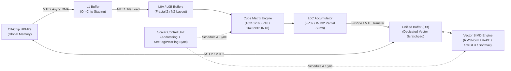
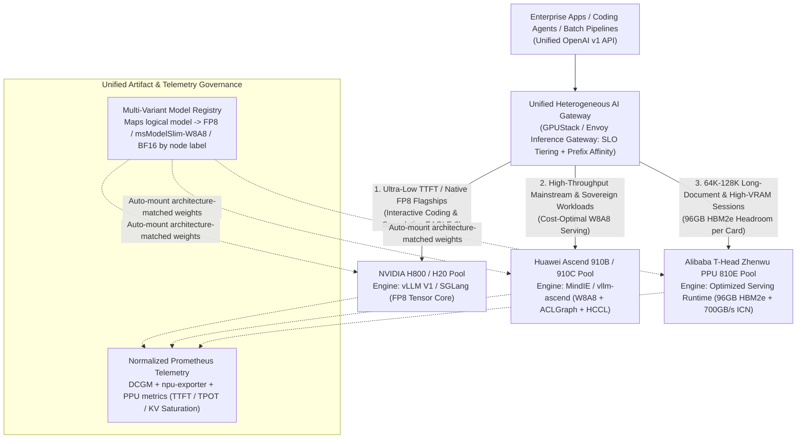

> [!NOTE] Executive Summary (TL;DR)
> - **Microarchitectural Paradigm Shift**: Migrating from NVIDIA GPUs (SIMT warps + unified L1/Shared cache) to Huawei Ascend (**DaVinci AI Cores with decoupled Cube, Vector, and Scalar engines**) or Alibaba T-Head's **Zhenwu PPU 810E** (`96 GB HBM2e`, `700 GB/s` inter-chip fabric) hinges on eliminating Cube-to-Vector HBM round-trips, suppressing dynamic-shape JIT recompilation storms, and capturing static **`ACLGraph`** execution schedules.
> - **FP8-to-W8A8 Quantization & Scientific Parity Gates**: Because Ascend 910B delivers `~640 TOPS` on native **INT8** Cube engines (2× its `~310–320 TFLOPS` BF16/FP16 rate) without native Hopper FP8 instructions, production workflows dequantize FP8 checkpoints and apply **`msModelSlim`** (`AntiOutlier` channel smoothing + dynamic per-token `W8A8`), validating parity via **teacher-forced Top-1 logit cosine similarity ($\ge 0.999$) and KL divergence ($< 10^{-3}$)** rather than brittle greedy string matching.
> - **HCCL Collectives & Multi-Silicon MaaS Routing**: Tuning `HCCL_OP_EXPANSION_MODE="AIV"`, sizing `HCCL_BUFFSIZE`, verifying per-NPU onboard RoCE links via `hccn_tool`, and orchestrating NVIDIA, Ascend, and Zhenwu PPU pools behind **Kubernetes + GPUStack** turns heterogeneous hardware diversity into an SLO-aligned cost advantage.

## Introduction: Why Copy-Pasting CUDA Intuition Fails on Heterogeneous NPUs

In enterprise private deployments and large-scale MaaS platforms, homogeneous single-vendor GPU clusters are increasingly rare. Production infrastructure teams routinely operate **multi-silicon heterogeneous clusters** spanning **NVIDIA (`A800 / H800 / H20`)**, **Huawei Ascend (`Ascend 910B / 910C / 310P`)**, **Alibaba T-Head (`Zhenwu PPU 810E`)**, and CUDA-compatible domestic GPUs.

Yet teams migrating a 72B dense model or a 671B MoE service from `H800 + vLLM` onto non-CUDA accelerators frequently hit three immediate walls in week one:
1. **"Why is per-token latency (TPOT) 3× slower despite comparable peak TFLOPS?"** — Assuming eager-mode PyTorch elementwise ops will be absorbed by a forgiving unified cache hierarchy, whereas decoupled Cube/Vector on-chip buffers stall severely without whole-block graph fusion (`ATB` / `ACLGraph`);
2. **"Why won't native FP8 checkpoints load directly—or why did accuracy collapse under naive INT8?"** — Conflating Hopper/Blackwell hardware `FP8 E4M3` Tensor Cores with Ascend 910B's native `INT8 W8A8` Cube pipeline;
3. **"Why do 8-card tensor-parallel jobs hang on collective initialization?"** — Debugging host Ethernet (`eth0`) with Linux `ethtool` instead of inspecting Ascend's dedicated intra-node **HCCS** mesh and per-NPU onboard **100G/200G RoCE NICs (`hccn_tool`)**.

This chapter dissects the hardware microarchitecture, dual-engine deployment stacks (`vllm-ascend` vs. native `MindIE`), `msModelSlim` `W8A8` precision alignment, `HCCL` collective tuning, and `Kubernetes + GPUStack` multi-silicon routing from first principles.

---

## 1. Silicon Microarchitecture from First Principles: Two Domestic Ecosystem Tracks

Before modifying serving configs, architects must classify accelerators along **hardware execution model and software-stack compatibility**:

| Architectural Axis | NVIDIA Hopper/Ampere Baseline<br>*(H800 / H20 / A800)* | Track A1: Huawei Ascend DaVinci<br>*(Ascend 910B / 910C)* | Track A2: Alibaba T-Head PPU<br>*(Zhenwu PPU 810E)* | Track B: CUDA-Compatible SIMT GPUs<br>*(Hygon DCU / MetaX MACA / Iluvatar)* |
| :--- | :--- | :--- | :--- | :--- |
| **Core Compute Model** | **32-thread SIMT Warps** + Tensor Cores (`MMA/WGMMA`) | **DaVinci AI Core**: Decoupled **Cube (Matrix) + Vector (SIMD) + Scalar** engines | **Proprietary Parallel Processing Unit (PPU)** tailored for LLM matrix & memory flows | **32/64-lane SIMT Wavefronts** + Matrix Tensor Units |
| **HBM Capacity & Throughput** | A800/H800: `80 GB`<br>H20: `96 GB HBM3` | **910B**: `64 GB HBM2e` (`~310–320 TFLOPS` BF16, `~640 TOPS` INT8)<br>**910C**: Dual-die `128 GB HBM2e` (`~800 TFLOPS` FP16, `~3.2 TB/s`) | **`96 GB HBM2e`** (matches H20 capacity; +20% headroom over 80GB cards) | Typically `64 GB – 128 GB` HBM2e/HBM3 |
| **Scale-Up Interconnect** | NVLink (`400 – 900 GB/s`) | **HCCS** coherent intra-node fabric + onboard RoCE NICs (scales to CloudMatrix 384 optical UB) | **Proprietary Inter-Chip Network (ICN)** delivering up to **`700 GB/s`** (PCIe 5.0 x16) | Proprietary XLink interconnects or PCIe Gen5 + RoCEv2 |
| **Low-Level Software Stack** | CUDA Driver + cuBLAS / CUTLASS / Triton | **Sovereign Non-CUDA Stack**: `CANN 8.0` + `Ascend C` + `ATB` + `HCCL` | **Sovereign Non-CUDA Stack** co-designed with Alibaba Cloud & Qwen | Source/binary translation stacks (`ROCm/DTK`, `MACA`) mirroring `cuBLAS/NCCL` |
| **Primary Serving Engines** | `vLLM` / `SGLang` / `TensorRT-LLM` | **`MindIE`** (native C++ graph stack) or **`vllm-ascend`** (`PluggableDevice`) | Vendor-optimized `vLLM` / proprietary serving runtime leveraging 96GB pools | Vendor-adapted `vLLM` / `SGLang` builds |

### Inside the DaVinci AI Core: Why Fusion & Memory Alignment Matter Even More Than on GPUs

As we analyzed in [LLM GPU Kernel Engineering](/en/articles/gpu-kernel-engineering-cuda-warp-triton-fused-ops/), an NVIDIA SM shares a unified register file and configurable `L1 / Shared Memory` across warps—allowing Tensor Core GEMM outputs to undergo epilogue scaling or residual addition directly in registers.

Inside Huawei's **DaVinci AI Core**, compute units and scratchpad memories form an **explicit multi-stage DMA pipeline orchestrated by Memory Transfer Engines (`MTE1 / MTE2 / MTE3`)**:



Three critical production consequences follow directly from this silicon layout:
1. **Fractal Tensor Layouts (`NZ` / `FRACTAL_Z`) & 32-Byte Alignment**: The Cube engine consumes fixed $16 \times 16$ (FP16/BF16) or $16 \times 32$ (INT8) tiles, while `UB` DMA transfers require strict **32-byte alignment**. Misaligned hidden dimensions or KV block strides inject hidden `TransData` / padding kernels that silently burn 15%–30% of step latency.
2. **Cube-Vector Hardware Pipelining**: High-throughput kernels like `FlashAttentionScore` (`PromptFlashAttention` / `IncreFlashAttention`) and `MLA` rely on **`Ascend C`** or **`ATB (Ascend Transformer Boost)`** to overlap tile $i+1$'s Cube GEMM ($Q K^\top$) with tile $i$'s Vector online Softmax via hardware `SetFlag / WaitFlag` barriers—keeping intermediates strictly on-chip.
3. **VRAM Topology Recalculation (`64 GB` vs. `80 GB` vs. `96 GB`)**: Because `Ascend 910B` provides **`64 GB` HBM2e** (~`60 GB` usable after OS and CANN driver reservations) whereas Alibaba T-Head's **Zhenwu `PPU 810E`** provides **`96 GB` HBM2e**:
   - A **72B BF16 checkpoint** (~`145 GB` weights) fits comfortably at **`TP=2`** on two `96 GB` `PPU 810E` cards (`192 GB` aggregate, leaving ~`40 GB` for KV Cache), whereas `TP=2` on `64 GB` `910B` (`128 GB` aggregate) cannot even hold static weights—requiring **`TP=4` (`256 GB`) in BF16 or `W8A8` quantization (~`73 GB`)**!

---

## 2. Dual-Track Serving Architecture: `vllm-ascend` vs. Native `MindIE`

Ascend production deployments standardize on two mature serving stacks depending on ecosystem coupling vs. bare-metal specialization:

### 2.1 Track 1: `vllm-ascend` (Zero-Friction Migration via PyTorch `PluggableDevice`)

When workloads depend on vLLM V1's OpenAI API semantics, structured output backends, and rapid day-0 model coverage, **`vllm-project/vllm-ascend`** provides a clean hardware-decoupled plugin:
- **Execution Architecture**: Registers `torch_npu` (`torch.device("npu")`) via PyTorch's `PrivateUse1` (`PluggableDevice`) interface, preserving upstream vLLM's Paged KV scheduler and Chunked Prefill logic while dispatching linear/MoE/attention layers to CANN kernels and capturing decode steps into **`ACLGraph`** (Ascend's counterpart to CUDA Graphs).
- **Production Launch Baseline**:
  ```bash
  # 1. Inspect NPU health, AICore utilization, HBM usage, and firmware versions
  npu-smi info

  # 2. Source CANN 8.0 environment and set NPU allocator + HCCL parameters
  source /usr/local/Ascend/ascend-toolkit/set_env.sh
  export ASCEND_RT_VISIBLE_DEVICES=0,1,2,3
  export PYTORCH_NPU_ALLOC_CONF="expandable_segments:True"   # Mitigates variable-length HBM fragmentation OOMs
  export HCCL_BUFFSIZE=256                                   # Expand TP collective buffer to 256 MB
  export HCCL_OP_EXPANSION_MODE="AIV"                        # Offload collective reductions onto AI Vector cores

  # 3. Launch vllm-ascend with W8A8 weights and automatic ACLGraph capture
  vllm serve /models/Qwen2.5-72B-Instruct-W8A8 \
    --served-model-name Qwen2.5-72B-Instruct \
    --tensor-parallel-size 4 \
    --quantization ascend \
    --max-model-len 32768 \
    --max-num-batched-tokens 8192 \
    --gpu-memory-utilization 0.90 \
    --trust-remote-code \
    --port 8000
  ```

### 2.2 Track 2: Native `MindIE` (`MindIE Service` + `MindIE LLM` + `MindIE Motor`)

For maximum hardware utilization on flagship deployments (such as multi-node DeepSeek-V3/V4 Wide-EP serving and disaggregated Prefill/Decode pools), Huawei's C++ stack **`MindIE`** eliminates Python runtime overhead via whole-layer **`ATB` C++ `GraphOperation`** fusion and **`MindIE Motor`** P/D orchestration (mirroring the disaggregation principles in [Prefill-Decode Split & Distributed KV Transfer](/en/articles/pd-disaggregation-distributed-kv-cache/)).

When sizing `MindIE Service`'s `conf/config.json`, explicit multi-instance KV pool allocation (`npuMemSize`, in GB) follows:

$$\text{npuMemSize}_{\text{GB}} = \left\lfloor \left( M_{\text{free\_HBM}} - \frac{W_{\text{model}}}{\text{worldSize}} - M_{\text{HCCL\_workspace}} \right) \times \gamma_{\text{safe}} \right\rfloor$$

On 4× `Ascend 910B (64 GB)` serving `Qwen2.5-72B-W8A8` ($W_{\text{model}} \approx 73\text{ GB} \implies 18.25\text{ GB/card}$, $M_{\text{free\_HBM}} \approx 60\text{ GB}$, $6\text{ GB}$ workspace reserve, $\gamma_{\text{safe}} = 0.90$), safe KV capacity is $\lfloor (60 - 18.25 - 6) \times 0.90 \rfloor = \mathbf{32\text{ GB}}$ per NPU (or set `npuMemSize: -1` when dedicating full cards to a single instance):

```json
{
  "Version": "1.0.0",
  "ServerConfig": {
    "ipAddress": "0.0.0.0",
    "port": 1025,
    "httpsEnabled": false,
    "inferMode": "standard",
    "openAiSupport": "vllm"
  },
  "BackendConfig": {
    "backendName": "mindieservice_llm_engine",
    "modelInstanceNumber": 1,
    "npuDeviceIds": [[0, 1, 2, 3]],
    "tokenizerProcessNumber": 8,
    "multiNodesInferEnabled": false,
    "ModelDeployConfig": {
      "maxSeqLen": 32768,
      "maxInputTokenLen": 28672,
      "truncation": false,
      "ModelConfig": [
        {
          "modelInstanceType": "Standard",
          "modelName": "Qwen2.5-72B-Instruct",
          "modelWeightPath": "/models/Qwen2.5-72B-Instruct-W8A8",
          "worldSize": 4,
          "cpuMemSize": 5,
          "npuMemSize": -1,
          "backendType": "atb",
          "trustRemoteCode": false
        }
      ]
    },
    "ScheduleConfig": {
      "templateType": "Standard",
      "maxBatchSize": 128,
      "maxPrefillBatchSize": 16,
      "maxPrefillTokens": 8192,
      "supportSelectBatch": true,
      "enablePrefixCache": true
    }
  }
}
```

> [!WARNING]
> **Mandatory MindIE File-Permission Gate**: `MindIE Service` enforces strict security checks on configuration and weight file permissions at startup! If `conf/config.json` has permissions looser than `640` (such as `644` or `777`), startup immediately aborts—always enforce `chmod 640 conf/config.json` in container entrypoints.

---

## 3. Precision Migration (`FP8` → `W8A8`) & Scientific Numerical Parity Verification

### 3.1 Why Native Hopper `FP8` Checkpoints Must Convert to `W8A8` on Ascend 910B
On NVIDIA Hopper/Blackwell GPUs, `FP8 (E4M3)` uses a 4-bit exponent (range $\pm 448$) that naturally absorbs activation spikes (see [Quantization Precision Guide](/en/articles/quantization-precision-guide/)). By contrast, **Ascend 910B** achieves its `~640 TOPS` peak on **native `INT8` Cube integer arithmetic**.

Because `INT8` provides a uniform linear `[-128, 127]` grid with zero exponent bits, naive static tensor-level clamping gets crushed by Transformer activation channel outliers.

### 3.2 Production `W8A8` Conversion with `msModelSlim` (`AntiOutlier` + Dynamic Per-Token Calibration)

When migrating native blockwise FP8 models (e.g., DeepSeek-V3/V4), first dequantize `128×128` FP8 blocks cleanly to `BF16`, then run Huawei's official **`msModelSlim`** pipeline combining **SmoothQuant-style channel migration (`AntiOutlier`)** with **Per-Token dynamic activation quantization (`act_method=3`)** and automatic sensitive-layer fallback:

```python
import torch
import torch_npu
from transformers import AutoModelForCausalLM, AutoTokenizer
from msmodelslim.pytorch.llm_ptq.anti_outlier import AntiOutlier, AntiOutlierConfig
from msmodelslim.pytorch.llm_ptq.llm_ptq_tools import Calibrator, QuantConfig

# Disable online JIT compilation during offline PTQ calibration on NPU
torch.npu.set_compile_mode(jit_compile=False)

MODEL_SRC = "/models/Qwen2.5-72B-Instruct-BF16"
SAVE_DIR = "/models/Qwen2.5-72B-Instruct-W8A8"

tokenizer = AutoTokenizer.from_pretrained(MODEL_SRC, trust_remote_code=True)
model = AutoModelForCausalLM.from_pretrained(
    MODEL_SRC,
    torch_dtype=torch.bfloat16,
    device_map="auto",
    trust_remote_code=True,
).eval()

# 1. Curate 64–128 representative domain prompts (code, math, long tables, bilingual prose)
raw_prompts = [
    "Explain the difference between RoCEv2 PFC deadlock and InfiniBand credit-based flow control.",
    "Derive why mixed-precision AdamW requires 16Ψ bytes of static training memory.",
]
calib_dataset = [
    [tokenizer(p, return_tensors="pt", truncation=True, max_length=2048).input_ids.to("npu:0")]
    for p in raw_prompts
]

# 2. Stage 1: Outlier Suppression (migrate activation channel spikes into weights)
anti_cfg = AntiOutlierConfig(
    anti_method="m4",       # Smooth/rotation strategy tuned for modern GQA + SwiGLU blocks
    dev_type="npu",
    dev_id=0,
)
anti_outlier = AntiOutlier(model, calib_data=calib_dataset, cfg=anti_cfg)
anti_outlier.process()

# 3. Stage 2: W8A8 Calibration (Per-Channel static weights + Per-Token dynamic activations)
quant_cfg = QuantConfig(
    w_bit=8,
    a_bit=8,
    act_method=3,           # Per-token dynamic activation scaling — critical for reasoning & code!
    w_sym=True,
    dev_type="npu",
    dev_id=0,
    mm_tensor=False,        # Enforce per-channel weight scales rather than coarse per-tensor scales
)

# disable_level="L1" automatically keeps the most sensitive down_proj layers in BF16
calibrator = Calibrator(model, quant_cfg, calib_data=calib_dataset, disable_level="L1")
calibrator.run()
calibrator.save(SAVE_DIR, save_type=["safe_tensor"])
print(f"W8A8 checkpoint exported cleanly to {SAVE_DIR}")
```

### 3.3 Three-Tier Numerical Parity Verification (Why Greedy String Equality Is Wrong)

Comparing 1,000-token `temperature=0` greedy outputs character-by-character between an H800 and an Ascend 910B or Zhenwu PPU is a classic anti-pattern: because IEEE-754 floating-point addition is non-associative, $16 \times 16 \times 16$ Cube tile accumulation naturally differs from NVIDIA `WGMMA` by $10^{-4} \sim 10^{-3}$. Whenever top-2 token probabilities sit within $2 \times 10^{-4}$, a single tie-break flips token $t$ and diverges the entire downstream autoregressive suffix!

Enforce a **deterministic three-tier acceptance protocol** instead:
1. **Tier 1 — Single-Pass Teacher-Forced Logit Alignment**: Feed identical `4,096`-token `input_ids` into both GPU and NPU/PPU in a single forward pass and compare output logits $\mathbf{z}$ across all positions:
   - **Mean Cosine Similarity**: $\cos(\mathbf{z}_{\text{GPU}}, \mathbf{z}_{\text{NPU}}) \ge \mathbf{0.9990}$ ($\ge 0.9998$ for BF16-vs-BF16; $\ge 0.9985$ for W8A8-vs-BF16);
   - **Mean Token-Level KL Divergence**: $D_{\text{KL}}\big(\operatorname{softmax}(\mathbf{z}_{\text{GPU}}) \parallel \operatorname{softmax}(\mathbf{z}_{\text{NPU}})\big) < \mathbf{10^{-3}}$;
2. **Tier 2 — Task-Level Evaluation Parity**: Verify end-to-end pass rates on a 200–500 item golden benchmark (math, unit-tested code, structured extraction; see [LLM Evaluation Guide](/en/articles/llm-evaluation-guide/)) stay within $\lvert \text{Acc}_{\text{NPU}} - \text{Acc}_{\text{GPU}} \rvert \le \mathbf{1.0\%}$;
3. **Tier 3 — Long-Context RoPE & RMSNorm Accumulator Audit**: Stress-test `32K–128K` prompts specifically checking that RoPE `cos/sin` tables and RMSNorm variance reductions execute in **`FP32`** rather than `FP16` (downcasting RoPE frequencies to FP16 corrupts positional phases past 16K tokens!).

---

## 4. HCCS / HCCL Collective Tuning & Dual-Plane Network Debugging

Unlike PCIe/NVLink GPU servers where host NICs handle all inter-node traffic through standard Linux interfaces, **each Ascend 910B module integrates a dedicated onboard 100G/200G RoCE NIC managed via `hccn_tool`**.

### Four Mandatory Pre-Flight Inspection & Tuning Commands

```bash
# 1. Inspect intra-node 8-NPU HCCS topology (distinguish full-mesh vs. dual-4-card islands!)
npu-smi info -t topo

# 2. Verify physical link state, IP assignment, and lossless PFC counters across all 8 onboard RoCE ports
for i in {0..7}; do
  echo "=== NPU $i Onboard RoCE Link & PFC ==="
  hccn_tool -i $i -link -g
  hccn_tool -i $i -ip -g
  hccn_tool -i $i -pfc -g
done

# 3. Production HCCL collective tuning flags
export HCCL_OP_EXPANSION_MODE="AIV"       # Offload collective reductions from slow AI CPU onto AI Vector cores
export HCCL_BUFFSIZE=512                  # Size to 512 MB for Wide-EP All-to-All or long-context TP
export HCCL_RDMA_TC=104                   # Match ToR switch lossless RoCEv2 DSCP traffic class
export HCCL_RDMA_SL=4                     # Match lossless PFC priority queue Service Level
export HCCL_CONNECT_TIMEOUT=1200          # Prevent premature rank timeouts during multi-hundred-GB weight load
```

> [!TIP]
> **Intra-Node `TP=4` Island Affinity**: On 8-NPU chassis wired as two 4-NPU HCCS islands (`[0,1,2,3]` and `[4,5,6,7]`), always pin `TP=4` instances strictly within `[0,1,2,3]` or `[4,5,6,7]`—never split an instance across `[0,1,4,5]`! Always verify with `npu-smi info -t topo` first.

---

## 5. Reference Architecture: Unified Multi-Silicon MaaS on Kubernetes + GPUStack

Rather than operating siloed per-vendor clusters, production platforms unify **NVIDIA GPUs, Huawei Ascend NPUs, and Alibaba T-Head Zhenwu `PPU 810E`** behind a single Kubernetes control plane (building directly on [Kubernetes AI Serving: LeaderWorkerSet & KV-Aware Gateways](/en/articles/k8s-ai-inference-gateway-lws-kv-cache-routing/)):



### Three Golden Rules for Multi-Silicon Production Routing
1. **Multi-Variant Artifact Mapping Behind One Logical Model ID**: Expose a single logical `model` name to applications while mounting hardware-matched checkpoints (`FP8` for H800/H20, `msModelSlim W8A8` for Ascend 910B, `BF16 / W8A16` for `96 GB` `PPU 810E`) via Kubernetes `nodeSelector` labels.
2. **Silicon-Strength Workload Placement**:
   - Route **64K–128K long-context document extraction and dense 72B workloads** to **Zhenwu `PPU 810E`** nodes (`96 GB HBM2e` + `700 GB/s` ICN gives 50% more HBM per card than 64GB NPUs, doubling concurrent long-context KV slots);
   - Route **high-volume conversational, RAG, and sovereign enterprise traffic** to **Ascend `910B / 910C`** (`W8A8` INT8 Cube throughput; for SuperPoD scale-up fabrics see [Rack-Scale SuperPoD & Optical UnifiedBus Collectives](/en/articles/rack-scale-superpod-nvl72-nccl-collectives/));
   - Reserve **NVIDIA `H800 / H20`** for bleeding-edge custom Triton/CUDA kernels and ultra-low-ITL EAGLE-3 speculative decoding.
3. **Pool-Scoped Prefix Affinity with Overflow Spillover**: Keep multi-turn session prefix hashing sticky *within* the same silicon pool until pool KV saturation exceeds `90%`, preventing cross-pool ping-pong that invalidates warm KV caches on both sides.

---

## Frequently Asked Questions (FAQ)

### Q1: When should we choose `MindIE` vs. `vllm-ascend` on Huawei Ascend clusters?
Choose **`vllm-ascend`** when operational uniformity with NVIDIA `vLLM` fleets, day-0 HuggingFace model onboarding, and upstream Guided Decoding / OpenAI tool-calling parity are top priorities. Choose **`MindIE`** (`MindIE LLM` + `MindIE Motor`) when squeezing maximum C++ whole-graph (`ATB`) throughput and multi-node P/D disaggregation out of flagship models (like full-scale DeepSeek-V3/V4 or Qwen) on large Ascend clusters.

### Q2: Why do the first few requests after container startup take 10–20 seconds on NPUs before latency drops to normal?
Aside from lazy weight page-ins, initial spikes almost always stem from **dynamic-shape JIT operator compilation or first-time `ACLGraph` bucket capture**. Disable unintended runtime JIT compilation where appropriate, enable static bucket warm-up at boot, and gate Kubernetes traffic behind a real inference `startupProbe` / `readinessProbe` so requests only arrive after `ACLGraph` capture completes.

### Q3: Can we directly cast open-source `FP8` weights (e.g., DeepSeek-V3/V4) into `INT8` for accelerators without native FP8?
**Never cast `FP8` directly into uniform `INT8` without recalibration!** `FP8 (E4M3)` relies on non-linear floating-point exponents, whereas `INT8` is a uniform linear grid. Always dequantize blockwise `FP8` cleanly back to `BF16` first, then run `msModelSlim` with `AntiOutlier` smoothing and `act_method=3` dynamic per-token `W8A8` calibration while preserving BF16 fallbacks on sensitive MLA / shared-expert projections.

### Q4: What is the fastest way to debug `HCCL_E_PARA` or `HCCL connect timeout` on multi-node Ascend jobs?
Run a three-step check: first, execute `hccn_tool -i $i -link -g` across all 8 NPUs to verify every onboard RoCE optical transceiver is `UP` (host `eth0` connectivity does NOT test NPU RoCE ports!); second, verify `HCCL_IF_IP` / ranktable bindings did not accidentally bind to the host management NIC; third, confirm `HCCL_RDMA_TC` and `HCCL_RDMA_SL` match the lossless PFC queues on your ToR switches (see [Lossless RoCEv2 & PFC Debugging](/en/articles/rdma-kernel-bypass-zero-copy-queue-pair-rocev2-lossless/)).
