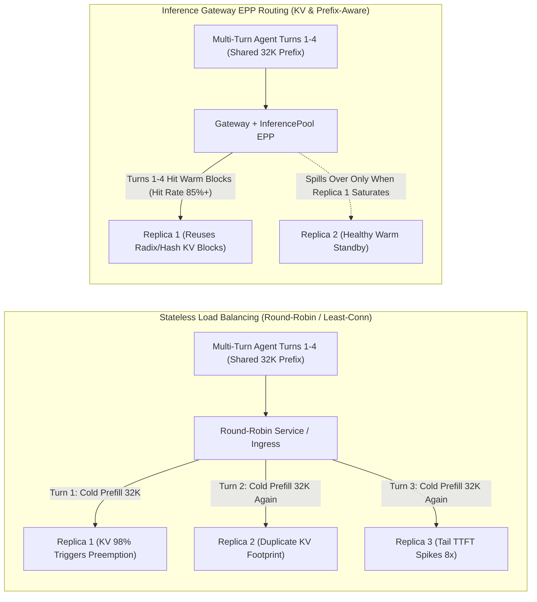
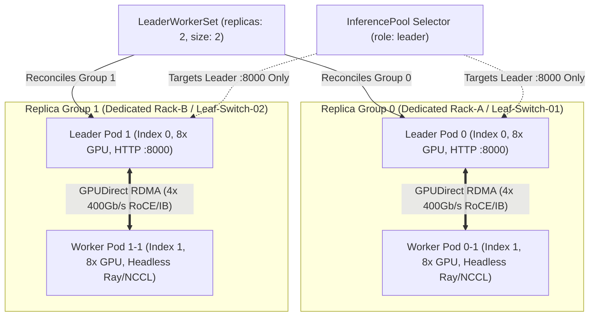
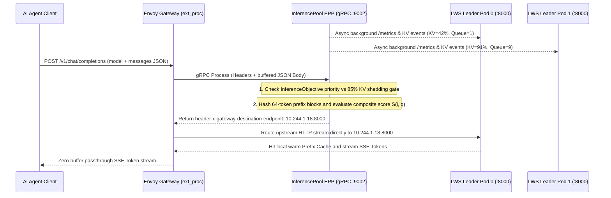
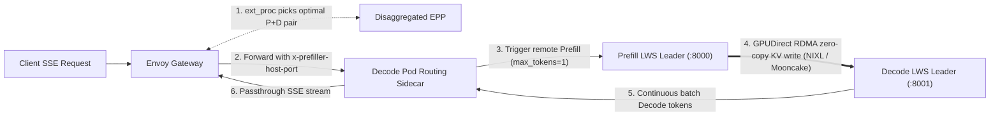

> [!NOTE] Executive Summary (TL;DR)
> - **Atomic Multi-Node Gang Serving**: When 400B–1T+ Dense and MoE models span 2–8 8-GPU nodes, a single logical serving replica is a tightly coupled `1 Leader + (N-1) Workers` super-unit. Kubernetes SIG `LeaderWorkerSet (LWS)` eliminates `Deployment` and `StatefulSet` lifecycle mismatches via two-level group scaling, exclusive rack placement, and atomic group recreation.
> - **KV-Cache-Aware L7 Routing**: Request-count load balancing destroys multi-turn Agent prefix locality and explodes tail TTFT. `Gateway API Inference Extension` pairs Envoy `ext_proc` with an Endpoint Picker (EPP) to evaluate prefix block-hash hit rate, HBM KV saturation, queue depth, and LoRA residency in `<1–2 ms` while enforcing Criticality load shedding.
> - **P/D Disaggregation & Zero-Drop Autoscaling**: Combining dual-pool `llm-d` LWS orchestration over GPUDirect RDMA, KEDA autoscaling on `vllm:kv_cache_usage_perc` and waiting queue depth, 300-second graceful stream draining, and local NVMe / OCI Image Volume weight caching drives cold-starts under `35s` with zero dropped SSE streams.

## Introduction: From Single-Node GPU Allocation to Stateful Distributed Serving

In the preceding chapter of this series, [Kubernetes GPU Scheduling with the GPU Operator](/en/articles/k8s-gpu-operator-ai-inference-scheduling/), we established zero-touch NVIDIA driver provisioning, hardware-isolated MIG slicing, and single-node NUMA / NVLink topology alignment. Earlier, in [Kubernetes Networking: CNI, Cilium eBPF, and Gateway API](/en/articles/k8s-networking-cni-cilium-ebpf-gateway-api/), we laid out the cloud-native data plane for north-south and east-west traffic governance.

Yet as platform teams graduate from single-node 7B/72B models to frontier-scale Dense and Mixture-of-Experts (MoE) architectures—such as 405B dense models, 671B DeepSeek-R1, 1T Kimi K2, and multi-trillion-parameter frontier MoE deployments—serving multi-turn ReAct Agents, 64K repository-context coding assistants, and strict-SLO enterprise APIs, a harsh architectural reality emerges: **the decade-old Kubernetes microservice playbook of a stateless `Deployment` behind a Round-Robin or Least-Connections `Service` breaks down completely under production LLM workloads.**

Online LLM inference is neither a stateless REST microservice (every GPU HBM holds hundreds of gigabytes of session-coupled KV Cache blocks) nor an offline distributed training `Job` (it demands sub-second TTFT, atomic recovery from localized GPU faults, and zero-downtime rolling upgrades). This deep dive dissects why legacy primitives fail from first principles and walks through a complete production stack built on **Kubernetes SIG `LeaderWorkerSet` (`LWS`)**, **`Gateway API Inference Extension`**, and **P/D disaggregated autoscaling**.

---

## 1. Why Stateless Microservice Primitives (Deployment + Round-Robin Service) Break on Production LLMs

Wrapping an LLM engine inside a container exposing port `8000` and handing it to a standard `Deployment` and `Service` triggers systemic failures across both **control-plane lifecycle management** and **data-plane traffic distribution**.

### 1.1 Failure Mode 1: Multi-Node Gang Lifecycle Mismatch

Consider serving a 671B-parameter MoE model (or a 400B–2T+ frontier architecture). Even with FP8 weight quantization, static weights plus runtime workspace buffers require roughly $680\text{–}700\text{ GB}$ of device memory; in BF16 precision or when provisioning ample KV Cache headroom for 64K–128K concurrency, a single logical model replica spans **2 to 8 8-GPU H100/H200/B200 hosts**, executing **a single forward pass** collectively via Tensor + Pipeline Parallelism (`TP=8, PP=2`) or wide Expert Parallelism (`EP=32`).

At this scale, one logical serving replica is no longer an independent Pod—it is a **tightly coupled multi-Pod super-unit (`1 Leader + (N-1) Workers`)**:
- **Asymmetric Pod Roles**: Only Rank 0 (the **Leader Pod**) runs the OpenAI-compatible HTTP/SSE server, tokenizer, and global scheduler on port `8000`. The remaining `N-1` **Worker Pods** run headless Ray or `torch.distributed` ranks executing cross-node GPUDirect RDMA `AllReduce`, `AllToAll`, and pipeline stage transfers.
- **All-or-Nothing Fate Sharing**: If Worker 3 suffers an NVIDIA Xid 79 (`GPU has fallen off the bus`), an OOM kill, or an InfiniBand/RoCE link flap that trips the NCCL watchdog timer, the entire `N`-node `ncclComm_t` communicator wedges permanently. The surviving `N-1` Pods cannot serve a single token on their own.

Mapping this topology onto native Kubernetes workload controllers exposes irreconcilable structural gaps:

| Orchestration Dimension | Native `Deployment` | Native `StatefulSet` | `LeaderWorkerSet (LWS)` |
| :--- | :--- | :--- | :--- |
| **Role Asymmetry** | **Homogeneous**: Single `PodTemplateSpec` cannot separate HTTP Leader from headless Workers | **Homogeneous**: All ordinals share identical container entrypoints and probes | **Dual Templates**: Native `leaderTemplate` and `workerTemplate` specs |
| **Scaling Unit** | Scales individual Pods independently; zero awareness of $M$-Pod replica groups | Scales flat ordinals `0..K-1` sequentially rather than scaling $M$-Pod groups | **Group-Atomic Scaling**: `spec.replicas` scales complete $M$-node units together |
| **Xid / NCCL Hang Recovery** | Replaces only the crashed Pod while peer Pods stay deadlocked on broken NCCL rings | Restarts only the failed ordinal; surviving Pods hold corrupted communicators | **Atomic Gang Rebuild**: `RecreateGroupOnPodRestart` tears down and rebuilds the full group |
| **Rolling Updates** | Replaces random Pods across groups, mixing incompatible model weights mid-flight | Updates single ordinals in reverse order, stalling the multi-node unit throughout | **Group-Level Rollout**: Spins up a complete new $M$-node group before draining the old one |
| **Traffic Isolation** | `Service` selector sprays HTTP traffic onto headless Workers lacking API servers | Requires brittle external label-patching controllers to expose every $M$-th Pod | **Leader-Only Routing**: Pool selector binds exclusively to Leader Pods |
| **Rack / Switch Affinity** | Cannot express "co-locate within each group, spread across groups" | Cannot bind contiguous $M$-ordinal slices to dedicated leaf switches | **Exclusive Topology**: Pins each replica group to a dedicated rack or NVLink domain |

### 1.2 Failure Mode 2: Request-Count Load Balancing Destroys KV Locality & Tail TTFT

Even for models that fit on a single 8-GPU node, fronting inference Pods with a Kubernetes `Service` or standard Round-Robin / Least-Connections Ingress causes severe tail-latency collapse because two foundational microservice assumptions fail for autoregressive LLMs:

1. **Super-Linear Token Compute Skew**: Traditional HTTP proxies treat every request as roughly uniform work. In LLM serving, a $100\text{-token}$ short query versus a $64,000\text{-token}$ codebase analysis request exhibits a **$640\times$ skew** in linear projection and FFN FLOPs—and quadratic $O(S^2)$ amplification during causal self-attention Prefill! Least-Connections counts both as "`1` active HTTP stream." Whenever two 64K-token requests land on the same replica, its waiting queue and Time-to-First-Token (TTFT) spike into tens of seconds while neighboring replicas sit idle after finishing 100-token requests in 40 ms.
2. **Multi-Turn Prefix Cache Destruction**: As detailed in [Prefix Caching: Hash Block Addressing and RadixAttention](/en/articles/prefix-caching-radix-attention-internals/), production ReAct Agents, RAG pipelines, and coding assistants reuse $75\%\text{–}90\%$ of their token prefix (system prompt, tool schemas, and prior turns) across 10–30 consecutive turns. Across a pool of $R = 16$ [vLLM production serving](/en/articles/vllm-serving-guide/) replicas:
   - Under **KV-aware prefix routing**, consecutive turns route consistently to the replica holding warm PagedAttention blocks, sustaining **$>80\%$ prefix cache hit rates** and bypassing redundant Prefill GEMMs.
   - Under **stateless Round-Robin**, each turn lands on a cold replica with probability $(R-1)/R$, collapsing single-session cache hit rates toward $1/R$ ($6.25\%$ at $R=16$). Worse, identical 32K-token KV tensors are recomputed and duplicated across all 16 HBM pools, driving `vllm:kv_cache_usage_perc` to $100\%$ and triggering PagedAttention preemption cascades (`vllm:num_preemptions_total > 0`) that stall active Decode streams mid-sentence.



---

## 2. Multi-Node Atomic Serving Units with Kubernetes SIG LeaderWorkerSet

To give Kubernetes native semantics for tightly coupled multi-host inference units, Kubernetes SIG Apps and WG Serving created **`LeaderWorkerSet` (`leaderworkerset.x-k8s.io/v1`, or `LWS`)**—now the standard multi-node orchestration CRD backing GKE, EKS, Alibaba Cloud ACK, and upstream `llm-d` deployments of vLLM, SGLang, and TensorRT-LLM.

### 2.1 LWS Two-Level Hierarchy, Atomic Gang Recovery & Exclusive Rack Placement

Internally, `LeaderWorkerSet` reconciles a **two-level nested hierarchy of replica groups and per-group leader-worker StatefulSets**:

1. **Two-Level Scale Semantics (`replicas` × `size`)**:
   - `spec.replicas` defines the number of **logical model replicas** serving traffic (e.g., `replicas: 3` deploys three independent multi-node DeepSeek-R1 instances);
   - `spec.leaderWorkerTemplate.size` defines the **number of Pods per logical replica** (`1` Leader + `size - 1` Workers; e.g., `size: 4` with 8 GPUs per Pod allocates $4 \times 8 = 32$ GPUs per logical replica and $3 \times 32 = 96$ GPUs cluster-wide).
2. **Zero-Config Distributed Discovery Env Vars**: The LWS mutating webhook automatically injects deterministic discovery variables into every container:
   - `LWS_LEADER_ADDRESS`: Headless DNS record of that group's Leader Pod (`<name>-<group-index>.<name>.<ns>.svc.cluster.local`);
   - `LWS_GROUP_SIZE`: Total Pods in the replica group (`size`);
   - `LWS_WORKER_INDEX`: Intra-group rank (`0` for Leader, `1 .. size-1` for Workers).
3. **Atomic Gang Recovery (`restartPolicy: RecreateGroupOnPodRestart`)**: Whenever any Leader or Worker container crashes, hits an Xid GPU fault, or loses its node, LWS does not leave peer ranks wedged—it **tears down and recreates all `size` Pods of that specific replica group atomically**, re-establishing clean NCCL communicators and Ray/RPC state while healthy replica groups continue serving uninterrupted.
4. **Exclusive Topology Placement (`exclusive-topology`)**: Cross-node Tensor and Expert Parallelism require deterministic low-latency RoCEv2 / InfiniBand fabric paths. Annotating LWS with `leaderworkerset.sigs.k8s.io/exclusive-topology: topology.k8s.io/rack` (or NVLink domain keys like `cloud.provider.com/topology-block`) automatically injects intra-group Pod Affinity and inter-group anti-affinity so every `size`-Pod unit locks onto a single leaf switch or NVLink rack without Spine-layer hair-pinning (with `subGroupPolicy` available when splitting TP inside NVLink racks and PP across racks).



### 2.2 Production YAML Manifest: 2-Node 16-GPU Multi-Node vLLM Deployment

Below is a complete, production-grade `LeaderWorkerSet` manifest deploying 2 logical replicas of a 2-node, 16-GPU (`TP=8, PP=2`) `vllm serve` cluster (32 H100 GPUs total), configured with a `64Gi` memory-backed `/dev/shm`, GPUDirect RDMA NIC resources with `IPC_LOCK`, Ray barrier synchronization via `LWS_LEADER_ADDRESS` & `LWS_GROUP_SIZE`, and `/health` readiness gates:

```yaml
apiVersion: leaderworkerset.x-k8s.io/v1
kind: LeaderWorkerSet
metadata:
  name: deepseek-r1-lws
  namespace: ai-serving
  annotations:
    # Pin each 2-node 16-GPU replica group onto a single low-latency RDMA leaf switch / rack
    leaderworkerset.sigs.k8s.io/exclusive-topology: "topology.k8s.io/rack"
spec:
  replicas: 2
  startupPolicy: LeaderCreated
  rolloutStrategy:
    type: RollingUpdate
    rollingUpdateConfiguration:
      maxUnavailable: 1
      maxSurge: 1
  leaderWorkerTemplate:
    size: 2
    restartPolicy: RecreateGroupOnPodRestart
    leaderTemplate:
      metadata:
        labels:
          app: deepseek-r1-lws
          role: leader
          # Attach InferencePool label ONLY to Leader Pods so Workers never receive HTTP traffic
          inference.networking.k8s.io/pool: deepseek-r1-pool
      spec:
        terminationGracePeriodSeconds: 300
        containers:
          - name: vllm-leader
            image: vllm/vllm-openai:v0.8.5
            securityContext:
              capabilities:
                add: ["IPC_LOCK"]
            env:
              - name: NCCL_IB_DISABLE
                value: "0"
              - name: NCCL_NET_GDR_LEVEL
                value: "5"
              - name: VLLM_USE_V1
                value: "1"
            command: ["/bin/bash", "-c"]
            args:
              - |
                set -euo pipefail
                ray start --head --port=6379 --num-gpus=8 --disable-usage-stats
                echo "Waiting for ${LWS_GROUP_SIZE} nodes to join Ray cluster..."
                python3 -c "
                import time, os, ray
                ray.init(address='auto')
                target = int(os.environ['LWS_GROUP_SIZE'])
                while sum(1 for n in ray.nodes() if n['Alive']) < target:
                    time.sleep(2)
                "
                exec vllm serve /models/DeepSeek-R1 \
                  --served-model-name deepseek-r1 \
                  --tensor-parallel-size 8 \
                  --pipeline-parallel-size 2 \
                  --distributed-executor-backend ray \
                  --enable-prefix-caching \
                  --gpu-memory-utilization 0.90 \
                  --max-model-len 65536 \
                  --port 8000
            ports:
              - name: http
                containerPort: 8000
              - name: ray-gcs
                containerPort: 6379
            resources:
              limits:
                nvidia.com/gpu: "8"
                rdma/ib: "4"
                cpu: "64"
                memory: "512Gi"
              requests:
                nvidia.com/gpu: "8"
                rdma/ib: "4"
                cpu: "64"
                memory: "512Gi"
            startupProbe:
              httpGet:
                path: /health
                port: 8000
              periodSeconds: 5
              failureThreshold: 120
            readinessProbe:
              httpGet:
                path: /health
                port: 8000
              periodSeconds: 5
              failureThreshold: 3
            lifecycle:
              preStop:
                exec:
                  command: ["/bin/sh", "-c", "sleep 15"]
            volumeMounts:
              - name: dshm
                mountPath: /dev/shm
              - name: model-weights
                mountPath: /models
                readOnly: true
        volumes:
          - name: dshm
            emptyDir:
              medium: Memory
              sizeLimit: 64Gi
          - name: model-weights
            hostPath:
              path: /mnt/nvme-models
              type: Directory
    workerTemplate:
      metadata:
        labels:
          app: deepseek-r1-lws
          role: worker
      spec:
        terminationGracePeriodSeconds: 300
        containers:
          - name: vllm-worker
            image: vllm/vllm-openai:v0.8.5
            securityContext:
              capabilities:
                add: ["IPC_LOCK"]
            env:
              - name: NCCL_IB_DISABLE
                value: "0"
              - name: NCCL_NET_GDR_LEVEL
                value: "5"
            command: ["/bin/bash", "-c"]
            args:
              - |
                set -euo pipefail
                until ray start --address="${LWS_LEADER_ADDRESS}:6379" --num-gpus=8 --block; do
                  echo "Waiting for Ray head at ${LWS_LEADER_ADDRESS}:6379..."
                  sleep 2
                done
            resources:
              limits:
                nvidia.com/gpu: "8"
                rdma/ib: "4"
                cpu: "64"
                memory: "512Gi"
              requests:
                nvidia.com/gpu: "8"
                rdma/ib: "4"
                cpu: "64"
                memory: "512Gi"
            volumeMounts:
              - name: dshm
                mountPath: /dev/shm
              - name: model-weights
                mountPath: /models
                readOnly: true
        volumes:
          - name: dshm
            emptyDir:
              medium: Memory
              sizeLimit: 64Gi
          - name: model-weights
            hostPath:
              path: /mnt/nvme-models
              type: Directory
```

> [!IMPORTANT]
> **Multi-Node Hardening Guardrails**: Default container `/dev/shm` is capped at `64Mi`, causing immediate `Bus error (core dumped)` crashes under 8-GPU NCCL shared-memory rings and Ray object stores—always mount a `64Gi` `medium: Memory` volume. Likewise, GPUDirect RDMA memory registration (`ibv_reg_mr`) requires `IPC_LOCK`; omitting it silently falls back to host-staged PCIe copies, slashing inter-node throughput by over $70\%$. For wide-EP MoE serving, the Ray bootstrap above can also be swapped directly for vLLM's native multi-node DP+EP flags (`--data-parallel-address ${LWS_LEADER_ADDRESS} --data-parallel-size ${LWS_GROUP_SIZE} --data-parallel-rank ${LWS_WORKER_INDEX} --enable-expert-parallel`).

---

## 3. L7 Token- & KV-Aware Traffic Governance: Gateway API Inference Extension

Once `LeaderWorkerSet` packages multi-node GPU groups into clean `:8000` Leader endpoints, the networking layer must answer a harder question: **how can an L7 proxy inspect OpenAI JSON payloads—extracting model names, LoRA targets, and prompt token prefixes—and pick the optimal Leader Pod within a `1–2 ms` budget?**

This is solved by the official Kubernetes SIG Network **`Gateway API Inference Extension`** (graduating from `inference.networking.x-k8s.io` to `inference.networking.k8s.io`, powering upstream `llm-d`, GKE Inference Gateway, and Envoy AI Gateway).

### 3.1 Control & Data Plane Dissection: InferencePool, InferenceObjective & Envoy ext_proc

Building directly atop standard Gateway API `Gateway` and `HTTPRoute` resources, the extension introduces two specialized CRDs and an Envoy External Processing (`ext_proc`) data plane:

1. **`InferencePool` (Infrastructure Operator Scope)**: Replaces a conventional Kubernetes `Service` as the `backendRefs` target of an `HTTPRoute`. It groups ready Leader Pods on port `8000` (`inference.networking.k8s.io/pool: deepseek-r1-pool`) and delegates endpoint selection to a dedicated **EPP (Endpoint Picker Extension)** gRPC service with configurable fallback (`failureMode: FailOpen`).
2. **`InferenceModel` / `InferenceObjective` (Workload Owner Scope)**: Initially introduced as `InferenceModel` in `v1alpha2` and refined into `HTTPRoute` model matching paired with `InferenceObjective` SLO policies, this layer multiplexes logical model names and dynamic LoRA adapters (`deepseek-r1-sql-lora`, `deepseek-r1-legal-lora`) onto a shared base pool while enforcing **Criticality / Priority Tiers**:
   - **Interactive Production SLO Tier (`Critical` / `priority: 100`)**: Customer-facing chat and real-time IDE completion with guaranteed capacity access;
   - **Sheddable Batch Tier (`Sheddable` / `priority: 0` or negative)**: Offline summarization and evaluation pipelines. Whenever aggregate cluster KV Cache saturation crosses a protective threshold (e.g., **$>85\%$**), EPP proactively rejects batch traffic with `429 Too Many Requests` (**priority-aware load shedding**), shielding interactive traffic from KV preemption cascades!

```yaml
apiVersion: inference.networking.k8s.io/v1
kind: InferencePool
metadata:
  name: deepseek-r1-pool
  namespace: ai-serving
spec:
  targetPorts:
    - number: 8000
  selector:
    matchLabels:
      inference.networking.k8s.io/pool: deepseek-r1-pool
  endpointPickerRef:
    name: deepseek-r1-epp
    port:
      number: 9002
    failureMode: FailOpen
---
apiVersion: inference.networking.x-k8s.io/v1alpha2
kind: InferenceObjective
metadata:
  name: realtime-coding-agent
  namespace: ai-serving
spec:
  priority: 100
  poolRef:
    group: inference.networking.k8s.io
    name: deepseek-r1-pool
---
apiVersion: gateway.networking.k8s.io/v1
kind: HTTPRoute
metadata:
  name: deepseek-r1-route
  namespace: ai-serving
spec:
  parentRefs:
    - name: ai-inference-gateway
  rules:
    - matches:
        - path:
            type: PathPrefix
            value: /v1/chat/completions
      backendRefs:
        - group: inference.networking.k8s.io
          kind: InferencePool
          name: deepseek-r1-pool
          port: 8000
```

On the data plane, standard HTTP proxies inspect only headers and URL paths. Inference Gateway uses Envoy's **`ext_proc` (External Processor)** bidirectional gRPC filter to buffer the OpenAI JSON request body, consult EPP in **`<1–2 ms`**, inject `x-gateway-destination-endpoint: <pod-ip>:8000`, and stream SSE tokens straight back without response buffering:



### 3.2 Composite EPP Scoring Formula & Prefix Indexer Trade-Offs

Routing solely to the highest prefix-hit Pod would overload a single replica whenever a popular shared system prompt surges. Production KV-aware routers (`llm-d` EPP, `SGLang Router`, `NVIDIA Dynamo`) evaluate a **multi-signal composite score** $S(i \mid q)$ across every candidate Leader replica $i \in \{1, \dots, R\}$ for incoming request $q$:

$$S(i \mid q) = w_{\text{cache}} \cdot \hat{H}_{\text{prefix}}(q, i) - w_{\text{kv}} \cdot U_{\text{kv}}(i) - w_{\text{queue}} \cdot \frac{Q_{\text{wait}}(i)}{Q_{\max}} + w_{\text{lora}} \cdot \mathbb{I}[\text{LoRA} \in \mathcal{A}_i]$$

Each normalized term provides a closed-loop physical signal:

- **Estimated Prefix Hit Ratio $\hat{H}_{\text{prefix}}(q, i) \in [0, 1]$**: Request $q$ is segmented into fixed-size token blocks $\mathcal{B}_q = (b_1, b_2, \dots, b_K)$ (e.g., 16 or 64 tokens aligned with PagedAttention blocks) using cumulative chained hashes $h_k = \text{Hash}(h_{k-1}, \text{tokens}_k)$ so causal token order is preserved. If replica $i$ holds the first $K_{\text{hit}}$ contiguous prefix blocks, $\hat{H}_{\text{prefix}}(q, i) = K_{\text{hit}} / \lvert \mathcal{B}_q \rvert$, quantifying saved Prefill compute.
- **HBM KV Utilization Penalty $U_{\text{kv}}(i) \in [0, 1]$**: Live `vllm:kv_cache_usage_perc` on replica $i$. As $U_{\text{kv}}(i)$ approaches $0.85\text{–}0.95$, $-w_{\text{kv}} \cdot U_{\text{kv}}(i)$ sharply penalizes the Pod before block eviction or recomputation preemption triggers.
- **Normalized Waiting Queue Penalty $Q_{\text{wait}}(i) / Q_{\max}$**: Live `vllm:num_requests_waiting` normalized by saturation cap $Q_{\max}$, capturing head-of-line scheduling delay.
- **LoRA Residency Bonus $\mathbb{I}[\text{LoRA} \in \mathcal{A}_i] \in \{0, 1\}$**: Equals $1$ when the target LoRA adapter resides in replica $i$'s active HBM adapter set $\mathcal{A}_i$, avoiding host-to-GPU PCIe weight swap stalls.

Walking through a concrete numerical evaluation with production weights ($w_{\text{cache}} = 2.0,\ w_{\text{kv}} = 1.5,\ w_{\text{queue}} = 1.5,\ w_{\text{lora}} = 0.5$, and $Q_{\max} = 16$) illustrates how composite scoring prevents hot-spot collapse:

- **Leader Pod 0 (Hot Prefix, Saturated HBM & Queue)**: $\hat{H}_{\text{prefix}} = 0.90,\ U_{\text{kv}} = 0.94,\ Q_{\text{wait}} = 14,\ \mathbb{I}_{\text{LoRA}} = 1$:
  $$S(0 \mid q) = 2.0(0.90) - 1.5(0.94) - 1.5\left(\frac{14}{16}\right) + 0.5(1) = 1.80 - 1.41 - 1.3125 + 0.50 = -0.4225$$
- **Leader Pod 1 (Partial Warm Prefix, Healthy Load)**: $\hat{H}_{\text{prefix}} = 0.50,\ U_{\text{kv}} = 0.44,\ Q_{\text{wait}} = 2,\ \mathbb{I}_{\text{LoRA}} = 1$:
  $$S(1 \mid q) = 2.0(0.50) - 1.5(0.44) - 1.5\left(\frac{2}{16}\right) + 0.5(1) = 1.00 - 0.66 - 0.1875 + 0.50 = +0.6525$$
- **Leader Pod 2 (Cold Cache, Freshly Scaled Idle Replica)**: $\hat{H}_{\text{prefix}} = 0.00,\ U_{\text{kv}} = 0.20,\ Q_{\text{wait}} = 0,\ \mathbb{I}_{\text{LoRA}} = 0$:
  $$S(2 \mid q) = 2.0(0.00) - 1.5(0.20) - 1.5\left(\frac{0}{16}\right) + 0.5(0) = -0.3000$$

Even though Leader 0 holds $90\%$ of the prompt prefix, its $94\%$ KV pressure and $14$ queued requests drive its score down to $-0.4225$. EPP routes to warm, healthy Leader 1 ($+0.6525$)—and even if only Leader 0 and cold Leader 2 ($-0.3000$) existed, EPP automatically **spills traffic onto Leader 2** to warm a second cache replica! Compare this against stateless consistent hashing:

| Routing Architecture | Prefix State Tracking | Behavior Under Viral Shared System Prompt | Engine Intrusion & Ops Overhead |
| :--- | :--- | :--- | :--- |
| **Stateless Consistent Hashing** | Zero cluster state; hashes Session ID or first $N$ prompt bytes onto a static ring | **Hot-Key Overload**: 100% of traffic sharing a viral Agent prompt hammers a single Pod while $R-1$ Pods sit idle; blind to actual HBM LRU evictions | Minimal (stock Envoy/Nginx), but prone to severe production meltdowns |
| **EPP Approximate Block-Hash Indexer** (`llm-d` default) | EPP maintains a bounded in-memory chained block-hash LRU radix/map sized to each Pod's HBM block capacity | **Load-Aware Spillover**: Automatically spills traffic to warm a secondary replica once primary Pod $U_{\text{kv}}$ or $Q_{\text{wait}}$ penalties outweigh $w_{\text{cache}}$ | **Zero engine modification**; works out-of-the-box with stock vLLM / SGLang |
| **Engine KV Event Subscription** (`Dynamo` / `SGLang` live sync) | Engines stream asynchronous `BlockStored` and `BlockRemoved` deltas over ZeroMQ / gRPC to the router | **Exact Global View + Load Spillover**: Eliminates LRU estimation drift even under heavy preemption and mixed context lengths | Requires enabling engine `KVEvents` publishers and reconnect snapshot sync |

---

## 4. Orchestrating P/D Disaggregated Pools & Zero-Drop Autoscaling on Kubernetes

At hundred-to-thousand-GPU scale under strict dual SLOs ($\text{TTFT} < 500\text{ ms}$ and $\text{TPOT} < 25\text{ ms}$), co-locating compute-bound Prefill and memory-bandwidth-bound Decode inside homogeneous replicas hits hardware interference limits—motivating the physical pool split analyzed in [P/D Disaggregation: Decoupling Prefill & Decode with Distributed KV Transfer](/en/articles/pd-disaggregation-distributed-kv-cache/).

### 4.1 Orchestrating Prefill LWS + Decode LWS over RDMA (NIXL / Mooncake)

Modern Kubernetes serving stacks such as **`llm-d`** express P/D disaggregation declaratively using paired `LeaderWorkerSet` pools behind a unified `InferencePool`:

- **Prefill `LeaderWorkerSet` (`prefill-lws`)**: Compute-dense configuration (e.g., `TP=4` or `TP=8` with aggressive Chunked Prefill and FP8 GEMMs) dedicated to saturating Tensor Cores on incoming prompts;
- **Decode `LeaderWorkerSet` (`decode-lws`)**: Memory-capacity and bandwidth-optimized configuration (e.g., wide `EP=16/32` on H200/B200 with massive HBM KV pools) dedicated to jitter-free autoregressive token generation;
- **Disaggregation Routing Sidecar + Zero-Copy RDMA (`NIXL` / `Mooncake`)**: EPP scores both pools simultaneously (short-circuiting straight to Decode if the target Decode Pod already holds a near-$100\%$ local prefix cache hit!). Otherwise, EPP selects an optimal `(Prefill Leader P, Decode Leader D)` pair and forwards the request with `x-prefiller-host-port` to a lightweight **Routing Sidecar** on Decode Pod `D`. The sidecar triggers remote Prefill on `P` (`max_tokens=1`), transfers KV blocks directly from `P` HBM into `D` PagedAttention pages via **NVIDIA NIXL (`NixlConnector`)** or **Mooncake** over GPUDirect RDMA, and streams subsequent Decode SSE tokens from `D`.



### 4.2 Why CPU/GPU% HPA Fails LLMs & Production KEDA ScaledObject on LWS

Pointing a standard Kubernetes HorizontalPodAutoscaler (HPA) at CPU usage or DCGM `DCGM_FI_DEV_GPU_UTIL` consistently misfires on LLM serving clusters for two hardware reasons:

1. **The False-100% GPU Utilization Trap**: `DCGM_FI_DEV_GPU_UTIL` measures the percentage of sampling windows where *at least one warp* is active on any SM—not Tensor Core saturation. Continuous Batching scheduler loops and NCCL spin-polling keep `DCGM_FI_DEV_GPU_UTIL` pinned at **$85\%\text{–}100\%$** even at `batch_size = 2`, tricking naive HPA into scaling expensive GPU nodes to `maxReplicas` during off-peak hours!
2. **The False-Idle SM Tensor Trap on Memory-Bound Decode**: Conversely, monitoring Tensor Core pipe activity (`DCGM_FI_PROF_PIPE_TENSOR_ACTIVE`) on a memory-bound Decode pool holding 64K-context sessions often reports only **$25\%\text{–}35\%$** compute utilization while HBM KV Cache (`vllm:kv_cache_usage_perc`) sits at **$99\%$** full and hundreds of requests queue—causing SM-based HPA to freeze while client requests time out!

Because `LeaderWorkerSet` implements the native Kubernetes `/scale` subresource, **KEDA (`ScaledObject`)** can scale multi-node LWS replica groups atomically using engine-level queue depth and HBM KV saturation directly:

```yaml
apiVersion: keda.sh/v1alpha1
kind: ScaledObject
metadata:
  name: deepseek-r1-lws-scaler
  namespace: ai-serving
spec:
  scaleTargetRef:
    apiVersion: leaderworkerset.x-k8s.io/v1
    kind: LeaderWorkerSet
    name: deepseek-r1-lws
  pollingInterval: 10
  cooldownPeriod: 600
  minReplicaCount: 2
  maxReplicaCount: 8
  advanced:
    restoreToOriginalReplicaCount: false
    horizontalPodAutoscalerConfig:
      behavior:
        scaleUp:
          stabilizationWindowSeconds: 15
          policies:
            - type: Pods
              value: 2
              periodSeconds: 60
        scaleDown:
          # Enforce a 600s window and drain at most 1 multi-node group per 5m to preserve warm KV caches
          stabilizationWindowSeconds: 600
          policies:
            - type: Pods
              value: 1
              periodSeconds: 300
  triggers:
    # Signal 1: Global waiting queue depth (AverageValue divides target across active LWS groups)
    - type: prometheus
      metricType: AverageValue
      metadata:
        serverAddress: http://prometheus-operated.monitoring.svc.cluster.local:9090
        metricName: vllm_num_requests_waiting
        query: sum(vllm:num_requests_waiting{model_name="deepseek-r1"})
        threshold: "8"
    # Signal 2: Cluster-wide average HBM KV Cache utilization (Value prevents double division)
    - type: prometheus
      metricType: Value
      metadata:
        serverAddress: http://prometheus-operated.monitoring.svc.cluster.local:9090
        metricName: vllm_kv_cache_usage_perc
        query: avg(vllm:kv_cache_usage_perc{model_name="deepseek-r1"})
        threshold: "0.78"
```

### 4.3 Zero-Drop Connection & KV Draining, plus Sub-35s Model Cold-Start

Closing the production loop requires eliminating dropped streams during scale-down and multi-minute weight pulls during scale-up:

- **Scale-Down: 300s Graceful SSE & KV Drain**: Long-horizon reasoning streams (`DeepSeek-R1` thinking traces, multi-file code generation) hold HTTP SSE connections open for $60\text{–}240\text{ seconds}$. Kubernetes' default `terminationGracePeriodSeconds: 30` issues `SIGKILL` mid-generation. Moreover, as analyzed in [Kubernetes Application Networking: gRPC Load Balancing & Zero-Downtime Draining](/en/articles/k8s-application-networking-grpc-service-mesh-zero-downtime/), Pod deletion and `EndpointSlice` / EPP removal propagate asynchronously. Production LWS templates combine three safeguards:
  1. A `preStop` hook (`sleep 15`) gives `EndpointSlice` watchers in EPP and Envoy time to delist the Leader Pod before the engine stops accepting connections;
  2. Upon `SIGTERM`, vLLM stops admitting new requests while draining in-flight Continuous Batching sequences until every active SSE response emits `[DONE]`;
  3. `terminationGracePeriodSeconds: 300` prevents premature `SIGKILL` truncation.
- **Scale-Up: Cutting 670GB Cold-Starts from 8 Minutes to `<35s`**: Pulling 670GB of weights over object storage at $1.5\text{ GB/s}$ takes nearly **8 minutes**—far too slow for reactive autoscaling. Production clusters slash multi-node cold-start under **`35 seconds`** via three layers:
  1. **Host Local PCIe Gen5 NVMe RAID-0 Weight Caching** (pre-warmed via DaemonSets, distributed RDMA caches like Fluid/JuiceFS, or Kubernetes 1.31+ read-only **OCI Image Volumes**), delivering $15\text{–}25\text{ GB/s}$ local sequential reads per host;
  2. **Parallel Direct-DMA Weight Streaming (`--load-format runai_streamer` or multi-threaded `safetensors` streaming)** to saturate PCIe transfers into all 8 GPUs without single-threaded Python `mmap` page-fault bottlenecks;
  3. **Persistent `torch.compile` and FlashInfer JIT Kernel Cache Volumes**, eliminating 90–150 seconds of redundant Triton/CUDA compilation on Pod startup!

```yaml
# Kubernetes 1.31+ OCI Image Volume paired with persistent JIT compilation cache PVC
volumes:
  - name: model-weights
    image:
      reference: registry.internal/models/deepseek-r1-fp8:v1
      pullPolicy: IfNotPresent
  - name: torch-compile-cache
    persistentVolumeClaim:
      claimName: vllm-jit-kernel-cache-rwx
```

---

## Frequently Asked Questions (FAQ)

### Q1: Since Envoy invokes EPP over ext_proc on every request, does EPP become a single point of failure or add tail latency on 64K-token prompts?
No. On latency, EPP is written in Go and computes fast non-cryptographic rolling hashes over UTF-8 chunks or bounded token prefixes (typically configurable to index the first 16K–32K tokens) while scraping `/metrics` asynchronously in the background—keeping per-request local gRPC `Process` latency at **`0.5–1.8 ms`**, under $0.5\%$ of typical LLM TTFT. On availability, EPP runs as a horizontally replicated Deployment and `InferencePool` supports `failureMode: FailOpen`: if EPP becomes unreachable, Envoy automatically bypasses `ext_proc` and falls back to healthy Leader Pod load balancing without dropping traffic.

### Q2: With `RecreateGroupOnPodRestart` enabled on a 4-node LWS, isn't restarting all 32 GPUs when a single Worker crashes overly destructive?
It is actually the fastest path back to healthy capacity due to how collective GPU communication works. Tightly coupled Tensor and Pipeline Parallelism share synchronized CUDA streams and `ncclComm_t` rings that cannot dynamically hot-swap a dead rank mid-execution. If Worker 3 suffers an Xid fault or container crash, the remaining 24 GPUs hang indefinitely inside collective kernels producing zero tokens. Atomic group recreation immediately frees wedged resources and, paired with local NVMe weight caching, restores the full 32-GPU group in `<35s` while sibling LWS `replicas` absorb traffic seamlessly.

### Q3: In P/D disaggregated Kubernetes clusters, should Prefill LWS and Decode LWS share one autoscaler or scale independently?
Always configure **independent KEDA `ScaledObject` policies** for each pool because their bottleneck resources are orthogonal and shift dynamically with workload shape. During RAG document ingestion spikes (32K input tokens, 200 output tokens), compute-bound Prefill queues grow rapidly, triggering `prefill-lws` scale-out on waiting requests and TTFT; during long-chain reasoning bursts (500 input tokens, 16K output tokens), Decode HBM KV utilization (`vllm:kv_cache_usage_perc`) saturates first, scaling `decode-lws` independently. Dynamic P:D ratio adaptation typically reduces total GPU-hours by $30\%\text{–}50\%$ compared to homogeneous pools.

### Q4: Can standard Istio or Cilium Gateway API with L7 Least-Request load balancing replace Gateway API Inference Extension?
No. Conventional L7 `LEAST_REQUEST` tracks only the count of in-flight HTTP streams per upstream Pod, leaving three critical blind spots for LLMs: first, it cannot see the $640\times+$ compute skew between a 100-token chat turn and a 64K-token prompt; second, it has zero visibility into GPU HBM KV saturation (`vllm:kv_cache_usage_perc`), routinely routing long prompts onto $98\%$-full Pods and triggering preemption stalls; third, it lacks prefix block-hash affinity and model-level priority load shedding (`InferenceObjective`). `Gateway API Inference Extension` does not replace Envoy Gateway or Istio—it plugs directly into their `ext_proc` hook to add native LLM state awareness.
