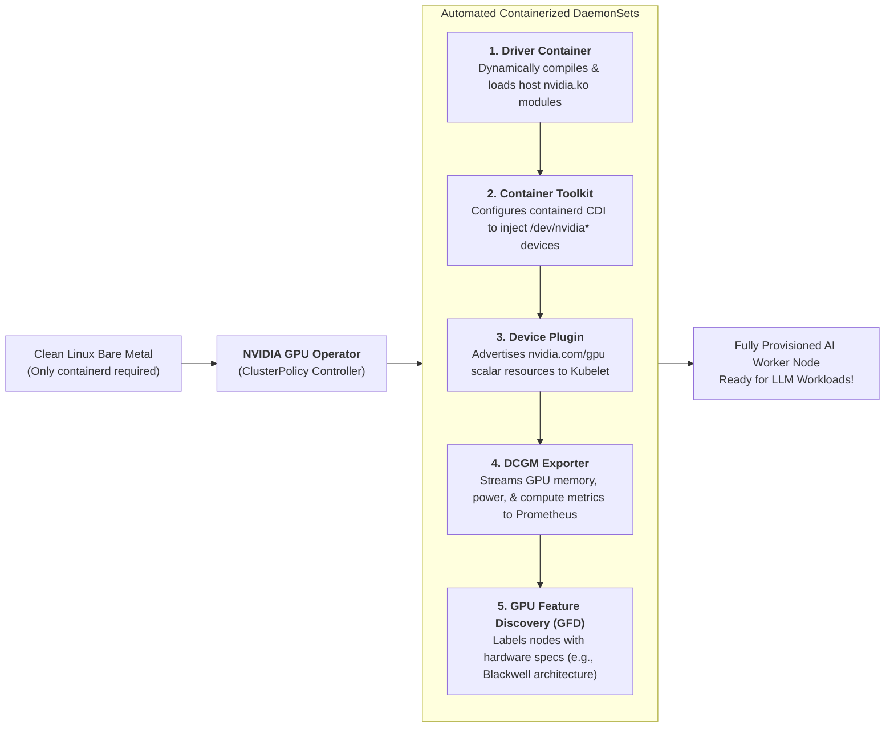
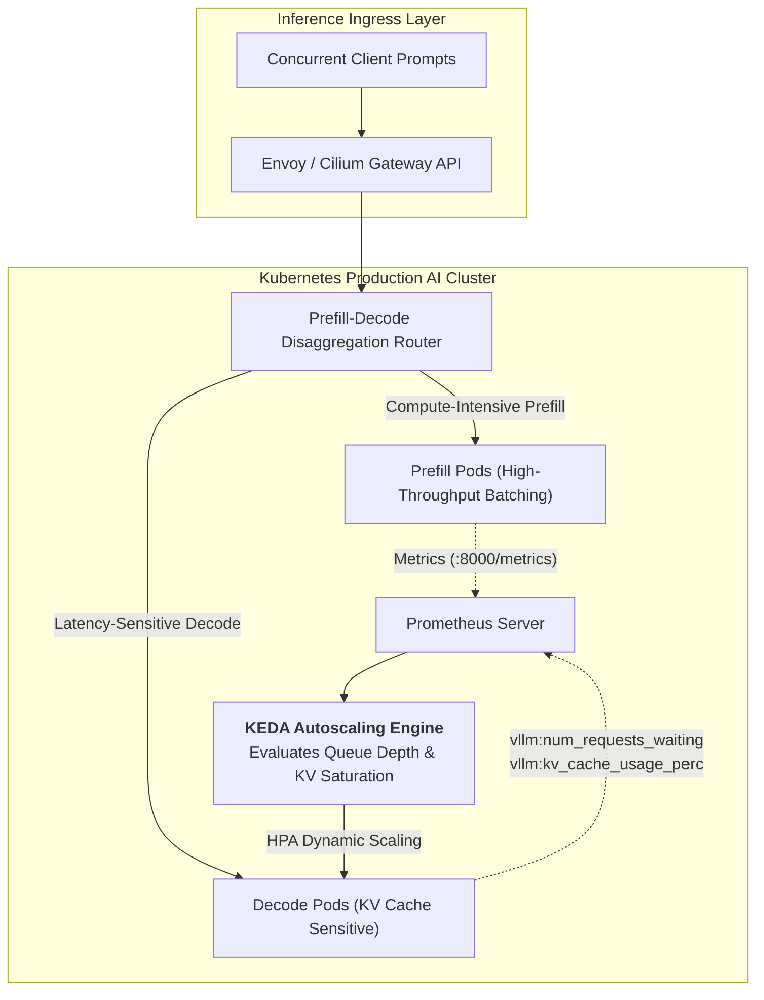

> [!NOTE] Executive Summary (TL;DR)
> - **Topology-Aware GPU Scheduling**: Analyzes NUMA, PCIe switch, and NVLink domain affinity in multi-GPU inference, leveraging Node Feature Discovery and the NVIDIA GPU Operator.
> - **Admission Failure Realities**: Clarifies that when a Pod fails Topology Manager admission, the scheduler does not automatically relocate the exact same Pod; reconciliation relies on higher-level controller reconstruction.
> - **Inference Alignment**: Connects directly with [vLLM Production Serving Metrics](/en/articles/vllm-serving-guide/) and [Custom Gang Scheduling Plugins](/en/articles/k8s-scheduling-framework-custom-plugin-gang-scheduling/).

## Introduction: The Paradigm Shift from Scalar CPUs to AI GPU Topologies

Throughout the first decade of cloud-native evolution, the core resource abstractions of Kubernetes scheduling were fundamentally **scalar and homogeneous**:
- A standard Pod requests `cpu: "2"` and `memory: "4Gi"`;
- The scheduler executes straightforward integer subtraction: $Node_{\text{allocatable}} - Pod_{\text{requests}}$. Whether those two CPU cores reside on socket 0 or socket 1, and which memory bus feeds that RAM, has negligible performance impact on conventional web microservices.

However, in the 2026 era of Large Language Models (LLMs), multimodal foundation models, and embodied intelligence, **these simplistic scalar scheduling assumptions collapse**:
1. **Capital Expenditure & Extreme Topology Sensitivity**: An 8x NVIDIA H100/H200/B200 computing node represents significant hardware investment;
2. **The "Topology Cliff" of NUMA and NVLink Interconnects**: When executing Tensor Parallelism (TP=4) across multiple GPUs, if the scheduler assigns 4 GPUs split across disparate NVSwitch interconnect groups or across CPU NUMA boundaries, cross-device communication latency increases by $5\times$ to $10\times$, degrading token generation rates (Tokens/s);
3. **Sub-Device Granularity**: Dedicated full-GPU allocation under-utilizes hardware for auxiliary workloads, requiring hardware-enforced Multi-Instance GPU (MIG) physical slicing with strict multi-tenant isolation.

```mermaid
flowchart TD
    subgraph GPUHost["Physical Topology of Modern 8-GPU AI Node"]
        direction TB
        subgraph NUMA0["NUMA Socket 0 (CPU 0 + Memory 0)"]
            GPU0["GPU 0 (B200)"] <== "NVLink (900 GB/s)" ==> GPU1["GPU 1 (B200)"]
            GPU2["GPU 2 (B200)"] <== "NVLink (900 GB/s)" ==> GPU3["GPU 3 (B200)"]
            GPU0 <==> GPU2
            GPU1 <==> GPU3
            NIC0["InfiniBand / RoCE NIC 0<br/>(PCIe Switch Direct to GPU 0-3)"]
        end

        subgraph NUMA1["NUMA Socket 1 (CPU 1 + Memory 1)"]
            GPU4["GPU 4 (B200)"] <== "NVLink (900 GB/s)" ==> GPU5["GPU 5 (B200)"]
            GPU6["GPU 6 (B200)"] <== "NVLink (900 GB/s)" ==> GPU7["GPU 7 (B200)"]
            GPU4 <==> GPU6
            GPU5 <==> GPU7
            NIC1["InfiniBand / RoCE NIC 1<br/>(PCIe Switch Direct to GPU 4-7)"]
        end

        NUMA0 <-.->|"Cross-NUMA UPI/QPI Interconnect (Bottleneck: 32-64 GB/s)"| NUMA1
    end
```



As the capstone chapter of **From Docker to Kubernetes: Cloud-Native Container & Cluster Orchestration Handbook**, this guide explores AI computing infrastructure: the **NVIDIA GPU Operator** automated lifecycle, **MIG hardware slicing, topology-aware scheduling**, and production autoscaling architectures for **vLLM and SGLang** inference clusters.

---

## 1. NVIDIA GPU Operator: Zero-Touch Management at Scale

Historically, enabling GPU workloads on Kubernetes was an operational bottleneck. Administrators had to manually SSH into bare-metal servers, compile kernel-matching NVIDIA drivers, configure CUDA runtimes, set up `nvidia-container-toolkit`, and deploy the Device Plugin DaemonSet.

In hyperscale AI clusters subject to continuous node cycling and autoscaling, manual provisioning causes driver version drift and node initialization failures.

The **NVIDIA GPU Operator** applies the [Operator Pattern](/en/articles/k8s-operator-pattern-kubebuilder-crd/) to hardware management. It automates node enablement via a declarative `ClusterPolicy`, delivering **zero-touch node configuration**:



### Component Architecture:
1. **Driver Container**: Compiles and injects `nvidia.ko` and `nvidia-uvm.ko` kernel modules into the host kernel at boot, **keeping the underlying Linux host filesystem clean**;
2. **NVIDIA Container Toolkit**: Modifies the container runtime (`/etc/containerd/config.toml`) with Container Device Interface (CDI) hooks, ensuring containers securely bind `/dev/nvidia*` devices and CUDA libraries at launch;
3. **NVIDIA Device Plugin**: Communicates with Kubelet over gRPC to register assignable GPU inventory;
4. **DCGM Exporter**: Collects high-frequency GPU telemetry—such as VRAM consumption, Tensor Core utilization, NVLink throughput, and thermal metrics—via the Data Center GPU Manager (DCGM);
5. **GPU Feature Discovery (GFD)**: Applies descriptive Kubernetes labels to nodes (e.g., `nvidia.com/gpu.product=NVIDIA-H100-80GB-HBM3`), enabling targeted workload scheduling.

---

## 2. GPU Slicing Architecture: Time-Slicing, MIG, and DRA

Not all AI tasks require an entire 80GB or 140GB HBM GPU. To maximize hardware utilization across enterprise clusters, three distinct allocation mechanisms are used:

| GPU Slicing Mechanism | Isolation Architecture | Memory & Compute Independence | Recommended Use Case |
| :--- | :--- | :--- | :--- |
| **Time-Slicing** | Software-level temporal sharing. Exposes multiple virtual devices to Kubelet. | **No Hardware Isolation**. Shared memory space; an out-of-memory error in one process terminates all co-located containers. | Dev/test staging, lightweight CI/CD, tiny feature-extraction models. |
| **MIG (Multi-Instance GPU)** | **Hardware-Level Partitioning**. Divides physical silicon into dedicated Compute Instances (CI) and GPU Instances (GI). | **Strict Physical Isolation**. Dedicated Streaming Multiprocessors, independent memory controllers, and isolated DMA engines. | Enterprise multi-tenancy, inference serving for small models (Embedding, Reranking). |
| **DRA (Dynamic Resource Allocation)** | Kubernetes 1.30+ claim-based allocation model replacing scalar integer counters. | **Topology-Aware Claims**. Requests specific device pairings (e.g., "Pair 2 GPUs connected via NVLink"). | Large-scale LLM training, disaggregated heterogeneous inference clusters. |

```text
NVIDIA MIG Physical Partitioning (Example: H100 80GB):
┌─────────────────────────────────────────────────────────────┐
│ Physical NVIDIA H100 80GB HBM3 GPU                          │
├──────────────────┬──────────────────┬───────────────────────┤
│ Instance 1       │ Instance 2       │ Instance 3            │
│ Profile: 3g.40gb │ Profile: 2g.20gb │ Profile: 1g.10gb (x2) │
│ • 42 SM Units    │ • 28 SM Units    │ • 14 SM Units         │
│ • 40GB VRAM      │ • 20GB VRAM      │ • 10GB VRAM           │
│ • 1.6 TB/s Band  │ • 800 GB/s Band  │ • 400 GB/s Band       │
│ (Deploy 14B LLM) │ (Deploy 7B LLM)  │ (Deploy Embedding)    │
└──────────────────┴──────────────────┴───────────────────────┘
```

Configuring `mig.strategy=mixed` within the GPU Operator enables declarative partitioning of physical cards into distinct MIG profiles (such as `nvidia.com/mig-3g.40gb: 2`), which the Kubernetes scheduler treats as non-preemptible hardware assets.

---

## 3. Topology-Aware Scheduling: NUMA and NVLink Co-location

Distributed LLM inference using Tensor Parallelism (TP) relies on ultra-low latency inter-card communication. Suboptimal placement decisions introduce significant performance degradation:

### 3.1 The Cross-NUMA Interconnect Bottleneck
On a typical dual-socket platform, CPU 0 controls Socket 0 local memory and GPUs 0–3, while CPU 1 controls Socket 1 and GPUs 4–7.
- If a Pod is assigned `CPU Core 2` (Socket 0) alongside `GPU 5` (Socket 1 PCIe root complex);
- Every host-to-device tensor memory transfer must cross CPU interconnect buses (such as Intel UPI or AMD Infinity Fabric), reducing bandwidth from 64 GB/s down to sub-15 GB/s!

### 3.2 Kubelet Topology Manager Alignment
To resolve this, Kubernetes provides the **Topology Manager** on worker nodes. It coordinates the CPU Manager, Memory Manager, and Device Plugin to enforce co-location:

```yaml
# Kubelet node configuration: /var/lib/kubelet/config.yaml
topologyManagerPolicy: single-numa-node
topologyManagerScope: container
cpuManagerPolicy: static
```

Under `single-numa-node`:
1. When Kubelet receives a container assignment, the Topology Manager evaluates NUMA boundaries;
2. **The container launches only if all requested exclusive CPU cores, HugePages memory allocations, and GPU devices reside within the identical physical NUMA node**;
3. If alignment cannot be satisfied, Kubelet rejects the container at admission (`TopologyAffinityError`), placing the Pod in `Failed` phase. Note that `kube-scheduler` does not automatically reschedule the terminated Pod instance; rescheduling requires a higher-level workload controller (e.g. Deployment/Job) to recreate a new Pod, or integrating topology-aware scheduling plugins (e.g. NodeResourceTopologyMatch) during the scheduling pre-filter phase.

---

## 4. Production AI Serving: Autoscaling vLLM & SGLang on Kubernetes

Operating production inference engines like **vLLM** and **SGLang** (analyzed in our companion deep dive on [Production Inference Engines Core Architecture Internals](/en/articles/inference-engines-core-architecture-internals/)) on Kubernetes requires accounting for two architectural constraints:
1. **VRAM preallocation**: `--gpu-memory-utilization` budgets a fraction of total device memory for the engine, including weights, activations, runtime overhead, and remaining KV storage. Allocated VRAM is different from occupied KV blocks, so device memory alone does not measure request pressure.
2. **Prefill/Decode (P/D) Disaggregation**: Prefill operations are compute-bound, whereas Decode operations are memory-bandwidth-bound.

The modern production architecture leverages **KEDA (Kubernetes Event-driven Autoscaling)** triggered by vLLM metrics scraped via Prometheus:



### 4.1 Production KEDA ScaledObject Configuration

The following manifest demonstrates autoscaling for a production vLLM deployment:

```yaml
apiVersion: keda.sh/v1alpha1
kind: ScaledObject
metadata:
  name: vllm-inference-autoscaler
  namespace: llm-serving
spec:
  scaleTargetRef:
    apiVersion: apps/v1
    kind: Deployment
    name: vllm-qwen-72b-instruct
  minReplicaCount: 2
  maxReplicaCount: 16
  cooldownPeriod: 300       # 300s scale-down delay prevents thrashing from large model reload cycles
  pollingInterval: 5        # Polls telemetry every 5s for rapid burst response
  advanced:
    horizontalPodAutoscalerConfig:
      behavior:
        scaleUp:
          stabilizationWindowSeconds: 0
          policies:
          - type: Percent
            value: 100      # Permits instantaneous 100% replica expansion during surges
            periodSeconds: 15
        scaleDown:
          stabilizationWindowSeconds: 300
  triggers:
  # Trigger 1: Queued inference requests awaiting compute capacity
  - type: prometheus
    metadata:
      serverAddress: http://prometheus-k8s.monitoring.svc.cluster.local:9090
      metricName: vllm_num_requests_waiting
      query: sum(vllm:num_requests_waiting{model_name="qwen-72b"})
      threshold: '5'        # Scales up when queue backlog exceeds 5 requests
  # Trigger 2: KV cache block allocation saturation
  - type: prometheus
    metricType: Value
    metadata:
      serverAddress: http://prometheus-k8s.monitoring.svc.cluster.local:9090
      metricName: vllm_kv_cache_usage_perc
      query: avg(vllm:kv_cache_usage_perc{model_name="qwen-72b"})
      threshold: '0.80'     # Triggers expansion when KV cache saturation crosses 80%
```

---

## 5. Comprehensive Series Review: Full Curriculum Retrospective

This concludes all 13 chapters of **From Docker to Kubernetes: Cloud-Native Container & Cluster Orchestration Handbook**!

Reviewing the architectural progression across the curriculum:

```mermaid
flowchart TD
    Ch1["<b>Ch 1: Docker Internals</b><br/>Linux namespaces, cgroups v2, OverlayFS CoW, and the runc execution chain"]
    Ch2["<b>Ch 2: Container Networking</b><br/>veth-pairs, Linux Bridge docker0, iptables NAT, and multi-host topologies"]
    Ch3["<b>Ch 3: Docker SwarmKit</b><br/>SwarmKit topology, embedded Raft consensus, VXLAN, and IPVS Routing Mesh"]
    Ch4["<b>Ch 4: Kubernetes Control Plane</b><br/>Declarative control theory, etcd MVCC, two-phase scheduling, and Informer reconcilers"]
    Ch5["<b>Ch 5: Kubernetes Networking</b><br/>The four network axioms, CNI plugins, Calico BGP routing, Cilium eBPF, and Gateway API"]
    Ch6["<b>Ch 6: Kubernetes Storage</b><br/>The CSI four-stage lifecycle, dynamic PV/PVC provisioning, and StatefulSet topology guarantees"]
    Ch7["<b>Ch 7: Application Networking</b><br/>gRPC load balancing trap, Service Mesh, and zero-downtime draining sequences"]
    Ch8["<b>Ch 8: Production Storage & Databases</b><br/>Local NVMe passthrough, RocksDB/WAL tuning, and Node Fencing split-brain defense"]
    Ch9["<b>Ch 9: Scheduler Customization</b><br/>Scheduling Framework plugins, Gang Scheduling, and Descheduler rebalancing"]
    Ch10["<b>Ch 10: Node & Runtime Customization</b><br/>NRI resource plugins, Kata/gVisor sandboxed runtimes, and sysctl isolation"]
    Ch11["<b>Ch 11: Control Plane Customization</b><br/>Aggregated APIServers, APF traffic control with Shuffle Sharding, and etcd sharding"]
    Ch12["<b>Ch 12: The Operator Pattern</b><br/>CRD domain models, KubeBuilder scaffolding, Split Clients, Reconcilers, and Finalizers"]
    Ch13["<b>Ch 13: 2026 AI Infrastructure</b><br/>NVIDIA GPU Operator, MIG hardware partitioning, Topology Manager, and vLLM/SGLang autoscaling"]

    Ch1 --> Ch2 --> Ch3 --> Ch4 --> Ch5 --> Ch6 --> Ch7 --> Ch8 --> Ch9 --> Ch10 --> Ch11 --> Ch12 --> Ch13
```



- **Linux Kernel Foundations to Single-Host Runtimes (Ch 1–2)**: We deconstructed the abstraction of containers into standard Linux processes bounded by kernel namespaces and cgroups, mapped through virtual bridges and iptables routing rules;
- **Lightweight Clustering to Declarative Control Planes (Ch 3–6)**: We examined Docker Swarm's embedded Raft consensus, then progressed to Kubernetes declarative control loops, CNI flat networking, and CSI stateful volume architectures;
- **Application Engineering & Hacking Kubernetes (Ch 7–11)**: We resolved application-layer gRPC stream pinning, rollout 502 race conditions, Local NVMe direct passthrough, and split-brain fencing; then customized the Kubernetes core via Scheduling Framework plugins, NRI hardware interception, and Aggregated APIServers;
- **Automation to the 2026 AI Frontier (Ch 12–13)**: We codified operational heuristics into autonomous production Operators, synthesizing modern cloud-native orchestration with hyperscale accelerator topologies from physical NUMA alignment to distributed LLM serving.

---

## Frequently Asked Questions (FAQ)

### Q1: How does vLLM VRAM preallocation relate to Kubernetes OOM?
`--gpu-memory-utilization` is a fraction of total device memory budgeted for the engine. Weights and other overhead are deducted before KV tensor storage is allocated; it is not 90% of remaining VRAM allocated to page tables. GPU OOM differs from host-RAM cgroup OOM. Node pressure can cause system OOM or eviction even when a Pod is below its own memory limit. Scale using queues, TTFT, preemptions, and occupied KV blocks together, rather than `memory.used` alone.

### Q2: Does Topology Manager guarantee a particular NVLink GPU group?
No. It combines NUMA hints from CPU, memory, and device managers for node admission; it is not a scheduler for arbitrary NVLink connectivity graphs. Server topology varies. DGX H100 connects all eight GPUs through NVSwitch, so two four-GPU islands are not a universal model. Check `nvidia-smi topo -m` and vendor documentation, then verify driver and scheduler support for any required GPU/NIC topology constraints. See the [DGX H100 hardware guide](https://docs.nvidia.com/dgx/dgxh100-user-guide/introduction-to-dgxh100.html).

### Q3: Does DRA automatically solve every GPU and NIC topology problem?
No. ResourceClaims and driver-published device attributes can express richer selection criteria, but available properties, cross-device constraints, and allocation behavior depend on Kubernetes and driver versions. Verify that GPU/NIC drivers expose the required topology and validate scheduling and admission behavior. Enabling DRA alone does not guarantee an optimal NVLink group or eliminate cross-NUMA traffic. See [Kubernetes DRA](https://kubernetes.io/docs/concepts/scheduling-eviction/dynamic-resource-allocation/).


In the KEDA example, `qwen-72b` must match vLLM `--served-model-name`; verify labels at `/metrics`. A total queue uses `AverageValue` to divide work among replicas; a cluster-average cache fraction uses `metricType: Value` to avoid an extra per-replica normalization. Thresholds are illustrative and require available GPUs, startup time, and cache-warmup planning.
