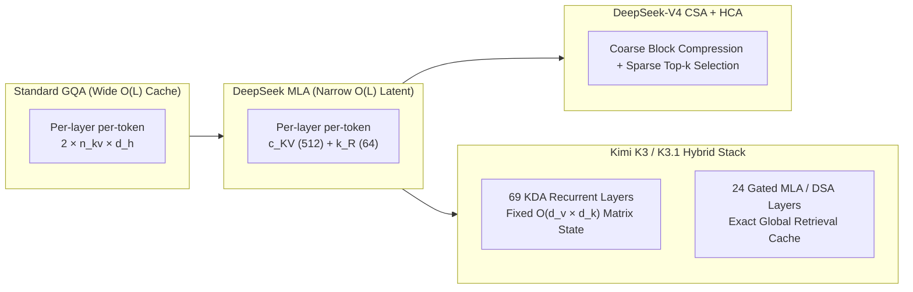

> [!NOTE] Executive Summary (TL;DR)
> - **Exact Architectural Taxonomy**: Dissects Moonshot's **KDA (Kimi Delta Attention)** inside Kimi K3 (69 KDA + 24 Gated MLA layers) and K3.1 Pro (Gated DSA + KDA), correcting common misconceptions that mislabel KDA as "Dynamic Attention" or claim whole-model constant memory.
> - **Explicit Memory Slope Math**: Each KDA layer maintains a sequence-length-independent recurrent matrix state $\mathbf{S}_t \in \mathbb{R}^{d_v \times d_k}$, while the 24 interleaved attention layers retain $O(L)$ caches—slashing linearly scaling KV layers by **~74.2%** while preserving exact long-range retrieval.
> - **System Integration**: Pairs directly with [DeepSeek MLA Matrix Absorption](/en/articles/mha-gqa-mla-matrix-absorption-inference-engine/), [DeepInfer Sparse Kernel Architecture](/en/articles/deepinfer-deepseek-recipe-architecture/), and [Test-Time Reasoning Systems](/en/articles/reasoning-test-time-compute-inference-future/).

## Three Distinct Solutions to Two Million-Token Walls

Serving million-token (`1M`) contexts hits two physical walls simultaneously: the **HBM capacity & bandwidth wall during Decode** and the **$O(L^2)$ quadratic compute wall during Prefill**. Modern frontier architectures attack different axes of this problem:

1. **DeepSeek-V2 / V3 MLA (Multi-head Latent Attention)**: Compresses the **channel dimension** of every historical token into a low-rank joint latent vector $\mathbf{c}_t^{KV}$, dramatically reducing the per-token cache slope while remaining $O(L)$ in sequence length.
2. **Kimi Linear / K3 / K3.1 KDA (Kimi Delta Attention)**: Replaces per-token historical caches in the majority of layers with a fine-grained channel-gated **Delta-Rule recurrent state $\mathbf{S}_t$** of fixed **$O(1)$ size** with respect to sequence length $L$, interleaving a smaller set of full/sparse attention layers for exact token-level recall.
3. **DeepSeek-V4 CSA / HCA (and V3.2 DSA Lightning Indexer)**: Combines channel latent compression with **sequence-dimension block compression and Top-$k$ sparse routing**, cutting both quadratic prefill FLOPs and per-step HBM read traffic.

---

## 1. Defined MHA / GQA Baseline Arithmetic

Standard Multi-Head (MHA) and Grouped-Query Attention (GQA) KV caches obey:

$$\text{KV}_{\text{bytes}} = 2 \times B \times L \times N_{\text{layers}} \times n_{kv} \times d_h \times \text{bytes\_per\_elem}$$

For an explicit GQA reference configuration with $B = 1$, $N_{\text{layers}} = 80$, KV hidden dimension $n_{kv} \times d_h = 2048$ (e.g., $n_{kv}=16, d_h=128$), and FP16/BF16 (`2 Bytes`):
- **Per-token cache across all 80 layers**: $2 \times 80 \times 2048 \times 2 = 655,360\text{ Bytes} \approx 640\text{ KiB}$;
- **At $L = 4,000$ tokens**: `2.62 GB` (decimal GB; divide by $2^{30}$ for `2.44 GiB`);
- **At $L = 1,000,000$ (`1M`) tokens**: A single request consumes **`655.36 GB`**, exceeding the entire `640 GB` HBM capacity of an 8×H100 node before even loading model weights.

---

## 2. DeepSeek-V2 / V3 MLA: Low-Rank Latents and Matrix Absorption

Instead of caching full multi-head keys and values, MLA caches a compressed joint latent vector $\mathbf{c}_t^{KV} \in \mathbb{R}^{d_c}$ alongside a decoupled RoPE positional key $\mathbf{k}_t^R \in \mathbb{R}^{d_R}$:

$$\text{MLA\_bytes\_per\_layer\_token} = (d_c + d_R) \times \text{bytes\_per\_elem}$$

Evaluating DeepSeek-V3's published dimensions ($d_c = 512, d_R = 64, N_{\text{layers}} = 61$):
- **Per-layer per-token footprint**: $512 + 64 = 576$ elements (`1,152 Bytes` in BF16, or `576 Bytes` in FP8);
- **1M-token cache across 61 layers**: $61 \times 1,152 \times 10^6 \approx \mathbf{70.27\text{ GB}}$ in BF16, dropping to **`35.14 GB`** with FP8 KV quantization;
- **Matrix Absorption**: During Decode, the up-projection $\mathbf{W}^{UK}$ is absorbed into the Query projection and $\mathbf{W}^{UV}$ into the output projection $\mathbf{W}^O$, avoiding materialization of expanded per-head K/V tensors in HBM. Full derivations appear in [From MHA and GQA to DeepSeek MLA: Matrix Absorption](/en/articles/mha-gqa-mla-matrix-absorption-inference-engine/).

Crucially, **MLA cache capacity still scales strictly linearly with $L$**, and MLA is a trained architectural parameterization—not a lossless runtime flag that can be toggled on an arbitrary pre-trained GQA checkpoint.

---

## 3. Kimi Delta Attention (KDA) and the K3 / K3.1 Hybrid Memory Equation

### 3.1 Fine-Grained Gated Delta-Rule Recurrence

Naive linear attention accumulates outer products $\mathbf{S}_t = \mathbf{S}_{t-1} + \mathbf{v}_t \mathbf{k}_t^\top$, suffering from severe memory collisions as context grows. **KDA (Kimi Delta Attention)** augments the error-correcting Delta Rule with **fine-grained per-channel decay gates $\boldsymbol{\alpha}_t \in (0,1)^{d_k}$** and scalar write-strength gates $\beta_t$:

$$\mathbf{S}_t = \operatorname{diag}(\boldsymbol{\alpha}_t)\,\mathbf{S}_{t-1}\left(\mathbf{I} - \beta_t \mathbf{k}_t \mathbf{k}_t^\top\right) + \beta_t \mathbf{v}_t \mathbf{k}_t^\top, \qquad \mathbf{o}_t = \mathbf{S}_t \mathbf{q}_t$$

At each step, KDA selectively erases stale associations along direction $\mathbf{k}_t$ via the delta correction term $-\beta_t \mathbf{S}_{t-1}\mathbf{k}_t\mathbf{k}_t^\top$, applies channel-specific decay $\operatorname{diag}(\boldsymbol{\alpha}_t)$, and writes the new association $\beta_t \mathbf{v}_t \mathbf{k}_t^\top$. During Prefill, chunkwise parallel scan formulations map these updates efficiently onto GPU Tensor Cores.

### 3.2 Hybrid Layer Accounting in Kimi K3 and K3.1 Pro

For a single KDA layer at fixed model dimensions, each head stores a fixed $d_v \times d_k$ recurrent matrix $\mathbf{S}_t$:

$$\text{State}_{\text{KDA\_layer}} = n_{\text{heads}} \times d_v \times d_k \times \text{bytes\_per\_state\_elem}$$

For $n_{\text{heads}} = 64$ and $d_k = d_v = 128$ in BF16/FP32, one KDA layer occupies only **`2 MB–4 MB`** per request—**identically at `4K` or `1M` tokens**.

However, fixed-rank recurrent states face an information-theoretic bottleneck on exact arbitrary-offset copy/needle tasks across a million tokens. Consequently:
- **[Kimi K3](https://huggingface.co/moonshotai/Kimi-K3) (`2.8T` total / `104B` active)** interleaves **69 KDA layers with 24 Gated MLA layers** (~3:1 ratio);
- **Kimi K3.1 Pro (late Oct / Nov 2026, `1,048,576` / `1.04M` context)** pairs **Gated DSA (Gated DeepSeek Sparse Attention) with KDA** to further accelerate million-token attention layers.

Therefore, total per-request state memory in a hybrid model follows a **constant + linear** law:

$$\text{Mem}_{\text{total}}(L) = \underbrace{N_{\text{KDA}} \times \text{State}_{\text{KDA\_layer}}}_{O(1)\text{ fixed recurrent state (~hundreds of MB)}} + \underbrace{N_{\text{Attn}} \times L \times \text{Bytes}_{\text{Attn\_layer\_token}}}_{O(L)\text{ linear attention cache}}$$

Replacing 69 of 93 layers with KDA eliminates **$69 / 93 \approx \mathbf{74.2\%}$** of the linearly growing KV layers, dramatically flattening the 1M-context memory curve—**without** making the complete model constant-memory. Furthermore, when serving multi-turn agents with prefix reuse (see [Prefix Caching & RadixAttention Internals](/en/articles/prefix-caching-radix-attention-internals/)), engines must budget memory for snapshotting recurrent KDA states at conversation branch points.

---

## 4. DeepSeek-V4 CSA / HCA and Dynamic Sparse Indexing

At `1M` tokens, even a compact `576`-element MLA cache incurs heavy $O(L^2)$ prefill compute and full-history HBM reads at decode. The [DeepSeek-V4 model card](https://huggingface.co/deepseek-ai/DeepSeek-V4-Pro) pairs **CSA (Compressed Sparse Attention)** with **HCA (Heavily Compressed Attention)** (for kernel-level execution mechanics, see [DeepInfer: DeepSeek's Sparse Inference Engine Architecture](/en/articles/deepinfer-deepseek-recipe-architecture/)):

1. **HCA (Blockwise Sequence Compression)**: Compresses contiguous token blocks along the sequence axis into coarse summary representations much shorter than $L$;
2. **CSA / DSA (Fine-Grained Top-$k$ Sparse Routing)**: Uses a lightweight scorer (such as an FP8 Lightning Indexer) to rank historical segments against the active query and gather only the **Top-$k$ (e.g., $k=2048$)** most relevant fine-grained latent entries from HBM.

Note the system distinction between **bandwidth/FLOPs** and **residency capacity**: sparse Top-$k$ selection reduces active per-step attention compute and HBM read bytes from $O(L)$ to $O(k)$, whereas the underlying compressed latent pool for all $L$ tokens must still remain resident across HBM or tiered host DRAM (e.g., Mooncake / LMCache) because future queries may attend to previously unselected spans.

---

## 5. Designing Reproducible Long-Context Benchmarks

Unqualified claims such as "8.6 GB at 100K, 42 GB at 1M, 110 tokens/s" cannot be compared across architectures without locking five experimental controls:

| Dimension | Mandatory Experimental Controls |
| --- | --- |
| **Checkpoint & Dtypes** | Exact model revision, weight format (`FP8` / `NVFP4` / `MXFP4`), KV cache dtype, and KDA recurrent state dtype (`BF16` vs `FP32`) |
| **Parallelism Layout** | `TP / PP / DP / EP` degrees, specifically whether MLA latents are replicated across TP ranks (vs. DP Attention) and how KDA heads shard |
| **Traffic Profile** | Exact prompt/output length distributions, concurrency, warm vs. cold prefix/state caches, and warm-up iterations |
| **Per-Rank Memory Ledger** | Separate accounting for static weights, fixed KDA state pools, linear paged KV blocks, CUDA Graph buffers, and NCCL workspaces |
| **Quality-at-SLA** | Joint reporting of TTFT, TPOT, SLO-compliant goodput, and multi-needle / cross-page numerical citation accuracy |

For multi-node hardware sizing and launch recipes, consult the [DeepSeek-V4 and Kimi K3 Production Deployment Guide](/en/articles/deepseek-v4-kimi-k3-deployment-guide/).

## Frequently Asked Questions (FAQ)

### Q1: What does KDA stand for, and does it eliminate all KV cache in Kimi K3 / K3.1?
KDA stands for **Kimi Delta Attention** (a channel-gated delta-rule linear attention mechanism, not "Dynamic Attention"). While each KDA layer holds a fixed-size recurrent matrix independent of sequence length, Kimi K3 (69 KDA + 24 Gated MLA) and K3.1 Pro retain interleaved attention layers whose caches still grow linearly with context length.

### Q2: Why do KDA recurrent states and MLA latent caches have different quantization sensitivities?
MLA caches static per-token projections where blockwise `FP8` scaling incurs minimal error without temporal accumulation. By contrast, a KDA state matrix $\mathbf{S}_t$ undergoes hundreds of thousands of sequential decay-and-update steps; aggressive low-bit quantization of the recurrent accumulator compounds rounding drift over time, so production kernels typically preserve `BF16` or `FP32` recurrent states while quantizing weights and static KV caches separately (see our [Practical Quantization Guide](/en/articles/quantization-hands-on-guide/)).

### Q3: If sparse attention (CSA / DSA) only attends to Top-$k$ tokens per step, does HBM storage also shrink to $k$ tokens?
No. Attending to Top-$k$ entries slashes **per-step compute FLOPs and HBM read bandwidth** from $O(L)$ to $O(k)$, directly accelerating long-context Prefill and Decode. However, because subsequent tokens in the same conversation may query entirely different historical spans, the compressed latent representations for the full context must remain stored in GPU HBM or tiered host memory pools.
