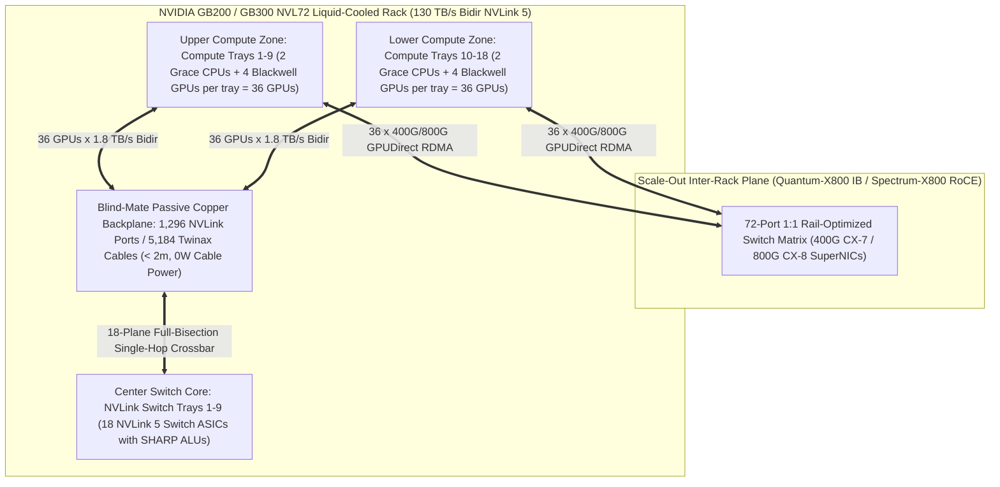
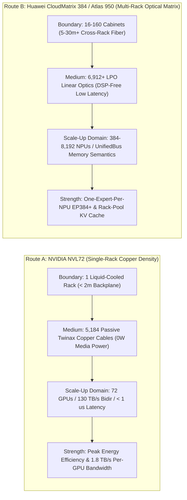
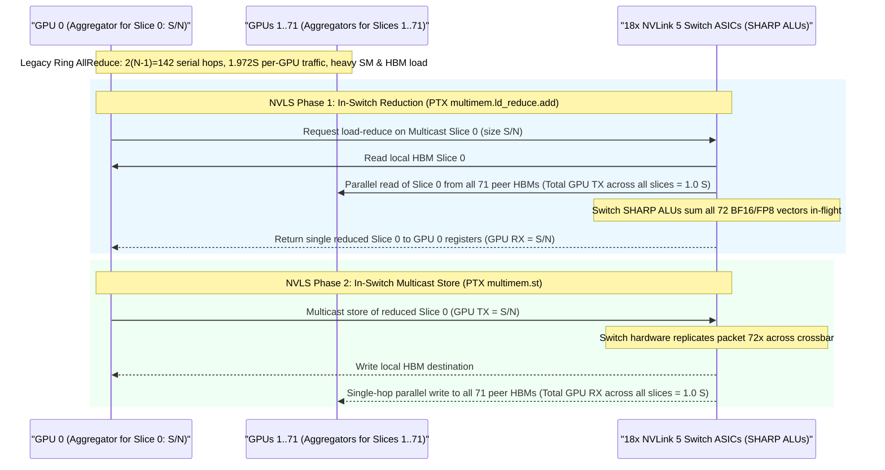
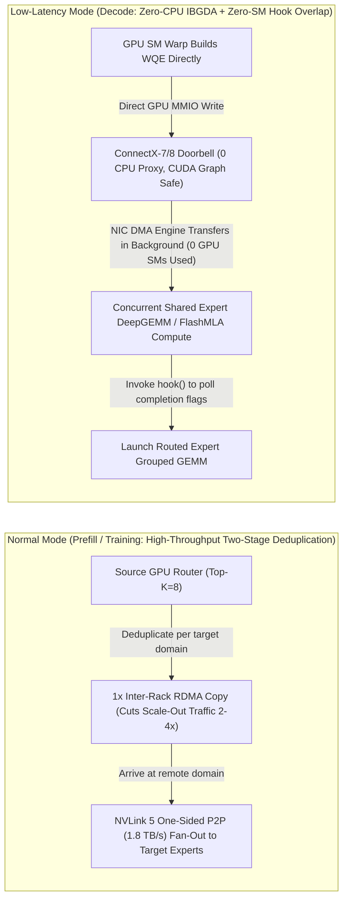

> [!NOTE] Executive Summary (TL;DR)
> - **End of the 8-GPU Island & The Bandwidth Cliff**: Traditional 8-GPU HGX servers hit a brutal physical wall at the chassis boundary—dropping from **Scale-Up NVLink 5 (900 GB/s unidirectional / 1.8 TB/s bidirectional byte-addressable load/store)** down to **Scale-Out 400G NDR / 800G XDR RDMA (50–100 GB/s unidirectional packetized Queue Pairs)**, a **9x–18x unidirectional bandwidth cliff** (18x–36x bidirectional-to-unidirectional) paired with microsecond latency jumps that cripple trillion-parameter MoE and Wide-EP decoding.
> - **Passive Copper Rack vs. All-Optical Multi-Rack SuperPoDs**: Dissects **NVIDIA GB200/GB300 NVL72** (18 compute trays × 9 NVLink switch trays wired via 5,184 passive twinax copper cables into a single-hop **130 TB/s** bidirectional fabric, saving >20 kW of optical transceiver power and pooling 13.8 TB to 20.7 TB of HBM3e) alongside **Huawei CloudMatrix 384 & Atlas 950 SuperPoDs** (leveraging 6,912× 400G LPO linear-drive optical transceivers and UnifiedBus to span 16+ racks across 384 to 8,192 Ascend NPUs).
> - **NCCL Collective Math & NVLS In-Switch Reduction**: Derives exact `algbw` vs. `busbw` normalization formulas from first principles, exposes the $2(N-1)=142$ sequential hop latency catastrophe of Ring AllReduce at 72 GPUs, and proves how **NVLS (NVLink SHARP)** `multimem.ld_reduce` and `multimem.st` PTX instructions slash per-GPU NVLink/HBM traffic nearly in half from $2\frac{N-1}{N}S$ to $\frac{N+1}{N}S$.
> - **MoE All-to-All Kernels & Production MNNVL Operations**: Unpacks **DeepEP**'s two-stage NVLink deduplicated forwarding, **IBGDA (InfiniBand GPUDirect Async)** zero-CPU doorbell posting (~163 $\mu\text{s}$ decode latency), and zero-SM hook overlap, followed by a bare-metal playbook for `nvidia-imex` cliques, 72-GPU `nccl-tests` validation, and NVLink lane degradation troubleshooting.

---

## Introduction: The End of the 8-GPU Server Era — Why Trillion-Parameter MoE and Wide-EP Force Infrastructure Toward Rack-Scale SuperPoDs

For nearly a decade of deep learning infrastructure evolution, the **8-GPU server node**—epitomized by NVIDIA DGX/HGX H100 systems—stood as the indisputable atomic unit of AI compute. System architects designed distributed workloads around a rigid boundary rule: confine communication-intensive Tensor Parallelism (`TP=8`) strictly inside the single-node NVSwitch baseboard, and relegate Data Parallelism (`DP`) and Pipeline Parallelism (`PP`) to inter-node InfiniBand or RoCEv2 fabrics.

With the rise of frontier sparse Mixture-of-Experts (MoE) architectures scaling from 600B to multi-trillion parameters, that 8-GPU chassis enclosure has become the primary bottleneck throttling cluster utilization. As examined in [Inside DeepSeek's Inference Money Printer: Full-Stack Production Dissection of DeepInfer and deepseek-recipe](/en/articles/deepinfer-deepseek-recipe-architecture/) and [MoE Expert Parallelism in Inference Engines](/en/articles/moe-expert-parallelism-inference-engine/), autoregressive MoE decoding suffers from a simultaneous three-way squeeze: **massive total weight memory footprint, ultra-low arithmetic intensity per step, and twice-per-layer all-to-all token routing**.

Evaluating the physics at the edge of an 8-GPU sheet-metal chassis reveals why traditional servers break down:

1. **The Bandwidth Cliff and Semantic Chasm Between Scale-Up and Scale-Out**:
   - **Inside the node (Scale-Up)**: Fifth-generation NVLink (NVLink 5) connects Blackwell GPUs to NVSwitch silicon at **900 GB/s unidirectional (1.8 TB/s bidirectional)** per GPU. Crucially, NVLink exposes **byte-addressable load/store memory semantics**—a GPU Streaming Multiprocessor (SM) warp issues a native PTX `ld.global` or `st.global` instruction to read or write peer GPU HBM3e in **~0.6 $\mu\text{s}$**.
   - **Across the node boundary (Scale-Out)**: Exiting the 8-GPU box forces traffic across PCIe Gen5/Gen6 or C2C links into a ConnectX-7 NIC (400 Gbps NDR = **50 GB/s unidirectional**) or ConnectX-8 SuperNIC (800 Gbps XDR = **100 GB/s unidirectional**).
   - Crossing that sheet-metal boundary inflicts an immediate **9x (800G XDR) to 18x (400G NDR) drop in symmetric unidirectional bandwidth**—or an **18x to 36x cliff** when contrasting 1.8 TB/s bidirectional NVLink memory fabric against 50–100 GB/s unidirectional RDMA injection! Simultaneously, transport semantics degrade from cache-line loads/stores to **packetized RDMA Queue Pair (QP) Work Queue Element (WQE) serialization**, pushing baseline hop latency up to **2–5 $\mu\text{s}$**.
2. **Why Wide-EP Decode Shatters on 8-GPU Islands**:
   - Consider serving a 671B–1T MoE model with 256 routed experts and Top-$K=8$ activation in a low-latency Decode pool targeting $>100\text{ tokens/s}$ per user (leaving a total per-layer execution budget of roughly **130–160 $\mu\text{s}$**).
   - To stream expert weights in microseconds while preserving HBM headroom for long-context KV caches, production engines deploy **Wide Expert Parallelism (`EP=64` or `EP=72`)**, placing only 3–4 routed experts per GPU and aggregating $72 \times 8\text{ TB/s} = \mathbf{576\text{ TB/s}}$ of rack-wide HBM3e memory bandwidth.
   - If those 64 GPUs are scattered across eight 8-GPU HGX boxes, every Transformer layer must execute both a `Dispatch` and a `Combine` `All-to-All` collective. Under uniform expert routing, $\frac{64 - 8}{64} = \mathbf{87.5\%}$ of all routed token activations slam directly into the 50–100 GB/s Scale-Out RDMA bottleneck—turning Tensor Cores idle behind massive communication bubbles.
3. **Disaggregated KV Cache Pooling and RL Weight Resharding**:
   - In [Prefill/Decode Disaggregation and Distributed KV Cache](/en/articles/pd-disaggregation-distributed-kv-cache/), multi-megabyte KV caches for long-context prompts must stream continuously between Prefill and Decode pools. Similarly, in [Distributed RL Post-Training and verl Colocation Architectures](/en/articles/distributed-rl-post-training-verl-colocation/), transitioning every rollout step from sharded FSDP/TP training states into Wide-EP inference states triggers hundred-gigabyte global `AllGather` and `All-to-All` weight resharding bursts.

The only architectural escape is to **obliterate the 8-GPU server boundary and expand the byte-addressable Scale-Up domain to 72, 384, or thousands of accelerators**—giving rise to the **Rack-Scale SuperPoD**.

| Architectural Dimension | Legacy 8-GPU Node (HGX H100/B200) | NVIDIA GB200 / GB300 NVL72 | Huawei CloudMatrix 384 (Atlas 900 A3) | Huawei Atlas 950 SuperPoD |
| :--- | :--- | :--- | :--- | :--- |
| **Scale-Up Domain Size** | 8 GPUs (Single Chassis) | **72 Blackwell GPUs** + 36 Grace CPUs | **384 Ascend 910C NPUs** + 192 Kunpeng CPUs | **64 – 8,192 Ascend 950DT NPUs** |
| **Physical Footprint** | Single 6U–8U Air/Liquid Server | **1 Liquid-Cooled Rack** (18 Compute + 9 Switch Trays) | **16 Racks** (12 Compute + 4 Switch Racks) | Multi-Rack Pod (1,024-NPU base pod = 160 cabinets) |
| **Scale-Up Medium** | PCB Traces (NVSwitch Baseboard) | **5,184 Passive Blind-Mate Twinax Copper Cables** (< 2m) | **All-Optical Mesh** (5,376× 400G LPO Transceivers) | **Cross-Rack All-Optical Fabric** (UnifiedBus 2.0) |
| **Per-Chip Scale-Up BW** | 900 GB/s – 1.8 TB/s (Bidir) | **1.8 TB/s Bidir** (900 GB/s Unidir, NVLink 5) | **784 GB/s Bidir** (392 GB/s Unidir, UB) | **2,016 GB/s Bidir** (18 × 112G UB Ports) |
| **Aggregate Scale-Up BW** | 7.2 TB/s – 14.4 TB/s (Bidir) | **130 TB/s Bidir** (64.8 TB/s Full-Bisection Unidir) | **~150.5 TB/s Unidir Aggregate** (Non-Blocking Optical) | **1.72 PB/s** (1,024 NPUs) – **16 PB/s** (8,192 NPUs) |
| **Pooled HBM Capacity** | 640 GB – 1.5 TB | **13.8 TB** (GB200) / **20.7 TB** (GB300) | **~49.2 TB HBM2E** (128 GB × 384) | Up to **256 TB Unified Global Memory Space** |
| **Scale-Out NIC Plane** | 8 × 400G/800G IB/RoCE | **72 × 400G (CX-7) or 800G (CX-8 SuperNICs)** | **384 × 400G RoCE** (1,536 Optical Modules) | 400G UBoE / RoCE Scale-Out Fabric |

> [!TIP]
> **Interactive SuperPoD Memory & Bandwidth Sizing**: When planning EP/TP sharding degrees, KV cache concurrency headroom, and interconnect bandwidth budgets for frontier MoE deployments, use our interactive [LLM VRAM & Throughput Calculator](/en/tools/) to model exact hardware utilization across FP16, FP8, and FP4 precisions.

---

## 1. Physical SuperPoD Dissection: NVIDIA GB200/GB300 NVL72 Copper Backplanes vs. Huawei CloudMatrix 384 / Atlas All-Optical Interconnects

To build massive unified-memory Scale-Up domains, global AI infrastructure engineering has bifurcated into two distinct, physics-driven paradigms: **NVIDIA's ultra-dense single-rack liquid cooling + passive blind-mate copper backplane (NVL72)**, and **Huawei's multi-rack LPO all-optical fabric + UnifiedBus architecture (CloudMatrix 384 & Atlas 950)**.

### 1.1 Inside NVIDIA GB200 / GB300 NVL72: 5,184 Copper Cables Weaving a 130 TB/s Monolithic GPU

Inspecting a 1.36-metric-ton, **120–140 kW** liquid-cooled NVIDIA GB200 NVL72 (or Blackwell Ultra GB300 NVL72) rack reveals a mechanical layout dictated entirely by **high-frequency electromagnetic insertion loss**:

1. **Symmetric "Sandwich" Vertical Rack Geometry**:
   - Rather than mounting switches at the Top-of-Rack (ToR), NVL72 positions **9 × 1RU NVLink Switch Trays dead-center** in the middle of the rack.
   - Flanking the switch core above and below are **9 upper + 9 lower = 18 × 1RU Liquid-Cooled Compute Trays**.
   - Why place the switch trays in the middle? At 200 Gbps PAM4 SerDes signaling rates, Nyquist attenuation limits unretimed passive twinax copper reach to roughly **1.5–2 meters**. Centering the switches cuts the worst-case vertical trace-plus-cable span from the topmost and bottommost compute trays to **under ~1.2 meters**, completely eliminating active retimers and optical transceivers inside the Scale-Up domain.
2. **Compute Tray Architecture & Pooled HBM3e Scaling (GB200 vs. GB300)**:
   - Each 1RU Compute Tray houses **2 Grace-Blackwell Superchips = 2 Grace 72-core Arm CPUs + 4 Blackwell GPUs**, linked internally via coherent **900 GB/s bidirectional NVLink-C2C**.
   - Across 18 compute trays, a single rack integrates **$18 \times 2 = \mathbf{36}$ Grace CPUs** and **$18 \times 4 = \mathbf{72}$ Blackwell GPUs**.
   - **HBM3e Capacity Leap**: **GB200 NVL72** equips each B200 GPU with **192 GB HBM3e** (~186 GB usable at 8 TB/s per GPU), yielding **13.8 TB nominal (~13.4–13.5 TB usable) HBM3e**. **GB300 NVL72 (Blackwell Ultra)** upgrades each B300 GPU to **12-Hi 288 GB HBM3e**, expanding rack HBM3e by 50% to **20.7 TB**—and when combined with ~17 TB of Grace CPU LPDDR5X, creates a **~37 TB hardware-coherent unified memory pool** inside a single rack footprint.
3. **18-Plane Single-Hop Non-Blocking Crossbar & The 5,184 Twinax Cable Math**:
   - Each of the 9 NVLink Switch Trays contains **2 × NVLink 5 Switch ASICs**, totaling **18 NVLink 5 Switch ASICs** per rack (each ASIC exposing 72 NVLink 5 ports with 7.2 TB/s bidirectional switching capacity).
   - Every Blackwell GPU exposes **18 NVLink 5 links**, where each link carries 2 differential pairs per direction at 200 Gbps PAM4 (**50 GB/s unidirectional / 100 GB/s bidirectional per link** $\implies$ **900 GB/s unidirectional / 1.8 TB/s bidirectional per GPU**).
   - **Orthogonal Crossbar Wiring**: Link $k \in \{0, \dots, 17\}$ of every single one of the 72 GPUs wires directly to NVSwitch ASIC $k$! This creates $72 \times 18 = \mathbf{1,296}$ NVLink ports; multiplying by 4 differential twinax pairs per port yields exactly **$1,296 \times 4 = \mathbf{5,184}$ high-speed twinax coaxial copper cables** (~2 miles of total copper wire) sealed inside rigid blind-mate **NVLink Cable Cartridges** along the rear backplane.
   - Any GPU in Tray 1 communicates with any GPU in Tray 18 across all 18 switch planes simultaneously in **strictly 1 switch hop**, delivering **$72 \times 1.8\text{ TB/s} = \mathbf{129.6\text{ TB/s}} \approx \mathbf{130\text{ TB/s}}$** of non-blocking bidirectional fabric bandwidth.



**Why Passive Copper Saves >20 kW Over Optics Inside the Rack**:
Replacing 1,296 bidirectional 100 GB/s (800 Gbps equivalent) links with double-ended pluggable 800G DSP optical transceivers ($1,296 \times 2 = 2,592$ optical transceiver ends at ~13–16 W each, plus retimers) would burn **20 kW to 30+ kW of pure electrical-to-optical heat per rack**, add ~100 ns of optical DSP serialization latency, and introduce laser thermal wear-out ("link flaps") that severely degrades 72-GPU synchronous MTBF. Passive copper consumes **0 W in the transmission medium**, channeling 100% of the rack's thermal budget into compute silicon.

### 1.2 Huawei CloudMatrix 384 & Atlas 950 SuperPoDs: Breaking the Copper Reach Wall with All-Optical UnifiedBus

Yet passive copper carries an inescapable geometric ceiling: **thermal and mechanical limits cap a single liquid-cooled cabinet at roughly 72 packages (or 144 logical dies)**. Expanding a flat Scale-Up domain to 384 or thousands of accelerators stretches inter-rack cable runs to 5–30+ meters, well beyond copper's electrical survival horizon.

Operating under single-die lithography constraints, Huawei engineered an aggressive system-level counter-strategy in the **Atlas 900 A3 SuperPoD (CloudMatrix 384)** and next-generation **Atlas 950 SuperPoD**: **trading optical power to unlock massive multi-rack Scale-Up domains**.

1. **CloudMatrix 384 (Atlas 900 A3) All-Optical Supernode**:
   - **Topology & Compute Footprint**: Spans **16 physical cabinets** (**12 compute racks + 4 UnifiedBus switching racks**), uniting **384 Ascend 910C NPUs** (dual-die packages delivering ~780 TFLOPS dense BF16 and 128 GB HBM2E each) with **192 Kunpeng CPUs**. The pod delivers **~300 PFLOPS BF16 compute** and **~49.2 TB of pooled HBM2E** (~3.6x the memory capacity of a GB200 NVL72 rack) within a ~560 kW power envelope.
   - **UnifiedBus (UB) Bandwidth Breakdown**: Each Ascend 910C compute die integrates $7 \times 224\text{ Gbps}$ UB links; across both dies, each NPU package delivers **3,136 Gbps = 392 GB/s unidirectional (784 GB/s bidirectional)** Scale-Up UB bandwidth, supplemented by a dedicated **400 Gbps (50 GB/s unidirectional)** RoCE RDMA Scale-Out interface.
   - **6,912× 400G LPO Modules Taming Optical Power & Latency**: Interconnecting 384 NPUs non-blockingly across 16 cabinets requires **6,912× 400G optical transceivers** (**5,376 dedicated to the internal UB Scale-Up mesh** and 1,536 for Scale-Out RoCE). To avoid burning >100 kW on conventional optical DSP chips, Huawei deployed **LPO (Linear-Drive Pluggable Optics)**—eliminating in-module DSP retimers altogether and driving lasers linearly from NPU/switch SerDes, **slashing optical module power by ~50%** and trimming transceiver conversion latency down to **single-digit nanoseconds**.
2. **Atlas 950 SuperPoD & UnifiedBus 2.0 Scaling**:
   - Powered by **Ascend 950DT** accelerators (up to 144 GB HBM at 4.0 TB/s, native FP8/MXFP8 ~1 PFLOPS and FP4 ~2 PFLOPS, with **18 × 112G UB ports = 2,016 GB/s bidirectional** chip interconnect), **Atlas 950 SuperPoD** scales UnifiedBus 2.0 across **1,024-NPU base pods (1.72 PB/s UB Link bandwidth)** and up to **8,192 NPUs in a single logical SuperPoD** (**16 PB/s aggregate interconnect, 256 TB unified load/store global memory space, ~3 $\mu\text{s}$ fabric RTT**, reinforced by 2+2 optical path protection).



This contrast highlights a profound architectural trade-off: NVL72 maximizes per-rack energy efficiency and per-GPU bandwidth, whereas CloudMatrix 384 / Atlas 950 invests optical power to expand the flat Scale-Up domain to 384+ chips—enabling **One-Expert-Per-NPU (`EP=256`–`384`)** placement and zero-copy [disaggregated Prefill/Decode KV cache pooling](/en/articles/pd-disaggregation-distributed-kv-cache/) entirely inside the Scale-Up UnifiedBus fabric.

### 1.3 Orthogonal Scale-Up + Rail-Optimized Scale-Out Co-Design & Quantitative MoE Ledger

When clusters scale beyond a single NVL72 rack (e.g., 16 racks = 1,152 GPUs or 144 racks = 10,368 GPUs), the **Scale-Up copper plane** and **Scale-Out optical RDMA plane** operate orthogonally:
- **Intra-Rack (Scale-Up)**: NVLink 5 absorbs 100% of Tensor Parallelism, `EP=72` MoE `All-to-All`, and Context Parallelism traffic.
- **Inter-Rack (Scale-Out)**: Every Blackwell GPU pairs **1:1** with a dedicated **ConnectX-7 (400G NDR)** or **ConnectX-8 SuperNIC (800G XDR over PCIe Gen6)**, exporting **72 high-speed optical links per rack** (alongside BlueField-3 DPUs for storage/control planes) into a **Rail-Optimized Fat-Tree** as detailed in [InfiniBand Fat-Tree Topologies, Rail-Optimized Architecture, Adaptive Routing, and SHARP](/en/articles/infiniband-fat-tree-rail-optimized-topology-adaptive-routing-sharp/).

To quantify the real-world latency impact, let us compute the exact per-step wire serialization ledger for a **671B-class sparse MoE model (hidden dimension $H=7168$, 61 MoE layers, Top-$K=8$, Decode local batch $B_{\text{local}}=64$ tokens/GPU, FP8 `Dispatch` + BF16 `Combine`)** at `EP=64`:

1. **Per-GPU Per-Layer Raw `All-to-All` Payload**:
   - `Dispatch` (FP8 hidden vector + block scales): $7,168\text{ B} + 128\text{ B} \approx 7.3\text{ KB}$ per routed expert;
   - `Combine` (BF16 expert output): $7,168 \times 2\text{ B} = 14,336\text{ B} \approx 14.0\text{ KB}$ per routed expert;
   - Per token across Top-$K=8$: $8 \times (7.3 + 14.0)\text{ KB} = 170.4\text{ KB}$. At $B_{\text{local}}=64$, **each GPU originates $64 \times 170.4\text{ KB} \approx \mathbf{10.9\text{ MB}}$ per layer** (~3.7 MB `Dispatch` + ~7.2 MB `Combine`).
2. **Wire Serialization Floor Across Three Infrastructure Substrates**:
   - **Eight Legacy 8-GPU HGX Servers (400G NDR InfiniBand, ~45 GB/s effective unidirectional payload)**: Without hierarchical deduplication, $\frac{56}{64} = 87.5\%$ of payloads (~9.5 MB) cross the NIC, imposing a pure wire floor of $\frac{9.5\text{ MB}}{45\text{ GB/s}} \approx \mathbf{211\ \mu\text{s}}$ per layer—burning **~12.9 ms across 61 layers** (and often **18–22 ms/token** once small-packet QP overhead is included)!
   - **Single NVIDIA GB200/GB300 NVL72 Rack (NVLink 5, ~750 GB/s effective unidirectional payload)**: Keeping all 64 ranks inside the single-hop copper crossbar slashes wire time to $\frac{10.7\text{ MB}}{750\text{ GB/s}} \approx \mathbf{14.3\ \mu\text{s}}$ per layer (**< 0.9 ms across all 61 layers**)—a **~15x speedup** that hides completely behind Shared Expert and MLA compute!
   - **Huawei CloudMatrix 384 SuperPoD (UB 392 GB/s unidirectional, ~320 GB/s effective)**: Holds single-layer wire transfer to $\frac{10.9\text{ MB}}{320\text{ GB/s}} \approx \mathbf{34\ \mu\text{s}}$ while scaling wide to **`EP=256` or `EP=320`**, shrinking local HBM2E weight reads down to a single routed expert per NPU!

---

## 2. Collective Communication Primitives & Bandwidth Math: From Ring / Tree to NVLS (NVLink SHARP) In-Switch Reduction

Benchmarking or tuning a SuperPoD without rigorously distinguishing **Algorithm Bandwidth (`algbw`)** from **Bus Bandwidth (`busbw`)**—or misconfiguring `Ring`, `Tree`, and `NVLS` collectives—can leave 70% of a 130 TB/s fabric stranded idle. Let us derive the exact governing equations from first principles.

### 2.1 First-Principles Derivation of `algbw` vs. `busbw`

Let $N$ denote the number of participating GPU ranks, $S$ denote the logical collective tensor size in bytes, and $T$ denote the measured wall-clock execution time in seconds.

**1. Algorithm Bandwidth (`algbw`)**:
From the PyTorch application's perspective, effective logical processing rate is simply:

$$\text{algbw} = \frac{S}{T}$$

Because `algbw` varies with rank count $N$ and ignores the underlying byte amplification required to reach distributed consensus, `nccl-tests` defines **Bus Bandwidth (`busbw`)**—normalizing throughput directly against **a single GPU's unidirectional physical bottleneck link rate $B_{\text{uni}}$** (e.g., $900\text{ GB/s}$ on Blackwell NVLink 5, $450\text{ GB/s}$ on Hopper NVLink 4, or $100\text{ GB/s}$ on ConnectX-8 800G):

- **`ReduceScatter`**: Each rank starts with buffer size $S$ and finishes with a reduced $\frac{1}{N}$ shard ($\frac{S}{N}$). In a point-to-point ring pipeline, every GPU transmits and receives $N-1$ chunks of size $\frac{S}{N}$, moving $\frac{N-1}{N}S$ unidirectional bytes across its link:

  $$\text{busbw}_{\text{ReduceScatter}} = \frac{\frac{N-1}{N} S}{T} = \text{algbw} \times \frac{N-1}{N}$$

- **`AllGather`**: Dual to `ReduceScatter`, each rank starts with a shard of size $\frac{S}{N}$ and gathers the remaining $N-1$ shards ($\frac{N-1}{N}S$ bytes) to assemble output size $S$:

  $$\text{busbw}_{\text{AllGather}} = \text{algbw} \times \frac{N-1}{N}$$

- **`AllReduce`**: Under Rabenseifner's classic decomposition, a point-to-point `AllReduce` executes **one `ReduceScatter` followed by one `AllGather`**, traversing the fabric twice and transferring $2\frac{N-1}{N}S$ unidirectional bytes per GPU:

  $$\text{busbw}_{\text{AllReduce}} = \frac{2\frac{N-1}{N} S}{T} = \text{algbw} \times \frac{2(N-1)}{N}$$

- **`AlltoAll`**: Each rank holds a send buffer of total size $S$ partitioned into $N$ destination blocks of size $\frac{S}{N}$. Since the self-targeted $\frac{S}{N}$ slice stays in local HBM, $\frac{N-1}{N}S$ bytes traverse the physical interconnect:

  $$\text{busbw}_{\text{AlltoAll}} = \text{algbw} \times \frac{N-1}{N}$$

| Collective Primitive | Input Size / Rank | Output Size / Rank | Unidirectional Ring Traffic / GPU | `nccl-tests` Bus Bandwidth (`busbw`) | Factor at $N=72$ |
| :--- | :---: | :---: | :---: | :---: | :---: |
| **`AllReduce`** | $S$ | $S$ | $2\dfrac{N-1}{N} S$ | $\text{algbw} \times \dfrac{2(N-1)}{N}$ | $\mathbf{1.9722}$ |
| **`ReduceScatter`** | $S$ | $S / N$ | $\dfrac{N-1}{N} S$ | $\text{algbw} \times \dfrac{N-1}{N}$ | $\mathbf{0.9861}$ |
| **`AllGather`** | $S / N$ | $S$ | $\dfrac{N-1}{N} S$ | $\text{algbw} \times \dfrac{N-1}{N}$ | $\mathbf{0.9861}$ |
| **`AlltoAll`** | $S$ | $S$ | $\dfrac{N-1}{N} S$ | $\text{algbw} \times \dfrac{N-1}{N}$ | $\mathbf{0.9861}$ |

### 2.2 Ring vs. Double Binary Tree: The α-β Cost Model & The 72-GPU Linear Hop Catastrophe

Applying Hockney's $\alpha\text{-}\beta$ latency-bandwidth model (where $\alpha_{\text{hop}}$ is per-step synchronization/forwarding latency and $B_{\text{uni}}$ is per-GPU unidirectional bandwidth), total **Ring AllReduce** runtime equals:

$$T_{\text{Ring}}(S, N) = \underbrace{2(N-1)\alpha_{\text{hop}}}_{\text{Linear Hop Latency } O(N)} + \underbrace{2\frac{N-1}{N}\frac{S}{B_{\text{uni}}}}_{\text{Bandwidth Term}}$$

While $2(N-1) = 14$ steps on an 8-GPU server is benign, scaling Ring directly to **NVL72's $N=72$ GPUs explodes sequential hop count to $2 \times 71 = \mathbf{142}$ steps**! Even at an ultra-tight per-hop kernel/fabric latency of $\alpha_{\text{hop}} \approx 1.5\ \mu\text{s}$, empty pipeline latency hits $142 \times 1.5\ \mu\text{s} = \mathbf{213\ \mu\text{s}}$! For small-to-medium inference TP or gradient tensors (`128 KB – 8 MB`), wire transfer takes single-digit microseconds while >95% of wall time evaporates waiting on 142 serial relay hops.

To eliminate $O(N)$ latency scaling across multi-node fabrics, NCCL implements **Double Binary Tree (`NCCL_ALGO=Tree`)**:
- A single binary tree reduces hop depth to logarithmic $O(\log_2 N)$, but leaves >50% of ranks as leaf nodes (wasting half their bidirectional link capacity) while bottlenecking interior parent nodes.
- NCCL constructs **two complementary binary trees (Tree A and Tree B)** where interior nodes of Tree A serve as leaf nodes of Tree B! Splitting payloads evenly across both trees simultaneously achieves **100% full-duplex bandwidth utilization alongside $O(\log_2 N)$ logarithmic latency**, making `Tree` vital for medium-sized Scale-Out collectives.

### 2.3 NVLS (`NCCL_ALGO=NVLS` / `NVLSTree`) In-Switch Multicast Reduction: Why Reported `busbw` Exceeds Physical Wire Speed!

Even with Double Binary Tree, GPU-side reductions force SMs to burn registers and HBM bandwidth repeatedly reading partial sums, adding floats, and writing intermediates back to HBM.

Starting with Hopper (NVSwitch Gen3) and scaling across 72 GPUs in Blackwell NVL72 (NVSwitch Gen4 / NVLink 5), **NVLS (NVLink SHARP / NVLink Network)** offloads both arithmetic reduction and broadcast replication directly into switch silicon:

1. **CUDA VMM Multicast Memory Objects**:
   Using CUDA Virtual Memory Management APIs (`cuMulticastCreate`, `cuMulticastAddDevice`, `cuMemMap`), NCCL binds a single **Multicast Virtual Address (`mc_ptr`)** concurrently to physical HBM pages across all $N=72$ GPUs.
2. **Two Hardware PTX Instructions (`multimem.ld_reduce` & `multimem.st`)**:
   Partitioning tensor $S$ evenly so each GPU $i$ owns an assigned slice of size $\frac{S}{N}$:
   - **Phase 1 (In-Switch Reduction via `multimem.ld_reduce`)**: GPU $i$ issues `multimem.ld_reduce.relaxed.sys.global.add.v4.bf16x2` against its $\frac{S}{N}$ multicast slice (natively supporting FP16, BF16, FP32, and FP8 reductions). The 18 NVLink 5 Switch ASICs concurrently fetch that slice from **all 72 GPUs' HBM**, sum all 72 vectors at wire speed inside in-switch **SHARP ALUs**, and return **only the single reduced $\frac{S}{N}$ result** into GPU $i$'s registers!
   - **Phase 2 (Hardware Multicast Broadcast via `multimem.st`)**: Immediately inside the same warp loop, GPU $i$ issues `multimem.st.relaxed.sys.global.v4.f32` writing that reduced $\frac{S}{N}$ slice back to the multicast address. The NVSwitch fabric replicates the packet 72 ways in hardware, writing simultaneously into all 72 GPUs' HBM!



Evaluating the exact unidirectional byte volume traversing each GPU's NVLink interface during **NVLS AllReduce**:
- **Per-GPU Transmit Volume (GPU $\to$ Switch TX)**: Contributes $1.0 S$ during Phase 1 switch reads + transmits $\frac{S}{N}$ during Phase 2 multicast store:

  $$\text{TX}_{\text{NVLS}} = S + \frac{S}{N} = \frac{N+1}{N} S$$

- **Per-GPU Receive Volume (Switch $\to$ GPU RX)**: Receives $\frac{S}{N}$ reduced registers in Phase 1 + receives $1.0 S$ multicast writes in Phase 2:

  $$\text{RX}_{\text{NVLS}} = \frac{S}{N} + S = \frac{N+1}{N} S$$

Comparing Ring's $2\frac{N-1}{N}S$ against NVLS's $\frac{N+1}{N}S$ at $N=72$ (**$1.9722 S$ vs. $1.0139 S$**) reveals three major breakthroughs:
1. **48.6% Reduction in NVLink & HBM Traffic**: Per-GPU wire and HBM traffic drops nearly in half while freeing Tensor Cores/SMs from software reduction loops.
2. **Resolving the "Super-Linear `busbw`" Paradox**: On 8× H100 (450 GB/s raw unidirectional NVLink 4, ~370 GB/s effective protocol ceiling $B_{\text{eff}}$) or 72× GB200 NVL72 (900 GB/s raw unidirectional NVLink 5, ~740–780 GB/s effective ceiling $B_{\text{eff}}$), engineers running `all_reduce_perf` routinely observe H100 `busbw` hitting **~480 GB/s** (>450 GB/s raw wire speed!) and NVL72 `busbw` surpassing **950–1,100+ GB/s**! Because `nccl-tests` multiplies measured `algbw` by Ring's fixed $\frac{2(N-1)}{N}$ factor while NVLS physically moves only $\frac{N+1}{N}S$:

   $$\text{busbw}_{\text{reported}} = \text{algbw}_{\text{NVLS}} \times \frac{2(N-1)}{N} \le \frac{B_{\text{eff}}}{\frac{N+1}{N}} \times \frac{2(N-1)}{N} = B_{\text{eff}} \times \frac{2(N-1)}{N+1}$$

   At $N=72$, $\frac{2(71)}{73} \approx \mathbf{1.945}$—meaning in-switch hardware aggregation legitimately delivers nearly $2\times$ the effective collective throughput of a point-to-point ring!
3. **Register-Level PTX Micro-Kernel, `NVLSTree`, and Wire Protocols (`NCCL_PROTO`)**:
   In custom ultra-low-latency inference kernels (e.g., SGLang, TensorRT-LLM, or DeepInfer custom TP collectives), engineers invoke 128-bit vectorized `multimem` instructions directly in CUDA C++ using only a handful of SMs:

   ```cuda
   // Hopper SM90+ / Blackwell SM100 hardware multicast AllReduce inner PTX loop
   // mc_ptr maps to physical HBM buffers across all 72 GPUs via cuMulticastCreate
   __global__ void nvls_allreduce_bf16_kernel(
       void* __restrict__ mc_ptr,
       size_t slice_offset_bytes,
       size_t slice_num_vec4
   ) {
       char* my_mc_slice = static_cast<char*>(mc_ptr) + slice_offset_bytes;
       size_t tid = blockIdx.x * blockDim.x + threadIdx.x;
       size_t stride = gridDim.x * blockDim.x;

       for (size_t idx = tid; idx < slice_num_vec4; idx += stride) {
           void* addr = my_mc_slice + idx * 16; // 16 Bytes (8 packed BF16 values) per transaction
           uint32_t d0, d1, d2, d3;

           // 1. In-switch hardware reduction: 18 NVSwitches fetch & sum all 72 GPU HBM slices in ALUs
           asm volatile(
               "multimem.ld_reduce.relaxed.sys.global.add.v4.bf16x2 {%0, %1, %2, %3}, [%4];"
               : "=r"(d0), "=r"(d1), "=r"(d2), "=r"(d3)
               : "l"(addr)
               : "memory"
           );

           // 2. In-switch hardware multicast store: single issue replicates 72x into all peer HBMs
           asm volatile(
               "multimem.st.relaxed.sys.global.v4.f32 [%0], {%1, %2, %3, %4};"
               :
               : "l"(addr), "r"(d0), "r"(d1), "r"(d2), "r"(d3)
               : "memory"
           );
       }
   }
   ```

   When jobs span multiple NVL72 racks, NCCL engages **`NVLSTree`**: reducing intra-rack tensors via NVLS `multimem.ld_reduce`, aggregating across racks over an InfiniBand Tree (optionally paired with IB SHARP as covered in [InfiniBand Fat-Tree Topologies & SHARP In-Network Computing](/en/articles/infiniband-fat-tree-rail-optimized-topology-adaptive-routing-sharp/)), and fanning results back out via intra-rack NVLS `multimem.st`. Underneath, NCCL dynamically selects among three framing protocols:

| Wire Protocol (`NCCL_PROTO`) | Transaction Frame Layout | Wire Efficiency | Hardware Atomicity Requirement | Optimal Payload Regime |
| :--- | :--- | :---: | :--- | :--- |
| **`LL` (Low Latency)** | `4B Data + 4B Flag` (8B atomic word) | **50.0%** | Basic 8-byte store atomicity | `< 32 KB` tiny payloads (Decode control sync, minimum microsecond latency) |
| **`LL128`** | `120B Data + 8B Flag` (128B transaction) | **93.75%** | **Strictly requires NVLink 128B atomic ordered writes** (unsafe on TLP-splitting PCIe) | `32 KB – 4 MB` intra-rack NVLink medium tensors (low latency + high BW) |
| **`Simple`** | Large FIFO buffers (`512 KB+`) + fences | **~99%+** | Standard DMA / GPUDirect RDMA ordering | `> 4 MB` large gradient syncs, NVLS pipelines, and inter-rack InfiniBand |

---

## 3. Geek Dissection of MoE All-to-All: Hierarchical Dispatch/Combine & Zero-CPU IBGDA Kernels

While `AllReduce` bends cleanly to NVLS hardware multicast, sparse MoE's lifeblood—**dynamic ragged `AlltoAllv` (`Dispatch` and `Combine`)**—remains the toughest communication workload in modern AI systems engineering.

### 3.1 Why MoE `AlltoAllv` Is an Order of Magnitude Harder Than `AllReduce`

In every MoE layer, the gating router dynamically assigns each token to Top-$K$ (e.g., $K=8$) experts across $N$ EP ranks, introducing three acute hardware challenges:
1. **No In-Switch Associative Reduction**: During `Dispatch`, token hidden states bound for distinct experts represent independent feature vectors—**they cannot be summed in transit**! Neither NVLS `multimem.ld_reduce` nor IB SHARP can compress `Dispatch` payloads inside switch ALUs.
2. **Dynamic Ragged Offsets & Straggler Skew (`AlltoAllv`)**: Exact token counts $m_{i \to j}$ routed from rank $i$ to rank $j$ depend on runtime token semantics, creating data-dependent ragged buffers known only on the GPU milliseconds before execution and exposing synchronous collectives to hot-expert stragglers.
3. **$O(N^2)$ Small-Message Explosion**: Across a 4-rack $N=288$ GPU EP domain, a flat `All-to-All` fires $288 \times 287 = \mathbf{82,656}$ concurrent point-to-point flows per step! During small-batch Decode where per-flow payloads measure a few kilobytes, traditional CPU-driven RDMA Queue Pair posting collapses under message-rate overhead.

### 3.2 Two-Stage Forwarding (Normal Mode) vs. Pure-RDMA Direct Async (Low-Latency Mode) in DeepEP

To conquer these limits, specialized MoE communication libraries led by **DeepEP** (powering [DeepInfer's production serving stack](/en/articles/deepinfer-deepseek-recipe-architecture/) as well as modern SGLang and vLLM Wide-EP backends) replace generic `ncclSend`/`ncclRecv` loops with two purpose-built transport pipelines:

1. **Normal Mode (Two-Stage Hierarchical Deduplication for Prefill & Training)**:
   - When Top-$K=8$ routing spans multiple nodes or racks, a single token frequently selects multiple experts residing inside the *same* remote NVLink domain. Naive flat `All-to-All` transmits redundant copies of that token over scarce Scale-Out RDMA NICs.
   - DeepEP executes **Intra-Domain Deduplication $\to$ Single Inter-Node RDMA Transfer $\to$ Remote NVLink P2P Fan-Out**: sending **at most 1 RDMA copy per destination NVLink domain** (tagged with an expert routing bitmask) and fanning out locally at 900 GB/s–1.8 TB/s via one-sided NVLink `st.global` writes—cutting cross-rack RDMA traffic by 2x–4x!
2. **Low-Latency Mode (Zero-CPU IBGDA Direct Doorbell for Decode)**:
   - During small-batch Decode, multi-hop forwarding adds unwanted barrier latency, and CPU involvement breaks `cudaGraphLaunch`.
   - Legacy GPUDirect RDMA relies on a **CPU Proxy Thread**: GPU kernels signal host pinned memory $\to$ a CPU thread wakes up, calls `ibv_post_send`, and writes the NIC's PCIe MMIO Doorbell—injecting **5–15 $\mu\text{s}$ of OS scheduling jitter** and preventing full CUDA Graph capture.
   - DeepEP leverages NVSHMEM's **IBGDA (InfiniBand GPUDirect Async, `NVSHMEM_IBGDA_SUPPORT=1`)**: mapping ConnectX-7/ConnectX-8 **Queue Pair WQE ring buffers and MMIO Doorbell registers directly into GPU virtual memory**! GPU SM warps construct RDMA Write-with-Immediate WQEs in registers and ring the NIC Doorbell directly from device code—achieving **zero CPU intervention, 100% CUDA Graph compatibility**, and **~163–195 $\mu\text{s}$** end-to-end pure-RDMA Decode `Dispatch + Combine` across 64–128 GPUs (and tens of microseconds inside a single 72-GPU NVL72 copper domain)!



### 3.3 SM Quota Co-Scheduling: Analytical `num_sms` Capping & Zero-SM Hook Overlap

Eliminating communication bubbles requires preventing communication kernels from starving compute kernels (`DeepGEMM` and `FlashMLA`) of Streaming Multiprocessors:
- Unconstrained NCCL channels easily commandeer 24–32 SMs out of a GPU's 132–148 SMs, triggering severe wave-quantization tail penalties on concurrent GEMMs.
- **Bounded `num_sms` in Normal Mode**: DeepEP exposes explicit `num_sms` control (e.g., `num_sms=16` or `20`), saturating NVLink and RDMA bandwidth while preserving **>85% of SMs** for overlapped compute streams.
- **Zero-SM Background Overlap via Hooks in Low-Latency Mode**: Because NIC DMA engines move bytes autonomously once IBGDA doorbells are rung (~a few microseconds of warp work), `return_recv_hook=True` releases **100% of GPU SMs** immediately so Shared Expert or dual-microbatch Attention runs at full chip occupancy while tokens fly over the wire:

```python
import torch
from deep_ep import Buffer

# 1. Initialize hybrid EP buffer: NVLink/MNNVL intra-rack + IBGDA low-latency queues inter-rack
ep_buffer = Buffer(
    group=ep_process_group,
    num_nvl_bytes=int(2e9),     # 2 GB symmetric NVLink / MNNVL mapped buffer pool
    num_rdma_bytes=int(1e9),    # 1 GB IBGDA GPUDirect Async zero-copy buffer pool
    low_latency_mode=True,      # Enable Decode IBGDA direct doorbell path (NVSHMEM_IBGDA_SUPPORT=1)
    num_qps_per_rank=24,        # Dedicated hardware QPs per expert stream to prevent head-of-line blocking
)

def decode_moe_layer_with_zero_sm_overlap(
    hidden_states: torch.Tensor,
    topk_idx: torch.Tensor,
    topk_weights: torch.Tensor,
    shared_expert_fn,
    routed_experts_fn,
):
    # 2. Post async Dispatch: GPU warps ring ConnectX Doorbells in microseconds and exit immediately
    # return_recv_hook=True guarantees 0 GPU SMs are occupied while packets traverse the fabric!
    recv_x, recv_count, handle, event, recv_hook = ep_buffer.low_latency_dispatch(
        hidden_states,
        topk_idx,
        num_max_dispatch_tokens_per_rank=128,
        num_experts=256,
        use_fp8=True,           # Native on-the-fly FP8 cast cuts wire payload volume by ~50%
        async_finish=False,
        return_recv_hook=True,
    )

    # 3. Golden Overlap Window: NIC DMA transfers tokens in background (consuming 0 GPU SMs!)
    # 100% of GPU SMs execute Shared Expert GEMMs or dual-microbatch MLA attention
    shared_out = shared_expert_fn(hidden_states)

    # 4. Trigger lightweight completion hook: verify atomic arrival flags, then run Grouped GEMM
    recv_hook()
    expert_out = routed_experts_fn(recv_x, recv_count)

    # 5. Post async Combine reduction back to originating token slots via zero-SM hook
    combined_out, event, combine_hook = ep_buffer.low_latency_combine(
        expert_out,
        topk_idx,
        topk_weights,
        handle,
        zero_copy=False,
        return_recv_hook=True,
    )
    combine_hook()
    return shared_out + combined_out
```

---

## 4. Production Benchmarking, Fabric Troubleshooting & Multi-Rack Tuning Playbook

The single biggest operational trap when bringing up a GB200/GB300 NVL72 rack is forgetting its dual personality: **physically it is one monolithic 72-GPU NVLink crossbar, but at the OS layer it consists of 18 independent Linux instances (4 GPUs per Compute Tray)!**

### 4.1 MNNVL Cross-OS Memory Sharing: Fabric Manager & `nvidia-imex` Clique Diagnostics

Unlike a single 8-GPU server where `cudaDeviceEnablePeerAccess` works inside one kernel address space, mapping physical HBM pages across 18 distinct Linux kernels requires two MNNVL (Multi-Node NVLink) control-plane services working in lockstep:

1. **NVLink Fabric Manager (`nv-fabricmanager` / NMX-C)**: Runs on the switch management plane to train all 5,184 twinax copper lanes at boot and program unicast routing tables plus NVLS multicast groups across all 18 NVSwitch ASICs.
2. **`nvidia-imex` (Internode Memory Exchange Daemon)**: Runs on every single one of the 18 Compute Trays! When NCCL (`NCCL_CUMEM_ENABLE=1`) exports a CUDA VMM allocation via `CU_MEM_HANDLE_TYPE_FABRIC`, `nvidia-imex` daemons authenticate peer trays listed in `/etc/nvidia-imex/nodes_config.cfg` (**IMEX Clique**) over TCP/gRPC and import remote physical HBM mappings into the local NVIDIA kernel driver. **If even one tray's `nvidia-imex` daemon is down or has a mismatched `nodes_config.cfg`, rack-wide MNNVL initialization fails or silently falls back to slow NICs!**

Always run this four-step pre-flight health check across all 18 compute trays before launching workloads:

```bash
# Step 1: Verify GPU registration with NVLink Fabric Manager
# Expect "State: Completed", "Status: Success", and identical ClusterUUID + CliqueId across all 72 GPUs
nvidia-smi -q -i 0 | grep -A 6 "Fabric"

# Step 2: Audit all 18 NVLink 5 lanes per GPU for full speed and zero hardware errors
# Confirm Links 0..17 report Active (50 GB/s per direction) with 0 CRC / Replay / Recovery errors
nvidia-smi nvlink -s -i 0
nvidia-smi nvlink -e -i 0

# Step 3: Validate local and rack-wide 18-node IMEX Clique readiness
# nvidia-imex-ctl -N MUST show all 18 Compute Trays as READY and Domain State as UP!
sudo systemctl status nvidia-imex
nvidia-imex-ctl -q
nvidia-imex-ctl -N
```

### 4.2 Full-Rack 72-GPU & Multi-Rack `nccl-tests` Benchmarking & Golden Environment Matrix

Once Fabric and IMEX checks pass, validate collective performance using `nccl-tests` compiled against CUDA 12.6+ / SM100 and NCCL `v2.25.2+` / `v2.27+`. For inter-rack InfiniBand driver bring-up, OpenSM high availability, and `ibdiagnet` optical audits, pair this script with our [InfiniBand Production Cluster Deployment, OpenSM, OFED, and NCCL Tuning Guide](/en/articles/infiniband-production-deployment-opensm-ofed-nccl-tuning/).

```bash
#!/usr/bin/env bash
# Production GB200/GB300 NVL72 Full-Rack (18 Trays x 4 GPUs = 72 Ranks) & Multi-Rack Benchmark

# 1. Core MNNVL & NVLS Hardware Acceleration Flags
export NCCL_MNNVL_ENABLE=1          # Enable cross-tray Multi-Node NVLink fabric
export NCCL_CUMEM_ENABLE=1          # Mandatory CUDA VMM fabric handle allocation for MNNVL & NVLS
export NCCL_NVLS_ENABLE=1           # Enable NVLink SHARP in-switch reduction & multicast

# 2. Grace-Blackwell C2C & Scale-Out Rail-Optimized Tuning
export NCCL_NET_GDR_C2C=1           # Enable GPUDirect RDMA across Grace-Blackwell NVLink-C2C links
export NCCL_NET_GDR_LEVEL=SYS       # Prevent PCIe/C2C topology distance heuristics from disabling GDR
export NCCL_CROSS_NIC=0             # Lock traffic onto aligned rails in symmetric Rail-Optimized Fat-Trees
export NCCL_IB_HCA=mlx5             # Bind data-plane ConnectX-7 / ConnectX-8 SuperNICs

# 3. Verification Logging: Confirm "Using MNNVL" and NVLS channel selection on initial run
export NCCL_DEBUG=INFO
export NCCL_DEBUG_SUBSYS=INIT,TUNING,NVLS

# 4. Full-Rack 72-GPU AllReduce Sweep (8 Bytes to 16 GB, factor 2)
srun -N 18 --ntasks-per-node=4 --cpu-bind=numa --mpi=pmix \
  /opt/nccl-tests/build/all_reduce_perf -b 8 -e 16G -f 2 -g 1 -w 5 -n 20

# 5. Full-Rack 72-GPU AlltoAll Sweep (Tests pure non-reducible NVLink 5 bisection throughput for MoE)
srun -N 18 --ntasks-per-node=4 --cpu-bind=numa --mpi=pmix \
  /opt/nccl-tests/build/alltoall_perf -b 1M -e 4G -f 2 -g 1 -w 5 -n 20
```

**Interpreting `nccl-tests` Telemetry & Cloud-Native Isolation**:
- **Out-of-place vs. In-place**: `nccl-tests` reports both separate send/recv buffers (`out-of-place`) and buffer-overwriting (`in-place`). Both columns should track closely; an `out-of-place` dip indicates HBM contention or unaligned VMM pages.
- **Healthy 72-GPU NVL72 Baselines**:
  - In `all_reduce_perf` (`4G–16G`), logs must confirm `Using MNNVL` and `NVLS`. Thanks to NVLS halving wire traffic, healthy GB200/GB300 NVL72 racks sustain **850–1,100+ GB/s `busbw`**, with `1 MB` latency holding around ~28 $\mu\text{s}$ (crushing legacy inter-node IB's >120 $\mu\text{s}$).
  - In `alltoall_perf` (no in-switch reduction possible), large-payload `busbw` reflects true unidirectional NVLink 5 protocol saturation at **~650–760+ GB/s**. If misconfigured MNNVL falls back to external 400G/800G NICs, `busbw` plunges below **95 GB/s** immediately!

```text
# Reference Healthy GB200 NVL72 72-Rank (18 Compute Trays x 4 GPUs, MNNVL + NVLS Enabled) Sweep Profile
#       size         count      type   redop    root     time   algbw   busbw #wrong
#        (B)    (elements)                              (us)  (GB/s)  (GB/s)
       65536         32768     bf16     sum      -1     19.4    3.38    6.66      0   <-- Sub-20 us low-latency regime
     1048576        524288     bf16     sum      -1     28.6   36.66   72.31      0   <-- 1 MB in ~28 us (vs >120 us over IB)
    67108864      33554432     bf16     sum      -1    168.5  398.27  785.48      0   <-- 64 MB rapidly crosses 750 GB/s
  1073741824     536870912     bf16     sum      -1   2084.2  515.18 1016.05      0   <-- 1 GB hits NVLS super-linear busbw!
  8589934592    4294967296     bf16     sum      -1  15960.0  538.22 1061.48      0   <-- 8 GB steady saturation (~1,060+ GB/s)
```

- **Multi-Tenant Security via Kubernetes DRA `ComputeDomain`**: Never expose a single host-global IMEX channel across untrusted tenant pods sharing an NVL72 rack (doing so allows cross-tenant fabric handle memory snooping). In Kubernetes 1.32+ with the NVIDIA DRA driver, provision a `ComputeDomain` object so the scheduler co-locates pods within an NVL72 rack and injects isolated `/dev/nvidia-caps-imex-channels/channelN` character devices per workload.

### 4.3 Production Failure Runbook: Degraded NVLink Lanes, IMEX Split-Brain & Straggler Isolation

When operating SuperPoDs under Slurm or Kubernetes (see [Kubernetes GPU Operator & Topology-Aware AI Inference Scheduling](/en/articles/k8s-gpu-operator-ai-inference-scheduling/)), resolve the two most common production incidents systematically:

1. **Incident A: `ncclCommInitRank` Hangs or Aborts with `unhandled system error` / `IMEX_ERROR`**:
   - **Root Cause**: Stale node IPs inside `/etc/nvidia-imex/nodes_config.cfg` after a tray replacement, or missing `/dev/nvidia-caps-imex-channels` device mounts inside container specs.
   - **Remediation**: Run `nvidia-imex-ctl -N` to spot `UNAVAILABLE` or `CONNECTING` trays, synchronize `nodes_config.cfg`, and verify `nvidia-caps-imex-channels` container permissions.
2. **Incident B: 72-GPU `all_reduce_perf` Completes Without Error, But `busbw` Drops 25%–40% (~500 GB/s)**:
   - **Root Cause**: Synchronous collectives obey a strict **weakest-link straggler law**. Out of 1,296 NVLink ports, micro-dust on a single blind-mate cartridge pin dropping one GPU from 18 active lanes down to 15 lanes (or triggering high `Replay Errors`) forces all 71 healthy GPUs to stall waiting on the degraded GPU every pipeline slice!
   - **2-Minute Binary Search Localization**: Split the 18 trays into upper 9 trays (36 GPUs) and lower 9 trays (36 GPUs) and run a 10-second `alltoall_perf` concurrently on both halves. Recursively bisect the slower half—**within 5 iterations (< 2 minutes), you isolate the exact degraded Compute Tray**, then inspect `nvidia-smi nvlink -e` and `/var/log/nmx/nmx-c/fabricmanager.log` to pinpoint the faulty lane.

---

## Frequently Asked Questions (FAQ)

### Q1: Why does NVIDIA GB200/GB300 NVL72 use 18 compute trays of 4 GPUs instead of 9 trays of 8 GPUs, and why must the 9 NVLink Switch trays sit in the center of the rack?
**Thermal flux density at 130 kW+ and the 200G SerDes Nyquist attenuation limit of passive copper dictate both choices.**
First, each Blackwell B200/B300 GPU dissipates 1,000 W–1,400 W; packing 8 GPUs + 4 Grace CPUs into a dense 1RU/2RU blade would exceed cold-plate liquid coolant pressure-drop budgets and safe blind-mate service weight limits, whereas 18 × 1RU 4-GPU trays keep per-tray heat load in an optimal ~5.5–6.5 kW liquid-cooling envelope. Second, NVLink 5 operates at 200 Gbps PAM4 signaling, limiting unretimed passive twinax copper reach (PCB traces + blind-mate connectors + backplane cable) to roughly **1.5–2 meters**. Placing the 9 NVLink Switch trays vertically in the center of the rack—flanked symmetrically by 9 compute trays above and 9 below—halves maximum cable reach to under ~1.2 meters, enabling a zero-watt passive copper backplane that saves >20 kW of optical transceiver power.

### Q2: Why can `all_reduce_perf` report a `busbw` higher than the physical unidirectional NVLink line rate per GPU when NVLS is enabled, and is that a measurement bug?
**It is not a bug—it is the exact mathematical consequence of NVLS in-switch reduction breaking the point-to-point ring traffic bound.**
To maintain an algorithm-agnostic comparison baseline, `nccl-tests` always computes `AllReduce` bus bandwidth using the Ring traffic formula: $\text{busbw} = \text{algbw} \times \frac{2(N-1)}{N}$, which assumes every GPU must transmit and receive nearly $2S$ bytes to complete a reduction. With `NCCL_NVLS_ENABLE=1`, summation is offloaded to SHARP ALUs inside the NVLink Switch ASICs via `multimem.ld_reduce` and `multimem.st`, requiring each GPU to physically transmit and receive only $\frac{N+1}{N}S \approx 1.014S$ bytes (at $N=72$). Because NVLS completes the collective while moving nearly half as many bytes across the wire, saturating effective link payload capacity $B_{\text{eff}}$ yields a reported `busbw` up to $B_{\text{eff}} \times \frac{2(N-1)}{N+1}$—legitimately exceeding nominal unidirectional wire speed on 8-GPU Hopper and 72-GPU Blackwell domains.

### Q3: Since NVLS and InfiniBand SHARP accelerate `AllReduce` by nearly 2x, why can't MoE `All-to-All` (`Dispatch` / `Combine`) use in-switch reduction to double bandwidth?
**Because MoE expert routing lacks a homogeneous global associative reduction across ranks.**
In `AllReduce`, all $N$ GPUs combine identical tensor coordinates via an associative sum $y = \sum_{i=0}^{N-1} x_i$, allowing switch silicon to sum 72 incoming packets into 1 outgoing packet in-flight. During MoE `Dispatch`, hidden states sent to different experts represent distinct token embeddings that must arrive completely intact so each expert can apply non-linear activations (such as SwiGLU); summing them inside a switch would corrupt the activations. Even during `Combine`, although each token sums outputs from its selected Top-$K$ ($K=8$) experts, every token routes to a sparse, dynamically chosen subset of experts rather than a static rack-wide multicast group. Consequently, MoE `All-to-All` relies on raw non-blocking bisection bandwidth (130 TB/s in NVL72 or optical UnifiedBus in CloudMatrix 384), two-stage intra-domain deduplication, and zero-CPU IBGDA one-sided RDMA writes.

### Q4: If a single compute tray kernel panics or a copper lane fails inside a 72-GPU NVL72 rack, does the entire rack go offline, and how do production schedulers isolate faults?
**No—a single tray failure does not brick the entire NVL72 rack thanks to MNNVL sub-clique fault isolation.**
Each of the 18 Compute Trays runs an independent Grace CPU complex, power shelf feed, and Linux OS, so a tray panic never powers down the passive copper backplane or central NVSwitch trays. On the fabric control plane, NVLink Fabric Manager (`nv-fabricmanager` / NMX-C) fencing isolates the failed tray's ports from active routing and multicast masks while preserving full single-hop non-blocking NVLink connectivity across the remaining 17 healthy trays (68 GPUs). At the orchestration layer (Slurm or Kubernetes with NVIDIA DRA `ComputeDomain`), the scheduler excludes the unhealthy tray from the job's `nvidia-imex` clique specification—either swapping in a hot-spare tray from the rack pool or restarting the workload cleanly on a 64-GPU (16-tray) sub-clique within minutes.
