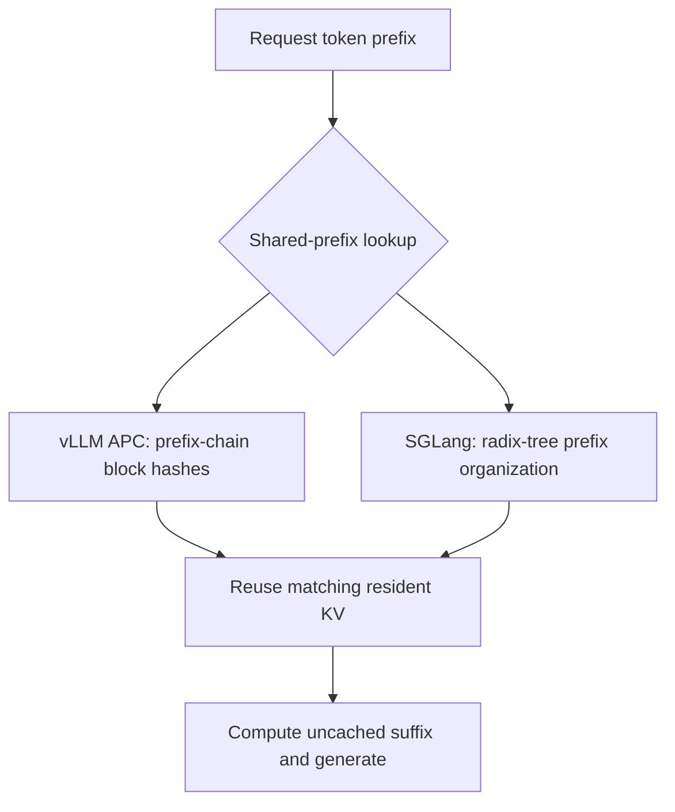

> [!NOTE] Executive Summary (TL;DR)
> - **Architectural Duel**: SGLang leverages native RadixAttention prefix tree reuse and runtime compilation for outstanding agent throughput; vLLM offers unmatched production ecosystem stability and multi-hardware support.
> - **Benchmark Realities**: Workloads with substantial shared system prompts benefit significantly from SGLang's cache hit rates; broad multi-accelerator production clusters often deploy vLLM.
> - **Further Exploration**: Explore [RadixAttention Internals](/en/articles/prefix-caching-radix-attention-internals/) and operational practices in [vLLM Production Serving Guide](/en/articles/vllm-serving-guide/).

## What Should You Compare?

vLLM and SGLang both evolve rapidly and support prefix caching, continuous batching, and structured outputs. This article compares mechanisms and evaluation methods. It does not report an original cluster benchmark: an “8×H100 result” without requests, logs, versions, and reproduction scripts is not evidence for deployment choices.

## Paging and Prefix Reuse Operate at Different Layers

PagedAttention maps logical KV blocks to noncontiguous physical storage, reducing contiguous-allocation waste. Prefix caching decides whether an existing KV computation can be reused. RadixAttention organizes shared token prefixes in a radix tree and can work with paged storage. These are not mutually exclusive memory architectures.



vLLM hashes encode preceding-prefix information rather than matching isolated blocks. Both engines can reuse history before a conversation branch; a tree is not required for that behavior. Reuse also depends on block granularity, eviction, routing, cache salts, and available capacity.

See [vLLM prefix-caching design](https://docs.vllm.ai/en/v0.29.0/design/prefix_caching/), the [SGLang paper](https://arxiv.org/abs/2312.07104), and our [prefix-caching guide](/en/articles/prefix-caching-radix-attention-internals/).

## Structured Outputs Are Supported by Both

Both engines can constrain output through grammar backends. Schema compilation, token masks, and deterministic-string skipping are different optimizations. Coverage depends on engine version, tokenizer, and backend. A CPU bottleneck in an early implementation does not establish a universal performance ranking.

Measure schema validity, semantic field correctness, compilation cold start, TTFT, and output speed. Valid JSON does not imply correct facts. See [vLLM structured outputs](https://docs.vllm.ai/en/v0.29.0/features/structured_outputs/) and [SGLang structured outputs](https://docs.sglang.io/docs/advanced_features/structured_outputs).

## Design a Reproducible Comparison

| Workload | Control | Measure |
|----------|---------|---------|
| Independent prompts | Identical weights, precision, input/output lengths | Output throughput and P50/P95/P99 TTFT and ITL |
| Multi-turn agents | Identical shared tokens and branching positions | Cold/warm latency, cache hits, eviction, routing |
| JSON extraction | Identical schemas and constraint backend | Validity, semantic accuracy, compilation and generation time |
| Load and failure | Identical arrival rate, queue limits, timeout budgets | SLO-compliant completions, errors, preemption, recovery |

Pin image digests, GPUs, drivers, CUDA, model revisions, quantization, TP/DP, and cache budgets. Replay the same requests and record actual input/output lengths. Separate cold-cache and warmed runs, repeat experiments, and retain raw results. Open-loop arrival rates reveal queueing; fixed-concurrency closed-loop tests explore saturation. Do not combine them as one result.

Aggregate tokens/s can look good even when requests time out, are truncated, or fail schema validation. Compare successful requests within the business SLO and total machine cost first.

## Minimal Launch Baselines

These generic Qwen2.5-7B examples assume compatible GPUs, drivers, installed frameworks, and sufficient VRAM. They are not large-MoE hardware recipes. Check the installed version's `--help`.

```bash
vllm serve Qwen/Qwen2.5-7B-Instruct \
  --max-model-len 8192 \
  --enable-prefix-caching \
  --port 8000
```

```bash
python3 -m sglang.launch_server \
  --model-path Qwen/Qwen2.5-7B-Instruct \
  --context-length 8192 \
  --port 30000
```

The obsolete `--enable-flashinfer` switch is omitted. If selecting a backend explicitly, use a supported `--attention-backend` value from the current [SGLang arguments](https://docs.sglang.io/docs/advanced_features/server_arguments). See the [vLLM deployment guide](/en/articles/vllm-serving-guide/) for serving operations.

## Making the Decision

First filter by target model, quantization, and hardware support. Then replay your business workload. Monitoring, failure recovery, API behavior, and operational experience also affect cost. Shared prefixes and complex schemas increase the priority of testing those features; they do not automatically select a winner.

## Frequently Asked Questions (FAQ)

### Q1: Must a radix tree achieve more cache hits than vLLM APC?
No. Both can reuse history before a branch. Granularity, eviction, capacity, and routing determine actual reuse under the same workload.

### Q2: Does prefix caching make the whole request free?
No. It reduces repeated prefill, while decoding, KV reads, memory residency, and fixed capacity still cost resources. Savings can be limited for long outputs.

### Q3: Does this article report original production speedup measurements?
No. It provides sourced mechanisms and an experiment design. Production decisions require local measurements with reproducible logs.
