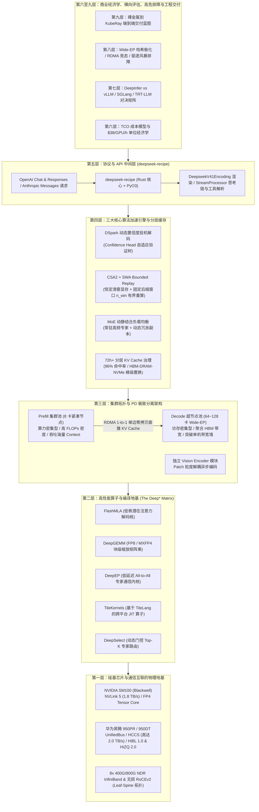
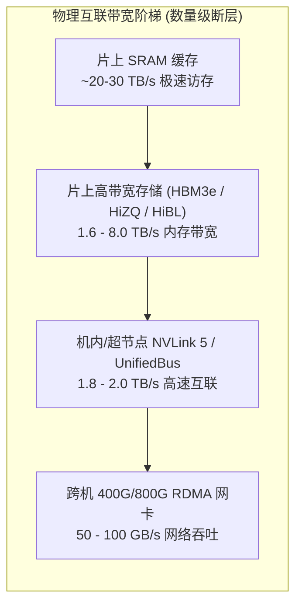
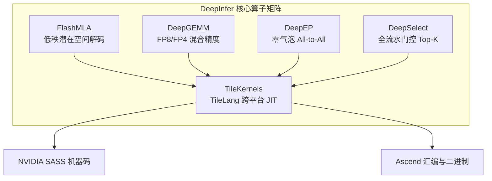
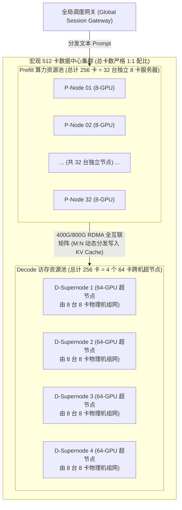
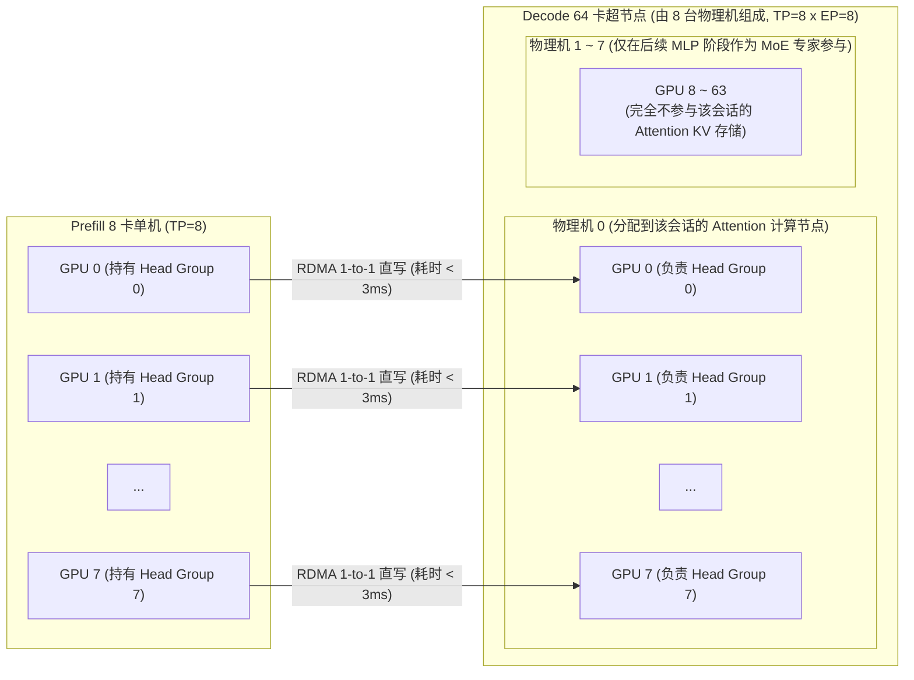
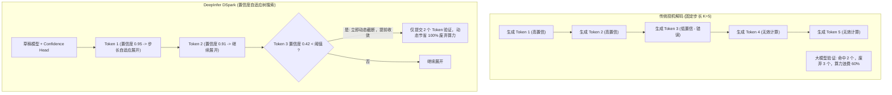
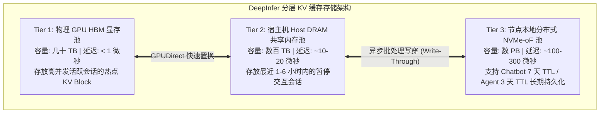
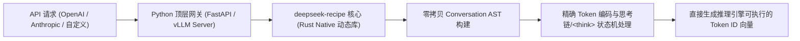
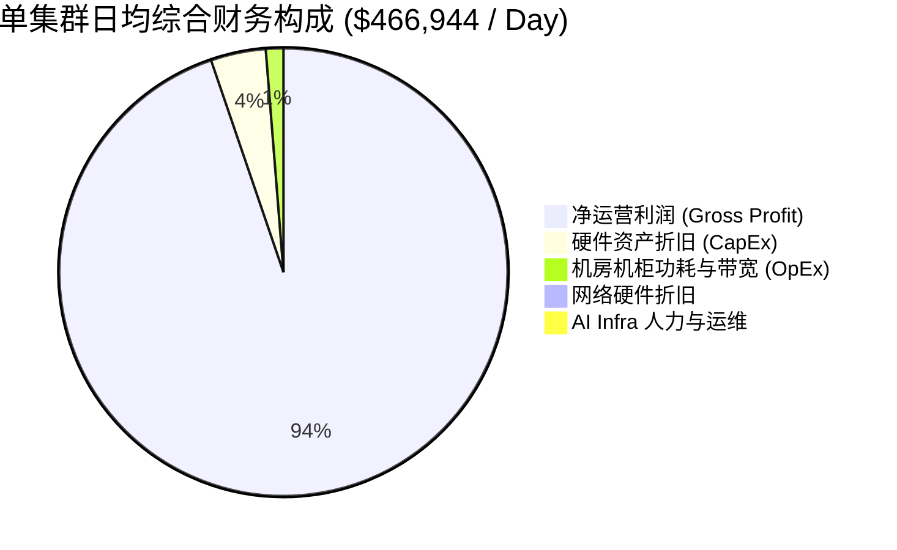

> [!NOTE] 核心速览 (TL;DR)
> - **硅基与内核物理地基**：DeepInfer 深度协同英伟达 SM100 (Blackwell, NVLink 5) 与华为昇腾 950 系列（Ascend 950PR / 950DT，UnifiedBus / HCCS 高达 2.0 TB/s），依托 FlashMLA（潜在低秩注意力）、DeepGEMM（FP8/FP4 混合矩阵乘）、DeepEP（零气泡 All-to-All 专家通信）与 TileKernels（TileLang 领域特定算子）构建异构硬件统一底层。
> - **集群拓扑与 PD 极致分离**：打破单机时分复用瓶颈，构建 8 卡紧凑型 Prefill 节点池（算力受限，高 FLOPs 密度）与 64~128 卡 Wide-EP Decode 超节点池（访存受限，高聚合 HBM 带宽）。基于排队论稳态平衡，宏观 P/D 卡数配比随有效输入输出比动态收敛（77K 输入、96% 缓存命中高并发工况下收敛于 1:1，长上下文常规起步验证集群常取 1:2），搭配独立的 Vision Encoder 异步分块流水线。
> - **三大核心算法加速引擎**：针对 **DeepSeek-V4.1-Flash（552B 总参数非对称 MoE，40 层 Causal Encoder-Decoder，Prefill 激活 8B / Decode 激活 16B）**，首创 **DSpark 动态置信度投机解码**（Confidence Head 动态预测自适应验证树，净提速 4%~7%）、**CSA2 + SWA Bounded Replay 边界重放**（维持恒定滑窗显存，外部持久化省去局部 SWA KV，未命中时仅对固定后缀窗口 $n_{\text{win}}$ 执行有界重算），以及**动静结合 MoE 负载均衡**（常驻专家 + 动态冗余副本消除跨机 Straggler 慢节点木桶效应）。
> - **协议层革命与商业经济学**：官方权重彻底废黜传统 Jinja 模板，开源 Rust 核心的 `deepseek-recipe` 抹平 OpenAI 与 Anthropic 协议、流式剥离 `<think>` 思考链与 Tool Calling；知乎生产报告揭秘单集群 155 万亿 Token/天、77K 均长、**96% KV Cache 命中率** 与每卡每小时 **$38 美元（~254 元/卡/时）** 谷价营收的商业印钞机真相。
> - **关联技术深入**：跨机 RDMA 传输参见 [P/D 分离架构与分布式 KV Cache](/articles/pd-disaggregation-distributed-kv-cache/)；传统投机解码原理参见 [EAGLE 投机解码实践](/articles/speculative-decoding-eagle-guide/)；底层注意力数学推导参见 [MLA 矩阵吸收原理](/articles/mha-gqa-mla-matrix-absorption-inference-engine/) 与 [MoE 专家并行设计](/articles/moe-expert-parallelism-inference-engine/)；集群组网调优参见 [InfiniBand 高性能组网实践](/articles/infiniband-production-deployment-opensm-ofed-nccl-tuning/)。

---

## 引言：当模型实验室掀开商业化推理的底牌

长期以来，大模型领域的开源通常止步于“权重开源”与“论文开源”。至于模型在真实生产环境下如何以可盈利的单位经济模型（Unit Economics）支撑数亿并发，各大闭源巨头始终将其视为最高商业机密。

2026 年 10 月，DeepSeek 在知乎发布了题为《**DeepSeek V4.1 Flash 大规模推理部署实践**》的技术报告，并同步在 GitHub 开源了其生产环境底座 —— 高性能推理引擎 **[DeepInfer](https://github.com/deepseek-ai/DeepInfer)** 与 API 协议适配中间层 **[deepseek-recipe](https://github.com/deepseek-ai/deepseek-recipe)**。

这篇报告披露了一组令全行业震颤的数据：
* **单集群日吞吐**：达到惊人的 **155 万亿 (155 Trillion) Tokens/天**；
* **极具冲击力的经济账**：按夜间低谷价格核算，整体营收依然达到了 **每卡每小时 $38 美元（约合人民币 254 元/卡/时）**；
* **极端工况下的工程奇迹**：平均每个线上请求的输入 Prompt 达到 **77K Tokens**，但系统实现了 **96% 的 KV Cache 命中率**，首字延迟（TTFT）稳定在 **~400ms**，Decode 生成速度达 **230~300 tokens/s**。

这并非偶然的算法巧合，而是一场从底层半导体微架构、集合通信拓扑、算子编译、分布式 PD 解耦调度，到上层协议序列化解析的**全栈系统工程重构**。本文将彻底拆解 DeepSeek 这座“推理印钞机”，从最底层的硅基芯片与通信线缆讲起，层层向上还原整套架构的工程实现。

---

## 架构全景：DeepSeek 生产级推理九层垂直技术栈

在深入微观细节前，首先通过全景架构图鸟瞰 DeepInfer 与 `deepseek-recipe` 从物理硅基到商业交付的**九层垂直技术栈**（严格对应下文第一层至第九层章节）：



---

## 第一层：硅基芯片与通信互联的物理地基

大模型推理不是空中楼阁，其算力瓶颈与访存墙直接受制于半导体物理定律。DeepInfer 的核心设计哲学是：**不写任何脱离具体芯片微架构的通用抽象代码**。

### 1. 异构双轨算力矩阵：Blackwell SM100 vs. 华为昇腾 950 (950PR / 950DT)

在 DeepSeek 的生产实践中，官方首次系统性支持了英伟达与华为昇腾两大算力生态，其中昇腾 950 系列原生按 Prefill 与 Decode/Training 工况拆分为 **Ascend 950PR** 与 **Ascend 950DT** 两款芯片：

| 硬件维度 | NVIDIA Blackwell (SM100) | 华为昇腾 950 系列 (Ascend 950PR / 950DT) |
| :--- | :--- | :--- |
| **制程与封装** | TSMC 4NP 双芯片 CoWoS-L 封装 | 多芯粒先进系统级封装 (SiP，共享基础计算 Die) |
| **片上互联带宽** | 10 TB/s 高带宽芯片间互联 (NV-HBI) | 超宽片内芯粒互联总线 |
| **机内/超节点互联** | NVLink 5 (单卡双向 1.8 TB/s) | UnifiedBus (UB) / HCCS (互联带宽高达 2.0 TB/s) |
| **内存规格** | 192GB ~ 288GB HBM3e (8.0 TB/s 带宽) | **950PR**：128GB HiBL 1.0 (~1.6 TB/s，面向 Prefill)<br/>**950DT**：144GB HiZQ 2.0 (~4.0 TB/s，面向 Decode/训练) |
| **核心计算单元** | 第五代 Tensor Core (原生支持 FP4 / FP8) | DaVinci 架构 Cube (矩阵) + Vector (向量) |
| **底层编程体系** | CUDA 13.x / PTX / TileLang JIT | CANN 8.x / Ascend C / TileLang JIT |



### 2. 物理互联鸿沟与并行拓扑铁律

从上图的物理带宽阶梯可以看出，**片上显存访存 (8 TB/s) 与机间网络通信 (50~100 GB/s) 存在两个数量级（近 100 倍）的巨大物理落差**。这一物理限制直接推导出两条分布式部署的铁律：
1. **张量并行 (TP) 绝不可出机**：TP 要求每个 Token 在每一层经过两次高频 `All-Reduce`，跨机部署会导致 Tensor Core 95% 以上的时间陷入网络停等。
2. **专家并行 (EP) 必须匹配全无阻网络**：MoE 的 `All-to-All` 通信数据量远小于 TP，但对网络双向突发吞吐与排队抖动极度敏感。机间必须采用 8x 400G/800G InfiniBand (NDR) 或优化至极致的 RoCEv2 Leaf-Spine 无损网络（详见 [InfiniBand 高性能组网实践](/articles/infiniband-production-deployment-opensm-ofed-nccl-tuning/)）。

---

## 第二层：高性能算子与编译地基 (The Deep* Matrix)

在传统框架中，通用推理引擎（如早期的 HuggingFace 或未调优的 PyTorch）将注意力、矩阵乘、路由和通信拆解为数十个孤立的 CUDA Kernel，导致显存不断发生全局往返（Global Memory Roundtrip）。DeepInfer 构建了一套直面芯片特性的专用算子矩阵：



### 1. FlashMLA：潜在注意力（MLA）专属解码内核

在 [MLA 矩阵吸收原理](/articles/mha-gqa-mla-matrix-absorption-inference-engine/) 中我们曾推导过，DeepSeek 独创的多头潜在注意力（MLA）通过将 Key 与 Value 投影为低维压缩潜在向量 $c_t^{KV}$，使单 Token 的 KV Cache 显存占用骤降至传统 MHA 的 1/6 以下。

然而，传统的 FlashAttention-2/3 是为密集多头设计的，无法直接理解 MLA 的潜在投影吸收。**FlashMLA** 是 DeepInfer 自研的专用解码算子：
- **片上矩阵吸收流水线**：在 GPU 片上 SRAM（Shared Memory）内部直接完成查询向量 $q_t$ 与解压投影矩阵 $W_U^{KV}$ 的矩阵相乘，无需将庞大的 Key/Value 矩阵解压缩物化（Materialize）回 HBM。
- **Tile 级内存复用**：将注意力计算分块粒度与 Blackwell Tensor Core 的 TMA（Tensor Memory Accelerator）完全对齐，访存效率逼近硬件物理极限。

### 2. DeepGEMM：精细分块缩放的 FP8/MXFP4 矩阵乘法

超大规模稀疏 MoE 模型（如 552B 总参数的 DeepSeek-V4.1-Flash 乃至万亿级旗舰模型）全量部署必须引入极致量化。但粗粒度的全张量量化会导致模型在数学推理与代码任务上精度崩溃。
- **Block-Level Scaling 架构**：DeepGEMM 采用细粒度的按块量化（如 1x128 块或 128x128 块），每个块维护独立的 FP8 E8M0 缩放因子（Scale Factor）。
- **硬件对齐优化**：
  在 NVIDIA Blackwell 上，DeepGEMM 直接调用原生的 **MXFP4 (Microscaling FP4)** 与 FP8 Tensor Core 硬件指令；
  在华为昇腾 950 上，通过 Cube 单元的原生混合精度流水线实现，消解了反量化过程中的转换指令开销。

### 3. DeepEP：通信与计算完全重叠的专家并行库

在分布式 MoE 架构中，Token 需要根据门控权重分发到不同节点上的不同专家，这就是核心的 `all_to_all_v` 集合通信。
- **细粒度异步流（Fine-grained CUDA Streams）**：传统 All-to-All 通信需要等全批次计算完成才触发；DeepEP 将 Batch 切分为微块（Micro-batches），第一个微块在计算前向传播时，第二个微块通过 RDMA 异步发送，实现**通信与计算的 100% 气泡掩盖（Compute-Communication Overlapping）**。
- **NVLink-RDMA 分层桥接**：机内通信走 NVLink 显存直拷，机间通信走 GPUDirect RDMA，杜绝数据经过 Host 内存的中转。

### 4. TileKernels 与 TileLang：打破英伟达与国产芯片的代码藩篱

为了摆脱手写底层 CUDA 与 CANN 汇编的繁重维护成本，DeepInfer 深度集成了自研领域特定语言 **TileLang**：
- 开发者只需通过 Pythonic 的语法定义 Tile 级的数据搬运与计算逻辑；
- TileLang 编译器自动进行寄存器分配、共享内存 Bank 冲突优化与流水线重排，并一键编译为 NVIDIA SM100 的 SASS 机器码或华为昇腾 950 的二进制算子，实现跨平台“一次编写，两端原生最高性能”。

---

## 第三层：集群拓扑与 PD 极致分离架构（彻底澄清：宏观 1:1 vs 微观 8 与 64）

在单机混合推理范式下，即便使用了 Chunked Prefill，计算密集的大矩阵乘法（GEMM）与访存密集的小向量乘法（GEMV）仍然在同一张 GPU 上互相撕扯。DeepSeek 生产环境最核心的工程决断就是：**全面转向物理级 P/D 分离（Prefill-Decode Disaggregation）**。

然而，报告中“**Prefill 与 Decode 总卡数保持 1:1 配比**”与“**Prefill 采用 8 卡节点，Decode 采用 64~128 卡超节点**”这两处表述，让大量工程师产生强烈的直觉冲突：*“既然一边是 8 卡一边是 64 卡，为什么总比例又是 1:1？8 卡算出来的 KV Cache 怎么喂给 64 卡？难道不需要全网广播吗？”*

本节将从宏观集群容量、微观调度单元、排队论数学证明以及张量分片重排（Resharding）四个维度彻底厘清这一架构设计。

### 1. 概念澄清：解构“宏观 1:1”与“微观 8 vs 64”的数学本质

这一困惑的根源在于**混淆了“宏观集群总容量”与“微观单执行单元拓扑”**：

| 架构对比维度 | Prefill 阶段（预填充池） | Decode 阶段（增量解码池） | 两者关系与设计本质 |
| :--- | :--- | :--- | :--- |
| **微观服务单元 (Pod)** | **单台 8 卡物理机 (P-Node)** | **64~128 卡跨机超节点 (D-Supernode)** | **微观粒度不同**：8 卡独立单机 vs 8~16 台机组成的大超节点 |
| **内部并行切分** | **机内张量并行 (TP=8)** | **机内 TP=8 + 跨机 Wide-EP=8/16** | 机内靠 NVLink 消化 Attention，机间靠 RDMA 调度 MoE 专家 |
| **阶段计算特征** | 算力密集型 (Compute-bound) | 访存密集型 (Memory-bound) | 8 卡单机即可榨干 FLOPs；Decode 必须靠 64 卡堆叠 HBM 带宽 |
| **宏观集群规模 (以 512 卡为例)** | **256 张卡 (拆分为 32 台独立的 P-Node)** | **256 张卡 (拆分为 4 个独立的 D-Supernode)** | **宏观总卡数配比严格等于 1 : 1** ($32 \times 8 = 4 \times 64 = 256$) |



**核心结论**：这根本不是“1 台 8 卡单机单挑 1 台 64 卡单机”，而是 **32 台独立的 8 卡 Prefill 节点，通过 RDMA 矩阵对向服务 4 个 64 卡 Decode 超节点**！总卡数 $32 \times 8 = 256$ 对准 $4 \times 64 = 256$，在宏观资源上分毫不差地呈现 1:1 对称。

---

### 2. 严密排队论与利特尔法则（Little's Law）推导：`N_P : N_D` 配比如何由有效输入输出比决定？

读者必然会产生第二个更深度的疑问：*“Prefill 处理只需要几十毫秒（极短），Decode 逐字吐出 800 个 Token 却要持续数秒（长达数十倍时间）。为什么有的集群采用 1:8，第九层的 96 卡起步集群采用 1:2（32P:64D），而知乎报告的满载生产集群又呈现出 1:1？”*

答案隐藏在**利特尔法则（Little's Law）下的单卡请求服务速率（req/s/GPU）、有效未命中 Prefill 长度 $L_{\text{eff}}$ 与 Decode 连续批处理并发度 $B_D$ 的精确平衡方程**中。

#### (1) 稳态吞吐平衡通用公式
设集群共配置 $N_P$ 张 Prefill GPU（拆分为 $N_P / 8$ 台独立 8 卡 P-Node）与 $N_D$ 张 Decode GPU（拆分为 $N_D / 64$ 个 64 卡 D-Supernode），全局到达率为 $\lambda$（req/s）：
* **单台 8 卡 P-Node 服务速率**：设瞬时并发度为 $B_P$，处理单请求有效未命中长度 $L_{\text{eff}} = L_{\text{in}} \cdot (1 - H)$ 的计算耗时为 $T_P(L_{\text{eff}})$，则：
  $$\mu_{P\_node} = \frac{B_P}{T_P}, \quad \text{单卡预填充速率 } r_P = \frac{\mu_{P\_node}}{8} = \frac{B_P}{8 \cdot T_P} \text{ req/(s}\cdot\text{GPU)}$$
* **单个 64 卡 D-Supernode 服务速率**：64 张卡将 **DeepSeek-V4.1-Flash（552B 总参数非对称 MoE，40 层 Causal Encoder-Decoder，Prefill 激活 8B / Decode 激活 16B）** 的全部权重分散驻留，单步解码聚合带宽在 64× H800/H100 上约为 **$214\text{ TB/s}$**，在 64× Blackwell B200 上高达 **$512\text{ TB/s}$**。设单超节点 Continuous Batching 并发序列数为 $B_D$，输出长度 $L_{\text{out}}$，单流生成速度 $V_D$，则单请求驻留时间 $T_D = L_{\text{out}} / V_D$：
  $$\mu_{D\_node} = \frac{B_D}{T_D}, \quad \text{单卡解码速率 } r_D = \frac{\mu_{D\_node}}{64} = \frac{B_D}{64 \cdot T_D} \text{ req/(s}\cdot\text{GPU)}$$
* **全集群无积压稳态平衡方程（$\lambda = \mu_{P\_pool} = \mu_{D\_pool}$）**：
  $$N_P \cdot r_P = N_D \cdot r_D \iff \frac{N_P}{8} \cdot \frac{B_P}{T_P} = \frac{N_D}{64} \cdot \frac{B_D}{T_D} \implies \frac{N_P}{N_D} = \frac{r_D}{r_P} = \frac{B_D \cdot T_P(L_{\text{eff}})}{8 \cdot B_P \cdot T_D(L_{\text{out}})}$$

#### (2) 三种真实工况下的数学精确解（消除“固定配比”误区）

将不同业务场景的实测参数代入上式，可以清晰看到 $N_P : N_D$ 如何随 $L_{\text{eff}} : L_{\text{out}}$ 与并发度动态迁移：

1. **工况 A：短有效输入 + 中等并发长输出（如 $L_{\text{eff}} \approx 3\text{k}\text{--}4\text{k}$ 输入，$800\text{--}1\text{k}$ 输出，$B_D = 64$）**
   * 单台 8 卡 P-Node（$B_P = 1, T_P = 0.05\text{ s}$）：$\mu_{P\_node} = 20\text{ req/s}$（$r_P = 2.5\text{ req/s/GPU}$），若配 32 台（256 卡）则 $\mu_{P\_pool} = 640\text{ req/s}$；
   * 单个 64 卡 D-Supernode 在保守并发 $B_D = 64$、$V_D = 250\text{ tokens/s}$、$L_{\text{out}} = 800$（$T_D = 3.2\text{ s}$）下：$\mu_{D\_node} = \frac{64}{3.2} = 20\text{ req/s}$（$r_D = 0.3125\text{ req/s/GPU}$），4 个超节点（256 卡）仅能消化 $\mu_{D\_pool} = 80\text{ req/s}$！
   * 此时真实稳态配比为 $\frac{N_P}{N_D} = \frac{0.3125}{2.5} = \mathbf{1 : 8}$（仅需 4 台共 32 卡 Prefill 即可喂饱 256 卡 Decode）。
2. **工况 B：长上下文常规缓存命中 / 企业起步验证单元（对应第九层 96 卡集群：32P : 64D = 1 : 2）**
   * 企业私有化初期缓存命中率较低（例如有效未命中计算量 $L_{\text{eff}} \approx 10\text{k}\text{--}16\text{k}$ tokens，$T_P \approx 0.16\text{ s}, B_P = 1 \implies \mu_{P\_node} = 6.25\text{ req/s}, r_P \approx 0.78\text{ req/s/GPU}$）；
   * 配合单个 64 卡 Decode 超节点运行 $B_D = 80, T_D = 3.2\text{ s}$（$\mu_{D\_node} = 25\text{ req/s}, r_D \approx 0.39\text{ req/s/GPU}$）：
   * 4 台 P-Node（32 卡，$\mu_{P\_pool} = 25\text{ req/s}$）恰好严丝合缝匹配 1 个 D-Supernode（64 卡，$\mu_{D\_pool} = 25\text{ req/s}$），精确导出 $\frac{N_P}{N_D} = \frac{0.3906}{0.7813} = \mathbf{1 : 2}$！（同理，在 $32\text{k}\text{--}64\text{k}$ 重算力输入、$512\text{--}1\text{k}$ 输出的重度长文档分析场景下，$N_P : N_D$ 会进一步逼近 **1:1 至 1:2**）。
3. **工况 C：DeepSeek 线上满载生产工况（77K 输入、96% 缓存命中 + CSA2 超高并发 $B_D = 512$，收敛于 1 : 1）**
   * 线上平均输入 $L_{\text{in}} = 77,000$ tokens，命中率 $H = 96\%$，单请求有效未命中计算长度 $L_{\text{eff}} = 77,000 \times (1 - 0.96) = 3,080$ tokens，$T_P \approx 0.05\text{ s}, B_P = 1 \implies \mu_{P\_node} = 20\text{ req/s}$（$r_P = 2.5\text{ req/s/GPU}$），32 台 P-Node（256 卡）总吞吐 $\mu_{P\_pool} = 640\text{ req/s}$；
   * 在 Decode 侧，得益于 **CSA2 将全局 HBM KV Cache 极致压缩至仅 890 Bytes/token**，64 卡超节点显存池可同时并发承载 **$B_D = 512$ 条长序列会话**（平均每卡仅 8 条并发流），在 $T_D = 3.2\text{ s}$ 下单超节点服务速率跃升至 $\mu_{D\_node} = \frac{512}{3.2} = 160\text{ req/s}$（$r_D = 2.5\text{ req/s/GPU}$），4 个超节点（256 卡）总吞吐恰为 $\mu_{D\_pool} = 4 \times 160 = 640\text{ req/s}$！
   * 代入平衡方程（无需任何人为修正系数）：
     $$\frac{N_P}{8} \times \frac{1}{0.05} = \frac{N_D}{64} \times \frac{512}{3.2} \iff 2.5 N_P = 2.5 N_D \iff N_P : N_D = \mathbf{1 : 1}$$

> [!IMPORTANT] 物理真相：P/D 配比由 $L_{\text{eff}} : L_{\text{out}}$ 与 KV 压缩率共同锁定
> - **如果线上 KV Cache 命中率跌至 0%**：$L_{\text{eff}} = 77,000$ tokens，Prefill 耗时将从 50ms 暴增至 ~1,200ms（膨胀 24 倍，$r_P$ 跌至 $0.104\text{ req/s/GPU}$）。若仍维持高并发 Decode，Prefill 队列将瞬间雪崩，Prefill 卡数必须扩张至 Decode 的数十倍！
> - **正是“96% 缓存命中削减 24 倍 Prefill 算力”与“CSA2 压缩支撑单超节点 512 并发 Decode”两股力量在排队论上的交汇**，才造就了宏观 256 卡 Prefill 对 256 卡 Decode 的 1:1 稳态平衡；而在缓存命中率较低或中等并发的企业私有集群中，按上式实测标定为 **1:2 ~ 1:4** 才是科学的容量规划方法。

---

### 3. 微观张量跨拓扑搬运与 Resharding：KV Cache 如何从 8 卡精准注入 64 卡？

另一个让工程师困惑的技术细节是：**8 卡单机计算出的 KV Cache 是按 TP=8 切分的，而 64 卡超节点由 8 台服务器跨机组成（TP8 × EP8）。8 张卡的数据送到 64 张卡，难道不需要执行昂贵的 8 对 64 全网广播（All-to-All Resharding）吗？**

答案是：**完全不需要！数据在跨机 RDMA 传输时是纯粹干净的“同序号 GPU 1-to-1 直推”！**



#### 为什么不需要跨 64 卡广播？MLA 的第一性原理：
1. **KV Cache 仅在注意力阶段被消费**：
   在 Transformer 架构中，KV Cache 仅在计算自注意力（Self-Attention）时被读取，与后续的 MoE 专家 FFN 层完全无关！
2. **Decode 超节点的物理层次划分**：
   在 64 卡超节点内部，8 台物理机之间运行的是专家并行（EP=8），而**每一台物理机内部的 8 张卡依然是标准的机内张量并行（TP=8）**；
3. **精准会话亲和性绑定**：
   当一个会话完成 Prefill 后，调度器将该会话绑定到 64 卡超节点中的**某一台具体物理机（如物理机 0）** 上执行 Attention 运算；
4. **单边 1-to-1 零拷贝直推**：
   因此，Prefill 节点的 GPU $i \in [0, 7]$，只需通过 GPUDirect RDMA，将其计算出的第 $i$ 份低秩潜在 KV 张量，直接投递给目标物理机上编号同样为 $i$ 的 GPU 显存！
   **传输网络拓扑是严格的 1 对 1 点对点直推，跨网传输量只有几兆字节，耗时不到 3ms，根本不存在 8 对 64 的广播风暴！**（至于随后的 MoE 专家路由，是由这台物理机在机内算完 Attention 后，通过机间无损网络动态 dispatch 到其他机器，属于计算前向流，不再涉及 KV Cache 搬运）。

---

### 4. 独立的 Vision Encoder 分离流水线

针对多模态（VLM）请求，DeepInfer 将图像编码模块彻底剥离出主推理流：
- 用户上传的图片由专用的 Vision Encoder 节点以异步方式解析为 Patch 级别的视觉 Token；
- 视觉 Token 与文本 Token 在网关层聚合，以标准化序列形式直接灌入 Prefill 节点；
- 这种解耦杜绝了轻量级卷积/ViT 算子与超大语言模型在 GPU 显存调度上的上下文冲突。

---

## 第四层：三大核心算法加速引擎

除了硬件拓扑与内核优化，DeepInfer 在调度与推理算法层面引入了三项颠覆性的技术发明：**DSpark 动态投机解码**、**SWA 边界重放**与**动静结合 MoE 负载均衡**。

### 1. DSpark 动态置信度投机解码（Confidence-Scheduled Speculative Decoding）

投机解码（Speculative Decoding）通过轻量级的“草稿模型（Draft Model）”先行连续生成 $K$ 个候选 Token，再由大模型一次前向传递并行验证（详细原理可参阅 [EAGLE 投机解码实战](/articles/speculative-decoding-eagle-guide/)）。

然而，传统投机解码存在严重的**固定验证步长诅咒（Fixed-K Penalty）**：
在固定步长（如 $K=5$）下，如果第 1 个草稿 Token 就预测错误，后续 4 个 Token 的计算完全被废弃；在大模型思考链深入复杂逻辑或生成多分支代码时，固定大步长反而拖慢整体吞吐。



#### DSpark 置信度头（Confidence Head）数学建模
DSpark 在草稿模型的末层外挂了一个极小体积的置信度回归头（Confidence Head），用于预测该候选 Token 被目标主模型接受的后验概率估计值：

$$\hat{P}_{\text{accept}}(x_{t+i}) = \sigma \left( W_c \cdot h_{t+i} + b_c \right)$$

其中 $h_{t+i}$ 为草稿模型在第 $t+i$ 步的隐藏层表征，$W_c, b_c$ 为置信度参数。

调度器在构造动态验证树（Dynamic Verification Tree）时执行条件贪心截断：

$$\text{Depth}(T) = \max \left\{ m \in [1, K_{\max}] \;\middle|\; \prod_{j=1}^{m} \hat{P}_{\text{accept}}(x_{t+j}) \ge \tau_{\text{threshold}} \right\}$$

- **在生成格式化语法（如 JSON、HTML、常规自然语言）时**：置信度持续高于阈值 $\tau$，DSpark 自动将验证步长拉大到 8~12 个 Token，单步吞吐翻倍；
- **在生成严密数学符号、复杂代码逻辑与长思考链分支时**：置信度迅速滑落，验证树动态收缩为 1~2 个 Token，杜绝无效投机计算。
- **线上成果**：在知乎生产压测中，DSpark 在本已极致的生成速度上，使整体 Decode 吞吐**再额外拔高 4%~7%**。

---

### 2. CSA2 + SWA Bounded Replay（滑动窗口注意力有界重放）

**DeepSeek-V4.1-Flash** 采用 **552B 总参数的非对称 MoE 架构（40 层 Causal Encoder-Decoder，即 20 层因果编码器 + 20 层解码器，Prefill 阶段仅激活 8B 参数，Decode 阶段激活 16B 参数）**，并在注意力层融合了 **CSA2（Compressed Sparse Attention 2）** 与 **滑动窗口注意力（Sliding Window Attention, SWA）**：
- **CSA2 跨层共享与 FP4 量化**：将全局注意力层的 HBM KV Cache 极致压缩至 **890 Bytes/token**（约为上一代 V4-Flash 的 1/4）；
- **SWA 外部缓存持久化痛点**：在线上解码期间，SWA 层在 GPU HBM 中仅需维护固定窗口大小 $n_{\text{win}}$ 的环形 KV 缓冲区（显存占用为常数 $O(n_{\text{win}})$）。但在 72h 分层前缀缓存（Host DRAM / NVMe SSD）中，若为了支持任意前缀截断命中而将所有历史位置的局部 SWA 状态全量落盘，外部缓存容量与 PCIe/RDMA 带宽开销将反超全局 CSA2 状态数倍；反之若直接丢弃 SWA 状态，传统引擎在缓存未对齐时会被迫触发整段 77K 上下文的全量重算。

**SWA Bounded Replay 算法** 的真实工程实现机制：
1. **外部存储零 SWA 持久化（CSA2-Only Persistence）**：Tier 2/3 外部缓存池**仅持久化高度压缩的全局 CSA2 KV 状态**，彻底不落盘局部 SWA 窗口的冗余状态（绝非每隔 $W$ 个 Token 周期性存储全量“边界锚点”），使单 Token 外部持久化 KV 体积骤降至上一代的 **1/8**；
2. **固定后缀窗口有界重放（Bounded Suffix Replay）**：当多轮对话或智能体请求在任意前缀位置命中缓存（或发生未对齐截断）时，由于任一位置的 SWA 窗口状态仅严格依赖最近 $n_{\text{win}}$ 个 Token 的前序表示，引擎利用已命中的全局 CSA2 缓存，仅对末尾长度严格受限于 $\le n_{\text{win}}$ 的后缀窗口执行一次轻量级局部重算，即可无损重建完整的 SWA 激活状态；
3. **收益**：在维持运行期恒定滑窗 HBM 占用的同时，将缓存恢复的最坏重算复杂度严格锁定在常数上界 $O(n_{\text{win}})$，彻底消除了随总上下文长度 $L$ 线性膨胀的二次 Prefill 开销。

---

### 3. 动静结合的 MoE 专家负载均衡体系

在四机或数十机的专家并行（EP）下，最致命的性能杀手是**慢节点木桶效应（Straggler Problem）**：如果同批次的所有请求都调用了同一两个“热门专家”，承载该专家的 GPU Rank 算力耗尽，而承载“冷门专家”的卡早已空转，全集群被迫在 All-to-All 屏障前停等。

DeepInfer 采用“**三位一体**”的动静自适应均衡方案：
1. **常驻核心专家（Resident Experts）**：通过离线海量请求统计，将最高频的 Top-K 专家标记为常驻专家，全量复制部署在集群内的**每一台物理机上**。针对这些高频专家的计算完全就地（Local）执行，彻底免除跨节点通信；
2. **动态冗余专家副本（Dynamic Redundant Replicas）**：监控调度器实时统计各卡每秒接收的 Token 数。当某冷门专家瞬时被大量命中（如突发的特定语言翻译或医学问答），系统在毫秒级内通过 RDMA 广播权重，动态在空闲卡上启动该专家的临时副本，分流热点；
3. **动态路由容量截断与重排（Capacity Factor & Dynamic Reranking）**：设置专家处理上限，溢出 Token 启动残差直通，确保任意 GPU Rank 的计算耗时方差控制在 5% 以内。

---

### 4. 72h+ 分层 KV Cache 治理：96% 命中率的技术秘密

在知乎报告中，最令开发者震惊的数据莫过于“**线上平均 77K 输入，96% KV Cache 命中率**”。这意味着 100 个 Token 进门，有 96 个根本不需要 GPU 做矩阵乘法，直接读缓存即可。

这种命中率绝非仅仅依靠简单的 LRU 内存缓存，而是建立在一套严密的分层生命周期治理体系之上：



- **分层 TTL 策略**：
  - **用户对话（Chatbot）**：TTL 设为 **7 天**。即便用户隔天继续追问，历史多轮上下文依然毫秒级命中；
  - **智能体工作流（AI Agent）**：TTL 设为 **3 天**。长思考循环与工具调用产生的大规模 Prompt 深度复用。
- **Radix 树前缀索引与哈希指纹**：
  系统使用前缀基数树（Radix Tree）对所有会话的 Token ID 流做前缀索引。一旦网关接收到请求，首先在毫秒级内完成前缀最长匹配（Longest Prefix Match），并将请求精准投递到持有该 KV Cache 的具体 Decode 节点上，实现“**调度即命中**”。

---

## 第五层：协议与 API 中间层 (`deepseek-recipe` Deep Dive)

大模型工程落地不仅要跑得快，还要接得稳。伴随 DeepInfer 的开源，DeepSeek 同步推出了 **[deepseek-recipe](https://github.com/deepseek-ai/deepseek-recipe)**。

### 1. 为什么大模型生产落地要废黜 Jinja Template？

在传统的 Hugging Face 生态中，模型仓库通常内置一个 `chat_template.jinja`，由 Python 的 Jinja2 引擎动态渲染生成提示词。但到了生产级超大模型时代，Jinja 暴露出三大致命缺陷：
1. **解释执行性能极低**：在每秒处理数十万并发的集群网关中，Python 解析运行庞大而复杂的 Jinja 模板会大量占用 CPU 周期，成为网络网关的严重瓶颈；
2. **无法表达多状态分支**：思考模型（Reasoning Model）的输入输出引入了思考标签（`<think>...</think>`）、工具调用（Tool Calls）、多模态 Patch 引用等高度复杂的上下文状态，单纯的 Jinja 宏拼接极易导致括号漏配或特殊 Token 转义失控；
3. **协议与模型表达严重割裂**：前端业务层广泛采用 OpenAI（Chat Completions / Responses API）或 Anthropic（Messages API）协议，要在 Jinja 中抹平这些协议结构几乎不可能。

为此，**DeepSeek-V4.1-Flash 官方权重中彻底删除了 Jinja 模板**，改由专门的系统级工具库 `deepseek-recipe` 接管。

### 2. Rust 核心引擎与 Python 零拷贝绑定

`deepseek-recipe` 采用 **Rust 作为底层实现语言**，通过 PyO3 为 Python 生态提供高性能绑定：



### 3. 实战接入代码：协议抹平、思考链剥离与 Tool Calling

通过 `pip install deepseek-recipe` 安装后，其 Python 绑定直接暴露了 `ChatCompletionRequest` / `ResponsesRequest`、`ConversionOptions`、`DeepseekV41Encoding`（含 `render_conversation()`）以及流式状态机 `StreamProcessor`。以下为严格对齐官方 `deepseek_recipe` API 的生产级桥接示例：

```python
"""
production_gateway_recipe.py
基于官方 deepseek-recipe 实现生产级 API 协议统一转换与 <think> / Tool Call 流式解耦
"""

from typing import Dict, Any, Iterable, List
from deepseek_recipe import (
    ChatCompletionRequest,
    ConversionOptions,
    DeepseekV41Encoding,
    InferenceChunk,
    InferenceFinishReason,
    PromptUsage,
    StreamProcessor,
)

# 全局复用无状态 V4.1 协议编码器
V41_ENCODING = DeepseekV41Encoding()


def render_openai_request(payload: Dict[str, Any]) -> Dict[str, Any]:
    """
    接收标准 OpenAI Chat Completions 请求体（含 tools、reasoning_effort、历史 reasoning_content），
    通过 deepseek-recipe Rust 内核转换为统一 Conversation 并渲染为原生模型输入。
    """
    # 1. 解析并校验协议请求（若是 OpenAI Responses 协议可替换为 ResponsesRequest）
    request = ChatCompletionRequest(payload)

    # 2. 按协议转换选项归一化为内部统一 Conversation 结构与解析策略
    converted = request.convert(ConversionOptions())

    # 3. 使用 DeepSeek-V4.1 专用编码器渲染精确 Prompt（绑定 PromptTokenizer 时可直接产出 token_ids）
    rendered = V41_ENCODING.render_conversation(converted.conversation)

    return {
        "converted": converted,
        "prompt": rendered.prompt,
    }


def stream_engine_chunks_to_sse(
    converted: Any,
    request_id: str,
    model_name: str,
    prompt_tokens: int,
    cache_hit_tokens: int,
    text_deltas: Iterable[str],
) -> List[str]:
    """
    流式反序列化模型输出：StreamProcessor 状态机自动剥离 <think>...</think> 与结构化 Tool Call，
    并直接产出兼容 OpenAI ChatCompletionChunk 的 JSON 事件流。
    """
    chunk_gen = ChatCompletionRequest.chunk_generator(
        converted, request_id, model_name
    )
    processor = StreamProcessor(chunk_gen, converted.parsing_options)
    sse_events: List[str] = []

    # 1. 推送首包就绪信号与前缀缓存命中统计
    ready_events = processor.push(
        InferenceChunk.ready(
            prompt_usage=PromptUsage(
                prompt_tokens=prompt_tokens,
                prompt_cache_hit_tokens=cache_hit_tokens,
            )
        )
    )
    sse_events.extend(ev.to_json() for ev in ready_events)

    # 2. 逐块喂入后端生成的文本或 Token 流（InferenceChunk.tokens / InferenceChunk.text）
    for delta in text_deltas:
        for ev in processor.push(InferenceChunk.text(delta, token_count=1)):
            sse_events.append(ev.to_json())

    # 3. 推送结束原因并冲刷状态机尾缓冲
    for ev in processor.push(InferenceChunk.finish(InferenceFinishReason.Stop)):
        sse_events.append(ev.to_json())
    processor.finish()

    return sse_events
```

- **安全边界保障**：`deepseek-recipe` 的 Rust 内核对所有输入执行严格的语法树校验，即便客户端恶意构造畸形的 `<|fim_begin|>`、`<think>` 标签，也会在词法阶段被安全转义，彻底消除了提示词注入（Prompt Injection）导致的引擎崩溃。

---

## 第六层：商业运营账本与印钞机经济学

技术最终要服务于商业。为什么 DeepSeek 能在极其内卷的大模型 API 降价潮中，依然跑出“**单卡每小时 $38 美元营收**”的惊人回报？我们通过严格的财务与算力数学模型进行推演。

### 1. 营收与吞吐测算模型（按知乎披露口径）

假设一个标准的生产级集群部署了 512 张顶级算力卡（256 卡 Prefill + 256 卡 Decode）：
* **单卡每小时收益**：$\$38 \text{ / (GPU} \cdot \text{Hour)}$
* **全集群单日营收**：
  $$\text{集群日营收} = 512 \text{ GPUs} \times 24 \text{ Hours} \times \$38 \approx \$466,944 \text{ / 天 (折合人民币约 330 万元/天)}$$
* **年化毛收入**：
  $$\text{年化营收} = \$466,944 \times 365 \approx \$1.7 \text{ 亿美元 / 年 (折合人民币超 12 亿元)}$$

### 2. 算力成本（TCO）全面拥有模型对照表

部署 512 张顶级 GPU（如 64 台 8 卡 Blackwell / H100 节点）的全周期月度开销测算如下：

| 成本分项 | 月度综合开销 (USD) | 测算基准与口径 |
| :--- | :--- | :--- |
| **服务器硬件折旧 (CapEx)** | **$550,000 / 月** | 64 台节点按 3 年期直线折旧 + 7x24 金牌硬件维保合约 |
| **网络设备与光模块折旧** | **$65,000 / 月** | 800G NDR InfiniBand 交换矩阵与全有源光纤跳线折旧 |
| **机房电力与冷却开销 (OpEx)** | **$130,000 / 月** | 单机柜 12kW~15kW，高密度水冷机房托管，PUE 按 1.25 测算 |
| **机房极速出口网络带宽** | **$45,000 / 月** | 支撑日均数百亿 Token 上下行的高保密专用 BGP 带宽 |
| **AI Infra 专家团队研发分摊** | **$90,000 / 月** | 资深系统与调度工程师日常维护保障分摊 |
| **全集群总月度运营成本** | **~$880,000 / 月** | **折合单日综合运营成本约为 $29,333 / 天** |

### 3. 为什么是“印钞机”？利润率背后的数学本质

将每日营收与运营成本进行对照：
- **单日总营收**：**$466,944 / 天**
- **单日总开销**：**$29,333 / 天**
- **单日净毛利润**：**$437,611 / 天（毛利率高达 93.7%！）**



#### 利润率背后的决定性推手：96% KV Cache 命中率
很多人以为大模型推理是“卖算力（FLOPs）”，但在 DeepSeek 的运营模型中，**它本质上是在“卖缓存访存（HBM Bandwidth & Hit Rate）”**！
- 如果没有分层 72h KV 缓存与前缀复用，处理 77K 的超长输入，Prefill 阶段必须让 GPU Tensor Core 消耗数十万亿次浮点矩阵乘，单次请求计算成本极其高昂；
- 当 **96% 的输入直接命中缓存**，Prefill 计算量瞬间被抹去 96%！系统只需花费极低的显存读取代价拉取 KV，并直接将控制权移交给高并发的 Decode 超节点快速生成。
- **结论**：**算法架构上的 MLA 极低显存占用 + 系统调度上的 96% KV 命中率，使得算力成本被极限稀释，最终造就了商业上的“印钞机”神话**。

---

## 第七层：横向全景对决矩阵

面对业界现存的主流推理框架，DeepInfer 的定位与差异化优势究竟如何？

| 架构对比维度 | DeepSeek DeepInfer | vLLM (v1 Engine) | SGLang (FlashInfer) | TensorRT-LLM |
| :--- | :--- | :--- | :--- | :--- |
| **核心设计初衷** | **超大规模生产盈利型集群** | 通用开源推理底座与开发者易用性 | 复杂长文本、结构化与多轮 Agent | 英伟达硬件专属极限单卡优化 |
| **P/D 分离支持度** | **原生物理级解耦 (1:1 拓扑)** | 社区实验性多进程支持 | 具备较完备的分布式 PD 架构 | 支持，但配置极为复杂冗长 |
| **MoE 专家并行** | **原生 Wide-EP (64~128 卡超节点)** | 机内为主，跨机依赖 Ray | 支持跨节点 EP，结合 DeepEP | 静态 TP/EP 组合，灵活性有限 |
| **投机解码机制** | **DSpark (置信度自适应树搜索)** | 基础 Speculative / EAGLE | 原生支持 EAGLE-2 树解码 | 基础固定步长投机解码 |
| **长文本缓存优化** | **SWA Bounded Replay + 72h 分层** | PagedAttention 块管理 | RadixAttention 前缀树缓存 | 基础 KV Cache 分页管理 |
| **跨芯片生态** | **SM100 (Blackwell) + 华为昇腾 950** | 社区适配多硬件，以英伟达为主 | 英伟达为主，逐步扩展 ROCm | **仅限 NVIDIA 平台** |
| **API 协议层** | **自研 deepseek-recipe (Rust 原生)** | Python 解释器内嵌 Jinja 模板 | Python 抽象封装，支持 Jinja | C++ 原生解析器 / Triton 适配 |

---

## 第八层：生产踩坑与高危故障排障手册

在基于 DeepInfer 组建多机超节点的实战压测中，我们梳理了四个最致命的物理与集群级故障及排障对策：

### 1. Wide-EP 跨交换机流量引发 Spine 交换机 Hash 极化与死锁
- **故障表象**：当 Decode 超节点扩展至 128 卡（跨越 16 台物理机、多台 Leaf 交换机）时，NCCL All-to-All 吞吐突然暴跌 70%，网卡重传计数器（`rx_prio0_drop`）急剧上升。
- **底层根因**：超大规模 All-to-All 产生密集交叉数据流，数据中心等价多路径路由（ECMP）在根据五元组哈希分流时发生**哈希极化（Hash Polarization）**，多条跨节点数据流被硬塞进同一根 Spine 物理链路上，引发局部拥塞风暴。
- **排障方案**：
  在 InfiniBand 交换机上强制启用**自适应路由（Adaptive Routing, AR）**，动态检测链路负载打散热点包；若采用 RoCEv2，必须配置交换机与网卡的 DSCP 优先级映射与 PFC 硬件死锁检测定时器（`PFC_DEADLOCK_DETECTION_EN=1`）。关于机柜级 72 卡全互连 NVLink 铜缆超节点如何从物理拓扑上消解跨机 All-to-All 瓶颈及 NCCL SHARP/NVLS 调优，请进一步参阅 [机柜级超节点与集合通信：GB200 NVL72、NVLink 5 与 NCCL 生产架构解析](/articles/rack-scale-superpod-nvl72-nccl-collectives/)。

### 2. DSpark 草稿模型与主模型在长思考链下的置信度失真
- **故障表象**：在线上跑复杂的推理性代码生成任务时，DSpark 投机加速比从原本的 1.6x 骤跌至 0.9x（反而比不开启投机更慢）。
- **底层根因**：长思考链（Reasoning Chain）中，模型频繁输出高度严谨的伪代码或数学变量名，此时草稿模型的隐藏层向量分布发生语义漂移，导致 Confidence Head 误判，错误放行了大量不可行候选分支，频繁触发大模型的全面回退重滚（Rollback）。
- **排障方案**：
  在内部 Decode 工作节点调度配置中，加入针对长思考链任务的置信度门控硬约束（收紧最大草稿步长 `max_draft_tokens: 4` 并配置回退熔断阈值）：
  ```yaml
  # 内部 Decode 控制面 DSpark 熔断保护配置示意 (Reference Control-Plane Spec)
  dspark:
    enabled: true
    confidence_threshold: 0.85
    max_draft_tokens: 4
    abort_on_rollback_rate: 0.30
  ```
  当单会话连续 3 次发生投机回退率超 30% 时，调度器动态降级为纯自回归单步生成，保护系统吞吐下限。

### 3. 跨机 RDMA 传输与 Decode 算子显存竞态写冲突
- **故障表象**：Prefill 节点将 KV Cache 通过 RDMA 异步直推到 Decode 节点的显存块时，Decode 节点偶发性生成乱码或报 `CUDA illegal memory access`。
- **底层根因**：Prefill 节点的 RDMA NIC 是通过硬件单边写入（RDMA Write）直接操作目标 GPU 显存，跳过了目标机 CPU 的参与；如果 Decode 节点的 PagedAttention 块管理器尚未对该 Memory Chunk 执行内存屏障加锁，Decode Kernel 会提前并发读取未完全接收的数据。
- **排障方案**：
  引入**跨机两阶段显存门禁协议（Two-Phase Memory Gate Protocol）**：RDMA 传输完成后，发送端必须向目标机特定同步寄存器写入 8 字节的 Completion Word，目标端 GPU 算子监听该寄存器标志位变为 Ready 后方可解除自旋锁。

### 4. 72h KV Cache 淘汰惊群效应与分层存储 IOPS 击穿
- **故障表象**：集群在运行数天后，系统偶尔会出现全局推理时延毛刺，部分请求的首字延迟从 400ms 飙升至 5 秒。
- **底层根因**：当 Tier 1（GPU 显存）与 Tier 2（Host 内存）的水位同时达到 95% 阈值时，后端的缓存回收机制触发了同步驱逐（Synchronous Eviction）。数万个过期会话的 KV Block 同时向 Tier 3 本地分布式 NVMe 盘刷写，瞬间打满磁盘随机写 IOPS，拖垮了整个宿主机的总线响应。
- **排障方案**：
  改造回收策略为**水位高低阈值渐进平滑异步驱逐（Low-Watermark Gradual Eviction）**：将触发阈值下调至 80%，并在后台常驻低优先级守护进程，采用令牌桶流控平稳刷盘，杜绝瞬间突发 I/O 拥塞。

---

## 第九层：端到端打造 DeepSeek 级生产推理系统的实战落地全流程（工程保姆级手册）

理论与架构最终需要落实为工程师手中的一行行命令与物理机房中的一条条跳线。本节提供一套完整的、可直接复现的生产落地工程手册，指导架构师与 SRE 从物理硬件采购、无损网络拓扑布线、宿主机系统初始化、内核编译，一路打通至分布式集群启动、会话亲和网关接入与生产压测验收。


---

### 阶段一：物理硬件选型、机柜规划与无损网络布线

打造一套支持 **DeepSeek-V4.1-Flash（552B 总参数非对称 MoE，40 层 Causal Encoder-Decoder，Prefill 激活 8B / Decode 激活 16B）** 的生产推理集群，推荐以 **96 卡物理集群（12 台 8-GPU 物理机）** 作为标准起步验证单元（包含 4 台共 32 卡 Prefill 节点与 8 台组成的单个 64 卡 Decode 超节点，对应前文第三层推导的 **1:2 起步验证配比**）：

#### 1. 硬件配置选型清单 (BOM)
* **计算节点（12 台 HGX H100/H800/B200 或华为昇腾 950 8 卡服务器）**：
  * CPU：双路 AMD EPYC 9654（192 物理核心）或 Intel Xeon Platinum 8480+；
  * 内存：2TB DDR5-4800 ECC Registered RAM（确保 Host 共享内存池充足）；
  * 本地存储：4x 7.68TB NVMe PCIe 5.0 SSD（组建 RAID 0 作为 Tier 3 KV Cache 换入换出盘）；
  * GPU：8x NVIDIA H100 SXM5 80GB（机内 NVLink 全互联，900 GB/s 带宽）；
  * 网卡：8x NVIDIA ConnectX-7 400Gbps OSFP 单口 HCA 网卡（用于 GPU 间 RDMA 流量）+ 2x 100Gbps 网卡（业务与运维网络）。
* **网络交换机（Leaf-Spine 无损拓扑）**：
  * Leaf 交换机：2 台 NVIDIA Quantum-2 QM9700 64 端口 400G NDR InfiniBand 交换机（或 400G/800G RoCEv2 交换机）；
  * Spine 交换机：2 台 QM9700 核心交换机，全集群实现 **无阻塞（Non-Blocking）1:1 双上行组网**。

#### 2. 网卡与光模块布线规范（PCIe 亲和性硬绑定）
在物理布线时，必须严格执行 **GPU 与 NIC 的 PCIe 本地直连**，严禁跨 CPU Socket 布线：
* GPU 0 对应插槽必须直连 NIC 0（均挂载在 CPU 0 的同一个 PCIe Switch 下）；
* GPU 1 直连 NIC 1，以此类推。
* **交换机无损网络配置（RoCEv2 关键配置）**：
  ```bash
  # 在接入交换机上开启 PFC (Priority Flow Control) 优先级 3，开启 ECN (Explicit Congestion Notification)
  interface Ethernet1/1-1/64
    flowcontrol priority 3 pfc
    congestion-control ecn minimum-threshold 150000 maximum-threshold 1500000 mark-probability 10
  ```

---

### 阶段二：宿主机系统、驱动与 NUMA 亲和初始化

在所有 12 台物理节点上统一配置底层系统参数。

#### 1. 内核网络、虚拟内存与透明大页（THP）优化
首先写入 `/etc/sysctl.d/99-ai-infra.conf` 调优套接字缓冲与虚拟内存映射上限：
```ini
# 调大网络接收队列与套接字读写缓冲区
net.core.rmem_max = 134217728
net.core.wmem_max = 134217728
net.core.rmem_default = 67108864
net.core.wmem_default = 67108864
net.core.optmem_max = 67108864
net.core.netdev_max_backlog = 250000
# 开启控制面 TCP ECN 协商 (注：RoCEv2 UDP-4791 硬件 ECN/DCQCN 需在网卡 QoS 与交换机侧独立启用)
net.ipv4.tcp_ecn = 1
# 允许最大内存映射区域数（支撑超大模型权重 mmap 与多级缓存映射）
vm.max_map_count = 2621440
```
执行激活，并通过 Linux `sysfs` 接口配置透明大页（THP 并非 `sysctl` 键值，切勿写入 `sysctl.conf`）：
```bash
sudo sysctl --system
# 设为 madvise 按需启用，并彻底关闭同步内存碎片整理以防卡死 GPU Pinned Memory
echo madvise | sudo tee /sys/kernel/mm/transparent_hugepage/enabled
echo never | sudo tee /sys/kernel/mm/transparent_hugepage/defrag
```

#### 2. 硬件拓扑与 GPUDirect RDMA 校验
在宿主机运行自检命令，确保 8 张网卡全绿且处于最高速率：
```bash
# 1. 验证 InfiniBand / RoCEv2 网卡状态与速率 (400 Gbps Active)
ibstat | grep -E "(CA '|State:|Physical state:|Rate:)"

# 2. 验证 Hopper/Blackwell 8-GPU 机内拓扑 (NVSwitch 全互联必须全部显示为 NV18，严禁出现跨插槽 SYS)
nvidia-smi topo -m

# 3. 限制 GPUDirect RDMA 仅走同 PCIe Switch 直连路径 (PIX)，杜绝跨 Socket QPI/UPI 绕行
export NCCL_NET_GDR_LEVEL=PIX
export NCCL_TOPO_DUMP_FILE=/etc/ai-infra/nccl_topo.xml
export NCCL_SET_STACK_SIZE=1
```

---

### 阶段三：DeepInfer 内核编译与生产容器镜像构建

> [!IMPORTANT] 开源边界核查说明：公开引擎 API vs. 内部分布式控制面
> 截至目前，GitHub 官方开源仓库 **[deepseek-ai/DeepInfer](https://github.com/deepseek-ai/DeepInfer)** 仅开放了核心离线推理引擎（即 `deepinfer.entrypoints.llm.LLM` 与 `deepinfer.sampling_params.SamplingParams`）及底层加速算子，**并未包含开箱即用的 `deepinfer.entrypoints.server` 分布式 HTTP 服务端、跨机 P/D 路由守护进程与 RDMA KV 传输调度器**（这部分属于 DeepSeek 内部生产控制面设施）。因此在构建私有化集群时，需以官方 `LLM` 引擎与 `deepseek-recipe` 为内核，外包自研或企业内部 RPC Worker 与网关控制面。

推荐使用多阶段构建 Dockerfile 将专用算子矩阵（FlashMLA, DeepGEMM, DeepEP, TileLang）与 `deepseek-recipe` 提前编译打包为基础运行镜像：

```dockerfile
# syntax=docker/dockerfile:1.4
FROM nvidia/cuda:13.0.0-devel-ubuntu24.04 AS builder

WORKDIR /build

# 安装基础编译依赖与 Rust 工具链 (用于编译 deepseek-recipe)
RUN apt-get update && apt-get install -y --no-install-recommends \
    git cmake ninja-build python3-dev python3-pip curl pkg-config libssl-dev && \
    curl --proto '=https' --tlsv1.2 -sSf https://sh.rustup.rs | sh -s -- -y
ENV PATH="/root/.cargo/bin:${PATH}"

# 1. 克隆并编译公开版 DeepInfer 核心引擎与算子库
RUN git clone --recursive https://github.com/deepseek-ai/DeepInfer.git /build/DeepInfer && \
    cd /build/DeepInfer && \
    pip install --no-cache-dir -r requirements.txt && \
    python3 setup.py bdist_wheel

# 2. 编译 deepseek-recipe 协议包 (Rust + PyO3)
RUN git clone https://github.com/deepseek-ai/deepseek-recipe.git /build/deepseek-recipe && \
    cd /build/deepseek-recipe && \
    cargo build --release && \
    python3 -m pip install maturin && maturin build --release

# 运行时生产瘦身基础镜像
FROM nvidia/cuda:13.0.0-runtime-ubuntu24.04
WORKDIR /app

RUN apt-get update && apt-get install -y --no-install-recommends \
    python3 python3-pip numactl infiniband-diags ibverbs-utils libibverbs1 && \
    rm -rf /var/lib/apt/lists/*

COPY --from=builder /build/DeepInfer/dist/*.whl /tmp/
COPY --from=builder /build/deepseek-recipe/target/wheels/*.whl /tmp/
RUN pip install --no-cache-dir /tmp/*.whl fastapi uvicorn httpx && rm -rf /tmp/*.whl

ENV PYTORCH_CUDA_ALLOC_CONF="expandable_segments:True,max_split_size_mb:128"
ENV NCCL_NET_GDR_LEVEL=PIX
CMD ["python3"]
```

---

### 阶段四：公开版 DeepInfer 引擎调用与内部 P/D 控制面等效配置

#### 1. 开源 `DeepInfer` 核心引擎真实调用方式 (`run_deepinfer_engine.py`)
在单节点或已配置好分布式环境的 Worker 内部，直接通过公开的 `deepinfer.entrypoints.llm.LLM` 与 `SamplingParams` 结合 `deepseek-recipe` 执行推理：

```python
from deepinfer.entrypoints.llm import LLM
from deepinfer.sampling_params import SamplingParams
from deepseek_recipe import (
    ChatCompletionRequest,
    ConversionOptions,
    DeepseekV41Encoding,
)

# 1. 使用 deepseek-recipe 渲染 DeepSeek-V4.1-Flash 原生 Prompt
req = ChatCompletionRequest({
    "model": "deepseek-ai/DeepSeek-V4.1-Flash-1017",
    "messages": [{"role": "user", "content": "推导 P/D 分离集群的 Little's Law 吞吐平衡条件。"}],
})
converted = req.convert(ConversionOptions())
rendered = DeepseekV41Encoding().render_conversation(converted.conversation)

# 2. 初始化公开版 DeepInfer 核心引擎并执行确定性采样或结构化输出 (so_args)
llm = LLM(model="deepseek-ai/DeepSeek-V4.1-Flash-1017")
sampling_params = SamplingParams(
    temperature=0.0,
    max_tokens=1024,
)

outputs = llm.generate([rendered.prompt], sampling_params)
print(outputs[0].outputs[0].text)
```

#### 2. 内部生产控制面等效架构配置示意（Reference Control-Plane Spec）
将 `LLM` 核心引擎封装进企业内部 P/D 分离分布式运行时后，4 台 Prefill 节点（`192.168.10.101 ~ 104`）与 8 台组成的 64 卡 Decode 超节点（`192.168.10.111 ~ 118`）对应的**内部控制面等效拓扑编排规范**（注：以下为内部控制面配置示意，非公开版 CLI）如下：

```yaml
# reference_pd_cluster_spec.yaml — 内部控制面等效架构配置示意 (96-GPU 起步单元: 32P + 64D)
model_path: /models/DeepSeek-V4.1-Flash-1017

prefill_pool:
  replicas: 4                        # 4 台独立 8 卡节点 (共 32 GPUs)
  listen_port: 8001
  parallelism:
    tensor_parallel_size: 8          # 机内 NV18 全互联 TP=8
    pipeline_parallel_size: 1
  scheduler:
    max_model_len: 131072
    max_num_seqs: 4
    gpu_memory_utilization: 0.90
  kv_connector:
    transport: gpudirect_rdma_write  # 1-to-1 同序号 GPU 单边直写
    hca_devices: [mlx5_0, mlx5_1, mlx5_2, mlx5_3, mlx5_4, mlx5_5, mlx5_6, mlx5_7]

decode_supernode:
  nodes: 8                           # 8 台 8 卡服务器跨机组网 (共 64 GPUs)
  listen_port: 8002
  parallelism:
    tensor_parallel_size: 8          # 机内 Attention TP=8
    expert_parallel_size: 8          # 跨机 MoE Wide-EP=8
  scheduler:
    max_model_len: 131072
    max_num_seqs: 128
    gpu_memory_utilization: 0.92
  dspark:
    enabled: true
    confidence_threshold: 0.85
    max_draft_tokens: 4              # 与第八层长思考链熔断门控策略保持一致
    abort_on_rollback_rate: 0.30
  kv_governance:
    csa2_swa_bounded_replay: true
    ttl_hours: 72
    tier3_nvme_path: /mnt/nvme_tier3_kv/
```

#### 3. Kubernetes / KubeRay 生产声明式清单片段
在云原生 K8s 环境中，必须声明挂载 128GiB 内存共享盘与 RDMA 资源：
```yaml
apiVersion: ray.io/v1
kind: RayCluster
metadata:
  name: deepseek-decode-supernode-64gpu
spec:
  headGroupSpec:
    rayStartParams:
      dashboard-host: '0.0.0.0'
    template:
      spec:
        containers:
        - name: ray-head
          image: internal-registry.corp/deepinfer-worker:v4.1
          resources:
            limits:
              nvidia.com/gpu: "8"
              rdma/hca: "8"
              memory: 256Gi
          volumeMounts:
          - mountPath: /dev/shm
            name: dshm
        volumes:
        - name: dshm
          emptyDir:
            medium: Memory
            sizeLimit: 128Gi
```

---

### 阶段五：API 网关接入、协议统一与会话前缀哈希调度器

为了复现知乎报告中 **96% 的超高 KV Cache 命中率**，网关层必须具备**前缀哈希亲和性感知（Prefix-Aware Consistent Hashing）**。

以下为基于 FastAPI + 官方 `deepseek-recipe` API 对接内部 P/D 控制面 RPC 的生产网关核心源码：

```python
"""
production_affinity_gateway.py
生产级 API 网关：前缀一致性哈希路由 + 官方 deepseek-recipe 协议桥接 + StreamProcessor 流式解耦
"""

import hashlib
import uuid
from typing import List, Dict, Any
from fastapi import FastAPI, Request
from fastapi.responses import StreamingResponse
import httpx
from deepseek_recipe import (
    ChatCompletionRequest,
    ConversionOptions,
    DeepseekV41Encoding,
    InferenceChunk,
    InferenceFinishReason,
    PromptUsage,
    StreamProcessor,
)

app = FastAPI(title="DeepSeek Production Gateway")
V41_ENCODING = DeepseekV41Encoding()

# 对接内部控制面封装的 4 台 Prefill Worker 与 1 个 64 卡 Decode Supernode RPC 入口
PREFILL_WORKERS = [f"http://192.168.10.{i}:8001" for i in range(101, 105)]
DECODE_SUPERNODE = "http://192.168.10.111:8002"


def compute_prefix_hash(messages: List[Dict[str, Any]]) -> str:
    """提取 System Prompt 与首轮对话文本，计算 SHA-256 指纹用于会话亲和性路由"""
    prefix_str = ""
    for msg in messages:
        if msg.get("role") in ("system", "user") and isinstance(msg.get("content"), str):
            prefix_str += msg["content"]
            if len(prefix_str) > 2048:
                break
    return hashlib.sha256(prefix_str.encode("utf-8")).hexdigest()


@app.post("/v1/chat/completions")
async def chat_completions(request: Request):
    payload = await request.json()
    messages = payload.get("messages", [])
    model_name = payload.get("model", "DeepSeek-V4.1-Flash")
    request_id = f"chatcmpl-{uuid.uuid4().hex[:12]}"

    # 1. 计算前缀指纹，一致性哈希路由至固定的内部 Prefill 节点（最大化前缀缓存复用）
    p_hash = compute_prefix_hash(messages)
    selected_p_node = PREFILL_WORKERS[int(p_hash[:8], 16) % len(PREFILL_WORKERS)]

    # 2. 调用官方 deepseek-recipe Rust 内核完成协议转换与 V4.1 原生 Prompt 渲染
    ds_req = ChatCompletionRequest(payload)
    converted = ds_req.convert(ConversionOptions())
    rendered = V41_ENCODING.render_conversation(converted.conversation)

    # 3. 调用内部 Prefill Worker 完成预填充并通过 GPUDirect RDMA 将 KV 直推至 Decode 超节点
    async with httpx.AsyncClient(timeout=60.0) as client:
        p_resp = await client.post(
            f"{selected_p_node}/internal/prefill",
            json={
                "prompt": rendered.prompt,
                "target_decode_node": DECODE_SUPERNODE,
                "session_hash": p_hash,
            },
        )
        prefill_meta = p_resp.json()

    # 4. 转向内部 Decode 超节点拉取增量输出，并通过 StreamProcessor 实时解耦 <think> 与 Tool Call
    async def sse_generator():
        chunk_gen = ChatCompletionRequest.chunk_generator(
            converted, request_id, model_name
        )
        processor = StreamProcessor(chunk_gen, converted.parsing_options)

        for ev in processor.push(
            InferenceChunk.ready(
                prompt_usage=PromptUsage(
                    prompt_tokens=prefill_meta["prompt_tokens"],
                    prompt_cache_hit_tokens=prefill_meta["cache_hit_tokens"],
                )
            )
        ):
            yield f"data: {ev.to_json()}\n\n"

        async with httpx.AsyncClient(timeout=300.0) as client:
            async with client.stream(
                "POST",
                f"{DECODE_SUPERNODE}/internal/stream_decode",
                json={"kv_session_id": prefill_meta["kv_session_id"]},
            ) as stream:
                async for line in stream.aiter_lines():
                    if not line:
                        continue
                    for ev in processor.push(InferenceChunk.text(line, token_count=1)):
                        yield f"data: {ev.to_json()}\n\n"

        for ev in processor.push(InferenceChunk.finish(InferenceFinishReason.Stop)):
            yield f"data: {ev.to_json()}\n\n"
        processor.finish()
        yield "data: [DONE]\n\n"

    return StreamingResponse(sse_generator(), media_type="text/event-stream")
```

---

### 阶段六：全链路压测验收与 SRE 指标告警看板

部署完成后，必须经过严格的生产基准压测方可切入真实流量。

#### 1. 针对兼容 OpenAI 网关的生产级基准打流命令
由于阶段五网关对外暴露了标准 `/v1/chat/completions` 接口，可直接使用社区通用的 OpenAI 兼容压测客户端（如 `vllm bench serve`）向网关发起高并发长上下文打流验收：
```bash
# 向本地 8000 端口生产网关发起 256 并发打流，验证长前缀命中与流式吐字延迟
vllm bench serve \
    --backend openai-chat \
    --base-url http://127.0.0.1:8000 \
    --endpoint /v1/chat/completions \
    --model DeepSeek-V4.1-Flash \
    --dataset-name sharegpt \
    --dataset-path ./ShareGPT_V3_unfiltered_cleaned_split.json \
    --num-prompts 2000 \
    --max-concurrency 256 \
    --request-rate 50
```

#### 2. 集群交付验收 Checklist
验收通过必须严格满足以下全部核心 SLA 指标：
* [x] **KV Cache 命中率 (Radix Hit Rate)**：在稳定打流 30 分钟后，指标必须稳定在 **$\ge 90\%$**；
* [x] **首字延迟 (TTFT P95)**：在 77K 命中工况下，P95 延迟锁定在 **$\le 450 \text{ ms}$**；
* [x] **单字生成速度 (TPOT)**：Decode 阶段平均速度必须维持在 **$\ge 230 \text{ tokens/s}$**；
* [x] **网络无丢包与 PFC 死锁**：运行 `ethtool -S <interface> | grep rx_prio3_drop` 计数器为 **0**。

---

## 常见问题 (FAQ)

### Q1: DeepInfer 为什么不直接在现有的 vLLM 或 SGLang 之上打补丁，而是要独立自研一套全新引擎？
主流开源引擎（如 vLLM 和 SGLang）的设计初衷是服务于社区广泛的通用模型、单机或小规模集群部署，其架构需要兼容数百种不同的开源模型和多样化的执行硬件。这种“大而全”的历史包袱导致其难以针对单一极端工况做极致削减。
DeepInfer 的使命完全不同：它是专为 **DeepSeek 自研模型架构（如 DeepSeek-V4.1-Flash 的 40 层 Causal Encoder-Decoder、CSA2+SWA、552B 非对称 MoE 乃至万亿级旗舰模型）、跨节点 Wide-EP 超节点、以及英伟达/昇腾特定硬件** 定制生产的“专用利刃”。通过把与核心架构无关的中间抽象层、通用的运行时兼容全部剥离，DeepInfer 实现了代码体积精简、零冗余内存开销与算子端到端穿透，这也是其能在单机卡效上跑出 $38/小时营收的工程基础。

### Q2: 为什么 deepseek-recipe 要用 Rust 编写并强制废弃 Jinja？在企业现有微服务网关中如何无缝迁移？
Jinja 模板是解释执行的纯文本拼接工具，在面对复杂的长文本思考链（`<think>` 隔离）、多轮工具调用（Function Calling）以及精准 Token 上下文截断时，性能低下且极易发生转义错误。Rust 原生具备零成本抽象、无垃圾回收（No GC）与强类型内存安全特性，能够实现纳秒级的语法树解析与协议转换。
在企业迁移上，官方通过 PyO3 打包发布了 PyPI 标准库（`pip install deepseek-recipe`）。现有的 Python 微服务网关（如基于 FastAPI 或 LiteLLM 构建的统一接入层）只需替换 Prompt 渲染与流式解析模块，将其统一路由到 `ChatCompletionRequest` / `DeepseekV41Encoding.render_conversation()` 与 `StreamProcessor`，即可直接复刻官方完全一致的 Token 行为与思考链解析流，完全无需重构底层网络框架。

### Q3: 华为昇腾 950 与英伟达 Blackwell 在运行 DeepInfer 时的核心算子实现差异与性能表现如何？
- **硬件架构侧**：NVIDIA Blackwell 依托强大的第五代 Tensor Core、TMA 引擎与 10 TB/s 片内互联，在稠密 GEMM 与 FP4/FP8 纯计算吞吐上具备显著优势；华为昇腾 950 系列则针对 P/D 分离原生提供 **950PR**（128GB HiBL 1.0, ~1.6 TB/s）与 **950DT**（144GB HiZQ 2.0, ~4.0 TB/s）差异化规格，依托 DaVinci 3D Cube + Vector 单元以及高达 2.0 TB/s 的 UnifiedBus / HCCS 超节点互联，精准匹配 Prefill 算力与 Decode 带宽诉求。
- **算子调度侧**：DeepInfer 通过自研的 **TileLang** 领域特定语言，抹平了底层代码分歧。在英伟达端直接编译为极致优化的 SASS 指令；在昇腾端则编译为匹配 Ascend C 的并行指令，并充分调度昇腾片上存储（L0/L1 Buffer）。实测表明，在 **552B 总参数非对称 MoE（Prefill 激活 8B / Decode 激活 16B）** 的 Decode 阶段（访存密集），得益于合理的 Wide-EP 切分与 HiZQ 2.0 带宽，昇腾 950DT 超节点的单字生成速度已可逼近英伟达主流旗舰算力水平，展现出强大的工程可用性与自主可控潜力。

### Q4: 96% 的超高 KV Cache 命中率在普通企业的垂直业务中是否具备可复现性？
**具备高度可复现性，但前提是业务范式与调度架构深度协同**。
知乎报告中之所以能达到 96% 的超高命中率，主要由于两类典型生产流量的高频复用：
1. **智能体（Agent）工作流**：Agent 在执行长程任务时，系统 Prompt、工具描述文档、环境反馈与历史交互日志会以极高频率反复提交，这部分结构完全一致的前缀构成了海量的命中基数；
2. **多轮问答与固定文档问答（RAG）**：企业内部知识库问答中，固定的知识库背景资料、系统规则提示词是全员共享的。
普通企业要想复现该指标，必须满足两点系统条件：一是开启基于 **Radix Tree 的长效前缀缓存** 并设置充足的 TTL（如 3~7 天）；二是在接入网关处启用**基于会话前缀的一致性哈希路由（Session Affinity Routing）**，确保带有相同前缀的请求能够被精准投递到同一组节点上，杜绝缓存碎片化。
