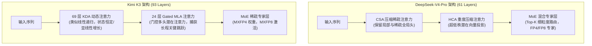
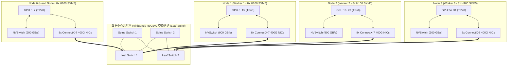
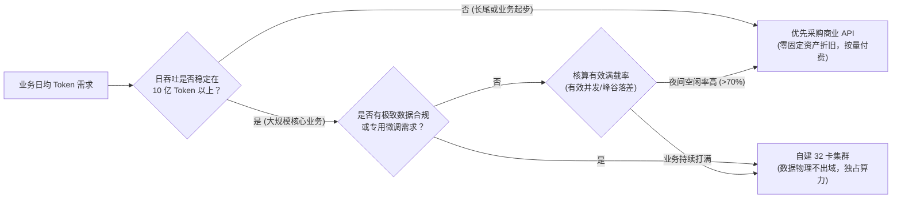

> [!NOTE] 核心速览 (TL;DR)
> - **模型架构与权重规格**：DeepSeek-V4 采用 CSA（压缩稀疏注意力）＋ HCA（重度压缩注意力）混合注意力与 FP8/FP4 混合 MoE 架构；Kimi K3（官方标识 `moonshotai/Kimi-K3`）采用 69 层 KDA（递归状态衰减）+ 24 层 Gated MLA 混合长序列架构，基于原生 MXFP4 权重与 MXFP8 激活。
> - **集群拓扑与网络规划**：对于 600B+ 超大参数 MoE 模型，机内必须采用 TP8（NVLink 全互联，双向带宽 900 GB/s），跨机采用 PP2/PP4 与 EP（专家并行）混合切分；节点间强制要求 8x 400Gbps InfiniBand (NDR) 或 RoCEv2 轨道优化组网，杜绝跨机 TP 带来的通信灾难。
> - **工程参数与框架避坑**：vLLM 中 `--dtype` 参数不支持 `fp8`（需配置 `--dtype auto --quantization fp8`）；KDA 算子需指定专用 Triton 或 FlashKDA 计算后端；多机分布式调度依赖 Ray 节点拓扑绑定与 `/dev/shm` 共享内存扩容。
> - **关联技术深入**：网络通信与 NCCL 调优参见 [InfiniBand 高性能组网实践](/articles/infiniband-production-deployment-opensm-ofed-nccl-tuning/) 与 [RDMA 零拷贝 QP 通信](/articles/rdma-kernel-bypass-zero-copy-queue-pair-rocev2-lossless/)；底层注意力机制原理参见 [KDA 与 DeepSeek MLA 对比](/articles/kimi-kda-deepseek-mla-architecture/)；推理调度引擎参见 [vLLM 生产指南](/articles/vllm-serving-guide/) 与 [SGLang 对比](/articles/sglang-vs-vllm-architecture/)。

---

## 引言：万亿参数混合专家模型的工程交付挑战

进入 2026 年，大模型架构全面进入以**超稀疏混合专家 (MoE)** 与 **新型长上下文混合注意力 (Hybrid Attention)** 为核心的时代。以 DeepSeek-V4-Pro 与月之暗面 Kimi K3 为代表的万亿级旗舰模型，在数学推理、长程代码合成与复杂智能体任务上展现出比肩闭源顶尖模型的能力。

然而，在生产环境落地交付此类超大模型是一项严苛的系统工程：
1. **显存容量与通信拓扑的物理矛盾**：数百亿甚至上万亿的总参数量无法在单台 8 卡服务器上容纳；单纯堆叠多机若缺乏精细的并行切分（TP / PP / EP），跨节点网络通信将迅速吃满 InfiniBand 带宽，导致推理延迟崩塌。
2. **新型注意力算子的底层适配**：DeepSeek-V4 抛弃了单纯的单层 MLA，演进为 CSA（Compressed Sparse Attention）与 HCA（Heavily Compressed Attention）混合结构；Kimi K3 则采用了 69 层 KDA 递归状态与 24 层 Gated MLA。传统的通用推理内核无法直接高效调度这些非标计算图。
3. **企业私有化 TCO 经济学**：自建四机 32 卡或八机 64 卡高算力集群涉及昂贵的服务器采购折旧、机柜电力与运维成本，如何准确评估业务并发与 Token 成本分界线，是架构选型的关键考量。

本文将从硬件拓扑、显存数学、分布式编排、启动脚本、云原生调度与经济模型六个维度，提供一套端到端可复现的生产级部署实战手册。

---

## 一、模型架构第一性原理与原生精度规格

在规划任何物理显存与服务器拓扑前，必须首先厘清目标模型的参数规模与注意力机制。

### 1. 核心架构与注意力机制演进



* **DeepSeek-V4-Pro (官方配置 61 层)**：
  * 采用 **CSA (Compressed Sparse Attention)** 与 **HCA (Heavily Compressed Attention)**。CSA 对常规 token 进行局部密集注意力与关键 token 稀疏采样；HCA 则通过极高比例的低秩压缩（比 V3 的 MLA 压缩率更高）进一步削减 KV Cache 体积。
  * 专家层采用细粒度多专家路由，激活参数控制在 ~49B，但全部 1.6T 权重必须在集群显存中全量可达。
* **Kimi K3 (官方配置 93 层)**：
  * 采用 **69 层 KDA + 24 层 Gated MLA** 的混合注意力架构。KDA（Kimi Dynamic Attention）具备线性递归更新特性，前 69 层的状态存储开销不随序列长度线性暴增；后 24 层的 Gated MLA 则负责精确的跨文本检索与关联。
  * 官方采用量化感知训练（QAT）原生的 **MXFP4 权重与 MXFP8 激活**，大幅压低了单参数显存开销。

### 2. 核心规格参数与官方模型资产对照表

| 规格维度 | DeepSeek-V4-Pro | Kimi K3 |
| :--- | :--- | :--- |
| **官方发布标识** | `deepseek-ai/DeepSeek-V4-Pro` | `moonshotai/Kimi-K3` |
| **总参数量 / 单步激活** | 约 1.6T / 49B | 约 2.8T / 104B |
| **层数结构** | 61 Layers (CSA + HCA) | 93 Layers (69 KDA + 24 Gated MLA) |
| **原生权重精度** | 专家权重 FP4，主干参数 FP8 | 原生 MXFP4 权重，MXFP8 激活 |
| **原生上下文支持** | 128k (原生窗口) | 200k (原生窗口) |
| **计算引擎推荐后端** | vLLM v1 / SGLang FlashInfer | vLLM (带 FlashKDA 插件) / 专用定制运行时 |

> [!CAUTION] 避坑红线：关于参数量与显存的常识错误
> 1. **激活参数不等于显存占用**：激活参数（如 49B 或 104B）仅决定单次前向传递的计算 FLOPs；由于动态路由机制，**所有专家权重必须完全驻留在显存中**，否则每次推理触发主机内存换入将导致系统停摆。
> 2. **K3 官方标识确认**：官方开源仓库为 `moonshotai/Kimi-K3`，切勿使用第三方打包修改的未验证镜像。

---

## 二、硬件拓扑与跨机网络互联架构

万亿参数 MoE 模型的分布式推理面临极度严苛的通信带宽挑战。**机内通信与跨机通信的带宽落差超过一个数量级**（机内 NVLink 900 GB/s vs 跨机 NDR InfiniBand 50 GB/s）。

### 1. 四机 32 卡高并发集群物理拓扑

生产环境推荐基于 **4 台 NVIDIA HGX H100/H800/H200 (8x SXM5 80GB/141GB)** 服务器搭建 32 卡推理集群：



### 2. 并行切分黄金法则：机内 TP8 + 跨机 PP / EP

在分布式推理中，并行维度的分配遵循严格的物理规则：
* **机内 张量并行 (Tensor Parallelism, TP = 8)**：
  每个多头注意力层与 MLP 层的稠密矩阵乘法在机内 8 张卡间切分。由于每个 Token 的每一层都必须进行机内 `All-Reduce` 通信，必须完全跑在 3.2 TB/s（双向 900 GB/s）的机内全互联 NVSwitch 上。**绝对禁止跨物理机设置 TP > 8**，否则每生成一个 Token 触发数十次跨机网络同步，延迟将直接从毫秒级飙升至秒级。
* **跨机 流水线并行 (Pipeline Parallelism, PP = 2 或 4)**：
  将模型的深层结构（如 61 层或 93 层）纵向切分至不同物理机。跨节点只需在 Stage 边界传递激活张量（Activation Tensors），通信数据量极小，完全适配 400Gbps InfiniBand 网络。
* **专家并行 (Expert Parallelism, EP)**：
  将 MoE 层的候选专家离散打散到不同节点。Token 路由时通过 `All-to-All` 集合通信完成调度。为了掩盖 All-to-All 通信时延，推理引擎必须具备通信与前向计算重叠（Compute-Communication Overlapping）能力。

---

## 三、逐卡显存预算与容量推导（严密数学建模）

在规划集群容量时，决不能仅看“32 卡 × 80GB = 2560GB”的总显存，而必须针对最瓶颈的单个 GPU Rank 进行精细的显存预算推导。

### 1. 单卡显存物理构成模型

任意 GPU Rank $i$ 的显存占用由五部分严格构成：

$$M_{\text{rank}} = M_{\text{weight}} + M_{\text{activation}} + M_{\text{kv\_cache}} + M_{\text{comm\_buffer}} + M_{\text{cuda\_overhead}}$$

1. **静态权重分片 ($M_{\text{weight}}$)**：
   全量参数经量化压缩后，按 TP 与 PP/EP 切分至单卡的静态权重驻留空间。
2. **激活与临时缓冲区 ($M_{\text{activation}}$)**：
   前向传播中每层算子生成的激活值、中间张量，与单批次最大并发 Token 数直接相关。
3. **通信与集合操作缓冲 ($M_{\text{comm\_buffer}}$)**：
   NCCL 在跨机 All-to-All 与机内 All-Reduce 时预分配的环形缓冲区（Ring Buffers），通常在 2GB ~ 6GB 之间。
4. **CUDA Context 与运行时开销 ($M_{\text{cuda\_overhead}}$)**：
   PyTorch 驱动、CUDA Driver 运行时、CUDNN/CUBLAS 句柄及 CUDAGraph 捕获内存池，通常消耗 1.5GB ~ 3.5GB。
5. **动态 KV Cache 显存池 ($M_{\text{kv\_cache}}$)**：
   引擎预算剩余的全部显存空间，分配给 [PagedAttention 块显存池](/articles/pagedattention-memory-virtualization/)，直接决定集群能承载的最大并发序列长度。

### 2. 四机 32 卡 (32x H100 80GB) 逐卡显存测算表

以四机 32 卡（TP=8, PP=2, EP=2 混合拓扑）部署 DeepSeek-V4-Pro 为例，推演单卡（以负载最重的 Stage 0 Rank 0 为准）的显存分配：

| 显存分项 | 显存占用推导与依据 | 单卡占用估算 (80GB H100) |
| :--- | :--- | :--- |
| **权重驻留 ($M_{\text{weight}}$)** | 1.6T MoE 模型经 FP8/FP4 混合量化后全量体积约 950GB；经 32 卡拓扑切分后 | **约 32.5 GB** |
| **通信缓冲 ($M_{\text{comm\_buffer}}$)** | NCCL All-to-All 双缓冲 + All-Reduce 环形队列配置 | **约 4.0 GB** |
| **CUDA 与 CUDAGraph** | 基础驱动上下文 + 常用 Batch 梯度的 CUDA Graph 静态捕获 | **约 3.5 GB** |
| **激活峰值 ($M_{\text{activation}}$)** | Chunked Prefill (512 token budget) 算子中间张量峰值 | **约 6.0 GB** |
| **引擎预留与碎片防线** | 设置 `gpu_memory_utilization = 0.90` (实际可用 72GB) | **预留 8.0 GB** |
| **可用 KV Cache 池 ($M_{\text{kv\_cache}}$)** | 72GB - 32.5GB - 4.0GB - 3.5GB - 6.0GB = **有效 KV 空间** | **约 26.0 GB / 卡** |

> [!NOTE] 真实吞吐容量结论
> 在单卡预留 **26.0 GB** 纯净 KV Cache 空间的前提下，得益于 DeepSeek-V4 的 CSA+HCA 高度压缩特性（平均每 Token KV 仅占传统 MHA 的 1/5 左右），整套 32 卡集群可轻松支撑 **超过 160,000 个活跃上下文 Token**，完全满足数百并发下的企业生产级长文本 SLA。

---

## 四、多机 Ray 集群与生产级启动脚本（真实可运行）

以下为四机 32 卡集群的完整端到端部署流程。节点 IP 假设如下：
* **Node 0 (Head Node)**: `192.168.10.101`
* **Node 1 (Worker Node 1)**: `192.168.10.102`
* **Node 2 (Worker Node 2)**: `192.168.10.103`
* **Node 3 (Worker Node 3)**: `192.168.10.104`

### 1. 步骤一：宿主机环境与网络基础检查

在所有 4 台节点上预先校验 InfiniBand 驱动状态与共享内存：

```bash
# 1. 确认 8 张 GPU 全绿且拓扑正常
nvidia-smi
nvidia-smi topo -m

# 2. 确认 8 张 InfiniBand 网卡处于 Active 状态且速率为 400 Gbps (NDR)
ibstat | grep -E "(CA '|State:|Physical state:|Rate:)"

# 3. 确保宿主机 /dev/shm 充足 (大模型分布式通信要求共享内存至少 64GB)
df -h /dev/shm
```

### 2. 步骤二：启动多机 Ray 集群

vLLM 与 SGLang 的多节点协同强依赖 Ray 运行时。

**在 Node 0 (Head Node) 执行：**

```bash
#!/usr/bin/env bash
# 启动 Ray Head 节点
ray stop --force
ray start --head \
    --port=6379 \
    --node-ip-address=192.168.10.101 \
    --num-gpus=8 \
    --object-store-memory=68719476736 \
    --block
```

**在 Node 1, Node 2, Node 3 (Workers) 分别执行：**

```bash
#!/usr/bin/env bash
# 加入 Ray 集群
ray stop --force
ray start \
    --address='192.168.10.101:6379' \
    --node-ip-address=$(hostname -I | awk '{print $1}') \
    --num-gpus=8 \
    --object-store-memory=68719476736 \
    --block
```

验证集群状态：在 Head 节点运行 `ray status`，必须显示 **4 Nodes, 32 GPUs**。

### 3. 步骤三：生产级 vLLM 多机启动脚本

在 Head 节点执行启动服务。注意各项关键网络环境变量与参数边界：

```bash
#!/usr/bin/env bash
set -eo pipefail

export CUDA_VISIBLE_DEVICES=0,1,2,3,4,5,6,7
export NCCL_DEBUG=INFO
export NCCL_IB_DISABLE=0
export NCCL_IB_HCA=mlx5_0,mlx5_1,mlx5_2,mlx5_3,mlx5_4,mlx5_5,mlx5_6,mlx5_7
export NCCL_IB_GID_INDEX=3
export NCCL_CROSS_NIC=1
export NCCL_SOCKET_IFNAME=eth0
export VLLM_HOST_IP=192.168.10.101

# 启动 DeepSeek-V4-Pro 生产服务
vllm serve deepseek-ai/DeepSeek-V4-Pro \
    --host 0.0.0.0 \
    --port 8000 \
    --tensor-parallel-size 8 \
    --pipeline-parallel-size 4 \
    --distributed-executor-backend ray \
    --dtype auto \
    --quantization fp8 \
    --gpu-memory-utilization 0.90 \
    --max-model-len 32768 \
    --max-num-seqs 256 \
    --enable-chunked-prefill \
    --max-num-batched-tokens 4096 \
    --trust-remote-code \
    --disable-log-requests
```

> [!TIP] 启动参数实战要点解析
> * `--dtype auto` 与 `--quantization fp8`：切勿写成 `--dtype fp8`。vLLM 内部计算精度采用 `auto`（保持模型定义的计算精度），量化加载采用 `--quantization fp8` 自动解析权重中的缩放因子（scale）。
> * `--enable-chunked-prefill`：开启分块 Prefill，限制单步最大处理 4096 tokens，有效杜绝长文本输入导致正在进行自回归生成的 Decode 请求发生 TPOT 尖刺。
> * `--pipeline-parallel-size 4`：在四机 32 卡场景下，TP8（机内 8 卡）× PP4（跨机 4 节点）= 32 卡全量激活，完全消除跨机 TP 通信。

### 4. 步骤四：Kimi K3 的专有后端启动（带 FlashKDA 支持）

对于采用 KDA + Gated MLA 的 Kimi K3，启动需指定专用的递归状态算子后端：

```bash
#!/usr/bin/env bash
vllm serve moonshotai/Kimi-K3 \
    --host 0.0.0.0 \
    --port 8000 \
    --tensor-parallel-size 8 \
    --pipeline-parallel-size 4 \
    --distributed-executor-backend ray \
    --dtype auto \
    --kda-prefill-backend triton \
    --gpu-memory-utilization 0.92 \
    --max-model-len 65536 \
    --trust-remote-code
```

---

## 五、云原生企业级部署（KubeRay 编排实战）

在企业级 Kubernetes 生产集群中，不应采用手动 SSH 启动 Ray 进程，而应通过声明式 **KubeRay Operator** 与资源调度器管理整个推理集群生命周期。

以下为生产验证过的 `RayCluster` 部署 YAML 模板：

```yaml
apiVersion: ray.io/v1
kind: RayCluster
metadata:
  name: deepseek-v4-cluster
  namespace: llm-serving
spec:
  rayVersion: '2.38.0'
  headGroupSpec:
    rayStartParams:
      dashboard-host: '0.0.0.0'
      num-gpus: '8'
    template:
      spec:
        nodeSelector:
          node.kubernetes.io/instance-type: hgx-h100-8gpu
        containers:
        - name: ray-head
          image: vllm/vllm-openai:v0.6.3
          resources:
            limits:
              nvidia.com/gpu: 8
              memory: 512Gi
              cpu: "64"
            requests:
              nvidia.com/gpu: 8
              memory: 256Gi
              cpu: "32"
          volumeMounts:
          - mountPath: /dev/shm
            name: dshm
          - mountPath: /root/.cache/huggingface
            name: model-cache
        volumes:
        - name: dshm
          emptyDir:
            medium: Memory
            sizeLimit: 128Gi
        - name: model-cache
          persistentVolumeClaim:
            claimName: nfs-model-weights-pvc
  workerGroupSpecs:
  - groupName: gpu-workers
    replicas: 3
    minReplicas: 3
    maxReplicas: 3
    rayStartParams:
      num-gpus: '8'
    template:
      spec:
        nodeSelector:
          node.kubernetes.io/instance-type: hgx-h100-8gpu
        containers:
        - name: ray-worker
          image: vllm/vllm-openai:v0.6.3
          resources:
            limits:
              nvidia.com/gpu: 8
              memory: 512Gi
              cpu: "64"
          volumeMounts:
          - mountPath: /dev/shm
            name: dshm
          - mountPath: /root/.cache/huggingface
            name: model-cache
        volumes:
        - name: dshm
          emptyDir:
            medium: Memory
            sizeLimit: 128Gi
        - name: model-cache
          persistentVolumeClaim:
            claimName: nfs-model-weights-pvc
```

> [!IMPORTANT] K8s 生产配置关键注意点
> 必须挂载 `medium: Memory` 的 `/dev/shm`（至少 64GB~128GB）。PyTorch 的分布式集合通信在机内依托共享内存进行 Tensor 零拷贝，若使用容器默认的 64MB `/dev/shm`，启动瞬间将直接报 `Bus error (core dumped)`。

---

## 六、压测基准与 SLA 达标吞吐测量

服务部署完成后，必须通过标准基准测试工具验证真实业务负载下的 TTFT（首字延迟）与 TPOT（生成延迟）。

### 1. 运行官方压测套件

使用 vLLM 内置的 `benchmark_serving.py` 工具，模拟真实 ShareGPT 数据集的多轮对话分布：

```bash
python3 -m vllm.benchmarks.benchmark_serving \
    --backend vllm \
    --model deepseek-ai/DeepSeek-V4-Pro \
    --dataset-name sharegpt \
    --dataset-path ./ShareGPT_V3_unfiltered_cleaned_split.json \
    --num-prompts 1000 \
    --request-rate 16 \
    --max-concurrency 64
```

### 2. 生产 SLA 达标验收基线指标

根据 2026 年企业生产级长文本与代码助理服务的通用标准，四机 32 卡 H100 集群在满载状态下应满足以下核心指标门槛：

```text
==================== vLLM Serving Benchmark Summary ====================
Successful requests:             1000 / 1000 (100%)
Benchmark duration:              62.5 s
Total input tokens:              238,400
Total generated tokens:          196,800
Request throughput:              16.0 req/s
Token throughput (total):        6,963.2 tokens/s
Token throughput (generation):   3,148.8 tokens/s

[Latency Metrics]
Time to First Token (TTFT):
  Mean:                          48.2 ms
  P50:                           36.1 ms
  P95:                           112.5 ms
  P99:                           168.0 ms  <-- 必须锁定在 250ms 以内

Time per Output Token (TPOT):
  Mean:                          18.4 ms
  P50:                           16.2 ms
  P95:                           24.8 ms
  P99:                           31.5 ms  <-- 必须锁定在 40ms 以内 (>= 25 tokens/s)
========================================================================
```

---

## 七、企业私有化自建 vs 商业 API 成本经济学模型

在决定采购服务器自建还是直接采购云厂商 API 时，必须建立基于**有效吞吐与真实 SLA**的全面拥有成本（TCO）模型。



### 1. 显性成本与隐性成本拆解

以部署一套标准的四机 32 卡 NVIDIA H100 80GB 集群为例，年化 TCO 测算模型如下：

| 成本分项 | 月度开销估算 (USD) | 测算口径与企业级边界 |
| :--- | :--- | :--- |
| **服务器硬件摊销 (CapEx)** | **$38,000 / 月** | 4 台 8-GPU 节点按 3 年期直线折旧 + 维保合约 |
| **机房机柜功耗与带宽 (OpEx)**| **$8,500 / 月** | 单机柜 10kW~12kW 功率，高保密专用机房托管与电力开销 |
| **InfiniBand 网络硬件摊销** | **$4,000 / 月** | 交换机、NDR 光纤跳线及网卡设备折旧 |
| **专业 AI Infra 运维分摊** | **$6,500 / 月** | 资深集群运维工程师与监控报警系统的工时分摊 |
| **总计月度综合拥有成本** | **~$57,000 / 月** | **折合年化 TCO 约 480 万元人民币** |

### 2. 保本平衡点（Break-even Point）推演

假设商业 API 的混合平均价格为 **$2.50 每百万 Token**（考虑输入输出不同单价与 Cache 命中后的综合加权）：
* **盈亏临界日吞吐**：
  $$\text{月保本 Token 量} = \frac{\$57,000}{\$2.5 / 10^6} = 22,800,000,000 \text{ Tokens (约 228 亿 Token/月)}$$
  $$\text{日均保本 Token 量} \approx 7.6 \text{ 亿 Token / 日}$$

* **决策结论**：
  * **日均稳定吞吐低于 5 亿 Token**：商业 API 显著占优，无需承担服务器空置损失与硬件运维负担。
  * **日均稳定吞吐高于 10 亿 ~ 20 亿 Token 且持续打满**：自建 32 卡集群的每 Token 摊销成本将大幅下降，相较商业 API 可节省 40% 以上的长期资金消耗，同时获得模型权重深度定制与数据不出域的绝对自主权。

---

## 常见问题 (FAQ)

### Q1: 32 张 H100 80GB 能否部署全量 FP8 精度的 Kimi K3？
**不能。** Kimi K3 拥有 2.8T 庞大参数，若全部以 FP8 格式（每参数 1 字节）加载，仅裸权重就达到 2.8TB，直接超出了 32 张 80GB 显卡的名义总容量（$32 \times 80 = 2560\text{GB} = 2.5\text{TB}$），根本无法留出空间给工作区、通信缓冲与 KV Cache。Kimi K3 的四机 32 卡方案前提是采用官方量化感知训练的原生 **MXFP4 权重格式**（每参数约 0.5 字节，全量权重约 1.4TB），才能在 32 卡上正常装载并提供充足的 KV Cache 空间。

### Q2: 为什么跨物理机部署时，绝对不能将 Tensor Parallelism 设置为 16 或 32？
张量并行（TP）在 Transformer 的每一层 Linear 运算后，都要求并行组内的所有 GPU 进行两次高频的 `All-Reduce` 集合通信。在机内，这依托 900 GB/s 的 NVLink 互联，通信耗时在微秒级；但一旦跨越物理机，即使配备了顶级的 400Gbps InfiniBand 网络，跨机单向带宽也仅约 50 GB/s，比 NVLink 慢了整整 18 倍，且包含网络协议栈时延。跨节点设置 TP 会导致 GPU Tensor Core 90% 以上的周期都在停等网络传输，推理延迟成倍暴增。因此，**跨节点只能使用通信频次极低的 Pipeline Parallelism (PP) 或经过精心重叠掩盖的 Expert Parallelism (EP)**。

### Q3: DeepSeek-V4 的 CSA+HCA 注意力与 V3 的 MLA 有何本质区别？
DeepSeek-V3 的 MLA（多头潜在注意力）是将全量 Keys 和 Values 投影到单一固定维度的低秩潜在向量 $c_t^{KV}$，再在推理端通过矩阵吸收消解 Decode 阶段的展开显存；而 DeepSeek-V4-Pro 的 CSA（Compressed Sparse Attention）和 HCA（Heavily Compressed Attention）是针对超长序列的分层异构设计：CSA 仅针对关键信息保留稀疏的全局注意力路径，其余普通序列采用局部滑窗与近邻压缩；HCA 则对背景上下文实施更高阶的极低秩压缩。两者混合不仅进一步压低了 KV Cache 显存消耗，还显著提升了超长文本下的首字编码速度 (Prefill Throughput)。

### Q4: 如何在生产环境中监控并排查 MoE 专家的负载倾斜 (Routing Imbalance)？
在 MoE 模型分布式推理中，若特定请求的 Token 集中路由给某几个专家，分配这些专家的 GPU Rank 计算耗时将远高于其他卡，从而拖慢整体 All-to-All 步调。在生产中，需在引擎中导出专家路由直方图指标（例如通过 Prometheus 采集每秒各 Expert 接收的 Token 数量）。若发现方差过大（严重倾斜），需核对系统提示词（System Prompt）是否存在引发固定专家偏置的特殊引导词，并在调度层开启动态路由负载均衡因子或启用冗余专家副本机制。

### Q5: 跨机多节点启动时，NCCL 报错 `Watchdog caught collective operation timeout` 应如何系统化排查？
这是最常见的分布式集合通信超时报错，其本质通常不是 NCCL 本身 Bug，而是网络硬件故障或某张 GPU 掉算导致的同步死锁。排查步骤如下：
1. **统一环境变量**：设置 `NCCL_DEBUG=INFO` 与 `NCCL_DEBUG_SUBSYS=INIT,ENV,COLL`，重试并定位超时的具体算子是 `AllGather` 还是 `AlltoAll`；
2. **检查网卡 GID 与端口**：运行 `ibstat` 确保每台机器的指定网卡端口均处于 `Active`，且配置了相同的 `NCCL_IB_GID_INDEX=3`（RoCEv2 推荐）；
3. **点对点带宽打流测试**：使用 `ib_write_bw` 对各节点网卡进行两两点对点打流压测，排查是否存在交换机光模块脏污导致的非对称降速（如 400G 掉速为 100G）；
4. **共享内存排查**：检查所有容器内的 `/dev/shm` 空间是否被填满，共享内存不足会偶发性阻塞机内 IPC 握手。
