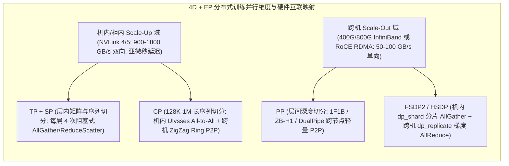
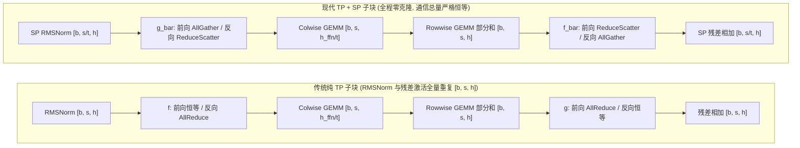
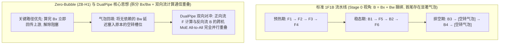
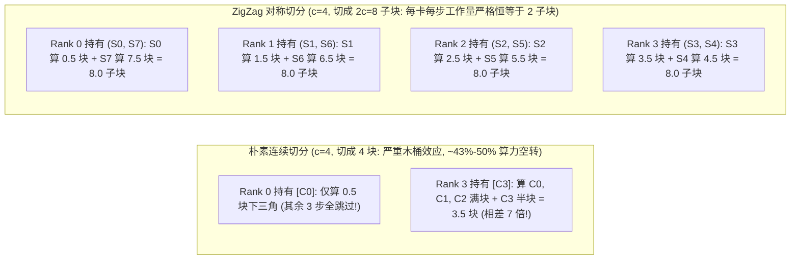

> [!NOTE] 核心速览 (TL;DR)
> - **混合精度显存与激活第一性原理**：在标准 BF16 计算 + FP32 AdamW 主状态范式下，参数量为 $\Psi$ 的模型仅静态状态便占满 **$16\Psi\text{ Bytes}$**（开启 FP32 梯度累加时达 $18\Psi\text{ Bytes}$），即 70B 稠密模型在分配任何激活张量前就需消耗 $1,120\text{ GB}$（约 $1,043\text{ GiB}$）HBM；而现代 **GQA + FlashAttention** 虽抹平了 $O(a s^2)$ 平方级注意力矩阵，但在 $128\text{K}\text{--}1\text{M}$ 长上下文下线性激活项 $O(s b h)$ 依然会击穿单卡显存墙。
> - **状态分片与层内切分的正交演进**：从 DDP、ZeRO-1/2（通信量恒为 $2\Psi$ 元素）到 ZeRO-3 / **PyTorch `FSDP2`**（通信量 $3\Psi$ 元素），`fully_shard` 通过基于 `DeviceMesh` 的逐参数 `DTensor` 表达与无 `recordStream` 确定性显存回收，彻底淘汰了 `FSDP1` 扁平参数拼接；在节点内 NVLink 域叠加 **张量并行（TP）+ 序列并行（SP）**，可在零额外通信体积（等价于单次 `AllReduce`）下将非 TP 区激活显存同步削减为 $1/t$。
> - **零气泡流水线与超长上下文负载均衡**：流水线并行从峰值驻留 $p$ 个微批次的 **`1F1B`**（气泡率 $\frac{p-1}{m}$）演进至解耦反向算子 $B_x / B_w$ 的 **Zero-Bubble PP**，再到 DeepSeek-V3 完全隐藏跨机 MoE `All-to-All` 的双向 **`DualPipe`**；针对百万上下文，**ZigZag Ring Attention** 通过对称分块配对 $(i, 2c-1-i)$ 攻克了因果掩码下朴素环状注意力近 $50\%$ 的算力空转陷阱，并突破了 DeepSpeed-Ulysses 受限于 $n_{kv}$ 头数的扩展天花板。

## 引言：为什么大模型训练是一场跨越显存容量墙与通信带宽断崖的四维博弈？

当你在单机上跑通 [大模型微调全流程指南：底层工作原理、高价值落地用例与生产实战](/articles/fine-tuning-guide/) 中的 7B LoRA 微调后，一旦转向 70B 稠密底座的全参数后训练、百万 Token 长上下文扩展预训练，或是像 [推理时扩展 (Test-Time Compute) 与 GRPO 强化学习实战](/articles/test-time-compute-grpo/) 与 [大模型后训练分布式强化学习架构实战](/articles/distributed-rl-post-training-verl-colocation/) 中那样在百卡集群更新超大策略网络时，单张 80GiB H100/H800 GPU 的物理边界会瞬间锁死训练进程。

现代分布式训练系统通过四个正交并行维度（4D Parallelism，稀疏混合专家模型再叠加第五维 Expert Parallelism `EP`）将庞大计算图映射到三维物理网络拓扑之上：
1. **数据并行（DP / ZeRO / FSDP2 / HSDP）**：沿批次维度切分样本，并通过 `ReduceScatter` 与 `AllGather` 将优化器状态、梯度与权重分片至多卡；
2. **张量并行与序列并行（TP + SP）**：在单层内部沿矩阵行列维度与序列维度切分 GEMM 及归一化激活，依赖机内超高速 Scale-Up 总线高频同步；
3. **流水线并行（PP）**：沿模型深度（Layer）切分阶段，仅在相邻阶段间通过轻量级点对点（P2P）通信传递层边界激活；
4. **上下文并行（CP）**：沿超长序列维度切分全部中间激活，仅在 Attention 核心通过 `All-to-All` 或环状 P2P 交换 KV 状态。



一切并行切分决策的起点，绝不是盲目堆砌配置参数，而是对每字节 HBM 显存与每次集合通信字节数的严格数学核算。

---

## 一、混合精度训练显存与激活值账本：第一性原理推导

在分布式训练中，单卡峰值 HBM 占用由**静态模型状态（Model States）**与**动态剩余内存（Residual Memory：前向激活值、临时通信缓冲与显存碎片）**两部分叠加而成。

### 1.1 静态模型状态的 16Ψ（与 18Ψ）字节精确推导

设模型可训练参数总数为 $\Psi$。现代大模型训练普遍采用 **BF16 混合精度计算 + FP32 AdamW 优化器**范式。为什么不能全程纯用 BF16 更新权重？因为 BF16 仅有 1 位符号位、8 位指数位与 **7 位显式尾数位（Mantissa）**，在数值 $1.0$ 附近的机器精度（Machine Epsilon）仅为 $\varepsilon_{\text{bf16}} = 2^{-7} \approx 7.81 \times 10^{-3}$。而在典型学习率 $\eta \in [10^{-5}, 3 \times 10^{-4}]$ 下，单步参数更新量 $\Delta w = \eta \cdot \hat{m}_t / (\sqrt{\hat{v}_t} + \epsilon)$ 的量级约为 $10^{-4} \ll \varepsilon_{\text{bf16}}$。若直接在 BF16 权重上执行减法，尾数对齐阶段会发生灾难性的**大数吃小数下溢（Mantissa Swamping）**，导致 $\text{fl}_{\text{bf16}}(w - \Delta w) \equiv w$，模型训练完全停滞。

因此，标准混合精度训练必须在 HBM 中维护四类静态张量：
1. **BF16 计算权重（Compute Weights, $W_{\text{bf16}}$）**：前向与反向传播中供 Tensor Core 执行矩阵乘法的参数，每参数占 $2\text{ Bytes}$，合计 **$2\Psi\text{ Bytes}$**；
2. **BF16 参数梯度（Gradients, $G_{\text{bf16}}$）**：反向传播产出的本步梯度，每参数占 $2\text{ Bytes}$，合计 **$2\Psi\text{ Bytes}$**（注：在大规模数据并行与多步梯度累积下，为防止数百路小梯度在 BF16 归约时损失低位精度，生产框架常开启 FP32 梯度累加缓冲 `reduce_dtype=fp32`，此时梯度项翻倍至 **$4\Psi\text{ Bytes}$**）；
3. **FP32 主权重副本（Master Weights, $W_{\text{fp32}}$）**：优化器步进时承载微小更新增量的高精度主副本，每参数占 $4\text{ Bytes}$，合计 **$4\Psi\text{ Bytes}$**；
4. **FP32 AdamW 一阶与二阶矩状态（$m_t, v_t$）**：一阶指数移动平均动量 $m_t$（$4\text{ Bytes}$）与二阶未中心化方差 $v_t$（$4\text{ Bytes}$），合计 **$8\Psi\text{ Bytes}$**。

将上述四项相加，即可得到工业界最核心的**静态显存第一性原理公式**：

$$M_{\text{static}} = \underbrace{2\Psi}_{\text{BF16 Weights}} + \underbrace{2\Psi}_{\text{BF16 Grads}} + \underbrace{4\Psi}_{\text{FP32 Master}} + \underbrace{(4\Psi + 4\Psi)}_{\text{FP32 AdamW } m_t, v_t} = \mathbf{16\Psi\text{ Bytes}} \quad (\text{FP32 梯度累加下为 } \mathbf{18\Psi\text{ Bytes}})$$

让我们用 **70B 稠密模型**（$\Psi = 70 \times 10^9$）做一次严格验算：
- 十进制容量：$M_{\text{static}} = 70 \times 10^9 \times 16\text{ Bytes} = \mathbf{1,120\text{ GB}}$（若按 $18\Psi$ 计则高达 $1,260\text{ GB}$）；
- 二进制物理显存容量（$1\text{ GiB} = 2^{30}\text{ Bytes}$）：$1,120 \times 10^9 / 2^{30} \approx \mathbf{1,043.08\text{ GiB}}$（即 **`~1,043 GiB`**）。

这意味着：**哪怕还没向模型喂入哪怕 1 个 Token、尚未分配任何一行激活张量**，仅 70B 模型的静态权重、梯度与优化器状态就已经超出整台 8 卡 H100-80GB 节点物理显存总和（$8 \times 80 = 640\text{ GiB}$）足足 **$403\text{ GiB}$**！

### 1.2 单层 Transformer 激活显存：从经典 MHA 平方爆炸到 GQA + FlashAttention 线性化

解决了静态状态后，长上下文训练的真正杀手是前向传播为了反向求导而必须驻留 HBM 的**中间激活值（Activations）**。设序列长度为 $s$、微批次大小（Micro-batch size）为 $b$、隐藏维度为 $h$、查询注意力头数为 $a$、GQA 键值头数为 $g = n_{kv}$、SwiGLU 中间层维度为 $h_{\text{ffn}}$。

**1. 经典 Megatron-LM 多头注意力（MHA）激活公式**：
在未引入 FlashAttention 的传统 Transformer 层（Post/Pre-LayerNorm + GeLU MLP 宽度 $4h$ + BF16 激活 + 1 字节 Dropout 掩码）中，依据 Korthikanti 等人（MLSys '23）的逐算子精确拆解：
- **Attention 子块**：输入 LayerNorm（$2sbh$）、QKV 共享输入（$2sbh$）、$Q \cdot K^T$ 保存的 $Q, K$（$4sbh$）、注意力概率与 $V$ 相乘保存的 $V$（$2sbh$）、输出投影输入（$2sbh$）及残差 Dropout 掩码（$1sbh$），合计 $13sbh\text{ Bytes}$；此外，显式具象化 $[b, a, s, s]$ 注意力矩阵需要保存 Softmax 输出（$2bas^2$）、Attention Dropout 掩码（$1bas^2$）与 Dropout 输出（$2bas^2$），合计 **$5bas^2\text{ Bytes}$**；
- **MLP 子块**：输入 LayerNorm（$2sbh$）、第一层线性输入（$2sbh$）、GeLU 输入（$8sbh$）、第二层线性输入（$8sbh$）与残差 Dropout 掩码（$1sbh$），合计 $21sbh\text{ Bytes}$。

合并两项，得到经典的单层激活显存公式：

$$M_{\text{act, classic}}^{\text{layer}} = 34 s b h + 5 b a s^2 = s b h \left(34 + \frac{5 a s}{h}\right)\text{ Bytes}$$

看看其中的二次项 $\frac{5 a s}{h}$ 有多致命：以 $h = 8192, a = 64, b = 1$ 为例，当序列扩至 $s = 32,768$ 时，仅单层的 $5 b a s^2$ 注意力图便高达 $5 \times 1 \times 64 \times 32768^2 \approx \mathbf{343.6\text{ GB}}$，80 层累计超过 $27\text{ TB}$！

**2. 现代架构（GQA + SwiGLU + RMSNorm + FlashAttention-2/3）与选择性激活重计算**：
现代主流大模型（如 Llama-3、Qwen2.5、DeepSeek）从硬件算子与模型结构两端彻底改写了这本账：
- **FlashAttention 抹平 $O(a s^2)$ 矩阵**：利用片上 SRAM 分块与在线 Softmax 递推，FlashAttention 从不向 HBM 写出 $s \times s$ 注意力分数或概率矩阵，仅需保存最终输出 $O$（$2sbh\text{ Bytes}$）与极其微小的 FP32 对数求和指数统计量 $L_{\text{lse}}$（$4bas\text{ Bytes}$），使单层激活严格退化为关于序列长度 $s$ 的**纯线性复杂度 $O(s b h)$**；
- **GQA 压缩 $K, V$ 投影状态**：键值张量体积缩小为 $4 s b h \cdot \frac{g}{a}\text{ Bytes}$（例如 Llama-3-70B 中 $g/a = 8/64 = 1/8$，$K, V$ 激活从 $4sbh$ 骤降至 $0.5sbh$）；
- **SwiGLU MLP 成为新的激活大户**：现代无 Dropout 架构的单层未重计算激活约为 $M_{\text{act, modern}}^{\text{layer}} \approx s b \left(10h + 4h\frac{g}{a} + 6h_{\text{ffn}}\right)\text{ Bytes}$。对于 Llama-3-70B（$h_{\text{ffn}} = 3.5h$），该值约为 **$31.5 s b h\text{ Bytes}$**，其中 SwiGLU 门控激活（$\text{SiLU}(x_{\text{gate}}) \odot x_{\text{up}}$）与上投影独占 $23 s b h$，占比超 $73\%$！
- **选择性激活检查点（Selective Activation Checkpointing, SAC）**：全量检查点（Full Checkpointing）虽能将每层驻留激活压至仅剩层入口残差 **$2 s b h\text{ Bytes}$**，但需在反向传播重算整层所有 GEMM，凭空增加约 **$33\%$** 的总计算 FLOPs；而 PyTorch 原生算子级 **SAC（Op-Level SAC）** 允许我们保存高算力开销的特定 GEMM 输出，仅丢弃并重算零矩阵乘开销、高显存占用的 `RMSNorm`、`RoPE` 与 `SwiGLU` 逐元素乘积（或按比例对每隔 $k$ 层做块级重计算），以低于 $10\%\text{--}15\%$ 的重算开销砍掉 $50\%\text{--}70\%$ 的激活显存。

| 显存账本维度 | 经典 MHA (无 FlashAttn) | 现代 GQA + FlashAttn (无重计算) | 现代架构 + 全量块级检查点 (Full AC) |
| :--- | :--- | :--- | :--- |
| **单层激活复杂度** | $s b h \left(34 + \frac{5 a s}{h}\right)\text{ Bytes}$ | $s b \left(10h + 4h\frac{g}{a} + 6h_{\text{ffn}}\right) = O(s b h)$ | 稳态 $2 s b h\text{ Bytes/layer}$ + 单层重算峰值 |
| **Llama-3-70B ($b=1, s=32\text{K}$, 80 层总计)** | $\sim 28,200\text{ GB}$ ($O(s^2)$ 爆炸) | $\sim 676\text{ GB}$ (纯线性，SwiGLU 主导) | $\sim 43\text{ GB}$ 边界激活 + $8.5\text{ GB}$ 当前层缓冲 |
| **反向传播额外重算 FLOPs** | $0\%$ | $0\%$ (仅 FlashAttn 核内重算局部块) | $+33\%$ (整层 QKV/O/MLP GEMM 重跑一次) |

---

## 二、数据并行演进：从 DDP、ZeRO-1/2/3 到 PyTorch FSDP2 (DTensor + HSDP)

既然单机装不下 $16\Psi$ 静态状态，最直观的思路就是消除传统数据并行（DDP）在所有 $N_d$ 张 GPU 上完全克隆同一份优化器、梯度与参数的巨大冗余——这就是微软 DeepSpeed **ZeRO（Zero Redundancy Optimizer）** 与 PyTorch **FSDP（Fully Sharded Data Parallel）** 的数学本质。

### 2.1 DDP 与 ZeRO-1/2/3 静态显存及集合通信量精确对比

设数据并行度为 $N_d$，总参数元素数为 $\Psi$，前反向通信精度均为 BF16（每元素 $2\text{ Bytes}$，在大规模集群下环状/树状集合通信系数 $\frac{N_d - 1}{N_d} \to 1$）。用元素个数（Rajbhandari SC'20 论文记号）与实际总线字节数双重标定各阶段开销：

| 并行策略 | 分片对象 | 单卡静态常驻显存 (Bytes, $16\Psi$ 基准) | 单步集合通信原语拆解 | 单步通信量 (参数元素数 / BF16 字节数) | 70B @ $N_d=64$ 静态显存 |
| :--- | :--- | :--- | :--- | :--- | :--- |
| **DDP** | 无（全量克隆） | $2\Psi + 2\Psi + 12\Psi = \mathbf{16\Psi}$ | 反向梯度 `AllReduce` ($2\Psi$ 元素) | **$2\Psi$ 元素** ($4\Psi\text{ Bytes}$) | $1,043.1\text{ GiB}$ (必现 OOM) |
| **ZeRO-1 ($P_{\text{os}}$)** | 优化器状态 ($12\Psi$) | $2\Psi + 2\Psi + \frac{12\Psi}{N_d}$ | 反向梯度 `ReduceScatter` ($\Psi$) + 更新后权重 `AllGather` ($\Psi$) | **$2\Psi$ 元素** ($4\Psi\text{ Bytes}$) | $277.1\text{ GiB}$ (仍 OOM) |
| **ZeRO-2 ($P_{\text{os}+g}$)** | 优化器 + 梯度 ($14\Psi$) | $2\Psi + \frac{2\Psi + 12\Psi}{N_d} = 2\Psi + \frac{14\Psi}{N_d}$ | 反向逐层流式 `ReduceScatter` ($\Psi$) + 步末权重 `AllGather` ($\Psi$) | **$2\Psi$ 元素** ($4\Psi\text{ Bytes}$) | $152.1\text{ GiB}$ (仍超 80GiB) |
| **ZeRO-3 / FSDP ($P_{\text{os}+g+p}$)** | 全状态分片 ($16\Psi$) | $\frac{2\Psi + 2\Psi + 12\Psi}{N_d} = \mathbf{\frac{16\Psi}{N_d}}$ | 前向 `AllGather` ($\Psi$) + 反向 `AllGather` ($\Psi$) + 梯度 `ReduceScatter` ($\Psi$) | **$3\Psi$ 元素** ($6\Psi\text{ Bytes}$) | **$16.30\text{ GiB}$** (充裕可训) |

仔细审视这张表格，我们可以提炼出两条黄金架构定律：
1. **ZeRO-1 与 ZeRO-2 是“零通信溢价”的免费午餐**：因为一次环状 `AllReduce` 在物理实现上本来就等价于 **1 次 `ReduceScatter`（$\Psi$ 元素）+ 1 次 `AllGather`（$\Psi$ 元素）**，所以 ZeRO-1/2 相比传统 DDP **没有增加哪怕 1 个字节的总线通信量**（同为 $2\Psi$ 元素 / $4\Psi\text{ Bytes}$），就把静态显存从 $16\Psi$ 压到了接近 $2\Psi$！只要单卡塞得下一份完整 BF16 权重（如 7B–14B 模型在 80GiB GPU 上），ZeRO-2 / `FSDP2(reshard_after_forward=False)` 永远优于 ZeRO-3。
2. **ZeRO-3 / FSDP 以 $+50\%$ 通信量换取无上限容量线性扩展**：为了连 $2\Psi$ 权重都不常驻，FSDP 必须在每层前向计算前临时 `AllGather` 拼出完整 BF16 层权重（算完即释放，耗费 $\Psi$），反向传播到该层时再次 `AllGather` 权重（耗费 $\Psi$），算完本层梯度后立即流式 `ReduceScatter` 归约并丢弃非本地分片（耗费 $\Psi$），总通信量升至 **$3\Psi$ 元素（$6\Psi\text{ Bytes}$）**。借助双缓冲异步预取（Prefetching），下一层的 `AllGather` 可以与当前层的 GEMM 高度重叠。

### 2.2 为什么 PyTorch FSDP2 (`fully_shard`) 彻底取代了 FSDP1？

在 PyTorch 2.0–2.3 时代，第一代 `FullyShardedDataParallel`（`FSDP1`）虽然普及了全分片训练，但在超大规模生产环境中暴露出了深层的架构负债；而在 PyTorch 2.4+ 推出并于 2.5/2.6 成为官方旗舰标准的 **`FSDP2`（`torch.distributed.fsdp.fully_shard`）** 从底层重写了整个执行引擎：

1. **淘汰 `FlatParameter` 一维大拼接，全面拥抱逐参数 `DTensor`**：
   - `FSDP1` 会强行把一个包装模块（如整层 `TransformerBlock`）内的所有 `nn.Parameter` 拍平并拼接成一块巨大的连续一维张量 `FlatParameter`。这不仅彻底破坏了参数原本的语义边界——导致冻结底座 + LoRA 混合微调、参数级异构精度（如 FP32 LayerNorm + BF16 Linear）、优化器参数分组（Weight Decay 排除项）以及分布式 Checkpoint 保存加载变得异常脆弱，更频繁触发 `torch.compile` 图中断（Graph Breaks）。
   - **`FSDP2` 基于 `DeviceMesh` 实现逐参数分片（Per-Parameter Sharding）**：每个原始 `nn.Parameter` 都被直接原地转换为沿第 0 维切分（`Shard(0)`）的 **`DTensor`**！模型层级结构、参数名与分布式状态字典（`DCP`）保持 100% 原生语义，无需任何反拍平胶水代码。
2. **零拷贝视图与 `torch.compile` 深度协同**：
   - `FSDP2` 将分片收集与归约抽象为可追踪的函数式算子（`all_gather_copy_in` / `reduce_scatter_tensor`）。当配合 `torch.compile` 时，TorchInductor 编译器可以直接看见计算图中的通信节点，自动重排算子发射顺序并将逐参数拷贝合并进连续通信缓冲，消除零碎内核启动开销。
3. **根除 `recordStream` 引发的幽灵显存碎片与非确定性 OOM**：
   - 这往往是工程师从 `FSDP1` 迁移到 `FSDP2` 感受最深的一点。`FSDP1` 为了防止计算流（Compute Stream）提前覆写正在通信流（NCCL Stream）上异步传输的张量，重度依赖 CUDA 的 `Tensor.record_stream()`。然而在 CPU 发射快于 GPU 执行的异步偏移下，`record_stream` 会将临时 `AllGather` 缓冲块的生命周期延长到不可预测的未来，迫使 `CUDACachingAllocator` 囤积数十 GB 无法复用的碎片缓存，甚至频繁触发全局同步 `cudaDeviceSynchronize` 清空缓存池，导致吞吐抖动与神秘 OOM。
   - **`FSDP2` 实现了完全无 `recordStream` 的确定性内存管理（Stream-Free Deterministic Memory）**：它通过内部显式维护的双缓冲队列与精确配对的 `torch.cuda.Event` 栅栏控制拷贝流、通信流与默认计算流的生命周期，一旦某一层的反向传播完成，其非分片临时缓冲区立即在确定性时间点归还复用，不仅带来约 **$7\%$ 的端到端吞吐提升**，更让数千步长稳训练的 HBM 水位线平直如刀切。
4. **原生 2D 混合分片数据并行（HSDP）隔离跨机流量**：
   - 在多节点集群中，只需向 `fully_shard` 传入二维网格 `DeviceMesh("cuda", (dp_replicate, dp_shard), mesh_dim_names=("dp_replicate", "dp_shard"))`，`FSDP2` 即自动激活 **2D HSDP**：高带宽消耗的每层前反向 `AllGather` 与 `ReduceScatter` 被严格锁死在单机 8 卡 `dp_shard` 的 $900\text{ GB/s}$ NVLink 域内；而跨节点的 `dp_replicate` 维度仅在梯度累积的最后一步通过 RDMA 网络执行一次轻量级梯度 `AllReduce`，彻底规避跨机慢速链路阻塞前向传播。

---

## 三、张量并行 (TP) 与序列并行 (SP)：层内矩阵切分与通信等价性证明

当模型扩张至 70B–405B 或上下文拉长至数万 Token 时，仅靠 FSDP2 存在两个硬伤：一是单层临时 `AllGather` 出的完整参数与层内巨型激活仍由单卡独立承担；二是当全局 Batch Size 固定而集群扩至数百卡时，纯数据并行会因单卡微批次过小而丧失算术强度。此时必须引入 Megatron-LM 开创的**张量并行（Tensor Parallelism, TP）**与**序列并行（Sequence Parallelism, SP）**。

### 3.1 Megatron-LM 列并行 + 行并行正交配对

观察 Transformer 层内的两大核心计算块（SwiGLU MLP 与 GQA Self-Attention），若随意切分单个线性层，每次矩阵乘后都需要昂贵的通信；Megatron-LM 巧妙利用块矩阵乘法结合律，构造了**“先列切分（Column-Parallel）、后行切分（Row-Parallel）”**的黄金配对（设 TP 并行度为 $t$）：

1. **MLP 子块切分**：
   - 将上投影与门控矩阵 $W_{\text{gate}}, W_{\text{up}} \in \mathbb{R}^{h \times h_{\text{ffn}}}$ **按列切分**为 $t$ 份：$W_{\text{gate}}^{(i)}, W_{\text{up}}^{(i)} \in \mathbb{R}^{h \times (h_{\text{ffn}}/t)}$。由于逐元素激活函数 $\text{SiLU}(\cdot)$ 与哈达玛积 $\odot$ 在特征维度上完全独立，每张 GPU 可在**零通信**下直接算出本地中间激活分片：
     $$Z^{(i)} = \text{SiLU}\!\left(X W_{\text{gate}}^{(i)}\right) \odot \left(X W_{\text{up}}^{(i)}\right) \in \mathbb{R}^{b \times s \times (h_{\text{ffn}}/t)}$$
   - 紧接着将下投影矩阵 $W_{\text{down}} \in \mathbb{R}^{h_{\text{ffn}} \times h}$ **按行切分**为 $W_{\text{down}}^{(i)} \in \mathbb{R}^{(h_{\text{ffn}}/t) \times h}$。由分块矩阵恒等式：
     $$Y = \begin{bmatrix} Z^{(1)} & \cdots & Z^{(t)} \end{bmatrix} \begin{bmatrix} W_{\text{down}}^{(1)} \\ \vdots \\ W_{\text{down}}^{(t)} \end{bmatrix} = \sum_{i=1}^{t} Z^{(i)} W_{\text{down}}^{(i)}$$
     各卡独立完成局部矩阵乘 $Y_{\text{partial}}^{(i)} = Z^{(i)} W_{\text{down}}^{(i)} \in \mathbb{R}^{b \times s \times h}$ 后，只需执行 **1 次 `AllReduce` 求和**即可还原完整输出 $Y$！反向传播中，共轭算子在 `gate_up` 入口处执行 **1 次 `AllReduce`** 汇总输入梯度 $\frac{\partial \mathcal{L}}{\partial X}$。
2. **GQA Attention 子块切分**：
   - 将 $a$ 个查询头与 $g = n_{kv}$ 个键值头均匀分配到 $t$ 张卡上（每卡持有 $a/t$ 个 Q 头与 $g/t$ 个 KV 头，标准切分要求 $t \le n_{kv}$）。QKV 投影为列并行，RoPE 旋转位置编码与 FlashAttention 完全在本地头分片上无通信闭环，最后经行并行的输出投影 $W_o$ 触发 **1 次 `AllReduce`**。

因此，在纯 TP 模式下，每个 Transformer 层在前向传播包含 **2 次 `AllReduce`**（Attention 出口与 MLP 出口），反向传播同样包含 **2 次 `AllReduce`**。

### 3.2 序列并行 (SP)：零额外通信削减 1/t 非 TP 激活显存

然而，纯 TP 留下了一个巨大的显存漏洞：在两个 `AllReduce` 边界之外——即 **RMSNorm / LayerNorm、残差连接（Residual Stream）与 Dropout** 区域，形状为 $[b, s, h]$ 的激活张量在全部 $t$ 张 TP 卡上是**100% 重复克隆**的！尽管这些逐元素算子几乎不占 FLOPs，却白白吃掉了每层约 $10 s b h\text{ Bytes}$ 的未分片显存。

**序列并行（Sequence Parallelism, SP）**抓住了集合通信的底层数学对称性：既然这些非 TP 算子在序列维度 $s$ 上彼此完全独立，为什么不在退出行并行层时，直接把张量沿序列维度切分为 $[b, s/t, h]$ 呢？



我们来严格校核 **纯 TP** 与 **TP + SP** 在单个子块（以 MLP 为例，BF16 激活张量 $[b, s, h]$ 的基础元素体积记为 $M_e = b s h$ 个元素，对应字节数为 $2 b s h\text{ Bytes}$）中的通信开销：
- **纯 TP 单子块前向**：入口无通信，出口执行 **1 次 `AllReduce`**。在环状或 NVSwitch 算法下，对 $2 b s h\text{ Bytes}$ 张量做一次 `AllReduce` 的单卡数据传输量为 $2 \frac{t-1}{t} (2 b s h)\text{ Bytes}$（即 **`2 b s h` 元素**，渐近字节数为 $4 b s h\text{ Bytes}$；若按半程单原语基数计则每次归约/收集各占 **`2 b s h` Bytes**）。
- **TP + SP 单子块前向**：
  1. 在 `gate_up` 列并行入口处执行 **1 次沿序列维度的 `AllGather`**（$[b, s/t, h] \to [b, s, h]$），通信字节数为 $\frac{t-1}{t} (2 b s h) \approx \mathbf{2 b s h\text{ Bytes}}$（即 $b s h$ 元素）；
  2. 在 `down_proj` 行并行出口处执行 **1 次沿序列维度的 `ReduceScatter`**（既对 $t$ 路部分和做规约累加，又将结果切回 $[b, s/t, h]$），通信字节数同样为 $\frac{t-1}{t} (2 b s h) \approx \mathbf{2 b s h\text{ Bytes}}$（即 $b s h$ 元素）。
  - 反向传播中，`ReduceScatter` 的对偶算子恰好是前段 `AllGather`（$2 b s h\text{ Bytes}$），而 `AllGather` 的对偶算子恰好是后段 `ReduceScatter`（$2 b s h\text{ Bytes}$）！

结论令人拍案叫绝：**`1 次 AllReduce` $\equiv$ `1 次 AllGather` + `1 次 ReduceScatter`！** `TP + SP` 在前向与反向传播中的总通信字节数与纯 `TP` **分毫不差（完全等价）**，却将 LayerNorm、Dropout 及残差流上的非 TP 激活显存干净利落地砍到了原来的 **$1/t$**，让整层 Transformer 的全部激活显存实现严格的 $1/t$ 线性缩放！

> [!IMPORTANT] 为什么 TP 必须严格锁死在单个 NVLink Scale-Up 域内？
> 与可以跨层预取重叠的 FSDP `AllGather` 不同，`TP + SP` 每层高达 4 次（前反向共 8 次）的 `AllGather` / `ReduceScatter` **严格位于计算图的关键串行路径上**。对于 80 层的 70B 模型，单个微批次就要触发 640 次阻塞式集合通信！一旦在传统 8 卡服务器上设置 $t > 8$ 跨出机箱，通信带宽会从机内 NVLink 4/5 的 $450\text{--}900\text{ GB/s}$（单向）断崖式暴跌至跨机 400G/800G RDMA 网卡的 $50\text{--}100\text{ GB/s}$，Tensor Core 将陷入 $50\%$ 以上的等待空转。因此，在传统 8 卡 HGX 节点上铁律是 **$t \le 8$**；唯有在 [机柜级超节点与集合通信全栈剖析](/articles/rack-scale-superpod-nvl72-nccl-collectives/) 所拆解的 **NVIDIA GB200/GB300 NVL72**（72 卡全互连 $130\text{ TB/s}$ 双向 NVLink 5 统一域）上，TP/EP 的无损边界才被物理拓宽至 **$t \le 72$**。

---

## 四、流水线并行 (PP)：从 GPipe、1F1B 到 Interleaved 1F1B、Zero-Bubble 与 DualPipe

当训练跨越数十台服务器、或者模型大到单机 NVLink 域（`TP=8`）依然塞不下且跨机慢速网络（如无高配 RoCE 的云主机）扛不住高频 FSDP `AllGather` 时，**流水线并行（Pipeline Parallelism, PP）**登场了：它将 $L$ 层网络按深度切分为 $p$ 个连续阶段（Stages），跨机每次仅需通过 P2P 发送层边界的单个 `[b, s/t, h]` 激活张量，通信量比 ZeRO-3 低一到两个数量级。但 PP 付出的代价是臭名昭著的**流水线气泡（Pipeline Bubble）**。

### 4.1 气泡率推导与 1F1B 的驻留激活封顶魔法

设流水线阶段数为 $p$，单个优化器步切分为 $m$ 个微批次（Micro-batches，$m \ge p$），单阶段单微批次前向与反向耗时分别为 $t_f$ 与 $t_b$：
- **理想零空转计算耗时**：$T_{\text{ideal}} = m (t_f + t_b)$；
- **启动填充与排空等待耗时（Bubble Time）**：最后一个阶段需要等待前 $p-1$ 个阶段依次完成前向才能启动第 1 个微批次，反向排空亦同理，累计空转时间为 $T_{\text{bubble}} = (p - 1)(t_f + t_b)$；
- **流水线气泡率（相对于有效计算时间的比值）**：

$$\text{Bubble Ratio} = \frac{T_{\text{bubble}}}{T_{\text{ideal}}} = \frac{(p - 1)(t_f + t_b)}{m(t_f + t_b)} = \mathbf{\frac{p - 1}{m}} \quad \left(\text{占总墙钟时间比例为 } \frac{p - 1}{m + p - 1}\right)$$

为了将气泡压低到 $10\%$ 以内，必须取 $m \ge 8p$。这就引出了 **`GPipe`** 与 **`1F1B`（One-Forward-One-Backward）** 的根本分水岭：
- **`GPipe` 的显存灾难**：`GPipe` 先一口气跑完所有 $m$ 个微批次的前向（$F_1 \dots F_m$），再跑所有反向（$B_1 \dots B_m$）。这意味着每张卡必须同时在 HBM 中缓存**全部 $m$ 个微批次的中间激活**！把 $m$ 调大以压低气泡会直接引爆 OOM。
- **`1F1B` 的峰值封顶机制**：非交错 `1F1B` 的气泡率同样是 **$\frac{p - 1}{m}$**（计算耗时丝毫未变），但它改变了调度次序——第 $i \in \{0, \dots, p-1\}$ 号阶段仅执行 $(p - i)$ 个预热前向步后，立即进入“做 1 次反向 $B_k$（立刻释放微批次 $k$ 的激活显存！）紧接 1 次前向 $F_{k+p-i}$”的稳态循环。因此，第 $i$ 阶段同时在途驻留的激活微批次数恒为 $p - i$，全流水线最重的 Stage 0 **峰值驻留激活严格封顶在 $p$ 个微批次（与 $m$ 完全脱钩！）**，让我们可以放心将 $m$ 推向 $32, 64$ 甚至更高！

### 4.2 Interleaved 1F1B、Zero-Bubble (Bx/Bw 拆分) 与 DeepSeek-V3 DualPipe

即便 $m = 4p$，基础 `1F1B` 仍有 $\frac{p-1}{4p} \approx 20\%+$ 的气泡。前沿系统通过三代调度革新将气泡彻底榨干：

1. **交错式流水线（Interleaved `1F1B`）**：
   每张 GPU 不再持有连续的 $L/p$ 层，而是交替持有 $v$ 个虚拟阶段（Virtual Stages，例如 $p=4, v=2$ 时，GPU 0 负责第 $\{0,1\}$ 层与第 $\{8,9\}$ 层）。由于单个虚拟阶段块耗时缩短为 $\frac{t_f + t_b}{v}$，填充与排空气泡直接缩小为原来的 **$1/v$**：
   $$\text{Bubble Ratio}_{\text{Interleaved}} = \mathbf{\frac{p - 1}{v \cdot m}}$$
   代价是每个微批次需要在 $p$ 张卡间环绕 $v$ 圈，**跨阶段 P2P 通信量翻了 $v$ 倍**。

2. **零气泡流水线（Zero-Bubble PP：`ZB-H1` / `ZB-V`）**：
   观察线性层 $Y = X W^T$ 的反向求导，传统框架将反向视为不可分割的黑盒 $B$（耗时 $t_b \approx 2 t_f$），但数学上它由两个完全独立的矩阵乘组成：
   - **输入激活梯度 $B_x$（$\frac{\partial \mathcal{L}}{\partial X} = \frac{\partial \mathcal{L}}{\partial Y} W$）**：**位于跨阶段关键路径上**，必须算完立刻发给上游 Stage $i-1$；
   - **参数权重梯度 $B_w$（$\frac{\partial \mathcal{L}}{\partial W} = (\frac{\partial \mathcal{L}}{\partial Y})^T X$）**：**无任何上下游数据依赖**！只要当前卡手头有 $\frac{\partial \mathcal{L}}{\partial Y}$ 和 $X$，$B_w$ 推迟到当前 Step 结束前的任意空闲缝隙执行，数学结果 100% 精确一致！
   **`ZB-H1`** 在保持峰值激活不超过 `1F1B`（$p$ 个微批次）的前提下，将 $B$ 拆解为 $B_x$ 与 $B_w$，优先把 $B_x$ 往前推以极速唤醒上游卡，再把延迟的 $B_w$ 像俄罗斯方块一样填入原本空闲的流水线气泡槽中，一举砍掉近 $2/3$ 气泡；配合 V 型双块折叠拓扑 **`ZB-V`**，更可在理论上逼近**真正的零计算气泡**。

3. **DeepSeek-V3 `DualPipe`：双向对冲流水线与计算通信全重叠**：
   在训练 671B 参数的 DeepSeek-V3（`PP=16, EP=64`）时，最大的痛点不仅是流水线气泡，还有跨节点 MoE 专家并行（底层机制参见 [MoE 专家并行推理引擎设计](/articles/moe-expert-parallelism-inference-engine/)）每层高达两次的跨机 RDMA `All-to-All`（`Dispatch` 与 `Combine`），通信耗时几乎与计算达到 $1:1$！
   **`DualPipe`** 创造性地从流水线**首尾两端（Stage $0 \to p-1$ 与 Stage $p-1 \to 0$）同时相向注入两束独立微批次**（每张卡对称存放正反两套镜像层分片）：在稳态的每一个微时间片内，系统将**正向流微批次的前向计算（$F$）与反向流微批次的反向计算（$B_x / B_w$）成对捆绑交错**——当流 A 正在占用大部分 SM 执行密集的 Attention/MLP 矩阵乘时，流 B 恰好利用专门划出的少量通信 SM（如 H800 上仅拨出 20 个 SM）在后台并发跑完跨节点 InfiniBand `All-to-All`！`DualPipe` 不仅将流水线气泡削减至 $(\frac{p}{2} - 1)$ 量级（排空期结合 $B_x/B_w$ 拆分），更实现了**跨机 EP 通信与 PP 传输的接近 100% 隐藏**。



---

## 五、上下文并行 (CP)：攻克 128K–1M 超长序列训练与因果掩码负载均衡

当模型进入 **128K 至 1M（百万 Token）** 长上下文预训练或长文档推理对齐阶段，单靠 `TP=8 + SP` 也会彻底失效：一方面，在 $s = 1,048,576$（1M）时，哪怕开启全量检查点，仅 80 层保存的 `[b, s/8, h]` 层入口激活单卡就高达 $171.8\text{ GB}$；另一方面，`TP + SP` 在每次进入线性层前依然要 `AllGather` 拼出完整的 $s = 1\text{M}$ 长度序列，瞬间撑爆单卡 80GiB HBM。

**上下文并行（Context Parallelism, CP，并行度记为 $c$）**将**所有算子**的输入输出永久按序列切分为 $s / c$（从不在任何单卡上拼回完整序列 $s$）！由于 `RMSNorm`、`RoPE`、`Linear` 与 `SwiGLU` 在每个 Token 位置上完全独立，它们无需任何跨 CP 通信即可原地执行；**全网唯一需要跨卡协同的算子只有 Self-Attention**。业界演化出了两条技术路线：**DeepSpeed-Ulysses** 与 **Ring Attention**。

### 5.1 DeepSpeed-Ulysses vs Ring Attention：头数天花板与 P2P 掩蔽方程

1. **DeepSpeed-Ulysses（基于 `All-to-All` 的序列-注意力头转置）**：
   - 在进入 Attention 前，$Q, K, V$ 按序列切分但拥有全部注意力头，形状为 $[b, s/c, a, d_{\text{head}}]$；
   - 发射一次跨 $c$ 卡的 **`All-to-All`**，将切分轴从“序列”瞬间翻转为“注意力头”，得到 $[b, s, a/c, d_{\text{head}}]$；每张卡在自己负责的 $a/c$ 个完整头上直接调用原生 FlashAttention，算完后再经一次逆向 **`All-to-All`** 翻回 $[b, s/c, a, d_{\text{head}}]$。
   - **优势与致命瓶颈**：通信体积随 $1/c$ 递减且无因果掩码偏斜；但它受限于**硬性的物理头数上限 $c \le n_{kv}$**！以 Llama-3-70B 或 Qwen2.5-72B（$n_{kv} = 8$）为例，一旦机内 `TP=8` 已经把 8 个 KV 头分完了，原生 Ulysses 便无法在不额外复制广播 KV 头的情况下继续扩展 `CP`。

2. **Ring Attention（环状 P2P KV 传递与分块在线 Softmax 重叠）**：
   - 各卡持有的查询块 $Q_i \in \mathbb{R}^{b \times (s/c) \times a \times d_{\text{head}}}$ **原地不动**，仅将键值块 $(K_j, V_j)$ 在 $c$ 张卡组成的逻辑环上通过异步 `isend` / `irecv` 循环传递 $c$ 步。
   - 利用 FlashAttention 在线 Softmax 的精确分块结合律，每步在计算本地 $(Q_i, K_j, V_j)$ 注意力并按 $\exp(m_{\text{old}} - m_{\text{new}})$ 修正累加输出 $O_i$ 的同时，后台通信流并行收发下一跳的 KV 块。
   - **完全隐藏通信的临界条件**：单步局部计算量为 $4 b (s/c)^2 h\text{ FLOPs}$，单步 GQA KV 传输字节数为 $4 b (s/c) h \frac{g}{a}\text{ Bytes}$，计算访存比恰好等于 $\frac{s}{c} \cdot \frac{a}{g}$。对 Llama-3-70B（$a/g = 8$），只要每卡分到的子序列 $s/c \ge 4,096$，计算通信比便高达 $32,768\text{ FLOPs/Byte}$，远超 H100 Tensor Core 与 400G IB 网卡的平衡点（$\sim 19,780\text{ FLOPs/Byte}$），**跨机 RDMA 传输可被 100% 隐藏，且完全不受 $n_{kv}$ 头数限制**！

### 5.2 朴素环状注意力的因果掩码空转陷阱与 ZigZag 对称配对证明

然而，若直接把长度为 $s$ 的自回归序列按自然顺序连续切分为 $C_0, C_1, \dots, C_{c-1}$ 交给朴素 Ring Attention，集群吞吐会瞬间腰斩！

**为什么朴素连续切分会引发约 50% 的算力空转？**
在因果掩码（Causal Mask，仅允许位置 $q_{\text{pos}} \ge k_{\text{pos}}$ 参与计算）下：
- **Rank $0$** 持有最开头的序列块 $C_0 \in [0, s/c)$：它只在第 0 步与自身 $K_0$ 计算半个下三角块（工作量仅为 $\frac{1}{2}$ 块）；在接下来的 $c-1$ 步中，环上传来的 $K_1, \dots, K_{c-1}$ 全部处于未来位置（$k_{\text{pos}} > q_{\text{pos}}$），**100% 被因果掩码跳过，计算量为 0**！
- **Rank $c-1$** 持有最末尾的序列块 $C_{c-1}$：它不仅要算自身的半个下三角块，还要对前面所有的 $K_0, \dots, K_{c-2}$ 执行 $(c-1)$ 个完整的稠密矩阵块计算（总工作量高达 $c - \frac{1}{2}$ 块，是 Rank $0$ 的 **$2c - 1$ 倍**）！
由于每轮环步所有 GPU 必须同步等待最慢的 Rank $c-1$，全网有效总计算量虽为 $\frac{c^2}{2}$ 块，墙钟耗时却被拉长到接近 $c^2$ 块——**整整 $\frac{c-1}{2c-1} \approx 50\%$ 的 Tensor Core 算力白白空转**！

**ZigZag（对称首尾双块）与 Striped Ring Attention 的精确破局**：
Megatron-Core 与主流长上下文框架采用的 **ZigZag Ring Attention** 给出了极其优美的组合数学解法：不再切 $c$ 份，而是将完整序列均匀切分为 **$2c$ 个等长子块** $\{S_0, S_1, \dots, S_{2c-1}\}$（每块长 $\frac{s}{2c}$），并按首尾中心对称法则，令 **Rank $i \in \{0, \dots, c-1\}$ 同时持有子块对 $(S_i, S_{2c - 1 - i})$**！



让我们对任意 Rank $i$ 做一次严格的算力恒等证明：
1. **全局总工作量绝对相等**：前半块 $S_i$ 需要计算前序 $i$ 个满子块加自身 $\frac{1}{2}$ 下三角，共 $i + \frac{1}{2}$ 子块；后半块 $S_{2c-1-i}$ 需要计算前序 $(2c - 1 - i)$ 个满子块加自身 $\frac{1}{2}$ 下三角，共 $2c - \frac{1}{2} - i$ 子块。两者相加：
   $$\text{Work}(\text{Rank } i) = \left(i + \frac{1}{2}\right) + \left(2c - 1 - i + \frac{1}{2}\right) \equiv \mathbf{2c\text{ 个标准子块}}$$
   下标 $i$ 被完美消去！
2. **不仅全局相等，连每一步环传递（Per-Step）都 100% 均衡**：当 Rank $i$ 收到来自 Rank $j$ 的键值块对 $(S_j, S_{2c-1-j})$ 时：
   - 若 $j = i$（本卡初态）：$S_i$ 自注意力占 $\frac{1}{2}$，$S_{2c-1-i}$ 对 $S_i$ 占 $1$ 满块、自注意力占 $\frac{1}{2}$，合计 **$\mathbf{2}$ 个子块**；
   - 若 $j < i$（则下标严格满足 $j < i < 2c-1-i < 2c-1-j$）：$S_i$ 与 $S_{2c-1-i}$ 均对 $S_j$ 算 $1$ 满块，且两者均排在 $S_{2c-1-j}$ 之前（跳过），合计 $1 + 1 + 0 = \mathbf{2}$ 个子块；
   - 若 $j > i$（则下标严格满足 $i < j < 2c-1-j < 2c-1-i$）：$S_i$ 排在两个 KV 块之前（全跳过），而末尾的 $S_{2c-1-i}$ 排在两个 KV 块之后（对两者各算 $1$ 满块），合计 $0 + 1 + 1 = \mathbf{2}$ 个子块！

每一跳、每一张 GPU 的有效 FLOPs 严格锁定在 $2$ 个子块，**负载失衡率直接清零**！在百万上下文生产系统中，更常采用 **2D 统一序列并行（USP）**——机内 NVLink 走 `Ulysses=8`（吃满 $n_{kv}=8$），跨机 RDMA 叠加 `ZigZag Ring=8`，轻松扩展至 64 卡 `CP` 并行。

---

## 六、生产级 PyTorch 2.5+ 3D 并行代码实战与集群容量规划蓝图

理解了上述全部数学原理后，我们来看现代原生 PyTorch（TorchTitan 架构范式，PyTorch 2.5+）如何仅用几十行干净的声明式代码，在同一套 `DeviceMesh` 上无侵入地组合 **3D 混合并行（`dp_replicate` × `dp_shard` × `tp` + `SequenceParallel` + `FSDP2`）**。

### 6.1 基于 DeviceMesh、TP/SP 与 FSDP2 (`fully_shard`) 的完整生产实现

以下代码完全兼容原生 PyTorch 2.5+ 分布式 API，无需修改模型前向传播中的线性层数学逻辑即可实现层内 TP+SP 切分与跨节点 2D HSDP 状态分片（启动命令如 `torchrun --nnodes=8 --nproc_per_node=8 train_3d.py`）：

```python
import os
import torch
import torch.nn as nn
import torch.nn.functional as F
import torch.distributed as dist
from torch.distributed.device_mesh import init_device_mesh
from torch.distributed.tensor import Replicate, Shard
from torch.distributed.tensor.parallel import (
    ColwiseParallel,
    PrepareModuleInput,
    RowwiseParallel,
    SequenceParallel,
    parallelize_module,
)
from torch.distributed.fsdp import MixedPrecisionPolicy, fully_shard


class RMSNorm(nn.Module):
    def __init__(self, dim: int, eps: float = 1e-6):
        super().__init__()
        self.eps = eps
        self.weight = nn.Parameter(torch.ones(dim))

    def forward(self, x: torch.Tensor) -> torch.Tensor:
        norm_x = x.float() * torch.rsqrt(x.float().pow(2).mean(-1, keepdim=True) + self.eps)
        return norm_x.type_as(x) * self.weight


class FeedForward(nn.Module):
    def __init__(self, dim: int, hidden_dim: int):
        super().__init__()
        self.w1 = nn.Linear(dim, hidden_dim, bias=False)  # gate_proj
        self.w3 = nn.Linear(dim, hidden_dim, bias=False)  # up_proj
        self.w2 = nn.Linear(hidden_dim, dim, bias=False)  # down_proj

    def forward(self, x: torch.Tensor) -> torch.Tensor:
        return self.w2(F.silu(self.w1(x)) * self.w3(x))


class GQAAttention(nn.Module):
    def __init__(self, dim: int, n_heads: int, n_kv_heads: int):
        super().__init__()
        self.n_heads = n_heads
        self.n_kv_heads = n_kv_heads
        self.head_dim = dim // n_heads
        self.wq = nn.Linear(dim, n_heads * self.head_dim, bias=False)
        self.wk = nn.Linear(dim, n_kv_heads * self.head_dim, bias=False)
        self.wv = nn.Linear(dim, n_kv_heads * self.head_dim, bias=False)
        self.wo = nn.Linear(n_heads * self.head_dim, dim, bias=False)

    def forward(self, x: torch.Tensor) -> torch.Tensor:
        bsz, seqlen, _ = x.shape
        # TP 列切分后按本地剩余通道自动推导本卡负责的 Q/KV 头数
        q = self.wq(x).view(bsz, seqlen, -1, self.head_dim).transpose(1, 2)
        k = self.wk(x).view(bsz, seqlen, -1, self.head_dim).transpose(1, 2)
        v = self.wv(x).view(bsz, seqlen, -1, self.head_dim).transpose(1, 2)
        out = F.scaled_dot_product_attention(q, k, v, is_causal=True, enable_gqa=True)
        return self.wo(out.transpose(1, 2).contiguous().view(bsz, seqlen, -1))


class TransformerBlock(nn.Module):
    def __init__(self, dim: int, hidden_dim: int, n_heads: int, n_kv_heads: int):
        super().__init__()
        self.attention_norm = RMSNorm(dim)
        self.attention = GQAAttention(dim, n_heads, n_kv_heads)
        self.ffn_norm = RMSNorm(dim)
        self.feed_forward = FeedForward(dim, hidden_dim)

    def forward(self, x: torch.Tensor) -> torch.Tensor:
        # 在 TP + SP 模式下, 残差流 x 的本地形状始终为 [batch, seq_len // tp_size, dim]
        x = x + self.attention(self.attention_norm(x))
        x = x + self.feed_forward(self.ffn_norm(x))
        return x


class MiniLLM(nn.Module):
    def __init__(self, vocab_size: int = 128256, dim: int = 4096, n_layers: int = 8):
        super().__init__()
        self.tok_embeddings = nn.Embedding(vocab_size, dim)
        self.layers = nn.ModuleList([
            TransformerBlock(dim=dim, hidden_dim=14336, n_heads=32, n_kv_heads=8)
            for _ in range(n_layers)
        ])
        self.norm = RMSNorm(dim)
        self.output = nn.Linear(dim, vocab_size, bias=False)

    def forward(self, tokens: torch.Tensor) -> torch.Tensor:
        h = self.tok_embeddings(tokens)
        for layer in self.layers:
            h = layer(h)
        return self.output(self.norm(h))


def apply_3d_parallel(
    model: MiniLLM,
    dp_replicate: int,
    dp_shard: int,
    tp_size: int,
) -> tuple[MiniLLM, dist.device_mesh.DeviceMesh]:
    # 1. 构建三维物理拓扑网格: (跨机副本归约, 机内全分片, 机内张量并行)
    mesh_3d = init_device_mesh(
        "cuda",
        (dp_replicate, dp_shard, tp_size),
        mesh_dim_names=("dp_replicate", "dp_shard", "tp"),
    )
    tp_mesh = mesh_3d["tp"]
    dp_mesh = mesh_3d["dp_replicate", "dp_shard"] if dp_replicate > 1 else mesh_3d["dp_shard"]

    # 2. 先施加 TP + SP: 嵌入层输出直接按序列维度 Shard(1) 切分进入残差流
    parallelize_module(
        model,
        tp_mesh,
        {
            "tok_embeddings": RowwiseParallel(
                input_layouts=Replicate(),
                output_layouts=Shard(1),
            ),
            "norm": SequenceParallel(),
            "output": ColwiseParallel(
                input_layouts=Shard(1),
                output_layouts=Replicate(),
            ),
        },
    )

    for layer in model.layers:
        parallelize_module(
            layer,
            tp_mesh,
            {
                "attention_norm": SequenceParallel(),
                "attention": PrepareModuleInput(
                    input_layouts=(Shard(1),),
                    desired_input_layouts=(Replicate(),),
                ),
                "attention.wq": ColwiseParallel(),
                "attention.wk": ColwiseParallel(),
                "attention.wv": ColwiseParallel(),
                "attention.wo": RowwiseParallel(output_layouts=Shard(1)),
                "ffn_norm": SequenceParallel(),
                "feed_forward": PrepareModuleInput(
                    input_layouts=(Shard(1),),
                    desired_input_layouts=(Replicate(),),
                ),
                "feed_forward.w1": ColwiseParallel(),
                "feed_forward.w3": ColwiseParallel(),
                "feed_forward.w2": RowwiseParallel(output_layouts=Shard(1)),
            },
        )

    # 3. 再自底向上施加 FSDP2 (fully_shard): 在 TP DTensor 之上叠加 2D HSDP 分片
    mp_policy = MixedPrecisionPolicy(
        param_dtype=torch.bfloat16,
        reduce_dtype=torch.float32,  # 梯度在 FP32 下归约以杜绝大规模 DP 下溢
    )
    for layer in model.layers:
        fully_shard(layer, mesh=dp_mesh, mp_policy=mp_policy, reshard_after_forward=True)
    fully_shard(model, mesh=dp_mesh, mp_policy=mp_policy, reshard_after_forward=True)
    return model, mesh_3d


if __name__ == "__main__":
    local_rank = int(os.environ["LOCAL_RANK"])
    torch.cuda.set_device(local_rank)
    dist.init_process_group(backend="nccl")

    world_size = dist.get_world_size()
    # 示例: 64 卡 (8x8) 自动切分为 dp_replicate=2, dp_shard=8, tp=4; 单机 8 卡则为 1x2x4
    tp_degree = 4
    dp_shard_degree = min(8, world_size // tp_degree)
    dp_rep_degree = world_size // (dp_shard_degree * tp_degree)

    with torch.device("meta"):
        llm = MiniLLM()
    llm, mesh = apply_3d_parallel(llm, dp_rep_degree, dp_shard_degree, tp_degree)
    llm.to_empty(device="cuda")  # 零主内存开销直接按 DTensor 分片在 GPU 上物化权重
    dist.destroy_process_group()
```

请注意上面代码末尾的 **`with torch.device("meta")` + `to_empty(device="cuda")`** 技巧：在加载 70B–405B 模型时，若每台节点的 8 个进程都在 CPU 内存先初始化完整的 $140\text{ GB+}$ 模型再分片，主机内存（Host RAM）会当场爆掉；先在零内存的 `meta` 设备完成 `TP` 与 `FSDP2` 的二维 `DTensor` 切分，再直接在单卡 HBM 上分配属于本 Rank 的 $1/(N_d \cdot t)$ 分片并利用 `torch.distributed.checkpoint` 流式加载，是百卡训练的标准工程实践。

### 6.2 7B 至 671B MoE 集群并行拓扑选型决策表

在实际集群容量规划中，切忌无脑把所有并行维度全部打开（每多开一维并行都会引入额外的通信同步边界与调度复杂度）。下表给出了从单机 8 卡到 512 卡规模的黄金切分准则：

| 模型规格与训练场景 | 集群规模 (80GiB/141GiB HBM) | 推荐并行拓扑组合 | 关键架构权衡与工程依据 |
| :--- | :--- | :--- | :--- |
| **7B–8B Dense** (4K–32K SFT / GRPO) | **8 GPUs** (单机 HGX) | `FSDP2 (dp_shard=8), TP=1, PP=1, CP=1` | 静态状态仅 $112\text{ GB}$（单卡 $14\text{ GB}$）；完全不开 TP 可规避每层 4 次串行阻塞通信，MFU 轻松达 $52\%\text{--}56\%$。 |
| **7B–8B Dense** (128K–512K 长文本扩展) | **32 GPUs** (4 台 8 卡) | `FSDP2 (dp_shard=8) × CP=4/8 (ZigZag Ring)` | 权重虽小但 512K 激活巨大；保持 `TP=1` 或 `TP=2`，用 `CP` 切碎序列激活并将跨机 KV 环隐藏在 FlashAttention 内。 |
| **70B–72B Dense** (8K–32K SFT / 后训练) | **64 GPUs** (8 台 8 卡) | `HSDP (dp_rep=2, dp_shard=8) × TP=4 (+SP)` | 静态 $1,120\text{ GB}$；机内 `TP=4 + SP` 削减单层峰值激活与词表 Logits，配合 HSDP 将重型 `AllGather` 锁在机内 NVLink。 |
| **70B–72B Dense** (128K–256K 长上下文) | **128–256 GPUs** (16–32 台) | `TP=8 (+SP) × CP=4–8 (ZigZag) × PP=2 × ZeRO-1` | 机内 `TP=8` 吃满 8 个 GQA KV 头，跨机用 `ZigZag Ring CP` 突破头数限制切分长序列，叠加轻量 `PP=2` 降低权重分片压力。 |
| **671B MoE (37B 激活)** (DeepSeek-V3 级续训/RL) | **256–512 GPUs** (H800 或 NVL72) | `TP=1 × PP=8–16 (DualPipe) × EP=64 × ZeRO-1` | 静态总重达 $10.7\text{ TB}$；放弃重通信 TP，用 `DualPipe` 双向流水掩盖跨机 `EP=64` 的 MoE `All-to-All`（在 GB200 NVL72 上单柜即可承载 `EP=64`）。 |

---

## 常见问题 (FAQ)

### Q1: 既然 70B 模型的静态状态在 64 卡纯 FSDP2 (`TP=1`) 下单卡只占 16.3 GiB，为什么在 32K 序列长度下经常莫名触发 CUDA OOM，必须开启 `TP=4/8 + SP`？
因为压垮单卡显存的往往不是静态分片，而是**未分片的瞬态峰值（Transient Peak）**！在 `TP=1` 的纯 FSDP2 下，有两座大山无法靠增大 $N_d$ 消除：第一，单层前反向必须在单卡完整重构当前层的 SwiGLU 中间激活与未检查点张量；第二，也是最致命的**输出层词表交叉熵峰值（Vocabulary Logits Spike）**——以 Qwen2.5-72B（词表 $V = 152,064$）为例，单条 $s = 32,768$ 序列一旦在输出层物化完整的 `[1, 32768, 152064]` FP32 Logits 及其反向梯度，瞬时显存便飙升至 $32768 \times 152064 \times 4 \times 2 \approx \mathbf{37.1\text{ GiB}}$！开启 `TP=4/8 + SP`（配合 Vocab-Parallel Cross-Entropy 或 Liger-Kernel 分块融合交叉熵 `FusedLinearCrossEntropy`）可直接将该峰值砍掉 $75\%\text{--}95\%$。

### Q2: 在 FSDP2 或 ZeRO-3 中同时开启激活检查点（Activation Checkpointing），反向传播重算前向时会导致单步通信量从 `3Ψ` 恶化到 `4Ψ` 吗？
**取决于检查点包装粒度（Wrapping Order）是否与 FSDP 分片单元严格对齐！** 如果你错误地把跨多层的大模块包进一个 `checkpoint` 块，而内部每层各自做 `fully_shard`，那么反向传播开始重算这几层时，每层都要额外触发一次 `AllGather` 并立即释放，等到真正回传梯度时还要再 `AllGather` 一次，通信量确实会从 $3\Psi$ 劣化至 **$4\Psi$**！正确做法是：**对每一个 `TransformerBlock` 先套单层激活检查点，再对该 `TransformerBlock` 调用 `fully_shard`**。此时在反向阶段，FSDP2 针对该层只做 **1 次 `AllGather`**，将非分片 BF16 权重同时供“局部前向重算”和紧随其后的“本层反向求导”复用后再释放，通信量严格保持在 **$3\Psi$**。

### Q3: 为什么上文代码里将 FSDP2 的 `MixedPrecisionPolicy` 配置为 `reduce_dtype=torch.float32`？这比 `bfloat16` 归约多花了一倍梯度带宽，值得吗？
在 64 卡以上的大规模分布式预训练与强化学习后训练中，**非常值得，甚至是防发散刚需**。当全局数据并行度 $N_d \ge 64$ 时，若采用预除以 $N_d$ 的平均归约或小微批次累加，许多层（尤其是残差深层与 Embedding 层）的单卡局部梯度幅值本身已小至 $10^{-5}\text{--}10^{-4}$；在 BF16 仅有 7 位尾数的限制下，跨 64–256 张卡逐跳累加会产生严重的非结合律截断误差乃至梯度归零。开启 `reduce_dtype=torch.float32` 虽然将 `ReduceScatter` 流量从 $2\Psi\text{ Bytes}$ 增至 $4\Psi\text{ Bytes}$（总通信从 $6\Psi$ 变为 $8\Psi\text{ Bytes}$，仅增加 $33\%$），但配合多微步梯度累积期间关闭跨步同步（仅最后一步归约），性能损耗通常低于 $3\%\text{--}5\%$，却能换来与单机纯 FP32 基准完全一致的 Loss 收敛曲线。

### Q4: 对于 GQA 键值头数仅有 8 个的模型（如 Llama-3-70B, `n_kv_heads=8`），如果单机已经开了 `TP=8`，还能怎么叠加 `CP=8` 训练 512K 上下文？
这正是区分 **DeepSpeed-Ulysses** 与 **ZigZag Ring Attention** 适用边界的经典实战题。由于机内 `TP=8` 已经把全部 8 个 KV 头切分完毕（每张 TP 卡仅持有 $8 / 8 = 1$ 个本地 KV 头），若强行在跨机维度使用 Ulysses，就不得不先把 KV 头复制 8 份，浪费显存与通信；而 **ZigZag Ring Attention 与注意力头切分维度完全正交**！标准解法是：**机内 8 卡组成 `TP=8 (+SP)` 组**（每卡负责 8 个 Q 头与 1 个 KV 头），同时将不同机器上具有相同机内 `local_rank` 的 8 张卡组成一个跨机 **`CP=8` 的 ZigZag Ring 环**。每个环内只传递该卡所属的那 **1 个 KV 头**的子序列分片（跨机 P2P 流量直接缩小为原来的 $1/8$！），零头数冲突即可丝滑跑通 $512\text{K}\text{--}1\text{M}$ 长序列训练。
