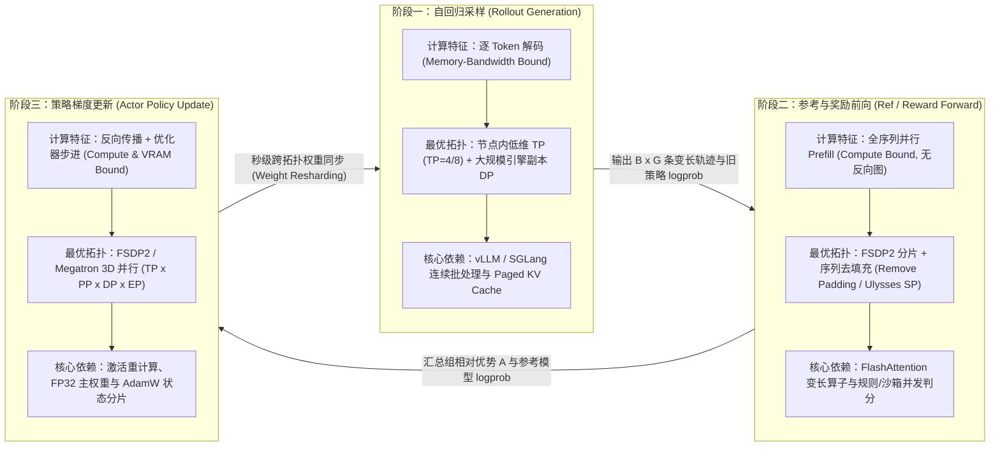
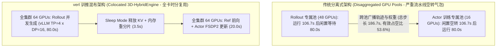
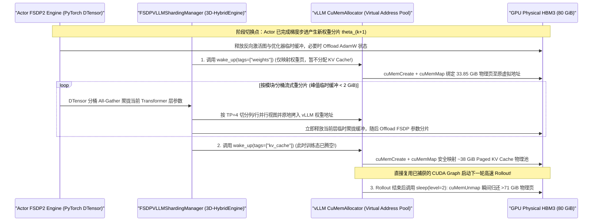
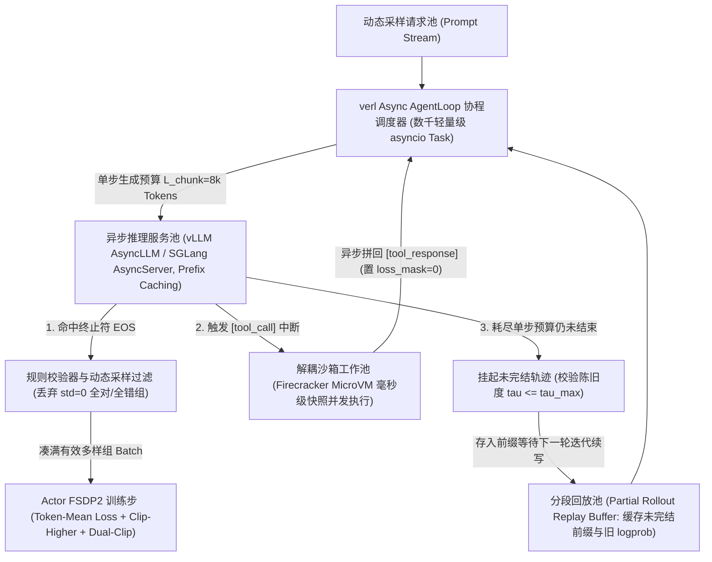

> [!NOTE] 核心速览 (TL;DR)
> - **异构算力错配是后训练头号瓶颈**：单步 RL 迭代在访存受限的自回归生成（Rollout）、算力受限的参考/奖励前向（Ref/Reward Forward）与显存及通信受限的策略反向更新（Actor Update）之间高频切换；在大规模集群中，推理采样的耗时占比往往高达 $70\%\text{--}85\%$。
> - **训推混布（Colocation）碾压静态分离架构**：以 Qwen2.5-72B 在 $64 \times \text{H100-80GB}$ 集群训练为例，同步分离式架构受限于串行数据依赖，即使在微积分最优卡数切分下仍存在约 $44\%$ 的理论空转气泡；基于 `verl` 的训推混布通过时分复用让全量 GPU 协同参与生成与训练，将单步端到端耗时压缩近 $1.8\times$。
> - **虚拟显存解绑与零冗余重分片**：借助 vLLM `Sleep Mode`（基于 CUDA `cuMemUnmap` 按 `weights` 与 `kv_cache` 双阶段解绑/唤醒物理页）与 `verl` 的 `3D-HybridEngine`（基于 `DTensor` 分桶流式 `All-Gather` 与微数据并行组 `dp_g` 重分片），百 GB 级模型可在 $1.5\text{--}3.5\text{ s}$ 内完成无盘内存态切换且消除显存波峰 OOM。
> - **Partial Rollout 与 DAPO 攻克长尾木桶效应**：针对 $32\text{k}\text{--}64\text{k}$ 长思维链与多轮工具调用引发的严重长尾阻塞，结合分段预算回放（Partial Rollout）、陈旧度受控的双重裁剪重要性采样（`clip_ratio_c=3.0`）、DAPO 动态采样与解耦沙箱协程池，可将百卡集群有效算力利用率稳定维持在 $90\%$ 以上。

## 引言：为什么后训练 RL 的真正瓶颈不是算法公式，而是分布式异构调度？

在单机 8 卡跑通一个 7B 模型的监督微调（SFT）甚至极简版 [推理时扩展 (Test-Time Compute) 与 GRPO 强化学习实战](/articles/test-time-compute-grpo/) Demo，往往只需要不到两百行 PyTorch 代码。在 SFT 阶段，所有 GPU 从头到尾都在重复完全同构的 `Forward -> Backward -> Optimizer Step` 密集矩阵运算（GEMM），数据并行（FSDP2）与张量并行（TP）拓扑一旦初始化便固定不变，算力利用率（MFU）可以轻松稳定在 $45\%\text{--}55\%$。

然而，当工程团队试图把参数量推向 **72B 稠密模型** 或 **235B–671B 混合专家模型（MoE）**，并在 **64 至 512 张 H100/H800 GPU** 上启动面向长思维链（Long-CoT）或多轮代码沙箱交互的后训练强化学习（Post-Training RL）时，绝大多数团队遭遇的第一个灾难并非策略不收敛，而是**整座智算集群的算力利用率暴跌至不足 $15\%$，且伴随高频的训练切换态 CUDA OOM 与 NCCL 超时崩溃**。

造成这一断崖式鸿沟的根本原因在于：**单步强化学习迭代在物理本质上是由三个硬件瓶颈截然相反、最佳并行拓扑完全互斥的子阶段串联而成的异构数据流图（Heterogeneous Dataflow Graph）**。



如上图所示，同一个 Actor 模型在相隔几十秒的两个阶段中呈现出完全分裂的系统诉求：
1. **自回归 Rollout 阶段（访存带宽受限）**：每生成一个新 Token 都必须将上百 GB 的模型权重与不断膨胀的 KV Cache 从 HBM 搬运至 SRAM，算术强度（Arithmetic Intensity）极低。它要求尽可能小的张量并行度（如单机 NVLink 域内 `TP=4` 或 `TP=8`）配合高并发动态批处理（Continuous Batching），底层机理详见 [vLLM 高性能推理服务实战指南](/articles/vllm-serving-guide/)。此时若直接用 PyTorch FSDP 原生 `model.generate()` 逐 Token 触发跨机 `All-Gather`，吞吐量会比专业推理引擎慢 $15\times\text{--}30\times$。
2. **Ref 前向对数概率计算阶段（纯算力受限）**：无须保存反向激活图，也无须维护优化器状态，只需对已生成的完整序列做一次高算术强度的 Prefill 前向传播以提取 $\log \pi_{\text{ref}}(o \mid q)$ 与旧策略精确对数概率。
3. **Actor 策略反向更新阶段（算力与显存容量双重受限）**：不仅要存储 BF16 参数与梯度，还要承载体积庞大的 FP32 Master Weights、FP32 AdamW 一阶与二阶动量（$m, v$）以及长序列激活值与词表级 Logits，必须借助 **FSDP2（基于 PyTorch `DTensor`）** 或 **Megatron-Core（TP + PP + DP + EP）** 将状态彻底打散到数十乃至上百张 GPU 上。

如何在不引爆 HBM 显存的前提下，让同一批物理 GPU 在“高吞吐推理引擎”与“全分片分布式训练器”两种身份之间秒级无损切换，正是以字节跳动开源的 **`verl`（Volcano Engine Reinforcement Learning，EuroSys '25 *HybridFlow* 论文生产实现）** 与 **OpenRLHF** 为代表的现代分布式 RL 框架所要解决的核心系统工程命题。

---

## 一、第一性原理显存与算力账本：Disaggregated 分离式 vs Colocated 训推混布

在设计百卡级 RL 拓扑之前，我们必须用严密的数学账本替代经验拍脑袋，精确拆解每一字节 HBM 的去向与每一秒 GPU 算力的生命周期。

### 1.1 72B 与 MoE 模型的全生命周期显存精确拆解

我们以工业界最典型的推理底座 **Qwen2.5-72B**（总参数量 $\Psi = 72.7 \times 10^9$，隐藏层数 $L = 80$，隐藏维度 $D = 8192$，查询头数 $H_q = 64$，GQA 键值头数 $H_{kv} = 8$，单头维度 $d_{\text{head}} = 128$）运行在 **8 台 8 卡 H100-80GB SXM5 节点（共 $N = 64$ 张 GPU，单卡可用容量按二进制 $80\text{ GiB} \approx 85.90\text{ GB}$ 计，以下统一同时标注十进制 $\text{GB}$ 与二进制 $\text{GiB}$）** 上执行 GRPO 训练为例：

1. **Actor 模型静态训练状态（混合精度 BF16 + FP32 AdamW = $16\text{ Bytes}/\text{param}$）**：
   - **BF16 模型参数（Parameters）**：$2\text{ Bytes} \times 72.7 \times 10^9 = 145.4\text{ GB}$（$135.41\text{ GiB}$）；
   - **BF16 参数梯度（Gradients）**：$2\text{ Bytes} \times 72.7 \times 10^9 = 145.4\text{ GB}$（$135.41\text{ GiB}$；注：若开启 FP32 梯度归约缓冲 `reduce_dtype=fp32`，该项翻倍至 $4\text{ Bytes}/\text{param}$，总系数升至 $18\text{ Bytes}/\text{param}$）；
   - **FP32 主权重副本（Master Weights）**：$4\text{ Bytes} \times 72.7 \times 10^9 = 290.8\text{ GB}$（$270.83\text{ GiB}$）；
   - **FP32 AdamW 一阶动量 $m$ 与二阶方差 $v$**：$(4 + 4)\text{ Bytes} \times 72.7 \times 10^9 = 581.6\text{ GB}$（$541.66\text{ GiB}$）。
   - **Actor 静态总显存**：
     $$M_{\text{actor}} = 16 \times 72.7 \times 10^9\text{ Bytes} = 1,163.2\text{ GB} \approx 1,083.31\text{ GiB}$$
     若通过 FSDP2 均匀分片至全部 $64$ 张 GPU，单卡静态常驻开销仅为 $1,083.31 / 64 \approx \mathbf{16.93\text{ GiB/GPU}}$。

2. **Reference 参考模型静态显存（冻结 BF16 = $2\text{ Bytes}/\text{param}$）**：
   - GRPO 已彻底剔除与 Actor 同等体积的 Critic 模型（直接省去 $1,083.31\text{ GiB}$！），但若启用显式 KL 惩罚（`use_kl_loss=True`），冻结的 $\pi_{\text{ref}}$ 仍需 $145.4\text{ GB}$（$135.41\text{ GiB}$），在 $64$ 卡 FSDP 分片下单卡仅占 $\mathbf{2.12\text{ GiB/GPU}}$（且平时可完全 Offload 至主机内存）。

3. **Rollout 推理引擎权重与长序列 KV Cache 账本**：
   - 在 Rollout 阶段，若以 $\text{TP} = 4$ 启动 $16$ 个独立的 vLLM 引擎实例，每个实例必须持有一份完整的 BF16 推理权重：$135.41\text{ GiB} / 4 = \mathbf{33.85\text{ GiB/GPU}}$。
   - 再算 **Qwen2.5-72B 单 Token KV Cache 物理体积**（BF16 精度）：
     $$\text{KV}_{\text{token}} = 2 \times L \times H_{kv} \times d_{\text{head}} \times 2\text{ Bytes} = 2 \times 80 \times 8 \times 128 \times 2 = 327,680\text{ Bytes} = 320\text{ KiB/token}$$
     当训练长思考推理模型、单条思维链扩展至 $S = 32,768$（$32\text{k}$）Token 时，**单条并发序列的 KV Cache 精确等于**：
     $$32,768 \times 320\text{ KiB} = 10,485,760\text{ KiB} = \mathbf{10.00\text{ GiB/seq}}$$
     在一个 $\text{TP}=4$ 组内，单条 $32\text{k}$ 序列分摊到每张卡上的 KV 缓存为 $10.00 / 4 = 2.50\text{ GiB/GPU}$。

> [!TIP] 交互式显存与分片速算工具
> 在规划 72B 稠密模型或 DeepSeek-V3（671B 总参 / 37B 激活，仅 Actor 混合精度训练态即高达 $10,736\text{ GB} \approx 10.0\text{ TiB}$）的多机 FSDP2 + TP 混布方案时，可直接打开本站内置的 [AI 基础设施显存与分布式算力测算工具箱](/tools/)，输入层数、GQA 头数、组采样大小 $G$ 与上下文长度，一键校核单卡峰值水位。

看看这笔账揭示了什么残酷现实：如果 **不释放** Rollout 引擎的权重（$33.85\text{ GiB}$）与预分配的 KV Cache 池（如 $30\text{ GiB}$），单卡推理态就已经吃掉了 $63.85\text{ GiB}$；一旦进入 Actor 反向传播阶段，叠加 FSDP 常驻分片（$19.05\text{ GiB}$）、单层 All-Gather 临时缓冲、长序列激活值与 `[micro_batch, seq_len, vocab_size]` 交叉熵峰值（Qwen2.5 词表 $152,064$，仅单条 $32\text{k}$ 序列的 FP32 Logits 未分块时便高达 $32,768 \times 152,064 \times 4\text{ Bytes} \approx 18.56\text{ GiB}$），$80\text{ GiB}$ 显存必将瞬间原地爆炸！下表汇总了 $64 \times \text{H100-80GB}$ 上两种混布内存管理策略的单卡峰值账本对比：

| 显存组件（单卡 GiB，Qwen2.5-72B @ 64 GPUs） | 朴素同驻（无休眠卸载） | `verl` 分阶段休眠 + 优化器 Offload（Rollout 态） | `verl` 分阶段休眠 + 优化器 Offload（Actor 更新态） |
| :--- | :--- | :--- | :--- |
| **Actor FSDP2 参数 + 梯度分片** | $4.23\text{ GiB}$ | $2.12\text{ GiB}$（梯度延迟分配） | $4.23\text{ GiB}$ |
| **Actor FP32 主权重 + AdamW ($m,v$)** | $12.70\text{ GiB}$ | $0\text{ GiB}$（驻留主机 DDR5） | $0\text{ GiB}$（CPU Adam / 按需流式更新） |
| **Reference FSDP2 冻结分片** | $2.12\text{ GiB}$ | $0\text{ GiB}$（`param_offload=True`） | $0\text{ GiB}$（阶段二按层流式拉取后即放） |
| **vLLM `TP=4` 推理权重** | $33.85\text{ GiB}$ | $33.85\text{ GiB}$（已唤醒映射） | **$0\text{ GiB}$**（`sleep(level=2)` 解绑物理页） |
| **vLLM Paged KV Cache 池** | $25.00\text{ GiB}$ | $14.15\text{ GiB}$（按 `0.60` 水位受控分配） | **$0\text{ GiB}$**（`cuMemUnmap` 全量归还） |
| **激活值 + 分桶重分片/梯度归约缓冲 + CUDA 上下文** | $28.50\text{ GiB}$ | $4.20\text{ GiB}$ | $34.50\text{ GiB}$（含重计算激活与分块 Logits） |
| **单卡峰值合计（上限 $80.00\text{ GiB}$）** | **$106.40\text{ GiB}$（必现 OOM）** | **$54.32\text{ GiB}$（安全裕量 $>25\text{ GiB}$）** | **$38.73\text{ GiB}$（可从容扩展至 $64\text{k}$ 序列）** |

### 1.2 分离式架构（Disaggregated）的气泡死穴 vs 混布架构（Colocated）数学证明

为了规避单卡显存冲突，早期 RLHF 系统（以及 OpenRLHF 的非混布默认分离模式）普遍采用**物理分离式架构（Disaggregated Architecture）**：用 Ray Placement Group 将集群硬切分为互不重叠的“Rollout 推理池”与“Actor 训练池”。

让我们用微积分算清楚同步 On-Policy 强化学习在分离式架构下的**结构性算力浪费**。假设 $N = 64$ 张 GPU 执行单步 GRPO 的总有效计算工作量为：
- Rollout 生成总算力开销 $W_{\text{roll}} = 5,120\text{ GPU}\cdot\text{s}$（占总工作量的 $80\%$）；
- Ref 前向 + Actor 反向更新总算力开销 $W_{\text{train}} = 1,280\text{ GPU}\cdot\text{s}$（占总工作量的 $20\%$）。

若采用**分离式同步架构**，将 $\alpha N$ 张卡划给 Rollout 池、$(1-\alpha)N$ 张卡划给训练池（$0 < \alpha < 1$）。由于严格 On-Policy GRPO 要求当前策略 $\pi_{\theta_k}$ 必须等待整批轨迹生成完毕后才能计算梯度更新为 $\pi_{\theta_{k+1}}$，两池之间存在硬同步屏障，单步端到端墙钟耗时为：

$$T_{\text{disagg}}(\alpha) = \frac{W_{\text{roll}}}{\alpha N} + \frac{W_{\text{train}}}{(1 - \alpha) N}$$

对比例因子 $\alpha$ 求一阶导数并令 $\frac{\mathrm{d}T_{\text{disagg}}}{\mathrm{d}\alpha} = 0$：

$$-\frac{W_{\text{roll}}}{\alpha^2 N} + \frac{W_{\text{train}}}{(1 - \alpha)^2 N} = 0 \implies \frac{\alpha^*}{1 - \alpha^*} = \sqrt{\frac{W_{\text{roll}}}{W_{\text{train}}}} = \sqrt{\frac{5120}{1280}} = 2 \implies \alpha^* = \frac{2}{3}$$

即便我们突破 2 的幂次拓扑限制，按理论微积分最优比例 $\alpha^* = 2/3$ 切分集群，分离式架构的最短理论耗时依然高达：

$$T_{\text{disagg}}(\alpha^*) = \frac{\left(\sqrt{W_{\text{roll}}} + \sqrt{W_{\text{train}}}\right)^2}{N} = \frac{\left(\sqrt{5120} + \sqrt{1280}\right)^2}{64} = \frac{11,520}{64} = \mathbf{180.0\text{ s}}$$

若按工程上可行的节点整除拓扑（$48$ 卡 Rollout + $16$ 卡 Train）切分，耗时进一步升至 $5120/48 + 1280/16 = \mathbf{186.7\text{ s}}$；若对半切分（$32$ 卡 + $32$ 卡），耗时更是恶化至 $160 + 40 = \mathbf{200.0\text{ s}}$，集群平均活跃占空比（Duty Cycle）永远锁死在 **$50.0\%$**！

反观 **`verl` 训推混布架构（Colocated Architecture）**：全部 $N = 64$ 张 GPU 在同一套物理显存上按时间片协同执行 Rollout（耗时 $5120 / 64 = 80.0\text{ s}$），随后通过约 $T_{\text{switch}} \approx 3.5\text{ s}$ 的内存级重分片与休眠唤醒，再由全部 $64$ 张 GPU 协同执行训练更新（耗时 $1280 / 64 = 20.0\text{ s}$）：

$$T_{\text{coloc}} = \frac{W_{\text{roll}}}{N} + T_{\text{switch}} + \frac{W_{\text{train}}}{N} = 80.0 + 3.5 + 20.0 = \mathbf{103.5\text{ s}}$$

单步吞吐直接提升 **$1.80\times\text{--}1.93\times$**，硬件有效活跃占空比跃升至 $6400 / (64 \times 103.5) \approx \mathbf{96.6\%}$！更重要的是，在长思维链 RL 训练中，模型的平均回答长度往往会随着自我反思能力的涌现从初期的 $1.5\text{k}$ Token 动态暴涨至中后期的 $16\text{k}$ Token，$W_{\text{roll}} / W_{\text{train}}$ 比值时刻剧烈漂移——静态切分池永远处于失配状态，而训推混布天然具备 $100\%$ 的自适应弹性。



| 架构维度 | 同步分离式（Disaggregated Sync） | 异步流水分离式（OpenRLHF Async / AReaL） | 训推混布（`verl` Colocated `3D-HybridEngine`） |
| :--- | :--- | :--- | :--- |
| **物理 GPU 归属** | Rollout 与 Actor 独占隔离的 Ray 节点池 | Rollout 与 Learner 独占隔离池，跨步流水重叠 | 同一组物理 GPU 时分复用，零硬件隔离碎片 |
| **策略新鲜度（Staleness）** | 严格 On-Policy（$\tau = 0$） | 固有 $\tau \ge 1$ 步策略滞后，需重要性裁剪修正 | 默认严格 On-Policy（$\tau = 0$），亦支持异步分段 |
| **动态思考长度适应性** | 极差（序列变长直接导致训练池长期饥饿） | 中等（需人工或弹性控制器动态重平衡卡池比例） | 极佳（全集群自动随阶段长度平滑流转） |
| **显存管理复杂度** | 低（各自独占 $80\text{ GiB}$ HBM） | 低（各自独占 HBM，经 NCCL 周期推送权重） | 高（依赖虚拟显存映射解绑与分阶段唤醒防 OOM） |
| **最佳适用场景** | 超大规模异构卡混训（如推理用 H20 + 训练用 H800） | 超重度多轮外部慢速环境且容忍 Off-Policy | 64–512 卡同构集群主流 GRPO / DAPO 后训练首选 |

---

## 二、训推秒级切换黑科技：vLLM / SGLang Sleep Mode 与 3D-HybridEngine 重分片

既然训推混布在算力效率上具有压倒性优势，工程上该如何破解我们在 1.1 节算出的“双引擎同驻必 OOM”与“销毁重建引擎耗时数分钟”的两难困局？答案由两项底层系统黑科技共同构成：**基于 CUDA 虚拟内存驱动 API 的推理引擎休眠机制**，以及 **`verl` 零冗余 3D-HybridEngine 权重重分片协议**。

### 2.1 vLLM `Sleep Mode`（`level=1/2`）与 SGLang `torch_memory_saver` 底层解剖

如果每次跑完 Rollout 都直接销毁 vLLM 进程并在下一步重新初始化，系统将付出三大不可接受的代价：重新编译/加载 Triton 与自定义算子、重新捕获数十个 Batch 档位的 **CUDA Graph**（在 72B 多卡模型上每次捕获耗时高达 $20\text{--}50\text{ s}$），以及销毁重建 NCCL 张量并行通信组。

然而，CUDA Graph 有一个极其苛刻的硬件约束：**被录制进静态计算图的所有权重张量与 KV Cache 缓冲区的虚拟内存地址（Virtual Memory Pointers）在回放时必须保持绝对不变**，否则会直接触发非法内存访问崩溃（`CUDA_ERROR_INVALID_VALUE` / Segmentation Fault）。

为了在“释放物理 HBM 显存”的同时“冻结虚拟地址指针”，vLLM（开启 `enable_sleep_mode=True`）基于底层 `CuMemAllocator` 与 NVIDIA Driver API（`cuMemAddressReserve`、`cuMemCreate`、`cuMemMap`、`cuMemUnmap`、`cuMemRelease`）实现了精妙的物理页与虚拟地址空间解耦；而 SGLang（开启 `--enable-memory-saver`，对比架构详见 [SGLang 与 vLLM 推理引擎架构深度对比](/articles/sglang-vs-vllm-architecture/)）则通过 `torch_memory_saver` 劫持 `cudaMalloc` 完成了同源的虚拟内存卸载（`release_memory_occupation()` / `resume_memory_occupation()`）。

在 vLLM 中，内存分配器为所有底层显存块打上了精确的语义标签（`"weights"` 与 `"kv_cache"`），并提供两个休眠等级：
- **`llm.sleep(level=1)`（主机内存备份休眠）**：先将 GPU 上的 `"weights"` 物理页异步拷贝（DMA）至锁页主机内存（Pinned Host CPU RAM），而对 `"kv_cache"` 直接丢弃数据，随后调用 `cuMemUnmap` 与 `cuMemRelease` 将两者的物理 HBM 页归还给驱动（释放率 $> 92\%$），但保留 `cuMemAddressReserve` 申请的虚拟地址区间与整套 CUDA Graph 句柄。适用于模型权重未发生改变的多模型轮转或 Reference 复用场景。
- **`llm.sleep(level=2)`（零备份纯解绑休眠 —— RL 训练黄金标准）**：既然 Actor 即将通过反向传播更新出一版全新的策略权重 $\theta_{k+1}$，Rollout 引擎里的旧权重 $\theta_k$ 根本毫无备份价值！因此 `level=2` **既不备份权重到 CPU RAM（节省数百 GB 主机内存与 PCIe 带宽），也不保留 KV Cache**，直接对 `"weights"` 和 `"kv_cache"` 执行 `cuMemUnmap` 瞬间清空物理显存（仅在 CPU 保留极微小的 RoPE 旋转位置编码等静态元数据缓冲区）。

更精妙的是**两阶段标签化唤醒机制（Staged Tag-Based Wake-Up）**——这是防止 72B 模型在“训练切回推理”瞬间发生尖峰 OOM 的生死命门：



请仔细观察上图的时序精髓：如果在 FSDP 训练权重尚未卸载、且正在执行 `All-Gather` 重分片的时刻，盲目调用无参 `llm.wake_up()` 同时把 `weights`（$33.85\text{ GiB}$）和 `kv_cache`（$38\text{ GiB}$）一次性全映射回 HBM，再加上 FSDP 自身的分片与临时聚合缓冲（$\sim 21\text{ GiB}$），瞬时峰值高达 $92.85\text{ GiB} > 80\text{ GiB}$，必定触发 OOM！通过严格拆分为 **`wake_up(tags=["weights"])` -> 流式重分片写权重 -> 卸载训练分片 -> `wake_up(tags=["kv_cache"])`**，显存峰值被硬生生削平了近 $40\text{ GiB}$。

### 2.2 `verl` 3D-HybridEngine：微数据并行组（`dp_g`）与零冗余权重重分片

解决了物理显存复用的容器问题后，下一步是如何把分散在 64 张卡上的训练态参数极速重排（Reshard）成推理态所需的张量并行布局。

在 `verl` 的架构核心 `3D-HybridEngine` 中，训练阶段的 3D 并行度记为 $(p, t, d)$（流水线并行 $p$、张量并行 $t$、数据并行/ZeRO 分片 $d$，满足 $N = p \times t \times d$），而生成阶段的并行度记为 $(p_g, t_g, d_g)$（通常推理不切流水线即 $p_g = 1$，张量并行 $t_g$，引擎副本数 $d_g = N / t_g$）。

如果采用朴素的全局聚合方案（例如在每个节点上对全部 $72.7\text{B}$ 模型一次性执行 `FSDP.summon_full_params()`），每张 GPU 都需要先把完整的 $145.4\text{ GB}$ 参数同时拉进本地显存再切片，这在 $80\text{ GB}$ 单卡上根本无法执行。`verl` 通过 `FSDPVLLMShardingManager` 与 Megatron 重分片器实现了两层极速算法优化：

1. **微数据并行组（Micro Data-Parallel Group，`dp_g`）正交子通信域**：
   当训练使用 Megatron 3D 并行 $(p, t, d)$ 而推理使用 $(1, t_g, d_g)$（设 $t_g$ 为 $t$ 的整数倍，则 $d = g \cdot d_g$，其中微组跨度 $g = p \cdot \frac{t_g}{t}$）时，`3D-HybridEngine` 根本不需要在全局 $N$ 张卡上做广播，而是将 $d$ 维数据并行组切分为若干互不相交的微通信组 `dp_g`，仅在规模为 $p \times \frac{t_g}{t}$ 的局部子图内并行执行集合通信收集与张量切片重排。各微组完全并发、互不抢占跨脊交换机带宽！在超节点硬件（如 NVLink 全互联机柜，底层集合通信拓扑详见 [机柜级超节点 NVL72 架构与 NCCL 集合通信深度解析](/articles/rack-scale-superpod-nvl72-nccl-collectives/)）上，子组通信甚至可以 $100\%$ 闭环在 $900\text{ GB/s}$ 的高带宽 NVSwitch 域内。
2. **基于 PyTorch `DTensor` 的分桶流式重分片（Bucketed Streaming All-Gather）**：
   在 FSDP2 后端（`actor.strategy=fsdp2`）下，模型每一层参数均被封装为标准的 `DTensor`。进入推理阶段时，`FSDPVLLMShardingManager.__enter__()` 按层或固定大小分桶遍历生成器，每次仅对单个模块执行 `full_tensor()` 聚拢（瞬时缓冲 $< 1.8\text{ GB}$），立即通过 `dtensor_weight_loader` 将融合或切分后的 `qkv_proj`、`gate_up_proj` 视图拷入 vLLM 刚刚唤醒的权重指针，随即释放临时缓冲。

用带宽公式验证其耗时：在配备 $8 \times 400\text{ Gbps}$（单口单向有效带宽约 $45\text{--}50\text{ GB/s}$，RDMA 调优规范见 [InfiniBand 生产级部署：OpenSM、OFED 与 NCCL 极致调优](/articles/infiniband-production-deployment-opensm-ofed-nccl-tuning/)）的 8 机 64 卡 H100 集群上，即便跨机执行全分片流式 Ring `All-Gather` 传输 $145.4\text{ GB}$ 参数，单卡总线吞吐耗时仅为 $\frac{63}{64} \times \frac{145.4\text{ GB}}{50\text{ GB/s}} \approx \mathbf{2.86\text{ s}}$（若配合节点内 HSDP 混合分片，更可压至 **$0.5\text{--}1.2\text{ s}$**），比传统经由共享文件系统落盘再重载（$40\text{--}90\text{ s}$）快出近两个数量级！

---

## 三、攻克长尾木桶效应：Reasoning 长思维链与多轮 Agentic RL 的异步/分段 Rollout

完成了训推混布与秒级重分片后，单卡显存冲突与阶段切换开销已被彻底扫平。但当我们真正启动 DeepSeek-R1 式长思考推理训练或多轮代码智能体（Agentic RL）训练时，集群监控大盘上往往会浮现出第二个幽灵：**每个 Rollout 阶段的前 30 秒所有 GPU 利用率满载，而在随后的 150 秒里，90% 的 GPU 算力曲线跌成一条死寂的直线**。

### 3.1 组采样长尾分布（Long-Tail Stragglers）与环境阻塞剖析

在 GRPO 中，我们对每个批次的 $B$ 个问题各自并行采样 $G$ 条候选轨迹（通常 $B = 128\text{--}512$，$G = 8\text{--}16$，即每步并发生成 $2,048\text{--}8,192$ 条序列）。在同步批处理屏障下，整步 Rollout 的完成时间取决于**全场最慢的那一条序列**：

$$T_{\text{rollout\_step}} = \max_{b \in [1, B],\, i \in [1, G]} \left( T_{\text{prefill}}(q_b) + \sum_{t=1}^{|o_{b,i}|} T_{\text{decode}}(t) + \sum_{m=1}^{M_{b,i}} T_{\text{sandbox}}(m) \right)$$

这种极值分布（Extreme Value Distribution）在两类主流后训练场景下会产生灾难性的木桶效应：
1. **Reasoning 长思维链长度重尾偏斜**：模型对中等难度题目可能在 $2,048$ Token 内干净利落地得出结论，但面对少数奥数难题或陷入“自我怀疑死循环（Overthinking）”时，单条思维链会一路狂飙至 $32,768$ 乃至 $65,536$ Token。不仅解码步数相差 $16\times\text{--}32\times$，随着序列突破 $32\text{k}$，单步 Attention 读取 KV Cache 的访存耗时本身还随上下文长度线性增长！结果就是 $95\%$ 的序列在 $25\text{ s}$ 内全部结束，剩下 $5\%$ 的超长序列把其余 60 张 GPU 硬生生拖死两分半钟（而且到最后，只有单条序列残留在引擎里时，Batch Size 退化为 $1$，GPU 计算单元利用率连 $2\%$ 都不到）。
2. **多轮 Agentic 工具调用外部 I/O 阻塞**：在面向软件工程或深度检索的智能体强化学习（环境扩展范式详见 [智能体环境扩展（Environment Scaling）工程指南](/articles/environment-scaling-agent-guide/)）中，模型在生成 `<tool_call>` 后必须暂停解码，等待外部沙箱编译 C++/Rust 项目、运行 Pytest 单元测试或执行网页抓取。若推理引擎以同步批模式死等沙箱返回，不仅浪费宝贵的 GPU 周期，还会让长耗时测试用例拖垮整个推理批次。

### 3.2 四大工程与算法协同解法：从 Partial Rollout 到异步 AgentLoop 与 DAPO

现代工业级 RL 训练栈（如 Moonshot Kimi k1.5、字节跳动 DAPO 与最新异步架构的 `verl`）通过以下四层协同设计彻底击碎了长尾阻塞：



#### 1. 分段采样与跨步续写（Partial / Chunked Rollout）
借鉴 Kimi k1.5 的核心系统设计，我们不再允许单条超长序列在单个 RL 步内无限制跑满 $64\text{k}$ Token，而是设定**单步最大输出预算 $L_{\text{chunk}}$**（例如 $8,192$ Token）：
- 当某条轨迹在当前迭代生成满 $8,192$ Token 仍未输出 `</think>` 或终止符时，调度器立即安全挂起该序列，将其已生成的 Token 序列连同**当时行为策略（Behavior Policy $\mu$）输出的逐 Token 对数概率 $\log \mu(o_t \mid q, o_{<t})$** 一并存入 **Replay Buffer**；
- 当前 RL 步立刻封账进入 Actor 梯度更新，绝不等慢请求！在下一轮 RL 迭代开启 Rollout 时，未完结轨迹从 Replay Buffer 中取出，借助 vLLM / SGLang 的 Prefix Caching 快速恢复前缀 KV Cache 并继续向后生成下一个 $8,192$ Token 分段。

由于一条跨越多步完成的轨迹混合了旧版本策略 $\pi_{\theta_{k-\tau}}, \dots, \pi_{\theta_k}$ 采样的分段，为了严防 Off-Policy 分布偏移导致梯度爆炸，工程上必须施加双重数学护栏：
- **最大陈旧度硬阈值（Staleness Bound $\tau_{\max}$）**：记录轨迹最早分段的策略版本号 $k_{\text{start}}$，若 $k - k_{\text{start}} > \tau_{\max}$（通常设为 $2\text{--}4$ 步），直接丢弃或重采；
- **Dual-Clip PPO 双重裁剪损失（`verl` 内置 `clip_ratio_c = 3.0`）**：当优势函数 $\hat{A}_{i,t} < 0$ 且新旧策略概率比 $r_{i,t}(\theta) = \frac{\pi_\theta(o_{i,t} \mid q, o_{i,<t})}{\mu(o_{i,t} \mid q, o_{i,<t})}$ 因跨步滞后而异常偏大时，标准 PPO 裁剪对负优势方向无下界保护，会造成毁灭性的梯度负向猛推；Dual-Clip 引入常数 $c > 1$（默认 $3.0$）强制截断极端负向项。

#### 2. 协程级异步 `AgentLoop` 与多轮观测掩码（Loss Masking）
在 `verl` 的异步多轮架构（`rollout.mode=async`）中，推理引擎退化为纯无状态的连续批处理服务器（`AsyncLLM` / `AsyncSGLangServer`），外层由成千上万个 Python `asyncio` 轻量协程驱动单条轨迹的状态机：
- 一旦某条序列解码出 `</tool_call>` 停止词，该请求立刻退出 GPU 解码队列，释放其占用的 Batch 槽位给其他待处理序列，并异步调用远程沙箱池（生产级毫秒级快照隔离架构详见 [Agent 沙箱隔离实战：基于 Firecracker MicroVM 的毫秒级快照与安全执行](/articles/agent-sandbox-firecracker-microvm-snapshot-isolation/)）；
- 沙箱返回执行结果 `<tool_response>...</tool_response>` 后，协程将工具返回文本拼接到历史对话末尾重新提交至推理引擎（此时 SGLang 的 RadixAttention 可近乎零成本命中前几轮的历史 KV 前缀！）。
- **核心数学红线 —— 观测掩码 $m_{i,t} \in \{0, 1\}$**：环境/沙箱注入的 `<tool_response>` Token 并非由策略模型 $\pi_\theta$ 采样生成，在计算策略梯度与 KL 散度时**必须严格将对应位置的 `response_mask` 置为 $0$**，否则模型会被迫去拟合编译器报错文本的概率分布，导致策略迅速崩坏！

#### 3. DAPO 四大算法-系统联合优化公式
字节跳动 Seed 团队基于 `verl` 构建的 **DAPO（Decoupled Clip and Dynamic Sampling Policy Optimization）** 进一步从目标函数层面修复了原始 GRPO 在长思维链训练中的三大顽疾。融合了多轮掩码 $m_{i,t}$、非对称解耦裁剪与 Token 级归一化的完整策略目标函数如下：

$$\mathcal{J}_{\text{DAPO}}(\theta) = \mathbb{E}_{(q,a)\sim\mathcal{D},\,\{o_i\}_{i=1}^G\sim\mu(\cdot\mid q)} \left[ \frac{1}{\sum_{i=1}^G \sum_{t=1}^{|o_i|} m_{i,t}} \sum_{i=1}^G \sum_{t=1}^{|o_i|} m_{i,t} \cdot \mathcal{L}_{\text{dual-clip}}\big(r_{i,t}(\theta), \hat{A}_{i,t}\big) \right]$$

其中单 Token 双重非对称裁剪替代损失 $\mathcal{L}_{\text{dual-clip}}$ 定义为（设 $c = 3.0$，$\varepsilon_{\text{low}} = 0.20$，$\varepsilon_{\text{high}} = 0.28$）：

$$\mathcal{L}_{\text{simple}}(r, \hat{A}) = \min\Big(r \cdot \hat{A},\; \operatorname{clip}(r,\, 1 - \varepsilon_{\text{low}},\, 1 + \varepsilon_{\text{high}}) \cdot \hat{A}\Big)$$

$$\mathcal{L}_{\text{dual-clip}}(r, \hat{A}) = \begin{cases} \max\big(\mathcal{L}_{\text{simple}}(r, \hat{A}),\; c \cdot \hat{A}\big), & \text{if } \hat{A} < 0 \\ \mathcal{L}_{\text{simple}}(r, \hat{A}), & \text{if } \hat{A} \ge 0 \end{cases}$$

而当场景需要锚定初始参考策略（`use_kl_loss=True`，如通用多轮 Agent 训练防止指令遵循退化）时，`verl` 默认采用 Schulman 提出的低方差非负无偏估计器 $k_3$（配置项 `kl_loss_type="low_var_kl"`）：

$$D_{\text{KL}}^{(k_3)}\big(\pi_\theta \,\|\, \pi_{\text{ref}}\big) = \frac{\pi_{\text{ref}}(o_{i,t} \mid q, o_{i,<t})}{\pi_\theta(o_{i,t} \mid q, o_{i,<t})} - \log \frac{\pi_{\text{ref}}(o_{i,t} \mid q, o_{i,<t})}{\pi_\theta(o_{i,t} \mid q, o_{i,<t})} - 1 \ge 0$$

让我们提炼这组公式背后的三项关键工程收益：
1. **Clip-Higher（抬升上裁剪界 $\varepsilon_{\text{high}} = 0.28 > \varepsilon_{\text{low}} = 0.20$）**：在标准对称裁剪 $\varepsilon = 0.2$ 下，一个初始概率仅 $\pi_{\theta_{\text{old}}} = 0.01$ 的低频反思词（如 `"Wait, let's re-verify"`）单步上限被死死卡在 $0.012$，极易导致策略过早陷入**熵坍缩（Entropy Collapse）**；单独放宽上界至 $0.28$ 为探索性思维分支打开了增长通道，同时保持下界 $0.20$ 严防既有能力被过猛抑制。
2. **Token-Level Policy Gradient Loss（`loss_agg_mode="token-mean"`）**：原始 GRPO 先对每条回答内部除以长度 $|o_i|$ 再对组求平均，这导致一条 $20,000$ Token 的深度推导轨迹中每个高质量推理步骤分配到的梯度权重被稀释了 $20\times$，而冗长废话的负反馈也被同样稀释；改为按全批次有效生成 Token 总数 $\sum m_{i,t}$ 归一化后，每一个推理 Token 都获得公平的梯度贡献。
3. **Dynamic Sampling（动态过滤零方差废组）与超长软惩罚（Overlong Reward Shaping）**：随着模型准确率提升，大量简单题目会出现 $G=16$ 次采样“全对”（$R_1 = \dots = R_{16} = 1$）或超难题目“全错”（全 $0$），此时组内标准差 $\operatorname{std} = 0 \implies \hat{A}_{i,t} = 0$，把这些零梯度废数据送进昂贵的 FSDP2 反向传播纯属空烧电费！动态采样在 Rollout 端实时过滤掉 $\operatorname{std} = 0$ 的样本组并持续补采，直至凑满真实有效的 `train_batch_size`；同时在距离最大长度截断线前设立缓冲区间（如最后 $4,096$ Token）施加平滑线性负奖励，彻底根治截断噪声与恶意凑字数（Verbosity Hacking）。

---

## 四、生产级实战：基于 Ray + `verl` 的多机 GRPO 训推混布工程配置与排障指南

理论与架构拆解完毕，下面给出一套经过交叉核验、可直接面向 **8 机 64 卡 H100-80GB 集群训练 Qwen2.5-72B 长思维链 / 多轮工具调用模型** 的 `verl` 生产级实战工程方案。

### 4.1 64 卡多机训推混布 `verl` 启动脚本（FSDP2 + vLLM Async + Clip-Higher）

在 Ray 集群就绪后（Head 节点与 7 个 Worker 节点已完成 RDMA 网卡与共享存储挂载），通过 `verl.trainer.main_ppo` 入口提交如下 Hydra 配置：

```bash
#!/usr/bin/env bash
set -euo pipefail

# NCCL 与 PyTorch 显存碎片防护关键环境变量
export NCCL_DEBUG=WARN
export NCCL_IB_GID_INDEX=3
export TORCH_NCCL_AVOID_RECORD_STREAMS=1
export PYTORCH_CUDA_ALLOC_CONF="expandable_segments:False"
export VLLM_ATTENTION_BACKEND=FLASH_ATTN

MODEL_PATH="/mnt/shared/models/Qwen2.5-72B-Instruct"
DATA_DIR="/mnt/shared/datasets/reasoning_code_rl"
REWARD_SCRIPT="/mnt/shared/verl_jobs/verifiable_reward.py"
TOOL_CONFIG="/mnt/shared/verl_jobs/sandbox_tools.yaml"

python3 -m verl.trainer.main_ppo \
    algorithm.adv_estimator=grpo \
    algorithm.use_kl_in_reward=False \
    data.train_files="${DATA_DIR}/train.parquet" \
    data.val_files="${DATA_DIR}/val.parquet" \
    data.train_batch_size=256 \
    data.max_prompt_length=2048 \
    data.max_response_length=32768 \
    data.filter_overlong_prompts=True \
    actor_rollout_ref.model.path="${MODEL_PATH}" \
    actor_rollout_ref.model.use_remove_padding=True \
    actor_rollout_ref.model.enable_gradient_checkpointing=True \
    actor_rollout_ref.actor.strategy=fsdp2 \
    actor_rollout_ref.actor.optim.lr=1e-6 \
    actor_rollout_ref.actor.ppo_mini_batch_size=64 \
    actor_rollout_ref.actor.ppo_micro_batch_size_per_gpu=1 \
    actor_rollout_ref.actor.use_dynamic_bsz=True \
    actor_rollout_ref.actor.ppo_max_token_len_per_gpu=36864 \
    actor_rollout_ref.actor.use_kl_loss=True \
    actor_rollout_ref.actor.kl_loss_coef=0.001 \
    actor_rollout_ref.actor.kl_loss_type=low_var_kl \
    actor_rollout_ref.actor.clip_ratio_low=0.2 \
    actor_rollout_ref.actor.clip_ratio_high=0.28 \
    actor_rollout_ref.actor.clip_ratio_c=3.0 \
    actor_rollout_ref.actor.loss_agg_mode=token-mean \
    actor_rollout_ref.actor.entropy_coeff=0.0 \
    actor_rollout_ref.actor.fsdp_config.param_offload=False \
    actor_rollout_ref.actor.fsdp_config.optimizer_offload=True \
    actor_rollout_ref.rollout.name=vllm \
    actor_rollout_ref.rollout.mode=async \
    actor_rollout_ref.rollout.multi_turn=True \
    actor_rollout_ref.rollout.tool_kwargs.tools_config_file="${TOOL_CONFIG}" \
    actor_rollout_ref.rollout.n=16 \
    actor_rollout_ref.rollout.tensor_model_parallel_size=4 \
    actor_rollout_ref.rollout.gpu_memory_utilization=0.60 \
    actor_rollout_ref.rollout.free_cache_engine=True \
    actor_rollout_ref.rollout.log_prob_micro_batch_size_per_gpu=2 \
    actor_rollout_ref.ref.fsdp_config.param_offload=True \
    actor_rollout_ref.ref.log_prob_micro_batch_size_per_gpu=2 \
    custom_reward_function.path="${REWARD_SCRIPT}" \
    custom_reward_function.name=compute_score \
    trainer.critic_warmup=0 \
    trainer.logger='["console","wandb"]' \
    trainer.project_name="qwen72b-grpo-colocated" \
    trainer.experiment_name="64xh100-fsdp2-vllm-async" \
    trainer.n_gpus_per_node=8 \
    trainer.nnodes=8 \
    trainer.save_freq=25 \
    trainer.test_freq=10 \
    trainer.total_epochs=15
```

重点关注上面几处决定集群生死的工程调优细节：
1. **为什么必须显式设置 `PYTORCH_CUDA_ALLOC_CONF="expandable_segments:False"`？** PyTorch 的 `expandable_segments:True` 与 vLLM `Sleep Mode` 底层均使用 CUDA 虚拟内存管理 API（`cuMemAddressReserve` / `cuMemMap`）。当两者在同一进程混用且频繁切换时，极易引发底层驱动虚拟地址段冲突或无法被对方感知的缓存池保留碎片；关闭 PyTorch 的可扩展段并交由 `free_cache_engine=True` 统一接管推理侧虚拟页解绑，是生产环境最稳妥的组合。
2. **动态 Token 微批平衡（`use_dynamic_bsz=True` + `ppo_max_token_len_per_gpu=36864`）**：配合 `use_remove_padding=True` 将变长序列拼接成无填充一维紧凑张量（1D Packed Sequence），训练器不再按固定条数切分微批，而是按总 Token 上限自动把多条短回答打包在一起、让单条 $32\text{k}$ 超长回答独占一个微批，彻底杜绝某张卡同时撞上两条 $32\text{k}$ 序列而触发局部 OOM。
3. **`gpu_memory_utilization=0.60` 的精确水位预留**：在 64 卡下，由于开启了 `actor.fsdp_config.optimizer_offload=True`（将占大头的 $541.66\text{ GiB}$ AdamW 状态与 $270.83\text{ GiB}$ FP32 主权重卸载至充裕的 2TB 主机 DDR5 内存）以及 `ref.fsdp_config.param_offload=True`，GPU 上仅保留 Actor 的 BF16 分片（$2.12\text{ GiB/GPU}$）及通信上下文；vLLM 按总显存 $0.60$ 水位申请（约 $48\text{ GiB/GPU}$，其中 $\text{TP}=4$ 权重占 $33.85\text{ GiB}$，净剩约 $14.15\text{ GiB/GPU}$ 即单组 $56.6\text{ GiB}$ KV Cache 池），为重分片切换与 NCCL 缓冲区留出了超 $25\text{ GiB}$ 的绝对安全裕量！

### 4.2 自定义可验证奖励函数（含超长软惩罚）与异步有状态沙箱工具实现

下面给出配套的 `verifiable_reward.py` 与基于 `verl.tools.base_tool.BaseTool` 的异步代码执行沙箱接口，严格遵循 `verl` 插件签名规范：

```python
# /mnt/shared/verl_jobs/verifiable_reward.py
import re
from typing import Any, Optional

THINK_ANS_PATTERN = re.compile(
    r"^<think>\s*.+?\s*</think>\s*<answer>\s*(.+?)\s*</answer>\s*$",
    re.DOTALL,
)


def compute_score(
    data_source: str,
    solution_str: str,
    ground_truth: str,
    extra_info: Optional[dict[str, Any]] = None,
) -> float:
    """verl 自定义规则奖励函数：精确答案校验 + 格式约束 + DAPO 超长软惩罚"""
    match = THINK_ANS_PATTERN.match(solution_str.strip())
    if not match:
        base_reward = -1.0
    else:
        extracted_answer = match.group(1).strip()
        is_correct = (extracted_answer == ground_truth.strip())
        base_reward = 1.0 if is_correct else -0.5

    # DAPO Overlong Reward Shaping：在最大长度 32768 前预留 4096 Token 软惩罚缓冲区
    if extra_info and "response_token_len" in extra_info:
        resp_len = int(extra_info["response_token_len"])
        max_len = 32768
        buffer_len = 4096
        soft_limit = max_len - buffer_len
        if resp_len > soft_limit:
            overlong_penalty = min(1.0, (resp_len - soft_limit) / buffer_len)
            base_reward -= overlong_penalty

    return float(base_reward)
```

而在多轮工具交互侧，通过继承 `BaseTool` 实现有状态会话级代码验证工具（每条采样轨迹绑定唯一 `instance_id`，与远程沙箱网关全异步通信，绝不阻塞推理事件循环）：

```python
# /mnt/shared/verl_jobs/code_sandbox_tool.py
import uuid
import httpx
from typing import Any, Optional
from verl.tools.base_tool import BaseTool, OpenAIFunctionToolSchema
from verl.tools.schemas import ToolResponse


class AsyncSandboxTool(BaseTool):
    """对接远程 Firecracker MicroVM 沙箱池的 verl 多轮异步工具实现"""

    def __init__(self, config: dict, tool_schema: OpenAIFunctionToolSchema):
        super().__init__(config, tool_schema)
        self._endpoint = config.get("sandbox_gateway_url", "http://sandbox-pool.rl.svc:8080")
        self._sessions: dict[str, dict[str, Any]] = {}
        self._client = httpx.AsyncClient(timeout=httpx.Timeout(15.0, connect=3.0))

    def get_openai_tool_schema(self) -> OpenAIFunctionToolSchema:
        return self.tool_schema

    async def create(
        self, instance_id: Optional[str] = None, **kwargs: Any
    ) -> tuple[str, ToolResponse]:
        session_id = instance_id or uuid.uuid4().hex
        resp = await self._client.post(
            f"{self._endpoint}/v1/sandboxes/restore",
            json={"session_id": session_id, "snapshot": "py312-scipy-env"},
        )
        resp.raise_for_status()
        self._sessions[session_id] = {"passed_tests": False, "turns": 0}
        return session_id, ToolResponse()

    async def execute(
        self, instance_id: str, parameters: dict[str, Any], **kwargs: Any
    ) -> tuple[ToolResponse, float, dict[str, Any]]:
        code_snippet = parameters.get("code", "")
        resp = await self._client.post(
            f"{self._endpoint}/v1/sandboxes/{instance_id}/exec",
            json={"code": code_snippet, "timeout_sec": 10},
        )
        payload = resp.json()
        stdout_trunc = (payload.get("stdout", "") + payload.get("stderr", ""))[:4096]
        exit_code = payload.get("exit_code", -1)

        self._sessions[instance_id]["turns"] += 1
        self._sessions[instance_id]["passed_tests"] = (exit_code == 0)
        step_reward = 0.05 if exit_code == 0 else 0.0
        return (
            ToolResponse(text=f"[exit_code={exit_code}]\n{stdout_trunc}"),
            step_reward,
            {"exit_code": exit_code},
        )

    async def calc_reward(self, instance_id: str, **kwargs: Any) -> float:
        state = self._sessions.get(instance_id, {})
        return 0.2 if state.get("passed_tests", False) else 0.0

    async def release(self, instance_id: str, **kwargs: Any) -> None:
        self._sessions.pop(instance_id, None)
        await self._client.delete(f"{self._endpoint}/v1/sandboxes/{instance_id}")
```

最后，在上面启动脚本引用的 `sandbox_tools.yaml` 中将该异步工具类与 OpenAI Function Calling 模式绑定，`verl` 的 `ToolAgentLoop` 即可在遇到模型输出工具调用时自动路由生命周期：

```yaml
# /mnt/shared/verl_jobs/sandbox_tools.yaml
tools:
  - class_name: "code_sandbox_tool.AsyncSandboxTool"
    config:
      sandbox_gateway_url: "http://sandbox-pool.rl.svc:8080"
    tool_schema:
      type: "function"
      function:
        name: "run_python_sandbox"
        description: "Execute Python verification script inside an isolated Firecracker microVM."
        parameters:
          type: "object"
          properties:
            code:
              type: "string"
              description: "Self-contained Python 3.12 source code to execute."
          required:
            - code
```

### 4.3 生产级集群排障黄金清单（Operational Troubleshooting Checklist）

在百卡级 Kubernetes + Ray 生产环境中长期运维 `verl` 混布作业，以下三大高频故障模式及根治手段值得每一位基础设施工程师置顶收藏：

1. **故障一：第 1 步 Rollout 正常，切回第 2 步 `wake_up` 或 `resume_memory_occupation` 时报 `CUresult error: 2 (out of memory)`**
   - **根因定位**：Actor 第 1 步反向更新结束后，PyTorch `CUDACachingAllocator` 虽然逻辑上释放了梯度与激活张量，但仍将数十 GB 物理块留存在自身的 Reserved Cache Pool 中未退还给 NVIDIA 驱动，导致 vLLM / SGLang 调用底层 `cuMemCreate` 直接向驱动索要连续物理页时撞墙。
   - **根治手段**：确认已开启 `TORCH_NCCL_AVOID_RECORD_STREAMS=1`（防止通信流跨生命周期死锁缓存块），检查 `FSDPVLLMShardingManager` 退出训练态时是否执行了 `torch.cuda.empty_cache()`，并将 `rollout.gpu_memory_utilization` 从激进的 `0.80` 下调至 `0.55–0.65`。
2. **故障二：长思维链训练运行数小时后突然抛出 `ProcessGroupNCCL Watchdog Timeout` 全作业雪崩**
   - **根因定位**：某几个 Rank 分配到了极端死循环题目或外部沙箱卡死超时，导致其他已完成采样的 Rank 提前进入集合通信屏障（如重分片 `All-Gather` 或梯度 `Reduce-Scatter`），苦等超过 PyTorch 默认的 `600s`（10 分钟）NCCL Watchdog 阈值。
   - **根治手段**：永远不要仅靠把 `NCCL_TIMEOUT` 盲目拉长到 3 小时来掩盖病灶！正确做法是在沙箱客户端设置硬超时（如 `10s–15s`），启用单步预算分段采样（Partial Rollout）截断失控轨迹，并在高速 RDMA 网络层按 [InfiniBand 生产级部署：OpenSM、OFED 与 NCCL 极致调优](/articles/infiniband-production-deployment-opensm-ofed-nccl-tuning/) 排查是否存在单口 PFC 死锁或光模块降速引起的慢节点（Slow Rank）。
3. **故障三：多租户 K8s 集群提交多机 KubeRay RL 作业时陷入半数节点挂起死锁**
   - **根因定位**：`RayPPOTrainer` 启动 `ActorRolloutRefWorker` 时会申请 `STRICT_PACK` 放置组（Placement Group），要求全部 $8 \times 8 = 64$ 张 GPU 同时到齐才能完成分布式世界大小（World Size）建链；若底层 Kubernetes 使用默认逐 Pod 调度器，两个 64 卡作业各抢到 32 张卡便会永久互锁。
   - **根治手段**：在 Kubernetes 编排层强制为 KubeRay `RayCluster` 注入 Volcano `PodGroup` 或 Kueue 批处理准入控制，实施 `All-or-Nothing` 成组调度，核心调度器插件机制详见 [对 K8s 调度器动刀：基于 Scheduling Framework 插件架构定制开发、Gang Scheduling 批处理调度与 Descheduler 重调度](/articles/k8s-scheduling-framework-custom-plugin-gang-scheduling/)。

---

## 常见问题 (FAQ)

### Q1: 在 `verl` 中，什么时候应该选择 `strategy=fsdp2`，什么时候必须切换到 `strategy=megatron`？
对于 7B 至 72B 规模的稠密模型（如 Qwen2.5-72B、Llama-3.3-70B），**强烈优先推荐 `fsdp2`**：它基于原生 PyTorch `DTensor` 构建，代码侵入性极低、新模型适配零改造成本，配合 `optimizer_offload=True` 与 `use_remove_padding=True` 即可在 32–64 卡上跑出极高吞吐。但当你训练 **200B+ 超大稠密模型** 或 **DeepSeek-V3 / Qwen3-235B-A22B 等大规模 MoE 模型** 时，纯数据并行分片在跨机 `All-Gather` 稀松激活专家参数时会遭遇严重的通信放大瓶颈，此时必须切换至 `megatron`（Megatron-Core）后端，启用原生的**专家并行（Expert Parallelism, EP）+ 流水线并行（PP）+ 上下文并行（Context Parallelism, CP）**，再由 `3D-HybridEngine` 完成从 `TP×PP×EP×DP` 到推理引擎 `TP×EP` 的跨维重分片。

### Q2: 为什么在混布 RL 中偶发观察到 vLLM / SGLang 算出的 `rollout_log_probs` 与 FSDP 训练前向重算的 `old_log_probs` 存在微小的数值偏差？该如何处理？
这是大规模 RL 工程中最隐蔽的深水区问题，根源在于**推理引擎与训练框架的算子数值非确定性差异**：推理侧使用了融合的 PagedAttention、自定义 RoPE 算子乃至 FP8 权重量化，且动态批处理的归约顺序随并发请求实时变化；而训练侧使用的是 1D 去填充 FlashAttention 与标准 BF16 矩阵乘。在 `16k–64k` 步自回归累积后，微小的 BF16 舍入误差会导致 $\frac{\pi_\theta}{\pi_{\text{vllm}}}$ 偏离 $1.0$。因此，在严格 On-Policy 模式下，**标准做法是在进入阶段二时，用训练侧的 Actor FSDP 模型对已生成序列重新做一次纯前向传播（`compute_log_prob`）作为精确基准 $\log \pi_{\theta_{\text{old}}}$**，确保第 1 个 PPO Mini-Batch 更新起点处重要性比率严格等于 $1.0000$；若在极致吞吐场景下直接复用推理侧对数概率以省去这次前向，则必须开启截断重要性采样（Truncated Importance Sampling）与 Dual-Clip 监控训推 KL 散度（`ppo_kl`），一旦漂移超限立即告警。

### Q3: 启用 `actor.fsdp_config.optimizer_offload=True` 把数千亿字节的 AdamW 状态卸载到 CPU 内存，会不会让 PCIe 带宽成为训练性能瓶颈？
在 SFT 预训练中确实会，因为 SFT 每步前反向仅耗时 $1\text{--}2\text{ s}$，PCIe 传输占比极高；但在**后训练强化学习（尤其是长思维链 GRPO）**中完全不会成为瓶颈！算一笔精确的时间账：在 64 卡 H100（PCIe Gen5 $\times 16$，单卡双向带宽 $128\text{ GB/s}$，单向实测约 $50\text{ GB/s}$）上，72.7B 模型的 FP32 主权重 + AdamW 状态分摊到单卡仅为 $(270.83 + 541.66) / 64 \approx 12.70\text{ GiB/GPU}$。每个 PPO Mini-Batch 更新一次优化器仅需跨 PCIe 往返传输约 $25.4\text{ GiB}$，耗时约 **$0.5\text{ s}$**；而一轮长思维链 Rollout + 反向传播总耗时通常在 **$80\text{--}150\text{ s}$** 以上，优化器 Offload 引入的端到端延迟开销不足 **$1.5\%$**，却白白换回了每张卡宝贵的 $12.7\text{ GiB}$ HBM 容量，让推理 KV Cache 池得以翻倍扩容，整体吞吐反而净增 $25\%$ 以上。

### Q4: 在多轮 Agentic RL 中，SGLang 相比 vLLM 作为 `verl` 的 Rollout 后端有哪些独特优势？
在单轮数学或代码题目（Single-Turn Reasoning）中，vLLM 与 SGLang 的吞吐表现处于同一梯队；但在**多轮工具交互（Multi-Turn Tool Use，例如单条轨迹包含 10–30 轮连续沙箱调用或网页浏览）**与**树状前缀分支采样**场景下，SGLang 凭借底层基于基数树（Radix Tree）的 **RadixAttention** 展现出显著优势：当协程把第 $k$ 轮沙箱执行结果拼接到前 $k-1$ 轮长达 $20\text{k}$ Token 的上下文末尾重新发起请求时，RadixAttention 能以任意 Token 粒度自动匹配并锁定整棵前缀树的 KV Cache，且配合基于缓存亲和性的路由调度器（Cache-Aware Load Balancer），可将多轮交互场景下的重复 Prefill 计算量削减 $60\%\text{--}85\%$，大幅缩短端到端采样步长。
