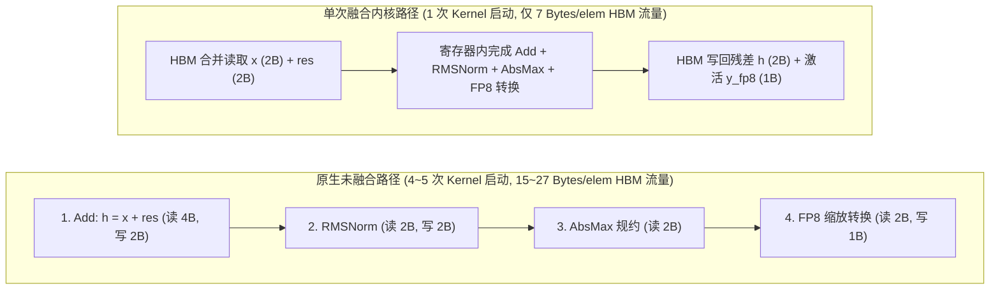
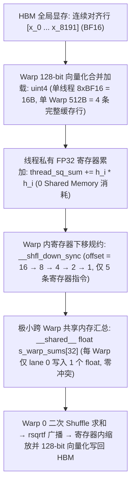

> [!NOTE] 核心速览 (TL;DR)
> - **打破细碎算子的显存带宽墙**：在现代大模型推理中，残差相加、RMSNorm 与动态 FP8 量化若以原生 PyTorch 逐算子执行，会产生 **15~27 Bytes/elem** 的 HBM 往返流量；将其融合为单次寄存器驻留内核后，流量骤降至 **7 Bytes/elem**，实现 **2.1x~3.9x** 访存压缩并彻底消除多次内核启动开销。
> - **压榨底层微架构红利**：通过 **128-bit 向量化访存（`uint4` 单指令吞吐 512 Bytes/Warp）** 跑满缓存行带宽，利用 **Shared Memory Padding 与 XOR Swizzling** 消除 32-Way Bank 冲突，并借助 **`__shfl_down_sync` Warp 寄存器洗牌** 将片上同步开销降至冰点。
> - **CUDA C++ 与 Triton 生产闭环**：掌握从底层 CUDA C++ 向量化规约内核，到 [vLLM](/articles/vllm-serving-guide/) / SGLang 核心热路径中的 **Triton 融合 Residual + RMSNorm + Per-Token FP8 (`e4m3fn`) 算子**，并打通 `torch.library.custom_op` CUDA Graph 捕获与 Nsight Compute (`ncu`) 性能诊断全链路。

## 引言：矩阵乘之外的“隐形延迟黑洞”

在探讨大模型性能优化时，绝大多数注意力往往集中在稠密矩阵乘法（GEMM）与注意力内核（如 [FlashAttention 与 FlashInfer](/articles/flashattention-flashinfer-kernel-evolution/)）上。诚然，借助 `cuBLASLt` 与 `CUTLASS` 的 Hopper WGMMA / Blackwell `tcgen05.mma` 指令，现代推理引擎已经能将线性投影层的 Tensor Core 利用率推向硬件极限。

然而，当你在 NVIDIA H100 或 B200 上抓取真实生产负载（如 Llama-3.1-70B 或 [DeepSeek-V3 MoE 架构](/articles/moe-expert-parallelism-inference-engine/)）的 Nsight Systems 时间线时，往往会发现一个反直觉的现象：**在 Decode 阶段与中小 Batch Prefill 阶段，真正拖垮端到端词间延迟（TPOT）的，往往是夹在两个大矩阵乘之间的“细碎逐元素与规约算子”——Residual Add、RMSNorm、RoPE 旋转位置编码、SwiGLU 激活以及动态 FP8 量化。**

这些非矩阵乘算子的浮点计算量（FLOPs）占比不足整网的 1%，但如果放任框架以未融合的 Eager 模式逐个调度，它们不仅会因为极低的算术强度死死卡在 [Roofline 模型的显存带宽墙](/articles/inference-roofline-prefill-decode/)上，还会因为每层高达十余次的独立 CUDA Kernel Launch 将 GPU 切得支离破碎。

作为**《大模型推理系统专栏》**第六讲，本文将深入 GPU 微架构的物理腹地：从寄存器文件、Shared Memory Bank 映射与 Warp SIMT 原语讲起，亲手编写工业级 **CUDA C++ 向量化融合 RMSNorm 内核**与 **OpenAI Triton 融合残差 + RMSNorm + 动态逐 Token FP8 量化内核**，最后结合 **Nsight Compute (`ncu`)** 剖析寄存器溢出与 CUDA Graph 捕获的生产级排障方法论。

---

## 一、 GPU 执行与存储层次：为什么原生 PyTorch 算子撞上 HBM 带宽墙

要写出逼近硬件物理极限的算子，首先必须在脑海中建立精确的 GPU 执行模型与片上存储带宽坐标系。

### 1.1 SIMT 执行层级与 Hopper / Blackwell 存储金字塔

在硬件物理执行上，GPU 将计算任务严格映射为四级层次结构：
1. **Thread（线程）**：最基本的算术逻辑载体，拥有私有的 32-bit 物理寄存器（Hopper 与 Blackwell 架构下单线程上限均为 **255 个 32-bit 寄存器**）。
2. **Warp（线程束）**：硬件调度的最小原子单位，固定由 **32 个连续线程**（`lane_id` 为 `0..31`）组成，遵循 **SIMT（单指令多线程）** 模型锁步执行。每个 SM 内部配备 4 个独立的 Warp Scheduler。
3. **CTA（Cooperative Thread Array / Thread Block，线程块）**：由最多 1024 个线程（32 个 Warp）组成，整体被调度到同一个流式多处理器（SM）上，共享同一片高速程序员可控缓存（Shared Memory），并可通过硬件屏障指令 `__syncthreads()`（PTX `bar.sync`）完成块内同步。
4. **SM（Streaming Multiprocessor）与 Grid（网格）**：单次 Kernel 启动的所有 CTA 构成 Grid，由硬件 GigaThread Engine 分发至全卡所有 SM（H100 SXM5 拥有 **132 个 SM**，Blackwell B200 拥有 **148 个 SM**）并行推进。

与执行层级相对应，数据在 GPU 内部流动的速度跨越了整整两个数量级。下表对比了旗舰级 **Hopper H100 SXM5** 与 **Blackwell B200** 的真实物理存储层次参数：

| 存储层级 (Memory Tier) | 作用域与生命周期 | Hopper H100 SXM5 规格 | Blackwell B200 规格 | 访问延迟 (约) | 物理特性与算子工程定位 |
| :--- | :--- | :--- | :--- | :--- | :--- |
| **Register File (寄存器文件)** | Thread 私有 | `256 KB / SM` (65,536 × 32-bit，上限 255/线程) | `256 KB / SM` (65,536 × 32-bit，上限 255/线程) | ~1 Cycle | 片上最快存储；过度占用会触发致命的 Local Memory 溢出或压低并发度 |
| **Shared Memory / L1 Cache** | CTA 内共享 (统一 SRAM 池) | 物理 `256 KB / SM` (Shared 最高可配 `228 KB / SM`) | 物理 `256 KB / SM` (Shared 最高 `228 KB / SM`，另设独立 `256 KB` TMEM) | ~20~30 Cycles | 32 个 4B 宽度 Bank 并行供数；跨 Warp 规约与矩阵 Tiling 核心舞台 |
| **L2 Cache (二级缓存)** | 全卡 Grid 共享 | `50 MB` | `126 MB` | ~200 Cycles | 硬件自动缓存；非常适合常驻 RMSNorm 权重等高频复用的小张量 |
| **Global Memory (HBM3 / HBM3e)** | 全局持久化显存 | `80 GB HBM3` @ **`3.35 TB/s`** | `192 GB HBM3e` @ **`8.0 TB/s`** | ~400~500+ Cycles | 容量巨大但相对片上单元极慢；所有未融合中间张量的往返瓶颈所在 |

> [!TIP]
> **Blackwell 微架构演进细节**：在 B200（`sm_100a`）中，除保留每 SM 最高 `228 KB` 可配置 Shared Memory 外，NVIDIA 新增了每 SM **`256 KB` 的专用 Tensor Memory (`TMEM`)** 专门存放第五代 Tensor Core（`tcgen05.mma`）的累加器结果，从而彻底释放了传统架构中 Tensor Core 与 Epilogue 争抢通用寄存器文件的压力。

### 1.2 算子融合的精确字节流量账本 (Byte-Traffic Math)

让我们算一笔严苛的显存带宽账。考察现代 FP8 推理引擎（如 vLLM 与 SGLang 的 W8A8 线性层前置入口）在每一层 Attention 与 FFN 之前都必须执行的热路径序列，设隐藏层维度 $D = 8192$（对应 Llama-3.1-70B 或 Qwen2.5-72B），输入激活与残差流均为 `BF16`（`2 Bytes/elem`）：

```python
# 典型 Pre-GEMM 热路径：残差相加 -> RMSNorm -> 动态逐 Token FP8 (E4M3FN) 量化
h = x + residual                                          # 更新残差流 (BF16)
rms = torch.rsqrt(h.float().pow(2).mean(-1, keepdim=True) + eps)
y = (h.float() * rms).to(torch.bfloat16) * weight         # 归一化输出 (BF16)
amax = y.abs().amax(dim=-1, keepdim=True).clamp(min=1e-12)
scale = amax.float() / 448.0                              # E4M3FN 最大有限值 448.0
y_fp8 = (y.float() / scale).to(torch.float8_e4m3fn)       # 供下游 FP8 Tensor Core 消费
```

如果不做定制算子融合，哪怕使用 PyTorch 2.4+ 原生 `F.rms_norm` 将归一化压成单算子，整个序列仍需拆分为 **4~5 个独立内核**，每一步都必须把形状为 $[M, 8192]$ 的中间张量写回 HBM，并在下一个内核启动后重新从 HBM 读回片上：



我们对单个元素（每个坐标 $(m, d)$）在 HBM 总线上产生的精确读写字节数进行逐项审计（注：RMSNorm 的权重向量 `weight` 长度仅为 $D = 8192$，总大小 $8192 \times 2 = 16\text{ KB}$，在多 Token 处理时稳稳常驻于 `50 MB` / `126 MB` L2 Cache 中，均摊 HBM 流量趋近于 `0B`；每行单个 FP32 `scale` 占 `4 Bytes/row`，均摊仅 $4 / 8192 \approx 0.0005\text{ Bytes/elem}$，完全可忽略）：

| 执行模式 | 拆解算子步骤与 HBM 读写明细 | 内核启动次数 | 累计 HBM 流量 (Bytes/elem) | 相对融合内核流量倍数 |
| :--- | :--- | :--- | :--- | :--- |
| **朴素 PyTorch Eager (含 `.float()` 物化)** | `add`(6B) + `h.float()` 物化与平方均值(10B) + 归一化乘权重(6B) + `amax`(2B) + `fp8` 转换(3B) | 6~7 次 | **~27 Bytes/elem** | **3.86x** |
| **标准未融合 BF16 路径 (拆分 RMSNorm)** | `add`(读2+2, 写2 = 6B) + 方差规约(读2B) + 缩放乘权重(读2, 写2 = 4B) + `amax`(读2B) + `fp8` 写出(读2, 写1 = 3B) | 5 次 | **17 Bytes/elem** | **2.43x** |
| **ATen `F.rms_norm` 半融合路径** | `add`(6B) + `F.rms_norm`(读2, 写2 = 4B) + `amax`(读2B) + `fp8` 写出(读2, 写1 = 3B) | 4 次 | **15 Bytes/elem** (若原位优化约 13~15B) | **2.14x** |
| **终极融合内核 (`Fused Add+RMSNorm+FP8`)** | 读 `x`(2B) + 读 `residual`(2B) $\rightarrow$ **全程驻留寄存器计算** $\rightarrow$ 写回残差 `h`(2B) + 写出 `y_fp8`(1B) | **1 次** | **`7 Bytes/elem`** | **1.00x (物理理论下限)** |

**这 `7 Bytes/elem` 已经是该数学语义下的绝对信息论物理下限**——因为两个输入（`2B + 2B`）必须读入，更新后的残差流（`2B`）与量化后的 FP8 激活（`1B`）必须写出！在 80 层 Transformer（每层含 Attention 前与 FFN 前共 2 处归一化，整网共 **160 处调用**）中，单次融合不仅将有效访存吞吐直接拉升 **2.14x~3.86x**，更是一举砍掉了 $160 \times (4 - 1) = 480$ 次内核启动（每次 Eager 调度开销约 $3\sim 5\;\mu\text{s}$，单步直接省下 **$1.5\sim 2.4\;\text{ms}$** 的纯调度空泡）。

---

## 二、 合并访存、128-bit 向量化加载与 Shared Memory Bank 冲突

把多个算子塞进同一个 Kernel 函数只是第一步。如果线程读写内存的姿势不对，哪怕只有 `7 Bytes/elem` 的理论流量，实际跑出来的有效带宽也可能跌破硬件峰值的 20%。决定访存效率的核心在于两条铁律：**全局显存的合并与向量化加载（Memory Coalescing & Vectorization）**，以及 **片上 Shared Memory 的零 Bank 冲突设计**。

### 2.1 32B 扇区合并与 128-bit (`uint4`) 向量化访存

在现代 NVIDIA GPU（Volta / Ampere / Hopper / Blackwell）中，SM 的加载存储单元（LSU）向 L1/L2/HBM 发起的全局内存事务是以 **32-Byte Sector（扇区）** 为最小物理粒度，并对齐到 **128-Byte Cache Line（缓存行，含 4 个连续扇区）** 的。

当一个 32 线程的 Warp 执行内存读取指令时，硬件 Memory Coalescer 会实时收集 32 个线程请求的地址：
* **标量 16-bit 加载的浪费（`ld.global.b16`）**：若每个线程每次只读取 1 个 `nv_bfloat16`（`2 Bytes`），整个 Warp 单条指令仅搬运 $32 \times 2 = 64\text{ Bytes}$（半条缓存行）。对于宽度 $D = 8192$（`16,384 Bytes`）的一行，一个包含 256 线程（8 个 Warp）的 CTA 中每个线程需要发射 **32 条** `ld.global.b16` 指令。这不仅浪费了缓存行合并宽度，更会瞬间塞满 SM 的指令发射槽与未决访存队列（MIO / Long Scoreboard Queue）。
* **128-bit 向量化满血加载（`float4` / `uint4` -> `ld.global.v4.u32`）**：GPU 单线程单指令支持的最大全局内存访问位宽为 **128-bit（16 Bytes）**。当我们将指针强转为 16 字节对齐的 `uint4*` 时：
  - **单线程单指令**：一次性装入 **`8 个 BF16 元素`（16 Bytes）** 到 4 个连续的 32-bit 寄存器中；
  - **单 Warp 单指令**：32 个连续线程精确覆盖 $32 \times 16 = \mathbf{512\text{ Bytes}}$（即 **`256 个 BF16 元素`**），严丝合缝地填满 **4 条完整的 128-Byte 缓存行（16 个连续 Sector）**，合并效率达到 **100%**；
  - **指令数锐减 8 倍**：同一行 $D = 8192$ 下，每个线程仅需发射 **4 条** `ld.global.v4.u32` 指令即可把整行吞入寄存器！

### 2.2 Shared Memory 32-Bank 架构、Padding 与 XOR Swizzling

数据进入片上后，一旦涉及跨线程块内转置、矩阵分块（Tiling）或规约，就必须经过 Shared Memory。与通过缓存行寻址的 HBM 不同，**Shared Memory 在物理上被切分为 32 个独立的 SRAM Bank（存储体）**，每个 Bank 在每个时钟周期提供 **4 Bytes（32-bit）** 的访问带宽。

任一字节地址 `byte_addr` 映射到物理 Bank 的硬件译码公式极为固定：

$$\text{bank\_id} = \left\lfloor \frac{\text{byte\_addr}}{4} \right\rfloor \bmod 32$$

假设我们声明了一个二维浮点分块缓存 `__shared__ float s_tile[32][32]`：
1. **无冲突行访问（`s_tile[row][lane_id]`）**：同一个 Warp 内的 32 个线程（`lane_id = 0..31`）读取同一行的连续 32 个 `float`。第 `k` 号线程命中的 Bank 为 `(row * 32 + k) % 32 = k`。32 个线程各自命中 1 个独立 Bank，硬件在 **1 个时钟波次（Wavefront）** 内并行返回全部 `128 Bytes` 数据（注：若多个线程读取**完全相同的同一个 4B 地址**如 `s_tile[0][0]`，硬件触发 **Broadcast 多播机制**，同样在 1 个周期内无冲突完成）。
2. **灾难性的 32-Way Bank 冲突（按列跨步访问 `s_tile[lane_id][col]`）**：当 32 个线程按列读取（步长 `stride = 32` 个 `float` = `128 Bytes`）时，线程 `lane_id` 访问的字偏移为 `lane_id * 32 + col`。代入公式可得：

$$\text{bank\_id} = (\text{lane\_id} \times 32 + \text{col}) \bmod 32 = \text{col} \bmod 32$$

**全 Warp 32 个线程访问的是同一个 Bank 内 32 个不同的物理行地址！** 硬件被迫将这一条指令串行拆解为 **32 个顺序波次** 执行，片上 SRAM 有效吞吐瞬间暴跌 **$32\times$**！

工程界针对 Bank 冲突有两套标准解法，分别适用于标量规约与 Tensor Core 矩阵分块场景：

* **解法一：静态列填充 Padding（`__shared__ float s_tile[32][33]`）**
  在最内层维度人为多补 1 个 `float` 哑元素，将行步长改为 `33`。此时按列访问 `s_tile[lane_id][col]` 的 Bank 映射变为：

  $$\text{bank\_id} = (\text{lane\_id} \times 33 + \text{col}) \bmod 32 = (\text{lane\_id} + \text{col}) \bmod 32$$

  当 `lane_id` 遍历 `0..31` 时，`bank_id` 完美双射覆盖 `0..31` 全部 32 个 Bank，冲突彻底归零！
  - **局限性**：`+1` 个 4 字节元素会破坏奇数行的 **16 字节（128-bit）地址对齐**（例如第 1 行起始偏移 `33 * 4 = 132 Bytes` 不能被 16 整除），导致无法使用 `ld.shared.v4.b32` 向量化加载、Tensor Core `ldmatrix` 指令或 Hopper TMA 异步硬件搬运！

* **解法二：零空间浪费且对齐安全的异或交错 XOR Swizzling**
  为了在不浪费任何 SRAM 字节的同时严守 16 字节对齐，`CUTLASS` / `CuTe` 与 `Triton` 编译器普遍采用按位异或（XOR）地址重映射：
  - **4B 标量粒度**：存储与读取逻辑坐标 `(row, col)` 时，映射到物理列 `phys_col = col ^ row`（`[32][32]` 块内异或具备天然双射性，同行异列互不相同，同列异行也互不相同）。
  - **128-bit (`16B`) 向量块粒度（`col_chunk ^ (row % 8)`）**：在 Tensor Core BF16 分块中，一行 `128 Bytes`（64 个 BF16）恰好由 **8 个 16-Byte（`uint4` / 4-Bank）向量块** 组成（`8 chunks × 4 banks = 32 banks`）。将逻辑块列号 `c`（`0..7`）映射为物理块列号：

  $$c_{\text{phys}} = c \oplus (\text{row} \bmod 8)$$

  当 `ldmatrix` 或 Warp 跨 `0..7` 共 8 行按相同逻辑列 `c` 读取时，$c \oplus (\text{row} \bmod 8)$ 恰好遍历 `0..7` 全部 8 个不重叠的 16B 向量块，一次性打满全部 32 个 Bank，**既实现了零冲突 1 周期吞吐，又严格保持了每一块的 16 字节物理对齐**！

下图完整串联了从 HBM 128-bit 合并加载到 Warp 寄存器洗牌规约的理想无冲突数据通路：



---

## 三、 底层 CUDA C++ 实战：向量化 Warp Shuffle 与 Block 级融合 RMSNorm

理解了访存合并与片上规约原理后，我们首先用原生 **CUDA C++** 手写一个零冗余、生产可用的 `fused_add_rmsnorm_bf16_kernel`。

传统初学者编写规约算子时，习惯把全部 256 或 512 个线程的部分和统统塞进 `__shared__ float sdata[256]`，并在循环中连续调用 8 次 `__syncthreads()` 进行树状折半求和。这种写法存在严重的屏障同步与 Shared Memory 读写开销。在现代 CUDA 工程中，**同一个 Warp 内的 32 个线程可以直接通过硬件洗牌网络（`__shfl_down_sync`）在寄存器之间交换数据**，整个 Warp 内规约无需分配哪怕 1 个字节的 Shared Memory！

### 3.1 完整生产级 CUDA C++ 内核实现

下面给出的代码完整实现了：**64 位防溢出寻址**、**`uint4` + `__nv_bfloat162` 128-bit 向量化加载**、**编译期循环展开寄存器缓存（避免二次读取 HBM）**、**`__shfl_down_sync` 寄存器规约**以及 **`__ldg` 只读缓存权重加载**：

```cpp
#include <cuda_runtime.h>
#include <cuda_bf16.h>
#include <cstdint>
#include <cassert>

constexpr int WARP_SIZE = 32;

// Warp 内纯寄存器规约：5 条 SHFL.DOWN 指令将 32 个线程的局部和汇聚至 lane 0
__device__ __forceinline__ float warp_reduce_sum(float val) {
    #pragma unroll
    for (int offset = WARP_SIZE / 2; offset > 0; offset >>= 1) {
        val += __shfl_down_sync(0xffffffffu, val, offset);
    }
    return val;
}

// 每个 CTA (Thread Block) 负责处理 1 个 Token 行 (维度 hidden_dim <= BLOCK_SIZE * MAX_VECS * 8)
// 默认 BLOCK_SIZE = 256, MAX_VECS = 8 可无溢出覆盖至 hidden_dim = 16384 (如 Llama-3.1-405B)
template <int BLOCK_SIZE = 256, int MAX_VECS = 8>
__global__ void __launch_bounds__(BLOCK_SIZE)
fused_add_rmsnorm_bf16_kernel(
    __nv_bfloat16* __restrict__ out,          // [M, D] 归一化输出 y
    __nv_bfloat16* __restrict__ residual_out, // [M, D] 更新后的残差流 h (支持与 residual 原位别名)
    const __nv_bfloat16* __restrict__ x,      // [M, D] 当前分支输入激活
    const __nv_bfloat16* __restrict__ residual,// [M, D] 上游残差流输入
    const __nv_bfloat16* __restrict__ weight, // [D]    RMSNorm 缩放权重 gamma
    const int hidden_dim,                     // 隐藏层维度 D (须为 8 的整数倍以满足 16B 对齐)
    const float eps)                          // 数值稳定常数 (通常为 1e-6f)
{
    static_assert(BLOCK_SIZE % WARP_SIZE == 0 && BLOCK_SIZE <= 1024,
                  "BLOCK_SIZE must be a multiple of 32 and <= 1024");
    constexpr int NUM_WARPS = BLOCK_SIZE / WARP_SIZE;

    const int num_vecs = hidden_dim >> 3; // 每个 uint4 承载 8 个 BF16 元素 (16 Bytes)
    // 关键细节：使用 size_t 计算行偏移，防止长上下文 (如 M=262144, D=8192) 发生 int32 符号位溢出!
    const size_t row_vec_offset = static_cast<size_t>(blockIdx.x) * num_vecs;

    const uint4* __restrict__ x_vec = reinterpret_cast<const uint4*>(x) + row_vec_offset;
    const uint4* __restrict__ r_vec = reinterpret_cast<const uint4*>(residual) + row_vec_offset;
    const uint4* __restrict__ w_vec = reinterpret_cast<const uint4*>(weight);
    uint4* __restrict__ res_out_vec = reinterpret_cast<uint4*>(residual_out) + row_vec_offset;
    uint4* __restrict__ out_vec     = reinterpret_cast<uint4*>(out) + row_vec_offset;

    // 静态大小寄存器数组：配合 #pragma unroll 编译期常量下标，100% 驻留物理寄存器而非 Local Memory
    uint4 h_regs[MAX_VECS];
    float thread_sq_sum = 0.0f;

    // ==================== Pass 1: 128-bit 向量化加载 + FP32 残差融合 + 平方和累加 ====================
    #pragma unroll
    for (int step = 0; step < MAX_VECS; ++step) {
        const int vec_idx = step * BLOCK_SIZE + threadIdx.x;
        if (vec_idx < num_vecs) {
            uint4 vx = x_vec[vec_idx];
            uint4 vr = r_vec[vec_idx];
            uint4 vh;

            const __nv_bfloat162* x_bf2 = reinterpret_cast<const __nv_bfloat162*>(&vx);
            const __nv_bfloat162* r_bf2 = reinterpret_cast<const __nv_bfloat162*>(&vr);
            __nv_bfloat162* h_bf2       = reinterpret_cast<__nv_bfloat162*>(&vh);

            #pragma unroll
            for (int k = 0; k < 4; ++k) {
                float2 xf = __bfloat1622float2(x_bf2[k]);
                float2 rf = __bfloat1622float2(r_bf2[k]);
                float2 hf = make_float2(xf.x + rf.x, xf.y + rf.y);
                // 舍入回 BF16 写入残差流，并以舍入后数值做平方累加，保证与标准残差流语义逐位对齐
                h_bf2[k]  = __float22bfloat162_rn(hf);
                float2 hf_rounded = __bfloat1622float2(h_bf2[k]);
                thread_sq_sum += hf_rounded.x * hf_rounded.x + hf_rounded.y * hf_rounded.y;
            }

            res_out_vec[vec_idx] = vh; // 128-bit 合并写出更新后的残差 h
            h_regs[step] = vh;         // 驻留寄存器，Pass 2 彻底免除二次 HBM 读取!
        }
    }

    // ==================== 跨 Warp 块级规约 (仅消耗 33 个 float = 132 Bytes Shared Memory) ====================
    __shared__ float s_warp_sums[WARP_SIZE];
    __shared__ float s_rrms;

    const int lane_id = threadIdx.x & (WARP_SIZE - 1);
    const int warp_id = threadIdx.x >> 5;

    float warp_sum = warp_reduce_sum(thread_sq_sum);
    if (lane_id == 0) {
        s_warp_sums[warp_id] = warp_sum;
    }
    __syncthreads(); // 全内核第 1 次同步：等待所有 Warp 写入各自的局部和

    if (warp_id == 0) {
        float block_sum = (lane_id < NUM_WARPS) ? s_warp_sums[lane_id] : 0.0f;
        block_sum = warp_reduce_sum(block_sum);
        if (lane_id == 0) {
            s_rrms = rsqrtf(block_sum / static_cast<float>(hidden_dim) + eps);
        }
    }
    __syncthreads(); // 全内核第 2 次同步：向全块广播倒数均方根 s_rrms

    const float rrms = s_rrms;

    // ==================== Pass 2: 寄存器直接归一化 + 只读权重广播 + 128-bit 写出 ====================
    #pragma unroll
    for (int step = 0; step < MAX_VECS; ++step) {
        const int vec_idx = step * BLOCK_SIZE + threadIdx.x;
        if (vec_idx < num_vecs) {
            uint4 vw = __ldg(&w_vec[vec_idx]); // 经由只读数据缓存 / L2 高效广播 gamma 权重
            uint4 vh = h_regs[step];
            uint4 vy;

            const __nv_bfloat162* h_bf2 = reinterpret_cast<const __nv_bfloat162*>(&vh);
            const __nv_bfloat162* w_bf2 = reinterpret_cast<const __nv_bfloat162*>(&vw);
            __nv_bfloat162* y_bf2       = reinterpret_cast<__nv_bfloat162*>(&vy);

            #pragma unroll
            for (int k = 0; k < 4; ++k) {
                float2 hf = __bfloat1622float2(h_bf2[k]);
                float2 wf = __bfloat1622float2(w_bf2[k]);
                float2 yf = make_float2(hf.x * rrms * wf.x, hf.y * rrms * wf.y);
                y_bf2[k]  = __float22bfloat162_rn(yf);
            }

            out_vec[vec_idx] = vy; // 128-bit 合并写出归一化结果 y
        }
    }
}

// Host 端启动封装函数
void launch_fused_add_rmsnorm_bf16(
    __nv_bfloat16* out,
    __nv_bfloat16* residual_out,
    const __nv_bfloat16* x,
    const __nv_bfloat16* residual,
    const __nv_bfloat16* weight,
    int num_tokens,
    int hidden_dim,
    float eps,
    cudaStream_t stream)
{
    assert(hidden_dim % 8 == 0 && hidden_dim <= 256 * 8 * 8);
    assert(reinterpret_cast<uintptr_t>(x) % 16 == 0);
    assert(reinterpret_cast<uintptr_t>(residual) % 16 == 0);
    assert(reinterpret_cast<uintptr_t>(out) % 16 == 0);

    dim3 grid(num_tokens);
    dim3 block(256);
    fused_add_rmsnorm_bf16_kernel<256, 8><<<grid, block, 0, stream>>>(
        out, residual_out, x, residual, weight, hidden_dim, eps);
}
```

### 3.2 关键微架构设计拆解

上述不到 120 行的内核蕴含了四处资深算子工程师必抠的细节：
1. **编译期常量下标消除 Local Memory**：许多工程师在写寄存器缓存时使用动态循环 `for (int i = 0; i < runtime_iters; ++i) h_regs[i] = ...`，这会导致 `ptxas` 无法在编译期确定寄存器编号，被迫将 `h_regs` 退化分配到基于 HBM 的栈帧（Local Memory）中！通过固定模板上界 `MAX_VECS = 8` 搭配 `#pragma unroll`，`h_regs[0..7]` 被完全展开为 32 个独立的 32-bit 物理寄存器，栈溢出严格为 `0 Bytes`。
2. **两次屏障最小化同步**：得益于 `__shfl_down_sync(0xffffffffu, val, offset)`（偏移依次取 `16, 8, 4, 2, 1`），8 个 Warp 内部各自独立完成 32 路求和，整个 CTA 仅需 `132 Bytes` Shared Memory 与 **2 次 `__syncthreads()`** 即可算完 `rsqrtf` 并广播到所有线程。
3. **`int64` / `size_t` 行指针防爆**：当推理引擎执行超长上下文 Chunked Prefill 或大 Batch 处理时（例如 $M = 262,144,\; D = 8192$），总元素下标 $M \times D = 2^{31}$ 刚好击穿 32 位有符号整型 `INT32_MAX`（`2,147,483,647`），引发隐蔽的非法显存访问崩溃（`cudaErrorIllegalAddress`）。显式强转 `static_cast<size_t>(blockIdx.x)` 是生产算子的标配防线。
4. **BF16 存储、FP32 计算的混合精度铁律**：`__nv_bfloat16` 仅有 7 位尾数（精度约 $7.8 \times 10^{-3}$），若在 BF16 下直接累加 8192 项平方和，大数吃小数（Mantissa Swamping）会导致严重的方差截断误差。因此所有算术规约与缩放必须提升至 `float2`（FP32）执行，仅在跨越 HBM 边界时压回 BF16。

---

## 四、 生产级 OpenAI Triton 内核：融合残差 + RMSNorm + 动态逐 Token FP8 量化

虽然手写 CUDA C++ 能够精确操控每一条寄存器指令，但在快速迭代的大模型算子研发中，每次增删一个 Epilogue（例如在 RMSNorm 后追加动态 FP8 量化、缩放截断或路由掩码）都要重写复杂的 `uint4` 拆包、边界对齐掩码与 Warp Shuffle 样板代码，维护成本极高。

这正是 **OpenAI Triton** 在 [vLLM](/articles/vllm-serving-guide/)、SGLang 与 Liger-Kernel 中成为事实标准的根本原因。

### 4.1 编程范式跃迁：CUDA Thread 视角 vs Triton Block (CTA) 视角

CUDA 采用的是 **SPMD 单线程视角（Thread-level Programming）**：程序员站在单个 `threadIdx.x` 的微观视角，手动计算线程到数据的映射、手动拼装 `uint4`、手动写 `__shfl_down_sync` 与 `__syncthreads()`。

而 Triton 采用的是 **分块张量视角（Block-Programmed / CTA-level Paradigm）**：
* 程序员站在整个 **Program Instance（对应一个 CTA）** 的宏观视角，直接用 `cols = tl.arange(0, BLOCK_N)` 操作一整块一维或二维向量切片；
* 编译器后端（沿着 `Triton Python AST -> Triton-IR -> TTGIR (Triton GPU IR) -> LLVM IR -> PTX -> CUBIN` 管线）**全自动完成线程内向量化切片（`ld.global.v4`）、越界掩码保护（Predicated Load/Store）、Shared Memory 分配与 Swizzling，以及 `tl.sum` / `tl.max` 底层的蝴蝶洗牌（`__shfl_xor_sync`）与跨 Warp 规约**！

### 4.2 完整生产级 Triton 融合算子实现 (`Fused Add + RMSNorm + Dynamic FP8`)

在 Hopper H100 与 Blackwell B200 的 W8A8 FP8 推理管线中（详见 [大模型量化精度选型指南](/articles/quantization-precision-guide/)），为了兼顾极高的动态范围精度与 Tensor Core 吞吐，工业界最主流的激活量化方案是 **Dynamic Per-Token `float8_e4m3fn` 量化**：对每一个 Token 行向量实时统计归一化后的绝对值峰值 $\text{amax} = \max_j \lvert y_j \rvert$，计算缩放因子 $\text{scale} = \text{amax} / 448.0$，并将 $y / \text{scale}$ 转换为 1 字节的 `e4m3fn` 格式直接喂给下游 `torch._scaled_mm`（或 `cutlass_scaled_mm`）FP8 矩阵乘内核。

下面给出可直接用于生产服务的完整 Triton 实现，**在唯一一次 HBM 扫描内同时完成残差更新、RMSNorm 归一化、逐 Token 动态 AbsMax 规约与饱和安全 FP8 量化写出**：

```python
import torch
import triton
import triton.language as tl

# E4M3FN 格式（1 符号位 + 4 指数位 + 3 尾数位，无 Inf 表示）最大正有限值为 448.0
FP8_E4M3_MAX: float = torch.finfo(torch.float8_e4m3fn).max  # 448.0


@triton.autotune(
    configs=[
        triton.Config({}, num_warps=4, num_stages=1),
        triton.Config({}, num_warps=8, num_stages=1),
        triton.Config({}, num_warps=16, num_stages=1),
    ],
    key=["N"],
)
@triton.jit
def fused_add_rmsnorm_fp8_kernel(
    x_ptr,          # [M, N] BF16 当前层输入张量指针
    res_ptr,        # [M, N] BF16 残差流输入张量指针
    w_ptr,          # [N]    BF16 RMSNorm 权重向量指针
    h_out_ptr,      # [M, N] BF16 更新后残差流输出指针 (可与 res_ptr 原位复用)
    y_fp8_ptr,      # [M, N] float8_e4m3fn 量化激活输出指针
    scale_ptr,      # [M]    FP32 逐 Token 动态反量化缩放因子指针
    stride_xm,      # x 行步长
    stride_rm,      # res 行步长
    stride_hm,      # h_out 行步长
    stride_ym,      # y_fp8 行步长
    N,              # 真实隐藏层维度 D (如 4096, 7168, 8192)
    eps,            # 数值稳定项 (如 1e-6)
    FP8_MAX: tl.constexpr,
    BLOCK_N: tl.constexpr,
):
    # 1. 映射到当前处理的 Token 行号，强转 int64 杜绝超大 Token 批次下指针乘法溢出
    row_idx = tl.program_id(axis=0).to(tl.int64)
    cols = tl.arange(0, BLOCK_N)
    mask = cols < N

    # 2. 单次合并读取 HBM：编译器自动生成 128-bit 向量化带谓词加载指令 (Predicated Vector Load)
    x = tl.load(x_ptr + row_idx * stride_xm + cols, mask=mask, other=0.0).to(tl.float32)
    res = tl.load(res_ptr + row_idx * stride_rm + cols, mask=mask, other=0.0).to(tl.float32)
    w = tl.load(w_ptr + cols, mask=mask, other=0.0).to(tl.float32)

    # 3. 更新残差流并以 BF16 写回 HBM，随后以舍入后的 BF16 值转回 FP32 保持与标准语义严格一致
    h_bf16 = (x + res).to(tl.bfloat16)
    tl.store(h_out_ptr + row_idx * stride_hm + cols, h_bf16, mask=mask)
    h = h_bf16.to(tl.float32)

    # 4. 寄存器驻留 RMSNorm：越界通道已置 0.0，对平方和无污染；注意分母除以真实维度 N 而非 BLOCK_N!
    mean_sq = tl.sum(h * h, axis=0) / N
    rrms = tl.math.rsqrt(mean_sq + eps)
    y = tl.where(mask, h * rrms * w, 0.0)

    # 5. 同一次寄存器驻留周期内完成动态 Per-Token AbsMax 规约与 FP8 缩放!
    amax = tl.max(tl.abs(y), axis=0)
    amax = tl.maximum(amax, 1e-12)  # 防止全零激活行导致除零产生 NaN
    scale = amax / FP8_MAX

    # 显式有限域截断：防止 FP32 除法末位舍入越过 448.0 在 e4m3fn (无 Inf) 转换时编码为 NaN!
    y_scaled = tl.clamp(y / scale, -FP8_MAX, FP8_MAX)
    y_fp8 = y_scaled.to(tl.float8e4m3fn)

    # 6. 合并写出 1-Byte/elem 的 FP8 激活与每行 4-Byte 的 FP32 缩放因子
    tl.store(y_fp8_ptr + row_idx * stride_ym + cols, y_fp8, mask=mask)
    tl.store(scale_ptr + row_idx, scale)


def fused_add_rmsnorm_dynamic_fp8(
    x: torch.Tensor,
    residual: torch.Tensor,
    weight: torch.Tensor,
    eps: float = 1e-6,
) -> tuple[torch.Tensor, torch.Tensor, torch.Tensor]:
    """返回 (h_out_bf16, y_fp8_e4m3fn, per_token_scale_fp32)，可直接衔接 torch._scaled_mm。"""
    assert x.shape == residual.shape and x.dtype == torch.bfloat16
    N = x.shape[-1]
    M = x.numel() // N
    BLOCK_N = triton.next_power_of_2(N)
    if BLOCK_N > 16384:
        raise ValueError(f"Single-pass register kernel requires N <= 16384, got {N}")

    x_2d = x.contiguous().view(M, N)
    res_2d = residual.contiguous().view(M, N)
    h_out = torch.empty_like(x_2d)
    y_fp8 = torch.empty((M, N), device=x.device, dtype=torch.float8_e4m3fn)
    scale = torch.empty((M,), device=x.device, dtype=torch.float32)

    fused_add_rmsnorm_fp8_kernel[(M,)](
        x_2d, res_2d, weight,
        h_out, y_fp8, scale,
        x_2d.stride(0), res_2d.stride(0), h_out.stride(0), y_fp8.stride(0),
        N, eps,
        FP8_MAX=FP8_E4M3_MAX,
        BLOCK_N=BLOCK_N,
    )
    return h_out.view_as(x), y_fp8.view(*x.shape), scale
```

仔细审视这段 Triton 内核，你会发现几个极其精妙的工业级工程细节：
* **非 2 的幂次隐藏维度无缝兼容**：例如 [DeepSeek-V3 MoE 模型](/articles/moe-expert-parallelism-inference-engine/) 的隐藏维度为 $N = 7168$（并非 2 的整数次幂）。Host 端通过 `BLOCK_N = triton.next_power_of_2(7168) = 8192` 补齐至硬件规约友好的 2 的幂，内核中利用 `mask = cols < N` 与 `tl.where(mask, ..., 0.0)` 确保 `[7168, 8192)` 区间的虚拟通道既不污染 `tl.sum` 均方和，也不污染 `tl.max` 绝对值峰值，且无需手写任何尾部标量分支！
* **`e4m3fn` 饱和溢出防线（`tl.clamp`）**：不同于 IEEE 标准浮点数，NVIDIA Hopper/Blackwell Tensor Core 主推的 `float8_e4m3fn` 为了扩充动态范围（最大可表达 `448.0` 而非标准 E4M3 的 `240.0`），牺牲了无穷大（`Inf`）编码，将尾数全 1 的 `S.1111.111` 唯一定义为 `NaN`。如果因为 FP32 除法末位舍入误差导致 `y / scale` 算出了 `448.00003`，未加保护的非饱和转换可能直接吐出 `NaN` 摧毁整层输出。显式调用 `tl.clamp(..., -448.0, 448.0)` 是生产环境零事故的关键保障。
* **直接喂入下游 W8A8 Tensor Core GEMM**：产出的 `y_fp8`（形状 `[M, N]`，步长连续）与 `scale.view(M, 1)` 可零拷贝直接传入 `torch._scaled_mm(y_fp8, w_fp8_col_major, scale_a=scale.view(-1, 1), scale_b=w_scale.view(1, -1), out_dtype=torch.bfloat16)`，在 Tensor Core 累加器出口一次性完成反量化还原。

### 4.3 从整行寄存器规约到流式分块规约：与 Online Softmax 的数学统一

读者可能会追问：**上面的 Triton 算子之所以能在一个 Pass 内连续完成 `tl.sum` 和 `tl.max` 两次全局规约，是因为隐藏维度 $N \le 16384$ 可以整行塞进单个 CTA 的寄存器文件中。如果规约维度膨胀到 $128\text{K}$（例如长文本自注意力分数矩阵的一整行），片上 SRAM 根本装不下一整行，还能做到单次 HBM 扫描吗？**

这正揭示了算子融合中“两遍规约转单遍流式递推”的最高阶武器——**Online Softmax 在线重缩放递推**（详见 [FlashAttention 与 FlashInfer 算子演进](/articles/flashattention-flashinfer-kernel-evolution/)）。标准 Softmax 需要先扫一遍求全局最大值 $m = \max_j x_j$，再扫第二遍求指数分母和 $d = \sum_j e^{x_j - m}$。而通过引入满足结合律的状态二元组 $(m, d)$，每流式读入一个新元素（或新分块）$x_j$ 时，只需利用指数偏移恒等式在线修正历史状态：

$$m_{\text{new}} = \max(m_{\text{old}}, x_j), \qquad d_{\text{new}} = d_{\text{old}} \, e^{m_{\text{old}} - m_{\text{new}}} + e^{x_j - m_{\text{new}}}$$

无论是我们在 `fused_add_rmsnorm_fp8` 中利用 **`BLOCK_N` 整行驻留寄存器消灭二次访存**，还是 FlashAttention 利用 **Online Softmax 在线重缩放消灭 $O(N^2)$ 中间矩阵写回**，它们在体系结构第一性原理上是完全同构的：**用片上极其廉价的寄存器算术指令（哪怕多做几次指数重缩放），死死守住 HBM 带宽大门，绝不让未压缩的中间状态越雷池一步。**

---

## 五、 生产环境排障指南：寄存器溢出、CUDA Graph 捕获与 Nsight Compute 调优

把算子跑通只是万里长征第一步。当算子真正合入 [vLLM](/articles/vllm-serving-guide/) 或 SGLang 承载线上高并发流量时，以下三大生产陷阱往往是决定延迟能否达标的分水岭。

### 5.1 寄存器溢出陷阱 (Register Spilling) 与并发度坍塌

片上寄存器文件虽然快如闪电，但每个 SM 的总池子严格锁死在 **`65,536` 个 32-bit 寄存器（`256 KB`）**，且硬件指令编码限制单线程最多寻址 **`255` 个寄存器**。算子融合并非越贪婪越好，过度融合会引发双重反噬：
1. **SM Warp 并发度（Occupancy）断崖下跌**：假设你的融合内核单线程占用了 `128` 个寄存器，那么整个 SM 最多只能同时驻留 $\lfloor 65536 / 128 \rfloor = 512$ 个线程（即 `16` 个活跃 Warp，仅为硬件上限 `64` 个 Warp 的 **25% 并发度**）。一旦并发度过低，当这少量 Warp 等待 HBM 数据返回时，Warp Scheduler 手中没有足够的其他就绪 Warp 来掩盖访存延迟（Latency Hiding 失效）！
2. **致命的 Local Memory 溢出（Spilling）**：如果在 `BLOCK_N = 16384` 时错误地配置了过小的 `num_warps = 2`（仅 64 个线程分摊 16384 个 FP32 变量，平均每线程需持有 256 个浮点数！），一旦突破 **255 寄存器硬红线**，编译器就会生成 `STL` / `LDL` 指令将多余变量溢出到 **`Local Memory`**。**切记：Local Memory 绝不是片上高速缓存，它的物理实体正是片外慢速的 HBM（经由 L2/L1 缓存）！** 本来为了省 HBM 带宽才写的融合算子，一旦发生寄存器溢出，反而会在暗地里产生海量的 HBM 栈读写流量，性能甚至惨败给未融合算子。

> [!WARNING]
> **寄存器审计与调优手册**：
> - **CUDA C++**：编译时务必加上 `nvcc --ptxas-options=-v`，严格检查输出中的 `spill stores` 与 `spill loads` 是否为 **`0 bytes`**。
> - **OpenAI Triton**：检查编译产物的 `compiled_kernel.n_regs` 与 `compiled_kernel.n_spills`。若发现 `n_spills > 0`，在固定 `BLOCK_N` 下应**调大 `num_warps`**（例如从 `4` 升至 `8` 或 `16`，让更多线程分摊同一块张量从而成倍降低单线程寄存器占用），或在矩阵乘流水线中适当**调低 `num_stages`**（减少同时在飞的异步预取缓冲级数）。

### 5.2 CUDA Graph 捕获与 `torch.compile` 零断裂集成

在 Decode 阶段，单层算子的 GPU 执行耗时往往只有 $3\sim 8\;\mu\text{s}$，远低于 Python 解释器与驱动发射的开销。因此 vLLM 和 SGLang 默认会将整张 Decode 计算图录制为 **CUDA Graph（`torch.cuda.CUDAGraph`）**，并在推理时通过单次图重放（Replay）倾泻整网算子。

自定义算子要安全进入 `torch.compile(fullgraph=True)` 与 CUDA Graph 捕获管线，必须严守**三条红线**：
1. **严禁任何 Host-Device 同步操作**：绝不能在算子内部调用 `.item()`、`.cpu()`、`print(tensor)` 或基于张量数值的 Python `if` 分支，否则捕获期直接抛出 `cudaErrorStreamCaptureUnsupported`；
2. **严禁动态数据依赖输出形状**：禁止出现 `torch.nonzero()` 或布尔掩码切片 `x[mask]`；
3. **使用 PyTorch 2.4+ 标准 `torch.library.custom_op` 注册算子与 FakeTensor 推导函数**：避免 `Dynamo` 遇到裸 Triton 调用发生图断裂（Graph Break）：

```python
@torch.library.custom_op("llm_ops::fused_add_rmsnorm_fp8", mutates_args=())
def fused_add_rmsnorm_fp8_op(
    x: torch.Tensor,
    residual: torch.Tensor,
    weight: torch.Tensor,
    eps: float = 1e-6,
) -> tuple[torch.Tensor, torch.Tensor, torch.Tensor]:
    return fused_add_rmsnorm_dynamic_fp8(x, residual, weight, eps)


@fused_add_rmsnorm_fp8_op.register_fake
def _(x: torch.Tensor, residual: torch.Tensor, weight: torch.Tensor, eps: float = 1e-6):
    # 为 torch.compile / Inductor 提供零开销的静态形状与 Dtype 元数据推导
    M = x.numel() // x.shape[-1]
    h_out = torch.empty_like(x)
    y_fp8 = torch.empty_like(x, dtype=torch.float8_e4m3fn)
    scale = torch.empty((M,), device=x.device, dtype=torch.float32)
    return h_out, y_fp8, scale
```

### 5.3 Nsight Compute (`ncu --set full`) 硬件计数器实战诊断单

切忌凭感觉盲目调参。完成算子编写后，使用 **NVIDIA Nsight Compute (`ncu`)** 采集稳态硬件计数器（务必使用 `--launch-skip` 跳过前几次 Triton Autotune 搜索与冷缓存热身）：

```bash
ncu --set full \
    --kernel-name regex:"fused_add_rmsnorm.*" \
    --launch-skip 10 --launch-count 1 \
    --export profile_fused_rmsnorm_fp8 \
    python3 bench_rmsnorm_fp8.py
```

打开生成的报告后，按以下四步清单即可在 3 分钟内定位算子的真实物理瓶颈：

| 诊断维度 | 核心 `ncu` 指标名称 | 健康融合规约算子目标水位 | 异常信号与对应根因定位 |
| :--- | :--- | :--- | :--- |
| **1. Roofline 光速水位 (SOL)** | `dram__throughput.avg.pct_of_peak_sustained_elapsed` 与 `sm__throughput...` | **Memory (DRAM) 达到 80%~92%**；Compute (SM) 约 10%~25% | 若 DRAM 与 SM 双低（均 `<40%`），说明卡在延迟空泡：Grid 太小未占满 SM、Occupancy 过低或频繁屏障阻塞 |
| **2. Warp 停顿归因 (Stall Reason)** | `smsp__pcsampling_stall_long_scoreboard` | 占比最高且伴随高 DRAM 利用率属正常现象 | 若 `stall_long_scoreboard` 极高但 DRAM 带宽很低，必存在**非合并零碎访存**或隐藏的寄存器溢出栈读取 |
| **3. 全局访存合并效率** | `l1tex__average_t_sectors_per_request_pipe_lsu_mem_global_op_ld.ratio` | `uint4` (512B/Warp) 下理想值为 **`16.0` sectors/req**（无冗余扇区） | 实测扇区数远高于理论请求字节数，说明行起始地址未对齐 16B 或跨步（Strided）散乱访问 |
| **4. Bank 冲突与本地溢出** | `l1tex__data_bank_conflicts_pipe_lsu_mem_shared_op_ld.sum` 与 `..._mem_local_op_st.sum` | **严格等于 `0`**（或极微量可忽略） | Shared 冲突非零需引入 Padding / XOR Swizzling；Local Store 非零说明已触发寄存器溢出，需立即调大 `num_warps` |

---

## 常见问题 (FAQ)

### Q1: 既然 PyTorch 2.x 自带了 `torch.compile` (TorchInductor) 自动算子融合，为什么生产推理引擎仍然要手写 Triton 与 CUDA C++ 算子？
`torch.compile` 底层的 TorchInductor 在处理纯逐元素（Pointwise）链条与简单规约时确实能自动生成不错的 Triton 代码，但在大模型核心推理热路径上仍存在三道难以跨越的鸿沟：
1. **复杂跨流状态与双规约调度局限**：在我们的“残差原位/双路写回 + RMSNorm 均方规约 + 动态 AbsMax 二次规约 + `e4m3fn` 饱和截断”复合图中，通用编译器往往难以稳健地保证在任意批次形状下都将其合并进**严格单次 HBM 读取**的同一个寄存器生命周期内，稍有图变动便可能退化拆分为两个子内核。
2. **启动编译耗时与动态 Shape 泛化成本**：在线服务需要同时应对变长 Token 批次与 CUDA Graph 多档位捕获，手写 `@triton.jit` 算子拥有完全确定的内存布局与显式可控的 `num_warps` 搜索空间。
3. **前瞻硬件指令鸿沟**：当涉及 Hopper 异步张量搬运引擎（`TMA`）、Warp 角色特化（Producer-Consumer Warp Specialization）、Blackwell 专用张量内存（`TMEM` / `tcgen05`）以及 [FlashInfer 分页 KV Cache 不规则索引](/articles/flashattention-flashinfer-kernel-evolution/) 时，仍必须下沉至 **CUDA C++ / CUTLASS CuTe** 才能榨干 100% 硬件潜能。因此工业界普遍遵循**“80% 带宽受限融合算子用 Triton 快速交付，20% 核心 Attention / Grouped GEMM 用 CUDA C++ / CUTLASS 攻坚”**的黄金分工。

### Q2: 为什么大模型激活量化普遍采用 `float8_e4m3fn`（上限 448.0）配合逐 Token 动态缩放，而不是动态范围更大的 `float8_e5m2` 或静态量化？
这源于尾数精度与激活离群值（Activation Outliers）之间的严密数学权衡（详见 [大模型量化精度选型指南](/articles/quantization-precision-guide/)）：
* **`e4m3fn` vs `e5m2`**：`e5m2` 虽然拥有 5 位指数（最大有限值高达 `57344.0`），但仅剩 **2 位尾数**，有效相对精度过于粗糙，直接用于前向激活与权重会导致显著的 PPL（困惑度）劣化，因此 `e5m2` 通常仅用于反向传播梯度；而 `e4m3fn` 拥有 **3 位尾数**，精度翻倍，是前向推理的绝对主力。
* **为什么必须 Per-Token 动态缩放**：大模型不同 Token（尤其是句首 BOS / 注意力汇聚点 Attention Sink Token）的激活幅值可能相差数十倍。若采用离线校准的静态全局缩放因子（Static Per-Tensor Scale），为了迁就极少数离群 Token 不溢出 `448.0`，99% 正常 Token 的有效量化桶会被严重压缩至趋近于零；而借助本文实现的**融合寄存器级 Per-Token 动态量化**，计算每行专属 `amax / 448.0` 的额外 HBM 访存代价为 **0 Byte**，近乎白嫖了逐 Token 自适应动态范围！

### Q3: 如果未来超宽模型的隐藏维度扩展到 32,768 甚至 65,536，超过了单 CTA 寄存器容量上限，本文的 Triton 内核该如何演进？
当隐藏维度 $D$ 大到 `BLOCK_N = triton.next_power_of_2(D)` 无法在单次加载中塞进 SM 的 `256 KB` 寄存器文件（即触发 `n_spills > 0`）时，需要将单块全载模式重构为**片上分块循环模式（Tiled Column Loop）**：
1. 将固定分块设为 `BLOCK_N = 2048` 或 `4096`；
2. **第一遍循环（Pass 1）**：沿列方向以步长 `BLOCK_N` 流式读取 `x` 与 `residual`，在循环内写出 `h_out` 并累加标量寄存器 `sq_sum += tl.sum(h * h, axis=0)`。注意此时 `h_out`（尺寸仅 $65536 \times 2 = 128\text{ KB}$/行）在活跃 SM 数合理时会高概率命中 **L2 Cache**；
3. **第二遍循环（Pass 2）**：算出 `rrms` 后，若紧接着还需动态 Per-Token FP8 量化，可在 Pass 1 同时利用代数齐次性 **提前规约未缩放峰值**——注意到当权重 `w` 同在 Pass 1 读入时，$\max_j \lvert h_j \cdot \text{rrms} \cdot w_j \rvert = \text{rrms} \cdot \max_j \lvert h_j \cdot w_j \rvert$！利用这一数学提公因式技巧，Pass 1 只需顺带维护 `raw_amax = tl.max(tl.abs(h * w))`，循环结束后直接算出最终 `scale = (raw_amax * rrms) / 448.0`，从而在 Pass 2（命中 L2 读取 `h_out`）中一次性直接写出 `y_fp8`，即便在超宽维度下依然无需第三遍扫描！

### Q4: 在 `@triton.autotune` 中，为什么调大 `num_warps`（如从 4 改到 16）在大维度（8192）下往往提速，在小维度（1024~2048）下反而变慢？
`num_warps` 本质上控制的是**“单线程寄存器负载与指令并行度（ILP）”**和**“跨 Warp 同步开销”**之间的跷跷板：
* **当维度很大（如 $D = 8192$ 或 $16384$）**：若 `num_warps = 4`（仅 128 线程），每个线程需独立持有 64~128 个元素，寄存器占用逼近上限，导致单个 SM 只能驻留 1~2 个 CTA，无法掩盖 HBM 约 400 周期的加载延迟；提升至 `num_warps = 8` 或 `16`（256~512 线程）能大幅摊薄单线程寄存器压力，激活更多 Warp 并发掩盖访存延迟。
* **当维度较小（如 $D = 1024$ 或 $2048$）**：若盲目设 `num_warps = 16`（512 线程），处理 $D = 1024$ 时每个线程仅仅分配到 **2 个 BF16 元素（4 Bytes）**！这直接导致硬件无法拼出 128-bit（`8 × BF16 = 16 Bytes`/线程）的满宽向量化加载指令，退化为窄位宽加载；同时 `tl.sum` 和 `tl.max` 需要在 16 个 Warp 之间通过 Shared Memory 与 `bar.sync` 频繁同步，同步开销反超计算收益。这也是必须结合 `@triton.autotune(key=["N"])` 按维度分档自适应寻优的根本原因。
