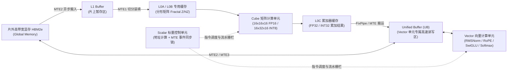
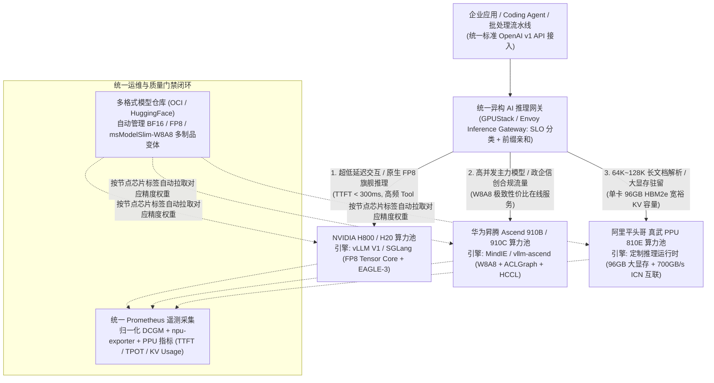

> [!NOTE] 核心速览 (TL;DR)
> - **微架构本质差异**：从 NVIDIA GPU（SIMT 线程束 + 统一片上缓存）迁移至华为昇腾（**DaVinci AI Core：解耦的 Cube 矩阵单元、Vector 向量单元与 Scalar 标量单元**）或阿里平头哥**真武 PPU 810E**（`96 GB HBM2e`、`700 GB/s` 片间互联），核心瓶颈不再是单纯算力标称值，而是**消除 Cube↔Vector 跨存储搬运流水气泡、规避动态 Shape 在线重编译风暴，以及打通 `ACLGraph` 静态图下沉**。
> - **FP8 到 W8A8 量化迁移与科学对标**：针对 Ascend 910B 原生具备 `~640 TOPS` INT8 Cube 算力（为 FP16/BF16 的 2 倍）但不原生执行 Hopper FP8 指令的硬件特征，工程上需借助 **`msModelSlim`** 完成 `AntiOutlier` 离群值平滑与敏感层回退校准，并以**固定前缀 Teacher-Forcing 下的 Top-1 Logits 余弦相似度（$\ge 0.999$）与 KL 散度（$< 10^{-3}$）**替代脆弱的长文本贪婪解码逐字比对。
> - **HCCL 通信与多芯 MaaS 统一编排**：生产集群通过 `HCCL_OP_EXPANSION_MODE="AIV"`（将集合通信规约卸载至 AI Vector 核）、`HCCL_BUFFSIZE` 扩容与 `hccn_tool` 机内 RoCE/HCCS 巡检扫除通信毛刺，并在上层通过 **Kubernetes + GPUStack** 按“低延迟流式 / 超长上下文大显存 / 高吞吐批处理”实现英伟达、昇腾与平头哥 PPU 的异构算力池化路由。

## 引言：为什么照搬 CUDA 经验会在国产算力集群上“水土不服”？

在企业级大模型私有化交付与云端 MaaS 底座建设中，“单一英伟达硬件同构集群”早已不再是唯一现实。一线推理架构师面临的真实生产环境，往往是由 **NVIDIA（A800 / H800 / H20）**、**华为昇腾（Ascend 910B / 910C / 310P）**、**阿里平头哥（真武 PPU 810E）** 乃至各类兼容栈国产 GPU 共同构成的**多芯异构算力池**。

然而许多团队在第一次把跑在 H800 + vLLM 上丝滑无比的 72B 或 671B MoE 服务迁往国产算力卡时，常常在第一周遭遇三连暴击：
1. **“标称算力明明不低，为什么单流 TPOT 慢了 3 倍？”** —— 习惯了 CUDA Eager 模式下细碎算子靠大容量 L2 Cache 兜底，却忽视了 NPU 解耦式片上存储中 Cube 与 Vector 单元频繁借道 HBM 交换中间张量与动态 Shape JIT 编译的巨大开销；
2. **“开源社区刚发布的原生 FP8 权重（如 DeepSeek 系列），直接加载怎么报错或掉点？”** —— 混淆了 Hopper/Blackwell 硬件级 `FP8 E4M3` Tensor Core 与昇腾 910B 原生 `INT8 W8A8` Cube 矩阵引擎的指令集边界；
3. **“单机 8 卡压测一上高并发就卡死在通信超时？”** —— 不了解昇腾节点内 **HCCS 缓存一致性总线** 与每张 NPU 独立板载 **100G/200G RoCE 网卡（HCCN）** 的双平面架构，直接套用 `nvidia-smi` 和 `NCCL` 的排障直觉导致南辕北辙。

本文将从芯片微架构第一性原理出发，完整复盘从 `CUDA + vLLM` 迁移至 **华为昇腾（`CANN 8.0` + `MindIE` / `vllm-ascend`）** 与 **平头哥真武 `PPU 810E`** 等异构算力底座的算子映射、精度对齐、HCCL 通信调优及多芯混部网关架构。

---

## 一、国产异构算力微架构第一性原理：两类技术路线与硬件账本

在动手改一行配置之前，必须先把当前国内主流智算芯片按**硬件执行模型与软件栈兼容范式**划分为两条截然不同的工程路线：

| 核心架构维度 | NVIDIA Hopper/Ampere 基线<br>*(H800 / H20 / A800)* | 路线 A1：华为昇腾原生达芬奇架构<br>*(Ascend 910B / 910C)* | 路线 A2：阿里平头哥原生 PPU 架构<br>*(真武 PPU 810E)* | 路线 B：类 CUDA 兼容 SIMT 路线<br>*(海光 DCU / 沐曦 MACA / 天数等)* |
| :--- | :--- | :--- | :--- | :--- |
| **核心计算微架构** | **SIMT 32 线程 Warp** + Tensor Core (`MMA/WGMMA`) | **DaVinci AI Core**：独立 **Cube（矩阵）+ Vector（向量）+ Scalar（标量）** 三单元流水 | **自研专用并行处理架构（PPU）**，面向大模型矩阵与访存密集负载定制 | **SIMT 线程束（32/64 Wavefront）** + 矩阵张量核心 |
| **典型单卡显存容量** | A800/H800: `80 GB`<br>H20: `96 GB HBM3` | **910B**: `64 GB HBM2e` (`~310–320 TFLOPS` BF16, `~640 TOPS` INT8)<br>**910C**: 双 Die 合封 `128 GB HBM2e` (`~800 TFLOPS` FP16, `~3.2 TB/s`) | **`96 GB HBM2e`**（单卡容量对标 H20，较 80GB 卡多出 20% KV 空间） | 主流旗舰集中在 `64 GB ~ 128 GB` HBM2e/HBM3 |
| **片间高速互联总线** | NVLink (`400 ~ 900 GB/s`) | **HCCS**（机内缓存一致性高速互联）+ 板载原生 RoCE 口（规模扩展至 CloudMatrix 384 全光 UB） | **自研片间互联网络 ICN**（高达 **`700 GB/s`** 双向互联带宽，PCIe 5.0 x16） | 自研 MetaXLink / 织网互联或 PCIe P2P + RoCEv2 |
| **底层软件与算子栈** | CUDA Driver + cuBLAS / CUTLASS / Triton | **全自研非 CUDA 栈**：`CANN 8.0` + `Ascend C` + `ATB`（加速库）+ `HCCL` | **全自研主权软件栈**（非 CUDA 原生兼容，深度垂直打通通义千问与云底座） | 源码级/编译器级兼容栈（如 `ROCm/DTK`、`MACA`），复刻 `cuBLAS/NCCL` 语义 |
| **主流推理引擎选型** | `vLLM` / `SGLang` / `TensorRT-LLM` | **`MindIE`**（官方原生极致压榨）或 **`vllm-ascend`**（社区插件无缝衔接） | 厂商深度定制版 `vLLM` / 自研推理运行时（依托 96GB 大显存承载长窗口） | 厂商适配分支 `vLLM` / `SGLang` |

### 深度透视：为什么达芬奇（DaVinci）架构对“算子融合”与“内存对齐”比 GPU 更敏感？

在我们在 [大模型 GPU 算子编程实战](/articles/gpu-kernel-engineering-cuda-warp-triton-fused-ops/) 中剖析过的 NVIDIA SM 内部，32 线程组成的 Warp 共享同一套寄存器文件与可配置比例的 `L1 / Shared Memory`，Tensor Core 算完矩阵乘后，结果直接留在寄存器里就能顺手做激活函数与残差相加。

而在华为昇腾的 **DaVinci AI Core** 中，计算与片上存储遵循严格的**显式多级 DMA 流水线（MTE，Memory Transfer Engine）**：



看懂这张硬件数据流图，一切迁移诡异现象就全部迎刃而解了：
1. **分形数据排布（Fractal Format `NZ` / `FRACTAL_Z`）与 32 字节对齐**：Cube 单元每次节拍固定吞吐 $16 \times 16$（FP16/BF16）或 $16 \times 32$（INT8）的数据块，且 UB 访存强制要求 **32 Bytes 对齐**。如果模型隐藏层切片或动态 Paged KV 块大小未对齐，底层会自动插入隐式 `TransData` / `Pad` 格式转换算子，白白吃掉 15%~30% 的耗时！
2. **Cube 与 Vector 异构流水掩盖（Cube-Vector Pipelining）**：在 `FlashAttention`（昇腾上称为 `FlashAttentionScore` / `PromptFlashAttention` 与 `IncreFlashAttention`）或 `MLA` 算子中，只有通过 **`Ascend C`** 或官方 **`ATB (Ascend Transformer Boost)`** 图融合引擎，让 **第 $i+1$ 块的 Cube 矩阵乘（$Q K^\top$）与第 $i$ 块的 Vector 在线 Softmax 在硬件事件锁（`SetFlag / WaitFlag`）下完全重叠**，才能避免中间结果回写 HBM。
3. **单卡容量差异带来的并行切分重算**：注意对比单卡 HBM 容量——`Ascend 910B` 为 **`64 GB`**（操作系统与 CANN 运行时固定预留约 `3~4 GB`，可用约 `60 GB`），而 `A800/H800` 为 `80 GB`，平头哥 **真武 `PPU 810E`** 则高达 **`96 GB`**！这意味着：
   - 一个 **72B BF16 模型**（静态权重约 `145 GB`）：在 2 张 `PPU 810E`（合计 `192 GB`）上开 **`TP=2`** 即可装下权重并留出近 `40 GB` KV Cache；但在 `64 GB` 的 `Ascend 910B` 上，`TP=2`（合计 `128 GB`）连静态 BF16 权重都装不下，**必须开启 `TP=4`（4 卡 256 GB）或使用 `W8A8` 量化压缩至 `~73 GB` 后才能跑在 2~4 卡上**！

---

## 二、推理引擎双轨选型：`vllm-ascend` 插件化栈 vs 原生 `MindIE` 全家桶

在昇腾生态上部署生产推理服务，目前存在两条成熟路径。切忌凭喜好盲选，应根据模型新颖度与性能压榨目标精准决策：

### 1. 路径一：`vllm-ascend`（基于 PyTorch `PluggableDevice` 的零代码认知迁移）

如果你的上层业务重度依赖 vLLM V1 引擎的标准 OpenAI 接口、Guided Decoding（结构化输出）以及快速跟进最新开源模型结构，首选 **`vllm-project/vllm-ascend`** 硬件解耦插件：
- **底层机制**：利用 PyTorch 的 **`PrivateUse1`（`PluggableDevice`）** 扩展机制注册 `torch_npu`，在不侵入上游 `vllm` 核心调度器（Paged KV 块表管理、Chunked Prefill 预算分配）的前提下，将底层算子派发至 CANN 的 `AscendLinearMethod`、`AscendFusedMoEMethod` 与自定义 PagedAttention 内核，并通过 **`ACLGraph`**（Ascend Computing Language Graph，对标 NVIDIA CUDA Graph）录制静态执行图消除 Decode 阶段 Python/CPU 下发瓶颈。
- **生产容器启动命令范式**：
  ```bash
  # 1. 检查全部 8 张昇腾 NPU 在位状态、AICore 利用率、HBM 占用与固件版本
  npu-smi info

  # 2. 加载 CANN 8.0 工具链环境并配置关键内存与 HCCL 通信参数
  source /usr/local/Ascend/ascend-toolkit/set_env.sh
  export ASCEND_RT_VISIBLE_DEVICES=0,1,2,3
  export PYTORCH_NPU_ALLOC_CONF="expandable_segments:True"   # 开启虚拟内存可扩展段，根治长短序列碎片化 OOM
  export HCCL_BUFFSIZE=256                                   # 扩大 TP 通信缓冲区至 256MB（大模型必调）
  export HCCL_OP_EXPANSION_MODE="AIV"                        # 将集合通信规约计算下沉至 AI Vector 核心执行

  # 3. 启动 vllm-ascend 服务（加载 msModelSlim 导出的 W8A8 量化权重，自动启用 ACLGraph）
  vllm serve /models/Qwen2.5-72B-Instruct-W8A8 \
    --served-model-name Qwen2.5-72B-Instruct \
    --tensor-parallel-size 4 \
    --quantization ascend \
    --max-model-len 32768 \
    --max-num-batched-tokens 8192 \
    --gpu-memory-utilization 0.90 \
    --trust-remote-code \
    --port 8000
  ```

### 2. 路径二：华为原生 `MindIE`（`MindIE Service` + `MindIE LLM` + `MindIE Motor`）

当面对超大规模旗舰模型（如 DeepSeek-V3/V4 全量多机部署、跨节点 P/D 分离与大 EP 专家并行）并追求昇腾 910B/910C 硬件极限吞吐时，官方 C++ 全栈引擎 **`MindIE`** 往往具备更激进的整图下沉融合（`ATB Graph`）与多流通信掩盖能力：
- **`MindIE LLM` & `ATB Models`**：将整层 Transformer 组装为 C++ 原生 `GraphOperation`，彻底绕过 Python 解释器开销；
- **`MindIE Service`**：高性能 C++ HTTP/gRPC 服务端（兼容 OpenAI / TGI / Triton 协议）；
- **`MindIE Motor`**：专职负责跨节点 **P/D 分离调度**、全局 KV Cache 传输与前缀亲和负载均衡（架构思想与我们在 [P/D 分离与 RDMA 分布式 KV 传输](/articles/pd-disaggregation-distributed-kv-cache/) 中剖析的原理一脉相承）。

在部署 `MindIE Service` 时，核心成败全部浓缩在 `conf/config.json` 的显存与序列边界核算上。首先严格核对 **`npuMemSize`（单卡可分配给 KV Cache 的显存上限，单位 GB）** 的工程计算公式（若不走 `-1` 自动探测而需硬隔离多实例时）：

$$\text{npuMemSize}_{\text{GB}} = \left\lfloor \left( M_{\text{free\_HBM}} - \frac{W_{\text{model}}}{\text{worldSize}} - M_{\text{HCCL\_workspace}} \right) \times \gamma_{\text{safe}} \right\rfloor$$

以 4 张 `Ascend 910B (64 GB)` 部署 `Qwen2.5-72B-W8A8`（权重约 $73\text{ GB}$，每卡分摊 $18.25\text{ GB}$；驱动与 CANN 预留后 $M_{\text{free\_HBM}} \approx 60\text{ GB}$，HCCL 与激活缓冲预留 $6\text{ GB}$，安全系数 $\gamma_{\text{safe}} = 0.90$）为例，单卡可安全划拨给 KV Cache 的空间约为 $\lfloor (60 - 18.25 - 6) \times 0.90 \rfloor = \mathbf{32\text{ GB}}$（单实例独占整卡时建议设为 `-1` 交由后端按比例自动接管）：

```json
{
  "Version": "1.0.0",
  "ServerConfig": {
    "ipAddress": "0.0.0.0",
    "port": 1025,
    "httpsEnabled": false,
    "inferMode": "standard",
    "openAiSupport": "vllm"
  },
  "BackendConfig": {
    "backendName": "mindieservice_llm_engine",
    "modelInstanceNumber": 1,
    "npuDeviceIds": [[0, 1, 2, 3]],
    "tokenizerProcessNumber": 8,
    "multiNodesInferEnabled": false,
    "ModelDeployConfig": {
      "maxSeqLen": 32768,
      "maxInputTokenLen": 28672,
      "truncation": false,
      "ModelConfig": [
        {
          "modelInstanceType": "Standard",
          "modelName": "Qwen2.5-72B-Instruct",
          "modelWeightPath": "/models/Qwen2.5-72B-Instruct-W8A8",
          "worldSize": 4,
          "cpuMemSize": 5,
          "npuMemSize": -1,
          "backendType": "atb",
          "trustRemoteCode": false
        }
      ]
    },
    "ScheduleConfig": {
      "templateType": "Standard",
      "maxBatchSize": 128,
      "maxPrefillBatchSize": 16,
      "maxPrefillTokens": 8192,
      "supportSelectBatch": true,
      "enablePrefixCache": true
    }
  }
}
```

> [!WARNING]
> **MindIE 上线必踩红线**：`MindIE Service` 出于企业安全合规要求，**强制校验配置文件与模型权重目录的文件权限**！若 `config.json` 权限大于 `640`（例如 `644` 或 `777`），进程启动会立即报安全校验失败退出——上线脚本中务必显式执行 `chmod 640 conf/config.json`！

---

## 三、从 FP8 到 W8A8：跨芯片量化转换与数值精度对齐工程

这是跨架构迁移中最容易引发线上质量事故的深水区。

### 1. 为什么不能把 Hopper FP8 权重直接硬塞给 910B？
在 NVIDIA H800/H20 上，`FP8 (E4M3)` 拥有 4 位指数位，动态范围达 $\pm 448$，能够较轻松地吸收激活值中的长尾尖峰（详见 [大模型量化精度理论](/articles/quantization-precision-guide/)）。然而在 **Ascend 910B** 上，DaVinci Cube 单元的翻倍算力峰值（`~640 TOPS`）位于 **原生 `INT8` 定点矩阵乘** 上！

`INT8` 仅有线性均匀的 `[-128, 127]` 网格，没有任何指数位。如果对大模型激活张量直接做粗暴的静态对称 `INT8` 截断，Transformer 特定通道上高达正常值数十倍的激活离群值（Activation Outliers）会把其余 99% 的正常特征全部挤压成 `0`，导致 PPL（困惑度）瞬间爆炸。

### 2. 基于华为官方 `msModelSlim` 的 `W8A8` 离群值抑制与混合校准实战

标准工业级流程是：若源模型为 DeepSeek 原生块级 FP8 权重，先按块缩放因子精确反量化回 `BF16`；随后在昇腾节点上使用 **`msModelSlim`** 执行 **SmoothQuant 式等价通道平滑（`AntiOutlier`）+ 敏感层自动回退（`disable_level`）**，导出原生适配 `MindIE` 与 `vllm-ascend` 的 `W8A8 safetensors` 权重：

```python
import torch
import torch_npu
from transformers import AutoModelForCausalLM, AutoTokenizer
from msmodelslim.pytorch.llm_ptq.anti_outlier import AntiOutlier, AntiOutlierConfig
from msmodelslim.pytorch.llm_ptq.llm_ptq_tools import Calibrator, QuantConfig

# 关键防坑：在 NPU 上执行离线 PTQ 校准时关闭动态图在线 JIT 编译，避免算子编译超时
torch.npu.set_compile_mode(jit_compile=False)

MODEL_SRC = "/models/Qwen2.5-72B-Instruct-BF16"
SAVE_DIR = "/models/Qwen2.5-72B-Instruct-W8A8"

tokenizer = AutoTokenizer.from_pretrained(MODEL_SRC, trust_remote_code=True)
model = AutoModelForCausalLM.from_pretrained(
    MODEL_SRC,
    torch_dtype=torch.bfloat16,
    device_map="auto",
    trust_remote_code=True,
).eval()

# 1. 构建高代表性业务校准集（50~128 条覆盖中英文代码、数学、长表格的真实脱敏 Prompt）
raw_prompts = [
    "Explain the difference between RoCEv2 PFC deadlock and InfiniBand credit-based flow control.",
    "请推导混合精度训练中 AdamW 优化器状态占 16Ψ 字节的精确构成。",
    # ... 实际生产校准需加载 64~128 条真实业务分布样本 ...
]
calib_dataset = [
    [tokenizer(p, return_tensors="pt", truncation=True, max_length=2048).input_ids.to("npu:0")]
    for p in raw_prompts
]

# 2. 第一阶段：离群值抑制 (将激活通道尖峰按对角矩阵等价迁移至权重侧)
anti_cfg = AntiOutlierConfig(
    anti_method="m4",       # 针对现代 GQA/SwiGLU 架构优化的平滑策略 (按版本可选 m1/m3/m4)
    dev_type="npu",
    dev_id=0,
)
anti_outlier = AntiOutlier(model, calib_data=calib_dataset, cfg=anti_cfg)
anti_outlier.process()

# 3. 第二阶段：W8A8 混合精度校准（对末尾 down_proj 等高敏感层按需回退浮点）
quant_cfg = QuantConfig(
    w_bit=8,
    a_bit=8,
    act_method=3,           # 开启 Per-Token 动态激活量化（长上下文与代码任务强烈推荐！）
    w_sym=True,
    dev_type="npu",
    dev_id=0,
    mm_tensor=False,        # 权重量化采用 Per-Channel 细粒度缩放而非粗粒度 Per-Tensor
)

# disable_level="L1"/"L2" 可根据层敏感度自动回退最敏感的少量线性层至 BF16，守住精度底线
calibrator = Calibrator(model, quant_cfg, calib_data=calib_dataset, disable_level="L1")
calibrator.run()
calibrator.save(SAVE_DIR, save_type=["safe_tensor"])
print(f"W8A8 checkpoint exported cleanly to {SAVE_DIR}")
```

请注意上面代码第 44 行的核心技巧：**`act_method=3`（W8A8 Dynamic Per-Token 激活量化）**！在长思维链推理与代码生成中，不同 Token 位置的激活动态范围波动极大；采用“权重静态 Per-Channel INT8 + 激活实时 Per-Token 动态 INT8”能将复杂数理基准（AIME / LiveCodeBench）的量化损耗时常压制在 **0.5% 以内**，远优于纯静态激活缩放。

### 3. 科学验证跨芯片精度对齐：告别“贪婪解码逐字对比”误区

很多测试同学在验收昇腾/PPU 迁移效果时，设 `temperature=0` 在 H800 和 910B 上跑同一条 Prompt，发现第 63 个字开始不一样就报“算子算错了 Bug”——这是典型的**浮点混沌放大效应误判**！

由于达芬奇 Cube（$16 \times 16 \times 16$ 分块累加）与 NVIDIA Tensor Core 的**浮点加法结合顺序不同**（而 IEEE 754 浮点加法不满足结合律 $(a+b)+c \neq a+(b+c)$），每层都会引入 $10^{-4} \sim 10^{-3}$ 量级的正常尾数舍入差异。当某个位置排第一和第二的候选词概率极度接近（如 `0.4851` vs `0.4849`）时，哪怕 $3 \times 10^{-4}$ 的微小扰动也会导致第 $t$ 步采样发生分叉，进而使后续整段自回归轨迹完全不同！

**正确的跨芯片三级精度验收门禁**应当是：
1. **L1 算子/单步对齐（Teacher-Forcing 单次前向比对）**：固定完全相同的 `input_ids`（长度 4K），分别在 GPU 基线与 NPU/PPU 上跑一次 Prefill，提取全序列所有位置的最终层 `Logits`：
   - **余弦相似度（Cosine Similarity）**：$\cos(\mathbf{z}_{\text{GPU}}, \mathbf{z}_{\text{NPU}}) \ge \mathbf{0.9990}$（BF16 对 BF16 通常 $\ge 0.9998$，W8A8 对 BF16 通常 $\ge 0.9985$）；
   - **平均逐位置 KL 散度**：$D_{\text{KL}}\big(\operatorname{softmax}(\mathbf{z}_{\text{GPU}}) \parallel \operatorname{softmax}(\mathbf{z}_{\text{NPU}})\big) < \mathbf{10^{-3}}$；
2. **L2 黄金评测集统计显著性对齐**：在 200~500 题确定性验证集（数学精确解、代码单元测试、业务私有提取集，见 [LLM 评估体系指南](/articles/llm-evaluation-guide/)）上，端到端准确率偏差 $\lvert \text{Acc}_{\text{NPU}} - \text{Acc}_{\text{GPU}} \rvert \le \mathbf{1.0\%}$；
3. **L3 极端边界压力校验**：单独压测 `32K ~ 128K` 超长上下文下的 RoPE 旋转位置编码高频外推精度（排查部分第三方算子将 RoPE `cos/sin` 强转 `FP16` 导致万字后位置编码精度坍塌的经典大坑——**RoPE 三角函数缓存与 RMSNorm 方差累加必须强制保持 `FP32`**！）。

---

## 四、HCCS / HCCL 集合通信调优与双平面网络排障

在单机 8 卡 Atlas 800I A2（8×Ascend 910B）或多机 RoCE 集群上，昇腾的硬件互连与英伟达 HGX 有一个极关键的物理差异：**每张昇腾 910B 模组内部自带独立的片上网络子系统与专属 100G/200G RoCE 硬件网口**，由宿主机专用工具 **`hccn_tool`**（而非 Linux 常规 `ifconfig`/`ethtool`）直接管理！

### 生产集群上线前必跑的四条黄金巡检与调优指令

```bash
# 1. 检查机内 8 卡 HCCS 互联拓扑矩阵（确认是否为全互联 Mesh 或双环拓扑，指导 TP=4 亲和分组）
npu-smi info -t topo

# 2. 逐卡检查昇腾板载原生 RoCE 网口物理链路、IP 连通性与 PFC 无损流控计数 (以卡 0..7 循环为例)
for i in {0..7}; do
  echo "=== NPU $i RoCE Link & PFC Status ==="
  hccn_tool -i $i -link -g
  hccn_tool -i $i -ip -g
  hccn_tool -i $i -pfc -g
done

# 3. 关键 HCCL 生产性能调优环境变量
export HCCL_OP_EXPANSION_MODE="AIV"       # 极其关键：用 AI Vector 核替代慢速 AI CPU 执行通信规约
export HCCL_BUFFSIZE=512                  # 多机 EP All-to-All 或长序列 TP 建议调大至 512MB
export HCCL_RDMA_TC=104                   # 对齐数据中心交换机无损队列 DSCP 优先级 (与 RoCE 交换机严格一致)
export HCCL_RDMA_SL=4                     # 对齐 PFC 优先级队列 Service Level
export HCCL_CONNECT_TIMEOUT=1200          # 大模型冷启动分片加载较慢，放宽建链超时防误杀
```

> [!TIP]
> **机内 `TP=4` 切分拓扑避坑**：在部分采用“两組 4 卡 HCCS 全互联岛（0-1-2-3 一组、4-5-6-7 一组）”的 8 卡服务器形态上，部署两个 `TP=4` 实例时，**必须按 `[0,1,2,3]` 与 `[4,5,6,7]` 对齐绑定**，绝不可切成 `[0,1,4,5]` 跨越两组岛屿走慢速链路！始终先敲 `npu-smi info -t topo` 看清物理拓扑再写 `npuDeviceIds`。

---

## 五、终局实战：基于 Kubernetes + GPUStack 构建“英伟达 + 昇腾 + 真武 PPU”统一 MaaS 底座

在真实的企业级智算中心里，最高效的架构绝不是让不同部门各自维护一套烟囱式集群，而是用统一控制面把异构硬件的**物理长板精准匹配给不同形态的业务流量**。

结合我们在云原生专栏终局篇剖析的 [K8s AI 推理网关与 KV 感知路由](/articles/k8s-ai-inference-gateway-lws-kv-cache-routing/)，下图展示了基于 **Kubernetes + GPUStack（配合各芯片 Device Plugin：NVIDIA `k8s-device-plugin`、华为 `Ascend Device Plugin / Volcano`、平头哥 PPU 设备插件）** 落地的三池异构协同生产架构：



### 异构流量编排的三条黄金法则
1. **“同一逻辑模型名、多精度制品映射（Multi-Variant Artifact Mapping）”**：对业务侧只暴露单一逻辑模型名（如 `Qwen2.5-72B-Instruct` 或 `DeepSeek-V4`），但在底层镜像与模型仓库中按 Kubernetes `nodeSelector`（`accelerator: nvidia-h800`、`accelerator: huawei-Ascend910B`、`accelerator: thead-ppu-810e`）自动挂载各自硬件最优的权重变体（`FP8`、`msModelSlim W8A8` 或 `BF16/W8A16`）。
2. **扬长避短的负载分层路由**：
   - 将单卡拥有 **`96 GB HBM2e` 与 `700 GB/s` 片间带宽的平头哥真武 `PPU 810E`** 优先分配给 **64K~128K 长财报/合同解析与中等规模稠密模型**——相比 64GB 卡，其多出的 50% 单卡显存可直接让长上下文并发槽位数翻倍；
   - 将规模庞大、INT8 算力充沛的 **昇腾 `910B / 910C`（配合 `MindIE` / `vllm-ascend` `W8A8`）** 作为高吞吐日常对话、RAG 生成与信创合规业务的主力基座（超大规模集群通信原理可对照 [机柜级超节点与昇腾全光互联剖析](/articles/rack-scale-superpod-nvl72-nccl-collectives/)）；
   - 将 **NVIDIA `H800 / H20`** 聚焦于对新出论文算子（如最新稀疏注意力原型）零等待上线或极致低延迟投机解码链路。
3. **跨池熔断与前缀亲和隔离**：开启 Prefix Caching 时，切记网关的一致性哈希环**必须先按异构池内部分桶亲和，仅在整池水位超限（如 `kv_cache_usage > 90%`）时才跨芯片池溢出降级**，避免同一多轮 Agent 会话在 GPU 与 NPU 之间来回横跳导致两侧前缀缓存双双失效。

---

## 常见问题 (FAQ)

### Q1: 在昇腾 910B 上部署大模型，到底该选 `MindIE` 还是 `vllm-ascend`？
按团队技术栈与模型阶段选型：如果你的团队熟悉上游 vLLM 参数体系、需要快速接入最新 HuggingFace 模型或强依赖复杂的结构化输出（XGrammar / Guided Decoding）与上层网关生态，优先选择 **`vllm-ascend`**（维护成本极低，与 GPU 侧运维命令高度统一）；如果你追求特定主力模型（如 DeepSeek 全尺寸 MoE 或 Qwen 主力模型）在多机昇腾集群上的极限吞吐、C++ 级整图融合以及 `MindIE Motor` 原生跨机 P/D 分离，则 **`MindIE`** 通常能榨取出更高的硬件上限。

### Q2: 为什么模型刚启动后前几条请求在 NPU 上极慢（首字延迟高达十几秒），之后又恢复正常？
除了常规的权重分页预热外，90% 是因为触发了**动态 Shape 在线算子编译（JIT Compile）或 `ACLGraph` 首次多档位捕获**。生产环境务必确认两点：第一，检查框架配置确保启用了静态图捕获预热（Warm-up）而非对每个奇葩长度现场调用算子编译器；第二，接入 K8s/网关前必须配置**发送真实推理请求的 `startupProbe` / `readinessProbe`**，等常用 Batch 档位的 `ACLGraph` 全部录制完毕后再挂载进线上流量池。

### Q3: 将 DeepSeek-V3 / V4 这类原生 `FP8` 开源权重迁移到不支持原生 FP8 的国产卡上，可以直接截断成 `INT8` 吗？
**绝对不能直接线性重映射截断！** 原生 `FP8 (E4M3)` 依靠指数位承载了跨数量级的数值分布，而 `INT8` 是均匀线性网格。标准做法是：先利用官方反量化脚本按 `128×128` 块缩放因子将 `FP8` 无损还原为 `BF16` 浮点权重，然后再使用 `msModelSlim` 跑一遍包含 `AntiOutlier` 离群值平滑与校准集的 `W8A8`（动态 Per-Token 激活量化）转换流程，并保留 MLA 关键投影层或共享专家的高精度回退策略。

### Q4: 多机昇腾推理启动时报 `HCCL_E_PARA` 或建链超时（`HCCL connect timeout`），最常见的根因是什么？
按三步秒级定位：第一，用 `for i in {0..7}; do hccn_tool -i $i -link -g; done` 确认全部 8 张 NPU 的板载 RoCE 光模块均为 `UP`（切记宿主机 `eth0` 通绝不代表 NPU 板载 RoCE 口通！）；第二，核对多机 ranktable 或通信环境变量中的 `HCCL_IF_IP` / 网卡绑定是否误绑到了宿主机低速管理网口；第三，检查 `HCCL_RDMA_TC` 与 `HCCL_RDMA_SL` 是否与机房 ToR 交换机配置的无损 PFC 队列严格一致（详见 [RoCEv2 无损网络与 PFC 排障手册](/articles/rdma-kernel-bypass-zero-copy-queue-pair-rocev2-lossless/)）。
