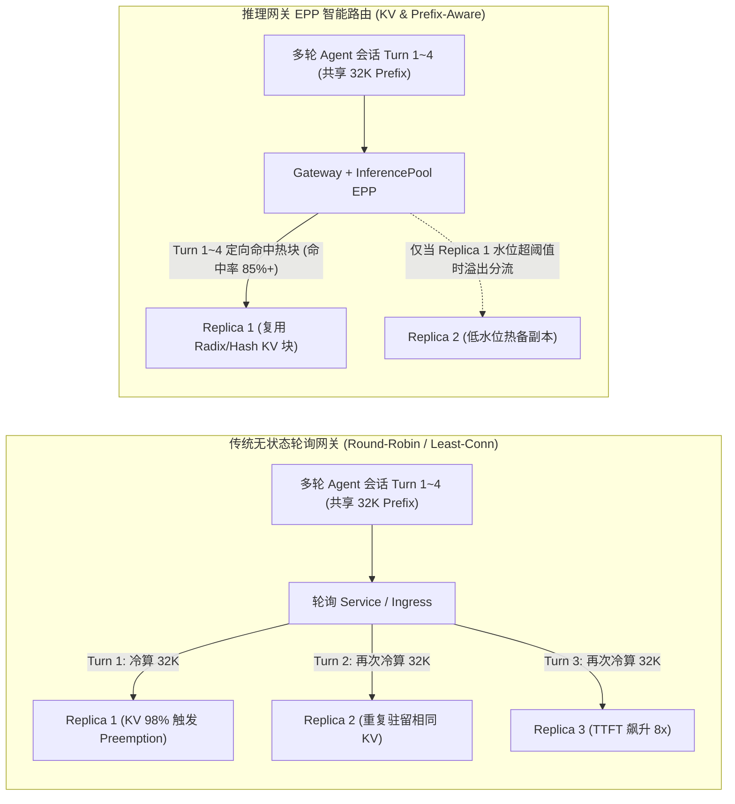
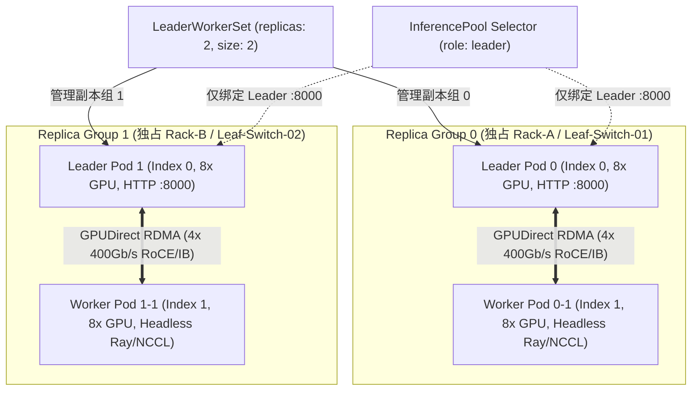
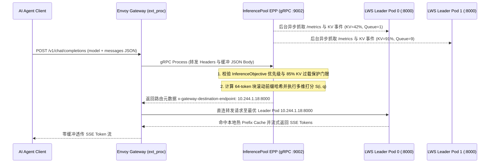
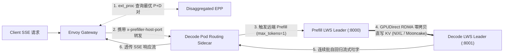

> [!NOTE] 核心速览 (TL;DR)
> - **多机原子编排**：百亿至万亿参数 MoE 模型跨越 2~8 台 8 卡节点时，单个推理副本本质上是紧耦合的 `1 Leader + (N-1) Workers` 超节点单元；Kubernetes SIG `LeaderWorkerSet (LWS)` 通过双层拓扑、排他机架亲和与组级原子重建，彻底解决 `Deployment` 与 `StatefulSet` 的生命周期错配。
> - **KV 缓存感知路由**：请求级轮询负载均衡会摧毁多轮 Agent 的前缀缓存局部性并引爆长尾 TTFT；`Gateway API Inference Extension` 通过 Envoy `ext_proc` 与端点选择器（EPP），在 `<1~2 ms` 内综合前缀哈希命中率、HBM KV 水位、排队深度与 LoRA 驻留状态完成最优路由与优先级过载保护。
> - **P/D 解耦与零损弹性**：结合 `llm-d` 双池 LWS 编排、KEDA 基于 `vllm:kv_cache_usage_perc` 与等待队列的精确扩缩容、300 秒平滑连接排空以及本地 NVMe 权重直通预热，实现 `<35s` 极速冷启动与零丢包弹性伸缩。

## 引言：从“单机算力挂载”到“分布式有状态推理编排”

在本专栏上一篇 [K8s GPU 调度：GPU Operator、MIG 与推理扩缩](/articles/k8s-gpu-operator-ai-inference-scheduling/) 中，我们打通了物理宿主机层面的 NVIDIA 驱动零接触装配、MIG 硬件切片与单节点 NUMA / NVLink 拓扑对齐；而在更早的 [K8s 网络：CNI、Cilium eBPF 与 Gateway API](/articles/k8s-networking-cni-cilium-ebpf-gateway-api/) 中，我们也建立了面向云原生南北向与东西向流量的标准网关治理底座。

然而，当基础设施团队把单机 7B/72B 模型推进到生产级超大参数稠密模型与混合专家（MoE）架构（如 405B 级稠密模型、671B 的 DeepSeek-R1、1T 参数的 Kimi K2 乃至更大规模的万亿参数多专家模型），并承接企业级多轮 ReAct Agent、64K 代码库上下文补全与高并发在线推理流量时，一个残酷的工程现实浮出水面：**过去十年间统治无状态 Web 微服务的黄金组合——`Deployment` 控制器加上轮询（Round-Robin）/ 最少连接（Least-Connections）`Service` 网关——在大模型推理场景下全面失灵。**

大模型在线推理既不是传统无状态 HTTP 微服务（每个 GPU HBM 中驻留着数百 GB 与会话强相关的动态 KV Cache 状态），也不是离线分布式训练 `Job`（要求毫秒级流式响应、局部故障快速自愈与按组滚动升级）。本文将深入剖析这一代际断层的物理根因，并完整落地云原生社区围绕 **LeaderWorkerSet (`LWS`)**、**Gateway API Inference Extension** 以及 **P/D 分离弹性底座** 构建的新一代生产级 AI 推理编排体系。

---

## 一、 为什么无状态微服务原语（Deployment + 轮询 Service）在大模型生产中全面失效

将大模型推理简单包装成一个监听 `8000` 端口的 HTTP 容器并交给 `Deployment` 与 `Service` 托管，会同时在**控制面编排生命周期**与**数据面流量调度**两个维度引发系统性雪崩。

### 1.1 失效模式一：多机紧耦合 Gang 生命周期与原生工作负载的错配

以 671B 参数的 MoE 模型（或 400B~2T+ 级前沿大模型）为例，即便采用 FP8 权重量化，仅静态模型权重加上运行时激活缓冲就需要约 $680\text{~}700\text{ GB}$ 以上的显存空间；若采用 BF16 精度或为高并发长上下文预留充裕的 KV Cache 池，单个模型实例往往需要跨越 **2 至 8 台 8 卡 H100/H200/B200 算力节点**，通过张量并行与流水线并行（如 `TP=8, PP=2`）或大规模专家并行（如 `EP=32`）协同完成**单次前向推理**。

此时，一个能够对外提供 OpenAI 兼容接口的“逻辑推理副本（Logical Replica）”，在物理上不再是单个 Pod，而是一个由 **`1 个 Leader Pod + (N-1) 个 Worker Pods`** 组成的**紧耦合多机超单元（Multi-Pod Super-Unit）**：
- **角色高度异构**：只有 Rank 0 所在的 Leader Pod 运行 HTTP/SSE API Server、Tokenizer 与全局调度器并对外暴露 `8000` 端口；其余 `N-1` 个 Worker Pods 仅作为无头（Headless）计算节点加入 Ray 或 `torch.distributed` 进程组，通过 GPUDirect RDMA 执行跨机 `AllReduce`、`AllToAll` 或流水线激活传输。
- **命运绝对绑定**：一旦组内任意一个 Worker（例如 Worker 3）遭遇 NVIDIA Xid 79 掉卡故障、OOM 崩溃或 RoCE 链路闪断引发 NCCL 通信看门狗超时，整个 `N` 节点通信域（`ncclComm_t`）立即进入不可恢复的死锁或损坏状态，剩余 `N-1` 个存活 Pod 无法独立处理任何请求。

如果强行套用 Kubernetes 原生工作负载原语，会遭遇不可调和的结构性矛盾：

| 核心编排维度 | 原生 `Deployment` | 原生 `StatefulSet` | `LeaderWorkerSet (LWS)` |
| :--- | :--- | :--- | :--- |
| **Pod 模板同质/异构性** | **纯同质**：单一模板无法区分对外 HTTP Leader 与内部无头 Worker | **纯同质**：所有序号共享同一套容器命令与探针模板 | **原生双模板**：独立声明 `leaderTemplate` 与 `workerTemplate` |
| **扩缩容最小原子粒度** | 单 Pod 独立增减，无法将 $M$ 个 Pod 视为一个逻辑副本整体扩缩 | 按 `0..K-1` 扁平序号逐个串行扩缩，无二维“副本组 × 组内节点”概念 | **组级原子扩缩**：`spec.replicas` 直接控制整组 $M$ 个节点的并发伸缩 |
| **单节点 Xid / NCCL 挂死自愈** | 仅原地替换崩溃的单 Pod，其余节点因通信域断裂永久假死 | 仅重启故障序号 Pod，存活节点持有失效通信句柄无法重新握手 | **组级原子重建**：`RecreateGroupOnPodRestart` 一键销毁并干净重建整组 |
| **滚动发布（Rolling Update）** | 随机分批替换单 Pod，导致新旧模型权重版本混跑于同一推理组内 | 按逆序逐个更新单 Pod，更新期间整个多机实例长时间不可用 | **按副本组滚动**：新组 `M` 个节点全量就绪后，原子切流并下线旧组 |
| **流量入口隔离** | `Service` 标签选择器把外部 HTTP 请求误打向无 API 能力的 Worker | 需手写复杂外部脚本动态给 `pod-0` 打标，多副本下极易错乱 | **天然隔离**：仅 Leader Pod 匹配推理池 Selector，Worker 零外部流量 |
| **机架 / 交换机拓扑亲和** | 仅支持全局同构 Pod 亲和，多副本时无法表达“组内同机架、组间分散” | 无法为每 $M$ 个连续序号自动绑定独立的 Leaf 交换机拓扑域 | **排他拓扑注解**：每组自动锁定独立机架/NVLink 域，消除跨 Spine 拥塞 |

### 1.2 失效模式二：按请求计数的负载均衡彻底摧毁 KV 局部性与长尾 TTFT

即便退一步只看单机可装下的 72B 模型，使用 Kubernetes `Service`、常规 Ingress 或四/七层轮询（Round-Robin）/ 最少连接（Least-Connections）网关转发 LLM 请求，同样会引发灾难性的延迟退化。其根源在于传统负载均衡器隐含的两条基本假设在自回归推理中彻底失效：

1. **单请求算力成本相差数百倍以上**：在传统 REST 服务中，两次请求的计算开销通常在同一数量级；而在大模型服务中，一条 $100\text{ Tokens}$ 的简单问答与一条 $64,000\text{ Tokens}$ 的代码库分析请求，在线性投影与 FFN 层的浮点计算量相差 $640\times$，而在因果自注意力（Causal Self-Attention）Prefill 阶段的复杂度更是呈二次方级放大！最少连接（Least-Connections）将这两条请求视为完全等价的“`1` 个活跃 HTTP 连接”，一旦两条 64K 长文本请求碰巧落入同一副本，该副本的等待队列与首字延迟（TTFT）将瞬间飙升至数十秒，而旁边刚处理完 100 Token 短请求的副本却处于空转状态。
2. **多轮会话分散导致前缀缓存（Prefix Cache）命中率雪崩**：正如我们在 [前缀缓存：Hash 块寻址与 RadixAttention](/articles/prefix-caching-radix-attention-internals/) 中剖析的那样，生产环境中的 ReAct Agent、RAG 检索问答与代码助手在连续 10~30 轮调用间共享着高达 $75\%\text{~}90\%$ 的相同历史前缀（System Prompt、工具 Schema 与历史轨迹）。假设后端部署了 $R = 16$ 个 [vLLM 在线推理](/articles/vllm-serving-guide/) 副本：
   - 在**前缀感知路由**下，同一会话或共享相同知识库前缀的请求被精准定向至已驻留对应 KV 物理块的副本，前缀缓存命中率稳定在 $>80\%$，跳过绝大部分冗余 Prefill 矩阵乘；
   - 在**无状态轮询路由**下，每一轮对话以 $(R-1)/R$ 的概率被随机抛向一个冷缓存副本，单会话跨轮次命中率从 $>80\%$ 断崖式跌向 $1/R$（当 $R=16$ 时仅为 $6.25\%$）！更致命的是，同一份 32K 上下文的 KV 张量被迫在全部 16 个副本的 HBM 显存中重复计算并冗余驻留，迅速榨干全集群显存水位（`vllm:kv_cache_usage_perc` 逼近 $100\%$），进而触发 PagedAttention 块抢占风暴（`vllm:num_preemptions_total > 0`），导致正在流畅吐字的 Decode 请求被迫中断重算。



---

## 二、 基于 Kubernetes SIG LeaderWorkerSet 的多机原子推理单元编排

为了填补 Kubernetes 原生 API 在“多 Pod 紧耦合有状态推理单元”上的空白，Kubernetes SIG Apps 与 WG Serving 联合推出了 **`LeaderWorkerSet` (`leaderworkerset.x-k8s.io/v1`，简称 LWS)** 标准扩展，如今已成为 GKE、EKS、阿里云 ACK 以及上游 `llm-d` 部署多机 vLLM / SGLang / TensorRT-LLM 的事实编排底座。

### 2.1 LWS 双层控制拓扑、组级原子自愈与排他机架亲和

`LeaderWorkerSet` 在控制器内部巧妙构建了**“外层副本组 + 内层主从节点集”的双层嵌套状态机**：

1. **双层规模语义（`replicas` × `size`）**：
   - `spec.replicas` 定义集群对外服务的**逻辑模型副本数**（例如 `replicas: 3` 表示部署 3 套完整的 DeepSeek-R1 服务实例以支撑水平并发）；
   - `spec.leaderWorkerTemplate.size` 定义单个逻辑副本内部包含的 **Pod 总数**（`1` 个 Leader + `size - 1` 个 Workers；例如 `size: 4` 配合每 Pod 8 张 GPU，即每个逻辑副本独占 $4 \times 8 = 32$ 张 GPU，整个 LWS 共调度 $3 \times 32 = 96$ 张 GPU）。
2. **零配置分布式寻址注入**：LWS Mutating Webhook 会自动为组内每个容器注入标准环境变量：
   - `LWS_LEADER_ADDRESS`：当前副本组专属 Leader Pod 的固定 Headless DNS 域名（形如 `<name>-<group-index>.<name>.<ns>.svc.cluster.local`）；
   - `LWS_GROUP_SIZE`：当前组总节点数（即 `size` 值）；
   - `LWS_WORKER_INDEX`：组内拓扑序号（Leader 恒为 `0`，Worker 依次为 `1 .. size-1`）。
3. **原子故障重建（`restartPolicy: RecreateGroupOnPodRestart`）**：当组内任意一个 Worker 容器因 CUDA 非法访存、Xid 硬件异常或 NCCL 超时退出，抑或所在节点被驱逐时，LWS 控制器不会像 `StatefulSet` 那样徒劳地只重启坏掉的单 Pod，而是**立即级联销毁该副本组的全部 `size` 个 Pod 并同步重建整组**，确保 Ray Cluster 或 `torch.distributed` 通信环在干净初始态下重新握手，同时丝毫不影响其他健康副本组继续承载线上流量。
4. **排他硬件拓扑锁定（`exclusive-topology`）**：跨节点张量并行或专家并行对东西向 RoCEv2 / InfiniBand 延迟极度敏感。通过在注解中声明 `leaderworkerset.sigs.k8s.io/exclusive-topology: topology.k8s.io/rack`（或云厂商 NVLink 机柜域标签如 `cloud.provider.com/topology-block`），LWS 会自动为同一副本组内的 `size` 个 Pod 注入强制亲和（同机架/同 Leaf 交换机），并在不同副本组之间维持拓扑域隔离，彻底杜绝跨 Spine 交换机的多跳拥塞（针对超大规模跨机柜场景，还可结合 `subGroupPolicy` 将 TP 域严格锁死在机柜 NVLink 内部、PP 域跨越机柜）。



### 2.2 生产级清单实战：双机 16 卡多节点 vLLM 推理服务部署

下面给出经过生产验证的完整 `LeaderWorkerSet` YAML 清单，在 2 台 8 卡 H100 节点（总计 16 张 GPU，`TP=8, PP=2`）上编排 `DeepSeek-R1` 在线服务（具备 2 个逻辑副本组，共计 32 张 GPU），完整涵盖 `/dev/shm` 内存盘、GPUDirect RDMA 网卡与 `IPC_LOCK` 锁页权限、组就绪阻塞脚本以及真实的 `/health` 探针：

```yaml
apiVersion: leaderworkerset.x-k8s.io/v1
kind: LeaderWorkerSet
metadata:
  name: deepseek-r1-lws
  namespace: ai-serving
  annotations:
    # 强制每个 2 机 16 卡副本组落在同一个低延迟 RDMA Leaf 交换机/机架拓扑域内
    leaderworkerset.sigs.k8s.io/exclusive-topology: "topology.k8s.io/rack"
spec:
  replicas: 2
  startupPolicy: LeaderCreated
  rolloutStrategy:
    type: RollingUpdate
    rollingUpdateConfiguration:
      maxUnavailable: 1
      maxSurge: 1
  leaderWorkerTemplate:
    size: 2
    restartPolicy: RecreateGroupOnPodRestart
    leaderTemplate:
      metadata:
        labels:
          app: deepseek-r1-lws
          role: leader
          # 仅在 Leader 模板打上推理池标签，确保网关绝不把 HTTP 流量发往 Worker
          inference.networking.k8s.io/pool: deepseek-r1-pool
      spec:
        terminationGracePeriodSeconds: 300
        containers:
          - name: vllm-leader
            image: vllm/vllm-openai:v0.8.5
            securityContext:
              capabilities:
                add: ["IPC_LOCK"]
            env:
              - name: NCCL_IB_DISABLE
                value: "0"
              - name: NCCL_NET_GDR_LEVEL
                value: "5"
              - name: VLLM_USE_V1
                value: "1"
            command: ["/bin/bash", "-c"]
            args:
              - |
                set -euo pipefail
                ray start --head --port=6379 --num-gpus=8 --disable-usage-stats
                echo "Waiting for ${LWS_GROUP_SIZE} nodes to join Ray cluster..."
                python3 -c "
                import time, os, ray
                ray.init(address='auto')
                target = int(os.environ['LWS_GROUP_SIZE'])
                while sum(1 for n in ray.nodes() if n['Alive']) < target:
                    time.sleep(2)
                "
                exec vllm serve /models/DeepSeek-R1 \
                  --served-model-name deepseek-r1 \
                  --tensor-parallel-size 8 \
                  --pipeline-parallel-size 2 \
                  --distributed-executor-backend ray \
                  --enable-prefix-caching \
                  --gpu-memory-utilization 0.90 \
                  --max-model-len 65536 \
                  --port 8000
            ports:
              - name: http
                containerPort: 8000
              - name: ray-gcs
                containerPort: 6379
            resources:
              limits:
                nvidia.com/gpu: "8"
                rdma/ib: "4"
                cpu: "64"
                memory: "512Gi"
              requests:
                nvidia.com/gpu: "8"
                rdma/ib: "4"
                cpu: "64"
                memory: "512Gi"
            startupProbe:
              httpGet:
                path: /health
                port: 8000
              periodSeconds: 5
              failureThreshold: 120
            readinessProbe:
              httpGet:
                path: /health
                port: 8000
              periodSeconds: 5
              failureThreshold: 3
            lifecycle:
              preStop:
                exec:
                  command: ["/bin/sh", "-c", "sleep 15"]
            volumeMounts:
              - name: dshm
                mountPath: /dev/shm
              - name: model-weights
                mountPath: /models
                readOnly: true
        volumes:
          - name: dshm
            emptyDir:
              medium: Memory
              sizeLimit: 64Gi
          - name: model-weights
            hostPath:
              path: /mnt/nvme-models
              type: Directory
    workerTemplate:
      metadata:
        labels:
          app: deepseek-r1-lws
          role: worker
      spec:
        terminationGracePeriodSeconds: 300
        containers:
          - name: vllm-worker
            image: vllm/vllm-openai:v0.8.5
            securityContext:
              capabilities:
                add: ["IPC_LOCK"]
            env:
              - name: NCCL_IB_DISABLE
                value: "0"
              - name: NCCL_NET_GDR_LEVEL
                value: "5"
            command: ["/bin/bash", "-c"]
            args:
              - |
                set -euo pipefail
                until ray start --address="${LWS_LEADER_ADDRESS}:6379" --num-gpus=8 --block; do
                  echo "Waiting for Ray head at ${LWS_LEADER_ADDRESS}:6379..."
                  sleep 2
                done
            resources:
              limits:
                nvidia.com/gpu: "8"
                rdma/ib: "4"
                cpu: "64"
                memory: "512Gi"
              requests:
                nvidia.com/gpu: "8"
                rdma/ib: "4"
                cpu: "64"
                memory: "512Gi"
            volumeMounts:
              - name: dshm
                mountPath: /dev/shm
              - name: model-weights
                mountPath: /models
                readOnly: true
        volumes:
          - name: dshm
            emptyDir:
              medium: Memory
              sizeLimit: 64Gi
          - name: model-weights
            hostPath:
              path: /mnt/nvme-models
              type: Directory
```

> [!IMPORTANT]
> **多机配置红线**：容器默认 `/dev/shm` 仅有 `64Mi`，一旦跑起 8 卡 NCCL 共享内存环与 Ray 对象存储会瞬间触发 `Bus error (core dumped)`，必须显式挂载至少 `64Gi` 的 `medium: Memory` 内存卷；同理，GPUDirect RDMA 注册锁定内存页（Pinned Memory）要求容器持有 `IPC_LOCK` 能力，否则跨机通信将静默退化回主机 PCIe 中转路径，吞吐暴跌 $70\%$ 以上。此外，针对大规模 MoE 专家并行部署，也可将上述 Ray 启动逻辑直接替换为 vLLM 原生多机 DP+EP 参数（`--data-parallel-address ${LWS_LEADER_ADDRESS} --data-parallel-size ${LWS_GROUP_SIZE} --data-parallel-rank ${LWS_WORKER_INDEX} --enable-expert-parallel`）。

---

## 三、 L7 Token 与 KV 感知流量治理：Gateway API Inference Extension

当 `LeaderWorkerSet` 把多机算力稳定封装为一组暴露 `:8000` 端口的 Leader Pods 后，下一步核心命题是：**网关如何在微秒至毫秒预算内，读懂 OpenAI JSON 请求体中的 Token 前缀与模型优先级，并将流量精准送往最合适的 Leader Pod？**

这正是 Kubernetes SIG Network 推出的 **Gateway API Inference Extension**（API 组演进自 `inference.networking.x-k8s.io` 至正式版 `inference.networking.k8s.io`，现已成为上游 `llm-d`、GKE Inference Gateway 与 Envoy AI Gateway 的统一标准内核）所解决的核心问题。

### 3.1 控制面与数据面解构：InferencePool、InferenceObjective 与 Envoy ext_proc

该架构在标准 Gateway API 的 `Gateway` 与 `HTTPRoute` 之上，引入了面向推理特化的两类核心 CRD 与一套高性能外部处理（External Processing）数据面：

1. **`InferencePool`（基础设施运维视角）**：替代传统的 Kubernetes `Service` 作为 `HTTPRoute` 的 `backendRefs` 目标。它通过标签选择器（如 `inference.networking.k8s.io/pool: deepseek-r1-pool`）汇聚所有就绪的 Leader Pods（端口 `8000`），并显式绑定一个专属的 **EPP（Endpoint Picker Extension，端点选择器）** gRPC 决策服务以及故障降级策略（`failureMode: FailOpen`）。
2. **`InferenceModel` / `InferenceObjective`（模型与业务归属方视角）**：在早期 `v1alpha2` 中由 `InferenceModel` 承载，并在最新架构中演进解耦为 `HTTPRoute` 模型匹配加上 `InferenceObjective` SLO 策略对象。它允许平台在同一底座模型池上复用挂载数十个动态 LoRA 适配器（如 `deepseek-r1-sql-lora`、`deepseek-r1-legal-lora`），更重要的是定义了**业务关键度与优先级分层（Criticality / Priority Tiers）**：
   - **高优实时交互级（Critical / Priority `100`）**：面向线上付费对话与 IDE 实时补全，拥有最高资源使用权；
   - **可丢弃离线批处理级（Sheddable / Priority `0` 或负优先级）**：面向夜间文档摘要、离线评测任务。一旦 EPP 监测到整个 `InferencePool` 的平均 KV Cache 饱和度突破警戒水位（例如 $>85\%$），EPP 会立即对低优先级流量主动返回 `429 Too Many Requests` 执行**有损过载卸载（Load Shedding）**，确保线上高优 SLO 流量绝不因批处理任务挤爆显存而发生抢占抖动！

```yaml
apiVersion: inference.networking.k8s.io/v1
kind: InferencePool
metadata:
  name: deepseek-r1-pool
  namespace: ai-serving
spec:
  targetPorts:
    - number: 8000
  selector:
    matchLabels:
      inference.networking.k8s.io/pool: deepseek-r1-pool
  endpointPickerRef:
    name: deepseek-r1-epp
    port:
      number: 9002
    failureMode: FailOpen
---
apiVersion: inference.networking.x-k8s.io/v1alpha2
kind: InferenceObjective
metadata:
  name: realtime-coding-agent
  namespace: ai-serving
spec:
  priority: 100
  poolRef:
    group: inference.networking.k8s.io
    name: deepseek-r1-pool
---
apiVersion: gateway.networking.k8s.io/v1
kind: HTTPRoute
metadata:
  name: deepseek-r1-route
  namespace: ai-serving
spec:
  parentRefs:
    - name: ai-inference-gateway
  rules:
    - matches:
        - path:
            type: PathPrefix
            value: /v1/chat/completions
      backendRefs:
        - group: inference.networking.k8s.io
          kind: InferencePool
          name: deepseek-r1-pool
          port: 8000
```

在数据面转发路径上，传统网关之所以无法按 Prompt 路由，是因为代理层只解析 HTTP Path/Header 而不解包 JSON Body。Inference Gateway 借助 **Envoy `ext_proc`（External Processor）双向 gRPC 过滤器**完美打通了这一链路，单次路由决策开销严格控制在 **`<1~2 ms`**（相比大模型数百毫秒的 TTFT 几乎可忽略不计）：



### 3.2 EPP 多信号复合评分公式与前缀索引架构对比

EPP 并非简单地寻找“缓存命中最高”的节点，因为盲目追逐缓存命中会把单一热门前缀瞬间打爆单机。工业级 KV 感知路由器（如上游 `llm-d` EPP、`SGLang Router` 与 `NVIDIA Dynamo`）普遍采用**多维归一化加权评分函数**，对池内每一个候选 Leader 副本 $i \in \{1, \dots, R\}$ 在给定请求 $q$ 下计算综合得分 $S(i \mid q)$：

$$S(i \mid q) = w_{\text{cache}} \cdot \hat{H}_{\text{prefix}}(q, i) - w_{\text{kv}} \cdot U_{\text{kv}}(i) - w_{\text{queue}} \cdot \frac{Q_{\text{wait}}(i)}{Q_{\max}} + w_{\text{lora}} \cdot \mathbb{I}[\text{LoRA} \in \mathcal{A}_i]$$

公式中四个核心物理信号的工程含义与闭环负反馈机制如下：

- **前缀块命中率估计 $\hat{H}_{\text{prefix}}(q, i) \in [0, 1]$**：将请求 $q$ 的输入序列按固定窗口（如 16 或 64 Tokens，与引擎物理分页块对齐）切分为链式前缀哈希块序列 $\mathcal{B}_q = (b_1, b_2, \dots, b_K)$，其中第 $k$ 块的哈希递归定义为 $h_k = \text{Hash}(h_{k-1}, \text{tokens}_k)$（确保位置因果性完全一致）。若副本 $i$ 连续命中前 $K_{\text{hit}}$ 个块，则 $\hat{H}_{\text{prefix}}(q, i) = K_{\text{hit}} / \lvert \mathcal{B}_q \rvert$，直接量化可省去的 Prefill 计算比例。
- **显存 KV 水位惩罚 $U_{\text{kv}}(i) \in [0, 1]$**：实时读取副本 $i$ 的 `vllm:kv_cache_usage_perc`。当某节点 KV 占用逼近 $0.85\text{~}0.95$ 时，负项 $-w_{\text{kv}} \cdot U_{\text{kv}}(i)$ 显著拉低得分，防止路由器将新长文本请求推入即将触发块驱逐或重算抢占的濒危节点。
- **等待队列归一化惩罚 $Q_{\text{wait}}(i) / Q_{\max}$**：读取副本 $i$ 的 `vllm:num_requests_waiting` 并除以饱和容忍上限 $Q_{\max}$，直接反映当前调度器排头阻塞压力。
- **动态 LoRA 驻留亲和项 $\mathbb{I}[\text{LoRA} \in \mathcal{A}_i] \in \{0, 1\}$**：指示函数，当请求指定的 LoRA 适配器当前已加载于副本 $i$ 的 GPU 活跃集合 $\mathcal{A}_i$ 时取 $1$，避免跨 PCIe 从主机内存临时换入权重引发数十毫秒抖动。

我们通过一组真实的线上打分推演（设定典型权重 $w_{\text{cache}} = 2.0,\ w_{\text{kv}} = 1.5,\ w_{\text{queue}} = 1.5,\ w_{\text{lora}} = 0.5$，队列饱和上限 $Q_{\max} = 16$），直观验证该公式如何在“追逐热缓存”与“规避过载热点”之间建立自适应负反馈平衡：

- **候选 Leader 0（高前缀命中但显存与队列过载）**：$\hat{H}_{\text{prefix}} = 0.90,\ U_{\text{kv}} = 0.94,\ Q_{\text{wait}} = 14,\ \mathbb{I}_{\text{LoRA}} = 1$：
  $$S(0 \mid q) = 2.0(0.90) - 1.5(0.94) - 1.5\left(\frac{14}{16}\right) + 0.5(1) = 1.80 - 1.41 - 1.3125 + 0.50 = -0.4225$$
- **候选 Leader 1（部分前缀命中、健康负载的次优副本）**：$\hat{H}_{\text{prefix}} = 0.50,\ U_{\text{kv}} = 0.44,\ Q_{\text{wait}} = 2,\ \mathbb{I}_{\text{LoRA}} = 1$：
  $$S(1 \mid q) = 2.0(0.50) - 1.5(0.44) - 1.5\left(\frac{2}{16}\right) + 0.5(1) = 1.00 - 0.66 - 0.1875 + 0.50 = +0.6525$$
- **候选 Leader 2（完全冷缓存的空闲扩容节点）**：$\hat{H}_{\text{prefix}} = 0.00,\ U_{\text{kv}} = 0.20,\ Q_{\text{wait}} = 0,\ \mathbb{I}_{\text{LoRA}} = 0$：
  $$S(2 \mid q) = 2.0(0.00) - 1.5(0.20) - 1.5\left(\frac{0}{16}\right) + 0.5(0) = -0.3000$$

可以看到，尽管 Leader 0 拥有高达 $90\%$ 的前缀命中率，但其 $94\%$ 的 KV 水位与 $14$ 条排队惩罚将其总分压低至 $-0.4225$；EPP 不仅会优先选择具备部分热块且水位健康的 Leader 1（$+0.6525$），甚至在只有 Leader 0 与全冷节点 Leader 2（$-0.3000$）可选时，也会果断将流量溢出（Spillover）至空闲的 Leader 2 培育“第二热缓存副本”，从数学根源上消灭了单节点热点崩溃！

许多团队在自研初期曾尝试用“对 System Prompt 或 Session ID 做**无状态一致性哈希（Consistent Hashing）**”来替代有状态 EPP，结果在大促或热门应用上线时遭遇严重线上事故。下表揭示了三种前缀路由流派的本质差异：

| 路由架构方案 | 前缀状态感知机制 | 热门 System Prompt 突发洪峰表现 | 引擎侵入性与运维复杂度 |
| :--- | :--- | :--- | :--- |
| **无状态一致性哈希环** | 零集群状态感知；仅对会话 ID 或前 $N$ 字节做静态取模映射 | **热点单点打爆（Hot-Key Collapse）**：全公司共用的爆款 Agent Prompt 100% 砸向同一个 Pod，队列爆炸而其余 $R-1$ 个节点空转；且完全感知不到底层 LRU 早已驱逐该块 | 极低（Nginx / Envoy 原生配置即可），但生产极易雪崩 |
| **EPP 近似前缀块索引器**（`llm-d` 默认方案） | EPP 在内存中维护按各 Pod HBM 容量等比缩放的链式块哈希 LRU 基数树/字典，在路由转发时同步更新推断驻留态 | **负载均衡自动溢出（Load-Aware Spillover）**：当主命中 Pod 的 $U_{\text{kv}}$ 或 $Q_{\text{wait}}$ 升高使得负载惩罚超过 $w_{\text{cache}}$ 收益时，自动将溢出流量导向次优空闲节点建立“第二热副本” | **零引擎侵入**，兼容标准 vLLM / SGLang，内存开销仅百 MB 级 |
| **引擎 KV 事件流实时订阅**（`Dynamo` / `SGLang` 深度模式） | 推理引擎在物理块分配（`BlockStored`）与驱逐（`BlockRemoved`）时通过 ZeroMQ / gRPC 向路由器推送增量事件流 | **精确全局视图 + 负载均衡溢出**：消除近似 LRU 估算漂移，在高频抢占与混合长短文本负载下仍保持近 $100\%$ 索引准确度 | 需开启引擎 `KVEvents` 消息总线并维护断线快照重同步 |

---

## 四、 K8s 上的 P/D 分离池化编排与零损弹性伸缩

当集群规模进一步迈向百卡至千卡级、且需要同时满足苛刻的首字延迟（$\text{TTFT} < 500\text{ ms}$）与丝滑的逐字解码节拍（$\text{TPOT} < 25\text{ ms}$）时，单池同构混跑将触及算力与访存干扰的物理上限，演进至我们在 [P/D 分离：Prefill 与 Decode 解耦及 KV 传输](/articles/pd-disaggregation-distributed-kv-cache/) 中深入推导的**预填充与解码物理分池架构**。

### 4.1 编排 Prefill LWS 与 Decode LWS 双池及 RDMA KV 飞渡

在现代 Kubernetes 推理栈（以 Red Hat / Google / CoreWeave 等共建的开源项目 `llm-d` 为代表）中，P/D 分离不再需要手工维护裸机进程，而是完全映射为声明式云原生编排：

- **Prefill 计算池（`prefill-lws`）**：独立部署一套算力密集型 `LeaderWorkerSet`（如 `TP=4` 或 `TP=8`，开启激进的 Chunked Prefill 与 FP8 GEMM 内核），专职吞吐海量输入 Token 并生成首字与全层 KV 张量；
- **Decode 访存池（`decode-lws`）**：独立部署另一套高显存容量与高带宽 `LeaderWorkerSet`（如在 H200/B200 上开启宽专家并行 `EP=16/32` 并挂载超大 HBM KV 缓存池），专职稳定维持数千并发会话的自回归吐字；
- **协调路由 Sidecar 与 NIXL / Mooncake 零拷贝传输**：网关将请求发入 EPP 后，EPP 同时对 Prefill 池与 Decode 池打分（若目标 Decode 节点本地已命中近 $100\%$ 前缀缓存，则直接短路跳过 Prefill 池！）。否则，EPP 选定最优 `(Prefill Leader P, Decode Leader D)` 组合，由挂在 Decode Leader Pod 内的轻量级 **Disaggregation Routing Sidecar** 先请求 `P` 完成单步预填充（`max_tokens=1`），触发 vLLM `KVConnector` 通过 **NVIDIA NIXL (`NixlConnector`)** 或 **Mooncake** 利用 GPUDirect RDMA 将 KV 物理块跨网络直接写入 `D` 预分配的显存页中，随后由 `D` 无缝接管 SSE 流式输出。



### 4.2 为什么基于 CPU / GPU 利用率的 HPA 彻底失灵？实战 KEDA 驱动 LWS 弹性

许多运维团队直接把微服务时代的 HorizontalPodAutoscaler（HPA）搬过来监控 CPU 利用率或 DCGM 导出的 `DCGM_FI_DEV_GPU_UTIL`，结果发现弹性策略完全失控：

1. **`DCGM_FI_DEV_GPU_UTIL` 的“虚假满载”陷阱**：该指标统计的是采样周期内“至少有一个 SM 上存在活跃线程束的时间占比”，而非真正的算力饱和度。由于 Continuous Batching 的毫秒级紧凑循环以及 NCCL 忙等待轮询（Spin-Polling），哪怕卡上仅仅跑着 Batch Size 为 `2` 的轻量解码请求，`DCGM_FI_DEV_GPU_UTIL` 也常常常年顶在 **$85\%\text{~}100\%$**，导致 HPA 在凌晨低峰期错误地将昂贵的 GPU 集群拉满至最大副本数！
2. **Tensor Core 利用率的“虚假清闲”陷阱**：反过来，如果改用 Tensor Core 活跃度（`DCGM_FI_PROF_PIPE_TENSOR_ACTIVE`）去扩缩访存受限（Memory-bound）的 Decode 池，当 64K 超长上下文会话塞满显存时，SM 计算单元因等待 HBM 访存带宽而仅显示 **$25\%\text{~}35\%$** 利用率，此时 HBM KV Cache 实际上已达 **$99\%$** 饱和且外部排队请求破百，HPA 却冷眼旁观拒绝扩容！

正确的工程解法是：**直接以引擎内部真实的排队压力与 KV 物理块饱和度作为弹性控制信号**。由于 `LeaderWorkerSet` 原生实现了 Kubernetes 标准 `/scale` 子资源，我们可以直接使用 **KEDA (`ScaledObject`)** 对整个多机 `LeaderWorkerSet` 执行按组原子扩缩容：

```yaml
apiVersion: keda.sh/v1alpha1
kind: ScaledObject
metadata:
  name: deepseek-r1-lws-scaler
  namespace: ai-serving
spec:
  scaleTargetRef:
    apiVersion: leaderworkerset.x-k8s.io/v1
    kind: LeaderWorkerSet
    name: deepseek-r1-lws
  pollingInterval: 10
  cooldownPeriod: 600
  minReplicaCount: 2
  maxReplicaCount: 8
  advanced:
    restoreToOriginalReplicaCount: false
    horizontalPodAutoscalerConfig:
      behavior:
        scaleUp:
          stabilizationWindowSeconds: 15
          policies:
            - type: Pods
              value: 2
              periodSeconds: 60
        scaleDown:
          # 缩容窗口设为 600 秒且每次最多回收 1 个多机副本组，保护宝贵的热 KV 缓存池
          stabilizationWindowSeconds: 600
          policies:
            - type: Pods
              value: 1
              periodSeconds: 300
  triggers:
    # 信号 1：全局等待队列深度（AverageValue 自动按当前 LWS 副本组数量分摊阈值）
    - type: prometheus
      metricType: AverageValue
      metadata:
        serverAddress: http://prometheus-operated.monitoring.svc.cluster.local:9090
        metricName: vllm_num_requests_waiting
        query: sum(vllm:num_requests_waiting{model_name="deepseek-r1"})
        threshold: "8"
    # 信号 2：集群平均 HBM KV Cache 占用率（显式指定 Value 防止二次除以副本数）
    - type: prometheus
      metricType: Value
      metadata:
        serverAddress: http://prometheus-operated.monitoring.svc.cluster.local:9090
        metricName: vllm_kv_cache_usage_perc
        query: avg(vllm:kv_cache_usage_perc{model_name="deepseek-r1"})
        threshold: "0.78"
```

### 4.3 零丢包连接与 KV 平滑排空，以及亚 35 秒极速权重冷启动

要让上述 KEDA 自动扩缩容与 LWS 滚动升级真正达到生产级“零损（Zero-Drop）”水准，还必须闭合缩容下线与扩容冷启动两端的时间差漏洞：

- **缩容端：300 秒优雅排空规避流式截断**：深度思考模型（如 DeepSeek-R1 长思维链推理或复杂代码生成）单次 HTTP SSE 流往往持续 $60\text{~}240\text{ 秒}$。若沿用 Kubernetes 默认的 `terminationGracePeriodSeconds: 30`，缩容时 Kubelet 会在 30 秒后强发 `SIGKILL`，直接腰斩用户生成到一半的答案。同时，正如我们在 [K8s 应用网络：gRPC 均衡与平滑切流](/articles/k8s-application-networking-grpc-service-mesh-zero-downtime/) 中拆解的异步控制面时序竞态，Pod 标记 Terminating 与 `EndpointSlice` / EPP 摘除该节点之间存在数秒传播延迟。因此生产配置必须组合三道防线：
  1. `preStop` 钩子执行 `sleep 15`，在此期间 EPP 通过 `EndpointSlice` Watch 率先将该 Leader 从候选池摘除，彻底切断新进请求；
  2. `preStop` 结束后容器收到 `SIGTERM`，vLLM API Server 关闭新建请求入口但继续跑完当前正在执行的 Continuous Batching 序列，直至最后一条 SSE 流自然输出 `[DONE]`；
  3. 将 `terminationGracePeriodSeconds` 设为 **`300`**（或略大于业务最大生成超时），实现真正的零截断下线。
- **扩容端：将 670GB 模型冷启动从 8 分钟压缩至 `<35s`**：如果新扩容出的 2 机 16 卡 LWS 副本组每次都从远端对象存储（S3/OSS）按 $1.5\text{ GB/s}$ 拉取 670GB 权重，仅文件下载与反序列化就要耗费近 **8 分钟**，流量洪峰早已超时溃败！现代智算集群通过三层加速链路击穿冷启动瓶颈：
  1. **宿主机本地 PCIe Gen5 NVMe RAID-0 权重预热缓存**（通过 DaemonSet 预分发、Fluid/JuiceFS 分布式 RDMA 缓存或 Kubernetes 1.31+ 原生 **OCI Image Volumes** 只读镜像卷挂载），提供单机 $15\text{~}25\text{ GB/s}$ 以上的本地顺序读取带宽；
  2. **启用流式并发直通加载（`--load-format runai_streamer` 或多线程 `safetensors` GPUDirect Storage / 零拷贝并发流）**，绕过单线程 Python `mmap` 缺页中断瓶颈，直接满带宽灌入 8 张 GPU HBM；
  3. **持久化挂载 `torch.compile` 与 FlashInfer JIT 编译缓存目录**（避免每次容器拉起耗费 90~150 秒重复编译 Triton/CUDA 内核），将双机 16 卡超大模型的端到端 Ready 就绪耗时从 8 分钟硬生生压入 **`<35 秒`**！

```yaml
# Kubernetes 1.31+ OCI Image Volume 结合持久化 JIT 编译缓存卷挂载范式
volumes:
  - name: model-weights
    image:
      reference: registry.internal/models/deepseek-r1-fp8:v1
      pullPolicy: IfNotPresent
  - name: torch-compile-cache
    persistentVolumeClaim:
      claimName: vllm-jit-kernel-cache-rwx
```

---

## 常见问题 (FAQ)

### Q1: Envoy 每次请求都通过 ext_proc 调一次 EPP 并解析长 Prompt，EPP 会成为单点故障或显著拖慢延迟吗？
不会。首先在延迟层面，EPP 采用 Go 编写并在内存中直接对 UTF-8 字节块或轻量分词前缀计算快速非加密滚动哈希（通常还可配置前缀采样上限，如仅索引前 16K~32K Tokens），配合异步后台拉取 `/metrics`，单次本地 gRPC `Process` 耗时稳定在 **`0.5~1.8 ms`**，不足大模型数百毫秒 TTFT 的 $0.5\%$。其次在高可用层面，EPP 本身可多副本水平部署，且 `InferencePool` 原生支持 `failureMode: FailOpen`——一旦 EPP 升级抖动或不可达，Envoy 会自动绕过外部处理器并无缝退化为对健康 Leader Pods 的常规负载均衡，绝不阻断线上数据面。

### Q2: LWS 开启 `RecreateGroupOnPodRestart` 后，单台 Worker 偶发崩溃会连坐重启整组 32 张 GPU，这样代价是不是太大了？
恰恰相反，这是由底层 NCCL 集合通信物理机制决定的最优解。在紧耦合张量并行（TP）与流水线并行（PP）中，所有 Rank 共享同步的 CUDA Stream 与 `ncclComm_t` 通信句柄，并不支持运行期单节点热插拔重连；一旦 Worker 3 发生 Xid 掉卡或进程崩溃，其余 3 台存活节点的 GPU 内核只会无限期阻塞在等待通信对端响应的状态，白白占着 24 张 GPU 却无法产出任何 Token。整组原子重建能在秒级释放僵死句柄，配合本地 NVMe 权重缓存可在 `<35s` 内拉起全新可用组，期间流量由其余健康 LWS `replicas` 平滑承接。

### Q3: 在 P/D 分离的 Kubernetes 架构下，Prefill LWS 和 Decode LWS 应该共用同一个扩缩容策略还是独立弹性？
必须配置**完全独立的 KEDA `ScaledObject`**。因为两池的物理瓶颈正交且随业务形态动态漂移：当线上涌入大量 RAG 长文档阅读（输入 32K、输出仅 200 字）时，算力密集的 Prefill 池队列迅速堆积，此时应根据输入排队数与 TTFT 水位单独横向扩容 `prefill-lws`；而当流量切换为长思维链代码推理（输入仅 500 字、自回归输出 16K 字）时，Decode 池 HBM KV 占用率（`vllm:kv_cache_usage_perc`）率先告警，此时只需独立扩容 `decode-lws`。独立弹性使集群能够全天候动态拟合最优的动态 P:D 配比，相比同构混部节省 $30\%\text{~}50\%$ 的总卡时成本。

### Q4: 既然集群里已经部署了 Istio 或 Cilium Gateway API，直接开启七层 Least-Request 策略能否替代 Gateway API Inference Extension？
不能替代。标准微服务网格的七层 `LEAST_REQUEST` 只统计每个上游端点当前未完成的 HTTP 请求个数（Active Requests），对大模型推理存在三大致命盲区：第一，它无法识别 100 Token 与 64K Token 请求之间超过 $640\times$ 的真实计算倾斜；第二，它看不见后端 GPU 的 HBM KV Cache 剩余空间，极易把长上下文请求塞进显存已达 $98\%$ 的节点诱发抢占雪崩；第三，它不具备前缀块哈希索引与基于模型优先级（`InferenceObjective`）的主动过载丢弃能力。事实上，`Gateway API Inference Extension` 并非推翻 Istio 或 Envoy Gateway，而是作为标准插件无缝挂载在它们之上补齐 AI 推理感知能力。
