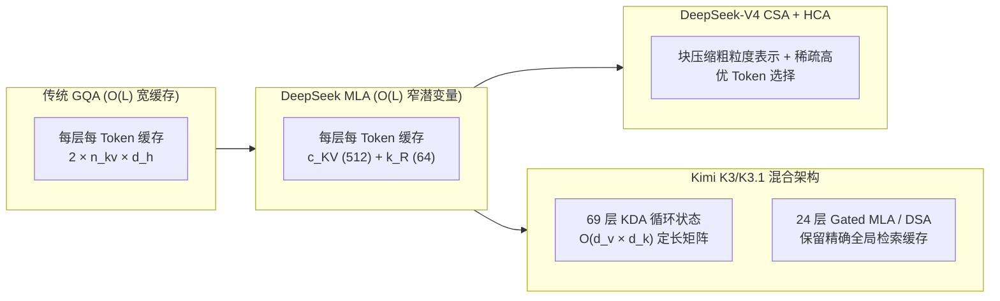

> [!NOTE] 核心速览 (TL;DR)
> - **新型注意力架构正名与拆解**：深入解析月之暗面 **KDA（Kimi Delta Attention，门控增量线性注意力）** 在 Kimi K3（69 层 KDA + 24 层 Gated MLA）及 K3.1 Pro（Gated DSA + KDA）中的混合编排，彻底纠正将 KDA 误写为“Dynamic Attention”或误认为“全模型显存恒定”的技术误区。
> - **显存增长斜率精确推演**：单层 KDA 维护与序列长度 $L$ 无关的固定维度循环矩阵状态 $\mathbf{S}_t \in \mathbb{R}^{d_v \times d_k}$，而保留的 24 层全注意力/稀疏注意力仍随上下文增长，将线性增长层数压缩约 **74.2%** 的同时守住大海捞针精确检索下限。
> - **推理工程联动**：与 [DeepSeek MLA 矩阵吸收原理](/articles/mha-gqa-mla-matrix-absorption-inference-engine/)、[DeepInfer 稀疏注意力算子栈](/articles/deepinfer-deepseek-recipe-architecture/) 及 [长思维链推理演进](/articles/reasoning-test-time-compute-inference-future/) 共同构成百万上下文推理底座。

## 为什么三种机制不能混为一谈？

百万 Token（1M Context）推理面临双重物理墙：**Decode 阶段的 KV Cache 显存容量与 HBM 带宽墙**，以及 **Prefill 阶段的 $O(L^2)$ 注意力算力墙**。工业界主流的三条架构演进路线分别从不同维度切入：

1. **DeepSeek-V2 / V3 的 MLA（Multi-head Latent Attention）**：沿通道维度（Channel Dimension）将每个历史 Token 的多头 K/V 压缩为低秩潜变量 $\mathbf{c}_t^{KV}$，**降低每 Token 缓存斜率**，但缓存总量仍为 $O(L)$。
2. **Kimi Linear / K3 / K3.1 的 KDA（Kimi Delta Attention）**：在大部分层用基于细粒度通道门控与 Delta Rule 的线性循环状态 $\mathbf{S}_t$ 替代逐 Token 历史缓存，使单个 KDA 层的状态体积变为 **$O(1)$（与序列长度无关）**，仅在少数穿插的全注意力层保留历史键值缓存。
3. **DeepSeek-V4 的 CSA / HCA（及 V3.2 DSA 闪电索引）**：在通道潜变量压缩之上进一步引入**序列维度（Sequence Dimension）的块压缩与 Top-$k$ 稀疏路由**，同步削减超长序列的计算复杂度与有效访存字节数。

---

## 一、MHA / GQA 的缓存计算基线

标准多头注意力（MHA）与分组查询注意力（GQA）的 KV Cache 字节数严格遵循：

$$\text{KV}_{\text{bytes}} = 2 \times B \times L \times N_{\text{layers}} \times n_{kv} \times d_h \times \text{bytes\_per\_elem}$$

以明确给定的 $B = 1$、$N_{\text{layers}} = 80$、KV 隐藏总维度 $n_{kv} \times d_h = 2048$（如 $n_{kv}=16, d_h=128$）、FP16/BF16（`2 Bytes`）算例核算：
- **单 Token 全层缓存**：$2 \times 80 \times 2048 \times 2 = 655,360\text{ Bytes} \approx 640\text{ KiB}$；
- **$L = 4,000$ Token**：约 `2.62 GB`（十进制 GB；换算二进制 GiB 除以 $2^{30}$ 约为 `2.44 GiB`）；
- **$L = 1,000,000$（1M）Token**：单并发请求即膨胀至 **`655.36 GB`**，单台 8×H100（640 GB HBM）连一条 1M 请求的原始 FP16 KV Cache 都无法独立容纳。

---

## 二、DeepSeek-V2 / V3 MLA：低秩潜变量与矩阵吸收

MLA 摒弃了逐头缓存完整 $\mathbf{K}_t, \mathbf{V}_t$ 的做法，转而缓存低维联合压缩潜向量 $\mathbf{c}_t^{KV} \in \mathbb{R}^{d_c}$ 与解耦的旋转位置编码键 $\mathbf{k}_t^R \in \mathbb{R}^{d_R}$：

$$\text{MLA\_bytes\_per\_layer\_token} = (d_c + d_R) \times \text{bytes\_per\_elem}$$

以 DeepSeek-V3 官方配置（$d_c = 512, d_R = 64, N_{\text{layers}} = 61$）验算：
- **单层单 Token 元素数**：$512 + 64 = 576$ 个浮点数（BF16 下为 `1,152 Bytes`，FP8 下仅 `576 Bytes`）；
- **全模型 61 层 1M Token 缓存**：BF16 下为 $61 \times 1,152 \times 10^6 \approx \mathbf{70.27\text{ GB}}$，启用 FP8 KV 后进一步降至约 **`35.14 GB`**。
- **矩阵吸收（Matrix Absorption）**：在 Decode 阶段，上投影矩阵 $\mathbf{W}^{UK}$ 被吸收进 Query 侧，$\mathbf{W}^{UV}$ 被吸收进输出投影 $\mathbf{W}^O$ 侧，从而避免在显存中把 `512` 维潜变量重新展开成庞大的多头 K/V 张量。完整线性代数推导请参阅 [从 MHA、GQA 到 DeepSeek MLA：矩阵吸收如何重塑推理算子](/articles/mha-gqa-mla-matrix-absorption-inference-engine/)。

需注意：**MLA 的缓存体积依然随序列长度 $L$ 严格线性增长**，且它是预训练原生结构，不能作为无损运行时开关直接套用在已训练好的 GQA 权重上。

---

## 三、Kimi Delta Attention (KDA) 与 K3 / K3.1 混合显存模型

### 1. KDA 的门控 Delta Rule 状态方程

传统线性注意力通过核技巧将注意力改写为累加外积 $\mathbf{S}_t = \mathbf{S}_{t-1} + \mathbf{v}_t \mathbf{k}_t^\top$，但在超长上下文中所有历史键值无差别叠加会导致严重的“记忆冲突（Memory Collision）”。**KDA（Kimi Delta Attention）** 在 DeltaNet 的纠错更新规则之上引入了**细粒度逐通道遗忘门控（Fine-grained Channel-wise Decay $\boldsymbol{\alpha}_t \in (0,1)^{d_k}$）**与写入强度标量门 $\beta_t$：

$$\mathbf{S}_t = \operatorname{diag}(\boldsymbol{\alpha}_t)\,\mathbf{S}_{t-1}\left(\mathbf{I} - \beta_t \mathbf{k}_t \mathbf{k}_t^\top\right) + \beta_t \mathbf{v}_t \mathbf{k}_t^\top, \qquad \mathbf{o}_t = \mathbf{S}_t \mathbf{q}_t$$

直观物理含义是：每当新 Token 到来时，模型先沿键方向 $\mathbf{k}_t$ 擦除旧状态中过时的关联值（Delta 纠错项 $-\beta_t \mathbf{S}_{t-1}\mathbf{k}_t\mathbf{k}_t^\top$），并按通道粒度衰减历史噪声 $\operatorname{diag}(\boldsymbol{\alpha}_t)$，最后写入新键值 $\beta_t \mathbf{v}_t \mathbf{k}_t^\top$。在 Prefill 阶段，KDA 可通过分块并行算法（Chunkwise Parallel Scan）跑满 Tensor Core。

### 2. Kimi K3 与 K3.1 Pro 的混合层显存公式

对于任意固定隐藏维度的单个 KDA 层，每个注意力头只需维护一个形状恒为 $d_v \times d_k$ 的二维状态矩阵 $\mathbf{S}_t$：

$$\text{State}_{\text{KDA\_layer}} = n_{\text{heads}} \times d_v \times d_k \times \text{bytes\_per\_state\_elem}$$

假设单层 $n_{\text{heads}} = 64, d_k = d_v = 128$，以 BF16/FP32 保存循环状态，单层状态仅占 **`2 MB ~ 4 MB`**，且无论上下文是 `4K` 还是 `1M` 都**完全不变**！

然而，纯线性循环状态在需要跨百万字精确逐字回溯（如提取某页财报的唯一订单哈希）时存在信息瓶颈。因此：
- **[Kimi K3](https://huggingface.co/moonshotai/Kimi-K3)（2.8T 总参 / 104B 激活）** 采用了约 **3:1 穿插的混合架构（69 层 KDA + 24 层 Gated MLA）**；
- **2026 年 11 月演进的 Kimi K3.1 Pro（支持 `1,048,576` 即 `1.04M` 上下文）** 进一步将全局层升级为 **Gated DSA（门控稀疏注意力）+ KDA** 组合。

因此，混合架构单请求总状态显存的严谨表达式为**“常数循环项 + 线性注意力项”**：

$$\text{Mem}_{\text{total}}(L) = \underbrace{N_{\text{KDA}} \times \text{State}_{\text{KDA\_layer}}}_{O(1)\text{ 定长循环状态（百 MB 级）}} + \underbrace{N_{\text{Attn}} \times L \times \text{Bytes}_{\text{Attn\_layer\_token}}}_{O(L)\text{ 随序列线性增长项}}$$

结论非常清晰：将 93 层中的 69 层替换为 KDA，使随长度 $L$ 线性膨胀的 KV Cache 层数减少了 $69 / 93 \approx \mathbf{74.2\%}$，极大压平了百万上下文的显存斜率；但 **24 层 Gated MLA / DSA 依然保留了随 $L$ 增长的缓存**，绝不能把整模笼统宣传为“任意长度恒定显存”。此外，若在服务端开启多轮前缀复用（见 [前缀缓存与 RadixAttention 原理](/articles/prefix-caching-radix-attention-internals/)），引擎还需为分叉点保存 KDA 状态快照（State Checkpointing），这同样需要计入服务端显存池预算。

---

## 四、DeepSeek-V4 CSA / HCA 与稀疏索引演进

当序列达到 `1M` Token 时，即便 MLA 把每层缓存压到 `576` 维，全序列稠密注意力的计算量仍按 $O(L^2)$ 增长。[DeepSeek-V4 模型卡](https://huggingface.co/deepseek-ai/DeepSeek-V4-Pro) 引入了 **CSA（Compressed Sparse Attention，压缩稀疏注意力）** 与 **HCA（Heavily Compressed Attention，高压缩注意力）** 协同设计（同源稀疏算子栈的实现细节可参阅 [DeepInfer：DeepSeek 推理引擎架构与稀疏算子拆解](/articles/deepinfer-deepseek-recipe-architecture/)）：

1. **HCA（高压缩块级语义汇聚）**：对历史 Token 序列沿时间轴按块（Block/Stride）聚合压缩，构建远小于原始长度 $L$ 的粗粒度上下文摘要表示；
2. **CSA / DSA（细粒度动态稀疏选择）**：利用极轻量的索引器（如 FP8 Lightning Indexer）快速评估当前 Query 与历史位置的关联得分，仅从 HBM 中按需抓取 **Top-$k$（例如 $k=2048$）** 个高相关细粒度潜变量块参与精确注意力计算。

需要注意的是：稀疏注意力虽然在**计算与每步 HBM 读取带宽**上把复杂度从 $O(L)$ 降至 $O(k)$，但只要未来步的 Query 仍可能回溯命中任意历史 Token，完整的压缩历史潜变量池依然需要驻留在集群 HBM 或分层 DRAM 池中——即**节省的是每步访存带宽与算力，缓存驻留容量仍需按模型实际压缩比核算**。

---

## 五、如何设计可复现的长上下文架构评测？

脱离控制变量的“100K 占 8.6 GB、1M 达 110 tok/s”数字不具备工程参考价值。横向对比 MLA、KDA 混合模型与 CSA/HCA 时，必须固定并披露以下五组基线：

| 评测维度 | 必须锁定并记录的控制变量 |
| --- | --- |
| **模型与精度** | 精确 HuggingFace revision、权重格式（FP8 / NVFP4 / MXFP4）、KV Cache dtype 与 KDA 循环状态 dtype（BF16 vs FP32） |
| **并行切分** | TP / PP / DP / EP 拓扑，特别是 MLA 潜变量是否在 TP Rank 间复制（或采用 DP Attention）以及 KDA 头状态如何分片 |
| **负载形态** | 精确 Prompt / Output Token 长度分布、并发度、是否开启 Prefix Caching / State Snapshot 以及预热轮次 |
| **显存账本拆解** | 分项采集每张 GPU 的静态权重、KDA 定长状态池、线性 KV 块池、CUDA Graph 捕获缓冲与通信 Workspace |
| **有效质量闭环** | 同步报告 TTFT、TPOT、满足 SLO 的有效吞吐，以及在多针检索（Multi-Needle）、跨页财报核算上的真实准确率 |

生产集群的完整硬件选型与启动参数请参阅 [DeepSeek-V4 与 Kimi K3 生产级部署实战指南](/articles/deepseek-v4-kimi-k3-deployment-guide/)。

## 常见问题 (FAQ)

### Q1: KDA 的全称是什么？它是否让 Kimi K3 / K3.1 彻底摆脱了 KV Cache？
KDA 的官方全称是 **Kimi Delta Attention**（基于细粒度通道衰减与 Delta Rule 的线性注意力，而非“Dynamic Attention”）。单个 KDA 层的循环状态矩阵大小确实不随上下文长度增长，但 Kimi K3（69 层 KDA + 24 层 Gated MLA）与 K3.1 Pro 均保留了约四分之一的注意力层用于高精全局检索，因此全模型依然包含随序列长度线性增长的缓存分量。

### Q2: 为什么 KDA 循环状态和 MLA 潜变量对低精度量化的敏感度不同？
MLA 缓存的是每个历史位置独立的静态投影向量，配合按块缩放（Block-wise FP8）通常能稳定保持精度；而 KDA 的状态矩阵 $\mathbf{S}_t$ 需要在数十万步自回归更新中反复乘加累积，若状态矩阵位宽过低，舍入误差会沿时间步持续放大，因此生产引擎通常将 KDA 核心累加状态保持在 BF16 或 FP32，仅对权重和线性注意力的静态键值层按需量化（详见 [大模型量化实战指南](/articles/quantization-hands-on-guide/)）。

### Q3: 稀疏注意力（如 CSA 或 DSA）把每步参与计算的 Token 限制在 Top-$k$，是否意味着显存占用也只剩 $k$ 个 Token？
不是。每步仅读取 Top-$k$ 个块大幅削减的是 **Decode 阶段的 HBM 读取带宽与注意力算力开销**；但由于后续生成的下一个 Token 可能会关注完全不同的历史段落，全量上下文的压缩潜变量仍需保留在 HBM 或主机内存池（如 Mooncake / LMCache 分层存储）中以备随时索引。
