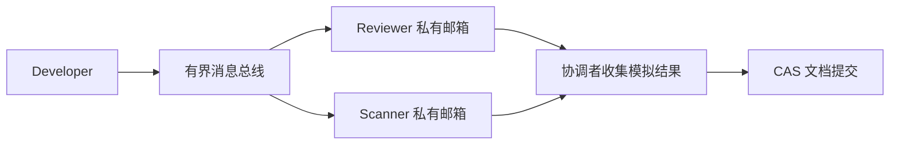

## 多 Agent 协作需要明确的消息与所有权

多 Agent 并不自动优于单 Agent。只有任务能分解、结果可验证，且并行收益超过通信和模型成本时，才值得拆分。本文用进程内 `asyncio` 演示 Actor 邮箱、消息投递、CAS 提交与令牌桶，不把本地队列等同于分布式持久消息代理。

## 信封、邮箱与背压

每个 Actor 按顺序消费自己的邮箱，多个 Actor 可以并行等待 I/O。冻结 dataclass 只能限制字段重新赋值，不能冻结内部字典，因此投递时必须复制消息载荷，避免订阅者互相修改数据。

队列有容量上限，投递超过等待预算会抛出 `BackpressureError`。广播不是原子事务：部分订阅者可能已收到消息，调用方应按消息 ID 去重并处理部分失败。示例没有持久化、ACK 重投或 Request-Response Future 注册表。



## 完整可运行示例

[下载 Python 源码](/examples/agents/actor_runtime.py)，使用 Python 3.11+ 执行 `python3 actor_runtime.py`。审查节点只作字符串条件判断，用来演示协作时序，不是真实代码审计器。协调者等待两个检查完成后才提交；Actor 停机时先排空队列，再取消等待任务。


```python
"""In-process actors with bounded delivery; not a distributed durable broker."""
import asyncio
import copy
import json
import time
import uuid
from dataclasses import asdict, dataclass, field
from enum import Enum


class MessageType(str, Enum):
    REQUEST = "request"
    RESPONSE = "response"
    EVENT = "event"


@dataclass(frozen=True)
class MessageEnvelope:
    source_actor: str = ""
    target_actor: str = ""
    message_type: MessageType = MessageType.REQUEST
    correlation_id: str = ""
    payload: dict = field(default_factory=dict)
    message_id: str = field(default_factory=lambda: str(uuid.uuid4()))
    timestamp: float = field(default_factory=time.time)

    def to_json(self):
        return json.dumps(asdict(self))

    @classmethod
    def from_json(cls, value):
        data = json.loads(value)
        data["message_type"] = MessageType(data["message_type"])
        return cls(**data)


class BackpressureError(RuntimeError):
    pass


class MessageBus:
    def __init__(self, mailbox_size=100, delivery_timeout=1):
        if mailbox_size < 1 or delivery_timeout <= 0:
            raise ValueError("mailbox_size and delivery_timeout must be positive")
        self.mailbox_size = mailbox_size
        self.delivery_timeout = delivery_timeout
        self.actor_mailboxes = {}
        self.subscriptions = {}

    def register_actor(self, actor_id):
        if actor_id in self.actor_mailboxes:
            raise ValueError("actor already registered")
        mailbox = asyncio.Queue(maxsize=self.mailbox_size)
        self.actor_mailboxes[actor_id] = mailbox
        return mailbox

    def subscribe(self, topic, actor_id):
        self.subscriptions.setdefault(topic, set()).add(actor_id)

    async def send(self, envelope):
        mailbox = self.actor_mailboxes.get(envelope.target_actor)
        if mailbox is None:
            raise ValueError("unknown actor")
        await self._deliver(mailbox, envelope)

    async def _deliver(self, mailbox, envelope):
        try:
            await asyncio.wait_for(mailbox.put(copy.deepcopy(envelope)), self.delivery_timeout)
        except asyncio.TimeoutError as error:
            raise BackpressureError("mailbox delivery timed out") from error

    async def publish(self, topic, envelope):
        # Each subscriber receives a separate payload; delivery is not an atomic broadcast.
        await asyncio.gather(*(self._deliver(self.actor_mailboxes[actor], envelope)
            for actor in self.subscriptions.get(topic, ()) if actor in self.actor_mailboxes))


class BaseActor:
    def __init__(self, actor_id, bus):
        self.actor_id = actor_id
        self.bus = bus
        self.mailbox = bus.register_actor(actor_id)
        self.task = None
        self.errors = []

    async def start(self):
        if self.task is not None:
            raise RuntimeError("actor already started")
        self.task = asyncio.create_task(self._event_loop())

    async def stop(self, timeout=5):
        if self.task is None:
            return
        try:
            await asyncio.wait_for(self.mailbox.join(), timeout)
        finally:
            self.task.cancel()
            await asyncio.gather(self.task, return_exceptions=True)
            self.task = None

    async def _event_loop(self):
        while True:
            envelope = await self.mailbox.get()
            try:
                await self.on_message(envelope)
            except asyncio.CancelledError:
                raise
            except Exception as error:
                self.errors.append(error)
            finally:
                self.mailbox.task_done()

    async def on_message(self, envelope):
        raise NotImplementedError


class ConcurrentDocumentStore:
    def __init__(self):
        self._content, self._version = "", 1
        self._lock = asyncio.Lock()

    async def get_document(self):
        async with self._lock:
            return {"content": self._content, "version": self._version}

    async def update_document(self, new_content, expected_version, author):
        async with self._lock:
            if self._version != expected_version:
                return False
            self._content = new_content
            self._version += 1
            return True


class TokenBucketRateLimiter:
    def __init__(self, capacity, refill_rate_per_sec):
        if capacity <= 0 or refill_rate_per_sec <= 0:
            raise ValueError("capacity and refill rate must be positive")
        self.capacity, self.refill_rate = capacity, refill_rate_per_sec
        self.tokens, self.last_refill = float(capacity), time.monotonic()
        self._lock = asyncio.Lock()

    async def acquire(self, tokens_needed=1):
        if not 0 < tokens_needed <= self.capacity:
            raise ValueError("requested tokens must fit bucket capacity")
        while True:
            async with self._lock:
                now = time.monotonic()
                self.tokens = min(self.capacity, self.tokens + (now-self.last_refill)*self.refill_rate)
                self.last_refill = now
                if self.tokens >= tokens_needed:
                    self.tokens -= tokens_needed
                    return
                delay = (tokens_needed-self.tokens)/self.refill_rate
            await asyncio.sleep(delay)


async def main():
    bus, store = MessageBus(), ConcurrentDocumentStore()
    limiter = TokenBucketRateLimiter(2, 2)

    class Developer(BaseActor):
        async def on_message(self, envelope):
            await limiter.acquire()
            await self.bus.publish("code", MessageEnvelope(source_actor=self.actor_id,
                message_type=MessageType.EVENT, correlation_id=envelope.correlation_id,
                payload={"code": "def login(): return True"}))

    class Reviewer(BaseActor):
        def __init__(self, actor_id, bus):
            super().__init__(actor_id, bus)
            self.approved = False

        async def on_message(self, envelope):
            self.approved = envelope.payload["code"].startswith("def login")

    developer, reviewer, scanner = Developer("dev", bus), Reviewer("review", bus), Reviewer("scan", bus)
    actors = [developer, reviewer, scanner]
    bus.subscribe("code", "review")
    bus.subscribe("code", "scan")
    for actor in actors:
        await actor.start()
    try:
        await bus.send(MessageEnvelope(target_actor="dev", correlation_id="example-1"))
        await developer.mailbox.join()
        await asyncio.gather(reviewer.mailbox.join(), scanner.mailbox.join())
        # Simulated checks only; the coordinator commits after both completed.
        if not all(actor.errors == [] for actor in actors) or not (reviewer.approved and scanner.approved):
            raise RuntimeError("review failed")
        snapshot = await store.get_document()
        merged = await store.update_document("def login(): return True", snapshot["version"], "coordinator")
        print("Simulated merge:", merged)
    finally:
        for actor in actors:
            await actor.stop()


if __name__ == "__main__":
    asyncio.run(main())
```

## 从本地示例走向分布式系统

CAS 版本号检查防止覆盖旧文档，但不会自动合并冲突。真实数据库应把版本比较和写入放在同一原子操作中。令牌桶使用单调时钟，申请量大于桶容量会立即报错；它只约束请求速率，不能替代 Token/minute、并发上限或服务商的 Retry-After 处理。

跨进程部署需要序列化、身份认证、持久消息代理、投递确认、幂等键和死信处理。`asyncio.Lock` 只保护当前进程的对象，不能充当分布式锁。进一步的执行边界见 [Tool Use 进阶](/articles/advanced-agent-tool-use-and-function-calling/)，审批恢复见 [轻量 Agent 框架](/articles/build-lightweight-agent-framework/)。

## 常见问题 (FAQ)

### Q1: `frozen=True` 是否足以实现不可变消息？
不足。嵌套的 payload 字典仍可修改。本例在投递到每个邮箱前深拷贝信封；分布式传输则应序列化为独立消息。

### Q2: 邮箱满了会丢消息还是永久挂起？
本例等待至多 `delivery_timeout`，超时返回明确异常。调用方需要选择重试、降载或持久化；不能把异常当成投递成功。

### Q3: 一个处理器报错会让 `queue.join()` 永久等待吗？
本例在 `finally` 中调用 `task_done()`，同时记录处理错误供协调者检查。生产系统仍需为失败消息设计重投或死信策略。

依据：[asyncio Queue](https://docs.python.org/3/library/asyncio-queue.html)、[Python dataclasses](https://docs.python.org/3/library/dataclasses.html)。
