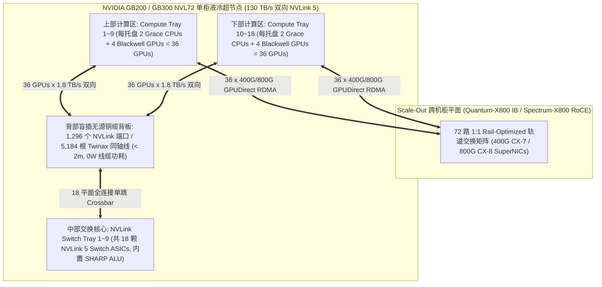
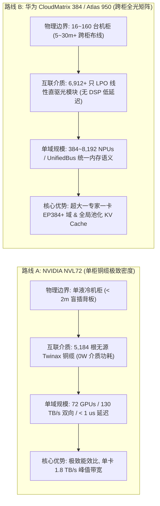
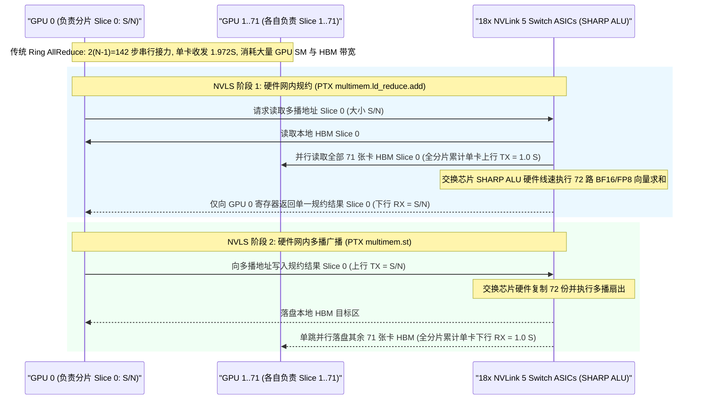
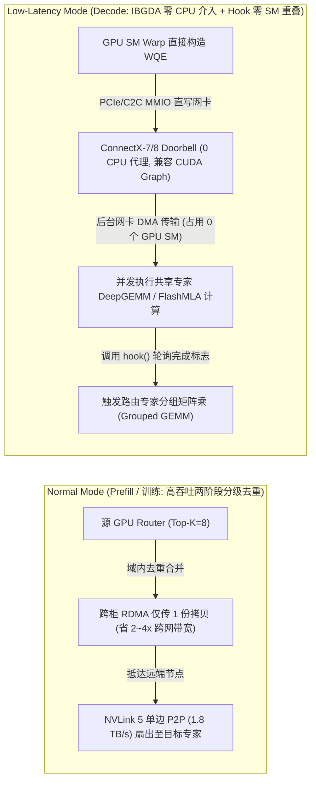

> [!NOTE] 核心速览 (TL;DR)
> - **8 卡孤岛终结与带宽断崖消除**：传统 8 卡 HGX 服务器在机箱边界处面临 **Scale-Up（NVLink 5 单向 900 GB/s、双向 1.8 TB/s 字节级 Load/Store）** 与 **Scale-Out（400G NDR / 800G XDR RDMA 单向 50~100 GB/s 报文级队列传输）** 之间 **9~18 倍单向带宽断崖** 与微秒级延迟跳变，迫使万亿参数 MoE 与大专家并行（Wide-EP）全面转向机柜级超节点（Rack-Scale SuperPoD）。
> - **铜进光退 vs 全光超节点工程路线**：精准拆解 **NVIDIA GB200/GB300 NVL72**（18 计算托盘 × 9 NVLink 交换托盘、5,184 根盲插同轴铜缆实现 **130 TB/s** 双向无阻塞单跳互联，单柜省电逾 20 kW，池化 13.8 TB 至 20.7 TB HBM3e）与 **华为 CloudMatrix 384 / Atlas 950 超节点**（依托 6,912 只 400G LPO 线性直驱光模块与 UnifiedBus 协议跨越 16 机柜距离墙，将统一寻址 Scale-Up 域扩展至 384~8,192 颗昇腾 NPU）。
> - **NCCL 带宽数学与 NVLS 硬件多播规约**：从第一性原理推导 `algbw` 与 `busbw` 归一化公式，揭示 Ring 算法在 72 卡规模下 $2(N-1)=142$ 步串行跳数的延迟灾难，并剖析 **NVLS（NVLink SHARP）** 如何通过 `multimem.ld_reduce` 与 `multimem.st` 指令将单卡 NVLink/HBM 流量从 $2\frac{N-1}{N}S$ 削减近半至 $\frac{N+1}{N}S$。
> - **MoE All-to-All 内核与 MNNVL 生产排障**：解剖 **DeepEP** 如何结合域内 NVLink 去重转发、跨柜 **IBGDA（GPU 直驱异步 RDMA Doorbell，零 CPU 介入）** 与 `num_sms` 精确配额将 Decode 分发合并压至 ~163 $\mu\text{s}$；提供覆盖 `nvidia-imex` 跨节点显存域、`nccl-tests` 72 卡压测与 NVLink 降速定位的完整运维手册。

---

## 引言：8 卡服务器时代的终结——为什么万亿 MoE 与 Wide-EP 迫使算力底座走向机柜级超节点？

在过去十年的深度学习基础设施演进中，以 NVIDIA DGX/HGX H100 为代表的 **“单机 8 卡 GPU 服务器”** 曾是工业界无可争议的标准算力原子。在这一范式下，架构师习惯了一条泾渭分明的并行切分铁律：将通信极度密集的张量并行（TP=8）严格锁死在单台 8 卡机器内部的 NVSwitch 总线之内，而将数据并行（DP）与流水线并行（PP）放到跨机 InfiniBand 或 RoCE 网络之上。

然而，随着以 DeepSeek-V3/R1 及新一代万亿参数稀疏混合专家模型（Mixture-of-Experts, MoE）为代表的现代架构成为主流，传统的 8 卡物理边界正在沦为锁死算力利用率的头号枷锁。在 [解密 DeepSeek 推理印钞机：DeepInfer 与 deepseek-recipe 生产全栈拆解](/articles/deepinfer-deepseek-recipe-architecture/) 与 [MoE 专家并行推理引擎设计](/articles/moe-expert-parallelism-inference-engine/) 中我们曾指出，稀疏 MoE 模型在自回归 Decode 阶段面临极端的 **“高总参数显存占用 + 低单步计算访存比 + 全网高频 All-to-All 激活路由”** 三重夹击。

让我们用最冷酷的物理定律算一笔账，看清横亘在传统 8 卡服务器机箱外壳上的 **“通信物理断崖”**：

1. **Scale-Up（机内纵向扩展）与 Scale-Out（跨机横向扩展）的带宽与语义鸿沟**：
   - 在机箱内部（Scale-Up），Blackwell GPU 通过第五代 NVLink（NVLink 5）直连 NVSwitch，单卡提供 **900 GB/s 单向带宽（1.8 TB/s 双向带宽）**。更重要的是，NVLink 支持硬件级 **字节可寻址（Byte-Addressable）Load/Store 内存语义**——GPU SM 线程只需发射一条 PTX `ld.global` 或 `st.global` 指令，即可在 **~0.6 $\mu\text{s}$** 内直接读写远端卡的 HBM3e 显存。
   - 一旦跨越 8 卡机箱边界（Scale-Out），流量必须经由 PCIe Gen5/Gen6 或 C2C 总线进入 ConnectX-7（400 Gbps NDR，即 **50 GB/s 单向**）或 ConnectX-8 SuperNIC（800 Gbps XDR，即 **100 GB/s 单向**）网卡。
   - 这意味着，跨出机箱的一瞬间，**单卡单向有效带宽暴跌了 9 倍（800G XDR）至 18 倍（400G NDR）**（若以双向 1.8 TB/s NVLink 对比单向 50~100 GB/s RDMA 注入能力，落差高达 **18~36 倍**）！同时，通信语义从纳秒级缓存行读写退化为 **报文级（Packetized）RDMA Queue Pair（QP）工作队列（WQE）序列化传输**，端到端基础跳步延迟飙升至 **2~5 $\mu\text{s}$**。
2. **Wide-EP（大专家并行）Decode 算力在 8 卡孤岛上的崩塌**：
   - 假设一个拥有 256 个路由专家（Top-$K=8$）、总权重 671B~1T 的 MoE 模型运行在线上低延迟 Decode 池（严格保障单用户输出速度 $> 100\text{ tokens/s}$，即每层耗时预算仅约 **130~160 $\mu\text{s}$**）。
   - 为了将单卡专家权重读取耗时压到微秒级，同时腾出充裕显存容纳长上下文 KV Cache，必须采用 **EP=64 甚至 EP=72** 的大专家并行（每张 GPU 仅驻留 3~4 个路由专家，聚合 72 张卡高达 $72 \times 8\text{ TB/s} = \mathbf{576\text{ TB/s}}$ 的 HBM3e 访存总带宽）。
   - 如果将这 64 张 GPU 散落在 8 台传统的 8 卡 HGX 服务器上，每一层 Transformer 的每个生成 Token 都必须经历 `Dispatch`（分发至专家）与 `Combine`（汇总专家输出）两次全网 `All-to-All` 通信。在均匀路由下，高达 $\frac{64 - 8}{64} = \mathbf{87.5\%}$ 的专家路由流量被迫一头撞上仅有 50~100 GB/s 的跨机 RDMA 网卡！通信耗时瞬间吞噬单层总耗时的 50% 以上，昂贵的 Tensor Core 陷入大面积空转气泡（Bubble）。
3. **P/D 分离 KV Cache 池化与强化学习（RL）权重重切分的双重诉求**：
   - 在 [P/D 分离架构与分布式 KV Cache 传输](/articles/pd-disaggregation-distributed-kv-cache/) 场景下，超长上下文请求的巨量 KV Cache 需要在 Prefill 与 Decode 实例间以百 GB/s 速率流转；而在 [分布式强化学习后训练与 verl 共置架构](/articles/distributed-rl-post-training-verl-colocation/) 中，训练态（FSDP/TP/PP）向推理采样态（Wide-EP）切换时，每轮迭代都要对数百 GB 权重执行全局 `AllGather` / `All-to-All` 重切分（Weight Resharding）。

唯一的破局之道，就是**彻底砸碎 8 卡机箱的物理藩篱，把 Scale-Up 内存语义高带宽域从 8 张卡暴力扩张到 72 张卡乃至数百、数千张卡**——这正是 **机柜级超节点（Rack-Scale SuperPoD）** 诞生的第一性原理。

| 架构维度 | 传统 8 卡服务器 (HGX H100/B200) | NVIDIA GB200 / GB300 NVL72 | 华为 CloudMatrix 384 (Atlas 900 A3) | 华为 Atlas 950 SuperPoD |
| :--- | :--- | :--- | :--- | :--- |
| **Scale-Up 单域规模** | 8 GPUs (单机箱) | **72 Blackwell GPUs** + 36 Grace CPUs | **384 Ascend 910C NPUs** + 192 Kunpeng CPUs | **64 ~ 8,192 Ascend 950DT NPUs** |
| **物理空间形态** | 单个 6U~8U 风冷/液冷节点 | **单台标准液冷机柜** (18 计算托盘 + 9 交换托盘) | **16 台机柜** (12 计算柜 + 4 交换柜) | 多柜集群 (1,024 卡基础 Pod 含 160 柜) |
| **Scale-Up 物理介质** | PCB 板载走线 (NVSwitch) | **5,184 根无源盲插同轴铜缆** (< 2m) | **全光互联** (5,376 只 400G LPO 光模块) | **跨柜全光互联** (UnifiedBus 2.0) |
| **单芯片 Scale-Up 带宽** | 900 GB/s ~ 1.8 TB/s (双向) | **1.8 TB/s 双向** (900 GB/s 单向, NVLink 5) | **784 GB/s 双向** (392 GB/s 单向, UB) | **2,016 GB/s 双向** (18 × 112G UB 端口) |
| **单域聚合 Scale-Up 带宽** | 7.2 TB/s ~ 14.4 TB/s (双向) | **130 TB/s 双向** (64.8 TB/s 全双工对分) | **~150.5 TB/s 单向聚合** (无阻塞全光矩阵) | **1.72 PB/s** (1024 卡) ~ **16 PB/s** (8192 卡) |
| **单域池化 HBM 总容量** | 640 GB ~ 1.5 TB | **13.8 TB** (GB200) / **20.7 TB** (GB300) | **~49.2 TB HBM2E** (128 GB × 384) | 最高支持 **256 TB 全局统一内存寻址** |
| **Scale-Out 跨节点/跨柜网卡** | 8 × 400G/800G IB/RoCE | **72 × 400G (CX-7) 或 800G (CX-8)** | **384 × 400G RoCE** (1,536 只光模块) | 400G UBoE / RoCE 高速平面 |

> [!TIP]
> **超节点显存与通信带宽在线核算**：在规划万亿参数 MoE 模型的 EP/TP 切分粒度、KV Cache 并发上限及跨节点通信吞吐门槛时，可使用站内交互式工具 [LLM 显存占用与吞吐估算器](/tools/) 实时推演不同精度（FP16/FP8/FP4）下的硬件水位。

---

## 一、超节点物理拓扑拆解：NVIDIA GB200/GB300 NVL72 铜缆背板 vs 华为 CloudMatrix 384 / Atlas 超节点全光互联

同样是为了构建超大半径的 Scale-Up 统一内存域，全球智算基础设施演化出了两条截然不同却各自登峰造极的物理工程路线：**以 NVIDIA NVL72 为代表的“单柜极致液冷 + 无源盲插铜缆背板”路线**，以及 **以华为昇腾 CloudMatrix 384 / Atlas 950 为代表的“跨柜 LPO 全光矩阵 + UnifiedBus 统一总线”路线**。

### 1.1 NVIDIA GB200 / GB300 NVL72 解剖：5,184 根铜缆织就的 130 TB/s 单体超级 GPU

打开一台重达 1.36 吨、满载热设计功耗（TDP）达 **120~140 kW** 的 NVIDIA GB200 NVL72（或升级版 Blackwell Ultra GB300 NVL72）全液冷机柜，其物理排布完全围绕 **“电磁信号衰减极限”** 精心设计：

1. **三明治式垂直对称机柜布局（Sandwich Rack Layout）**：
   - 机柜并非按传统方式把交换机放在顶部（Top-of-Rack），而是将 **9 台 1RU NVLink Switch 交换托盘（Switch Trays）严格居中放置**；
   - 在交换托盘区的上方和下方，对称插入 **上 9 台 + 下 9 台 = 共 18 台 1RU 液冷计算托盘（Compute Trays）**。
   - 为什么要把交换机夹在正中间？因为在 200 Gbps PAM4 超高频 SerDes 速率下，无源铜缆的奈奎斯特插入损耗（Insertion Loss）极其严苛，极限无中继传输距离仅为 **1.5 ~ 2 米**。交换托盘居中后，从机柜最顶端和最底端计算托盘到任意交换托盘的最大物理走线长度被精确压缩在 **~1.2 米以内**，彻底消除了有源重定时器（Retimer）与光模块的生存必要。
2. **计算托盘与内存池规格（GB200 vs GB300）**：
   - 每台 Compute Tray 内部封装了 **2 组 Grace-Blackwell 超级芯片（2 颗 72 核 Grace Arm CPU + 4 颗 Blackwell GPU）**，CPU 与配对的 2 颗 GPU 之间通过 **900 GB/s 双向 NVLink-C2C** 一致性总线互联。
   - 整柜合计拥有 **$18 \times 2 = \mathbf{36}$ 颗 Grace CPU** 与 **$18 \times 4 = \mathbf{72}$ 颗 Blackwell GPU**。
   - **HBM3e 显存池跃迁**：在 **GB200 NVL72** 中，每颗 B200 GPU 配备 **192 GB HBM3e**（可用约 186 GB，单卡访存带宽 8 TB/s），整柜聚合 **13.8 TB HBM3e**（可用约 13.4~13.5 TB）；而在 **GB300 NVL72（Blackwell Ultra）** 中，每颗 B300 GPU 升级至 **12-Hi 堆叠的 288 GB HBM3e**，整柜 HBM3e 容量跃升 50% 至 **20.7 TB**，叠加 36 颗 Grace CPU 挂载的约 **17 TB LPDDR5X** 内存，在单台机柜内构筑起高达 **~37 TB 的硬件缓存一致性统一寻址内存池**！
3. **18 平面单跳无阻塞 Crossbar 与 5,184 根同轴铜缆数学还原**：
   - 每台 NVLink Switch Tray 内含 **2 颗 NVLink 5 Switch ASIC**，9 台交换托盘共计 **18 颗交换芯片**（每颗芯片具备 72 个 NVLink 5 端口，单芯片交换容量高达 7.2 TB/s 双向）。
   - 每颗 Blackwell GPU 引出 **18 条 NVLink 5 链路**（每条链路含正反各 2 对 200 Gbps PAM4 差分线，即单链路 **50 GB/s 单向 / 100 GB/s 双向**，合计单卡 **900 GB/s 单向 / 1.8 TB/s 双向**）。
   - **拓扑正交映射**：全柜 72 颗 GPU 的第 $k$ 条 NVLink 链路（$k \in \{0, \dots, 17\}$）分别直连至第 $k$ 颗 NVSwitch ASIC！由此构成 $72 \times 18 = \mathbf{1,296}$ 个 NVLink 物理端口；每个端口包含 4 对高速同轴差分线（Twinax），合计 **$1,296 \times 4 = \mathbf{5,184}$ 根高速同轴铜缆**（累计线长约 2 英里 / 3.2 公里），全部密封在机柜背部的模块化盲插线束盒（NVLink Cable Cartridges）中，计算托盘推入导轨即自动完成数千针脚的高频盲插耦合。
   - 任意两颗 GPU（哪怕分别位于第 1 托盘与第 18 托盘）之间的通信，都并行打散在全部 18 颗 NVSwitch 芯片上，**严格只需 1 次交换芯片跳步（Single-Hop）**，实现 **$72 \times 1.8\text{ TB/s} = \mathbf{129.6\text{ TB/s}} \approx \mathbf{130\text{ TB/s}}$** 的全双工无阻塞聚合带宽！



**为什么 NVIDIA 在柜内死守无源铜缆（Copper）而拒绝光模块（Optics）？**
答案是硬核的热力学与可靠性账单：如果把这 1,296 条双向 100 GB/s（等效 800 Gbps）链路换成双端可插拔 800G DSP 光模块（共需 $1,296 \times 2 = 2,592$ 个等效 800G 光引擎接口，单模块功耗约 13~16 W），**仅光电转换芯片就会在单台机柜内凭空烧掉 20 kW ~ 30 kW 以上的额外功耗**，同时引入 ~100 ns 的 DSP 编解码转发延迟，并因激光器热衰减大幅拉低整柜平均无故障时间（MTBF，即臭名昭著的“闪断 Flapping”）。无源铜缆不仅实现了 **0 W 线缆功耗与光速级电气直通**，更让整柜 120 kW+ 供电预算 100% 倾注于硅片算力。

### 1.2 华为 CloudMatrix 384 与 Atlas 950 超节点：突破单柜铜缆半径的 UnifiedBus 全光互联

然而，无源铜缆的物理优势也锁死了它的几何天花板：**单台标准机柜在 120~140 kW 散热与机械承重极限下，最多只能塞入 72 颗（未来 Vera Rubin NVL144 双 Die 封装为 144 颗逻辑 GPU）芯片**。一旦想要把 384 颗甚至数千颗算力芯片拉进同一个扁平 Scale-Up 域，机柜间走线距离必然拉长至 5~30 米，无源铜缆彻底失效。

面对单芯片制程受限的客观工程边界，华为在 **Atlas 900 A3 SuperPoD（商用代号 CloudMatrix 384）** 与新一代 **Atlas 950 SuperPoD** 上走出了一条极具颠覆性的 **“以光电互联换取超大规模系统级赶超”** 之路：

1. **CloudMatrix 384（Atlas 900 A3）全光超节点架构**：
   - **规模与空间拓扑**：由 **16 台物理机柜**（**12 台计算柜 + 4 台总线交换柜**）组成单一逻辑超节点，内部集成 **384 颗昇腾 Ascend 910C NPU**（双 Die 封装，单颗约 780 TFLOPS BF16 算力、128 GB HBM2E 显存）与 **192 颗鲲鹏 CPU**。整套超节点聚合 **~300 PFLOPS BF16 稠密算力** 与高达 **~49.2 TB 的 HBM 显存池**（约为 GB200 NVL72 的 3.6 倍），整 Pod 功耗约 **560 kW**。
   - **UnifiedBus（UB 灵衢总线）带宽拆解**：每颗 Ascend 910C 的单个计算 Die 引出 $7 \times 224\text{ Gbps}$ 高速 UB 通道，双 Die 合计提供高达 **3,136 Gbps = 392 GB/s 单向（784 GB/s 双向）** 的 Scale-Up 互联带宽；此外每颗 NPU 独立配备 **400 Gbps（50 GB/s 单向）** 的 RoCE RDMA Scale-Out 网络接口。
   - **6,912 只 LPO 线性直驱光模块破解光功耗困局**：为了跨越 16 个机柜实现 384 颗 NPU 的单层无阻塞全互联，CloudMatrix 384 部署了惊人的 **6,912 只 400G 光模块**（其中 **5,376 只专用于内部 UB Scale-Up 平面**，1,536 只用于跨 Pod Scale-Out 平面）。为了避免传统 DSP 光模块带来的百千瓦级功耗灾难与微秒级延迟，华为大规模引入 **LPO（Linear-Drive Pluggable Optics，线性直驱可插拔光模块）**——直接砍掉光模块内部高功耗的 DSP 重定时芯片，由交换芯片与 NPU 高性能 SerDes 线性直驱激光器，将单只光模块功耗腰斩约 **50%**，同时把光电转换延迟压制在 **几纳秒（ns）** 量级！
2. **Atlas 950 SuperPoD 与 UnifiedBus 2.0 演进**：
   - 在搭载 **Ascend 950DT**（单卡最高 144 GB HBM、4.0 TB/s 显存带宽，原生支持 FP8/MXFP8 ~1 PFLOPS 与 FP4 ~2 PFLOPS）的 **Atlas 950 SuperPoD** 中，每颗芯片配备 **18 个 112G UnifiedBus 端口（双向总带宽高达 2,016 GB/s）**。
   - 依托全光交换与 2+2 光路冗余自愈技术，UnifiedBus 2.0 将单个超节点的统一内存语义寻址半径从 384 卡进一步推向 **1,024 卡基础 Pod（聚合 UB 带宽 1.72 PB/s）**，最高可扩展至 **8,192 颗 NPU（聚合互联带宽 16 PB/s，全局统一内存寻址空间达 256 TB，全域 RTT 延迟仅 ~3 $\mu\text{s}$）**。



这两条路线展现出极其鲜明的工程权衡（Trade-off）：NVL72 追求极致的单柜体积算力密度与能效比；而 CloudMatrix 384 / Atlas 950 则主动承担跨柜全光互联的功耗成本，换取 **384 卡以上的超大扁平 Scale-Up 域**——在部署 256~384 专家的万亿 MoE 时，可以直接实现 **“一专家一卡（One-Expert-Per-NPU）”** 甚至在同一 UB 总线池内原生完成 [P/D 分离与分布式 KV Cache 零拷贝直读](/articles/pd-disaggregation-distributed-kv-cache/)，彻底省去跨柜 RDMA 转发层。

### 1.3 Scale-Up 域与 Scale-Out 轨道优化（Rail-Optimized）双平面正交协同与定量账本

当模型训练或超大规模推理集群跨越单台 NVL72 机柜（例如由 16 台 GB200/GB300 NVL72 组成 1,152 卡集群，或由 144 台组成万卡集群）时，**Scale-Up 铜缆平面**与 **Scale-Out 光纤 RDMA 平面**呈现出完美的正交分工：
- **柜内纵向（Scale-Up Plane）**：全柜 72 张 GPU 通过 NVLink 5 承载所有高频通信——包括 TP 张量并行、EP=72 专家并行 `All-to-All` 以及上下文并行（CP）环网。
- **跨柜横向（Scale-Out Plane）**：每颗 Blackwell GPU 均以 **1:1 无收敛配比** 直连一张 **ConnectX-7（400G NDR）** 或 **ConnectX-8 SuperNIC（800G XDR，PCIe Gen6 接口）**，整柜对外引出 **72 根 400G/800G 高速光纤**（另配 BlueField-3 DPU 专职处理南北向存储与管控流量）。这 72 路光纤严格遵循我们在 [InfiniBand 胖树拓扑、Rail-Optimized 轨道优化与 SHARP 网内计算](/articles/infiniband-fat-tree-rail-optimized-topology-adaptive-routing-sharp/) 中推导的 **Rail-Optimized 组网准则**：不同机柜内同序号槽位的 GPU 优先汇聚至同一组 Leaf 轨道交换机，使得跨柜 DP 梯度同步（`AllReduce` / `ReduceScatter`）完全锁定在平行轨道子树内无阻塞运行。

为了直观量化超节点消弭 Scale-Out 断崖后的真实收益，我们以 **671B 级稀疏 MoE 模型（隐藏层维度 $H=7168$，61 层 MoE，Top-$K=8$，单卡 Decode 本地微批次 $B_{\text{local}}=64$ Tokens，采用 FP8 `Dispatch` + BF16 `Combine`）** 在 64 卡专家并行（EP=64）下的单步通信耗时做一次严谨的算术推演：

1. **单卡单层 `All-to-All` 原始净荷计算**：
   - `Dispatch` 阶段（FP8 激活 + 缩放因子）：每个选中专家需传输约 $7,168\text{ B} + 128\text{ B} \approx 7.3\text{ KB}$；
   - `Combine` 阶段（BF16 精度回传）：每个选中专家回传 $7,168 \times 2\text{ B} = 14,336\text{ B} \approx 14.0\text{ KB}$；
   - 单 Token 在 Top-$K=8$ 路由下每层收发净荷为 $8 \times (7.3 + 14.0)\text{ KB} = 170.4\text{ KB}$；在 $B_{\text{local}}=64$ 时，**每张 GPU 每层产生的双向总路由流量为 $64 \times 170.4\text{ KB} \approx \mathbf{10.9\text{ MB}}$**（其中 `Dispatch` 约 $3.7\text{ MB}$，`Combine` 约 $7.2\text{ MB}$）。
2. **三种物理底座上的传输线速下界对比**：
   - **传统 8 台 HGX 8 卡服务器（400G NDR InfiniBand，单卡单向有效净荷约 45 GB/s）**：若不加分层去重，高达 $\frac{56}{64} = 87.5\%$ 的流量（约 $9.5\text{ MB}$）必须挤过跨机网卡，单层纯物理线速传输下界为 $\frac{9.5\text{ MB}}{45\text{ GB/s}} \approx \mathbf{211\ \mu\text{s}}$，61 层累计仅线路序列化就吃掉 **~12.9 ms**（叠加小包队列延迟往往突破 **18~22 ms/token**）！
   - **单台 NVIDIA GB200/GB300 NVL72 超节点（NVLink 5 单向有效净荷约 750 GB/s）**：64 张卡 100% 落在单跳铜缆交换网内，单层纯传输耗时骤降至 $\frac{10.7\text{ MB}}{750\text{ GB/s}} \approx \mathbf{14.3\ \mu\text{s}}$（61 层合计 **< 0.9 ms**），**相比跨机 8 卡孤岛提速近 15 倍**，可被共享专家与 MLA 注意力计算 100% 掩盖！
   - **华为 CloudMatrix 384 全光超节点（UB 单卡单向 392 GB/s，有效净荷约 320 GB/s）**：不仅将单层 `All-to-All` 纯传输耗时压制在 $\frac{10.9\text{ MB}}{320\text{ GB/s}} \approx \mathbf{34\ \mu\text{s}}$，更允许将并行度直接拉满至 **EP=256 或 EP=320**，使每颗昇腾 910C 仅需从 HBM2E 加载 **1 个专家权重**，用超大互联域彻底对冲单芯片访存带宽差异！

---

## 二、集合通信原语与带宽数学：从 Ring / Tree 到 NVLS (NVLink SHARP) 硬件多播规约

在超节点集群上进行性能调优，如果分不清 **算法带宽（`algbw`）** 与 **总线带宽（`busbw`）**，或者用错 `Ring`、`Tree` 与 `NVLS` 算法，价值数千万美元的 130 TB/s 铜缆背板可能连 30% 的有效吞吐都发挥不出来。下面我们从严格数学模型出发，彻底贯通集合通信底层原理。

### 2.1 `algbw` 与 `busbw` 的严格第一性原理推导

设参与集合通信的 GPU 总数（Ranks）为 $N$，逻辑张量字节大小为 $S$（单位 Bytes），完成一次集合通信原语的实测墙钟耗时为 $T$（单位 Seconds）。

**1. 算法带宽（Algorithm Bandwidth, `algbw`）**：
从上层 PyTorch 应用视角出发，单位时间内处理完逻辑张量 $S$ 的表观速率定义为：

$$\text{algbw} = \frac{S}{T}$$

为什么不能直接用 `algbw` 去对比硬件网卡或 NVLink 标称带宽？因为 `algbw` 会随着参与卡数 $N$ 的增加而下降，它忽略了底层为了达成全局一致性在物理链路上实际搬运的字节倍数！为此，NCCL 官方基准套件 `nccl-tests` 引入了 **总线带宽（Bus Bandwidth, `busbw`）**——将吞吐率严格归一化到 **单张 GPU 单向物理瓶颈链路的实际数据承载速率 $B_{\text{uni}}$**（例如 Blackwell NVLink 5 的 $B_{\text{uni}} = 900\text{ GB/s}$，Hopper NVLink 4 的 $B_{\text{uni}} = 450\text{ GB/s}$，ConnectX-8 800G 的 $B_{\text{uni}} = 100\text{ GB/s}$）：

- **`ReduceScatter`（规约散播）**：每张卡初始持有大小为 $S$ 的完整张量，最终每张卡获得全局求和后的 $\frac{1}{N}$ 分片（大小 $\frac{S}{N}$）。在点对点环形流水线中，每张卡需要向外发送并接收 $N-1$ 个大小为 $\frac{S}{N}$ 的数据块，单卡单向物理链路实际搬运字节数为 $\frac{N-1}{N}S$。因此：

  $$\text{busbw}_{\text{ReduceScatter}} = \frac{\frac{N-1}{N} S}{T} = \text{algbw} \times \frac{N-1}{N}$$

- **`AllGather`（全局收集）**：作为 `ReduceScatter` 的对偶逆操作，每张卡初始持有 $\frac{S}{N}$ 分片，最终拼齐总大小 $S$ 的完整张量。每张卡同样需从网络接收其余 $N-1$ 张卡的分片（共 $\frac{N-1}{N}S$ 字节）：

  $$\text{busbw}_{\text{AllGather}} = \text{algbw} \times \frac{N-1}{N}$$

- **`AllReduce`（全局规约）**：在经典的拉宾斯奈德（Rabenseifner）点对点分解中，一次完整的 `AllReduce` 等价于 **一次 `ReduceScatter` + 一次 `AllGather`**。数据在全网中完整流转两趟，每张卡单向发送和接收的总字节数均为 $2\frac{N-1}{N}S$：

  $$\text{busbw}_{\text{AllReduce}} = \frac{2\frac{N-1}{N} S}{T} = \text{algbw} \times \frac{2(N-1)}{N}$$

- **`AlltoAll`（全员个性化交换）**：每张卡持有总大小为 $S$ 的发送缓冲区（均分为 $N$ 份，每份 $\frac{S}{N}$ 发往目标卡 $j \in \{0, \dots, N-1\}$）。发给自身的那一份（$\frac{S}{N}$）仅需本地显存拷贝，真正跨物理互联总线发送给其余 $N-1$ 张卡的数据量为 $\frac{N-1}{N}S$：

  $$\text{busbw}_{\text{AlltoAll}} = \text{algbw} \times \frac{N-1}{N}$$

| 集合通信原语 | 单卡输入尺寸 | 单卡输出尺寸 | Ring/P2P 单卡单向网络流量 | `nccl-tests` 总线带宽公式 (`busbw`) | $N=72$ 时修正系数 |
| :--- | :---: | :---: | :---: | :---: | :---: |
| **`AllReduce`** | $S$ | $S$ | $2\dfrac{N-1}{N} S$ | $\text{algbw} \times \dfrac{2(N-1)}{N}$ | $\mathbf{1.9722}$ |
| **`ReduceScatter`** | $S$ | $S / N$ | $\dfrac{N-1}{N} S$ | $\text{algbw} \times \dfrac{N-1}{N}$ | $\mathbf{0.9861}$ |
| **`AllGather`** | $S / N$ | $S$ | $\dfrac{N-1}{N} S$ | $\text{algbw} \times \dfrac{N-1}{N}$ | $\mathbf{0.9861}$ |
| **`AlltoAll`** | $S$ | $S$ | $\dfrac{N-1}{N} S$ | $\text{algbw} \times \dfrac{N-1}{N}$ | $\mathbf{0.9861}$ |

### 2.2 Ring vs Double Binary Tree：α-β 延迟模型与 72 卡线性跳数灾难

根据分布式计算经典的 Hockney $\alpha\text{-}\beta$ 模型（设单跳启动与同步固定延迟为 $\alpha$，单卡单向有效字节传输时间的倒数即带宽为 $B_{\text{uni}} = 1/\beta$），我们来审视 **Ring AllReduce** 的端到端耗时方程：

$$T_{\text{Ring}}(S, N) = \underbrace{2(N-1)\alpha_{\text{hop}}}_{\text{串行跳数延迟项 } O(N)} + \underbrace{2\frac{N-1}{N}\frac{S}{B_{\text{uni}}}}_{\text{带宽传输项}}$$

在 8 卡节点上，$2(N-1) = 14$ 步尚可接受；然而当我们将 Ring 算法直接搬上 **NVL72 的 $N=72$ 张卡** 时，串行跳数暴涨至 **$2 \times 71 = \mathbf{142}$ 步**！即便单跳核内同步与链路延迟 $\alpha_{\text{hop}}$ 压低至 $1.5\ \mu\text{s}$，仅空载跳数延迟底噪就高达 $142 \times 1.5\ \mu\text{s} = \mathbf{213\ \mu\text{s}}$！在大模型推理 TP 切分或中小 Batch 场景下（单次 `AllReduce` 张量往往仅有 `128 KB ~ 8 MB`），带宽传输项仅需几微秒，95% 以上的时间全被 142 次串行接力耗死！

为了解决中大集群下的 $O(N)$ 延迟爆炸，NCCL 引入了 **双二叉树（Double Binary Tree, `NCCL_ALGO=Tree`）**：
- 单棵二叉树虽然将汇聚与广播跳数降为对数级 $2\lceil \log_2 N \rceil$，但存在致命缺陷——超过一半的节点是叶子节点（只发不收或只收不发，浪费 50% 上下行带宽），而中间节点却要承受 2 个子节点上联 + 1 个父节点下联的带宽阻塞。
- NCCL 巧妙构造了 **两棵结构互补的二叉树（Tree A 与 Tree B）**：Tree A 中的内部非叶子节点恰好在 Tree B 中充当叶子节点！系统将数据切分为两半并发注入两棵树，使得每张 GPU 同时充当一棵树的内部汇聚点与另一棵树的叶子节点，**既保留了 100% 满双工带宽利用率，又将 72 卡或跨机数百卡的通信步数从 $O(N)$ 砍到了对数级 $O(\log_2 N)$**，成为跨多机柜 Scale-Out 中等包长场景的主力算法。

### 2.3 NVLS (`NCCL_ALGO=NVLS` / `NVLSTree`) 硬件多播规约：为什么实测 `busbw` 能“突破”物理线速？

即便有了 Double Binary Tree，只要规约加法仍在 GPU 内部执行，每张 GPU 就必须耗费宝贵的流多处理器（SM）线程块去反复从 HBM 读取分片、在寄存器里做浮点累加、再写回 HBM 并转发给下一跳。

在第三代（Hopper）与第五代（Blackwell NVL72）NVSwitch 架构中，NVIDIA 在交换芯片硅片内部集成了硬件级网内计算单元——**NVLS（NVLink SHARP / NVLink Network）**，彻底颠覆了集合通信的数据流向：

1. **CUDA VMM 多播虚拟地址映射（Multicast Memory Object）**：
   NCCL 利用底层 CUDA 虚拟内存管理 API（`cuMulticastCreate`、`cuMulticastAddDevice`、`cuMemMap`），在所有 72 张 GPU 的页表中映射出一段特殊的 **多播虚拟地址空间（Multicast VA）**，该虚拟地址在 NVSwitch 路由表中同时绑定全柜 72 张卡对应的物理 HBM 缓冲帧。
2. **两条硬件级 PTX 多播指令一键打通规约与广播**：
   全柜 72 张卡将大小为 $S$ 的待规约张量按地址均分为 $N$ 个专属负责分片（每张卡负责 $\frac{S}{N}$）：
   - **第一阶段（网内规约拉取 `multimem.ld_reduce`）**：GPU $i$ 的少量通信 Warp 对其负责的 $\frac{S}{N}$ 多播地址区间发射 PTX 指令 `multimem.ld_reduce.global.add.v4.bf16x2`（原生支持 FP16、BF16、FP32 及 FP8 低精度硬件累加）。18 颗 NVLink 5 Switch ASIC 收到请求后，并行向全部 $N$ 张 GPU 的 HBM 发起读取，**在交换机内部的 SHARP 算术逻辑单元（ALU）中实时完成 $N$ 路张量的线速求和**，仅将规约后的单一结果（大小 $\frac{S}{N}$）返回至 GPU $i$ 的寄存器！
   - **第二阶段（硬件多播回写 `multimem.st`）**：紧接着在同一流水线循环内，GPU $i$ 将寄存器里算好的 $\frac{S}{N}$ 结果直接发射一条 `multimem.st.global.v4.f32` 写入多播地址。NVSwitch 硬件多播引擎瞬间在交换网内将该数据包复制 $N$ 份，并行直写回全部 $N$ 张 GPU 的目标 HBM！



让我们精准核算 **NVLS AllReduce** 中每张 GPU 在物理 NVLink 链路上实际流过的单向字节总量：
- **GPU 上行发送量（GPU $\to$ Switch TX）**：阶段 1 向交换机贡献全量本地数据 $S$，阶段 2 向交换机写出自身汇总完的分片 $\frac{S}{N}$，合计：

  $$\text{TX}_{\text{NVLS}} = S + \frac{S}{N} = \frac{N+1}{N} S$$

- **GPU 下行接收量（Switch $\to$ GPU RX）**：阶段 1 接收自身负责的汇总结果 $\frac{S}{N}$，阶段 2 接收全量多播回写结果 $S$，合计：

  $$\text{RX}_{\text{NVLS}} = \frac{S}{N} + S = \frac{N+1}{N} S$$

对比 Ring 算法的 $2\frac{N-1}{N}S$ 与 NVLS 的 $\frac{N+1}{N}S$（在 $N=72$ 时，即 **$1.9722 S$ vs $1.0139 S$**）：
1. **NVLink 物理链路流量与 HBM 读写压力双双直降 48.6%（接近腰斩）！**
2. **彻底解开“超线速 `busbw` 悖论”**：许多工程师在 H100（单向 NVLink 4 物理峰值 $450\text{ GB/s}$，扣除协议头后有效净荷极限 $B_{\text{eff}} \approx 370\text{ GB/s}$）或 GB200 NVL72（单向 NVLink 5 物理峰值 $900\text{ GB/s}$，有效净荷极限 $B_{\text{eff}} \approx 740\text{--}780\text{ GB/s}$）上运行 `all_reduce_perf` 时，惊讶地发现 H100 的 `busbw` 高达 **~480 GB/s**（超过了 450 GB/s 物理线速！），而 NVL72 的 `busbw` 更是能冲破 **950~1,100+ GB/s**！原因正是 `nccl-tests` 始终按 Ring 基准系数 $\frac{2(N-1)}{N}$ 换算 `busbw`：

   $$\text{busbw}_{\text{reported}} = \text{algbw}_{\text{NVLS}} \times \frac{2(N-1)}{N} \le \frac{B_{\text{eff}}}{\frac{N+1}{N}} \times \frac{2(N-1)}{N} = B_{\text{eff}} \times \frac{2(N-1)}{N+1}$$

   代入 8 卡 H100（$\frac{14}{9} \approx 1.556$）或 72 卡 NVL72（$\frac{142}{73} \approx \mathbf{1.945}$），硬件网内规约省下的近一半流量，直接体现为接近翻倍的等效总线吞吐增益！
3. **寄存器级 PTX 微内核实现与底层传输协议（`NCCL_PROTO`）矩阵**：
   在自定义超低延迟 TP `AllReduce` 算子（例如 SGLang、TensorRT-LLM 或 DeepInfer 定制通信核）中，工程师甚至可以绕过重量级 NCCL 调度器，直接在 CUDA C++ 中内联发射 128-bit 向量化 `multimem` 指令，仅用极少数 SM 跑满 NVSwitch SHARP 硬件管线：

   ```cuda
   // 基于 Hopper SM90+ / Blackwell SM100 的硬件多播 AllReduce 核心内联 PTX 循环
   // mc_ptr 指向通过 cuMulticastCreate 绑定了全柜 72 张卡物理 HBM 的多播虚拟地址
   __global__ void nvls_allreduce_bf16_kernel(
       void* __restrict__ mc_ptr,
       size_t slice_offset_bytes,
       size_t slice_num_vec4
   ) {
       char* my_mc_slice = static_cast<char*>(mc_ptr) + slice_offset_bytes;
       size_t tid = blockIdx.x * blockDim.x + threadIdx.x;
       size_t stride = gridDim.x * blockDim.x;

       for (size_t idx = tid; idx < slice_num_vec4; idx += stride) {
           void* addr = my_mc_slice + idx * 16; // 每次处理 16 Bytes (8 个 BF16 元素)
           uint32_t d0, d1, d2, d3;

           // 1. 交换机硬件网内规约：18 颗 NVSwitch 并行读取 72 卡 HBM 并在 ALU 内累加求和
           asm volatile(
               "multimem.ld_reduce.relaxed.sys.global.add.v4.bf16x2 {%0, %1, %2, %3}, [%4];"
               : "=r"(d0), "=r"(d1), "=r"(d2), "=r"(d3)
               : "l"(addr)
               : "memory"
           );

           // 2. 交换机硬件多播广播：单次发射，NVSwitch 硬件复制 72 份直写回全体 GPU HBM
           asm volatile(
               "multimem.st.relaxed.sys.global.v4.f32 [%0], {%1, %2, %3, %4};"
               :
               : "l"(addr), "r"(d0), "r"(d1), "r"(d2), "r"(d3)
               : "memory"
           );
       }
   }
   ```

   当训练跨越多个 NVL72 机柜时，NCCL 自动启用 **`NVLSTree`** 算法：机柜内 72 张卡先通过 NVLS `multimem.ld_reduce` 在纳秒间完成柜内硬件规约，随后通过跨柜 InfiniBand 树（还可进一步叠加交换机侧 IB SHARP，参见 [InfiniBand 胖树拓扑与 SHARP 网内计算](/articles/infiniband-fat-tree-rail-optimized-topology-adaptive-routing-sharp/)）完成柜间汇聚，最后再由柜内 NVLS `multimem.st` 单跳广播至全柜。与此同时，在帧协议层，NCCL 会依据张量字节数在三种硬件同步协议间自动寻优：

| 传输协议 (`NCCL_PROTO`) | 事务帧结构 (净荷 + 同步标志) | 理论线速效率 | 硬件原子性前置约束 | 典型最佳适用场景 |
| :--- | :--- | :---: | :--- | :--- |
| **`LL` (Low Latency)** | `4B Data + 4B Flag` (8B 原子字) | **50.0%** | 基础 8 字节存储原子性 | `< 32 KB` 极小张量（Decode 小 Batch 控制同步，极致微秒级延迟） |
| **`LL128`** | `120B Data + 8B Flag` (128B 事务) | **93.75%** | **强依赖 NVLink 128B 保序原子写**（严禁在拆分 TLP 的普通 PCIe 上强开） | `32 KB ~ 4 MB` 柜内 NVLink 中等张量（兼顾微秒级延迟与高带宽） |
| **`Simple`** | 大块环形 FIFO (`512 KB+`) + 内存屏障 | **~99%+** | 标准 DMA / GPUDirect RDMA 内存序 | `> 4 MB` 大张量梯度同步、NVLS 多播流水线及跨机 InfiniBand 传输 |

---

## 三、MoE All-to-All 通信极客解剖：跨层分级分发（Hierarchical Dispatch/Combine）与 IBGDA 零 CPU 介入

如果说 `AllReduce` 已经被 NVLS 硬件多播完美驯服，那么稀疏 MoE 架构赖以生存的 **`AlltoAllv`（动态不等长全员分发 `Dispatch` 与合并 `Combine`）** 则是当今超节点通信工程中最险峻的珠穆朗玛峰。

### 3.1 为什么 MoE `AlltoAllv` 比 `AllReduce` 难一个数量级？

在 MoE 层的前向传播中，门控路由器（Router）为本地每个 Token 动态挑选 Top-$K$（如 $K=8$）个目标专家，由此带来三大硬件难题：
1. **不可规约性（Non-Associative Routing）**：在 `Dispatch` 阶段，发往不同专家的 Token 激活张量是完全独立的语义个体，**绝对不能在交换机内部相加合并**！因此无论是 NVLS 的 `multimem.ld_reduce` 还是 IB SHARP，都无法对 `Dispatch` 流量做网内规约压缩。
2. **动态不规则分片与木桶效应（Ragged `AlltoAllv` & Routing Skew）**：不同专家在同一微批次中被命中的 Token 数量 $m_{i \to j}$ 高度偏斜且仅在 GPU 算完 Router Gate 后才动态揭晓，无法提前在 CPU 端静态编译固定偏移量；最繁忙的热点专家卡将成为拖慢全域同步的慢节点（Straggler）。
3. **小包风暴（$O(N^2)$ Message Rate Explosion）**：若在 4 台 NVL72 组成的 $N=288$ 卡专家并行域中执行扁平 `All-to-All`，单次通信瞬间迸发出 $288 \times 287 = \mathbf{82,656}$ 条并发点对点消息流！若 Decode 阶段每卡 Batch 仅有几十个 Token，单条流净荷不足几 KB，传统 RDMA 网卡的包处理率（Message Rate）与 CPU 驱动锁会瞬间崩溃。

### 3.2 分级转发（Normal Mode）vs 纯 RDMA 低延迟直驱（Low-Latency Mode）：DeepEP 内核解剖

为彻底攻克这一瓶颈，以开源标杆 **DeepEP**（集成于 [DeepInfer 生产推理技术栈](/articles/deepinfer-deepseek-recipe-architecture/) 以及 SGLang / vLLM 现代 MoE 后端）为代表的专用通信内核，彻底抛弃了通用 NCCL `ncclSend`/`ncclRecv` 包装，针对 **Prefill/训练高吞吐（Normal Mode）** 与 **Decode 极低延迟（Low-Latency Mode）** 锻造了两套底层异步管线：

1. **Normal Mode（面向 Prefill 与预训练的两阶段分级去重转发）**：
   - 当跨多个节点或机柜运行 EP 时，同一个 Token 选中的 Top-$K=8$ 个专家往往有多个落在同一个远端超节点/机器内部。若采用朴素扁平发送，该 Token 会通过宝贵的跨柜 RDMA 网卡重复发送多次！
   - DeepEP 的分级内核执行 **“先域内去重聚合 $\to$ 跨网 RDMA 单次传输 $\to$ 远端域内 NVLink 扇出”**：每个源 Token 对同一个远端 NVLink 域 **最多只发送 1 份跨网 RDMA 拷贝**（附带路由位图元数据），抵达目标域的代理 GPU 后，再借由高达 900 GB/s~1.8 TB/s 的域内 NVLink 单边写（One-Sided P2P `st.global`）瞬间分发给目标专家卡，一举将跨网 Scale-Out 流量削减 2~4 倍！
2. **Low-Latency Mode（面向 Decode 的 IBGDA 零 CPU 介入微秒级直驱）**：
   - 在小 Batch Decode 阶段，两阶段转发带来的额外一次流水线同步延迟反而得不偿失。此时首要矛盾从“省带宽”切换为“极致砍延迟 + 兼容 CUDA Graph 静态图捕获”。
   - 传统 GPUDirect RDMA 依赖 **CPU 代理线程（CPU Proxy Thread）**：GPU 算完路由后必须通过主机锁页内存唤醒 CPU 线程 $\to$ CPU 调用 `ibv_post_send` 组装 WQE 并通过 PCIe MMIO 敲响网卡门铃（Doorbell）。这一来一回不仅引入 **5~15 $\mu\text{s}$ 的操作系统调度抖动**，更因为存在主机 CPU 同步而无法被完整纳入 `cudaGraphLaunch`！
   - DeepEP 基于底层 NVSHMEM 启用了杀手锏 **IBGDA（InfiniBand GPUDirect Async，`NVSHMEM_IBGDA_SUPPORT=1`）**：在初始化阶段直接将 ConnectX-7/ConnectX-8 网卡的 **Queue Pair（QP）发送环形队列与 MMIO Doorbell 寄存器映射进 GPU 虚拟地址空间**！GPU SM 线程束（Warp）在核函数内部直接用寄存器构造 RDMA Write-with-Immediate WQE，并由 GPU 线程亲自向网卡发起原子 Doorbell 写入——**全程 0 CPU 介入、100% 兼容 CUDA Graph 固化重放**，在百卡级集群上将纯 RDMA Decode `Dispatch` 与 `Combine` 延迟压制在惊人的 **~163 ~ 195 $\mu\text{s}$**（而在单台 NVL72 全铜缆域内运行 EP=72 时，纯 NVLink P2P 单跳分发更是低至 **几十微秒**）！



### 3.3 通信与计算 SM 配额博弈：`num_sms` 精确建模与 Hook 零 SM 后台重叠

在超节点上实现“零通信气泡”的最后一环，是严防通信算子抢占矩阵计算算子（如 `DeepGEMM` 与 `FlashMLA`）的硬件计算核心（SM）：
- 如果任由传统 NCCL 启动数十个重量级持久化 CTA（线程块），GPU 上原本拥有 132~148 个 SM 的芯片会被划走 24~32 个 SM，导致并发运行的矩阵乘因波次量化（Wave Quantization）尾效应算力骤降 20% 以上。
- **Normal Mode 下的 `num_sms` 精细限流**：DeepEP 允许显式传入 `num_sms`（例如仅分配 `16` 或 `20` 个 SM 专门负责 NVLink 向量化读写与 FP8 动态量化打包），就能喂满物理带宽上限，将其余 **85% 以上的 SM 完整留给重叠计算流**。
- **Low-Latency Mode 下的 Hook 零 SM 异步重叠（Zero-SM Overlap）**：由于 IBGDA 下真正的数据搬运全部由网卡硬件 DMA 引擎在后台独立完成，GPU 线程只需花费 **几微秒** 把门铃敲响即可立即退出释放 SM！通过如下双微批次（Dual-Microbatch）或计算重叠钩子接口，在网络飞线传输期间实现 **真正的 0 SM 占用**：

```python
import torch
from deep_ep import Buffer

# 1. 初始化混合通信缓冲区：机柜内走 NVLink/MNNVL，跨机柜启用 IBGDA 低延迟队列
# num_nvl_bytes 与 num_rdma_bytes 分别预分配对称显存池与 IBGDA QP 环形缓冲区
ep_buffer = Buffer(
    group=ep_process_group,
    num_nvl_bytes=int(2e9),     # 2 GB NVLink / MNNVL 映射缓冲池
    num_rdma_bytes=int(1e9),    # 1 GB IBGDA GPUDirect Async 零拷贝缓冲池
    low_latency_mode=True,      # 开启 Decode 专用 IBGDA 路径 (需 NVSHMEM_IBGDA_SUPPORT=1)
    num_qps_per_rank=24,        # 为多专家并发流绑定独立硬件 QP 消除队头阻塞
)

def decode_moe_layer_with_zero_sm_overlap(
    hidden_states: torch.Tensor,
    topk_idx: torch.Tensor,
    topk_weights: torch.Tensor,
    shared_expert_fn,
    routed_experts_fn,
):
    # 2. 发起异步 Dispatch：GPU Warp 仅花数微秒敲响 ConnectX Doorbell 即立刻返回 recv_hook
    # return_recv_hook=True 确保等待期间绝不挂起任何 GPU SM 线程块！
    recv_x, recv_count, handle, event, recv_hook = ep_buffer.low_latency_dispatch(
        hidden_states,
        topk_idx,
        num_max_dispatch_tokens_per_rank=128,
        num_experts=256,
        use_fp8=True,           # Dispatch 途中原生转为 FP8 载荷，跨网字节量直接减半
        async_finish=False,
        return_recv_hook=True,
    )

    # 3. 黄金重叠窗口：此时后台网卡正在全速收发 FP8 Token (消耗 0 个 GPU SM！)
    # 当前 GPU 100% 的 SM 全力计算共享专家 (Shared Expert) 或下一微批次 Attention
    shared_out = shared_expert_fn(hidden_states)

    # 4. 触发轻量级完成钩子：核查接收队列原子标志位就绪后，无缝进入路由专家 Grouped GEMM
    recv_hook()
    expert_out = routed_experts_fn(recv_x, recv_count)

    # 5. 同样以零 SM Hook 模式发起异步 Combine 加权归位
    combined_out, event, combine_hook = ep_buffer.low_latency_combine(
        expert_out,
        topk_idx,
        topk_weights,
        handle,
        zero_copy=False,
        return_recv_hook=True,
    )
    combine_hook()
    return shared_out + combined_out
```

---

## 四、生产级压测、拓扑排障与多机多柜调优实战

将一台 GB200/GB300 NVL72 机柜或多柜超节点集群推入生产环境时，最容易踩坑的地方在于：**物理上它是一张统一的 72 卡 NVLink 网，但在操作系统视角下，它是由 18 台独立运行 Linux 内核的四卡服务器（Compute Trays）拼成的分布式集群！**

### 4.1 MNNVL 跨 OS 显存共享底座：Fabric Manager 与 `nvidia-imex` Clique 诊断

为什么传统单机 8 卡只需装好 GPU 驱动就能跑通 NVLink P2P，而 NVL72 却经常在刚上手时退化回慢速网络甚至直接报错崩溃？因为跨越 18 个独立 Linux 内核共享物理 HBM 地址，必须依赖 **MNNVL（Multi-Node NVLink）** 双守护进程协同：

1. **NVLink Fabric Manager（NMX-C）**：运行于交换托盘管理控制面，负责在机柜上电时对 5,184 根同轴铜缆执行链路训练（Link Training），并在 18 颗 NVSwitch 芯片中下发全局单播路由表与 NVLS 多播组表。
2. **`nvidia-imex`（Internode Memory Exchange Daemon，跨节点显存交换服务）**：必须以守护进程方式运行在全部 18 台计算托盘的 Linux OS 上！当上层 NCCL（配合 `NCCL_CUMEM_ENABLE=1`）通过 `cuMemExportToShareableHandle(..., CU_MEM_HANDLE_TYPE_FABRIC)` 导出本地显存句柄时，各托盘上的 `nvidia-imex` 依据 `/etc/nvidia-imex/nodes_config.cfg` 组成的信任域（**IMEX Clique**），通过加密 TCP/gRPC 控制面完成跨节点物理页权限校验与硬件页表导入。**只要任意一台托盘的 `nvidia-imex` 未就绪或节点 IP 列表不一致，整柜 MNNVL 与 NVLS 就会初始化失败！**

上线压测前，务必在全部 18 台计算托盘上执行以下四步标准体检：

```bash
# 步骤 1：核查 GPU 是否已成功注册进 NVLink Fabric 交换网
# 正常输出必须为 State: Completed 且 Status: Success，且全柜 72 卡拥有相同的 ClusterUUID 与 CliqueId
nvidia-smi -q -i 0 | grep -A 6 "Fabric"

# 步骤 2：逐卡核查 18 条 NVLink 5 物理链路速率与硬件误码计数器
# 确认 Link 0 ~ Link 17 全部处于 Active (50 GB/s 单向 / 100 GB/s 双向)，且 CRC/Replay 错误为 0
nvidia-smi nvlink -s -i 0
nvidia-smi nvlink -e -i 0

# 步骤 3：核查本机与全机柜 18 个节点的 IMEX 跨节点显存交换域状态
# nvidia-imex-ctl -N 必须显示全部 18 台 Compute Tray 均为 READY 且 Domain State 为 UP！
sudo systemctl status nvidia-imex
nvidia-imex-ctl -q
nvidia-imex-ctl -N
```

### 4.2 72 卡全机柜与跨柜 `nccl-tests` 压测实战及黄金环境变量矩阵

确认硬件 Fabric 与 IMEX Clique 全绿后，使用编译支持 CUDA 12.6+ / Blackwell SM100 及最新 NCCL（建议 `v2.25.2+` / `v2.27+`）的 `nccl-tests` 执行全柜 72 卡及多柜联合压测。跨柜InfiniBand 底层网卡驱动、OpenSM 主备与 `ibdiagnet` 光链路巡检规范可前置参考 [InfiniBand 生产级集群落地运维与 NCCL 极限调优](/articles/infiniband-production-deployment-opensm-ofed-nccl-tuning/)。

```bash
#!/usr/bin/env bash
# 生产级 GB200/GB300 NVL72 单柜 (18 节点 x 4 卡 = 72 GPUs) 与多柜压测脚本

# 1. 核心 MNNVL 与 NVLS 加速开关
export NCCL_MNNVL_ENABLE=1          # 强制启用跨计算托盘 Multi-Node NVLink
export NCCL_CUMEM_ENABLE=1          # 必须开启 CUDA VMM 动态显存句柄以支持 MNNVL 与多播映射
export NCCL_NVLS_ENABLE=1           # 开启 NVLink SHARP 硬件网内规约与多播广播

# 2. Grace-Blackwell C2C 架构与 Scale-Out Rail 轨道调优
export NCCL_NET_GDR_C2C=1           # 允许跨 Grace-Blackwell NVLink-C2C 路径启用 GPUDirect RDMA
export NCCL_NET_GDR_LEVEL=SYS       # 防止 Grace Arm 拓扑下因 PCIe Host Bridge 距离误关 GDR
export NCCL_CROSS_NIC=0             # 在严格对称的 Rail-Optimized 胖树中锁定同轨通信，避免跨轨乱窜
export NCCL_IB_HCA=mlx5             # 指定高速 ConnectX-7 / ConnectX-8 数据面 HCA (排除管理口)

# 3. 调试日志：首次压测打开 INIT,TUNING,NVLS 确认实际命中了 MNNVL 与 NVLS 通道
export NCCL_DEBUG=INFO
export NCCL_DEBUG_SUBSYS=INIT,TUNING,NVLS

# 4. 执行全柜 72 卡 AllReduce 峰值压测 (8 Bytes 扫频至 16 GB，步进因子 2)
srun -N 18 --ntasks-per-node=4 --cpu-bind=numa --mpi=pmix \
  /opt/nccl-tests/build/all_reduce_perf -b 8 -e 16G -f 2 -g 1 -w 5 -n 20

# 5. 执行全柜 72 卡 AlltoAll 压测 (检验 MoE 专家并行无网内规约下的纯交换矩阵对分吞吐)
srun -N 18 --ntasks-per-node=4 --cpu-bind=numa --mpi=pmix \
  /opt/nccl-tests/build/alltoall_perf -b 1M -e 4G -f 2 -g 1 -w 5 -n 20
```

**如何专业判读 `nccl-tests` 输出报表？**
- **Out-of-place vs In-place**：默认报表同时打印独立收发缓冲区（`out-of-place`）与原地覆盖（`in-place`）两列。生产训练中梯度同步多为 `in-place`，二者性能应高度接近；若 `out-of-place` 明显偏低，往往指向显存带宽争抢或页表未对齐。
- **单柜 72 卡健康水位红线与典型扫频基线对比**：
  - 在 `all_reduce_perf` 大包区间（`4G ~ 16G`），日志必须打印 `Using MNNVL` 与 `NVLS` 算法通道；受惠于 NVLS 接近折半的流量压缩效应，健康的 GB200/GB300 NVL72 机柜汇报的 `busbw` 通常稳定在 **850 ~ 1,100+ GB/s** 高位，而中小包（`1 MB`）延迟应控制在几十微秒以内（彻底碾压传统跨机 IB 的数百微秒）。
  - 在 `alltoall_perf` 中，由于无法使用 NVLS 网内求和，测试的是实打实的 NVLink 5 点对点全双工交换能力，大包 `busbw` 应逼近单向有效协议上限 **~650 ~ 760+ GB/s**。若某台托盘配置错误回退到了外部 400G/800G 网卡，`busbw` 会瞬间断崖式暴跌至 **< 95 GB/s**！

```text
# 典型健康 GB200 NVL72 全机柜 72 Ranks (18 Compute Trays x 4 GPUs, MNNVL + NVLS 开启) 判读特征参考
#       size         count      type   redop    root     time   algbw   busbw #wrong
#        (B)    (elements)                              (us)  (GB/s)  (GB/s)
       65536         32768     bf16     sum      -1     19.4    3.38    6.66      0   <-- 微秒级低延迟区
     1048576        524288     bf16     sum      -1     28.6   36.66   72.31      0   <-- 1 MB 仅 ~28 us (传统跨机 IB > 120 us)
    67108864      33554432     bf16     sum      -1    168.5  398.27  785.48      0   <-- 64 MB 快速爬升突破 750 GB/s
  1073741824     536870912     bf16     sum      -1   2084.2  515.18 1016.05      0   <-- 1 GB 触发 NVLS 超线速等效 busbw!
  8589934592    4294967296     bf16     sum      -1  15960.0  538.22 1061.48      0   <-- 8 GB 稳态饱和 (~1,060+ GB/s busbw)
```

- **云原生多租户安全边界（Kubernetes DRA `ComputeDomain`）**：在多团队共享一台或多台 NVL72 机柜时，切忌在宿主机上全局暴露单一静态 IMEX 通道（否则容器 A 可通过伪造 Fabric Handle 越权映射容器 B 的物理显存！）。在 Kubernetes 1.32+ 结合 NVIDIA DRA Driver 生产环境中，应声明 `ComputeDomain` 资源对象，由调度器在同一个 NVL72 机柜内按拓扑亲和性分配一组 Compute Trays，并为每个分布式训练/Wide-EP 推理作业动态注入隔离的 `/dev/nvidia-caps-imex-channels/channelN` 设备句柄。

### 4.3 线上典型故障定位：NVLink 单通道降速、IMEX 脑裂与木桶效应排查

在大规模超节点集群运维与云原生调度（Kubernetes 侧拓扑感知调度与 GPU Operator 纳管方案详见 [Kubernetes GPU Operator 与 AI 推理调度实战](/articles/k8s-gpu-operator-ai-inference-scheduling/)）中，高频线上顽疾可通过以下闭环手册秒级定界：

1. **故障现象 A：`ncclCommInitRank` 卡死超时或报 `unhandled system error` / `IMEX_ERROR`**：
   - **根因**：Kubernetes Pod 或 Slurm 作业跨托盘拉起时，部分计算托盘上的 `/etc/nvidia-imex/nodes_config.cfg` 未同步最新节点 IP，或容器内未挂载 `/dev/nvidia-caps-imex-channels` 字符设备（在 K8s 1.32+ 中需通过 Dynamic Resource Allocation `ComputeDomain` 动态注入独立 IMEX Channel 以实现多租户显存安全隔离）。
   - **修复**：运行 `nvidia-imex-ctl -N` 定位状态为 `UNAVAILABLE` 或 `CONNECTING` 的节点，对齐配置并验证容器 `nvidia-caps-imex-channels` 权限。
2. **故障现象 B：72 卡 `all_reduce_perf` 未报错，但整柜 `busbw` 莫名跌落 25%~40%（例如仅剩 500 GB/s）**：
   - **根因**：集合通信具有残酷的 **同步木桶效应**——全柜 1,296 个 NVLink 端口中，哪怕仅有某一台计算托盘推入机柜时盲插连接器微尘污染，导致某颗 GPU 的 18 条 NVLink 链路掉了 2~3 条（退化为 15 条 Active），或者某条铜缆高频重传（Replay Error 飙升），其余 71 张健康卡在每个流水线切片上都必须停下来等待这颗降速卡！
   - **二分法秒级揪出病灶托盘**：无需逐卡盲查，直接将 18 台托盘对半切分为上 9 托盘（36 卡）与下 9 托盘（36 卡）并发跑 10 秒 `alltoall_perf`；锁定慢半区后继续二分，**最多 5 轮（不到 2 分钟）即可精准揪出异常 Compute Tray**，随后结合 `nvidia-smi nvlink -e` 与交换托盘 `/var/log/nmx/nmx-c/fabricmanager.log` 定位具体故障端口。

---

## 常见问题 (FAQ)

### Q1: 为什么 NVIDIA GB200/GB300 NVL72 采用“18 台计算托盘 × 每托盘 4 卡”的碎片化设计，而不是做成“9 台 8 卡托盘”，且必须把 9 台交换托盘夹在机柜正中央？
**核心原因在于 130 kW 级液冷散热极限与 200G SerDes 无源铜缆的物理衰减半径铁律。**
首先，单颗 Blackwell B200/B300 GPU 热设计功耗高达 1,000 W ~ 1,400 W，若单托盘强塞 8 颗 GPU + 4 颗 CPU，单 1RU/2RU 托盘热通量将突破冷板液冷流道压降极限与盲插水嘴流量上限，且整盘重量超出单人运维滑轨承重安全线；拆分为 18 台 1RU 四卡托盘可将单盘功耗控制在 ~5.5~6.5 kW 的黄金液冷区间。其次，NVLink 5 采用 200 Gbps PAM4 信号，无源 Twinax 同轴铜缆在不加有源 Retimer 的前提下，高频损耗预算严格限制总走线长度（PCB 走线 + 盲插连接器 + 背板线缆）不得超过约 **1.5 ~ 2 米**。只有把 9 台 NVLink Switch 交换托盘放置在机柜垂直正中心，上下各排布 9 台计算托盘，才能把最远端托盘到交换芯片的物理距离折半控制在 ~1.2 米以内，用纯无源铜缆达成 130 TB/s 互联并省下逾 20 kW 光模块功耗。

### Q2: 在 H100 或 GB200 NVL72 上运行 `all_reduce_perf` 时，为什么开启 NVLS 后测出的 `busbw` 会超过单卡 NVLink 的单向物理线速上限？这是否意味着测试工具算错了？
**测试工具没有算错，这是 NVLS 硬件网内规约打破传统点对点流量下界后的正常数学现象。**
`nccl-tests` 为了保持跨算法横向可比性，对 `AllReduce` 固定采用点对点 Ring 算法的理论流量系数来换算总线带宽：$\text{busbw} = \text{algbw} \times \frac{2(N-1)}{N}$（隐含假设每张卡必须收发接近 $2S$ 的数据才能完成全局规约）。然而，开启 NVLS（`NCCL_NVLS_ENABLE=1`）后，求和运算被卸载到了 NVSwitch 芯片内部的 SHARP ALU 中，每张卡仅需通过 `multimem.ld_reduce` 与 `multimem.st` 实际收发 $\frac{N+1}{N}S \approx 1.014S$（$N=72$）的字节量即可拿到完整结果。换言之，NVLS 用接近一半的物理总线流量完成了原本需要两倍流量的工作；当物理链路跑满有效净荷上限 $B_{\text{eff}}$ 时，套用 $\frac{2(N-1)}{N}$ 公式折算出的等效 `busbw` 最高可达 $B_{\text{eff}} \times \frac{2(N-1)}{N+1}$，因此在 72 卡超节点上完全可以突破单向标称线速！

### Q3: 既然 NVLS 与 InfiniBand SHARP 能让 `AllReduce` 获得近 2 倍加速，为什么 MoE 模型的 `All-to-All`（`Dispatch` / `Combine`）不能直接开启网内规约来翻倍带宽？
**根本原因在于 MoE 专家路由通信不具备全网结合律规约（Associative Reduction）的代数性质。**
在 `AllReduce` 中，全网 $N$ 张卡相同坐标位置的元素执行的是同构加法 $y = \sum_{i=0}^{N-1} x_i$，交换机可以把 72 个输入包在芯片内就地加成一个输出包，从而将转发字节数压缩 $N$ 倍。而在 MoE `Dispatch` 阶段，源卡发往不同专家卡的 Token 隐状态是彼此独立的异构特征向量，目标专家必须原封不动地收到每一个独立 Token 才能执行非线性激活函数（如 SwiGLU），交换机一旦将它们相加就会彻底损毁张量信息；即便在 `Combine` 阶段，虽然每个源 Token 需要将其选中的 Top-$K$（如 $K=8$）个专家输出做加权求和，但这是一种高度稀疏、每个 Token 路由目标各异的个性化局部归约，而非全网统一的静态多播组求和。因此，MoE `All-to-All` 只能依靠超节点高对分带宽（NVL72 的 130 TB/s 或 CloudMatrix 384 的全光 UB）、两阶段域内去重转发以及 DeepEP IBGDA 异步单边写来压榨极限性能。

### Q4: 在一台 72 卡 NVL72 机柜中，如果某一台计算托盘内核崩溃重启或单条铜缆发生硬件故障，会导致整柜 72 张卡全部瘫痪不可用吗？生产集群如何实现故障隔离？
**不会导致整柜报废，现代 MNNVL 控制面支持细粒度托盘摘除与子域重编排（Sub-Clique Isolation）。**
由于 18 台计算托盘拥有各自独立的 Grace CPU、供电模块与 Linux OS，单台托盘宕机不会引起物理背板掉电。在交换控制面，NVLink Fabric Manager（NMX-C）感知到某台托盘链路断开后，会将对应端口从活跃路由与多播掩码中动态隔离，其余 17 台健康托盘（68 张 GPU）之间的单跳无阻塞 NVLink 通路依然完好。在调度编排层（如 Slurm 或结合 Kubernetes DRA `ComputeDomain` 的云原生调度器），运维系统只需从当前作业的 `nvidia-imex` 节点配置中剔除故障托盘，并拉入热备节点或缩容重启为 64 卡（16 托盘）IMEX 子域，即可在分钟级恢复高带宽超节点训练与 Wide-EP 推理服务。
