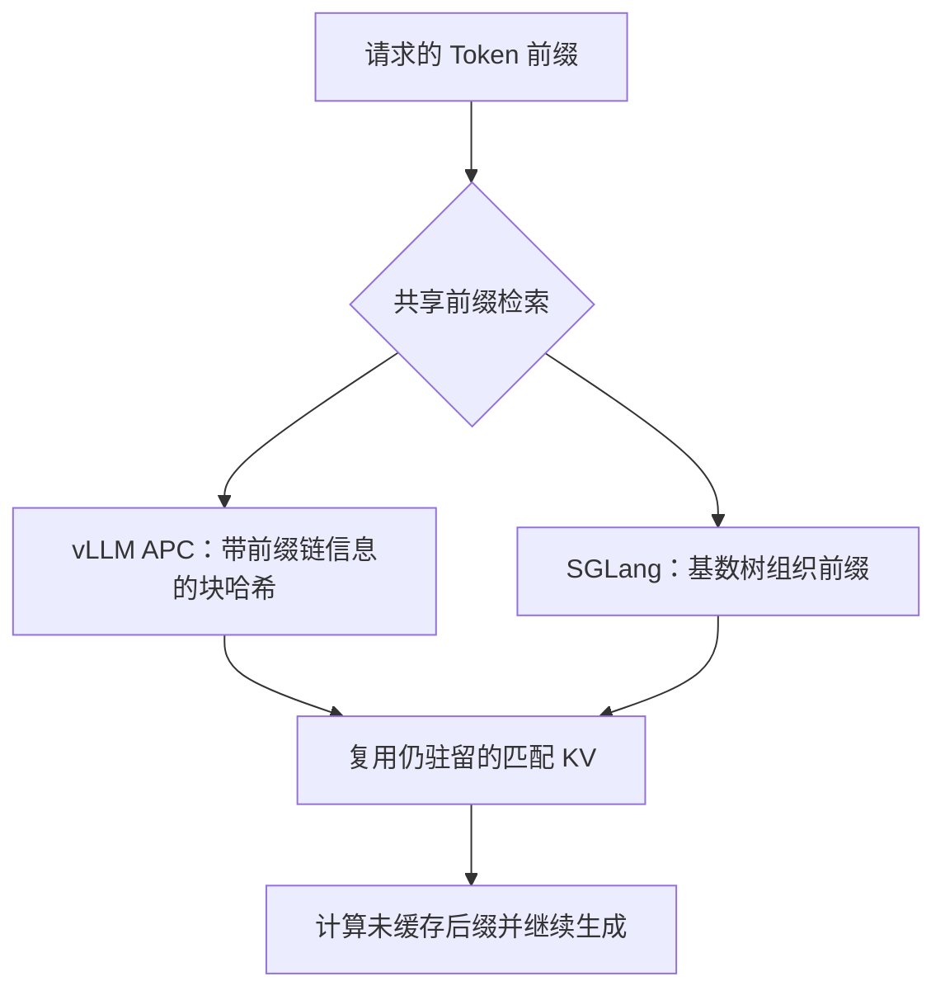

> [!NOTE] 核心速览 (TL;DR)
> - **架构流派抉择**：SGLang 以 RadixAttention 树状前缀缓存与端到端编译为核心，在多轮对话与 Agent 场景具备极高的 Cache 命中率与吞吐；vLLM 则以广泛的生态适配与模块化插件见长。
> - **选型指标实测**：在固定系统提示词（System Prompt 占比 >50%）的高并发负载下，SGLang 表现出更优异的 TTFT 与吞吐指标；在快速多硬件平台（AMD/Ascend/NVIDIA）迁移中 vLLM 兼容性更广。
> - **落地关联**：建议结合 [RadixAttention 源码解密](/articles/prefix-caching-radix-attention-internals/) 与 [vLLM 生产级落地部署指南](/articles/vllm-serving-guide/) 综合规划技术栈。

## vLLM 与 SGLang 应该比较什么？

两者都是持续演进的推理服务框架，都支持前缀缓存、连续批处理以及结构化输出。本文比较数据结构与评测方法，不提供本站集群实测排名；没有原始请求、日志、版本与复现脚本支撑的“8×H100 跑分”不能作为选型证据。

## 分页分配与前缀复用是不同层次

PagedAttention 将逻辑 KV 块映射到非连续物理存储，降低大块连续分配的浪费；前缀缓存决定已有 KV 能否在新请求中复用。RadixAttention 用基数树组织共享 Token 前缀，也可以配合分页存储。两者并非二选一的物理内存体系。



vLLM 的块哈希包含前面的前缀信息，不是只对孤立块做相等匹配。因此多轮历史发生分叉时，两个引擎都可能复用分叉前的共同前缀，不能断言只有树结构才能做到。命中范围还受块粒度、淘汰策略、路由、缓存盐与可用容量影响。

参考 [vLLM 前缀缓存设计](https://docs.vllm.ai/en/v0.29.0/design/prefix_caching/)、[SGLang 论文](https://arxiv.org/abs/2312.07104)。更完整的背景见 [前缀缓存与 RadixAttention](/articles/prefix-caching-radix-attention-internals/)。

## 结构化输出不是单方独有能力

现代 vLLM 与 SGLang 均可通过语法约束后端限制输出。JSON Schema 编译、Token mask 和确定性字符串跳步是不同优化，支持范围随引擎版本、tokenizer 与后端变化。不能沿用早期某个后端的 CPU 瓶颈，推导所有 vLLM 部署都比 SGLang 慢。

结构化输出应同时测量 schema 合法率、字段语义正确率、编译冷启动、首 Token 延迟与生成速度。合法 JSON 不代表业务事实正确。参考 [vLLM 结构化输出](https://docs.vllm.ai/en/v0.29.0/features/structured_outputs/)、[SGLang 结构化输出](https://docs.sglang.io/docs/advanced_features/structured_outputs)。

## 可复现的对比实验设计

| 场景 | 控制变量 | 重点记录 |
|------|---------|---------|
| 无共享前缀问答 | 同一权重、精度、输入与输出长度 | 输出吞吐、P50/P95/P99 TTFT 与 ITL |
| 多轮 Agent | 固定共享 Token 序列与分叉位置 | 冷/热缓存延迟、命中量、淘汰与路由 |
| JSON 抽取 | 同一 schema 集合与约束后端 | 合法率、语义准确率、编译与生成耗时 |
| 压力与故障 | 同一到达率、排队限制、超时预算 | SLO 内完成量、错误率、抢占与恢复 |

固定镜像 digest、GPU 型号、驱动、CUDA、模型 revision、量化方式、TP/DP 和缓存预算。使用同一请求回放集，记录输入/输出实际长度；分别运行冷缓存与预热后的测试，重复实验并保留原始输出。开放环到达率能揭示排队，固定并发闭环测试适合观察饱和吞吐，二者不能混为一组结果。

不要只报告总体 tokens/s：输出被截断、超时或 schema 不合法时，吞吐仍可能看起来很好。应优先比较满足业务 SLO 的成功请求量和整机成本。

## 最小启动配置

下面仅作通用 Qwen2.5-7B 基线，假设已安装兼容 GPU、驱动和框架，显存足够。它们不是大型 MoE 的硬件配方；依实际安装版本的 `--help` 确认参数。

```bash
vllm serve Qwen/Qwen2.5-7B-Instruct \
  --max-model-len 8192 \
  --enable-prefix-caching \
  --port 8000
```

```bash
python3 -m sglang.launch_server \
  --model-path Qwen/Qwen2.5-7B-Instruct \
  --context-length 8192 \
  --port 30000
```

不用旧的 `--enable-flashinfer` 开关；需要指定 attention backend 时按当前 [SGLang 参数文档](https://docs.sglang.io/docs/advanced_features/server_arguments) 中的 `--attention-backend` 选择受支持后端。vLLM 运维配置见 [部署指南](/articles/vllm-serving-guide/)。

## 如何选型？

先排除不支持目标模型、量化格式或硬件的版本，再用自己的业务回放验证。现有监控、故障恢复、API 行为与运维经验也是成本；共享前缀较多或 JSON 较重只是增加测试这些能力的优先级，并不自动决定赢家。

## 常见问题 (FAQ)

### Q1: SGLang 的前缀树一定比 vLLM APC 命中率高吗？
不一定。二者都可以复用分叉之前的历史前缀。粒度、淘汰、容量与路由决定实际命中率，需要同一工作负载验证。

### Q2: 前缀缓存能让整个请求免费吗？
不能。它主要减少重复预填充，后续解码、KV 读取、缓存驻留与固定资源仍有成本。长输出场景总收益可能很有限。

### Q3: 本文是否提供生产集群实测倍数？
没有。本文提供来源可核查的机制与实验设计；上线选择需要保留可复现日志的本地评测。
