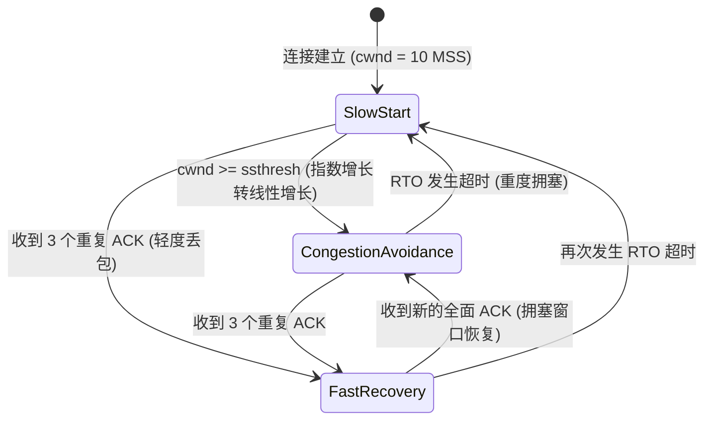
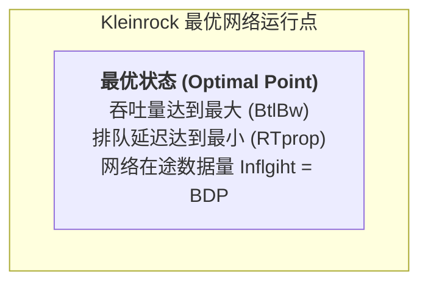
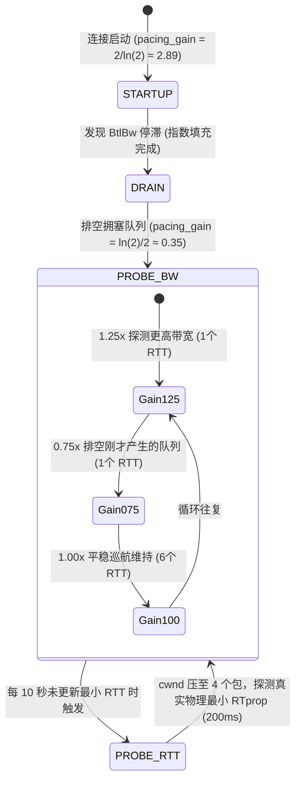
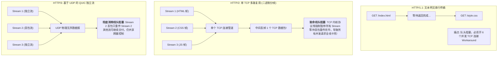

> [!NOTE] 核心速览 (TL;DR)
> - **拥塞控制算法演进**：对比基于丢包反馈的传统 Reno、基于三次函数增长的 CUBIC（规范乘法递减因子为 0.7）以及基于带宽延迟积 (BDP) 测量的 Google BBR 算法本质差异。
> - **内核实现细节**：澄清现代 Linux 内核实现中 BBR 并不强制绑定 fq 排队规则，内核内部支持内置 pacing 机制。
> - **协议终局**：剖析 QUIC 协议在 UDP 之上的用户态重构与 HTTP/3 零 RTT 连接迁移，为跨机大模型 API 调用提供抗网络抖动底座。

## 引言：流量控制与拥塞控制的本质分野

在专栏第五讲 [网络层与传输层精解：IP 路由选路、CIDR、TCP 三次握手/四次挥手状态机与滑动窗口第一性原理](/articles/network-layer-transport-layer-ip-routing-tcp-state-machine/) 中，我们剖析了 TCP 滑动窗口如何通过通告窗口（Advertised Window, `rwnd`）精确保护接收端的缓冲区内存。

然而，网络通信并非两点之间的理想直连管道，而是跨越成百上千台交换机与路由器的复杂网状拓扑：
- **流量控制（Flow Control）**：是**端到端（End-to-End）**的局部契约，解决的是“发送端发得太快，接收端应用程序读得太慢导致其内存溢出”的问题；
- **拥塞控制（Congestion Control）**：是**全局性（Global/Fabric-Wide）**的网络保护机制，解决的是“通信各方注入网络的数据总量超出了中间物理路由器队列容量与光纤物理带宽极限，导致路由器丢包与网络瘫痪”的问题。

1986 年，初生的互联网经历了人类历史上第一次灾难性的**“拥塞崩溃（Congestion Collapse）”**：全美主干网吞吐量在一瞬间从 32 Kbps 暴跌至 40 bps，下降了整整 800 倍！

为了拯救网络，Van Jacobson 于 1988 年提出经典的拥塞控制算法，奠定了现代互联网传输控制理论的基石。本文将带你全景拆解拥塞控制技术的三次范式跃迁：**基于丢包的经典算法（Reno/Cubic）$\to$ 基于带宽时延积模型的颠覆性革命（Google BBR）$\to$ 应用层协议栈大一统（HTTP/3 QUIC）**。

---

## 一、 基于丢包的拥塞控制：AIMD、Reno 与 Cubic 的数学演进

### 1.1 经典 AIMD 哲学与 TCP Reno 四大阶段

基于丢包的拥塞控制遵循核心原则：**网络是黑盒，丢包即拥塞**。发送端维护一个**拥塞窗口（Congestion Window, `cwnd`）**，实际能够发往网络的数据量受限于两者最小值：

$$W = \min(cwnd, rwnd)$$

TCP Reno 引入了著名的 **AIMD（加法递增，乘法递减）** 控制回路：



1. **慢启动（Slow Start）**：
   每经过一个往返时间（RTT），`cwnd` 翻倍（指数增长：$1, 2, 4, 8 \dots$），直到达到慢启动阈值 `ssthresh`；
2. **拥塞避免（Congestion Avoidance，加法递增）**：
   进入稳态后，每个 RTT 仅将 `cwnd` 增加 1 个 MSS（线性增长），谨慎探测网络剩余带宽；
3. **快重传与快恢复（Fast Retransmit & Fast Recovery，乘法递减）**：
   当收到 3 个重复 ACK（Duplicate ACK）时，判定单包丢失而非全网断裂，立即重传该包，将 `ssthresh` 砍半（$\text{ssthresh} = \frac{cwnd}{2}$），并将 `cwnd` 设置为 `ssthresh + 3` 进入快恢复，避免退化回慢启动。

#### 致命缺陷：Bufferbloat（缓冲区膨胀）
以 Reno 为代表的算法基于“丢包才算拥塞”的假设，导致发送端不断狂塞数据，**硬生生将中间路由器的硬件深缓冲区塞满**。虽然没有丢包，但数据包在路由器队列中排队等待长达数百毫秒甚至数秒，导致**极高的 RTT 膨胀和剧烈的排队延迟（Queueing Delay）**，严重摧毁实时交互体验！

### 1.2 TCP Cubic：三次方程拟合与 RTT 不相关性

在跨国高带宽长延迟（High-BDP）网络中，Reno 每次线性只加 1 MSS 的策略极其缓慢，填满 10Gbps 光纤甚至需要几个小时。

Linux 内核在 2.6.19 引入了 **TCP Cubic** 并将其设为长期默认算法。Cubic 将拥塞窗口增长函数设计为一个以时间 $t$ 为自变量的**三次多项式方程**：

$$W_{cubic}(t) = C \cdot (t - K)^3 + W_{max}$$

其中：
- $W_{max}$ 为上一次发生拥塞丢包时的窗口大小；
- $K = \sqrt[3]{\frac{W_{max} \cdot (1 - \beta)}{C}}$，为窗口恢复到 $W_{max}$ 所需的时间常数；
- $C$ 为缩放常数（默认约 0.4），$\beta$ 为现行 RFC 8312 / RFC 9438 规范的乘法递减因子（默认取 0.7，即丢包后窗口回退至 $0.7 \times W_{max}$，窗口削减幅度为 $1 - \beta = 0.3$）。

```text
Cubic 窗口增长曲线 (凹凸两阶段):
      cwnd ^                                    / (凸阶阶段: 快速试探新带宽)
           |                                  /
           |                                /
   W_max --+---------------------+        /
           |   (凹阶段: 快速回归)  \    /
           |                     \  /
           |                      \/
           +---------------------------------------------> 时间 t
                                  t = K
```

- **凹阶段（Concave Phase）**：丢包后窗口迅速爬升，越靠近 $W_{max}$ 增速越缓，以高度平滑的姿态逼近原有容量；
- **高原阶段（Plateau）**：在 $t \approx K$ 附近保持相对平稳，最大化网络利用率并维持稳定性；
- **凸阶段（Convex Phase）**：若长时间无丢包，窗口加速上扬，积极探索物理链路是否存在更高的新带宽！
- **时间函数与 RTT**：CUBIC 的主窗口增长函数按拥塞后的时间演化，同时保留 TCP-friendly 区域；实际吞吐与公平性仍受 RTT、ACK 和竞争流影响，不能声称完全与 RTT 解耦。

---

## 二、 基于模型的拥塞控制革命：Google BBR 物理建模

无论 Reno 还是 Cubic，本质上都是**丢包驱动（Loss-based）**的算法。丢包往往滞后于拥塞，且在弱网无线信道中，随机电磁干扰引起的误码丢包并不等于拥塞。

2016 年，Google 提出了基于**瓶颈带宽与往返时延（Bottleneck Bandwidth and RTT, BBR）**的全新模型驱动算法。

### 2.1 Kleinrock 理想工作点与带宽时延积（BDP）



根据控制理论，物理网络的容量由两个物理常数决定：
1. **$BtlBw$（Bottleneck Bandwidth，瓶颈链路物理带宽）**：由路径上最慢的网卡/光纤物理吞吐量决定；
2. **$RTprop$（Round-Trip Propagation Time，往返物理传播时延）**：由光信号在玻璃光纤中的光速及物理距离决定。

由此定义网络的最优在途容量 —— **带宽时延积（Bandwidth-Delay Product, BDP）**：

$$BDP = BtlBw \times RTprop$$

- **状态 1（欠载区，$\text{Inflight} < BDP$）**：管道没填满，网络带宽未充分利用；
- **状态 2（最优平衡点，$\text{Inflight} = BDP$）**：**吞吐量达到理论峰值，中间路由器完全没有积压排队，网络延迟维持物理光速极限！**
- **状态 3（缓冲排队区，$\text{Inflight} > BDP$）**：管道已满，多发的数据全部在路由器队列堆积，引发 Bufferbloat 和延迟飙升；
- **状态 4（丢包崩溃区）**：路由器队列溢出，发生严重丢包。

**BBR 的颠覆性核心思想**：坚决不让网络滑入状态 3 和状态 4，通过交替测量 $BtlBw$ 与 $RTprop$，精准将网络流量锁定在 **Kleinrock 最优工作点（$\text{Inflight} = BDP$）**！

### 2.2 BBR 状态机与起搏速率控制（Pacing Rate）

BBR 不再单纯依赖 TCP 窗口滑动，而是引入了精准的**起搏速率引擎（Pacing Rate）**，以恒定的纳秒级时间间隔均匀向网卡喷射数据包：

```text
pacing_rate = pacing_gain * BtlBw
```



1. **STARTUP 阶段**：以 $2.89\times$ 的高增益迅速探明瓶颈带宽；
2. **DRAIN 阶段**：以 $0.35\times$ 的低增益主动压低发送速率，清空 STARTUP 阶段在路由器中造成的排队堆积；
3. **PROBE_BW 阶段（巡航稳态）**：采用 8 周期循环（$1.25 \to 0.75 \to 1.0 \times 6$）。先加速探顶，再降速排空队列，其余时间平稳运行；
4. **PROBE_RTT 阶段**：每 10 秒强制将 `cwnd` 限制为 4 个数据包并维持 200ms，迫使网络队列彻底归零，从而准确测量出物理光缆的无干扰真实时延 $RTprop$。

---

## 三、 应用层与传输层协议大一统：HTTP/1.1、HTTP/2 到 HTTP/3 (QUIC)

即使拥塞控制算法做到了极致，**TCP 协议本身的内核实现与单流特性**依然成为了应用层吞吐与延迟的最大绊脚石。

### 3.1 协议栈演进与线头阻塞（Head-of-Line Blocking）之战



### 3.2 HTTP/3 与 QUIC 的能力及边界

1. **流间交付独立**：流使用字节 offset 管理顺序，包号属于连接的包号空间，并非每流一套包号。一个流的数据丢失不要求其他流等待重传，但共享拥塞窗口和应用依赖仍有影响。
2. **握手与 0-RTT**：首次连接通常需要 1 RTT；已有会话状态时可尝试 0-RTT early data，但服务器可拒绝，而且必须考虑重放风险，不能承诺每次重访都零等待。
3. **连接迁移**：可变长度 CID 使连接有机会跨 IP/端口变化继续使用；实际迁移受端点支持、地址验证及网络可达性约束。
4. **用户态实现**：QUIC 库可独立于内核 TCP 演进，但发布新二进制也不等于现存连接能任意热替换算法。
5. **加密与可见元数据**：TLS 1.3 保护握手和应用数据，QUIC 还提供头部保护；版本、CID 等部分字段仍可见，攻击者也仍能丢弃或延迟包。不能称为所有头部都加密或彻底消除中间网络风险。

---

## 四、 生产级环境调优实战

### 4.1 Linux 服务器开启 Google BBR 与 FQ 调度器

在现代 Linux 内核（Linux 4.9+ 原生支持，推荐 Linux 5.15+ 或 6.x）中全面启用 BBR：

```bash
# 1. 检查当前内核拥塞控制算法
sysctl net.ipv4.tcp_congestion_control
sysctl net.ipv4.tcp_available_congestion_control

# 2. 写入生产优化配置
cat << 'EOF' >> /etc/sysctl.conf
# fq 是常用起搏队列，现代 TCP 也提供内部 pacing。
net.core.default_qdisc = fq
# 切换拥塞控制为 bbr
net.ipv4.tcp_congestion_control = bbr
EOF

# 3. 立即加载生效
sysctl -p

# 4. 验证 BBR 是否正确激活
lsmod | grep bbr
```

---

## 五、 总结与进阶预告

从以太网数据链路、IP LPM 路由选路，到 TCP 状态机、滑动窗口、Cubic 与 BBR 拥塞控制，再到基于 UDP 的 HTTP/3 QUIC 传输革命，我们完整绘制了传统互联网跨主机通信的宏伟图卷。

然而，我们始终没有看清一个终极黑盒：**当一个光电脉冲冲入 Linux 宿主机的网卡后，操作系统内核底层究竟是如何在纳秒级把字节数据捞取出来、调度多核 CPU 并送入应用程序 Socket 缓冲区的？**
- 为什么早期的纯硬件中断会导致“中断风暴”雪崩？NAPI 混合轮询是如何拯救高并发 CPU 的？
- Linux 内核最核心的数据结构 `sk_buff` 是如何凭借神奇的指针移动实现零内存拷贝协议栈穿越的？
- 为什么在 100Gbps 满线速下，甚至连内核协议栈都会成为瓶颈？**eBPF XDP** 是如何在网卡驱动最底层实现 2000 万+ PPS 极速包转发与防 DDoS 的？

在接下来的**专栏第七讲**中，我们将全面攻入 Linux 操作系统的网络深水区 —— **[Linux 内核网络子系统硬核剖析：从网卡驱动、NAPI 机制、Ring Buffer 到 eBPF XDP 极速转发](/articles/linux-kernel-networking-napi-ring-buffer-skbuff-xdp/)**！

---

## 常见问题 (FAQ)

### Q1: BBR 是否强制依赖 fq？
现代 Linux 的 TCP 内部 pacing 可在没有 `fq` 时提供回退。`fq` 是常用的起搏与流公平队列，不是所有内核与部署下的协议强制条件，也不等同于硬件卸载。核实内核版本、qdisc 和实际延迟后选用。参见 [Linux BBR 实现说明](https://android.googlesource.com/kernel/common/+/refs/heads/android16-6.12-kminext/net/ipv4/tcp_bbr.c)。

### Q2: 随机丢包时 BBR 一定比 CUBIC 快吗？
不一定。CUBIC 在拥塞事件时通常将窗口乘以 $\beta=0.7$，不是 Reno 式减半。BBR 根据交付速率与 RTT 建模，但仍受到丢包、重传、ACK 行为和实现版本影响；不能保证在 10% 丢包时仍有 90% 线速。比较需固定 RTT、队列、丢包模型与竞争流。参见 [RFC 9438 CUBIC](https://www.rfc-editor.org/rfc/rfc9438.html)。

### Q3: QUIC 如何在 UDP 上提供可靠流？
网络仍可能丢弃 UDP/IP 包。QUIC 通过确认、丢失检测和重新发送未确认的数据提供可靠字节流；重传的数据放入新的 QUIC 包，并非重发相同包号。TLS 1.3 保护握手和应用数据，但部分路由所需的包头仍可见，不能称为“所有头部都加密”。不同流减少传输层跨流队头阻塞，共享拥塞窗口与应用依赖仍会造成相互影响。参见 [RFC 9000](https://www.rfc-editor.org/rfc/rfc9000.html)、[RFC 9001](https://www.rfc-editor.org/rfc/rfc9001.html)。
