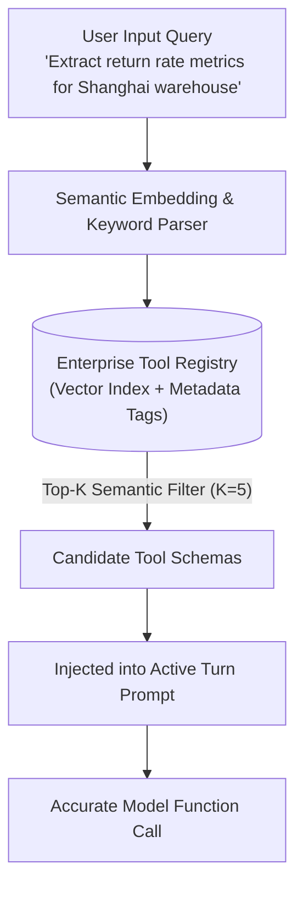
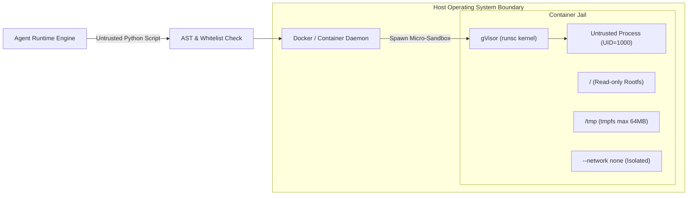

Basic Function Calling is no longer novel. However, when an enterprise AI agent integrates across internal ERPs, CRMs, data warehouses, and cloud infrastructure spanning 500+ microservice APIs, static injection of every tool schema into every prompt triggers catastrophic failures:
- **Context Window & Cost Explosion**: Hundreds of OpenAPI/JSON schemas devour tens of thousands of tokens per turn before user interaction even begins;
- **Attention Degradation**: Massive schema clutter severely degrades LLM attention, resulting in hallucinated arguments and accidental invocation of unrelated tools;
- **Execution Vulnerabilities**: Exposing Python execution or shell interpreters directly to model outputs risks host compromise and data leakage without isolation.

In 2026 production architectures, **Dynamic Tool Discovery**, **Kernel-isolated Sandboxing**, and **Self-Healing Error Recovery** form the three pillars of reliable Agent systems. For baseline agent runtime patterns, see [7 Runtime Practices for Building AI Agents](/en/articles/agent-runtime-practices/).

---

## 1. Dynamic Tool Discovery: Semantic Retrieval & MCP Integration

Modern agents reject static monolithic tool lists in favor of **Retrieval-Augmented Tool Selection (RATS)**:



### 1.1 Semantic Tool Registry Implementation

```python
import json
from typing import List, Dict, Any
import numpy as np

class ToolRegistry:
    """Enterprise dynamic tool registry with on-demand semantic discovery"""
    def __init__(self, embedding_client):
        self.embedding_client = embedding_client
        self.tools: Dict[str, Dict[str, Any]] = {}
        self.tool_vectors: Dict[str, np.ndarray] = {}
        self.category_index: Dict[str, List[str]] = {}

    def register_tool(self, name: str, description: str, parameters: Dict[str, Any], category: str):
        schema = {
            "type": "function",
            "function": {
                "name": name,
                "description": description,
                "parameters": parameters
            }
        }
        self.tools[name] = {"schema": schema, "category": category, "doc": f"{name}: {description}"}
        vector = self.embedding_client.get_embedding(f"{name}: {description}")
        self.tool_vectors[name] = np.array(vector, dtype=np.float32)
        self.category_index.setdefault(category, []).append(name)

    def retrieve_tools(self, query: str, top_k: int = 5, category: str = None) -> List[Dict[str, Any]]:
        query_vec = np.array(self.embedding_client.get_embedding(query), dtype=np.float32)
        candidates = self.category_index.get(category, list(self.tools.keys())) if category else list(self.tools.keys())
        
        scores = []
        for name in candidates:
            tool_vec = self.tool_vectors[name]
            similarity = np.dot(query_vec, tool_vec) / (np.linalg.norm(query_vec) * np.linalg.norm(tool_vec) + 1e-9)
            scores.append((similarity, name))
        
        scores.sort(key=lambda x: x[0], reverse=True)
        return [self.tools[name]["schema"] for _, name in scores[:top_k]]
```

### 1.2 Model Context Protocol (MCP) Client

Under the open **Model Context Protocol (MCP)**, external systems expose capability endpoints dynamically over JSON-RPC 2.0. For complete protocol internals, see our [Complete Guide to Model Context Protocol (MCP)](/en/articles/mcp-guide/).

```python
import asyncio
import json

class MCPToolDiscoveryClient:
    """Standard JSON-RPC MCP tool discovery client"""
    def __init__(self, reader: asyncio.StreamReader, writer: asyncio.StreamWriter):
        self.reader = reader
        self.writer = writer
        self._req_id = 0

    async def list_tools(self) -> List[Dict[str, Any]]:
        self._req_id += 1
        payload = {"jsonrpc": "2.0", "id": self._req_id, "method": "tools/list", "params": {}}
        self.writer.write(json.dumps(payload).encode() + b"\n")
        await self.writer.drain()

        line = await self.reader.readline()
        res = json.loads(line.decode().strip())
        if "error" in res:
            raise RuntimeError(f"MCP discovery failed: {res['error']}")
        
        return [
            {
                "type": "function",
                "function": {
                    "name": t["name"],
                    "description": t["description"],
                    "parameters": t["inputSchema"]
                }
            }
            for t in res.get("result", {}).get("tools", [])
        ]
```

---

## 2. Kernel Sandboxing: Hardened Execution via gVisor

Untrusted code generated by LLMs must never execute directly in the host OS space via `subprocess` or `exec`.



### 2.1 Hardened Container Runtime Configuration

```bash
docker run -d \
  --runtime=runsc \               # Enforce gVisor user-space kernel
  --network=none \                # Block all outbound networking
  --memory=512m \                 # Enforce hard memory limits
  --cpus=1.0 \                    # Limit compute allocation
  --pids-limit=64 \               # Prevent fork bomb attacks
  --read-only \                   # Immutable root filesystem
  --tmpfs /tmp:rw,noexec,nosuid,size=64m \ # Transient in-memory tmp only
  --user=1000:1000 \              # Non-root user execution
  --cap-drop=ALL \                # Drop all Linux capabilities
  sandbox-python:3.11-slim
```

### 2.2 Python Sandbox Execution Runner

```python
import docker

class SandboxedPythonExecutor:
    """Docker + gVisor isolated Python code executor"""
    def __init__(self, image: str = "sandbox-python:3.11-slim"):
        self.client = docker.from_env()
        self.image = image

    def execute_code(self, code_snippet: str, timeout_sec: int = 5) -> Dict[str, Any]:
        try:
            container = self.client.containers.run(
                image=self.image,
                command=["python3", "-c", code_snippet],
                runtime="runsc",
                network_mode="none",
                mem_limit="256m",
                nano_cpus=1000000000,
                read_only=True,
                tmpfs={"/tmp": "rw,noexec,nosuid,size=32m"},
                user="1000:1000",
                detach=True,
                stdout=True,
                stderr=True
            )
            result = container.wait(timeout=timeout_sec)
            stdout = container.logs(stdout=True, stderr=False).decode("utf-8")
            stderr = container.logs(stdout=False, stderr=True).decode("utf-8")
            container.remove(force=True)
            
            return {
                "exit_code": result.get("StatusCode", 0),
                "stdout": stdout,
                "stderr": stderr,
                "status": "success" if result.get("StatusCode") == 0 else "error"
            }
        except Exception as e:
            return {"exit_code": -1, "stdout": "", "stderr": f"Sandbox execution timeout/error: {str(e)}", "status": "timeout"}
```

---

## 3. Self-Healing Error Recovery: From Traceback to Reflection

When code or tool execution fails, terminating the entire agent session is anti-pattern. Autonomous self-healing intercepts errors and prompts reflection:

```python
class SelfHealingToolRunner:
    """Autonomous self-healing runner with traceback distillation"""
    def __init__(self, llm_client, sandbox_executor, max_retries: int = 3):
        self.llm_client = llm_client
        self.sandbox = sandbox_executor
        self.max_retries = max_retries

    def _sanitize_traceback(self, stderr: str) -> str:
        lines = stderr.strip().split("\n")
        return "\n".join(lines[-5:]) if len(lines) > 5 else stderr

    async def run_with_recovery(self, initial_code: str, context: List[Dict[str, Any]]) -> str:
        current_code = initial_code
        attempts = 0

        while attempts < self.max_retries:
            attempts += 1
            execution = self.sandbox.execute_code(current_code)
            if execution["status"] == "success":
                return execution["stdout"]
            
            clean_error = self._sanitize_traceback(execution["stderr"])
            prompt = (
                f"Execution failed (Attempt {attempts}/{self.max_retries}):\n"
                f"```text\n{clean_error}\n```\n"
                f"Code snippet:\n```python\n{current_code}\n```\n"
                f"Analyze the error and reply strictly with corrected executable Python code:"
            )
            context.append({"role": "user", "content": prompt})
            response = await self.llm_client.generate(messages=context)
            current_code = self._extract_code(response)
        
        raise RuntimeError(f"Self-healing exceeded retry budget of {self.max_retries}.")

    def _extract_code(self, text: str) -> str:
        if "```python" in text:
            return text.split("```python")[1].split("```")[0].strip()
        elif "```" in text:
            return text.split("```")[1].split("```")[0].strip()
        return text.strip()
```

---

## Frequently Asked Questions (FAQ)

### Q1: When scaling beyond 1,000 tools, how do we prevent semantic retrieval from missing relevant schemas?
Combine domain categorization with **Hybrid Search (Dense Vectors + BM25)** using Reciprocal Rank Fusion (RRF). Classify incoming tasks into high-level domains (e.g., Billing, DevOps) first to constrain search space, then fuse keyword and embedding rankings to retain critical function name tokens. See [Building Production AI Agents from Scratch](/en/articles/build-ai-agent/).

### Q2: Why run gVisor (`runsc`) instead of standard Docker runc containers?
Standard Docker containers share the host Linux kernel directly, exposing hundreds of system calls and creating potential container escape vectors. gVisor replaces direct syscall handling with a user-space application kernel written in Go, strictly neutralizing zero-day kernel exploits.

### Q3: How do we prevent self-healing loops from spinning infinitely and burning token quotas?
Implement three hard guardrails: 1) A strict retry count budget (typically 2-3 iterations); 2) Traceback fingerprinting (aborting if consecutive attempts return identical error hashes); and 3) Global per-session token budget limiters.
