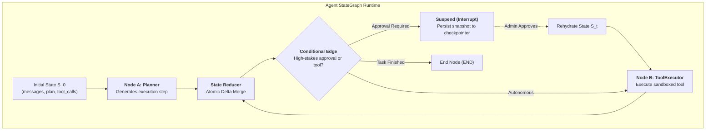

In 2026, relying on monolithic, one-shot prompts to solve complex tasks is obsolete. Complex reasoning and multi-step tool calls require an agent runtime that is **deterministic, resumable, and observable**.

Naive `while True` loops and linear chains fail in production due to three critical flaws:
1. **State Drift & Oblivion**: Variables remain trapped in local loop scopes, obscuring state history and causing hallucinated goal drift over long horizons;
2. **Lack of Human-in-the-Loop Primitives**: High-stakes operations (e.g. wire transfers, database drop commands) cannot cleanly suspend execution and resume hours later across restarts;
3. **No Streaming Observability**: End-users stare at blank screens rather than receiving real-time token deltas, tool telemetry, and reasoning progress.

To solve these challenges, we turn to foundational computer science patterns: **Finite State Machines (FSM) combined with reactive Event Streams**. For execution loop foundations, see [Demystifying AI Agent Execution Loops and State Machine Design](/en/articles/agent-loop-state-machine/).

---

## 1. Architecture: The State Machine & Reducer Pattern



---

## 2. Complete Runnable Framework Implementation

Below is a dependency-free, pure Python async implementation of a state-machine agent framework:

```python
import asyncio
from typing import Dict, Any, Callable, List, Optional, AsyncGenerator
from dataclasses import dataclass
import uuid

# 1. State & Reducer Definition
def add_messages(existing: List[Dict[str, Any]], new_items: List[Dict[str, Any]]) -> List[Dict[str, Any]]:
    return existing + new_items

class AgentState(dict):
    """Global state container with reducer-driven delta application"""
    def __init__(self, *args, **kwargs):
        super().__init__(*args, **kwargs)
        self.setdefault("messages", [])
        self.setdefault("pending_approval", False)

    def apply_delta(self, delta: Dict[str, Any]):
        for key, val in delta.items():
            if key == "messages" and isinstance(val, list):
                self[key] = add_messages(self.get(key, []), val)
            else:
                self[key] = val

# 2. Typed Event Stream
@dataclass
class AgentEvent:
    event_type: str  # "node_start", "state_update", "interrupted", "completed"
    node_name: str
    payload: Dict[str, Any]
    run_id: str

# 3. StateGraph Engine
class StateGraph:
    def __init__(self):
        self.nodes: Dict[str, Callable] = {}
        self.edges: Dict[str, str] = {}
        self.conditional_edges: Dict[str, Callable[[AgentState], str]] = {}
        self.entry_point: Optional[str] = None
        self.interrupt_nodes: set = set()
        self.checkpointer: Dict[str, AgentState] = {}

    def add_node(self, name: str, func: Callable):
        self.nodes[name] = func

    def set_entry_point(self, name: str):
        self.entry_point = name

    def add_edge(self, from_node: str, to_node: str):
        self.edges[from_node] = to_node

    def add_conditional_edge(self, from_node: str, router_func: Callable[[AgentState], str]):
        self.conditional_edges[from_node] = router_func

    def add_interrupt_before(self, node_name: str):
        self.interrupt_nodes.add(node_name)

    async def stream(self, state: AgentState, run_id: Optional[str] = None) -> AsyncGenerator[AgentEvent, None]:
        run_id = run_id or str(uuid.uuid4())
        current_node = self.entry_point
        
        while current_node and current_node != "END":
            # Check for human-in-the-loop interruption
            if current_node in self.interrupt_nodes and not state.get("approved", False):
                self.checkpointer[run_id] = state
                yield AgentEvent("interrupted", current_node, {"state": dict(state)}, run_id)
                return

            yield AgentEvent("node_start", current_node, {}, run_id)
            
            node_func = self.nodes[current_node]
            delta = await node_func(state) if asyncio.iscoroutinefunction(node_func) else node_func(state)
            
            if delta:
                state.apply_delta(delta)
                yield AgentEvent("state_update", current_node, {"delta": delta}, run_id)

            if current_node in self.conditional_edges:
                current_node = self.conditional_edges[current_node](state)
            else:
                current_node = self.edges.get(current_node, "END")

        yield AgentEvent("completed", "END", {"final_state": dict(state)}, run_id)

    async def resume(self, run_id: str, resume_payload: Dict[str, Any]) -> AsyncGenerator[AgentEvent, None]:
        if run_id not in self.checkpointer:
            raise ValueError(f"Checkpoint not found for run_id: {run_id}")
        state = self.checkpointer[run_id]
        state.apply_delta(resume_payload)
        state["approved"] = True
        async for event in self.stream(state, run_id=run_id):
            yield event
```

---

## 3. Hands-On: Building an Approval & Tool Calling Agent

```python
async def planner_node(state: AgentState) -> Dict[str, Any]:
    return {
        "messages": [{"role": "assistant", "content": "Initiating wire transfer of $10,000"}],
        "action": "transfer",
        "amount": 10000
    }

def route_planner(state: AgentState) -> str:
    if state.get("amount", 0) > 1000:
        return "human_approval"
    return "execute_tool"

async def tool_node(state: AgentState) -> Dict[str, Any]:
    return {"messages": [{"role": "tool", "content": f"Transfer of ${state['amount']} succeeded."}]}

# Build Graph
graph = StateGraph()
graph.add_node("planner", planner_node)
graph.add_node("human_approval", lambda s: {"pending_approval": True})
graph.add_node("execute_tool", tool_node)

graph.set_entry_point("planner")
graph.add_conditional_edge("planner", route_planner)
graph.add_edge("human_approval", "execute_tool")
graph.add_edge("execute_tool", "END")
graph.add_interrupt_before("human_approval")
```

### Execution & Resumption Walkthrough

```python
async def main():
    state = AgentState({"messages": [{"role": "user", "content": "Transfer $10,000"}]})
    
    run_id = None
    async for event in graph.stream(state):
        print(f"Event: {event.event_type} | Node: {event.node_name}")
        if event.event_type == "interrupted":
            run_id = event.run_id
            print(f"Workflow suspended for human approval. Run ID: {run_id}")
            break

    print("\nAdmin approves transaction in web dashboard...")
    async for event in graph.resume(run_id, {"approval_decision": "confirmed"}):
        print(f"Event: {event.event_type} | Node: {event.node_name}")
        if event.event_type == "completed":
            print("Execution finalized successfully.")

if __name__ == "__main__":
    asyncio.run(main())
```

---

## Frequently Asked Questions (FAQ)

### Q1: When should an enterprise build a custom lightweight FSM instead of using LangGraph?
Choose custom implementations when: 1) Strict enterprise compliance prohibits deep open-source dependency trees; 2) Microservice edge environments require sub-millisecond dispatch without serialization overhead; and 3) Custom database transactions require atomicity between agent state checkpoints and business records.

### Q2: How is race condition avoidance guaranteed during concurrent event streaming?
In single instances, Python's `asyncio` cooperative event loop serializes reducer evaluations without thread-locking contention. In distributed multi-worker environments, back checkpointers with **Optimistic Concurrency Control (OCC)** using version increments in PostgreSQL.

### Q3: How do we prevent state loss during human-in-the-loop interrupts across container restarts?
Never store checkpoints exclusively in memory. Before dispatching `interrupted` events, serialize the state dictionary, node identifier, and execution run ID into an external database (e.g. PostgreSQL). Any worker replica can then rehydrate the state graph upon approval. For tool sandboxing, see [Advanced Tool Use in Agent Architecture](/en/articles/advanced-agent-tool-use-and-function-calling/).
