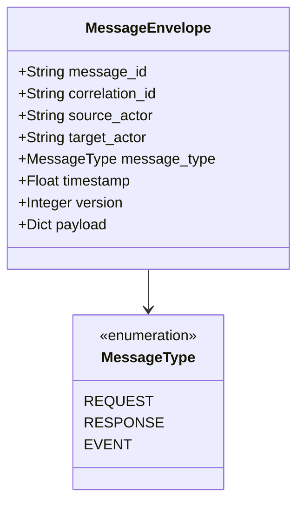
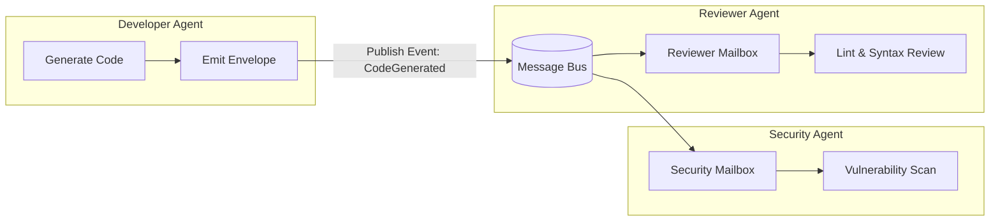

In 2026, enterprise AI tasks—such as full-repository refactoring, security audits, and financial reconciliation—far exceed the cognitive capacity of any single monolithic model. The industry has decisively shifted toward **Multi-Agent Systems (MAS)**.

Early multi-agent approaches (e.g. naive GroupChat patterns) relied on **shared global memory**, maintaining a single growing chat history that each agent accessed sequentially. This pattern breaks down under production loads:
- **Context Window Flooding**: Every specialized agent is forced to ingest hundreds of thousands of tokens of irrelevant conversation from other agents;
- **Severe Serial Bottlenecks**: When one agent runs inference or waits for a tool response, all other agents sit idle, wasting parallel API throughput;
- **Concurrent Write Clashes**: Multiple agents modifying the same document or codebase branch cause destructive race conditions and silent state corruption.

The architectural solution comes from distributed systems: **The Actor Model combined with strictly typed message envelopes**. For single-agent state machines, see [Building a Lightweight Agent Framework from Scratch](/en/articles/build-lightweight-agent-framework/).

---

## 1. Communication Contract: The Standardized Message Envelope

In the Actor Model, agents share **zero memory**. All collaboration occurs through immutable, asynchronous messages:



### 1.1 Protocol Specification

```python
import time
import uuid
from enum import Enum
from typing import Dict, Any, List
from dataclasses import dataclass, field, asdict
import json

class MessageType(str, Enum):
    REQUEST = "request"      # Point-to-point request awaiting response
    RESPONSE = "response"    # Direct reply to a request
    EVENT = "event"          # Asynchronous broadcast notification

@dataclass(frozen=True)
class MessageEnvelope:
    """Enterprise multi-agent message envelope (CloudEvents aligned)"""
    message_id: str = field(default_factory=lambda: str(uuid.uuid4()))
    source_actor: str = ""
    target_actor: str = ""
    message_type: MessageType = MessageType.REQUEST
    correlation_id: str = ""
    timestamp: float = field(default_factory=time.time)
    version: int = 1
    payload: Dict[str, Any] = field(default_factory=dict)

    def to_json(self) -> str:
        data = asdict(self)
        data["message_type"] = self.message_type.value
        return json.dumps(data)

    @classmethod
    def from_json(cls, json_str: str) -> "MessageEnvelope":
        raw = json.loads(json_str)
        raw["message_type"] = MessageType(raw["message_type"])
        return cls(**raw)
```

---

## 2. Asynchronous Message Bus and Actor Mailboxes

Each Agent runs as an independent Actor with its own private mailbox queue. A central **Message Bus** routes point-to-point and pub-sub topics:



### 2.1 Runnable Message Bus & Base Actor Implementation

```python
import asyncio

class MessageBus:
    """Asynchronous message bus supporting direct and broadcast delivery"""
    def __init__(self):
        self.mailboxes: Dict[str, asyncio.Queue] = {}
        self.subscriptions: Dict[str, List[str]] = {}

    def register(self, actor_id: str) -> asyncio.Queue:
        box = asyncio.Queue(maxsize=100) # Bounded queue prevents memory saturation
        self.mailboxes[actor_id] = box
        return box

    def subscribe(self, topic: str, actor_id: str):
        self.subscriptions.setdefault(topic, []).append(actor_id)

    async def send(self, env: MessageEnvelope):
        if env.target_actor in self.mailboxes:
            await self.mailboxes[env.target_actor].put(env)
        else:
            raise ValueError(f"Target actor {env.target_actor} not registered")

    async def publish(self, topic: str, env: MessageEnvelope):
        for actor_id in self.subscriptions.get(topic, []):
            if actor_id in self.mailboxes:
                await self.mailboxes[actor_id].put(env)

class BaseActor:
    def __init__(self, actor_id: str, bus: MessageBus):
        self.actor_id = actor_id
        self.bus = bus
        self.mailbox = bus.register(actor_id)
        self._running = False

    async def start(self):
        self._running = True
        asyncio.create_task(self._loop())

    async def stop(self):
        self._running = False

    async def _loop(self):
        while self._running:
            try:
                env = await self.mailbox.get()
                await self.on_message(env)
                self.mailbox.task_done()
            except asyncio.CancelledError:
                break

    async def on_message(self, env: MessageEnvelope):
        raise NotImplementedError
```

---

## 3. Resolving Concurrency Conflicts

### 3.1 Scenario 1: Shared Resource Clashes (Optimistic Concurrency Control)

When multiple agents modify the same document or codebase branch simultaneously, use Compare-And-Swap (CAS) version checks:

```python
class ConcurrentDocumentStore:
    def __init__(self):
        self._content = ""
        self._version = 1
        self._lock = asyncio.Lock()

    async def update(self, new_text: str, expected_ver: int, author: str) -> bool:
        async with self._lock:
            if self._version != expected_ver:
                print(f"[OCC Conflict] Write by {author} rejected: Version is {self._version}, expected {expected_ver}")
                return False
            self._content = new_text
            self._version += 1
            print(f"[Success] Version incremented to {self._version} by {author}")
            return True
```

### 3.2 Scenario 2: Downstream Rate Limits & API 429s (Token Bucket Backpressure)

```python
class TokenBucketLimiter:
    def __init__(self, capacity: int, refill_rate: float):
        self.capacity = capacity
        self.rate = refill_rate
        self.tokens = float(capacity)
        self.last_update = time.time()
        self._lock = asyncio.Lock()

    async def acquire(self, needed: int = 1):
        while True:
            async with self._lock:
                now = time.time()
                self.tokens = min(self.capacity, self.tokens + (now - self.last_update) * self.rate)
                self.last_update = now
                if self.tokens >= needed:
                    self.tokens -= needed
                    return
            await asyncio.sleep(0.05)
```

---

## Frequently Asked Questions (FAQ)

### Q1: When should agents use Point-to-Point (Request-Response) vs Publish-Subscribe (Pub-Sub)?
Use Request-Response when an upstream orchestrator strictly depends on a single deterministic return value before continuing. Use Pub-Sub when an output triggers multiple downstream decoupled consumers in parallel (e.g. testing, security scanning, and documentation agents reviewing newly emitted code).

### Q2: Optimistic Concurrency Control (OCC) vs Pessimistic Distributed Locking: which is preferred?
In multi-agent systems, **OCC with versioning is preferred in 90% of scenarios**. Model inference takes seconds; holding pessimistic distributed mutexes stalls the entire agent swarm, causing cascading timeouts. Only use pessimistic locks for sub-millisecond, highly contentious transaction counters.

### Q3: How do we prevent slow agent mailbox queues from causing bufferbloat?
Enforce bounded queues (e.g. `asyncio.Queue(maxsize=100)`). When a queue fills, emit a `BackpressureWarningEvent` to upstream dispatchers to pause ingestion, or dynamically scale consumer actor replicas. For tool sandboxing, see [Advanced Tool Use in Agent Architecture](/en/articles/advanced-agent-tool-use-and-function-calling/).
