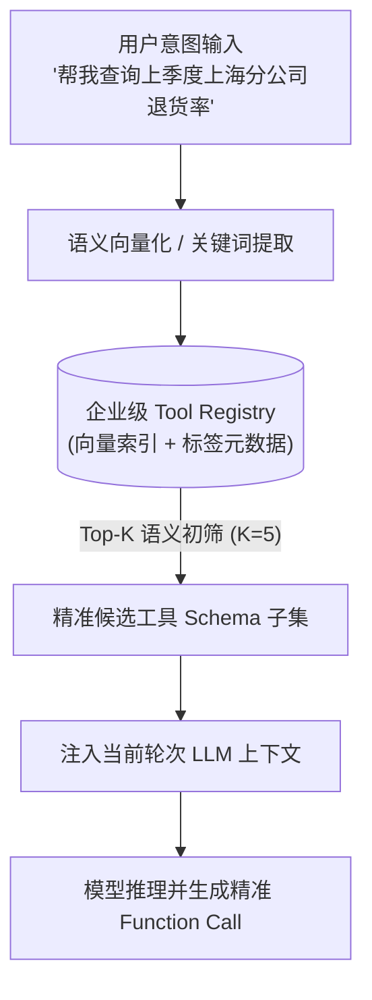
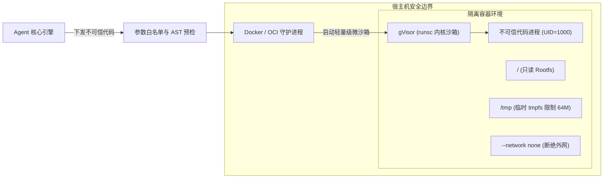

大模型支持 Function Calling 已经不再是新鲜事，但这仅仅是 Tool Use（工具使用）的起点。当你的企业级智能体系统接入了内部 ERP、CRM、数据库与基础设施等超过 500 个微服务 API 时，若仍采用初级的“全量静态注入”策略，把所有工具的 JSON Schema 一股脑塞进每一次 Prompt，会立刻引发现象级崩塌：
- **Token 账单失控**：几百个接口的 Schema 动辄占据数万 Token，每次单轮对话仅工具声明就要耗费大量计算成本；
- **模型注意力被稀释**：巨量的工具描述会形成强大的注意力噪声，模型极易产生参数误填、甚至“幻觉调用”完全不相干的工具；
- **执行安全裸奔**：赋予 Agent 代码执行（Code Interpreter）或 Bash 命令行权限时，一旦产生越权或破坏性指令，将直接危及宿主机数据安全。

在 2026 年的生产实践中，**动态工具发现（Dynamic Discovery）**、**轻量沙箱隔离（Sandbox Isolation）** 与 **自愈式错误恢复（Self-Healing Recovery）** 构成了高可靠 Agent 架构的三大支柱。关于智能体运行时基础架构设计，亦可同步参考 [做 AI Agent 的 7 条运行时实践](/articles/agent-runtime-practices/)。

---

## 一、 动态工具发现：语义检索与 MCP 客户端实现

现代智能体架构抛弃了在 System Prompt 中硬编码全部工具的静态范式，转而采用**“两阶段按需检索（Retrieval-Augmented Tool Selection）”**机制。



### 1.1 语义化工具仓库（Tool Registry）代码实现

以下是一个基于语义相似度与元数据过滤的生产级 `ToolRegistry` Python 实现：

```python
import json
from typing import List, Dict, Any
import numpy as np

class ToolRegistry:
    """企业级动态工具注册与按需检索中心"""
    def __init__(self, embedding_client):
        self.embedding_client = embedding_client
        self.tools: Dict[str, Dict[str, Any]] = {}
        self.tool_vectors: Dict[str, np.ndarray] = {}
        self.category_index: Dict[str, List[str]] = {}

    def register_tool(self, name: str, description: str, parameters: Dict[str, Any], category: str):
        """注册工具元数据并预计算语义向量"""
        tool_schema = {
            "type": "function",
            "function": {
                "name": name,
                "description": description,
                "parameters": parameters
            }
        }
        self.tools[name] = {
            "schema": tool_schema,
            "category": category,
            "doc": f"{name}: {description}"
        }
        # 计算并缓存工具描述的嵌入向量
        vector = self.embedding_client.get_embedding(f"{name}: {description}")
        self.tool_vectors[name] = np.array(vector, dtype=np.float32)
        self.category_index.setdefault(category, []).append(name)

    def retrieve_tools(self, query: str, top_k: int = 5, category: str = None) -> List[Dict[str, Any]]:
        """根据用户输入动态召回最相关的 Top-K 工具 Schema"""
        query_vector = np.array(self.embedding_client.get_embedding(query), dtype=np.float32)
        candidates = self.category_index.get(category, list(self.tools.keys())) if category else list(self.tools.keys())
        
        scores = []
        for name in candidates:
            tool_vec = self.tool_vectors[name]
            # 计算余弦相似度
            similarity = np.dot(query_vector, tool_vec) / (np.linalg.norm(query_vector) * np.linalg.norm(tool_vec) + 1e-9)
            scores.append((similarity, name))
        
        # 降序排序取 Top-K
        scores.sort(key=lambda x: x[0], reverse=True)
        selected_schemas = [self.tools[name]["schema"] for _, name in scores[:top_k]]
        return selected_schemas
```

### 1.2 Model Context Protocol (MCP) 动态集成

在异构多系统环境下，**MCP（Model Context Protocol）** 协议已成为动态能力的工业界标准。关于 MCP 协议的底层通信机制，可深度参考 [Model Context Protocol (MCP) 完整指南](/articles/mcp-guide/)。

通过标准 JSON-RPC 2.0，Agent 可以在启动或运行时向外部 MCP Server 发起动态能力发现：

```python
import asyncio
import json

class MCPToolDiscoveryClient:
    """基于 JSON-RPC 的标准 MCP 工具发现客户端"""
    def __init__(self, process_reader: asyncio.StreamReader, process_writer: asyncio.StreamWriter):
        self.reader = process_reader
        self.writer = process_writer
        self._request_id = 0

    async def list_remote_tools(self) -> List[Dict[str, Any]]:
        """向 MCP Server 查询所有已就绪的 Tool 列表"""
        self._request_id += 1
        payload = {
            "jsonrpc": "2.0",
            "id": self._request_id,
            "method": "tools/list",
            "params": {}
        }
        self.writer.write(json.dumps(payload).encode() + b"\n")
        await self.writer.drain()

        line = await self.reader.readline()
        response = json.loads(line.decode().strip())
        if "error" in response:
            raise RuntimeError(f"MCP 发现失败: {response['error']}")
        
        # 将 MCP Tool 转换为大模型标准 Function Calling 格式
        formatted_tools = []
        for tool in response.get("result", {}).get("tools", []):
            formatted_tools.append({
                "type": "function",
                "function": {
                    "name": tool["name"],
                    "description": tool["description"],
                    "parameters": tool["inputSchema"]
                }
            })
        return formatted_tools
```

---

## 二、 沙箱隔离：基于 gVisor 与容器虚拟化的硬核防线

当 Agent 获得执行代码（如 Python 计算、数据清洗）或终端命令的能力时，绝对不能在宿主机直接运行 `exec()` 或 `subprocess.run()`。



### 2.1 生产级沙箱运行时安全配置

在生产环境中，强烈建议使用 **gVisor (`runsc`)** 作为容器运行时。gVisor 独立拦截并重写了 Linux 系统调用，防止逃逸攻击：

```bash
# 启动受限沙箱容器的典型生产参数规范
docker run -d \
  --runtime=runsc \               # 使用 gVisor 独立内核沙箱
  --network=none \                # 默认完全断绝网络互通
  --memory=512m \                 # 严格限制内存上限 512MB
  --cpus=1.0 \                    # 限制占用 1 个 CPU 核心
  --pids-limit=64 \               # 防御 Fork 炸弹
  --read-only \                   # 根文件系统绝对只读
  --tmpfs /tmp:rw,noexec,nosuid,size=64m \ # 仅允许有限的 tmpfs 临时写入
  --user=1000:1000 \              # 严禁以 root 身份运行
  --cap-drop=ALL \                # 丢弃所有 Linux Capabilities
  sandbox-python:3.11-slim
```

### 2.2 Python 沙箱安全执行器实现

```python
import docker
from docker.errors import ContainerError

class SandboxedPythonExecutor:
    """基于 Docker + gVisor 的高安全代码沙箱执行器"""
    def __init__(self, image: str = "sandbox-python:3.11-slim"):
        self.client = docker.from_env()
        self.image = image

    def execute_code(self, code_snippet: str, timeout_seconds: int = 5) -> Dict[str, Any]:
        """在隔离沙箱中执行单次 Python 代码并设定超时截断"""
        command = ["python3", "-c", code_snippet]
        try:
            container = self.client.containers.run(
                image=self.image,
                command=command,
                runtime="runsc",            # 启用 gVisor 沙箱
                network_mode="none",        # 阻断外网回连与数据外泄
                mem_limit="256m",
                nano_cpus=1000000000,       # 1 CPU
                pids_limit=32,
                read_only=True,
                tmpfs={"/tmp": "rw,noexec,nosuid,size=32m"},
                user="1000:1000",
                detach=True,
                stdout=True,
                stderr=True
            )
            
            # 等待容器执行完毕，若超时则强制杀死并销毁
            result = container.wait(timeout=timeout_seconds)
            stdout = container.logs(stdout=True, stderr=False).decode("utf-8")
            stderr = container.logs(stdout=False, stderr=True).decode("utf-8")
            container.remove(force=True)
            
            return {
                "exit_code": result.get("StatusCode", 0),
                "stdout": stdout,
                "stderr": stderr,
                "status": "success" if result.get("StatusCode") == 0 else "error"
            }
        except docker.errors.ContainerError as ce:
            return {"exit_code": -1, "stdout": "", "stderr": str(ce), "status": "error"}
        except Exception as e:
            return {"exit_code": -1, "stdout": "", "stderr": f"沙箱执行异常或超时: {str(e)}", "status": "timeout"}
```

---

## 三、 自愈式错误恢复：从 Traceback 提纯到反射重试

在企业级调用中，工具失败是家常便饭（参数缺失、格式解析错误、接口 429 限流等）。传统的抛出异常（Raise Exception）会直接打断 Agent 运行链条。

生产级 Agent 必须具备**“自愈环（Self-Healing Loop）”**：
1. **错误分类与降噪**：拦截异常，提取精炼的 Traceback（去除无意义的冗长系统栈，保留核心错误类型与报错行）；
2. **观察值注入（Observation Injection）**：以标准 Tool Message 将错误反馈回传给模型；
3. **反射修正与预算控制**：模型阅读报错原因，主动反思参数并重新发起修正调用；系统设定最多 3 次自愈重试预算，防止死循环。

```python
class SelfHealingToolRunner:
    """带自愈与反射重试机制的工具调度器"""
    def __init__(self, llm_client, sandbox_executor, max_retries: int = 3):
        self.llm_client = llm_client
        self.sandbox = sandbox_executor
        self.max_retries = max_retries

    def _sanitize_traceback(self, stderr: str) -> str:
        """提纯 Traceback，过滤框架内部冗余噪音，避免撑爆 Token"""
        lines = stderr.strip().split("\n")
        # 截取末尾关键的 5 行异常核心描述
        return "\n".join(lines[-5:]) if len(lines) > 5 else stderr

    async def run_with_recovery(self, initial_code: str, context_messages: List[Dict[str, Any]]) -> str:
        current_code = initial_code
        attempts = 0

        while attempts < self.max_retries:
            attempts += 1
            execution = self.sandbox.execute_code(current_code)
            
            # 若执行成功，直接返回结果
            if execution["status"] == "success":
                return execution["stdout"]
            
            # 执行失败，提取精简报错并触发模型反思
            error_msg = self._sanitize_traceback(execution["stderr"])
            reflection_prompt = (
                f"你之前生成的代码执行报错（第 {attempts} 次尝试）：\n"
                f"```text\n{error_msg}\n```\n"
                f"错误代码片段如下：\n"
                f"```python\n{current_code}\n```\n"
                f"请分析错误原因（如变量名写错、缺少类型转换、模块不可用等），仅返回修复后的完整 Python 代码："
            )
            
            context_messages.append({"role": "user", "content": reflection_prompt})
            response = await self.llm_client.generate(messages=context_messages)
            current_code = self._extract_code(response)
        
        raise RuntimeError(f"工具执行在重试 {self.max_retries} 次后依然失败，终止任务以保护 Token 预算。")

    def _extract_code(self, text: str) -> str:
        """从模型回复中提取 markdown 代码块"""
        if "```python" in text:
            return text.split("```python")[1].split("```")[0].strip()
        elif "```" in text:
            return text.split("```")[1].split("```")[0].strip()
        return text.strip()
```

---

## 四、 总结与企业级选型建议

| 模块 | 基础做法 (Demo 级) | 生产级做法 (2026 工业级) |
| :--- | :--- | :--- |
| **工具发现** | 静态硬编码全量注入 Prompt | 基于语义向量检索 + MCP 协议按需拉取 Top-K |
| **执行隔离** | 本地 `exec()` 或无特权 `subprocess` | gVisor (`runsc`) 微沙箱 + 只读 Rootfs + 严禁外网 |
| **异常恢复** | 直接抛出 HTTP 500 异常崩溃 | Traceback 提纯 + 注入 Observation + 自愈反射重试 |
| **工程保障** | 无超时、无熔断 | 严格限制 CPU/内存限额 + 强制执行超时销毁 |

有关轻量状态机与事件流的整体设计模式，可深入阅读 [从零手搓轻量级 Agent 框架：基于状态机与事件流的设计模式](/articles/build-lightweight-agent-framework/)，并在多智能体场景下参考 [多 Agent 协作系统中的通信协议与并发控制实践](/articles/multi-agent-collaboration-and-concurrency/)。

---

## 常见问题 (FAQ)

### Q1: 当企业内部工具扩充到成百上千个时，基于向量检索的工具发现容易出现“漏召回”或“语义相近工具误选”，该如何进阶优化？
建议采用“分层路由 + 混合检索（Hybrid Search）”双重机制：首先通过前置轻量分类器将任务划定在特定业务领域（如财务、运维、人力），限制初筛候选池；其次将向量语义检索与 BM25 关键词精确匹配（精确命中函数名、字段关键字）进行 RRF 倒数排名融合；最后在候选集不超过 10 个的前提下，交由主模型结合系统上下文做二次判定。更多实现思路可参考 [从零搭建 AI Agent 应用：架构设计与实战](/articles/build-ai-agent/)。

### Q2: 既然已经配置了 Docker 容器隔离，为什么在生产级 Agent 代码执行中仍强烈建议引入 gVisor (`runsc`)？
标准 Docker 容器共享宿主机的 Linux 内核，虽然有 Namespace 和 Cgroups 隔离，但宿主机内核暴露了超过 300 多个系统调用，历史上曾多次出现由于内核漏洞引发的容器逃逸（Container Escape）。gVisor 作为轻量级应用内核，在用户空间拦截并完整重写了系统调用实现，即使模型生成的恶意代码利用了 Linux 0-day 内核漏洞，其破坏范围也被彻底封死在虚拟沙箱内部，不会波及真实物理宿主机。

### Q3: 智能错误恢复（Self-Healing）机制会不会导致大模型陷入死循环并耗尽 Token 额度？工程上如何设防？
必须在编排层设立三重硬性安全熔断网：其一，**重试预算限制**（单工具自愈上限通常设为 2~3 次，超限强制中止）；其二，**错误特征哈希比对**（若连续两次重试返回的异常 Traceback 哈希值完全一致，说明模型陷入无效循环，立刻短路截停）；其三，**全局任务 Token 预算守卫**（为整条链路分配全局 Token 消耗上限，一旦溢出立即触发人工介入）。
