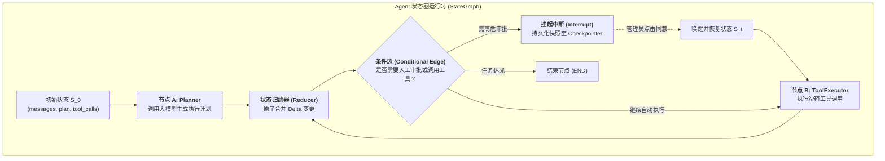

在 2026 年的今天，单纯依赖超大 Prompt 让 LLM "一步到位" 完成复杂任务的时代已经过去。面对多步骤长程推理、外部工具调用与不确定性环境，我们需要的是一个**可控、可恢复、可观测**的 Agent Runtime（智能体运行时）。

早期许多开源实现采用简单的 `while True` 循环或线性链条。在进入真实生产环境后，这种简单架构迅速暴露出三大致命死穴：
1. **状态黑盒与漂移**：变量散落在循环局部作用域中，一旦步骤超过 10 步，无法追踪状态历史，甚至出现目标漂移；
2. **无法原生支持 Human-in-the-loop**：当执行高危操作（如转账、删除数据库、向客户发信）需要人工审批时，线性代码无法优雅“暂停挂起”并在数小时后从断点无缝恢复；
3. **缺乏结构化可观测流**：前端界面只能干等最后一次性返回，无法向用户流式输出思考步骤、工具执行日志与中间产物。

解决这些问题的核心，在于回归计算机科学的经典设计模式：**有限状态机（Finite State Machine, FSM）结合反应式事件流（Event Stream）**。本文将带你从零手搓一个具备工业级特性的轻量级 Agent 框架。关于基础状态机循环设计，可同步参阅 [深入浅出 AI Agent 执行循环与状态机设计](/articles/agent-loop-state-machine/)。

---

## 一、 核心架构：状态机模式与状态归约（Reducer）



### 核心要素定义：
- **State（全局状态）**：唯一的真相源（Single Source of Truth），所有节点只能通过纯函数读取状态；
- **Node（节点）**：执行单元，接收当前 State，返回增量状态变更（Delta）；
- **Reducer（归约器）**：负责将各节点的 Delta 变更原子合并进全局 State（例如将新消息追加至列表，而非粗暴覆盖）；
- **Conditional Edge（条件边）**：基于当前 State 计算下一个目标节点的路由函数；
- **Interrupt（挂起中断）**：遇到需要人工确认的敏感节点时，主动挂起控制流，保存快照并等待外部信号。

---

## 二、 完整可运行代码：手搓轻量级 Agent 框架

以下是一个零重依赖、仅基于 Python 原生异步特性的完整轻量级框架实现：

```python
import asyncio
from typing import Dict, Any, Callable, List, Optional, AsyncGenerator
from dataclasses import dataclass, field
import uuid

# 1. 状态定义与归约函数
def add_messages(existing: List[Dict[str, Any]], new_items: List[Dict[str, Any]]) -> List[Dict[str, Any]]:
    """列表追加归约器"""
    return existing + new_items

class AgentState(dict):
    """全局状态容器，支持字段级归约更新"""
    def __init__(self, *args, **kwargs):
        super().__init__(*args, **kwargs)
        self.setdefault("messages", [])
        self.setdefault("next_step", "")
        self.setdefault("pending_approval", False)

    def apply_delta(self, delta: Dict[str, Any]):
        for key, val in delta.items():
            if key == "messages" and isinstance(val, list):
                self[key] = add_messages(self.get(key, []), val)
            else:
                self[key] = val

# 2. 事件流类型定义
@dataclass
class AgentEvent:
    event_type: str  # "node_start", "token_delta", "tool_result", "interrupted", "completed"
    node_name: str
    payload: Dict[str, Any]
    run_id: str

# 3. 核心状态图执行器
class StateGraph:
    def __init__(self):
        self.nodes: Dict[str, Callable] = {}
        self.edges: Dict[str, str] = {}
        self.conditional_edges: Dict[str, Callable[[AgentState], str]] = {}
        self.entry_point: Optional[str] = None
        self.interrupt_nodes: set = set()
        self.checkpointer: Dict[str, AgentState] = {}  # 简化版内存检查点

    def add_node(self, name: str, func: Callable):
        self.nodes[name] = func

    def set_entry_point(self, name: str):
        self.entry_point = name

    def add_edge(self, from_node: str, to_node: str):
        self.edges[from_node] = to_node

    def add_conditional_edge(self, from_node: str, router_func: Callable[[AgentState], str]):
        self.conditional_edges[from_node] = router_func

    def add_interrupt_before(self, node_name: str):
        """配置需要人工介入暂停的节点"""
        self.interrupt_nodes.add(node_name)

    async def stream(self, state: AgentState, run_id: Optional[str] = None) -> AsyncGenerator[AgentEvent, None]:
        """流式驱动执行，产生细粒度事件流"""
        run_id = run_id or str(uuid.uuid4())
        current_node = self.entry_point
        
        while current_node and current_node != "END":
            # 检查是否命中中断节点（Human-in-the-loop）
            if current_node in self.interrupt_nodes and not state.get("approved", False):
                self.checkpointer[run_id] = state  # 持久化检查点
                yield AgentEvent("interrupted", current_node, {"state": dict(state)}, run_id)
                return

            # 发送节点开始事件
            yield AgentEvent("node_start", current_node, {}, run_id)
            
            # 执行节点业务逻辑
            node_func = self.nodes[current_node]
            delta = await node_func(state) if asyncio.iscoroutinefunction(node_func) else node_func(state)
            
            # 原子归约更新全局状态
            if delta:
                state.apply_delta(delta)
                yield AgentEvent("state_update", current_node, {"delta": delta}, run_id)

            # 计算下一跳路由
            if current_node in self.conditional_edges:
                current_node = self.conditional_edges[current_node](state)
            else:
                current_node = self.edges.get(current_node, "END")

        yield AgentEvent("completed", "END", {"final_state": dict(state)}, run_id)

    async def resume(self, run_id: str, resume_payload: Dict[str, Any]) -> AsyncGenerator[AgentEvent, None]:
        """从挂起的中断检查点恢复执行"""
        if run_id not in self.checkpointer:
            raise ValueError(f"未找到对应的检查点: {run_id}")
        saved_state = self.checkpointer[run_id]
        saved_state.apply_delta(resume_payload)
        saved_state["approved"] = True  # 标记已审批
        async for event in self.stream(saved_state, run_id=run_id):
            yield event
```

---

## 三、 实战演练：构建带安全审批与工具调用的 Agent

我们通过上述手搓的框架，组装一个企业级任务助手：
1. **Planner 节点**：分析意图，决定是否调用退款 API；
2. **审批中断**：退款金额大于 500 元时，触发中断挂起；
3. **Tool 节点**：执行实际退款逻辑；
4. **Responder 节点**：返回最终用户提示。

```python
# 模拟大模型与业务节点实现
async def planner_node(state: AgentState) -> Dict[str, Any]:
    print("[Node: Planner] 分析用户需求...")
    # 模拟模型输出：识别出需要退款 1000 元
    return {
        "messages": [{"role": "assistant", "content": "检测到退款申请：金额 1000 元"}],
        "action": "refund",
        "amount": 1000
    }

def route_planner(state: AgentState) -> str:
    """条件边路由判断"""
    if state.get("action") == "refund" and state.get("amount", 0) > 500:
        return "human_approval"
    return "tool_node"

async def tool_node(state: AgentState) -> Dict[str, Any]:
    print(f"[Node: Tool] 真正执行退款操作，金额: {state['amount']} 元...")
    return {
        "messages": [{"role": "tool", "content": f"退款成功: {state['amount']} 元已原路返还"}],
        "status": "success"
    }

async def responder_node(state: AgentState) -> Dict[str, Any]:
    print("[Node: Responder] 整理最终答复...")
    return {
        "messages": [{"role": "assistant", "content": "您的退款已处理完毕，请查收账户。"}]
    }

# 组装状态机图
workflow = StateGraph()
workflow.add_node("planner", planner_node)
workflow.add_node("human_approval", lambda state: {"pending_approval": True})
workflow.add_node("tool_node", tool_node)
workflow.add_node("responder", responder_node)

workflow.set_entry_point("planner")
workflow.add_conditional_edge("planner", route_planner)
workflow.add_edge("human_approval", "tool_node")
workflow.add_edge("tool_node", "responder")
workflow.add_edge("responder", "END")

# 设置在 human_approval 节点前强制中断
workflow.add_interrupt_before("human_approval")
```

### 运行与唤醒演示：

```python
async def main():
    initial_state = AgentState({"messages": [{"role": "user", "content": "我要退款 1000 元"}]})
    
    print("=== 阶段 1: 首次运行触发审批中断 ===")
    captured_run_id = None
    async for event in workflow.stream(initial_state):
        print(f"收到事件: {event.event_type} | 来自节点: {event.node_name}")
        if event.event_type == "interrupted":
            captured_run_id = event.run_id
            print(f"⚠️ 触发安全审批拦截！任务已挂起，Run ID: {captured_run_id}")
            break

    print("\n=== 阶段 2: 人工在管理后台点击'同意退款'，恢复执行 ===")
    async for event in workflow.resume(captured_run_id, {"approval_decision": "approved"}):
        print(f"收到事件: {event.event_type} | 来自节点: {event.node_name}")
        if event.event_type == "completed":
            print("任务圆满结束，最终上下文:")
            for msg in event.payload["final_state"]["messages"]:
                print(f" - [{msg['role']}]: {msg['content']}")

if __name__ == "__main__":
    asyncio.run(main())
```

---

## 四、 架构权衡：手搓轻量框架 vs 重型 LangGraph

| 维度 | 自研轻量级状态机框架 | 重型框架 (如 LangGraph / CrewAI) |
| :--- | :--- | :--- |
| **代码依赖** | 纯标准库或极简 Pydantic，无外部第三方依赖包 | 捆绑数十个依赖包，版本升级容易冲突破损 |
| **性能开销** | 纯 Python 异步事件驱动，零中间层延迟 | 较厚的框架封装，节点调用链增加额外序列化损耗 |
| **可观测性** | 开发者可对每一处事件派发完全掌控，轻松对接私有可观测系统 | 强依赖其自家的商业化云端追踪平台 |
| **维护门槛** | 200 行核心代码，团队任何工程师皆可通读并定制魔改 | 复杂概念繁多（如 Pregel 算法模型），排障成本高 |

在实际工程落地中，工具边界与错误自愈可配合 [Agent 开发中的 Tool Use 进阶：动态发现、沙箱隔离与错误恢复](/articles/advanced-agent-tool-use-and-function-calling/)，若业务进一步扩展为多个独立运行的智能体集群，则可继续演进至 [多 Agent 协作系统中的通信协议与并发控制实践](/articles/multi-agent-collaboration-and-concurrency/)。

---

## 常见问题 (FAQ)

### Q1: 与直接引入 LangGraph 相比，在什么业务场景下应该优先选择自研轻量级 Agent 框架？
当业务面临以下三种情况时优先自研：1）**极度严苛的安全与审计环境**（如金融银行、政企内网，严格限制开源依赖树深度，要求每一行运行时代码均可审计）；2）**极致低延迟的边缘或微服务环境**（例如需要在高并发网关内以微秒级耗时驱动状态流转，承受不起重量级抽象的开销）；3）**高度定制化的持久化方案**（企业已有专有的分布式数据库事务机制，需要将 Agent 快照与现有业务事务绑定在一个原子 Commit 中提交）。

### Q2: 在事件流（Event Stream）驱动架构中，如何保证高并发下状态更新的原子性与无竞争？
在单实例内部，应当通过集中式的 Reducer 管道（如上述代码中的 `apply_delta`）配合 Python `asyncio` 的协作式单线程事件循环执行状态合并，天然避免线程锁竞争；在多节点分布式部署时，必须结合外部分布式存储（如 Redis 或 PostgreSQL）的**乐观并发控制（OCC, Optimistic Concurrency Control）**，在状态记录中附加自增版本号 `version`，提交时通过 `UPDATE state WHERE version = old_version` 保证原子性。

### Q3: 生产环境下 Human-in-the-loop（人类介入审批）长事务如何防止数据丢失？
绝不能将检查点仅保存在内存中。在触发 `interrupted` 事件前，框架必须将包含完整当前状态、待审批参数、以及全局调用链 ID 的序列化快照写入持久化数据库（如 PostgreSQL）。即使负责编排的 Worker 容器发生物理重启或节点迁移，管理员在 Web 后端点击审批通过后，任何健康的 Worker 都可以通过 `Run_ID` 从数据库重新水合（Rehydrate）出状态机，继续向下派发任务。
