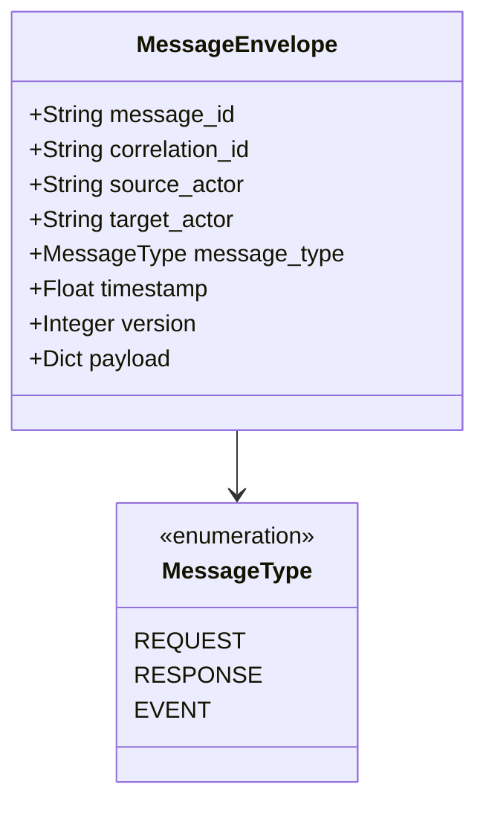
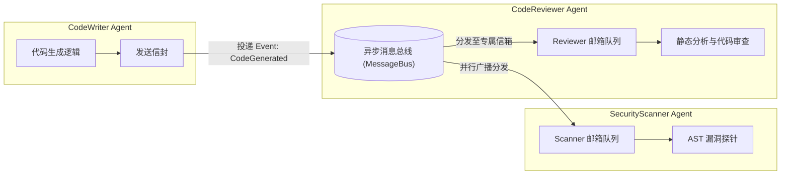

在 2026 年，解决极其复杂的企业级任务（例如全自动代码库重构、端到端研报编写与交叉审计）早已不是单一全能模型所能胜任的。随之而来的是 **Multi-Agent（多智能体）架构**的全面爆发。

早期很多多智能体框架（如简单的 GroupChat）采用的是**“全员共享记忆”**模式——所有 Agent 围坐在一张桌子前，把所有人说的话以一个巨大的全局 List 维护，轮流发言。这种方案在并发规模扩大后迅速崩溃：
- **上下文爆炸（Context Explosion）**：每个微型 Agent 都被迫读取与自身专业毫无关系的数十万字杂音日志；
- **执行严重串行阻塞**：一个 Agent 在思考或等待工具返回时，其余所有 Agent 全部闲置等待，无法发挥现代异步并发的算力吞吐；
- **并发写冲突**：当多个 Agent 同时尝试修改同一个文档或同一个代码仓库分支时，后写的状态无情覆盖先写的成果，导致系统进入不可逆的脏状态。

彻底攻克这一难题的武器，来自分布式系统领域历经数十年实战检验的经典模式：**Actor 模型（Actor Model）结合结构化消息通信协议**。本文将深入解构企业级 Multi-Agent 系统的通信契约与并发治理方案。关于单体 Agent 的状态机实现，可参阅 [从零手搓轻量级 Agent 框架：基于状态机与事件流的设计模式](/articles/build-lightweight-agent-framework/)。

---

## 一、 通信契约：标准化消息信封（Message Envelope）

在 Actor 模型中，Agent 之间**绝对不共享内存状态，所有协作均通过不可变的消息传递（Message Passing）完成**。

为了确保异构 Agent、不同语言编写的外部工具、以及分布式消息代理之间能够严格互联，必须定义严谨的通信协议信封：



### 1.1 协议规范与数据类实现

```python
import time
import uuid
from enum import Enum
from typing import Dict, Any, Optional
from dataclasses import dataclass, field, asdict
import json

class MessageType(str, Enum):
    REQUEST = "request"      # 点对点请求，期待下游回应
    RESPONSE = "response"    # 针对特定 request 的响应
    EVENT = "event"          # 单向广播事件，无需等待响应

@dataclass(frozen=True)
class MessageEnvelope:
    """企业级多智能体通信协议信封 (符合 CloudEvents 思想)"""
    message_id: str = field(default_factory=lambda: str(uuid.uuid4()))
    source_actor: str = ""
    target_actor: str = ""   # 广播事件时可为 "broadcast" 或 Topic 名
    message_type: MessageType = MessageType.REQUEST
    correlation_id: str = "" # 用于端到端追踪同一调用链路
    timestamp: float = field(default_factory=time.time)
    version: int = 1         # 乐观并发版本控制
    payload: Dict[str, Any] = field(default_factory=dict)

    def to_json(self) -> str:
        data = asdict(self)
        data["message_type"] = self.message_type.value
        return json.dumps(data)

    @classmethod
    def from_json(cls, json_str: str) -> "MessageEnvelope":
        raw = json.loads(json_str)
        raw["message_type"] = MessageType(raw["message_type"])
        return cls(**raw)
```

---

## 二、 异步消息总线与 Actor 邮箱实现

每个 Agent 作为一个独立的 Actor，内部维护一个专有的**私有邮箱（Mailbox）**。外部通信由中央**异步消息总线（Message Bus）**统一路由：



### 2.1 生产级异步消息总线与基类 Actor 代码实现

```python
import asyncio
from typing import Dict, Callable, Awaitable

class MessageBus:
    """支持点对点路由与 Topic 广播的异步消息中枢"""
    def __init__(self):
        self.actor_mailboxes: Dict[str, asyncio.Queue] = {}
        self.subscriptions: Dict[str, List[str]] = {}  # topic -> [actor_ids]

    def register_actor(self, actor_id: str) -> asyncio.Queue:
        mailbox = asyncio.Queue(maxsize=100) # 限制信箱深度，防止内存溢出
        self.actor_mailboxes[actor_id] = mailbox
        return mailbox

    def subscribe(self, topic: str, actor_id: str):
        self.subscriptions.setdefault(topic, []).append(actor_id)

    async def send(self, envelope: MessageEnvelope):
        """精准投递至目标 Actor"""
        if envelope.target_actor in self.actor_mailboxes:
            await self.actor_mailboxes[envelope.target_actor].put(envelope)
        else:
            raise ValueError(f"目标 Actor [{envelope.target_actor}] 不存在或已离线")

    async def publish(self, topic: str, envelope: MessageEnvelope):
        """按 Topic 并发广播"""
        subscribers = self.subscriptions.get(topic, [])
        tasks = []
        for actor_id in subscribers:
            if actor_id in self.actor_mailboxes:
                tasks.append(self.actor_mailboxes[actor_id].put(envelope))
        if tasks:
            await asyncio.gather(*tasks)

class BaseActor:
    """Actor 基类：独立轮询私有邮箱，零共享内存"""
    def __init__(self, actor_id: str, bus: MessageBus):
        self.actor_id = actor_id
        self.bus = bus
        self.mailbox = bus.register_actor(actor_id)
        self._running = False

    async def start(self):
        self._running = True
        asyncio.create_task(self._event_loop())

    async def stop(self):
        self._running = False

    async def _event_loop(self):
        while self._running:
            try:
                # 阻塞从私有邮箱获取消息
                envelope: MessageEnvelope = await self.mailbox.get()
                await self.on_message(envelope)
                self.mailbox.task_done()
            except asyncio.CancelledError:
                break
            except Exception as e:
                print(f"[Actor: {self.actor_id}] 消息处理异常: {str(e)}")

    async def on_message(self, envelope: MessageEnvelope):
        raise NotImplementedError
```

---

## 三、 并发冲突解决实战：状态竞争与令牌桶背压

### 3.1 冲突场景一：共享资源竞争（通过乐观锁版本控制解决）

当 "DocWriter" 与 "Reviewer" 两个 Agent 同时尝试将修改写回同一份文档状态时，极易发生“覆盖丢失”问题。

**解决方案：基于版本号的 CAS（Compare-And-Swap）乐观锁**：

```python
class ConcurrentDocumentStore:
    """基于乐观并发控制 (OCC) 的文档版本仓库"""
    def __init__(self):
        self._content = ""
        self._version = 1
        self._lock = asyncio.Lock()

    async def get_document(self) -> Dict[str, Any]:
        async with self._lock:
            return {"content": self._content, "version": self._version}

    async def update_document(self, new_content: str, expected_version: int, author: str) -> bool:
        async with self._lock:
            # 检查版本号是否一致 (CAS 检查)
            if self._version != expected_version:
                print(f"[冲突拦截] {author} 提交被拒绝！当前版本 {self._version} 已被更新，预期版本为 {expected_version}")
                return False
            
            # 版本一致，安全写入并递增版本号
            self._content = new_content
            self._version += 1
            print(f"[写入成功] {author} 成功提交版本 {self._version}")
            return True
```

### 3.2 冲突场景二：下游吞吐瓶颈与 API 429（通过令牌桶背压治理）

在多 Agent 高并发场景下，多个 Agent 同时调用昂贵的底层 LLM API，瞬间并发可能达到每秒数百次，极易触发云厂商的 `429 Too Many Requests` 限流报错。

**解决方案：在消息总线层植入带背压（Backpressure）的令牌桶限流器**：

```python
class TokenBucketRateLimiter:
    """用于平滑控制下游 API 调用的令牌桶背压控制器"""
    def __init__(self, capacity: int, refill_rate_per_sec: float):
        self.capacity = capacity
        self.refill_rate = refill_rate_per_sec
        self.tokens = float(capacity)
        self.last_refill = time.time()
        self._lock = asyncio.Lock()

    async def acquire(self, tokens_needed: int = 1):
        """阻塞申请令牌，实现硬件级平滑限流"""
        while True:
            async with self._lock:
                now = time.time()
                elapsed = now - self.last_refill
                # 补充新令牌
                self.tokens = min(self.capacity, self.tokens + elapsed * self.refill_rate)
                self.last_refill = now

                if self.tokens >= tokens_needed:
                    self.tokens -= tokens_needed
                    return
            # 令牌不足，背压挂起 50ms 重新探测
            await asyncio.sleep(0.05)
```

---

## 四、 协同实战：三 Agent 并行流水线

我们通过上述基础设施搭建一个协同系统：
1. **DeveloperAgent**：负责生成代码，通过 `publish("code_events")` 发出事件；
2. **ReviewerAgent**：订阅 `code_events`，并行进行代码风格审查；
3. **SecurityAgent**：订阅 `code_events`，并行进行安全扫描；
4. 二者均通过且经过文档仓库的 CAS 乐观锁校验后，代码正式合入。

```python
class DeveloperAgent(BaseActor):
    async def on_message(self, envelope: MessageEnvelope):
        if envelope.message_type == MessageType.REQUEST:
            print("[Developer] 开始编写代码...")
            await asyncio.sleep(0.1) # 模拟推理生成
            code_payload = {"filename": "auth.py", "code": "def login(): pass"}
            event = MessageEnvelope(
                source_actor=self.actor_id,
                target_actor="broadcast",
                message_type=MessageType.EVENT,
                correlation_id=envelope.correlation_id,
                payload=code_payload
            )
            # 广播代码生成事件
            await self.bus.publish("code_events", event)

class ReviewerAgent(BaseActor):
    async def on_message(self, envelope: MessageEnvelope):
        print(f"[Reviewer] 收到来自 {envelope.source_actor} 的代码，正在执行规范审查...")

class SecurityAgent(BaseActor):
    async def on_message(self, envelope: MessageEnvelope):
        print(f"[Security] 收到来自 {envelope.source_actor} 的代码，正在执行静态漏洞扫描...")

async def run_collaboration():
    bus = MessageBus()
    dev = DeveloperAgent("dev_agent", bus)
    rev = ReviewerAgent("rev_agent", bus)
    sec = SecurityAgent("sec_agent", bus)

    # 注册订阅
    bus.subscribe("code_events", "rev_agent")
    bus.subscribe("code_events", "sec_agent")

    await dev.start()
    await rev.start()
    await sec.start()

    # 触发首个任务
    start_req = MessageEnvelope(
        source_actor="user",
        target_actor="dev_agent",
        message_type=MessageType.REQUEST,
        correlation_id="task_001",
        payload={"task": "实现用户鉴权模块"}
    )
    await bus.send(start_req)
    await asyncio.sleep(0.5)

    await dev.stop()
    await rev.stop()
    await sec.stop()

if __name__ == "__main__":
    asyncio.run(run_collaboration())
```

---

## 五、 企业级架构对比矩阵

| 维度 | 传统共享内存 GroupChat | 2026 Actor 消息协议架构 |
| :--- | :--- | :--- |
| **通信机制** | 共享全量消息列表（广播风暴） | 结构化信封 + 目标 Actor 私有邮箱 |
| **并发能力** | 严格串行单步执行 | 全链路异步非阻塞并发 |
| **状态竞争** | 后执行者盲目覆盖数据（脏写） | CAS 乐观锁 + 版本控制强校验 |
| **流量抗压** | 极易并发打爆引发 API 429 报错 | 令牌桶背压控制器平滑调度 |
| **容错隔离** | 单个 Agent 崩溃导致全系统卡死 | 邮箱故障隔离，单点崩溃不影响总线 |

有关单智能体内部如何利用状态机组织节点，请参考 [从零手搓轻量级 Agent 框架：基于状态机与事件流的设计模式](/articles/build-lightweight-agent-framework/)；在执行外部操作时保障安全隔离，可参阅 [Agent 开发中的 Tool Use 进阶：动态发现、沙箱隔离与错误恢复](/articles/advanced-agent-tool-use-and-function-calling/)。

---

## 常见问题 (FAQ)

### Q1: 在 Multi-Agent 架构中，如何判定何时使用点对点请求（Request-Response），何时使用发布订阅（Pub-Sub）？
核心判定准则在于**上下游的耦合度与关注点分离**：
- **使用 Request-Response**：当调用方明确依赖被调用方的单次确定性输出才能进行后续决策时（例如：Supervisor 必须获得 SQL 编写 Agent 的查询语句，才能决定是否放行给数据库），应当使用携带 `correlation_id` 的点对点请求并等待响应；
- **使用 Pub-Sub（发布-订阅）**：当某一阶段成果产出后，会有多个独立职能的下游并行消费该成果（例如：新代码生成后，评审 Agent、安全 Agent、单元测试生成 Agent 需要同时并发介入），且发布方无需感知有多少订阅者存在时，坚决采用事件主题广播。

### Q2: 多个 Agent 并发读写共享资源（如代码仓库分支、共享文档）时，乐观锁与悲观锁该如何抉择？
在 AI Agent 系统中，**90% 的场景应当优先选择乐观锁（OCC, 附加版本号）**。因为大模型的推理延迟通常在数秒级别，如果使用互斥悲观锁（Pessimistic Lock），锁的持有时间会被严重拉长，极易引发死锁与全集群积压。只有在低延迟、高竞争且冲突率超过 30% 的绝对高频资源争抢场景下（例如特定热点库存计数扣减），才考虑引入基于 Redis 的分布式短期悲观锁。

### Q3: 面对极端突发并发任务时，如何防止下游慢速 Agent 的邮箱队列积压（Bufferbloat）导致系统崩溃？
必须在 Actor 邮箱层实施**显式背压（Backpressure）机制**：1）**邮箱队列容量上限（Bounded Queue）**：如上述代码所示，将 `asyncio.Queue` 显式设置为 `maxsize=100`；2）**溢出策略（Rejection Policy）**：当邮箱打满时，消息总线拒绝写入并向上游派发 `BackpressureWarningEvent`，通知调度层放缓任务分发，或动态横向拉起新的同类 Agent Worker 副本实现负载均摊。
